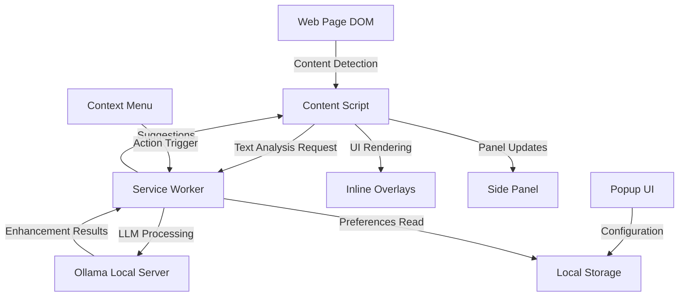
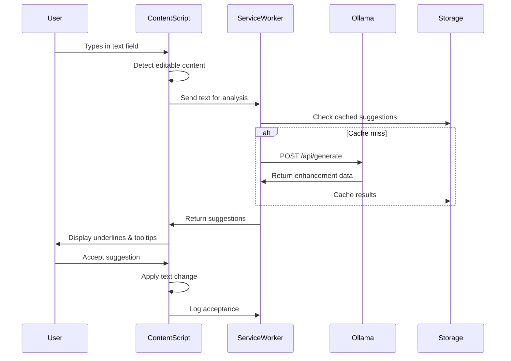
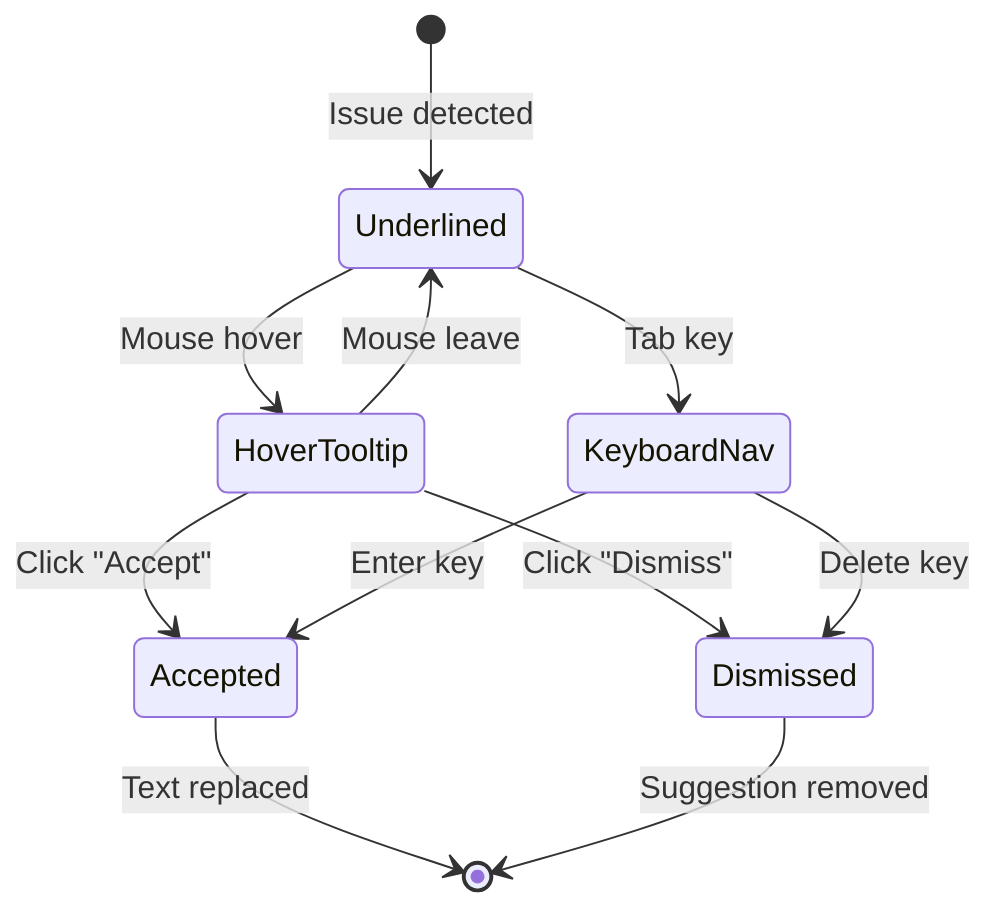
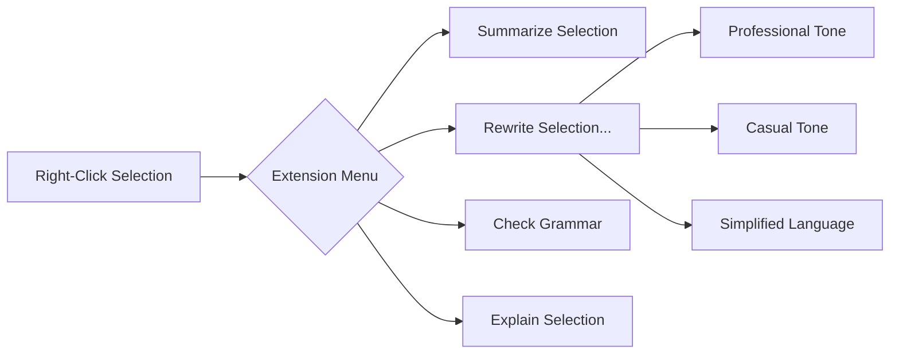
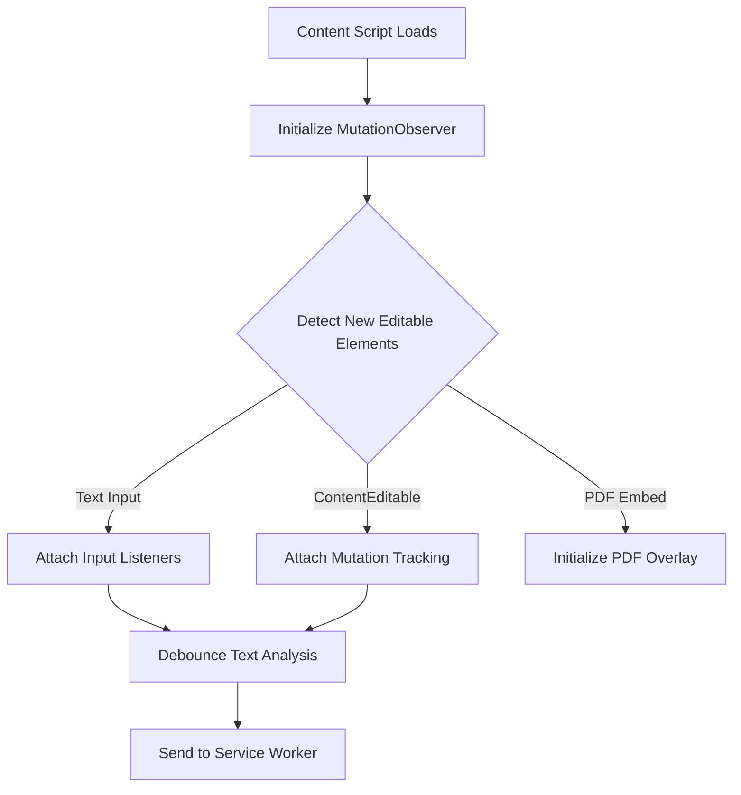
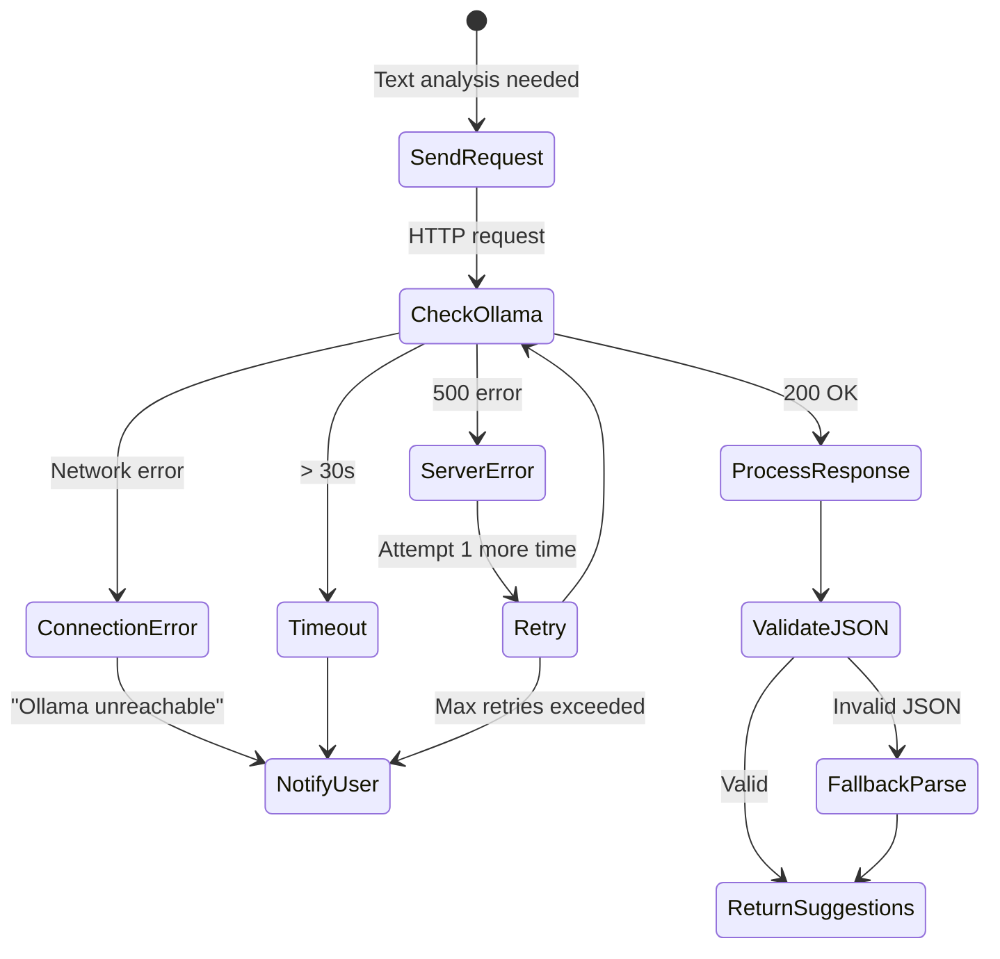
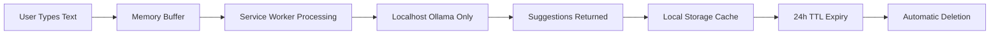

# Chrome Extension Design: Intelligent Inline Document Enhancement with Local LLM

## 1. Vision & Objectives

### 1.1 Purpose
Develop a privacy-first Chrome extension that provides intelligent text enhancement, grammar checking, and content analysis capabilities by exclusively leveraging local LLM processing through Ollama, ensuring zero data transmission beyond the user's device.

### 1.2 Core Objectives
- Deliver inline text enhancement with visual feedback comparable to commercial solutions while maintaining complete data privacy
- Enable comprehensive content analysis, summarization, and rewriting across diverse web contexts
- Provide seamless integration with local LLM infrastructure without compromising user experience
- Ensure accessibility and usability across diverse user needs and technical proficiencies

### 1.3 Key Success Criteria
- All processing occurs locally via Ollama API on localhost:11434
- Zero external data transmission under any circumstance
- Functional parity with major text enhancement tools for core features
- Graceful degradation when local LLM is unavailable
- Accessible interface meeting WCAG 2.1 AA standards

## 2. System Architecture

### 2.1 High-Level Component Overview

The extension architecture follows Chrome's Manifest V3 requirements with clear separation of concerns:

**Component Interaction Flow:**



### 2.2 Component Responsibilities

| Component | Primary Responsibilities | Key Interactions |
|-----------|-------------------------|------------------|
| **Content Script** | DOM monitoring, text field detection, underline injection, tooltip rendering, user interaction capture | Communicates with Service Worker for processing; manipulates DOM for visual feedback |
| **Service Worker** | Request orchestration, Ollama API communication, caching logic, error handling, context menu management | Receives requests from Content Scripts; sends text to Ollama; returns structured suggestions |
| **Side Panel** | Persistent analysis dashboard, readability metrics, suggestion history, batch action controls | Receives updates from Service Worker; sends user actions back to Content Scripts |
| **Popup UI** | Quick settings, model selection, feature toggles, site-specific controls | Reads/writes to Local Storage; communicates preferences to Service Worker |
| **Local Storage** | User preferences, allowlist/denylist, model configurations, cached suggestions | Accessed by all components for state persistence |

### 2.3 Data Flow Architecture

**Text Enhancement Flow:**



## 3. Feature Specifications

### 3.1 Inline Text Enhancement

**Detection Strategy:**
- Monitor all contentEditable elements, textarea, and input fields through MutationObserver
- Debounced text analysis triggered 500ms after user stops typing
- Real-time DOM tracking for dynamic content (SPA frameworks, lazy-loaded sections)

**Visual Feedback System:**

| Issue Type | Underline Color | Tooltip Header | Priority |
|------------|----------------|----------------|----------|
| Grammar Error | Red (#E53E3E) | Grammar | High |
| Clarity Issue | Blue (#3182CE) | Clarity | Medium |
| Tone Suggestion | Green (#38A169) | Tone | Low |
| Style Enhancement | Purple (#805AD5) | Style | Low |

**Suggestion Structure:**

Each suggestion contains:
- **Position**: Character offset start and end within the text
- **Type**: One of the four issue categories
- **Original**: The text segment flagged
- **Replacement**: Proposed correction
- **Explanation**: Plain language rationale (max 120 characters)
- **Confidence**: LLM confidence score (0.0-1.0)

**User Interaction Model:**



**Batch Operations:**
- "Accept All" button appears when 3+ suggestions exist in a field
- Applies suggestions sequentially from start to end of document to maintain offset accuracy
- Confirmation dialog if batch includes high-impact changes (50+ character modifications)

### 3.2 Side Panel Integration

**Panel Layout Structure:**

| Section | Content | Update Frequency |
|---------|---------|------------------|
| **Overview Card** | Current page analysis status, active field word count, estimated reading time | On field focus change |
| **Metrics Dashboard** | Readability score (Flesch-Kincaid), avg sentence length, passive voice %, complex word density | On analysis complete |
| **Suggestions List** | Scrollable list of all active suggestions grouped by type with inline accept/dismiss actions | Real-time as detected |
| **History Log** | Last 20 accepted/dismissed suggestions with timestamps and before/after preview | On user action |
| **Quick Actions** | Summarize current selection, Rewrite with tone options, Simplify language | Context-sensitive |

**State Management:**
- Panel maintains connection with active tab's content script
- Survives tab switches; displays "No active analysis" when not applicable
- Settings toggle to pin panel open or auto-collapse

### 3.3 Summarization & Rewriting

**Trigger Mechanisms:**
1. User highlights text → Context menu appears with options
2. Right-click selected text → "Summarize" or "Rewrite" in menu
3. Side panel Quick Actions when text is selected

**Rewrite Options:**

| Tone Option | LLM Prompt Modifier | Use Case |
|-------------|---------------------|----------|
| Professional | "Rewrite in formal business tone" | Emails, reports |
| Casual | "Rewrite in conversational friendly tone" | Social media, informal docs |
| Concise | "Reduce verbosity while preserving meaning" | Editing long text |
| Elaborate | "Expand with additional detail and examples" | Content development |
| Simplified | "Rewrite at 8th grade reading level" | Accessibility |

**Summarization Behavior:**
- For text selections: Generate 2-3 sentence summary retaining key points
- For YouTube transcripts: Extract from auto-generated captions via DOM parsing; produce timestamped bullet points
- For embedded PDFs: Attempt text extraction via content script; fallback to desktop app prompt if sandboxed

**Output Presentation:**
- Results appear in modal overlay with side-by-side original/processed view
- Copy to clipboard and insert into field actions
- Regenerate option with different parameters

### 3.4 Context Menu Integration

**Menu Items:**



**Conditional Display:**
- Menu items only appear when text is selected (1+ characters)
- "Summarize" requires minimum 100 characters
- "Rewrite" options appear as nested submenu
- Disabled state with tooltip if Ollama is unreachable

### 3.5 PDF & Rich Document Handling

**Detection Strategy:**
- Identify embedded PDF viewers via iframe source patterns (.pdf extension, PDF MIME type headers)
- Detect common PDF.js implementations and browser native viewers
- Monitor for PDF annotation layers and selectable text regions

**Interaction Approach:**

| PDF Context | Capability | Implementation Strategy |
|-------------|------------|-------------------------|
| Browser-native viewer | Selection-based actions | Inject content script into PDF viewer context; listen for text selection events |
| Embedded iframe PDF | Limited overlay support | Attempt cross-origin message passing; fallback to "Open in Desktop" button |
| PDF.js implementations | Full support | Hook into text layer rendering; apply standard suggestion overlays |
| Sandboxed/restricted CSP | No injection possible | Display non-intrusive banner with "Analyze in Desktop App" option |

**Graceful Degradation:**
- When content script injection fails, display subtle notification suggesting desktop workflow
- Provide copy-paste bridge: User copies PDF text → Pastes in side panel text area → Analyzes there

### 3.6 YouTube Transcript Processing

**Transcript Extraction:**
- Detect YouTube video pages via URL pattern matching
- Access transcript via YouTube's built-in transcript panel DOM structure
- Parse timestamped segments into structured data

**Processing Options:**
- Full video summary with key points
- Time-segmented breakdown by topic
- Extract action items or key quotes

## 4. Chrome Extension Architecture

### 4.1 Manifest V3 Configuration

**Required Permissions:**

| Permission | Justification | Scope |
|------------|---------------|-------|
| `activeTab` | Access current tab's DOM for content injection | Only when user invokes extension |
| `scripting` | Dynamic content script injection for detected contexts | Programmatic injection only |
| `contextMenus` | Right-click menu integration | Extension-specific items |
| `storage` | Persist user preferences and cache | Local storage only, no sync |
| `sidePanel` | Side panel API access | Chrome 114+ feature |

**Host Permissions:**
- `http://localhost:11434/*` - Ollama API communication
- No wildcard host permissions; rely on activeTab for web content

**Content Security Policy:**
- Must not eval() or use unsafe-inline
- All LLM responses sanitized before DOM insertion to prevent XSS

### 4.2 Content Script Strategy

**Injection Timing:**
- Automatic injection on document_idle for common sites
- Programmatic injection via scripting API when user activates extension on new site
- Separate content scripts for:
  - Standard web pages (main content script)
  - PDF viewers (specialized PDF handler)
  - Video platforms (transcript extractor)

**DOM Monitoring:**



**Isolation & Performance:**
- Run content scripts in isolated world to avoid conflicts with page scripts
- Lazy-load heavy processing; initial injection < 50KB
- Use Intersection Observer to analyze only visible text regions on long pages

### 4.3 Service Worker Design

**Core Responsibilities:**

**Request Queue Management:**
- Maintain FIFO queue for LLM requests to prevent overwhelming localhost server
- Maximum 2 concurrent requests to Ollama
- Request timeout of 30 seconds with user notification

**Ollama API Integration:**

| Endpoint | Purpose | Request Structure |
|----------|---------|-------------------|
| POST /api/generate | Text analysis & suggestions | `{model: "qwen2.5:1.5b", prompt: <constructed_prompt>, stream: false}` |
| POST /api/generate | Summarization | `{model: <user_selected>, prompt: <summary_prompt>, stream: false}` |
| POST /api/generate | Rewriting | `{model: <user_selected>, prompt: <rewrite_prompt>, stream: false, temperature: 0.7}` |
| GET /api/tags | Model availability check | Health check on extension startup |

**Prompt Engineering Strategy:**

For grammar/style detection:
- Structured prompt requesting JSON output with detected issues
- Example format: "Analyze the following text for grammar, clarity, style, and tone issues. Return JSON array with structure: [{type, start, end, original, replacement, explanation, confidence}]"
- Fallback parsing if LLM returns non-JSON with regex extraction

**Caching Layer:**
- SHA-256 hash of input text as cache key
- Store suggestions in local storage with 24-hour TTL
- Cache invalidation on model change or settings update
- Maximum cache size: 10MB (auto-prune oldest entries)

**Error Handling:**



### 4.4 Popup & Side Panel UI

**Popup Interface (Quick Access):**

| UI Element | Purpose | Interaction |
|------------|---------|-------------|
| Power toggle | Enable/disable extension for current site | Immediate effect; adds to denylist |
| Model selector dropdown | Choose active Ollama model | Updates service worker config |
| Feature checkboxes | Toggle inline checking, summarization, etc. | Persists to local storage |
| Settings button | Open full settings page | New tab navigation |
| Status indicator | Ollama connection health | Green/Red/Yellow status dot |

**Side Panel Structure:**

Persistent panel docked to browser edge with:
- Collapsible sections for metrics, suggestions, history
- Responsive width (300px default, 250-500px adjustable)
- Dark mode support following browser/OS preference
- Keyboard shortcuts for common actions (documented in panel footer)

**Settings Page (Full Configuration):**

Categories:
1. **General**: Language preferences, auto-update toggles
2. **Models**: Installed Ollama models, default selections per task type
3. **Privacy**: Site allowlist/denylist, auto-disable domains (banking, medical)
4. **Appearance**: Underline colors, tooltip styling, panel layout
5. **Accessibility**: Keyboard shortcut customization, screen reader optimizations
6. **Advanced**: Cache management, debug logging toggle

## 5. Privacy & Security Architecture

### 5.1 Data Processing Constraints

**Absolute Privacy Rules:**
- No network requests to any domain except localhost:11434
- No telemetry, analytics, or usage tracking
- No cloud synchronization of user content or suggestions
- All processing happens in browser memory or local storage

**Data Lifecycle:**



### 5.2 Ollama Unavailability Handling

**Detection Strategy:**
- Health check on extension startup (GET /api/tags)
- Subsequent health checks every 5 minutes when inactive
- Immediate retry on user-triggered action failure

**User Notification Flow:**

| Scenario | Notification Type | Message | Action |
|----------|------------------|---------|--------|
| Ollama never connected | Persistent banner in popup | "Ollama is not running. Start Ollama to enable features." | Link to Ollama download/docs |
| Ollama disconnected mid-session | Toast notification | "Lost connection to Ollama. Retrying..." | Auto-retry 3 times |
| Model not found | Error modal | "Selected model '{name}' not found. Please pull it in Ollama." | Model selection guidance |
| Request timeout | Inline message | "Analysis taking longer than expected. Check Ollama status." | Cancel/retry options |

**Graceful Feature Degradation:**
- Disable inline checking when Ollama unavailable
- Show cached suggestions from previous sessions if available
- All UI elements show disabled state with explanatory tooltips

### 5.3 Sensitive Domain Protection

**Auto-Disable List:**

Patterns that trigger automatic extension disabling:
- `*://*/bank*`, `*://*.bank/*`
- `*://*/medical/*`, `*://health.*/*`
- `*://*.gov/tax*`, `*://*.gov/ssn*`
- Financial service domains (configurable list)
- Healthcare portals (configurable list)

**User Override:**
- User can manually enable on sensitive domains via popup toggle
- Warning modal: "This site may contain sensitive information. Ensure your local LLM is trusted."
- Requires confirmation checkbox before activation

### 5.4 Content Security

**Input Sanitization:**
- All text from web pages sanitized before sending to Ollama to strip executable code
- LLM responses parsed and validated before DOM insertion
- HTML entities encoded to prevent XSS

**Isolation:**
- Content scripts isolated from page JavaScript context
- postMessage communication validated with origin checks
- No eval() or Function() constructor usage anywhere in codebase

## 6. Accessibility & User Experience

### 6.1 Accessibility Standards

**WCAG 2.1 AA Compliance:**

| Requirement | Implementation |
|-------------|----------------|
| Keyboard Navigation | All interactive elements reachable via Tab; custom shortcuts for power users |
| Screen Reader Support | ARIA labels on all controls; live regions for dynamic suggestion updates |
| Color Contrast | Minimum 4.5:1 contrast ratio for all text; underlines supplemented with icons |
| Focus Indicators | Clear 2px outline on all focused elements; skip links for long suggestion lists |
| Text Scaling | UI remains functional at 200% zoom; no fixed pixel font sizes |

**Keyboard Shortcuts:**

| Shortcut | Action | Context |
|----------|--------|---------|
| `Tab` | Navigate to next suggestion | When text field focused |
| `Shift+Tab` | Navigate to previous suggestion | When text field focused |
| `Enter` | Accept focused suggestion | When suggestion tooltip focused |
| `Delete` | Dismiss focused suggestion | When suggestion tooltip focused |
| `Ctrl+Shift+S` | Open side panel | Global (when extension enabled) |
| `Ctrl+Shift+D` | Toggle extension on/off | Global |
| `Escape` | Close current tooltip/modal | Any overlay |

### 6.2 Responsive Design

**Popup UI:**
- Fixed 400px width, variable height (max 600px)
- Mobile-style layout for narrow browser windows
- Touch-friendly 44px minimum tap targets

**Side Panel:**
- Adaptive width 250-500px based on user drag
- Collapsible sections to manage vertical space
- Sticky header with controls always accessible

**Tooltips:**
- Smart positioning to avoid viewport edges
- Flip above/below underline based on available space
- Maximum width 320px with automatic text wrapping

### 6.3 Performance Targets

| Metric | Target | Rationale |
|--------|--------|-----------|
| Content script injection | < 100ms | Avoid perceivable page load delay |
| First suggestion appearance | < 2s after typing stops | Maintain feeling of real-time feedback |
| Suggestion application | < 50ms | Instant visual feedback |
| Side panel render | < 200ms | Smooth panel opening experience |
| Memory footprint | < 50MB per tab | Prevent browser slowdown |
| Ollama request latency | < 5s | User tolerance threshold for AI processing |

**Optimization Strategies:**
- Debounced analysis (500ms) to reduce redundant requests
- Virtual scrolling for long suggestion lists
- Lazy-load side panel components until first opened
- Web Worker consideration for heavy text parsing (if needed)

### 6.4 Multi-Site Compatibility

**Targeted Testing Sites:**

| Category | Example Sites | Specific Challenges |
|----------|---------------|---------------------|
| Rich Text Editors | Google Docs, Notion, WordPress | Complex contentEditable with custom rendering |
| Email Clients | Gmail, Outlook Web | Dynamic DOM updates, iframe isolation |
| Code Editors | GitHub, CodePen | Avoid false positives on code syntax |
| Forms | LinkedIn, Facebook | Multiple field types, AJAX submissions |
| PDF Viewers | Browser PDF viewer, PDF.js sites | Limited DOM access, selection tracking |

**Compatibility Approach:**
- Site-specific content script variants for known problematic implementations
- Feature detection over user-agent sniffing
- Fallback to basic text extraction when rich integration fails

## 7. Configuration & Extensibility

### 7.1 User Preferences Schema

**Storage Structure:**

| Preference Key | Type | Default Value | Description |
|----------------|------|---------------|-------------|
| `enabled` | boolean | true | Global extension enable/disable |
| `deniedSites` | array[string] | [] | User-blocked domains |
| `allowedSites` | array[string] | [] | Explicitly allowed domains (overrides auto-disable) |
| `defaultModel` | string | "qwen2.5:1.5b" | Model for grammar/style checking |
| `summaryModel` | string | "qwen2.5:1.5b" | Model for summarization tasks |
| `rewriteModel` | string | "qwen2.5:1.5b" | Model for rewriting tasks |
| `underlineColors` | object | {grammar: "#E53E3E", ...} | Color scheme customization |
| `autoCheck` | boolean | true | Automatic inline checking on typing |
| `showMetrics` | boolean | true | Display readability metrics in panel |
| `keyboardShortcuts` | object | {togglePanel: "Ctrl+Shift+S", ...} | Custom shortcut mappings |
| `cacheEnabled` | boolean | true | Enable suggestion caching |
| `darkMode` | string | "auto" | "auto", "light", or "dark" |

### 7.2 Model Selection

**Model Discovery:**
- Query Ollama `/api/tags` on settings page load
- Display installed models with metadata (size, family)
- Recommended models section with pull instructions for uninstalled

**Per-Task Model Assignment:**
- Users can assign different models for checking, summarization, and rewriting
- Guidance: Smaller models (1.5B) for speed, larger (7B+) for quality
- Quick-switch in popup for temporary model changes

### 7.3 Site-Specific Rules

**Allowlist/Denylist Management:**

```mermaid
stateDiagram-v2
    [*] --> CheckSite: User visits page
    CheckSite --> AutoDisable: Matches# Chrome Extension Design: Intelligent Inline Document Enhancement with Local LLM

## 1. Vision & Objectives

### 1.1 Purpose
Develop a privacy-first Chrome extension that provides intelligent text enhancement, grammar checking, and content analysis capabilities by exclusively leveraging local LLM processing through Ollama, ensuring zero data transmission beyond the user's device.

### 1.2 Core Objectives
- Deliver inline text enhancement with visual feedback comparable to commercial solutions while maintaining complete data privacy
- Enable comprehensive content analysis, summarization, and rewriting across diverse web contexts
- Provide seamless integration with local LLM infrastructure without compromising user experience
- Ensure accessibility and usability across diverse user needs and technical proficiencies

### 1.3 Key Success Criteria
- All processing occurs locally via Ollama API on localhost:11434
- Zero external data transmission under any circumstance
- Functional parity with major text enhancement tools for core features
- Graceful degradation when local LLM is unavailable
- Accessible interface meeting WCAG 2.1 AA standards

## 2. System Architecture

### 2.1 High-Level Component Overview

The extension architecture follows Chrome's Manifest V3 requirements with clear separation of concerns:

**Component Interaction Flow:**

```mermaid
graph TB
    A[Web Page DOM] -->|Content Detection| B[Content Script]
    B -->|Text Analysis Request| C[Service Worker]
    C -->|LLM Processing| D[Ollama Local Server]
    D -->|Enhancement Results| C
    C -->|Suggestions| B
    B -->|UI Rendering| E[Inline Overlays]
    B -->|Panel Updates| F[Side Panel]
    G[Popup UI] -->|Configuration| H[Local Storage]
    C -->|Preferences Read| H
    I[Context Menu] -->|Action Trigger| C
```

### 2.2 Component Responsibilities

| Component | Primary Responsibilities | Key Interactions |
|-----------|-------------------------|------------------|
| **Content Script** | DOM monitoring, text field detection, underline injection, tooltip rendering, user interaction capture | Communicates with Service Worker for processing; manipulates DOM for visual feedback |
| **Service Worker** | Request orchestration, Ollama API communication, caching logic, error handling, context menu management | Receives requests from Content Scripts; sends text to Ollama; returns structured suggestions |
| **Side Panel** | Persistent analysis dashboard, readability metrics, suggestion history, batch action controls | Receives updates from Service Worker; sends user actions back to Content Scripts |
| **Popup UI** | Quick settings, model selection, feature toggles, site-specific controls | Reads/writes to Local Storage; communicates preferences to Service Worker |
| **Local Storage** | User preferences, allowlist/denylist, model configurations, cached suggestions | Accessed by all components for state persistence |

### 2.3 Data Flow Architecture

**Text Enhancement Flow:**


## 3. Feature Specifications

### 3.1 Inline Text Enhancement

**Detection Strategy:**
- Monitor all contentEditable elements, textarea, and input fields through MutationObserver
- Debounced text analysis triggered 500ms after user stops typing
- Real-time DOM tracking for dynamic content (SPA frameworks, lazy-loaded sections)

**Visual Feedback System:**

| Issue Type | Underline Color | Tooltip Header | Priority |
|------------|----------------|----------------|----------|
| Grammar Error | Red (#E53E3E) | Grammar | High |
| Clarity Issue | Blue (#3182CE) | Clarity | Medium |
| Tone Suggestion | Green (#38A169) | Tone | Low |
| Style Enhancement | Purple (#805AD5) | Style | Low |

**Suggestion Structure:**

Each suggestion contains:
- **Position**: Character offset start and end within the text
- **Type**: One of the four issue categories
- **Original**: The text segment flagged
- **Replacement**: Proposed correction
- **Explanation**: Plain language rationale (max 120 characters)
- **Confidence**: LLM confidence score (0.0-1.0)

**User Interaction Model:**


**Batch Operations:**
- "Accept All" button appears when 3+ suggestions exist in a field
- Applies suggestions sequentially from start to end of document to maintain offset accuracy
- Confirmation dialog if batch includes high-impact changes (50+ character modifications)

### 3.2 Side Panel Integration

**Panel Layout Structure:**

| Section | Content | Update Frequency |
|---------|---------|------------------|
| **Overview Card** | Current page analysis status, active field word count, estimated reading time | On field focus change |
| **Metrics Dashboard** | Readability score (Flesch-Kincaid), avg sentence length, passive voice %, complex word density | On analysis complete |
| **Suggestions List** | Scrollable list of all active suggestions grouped by type with inline accept/dismiss actions | Real-time as detected |
| **History Log** | Last 20 accepted/dismissed suggestions with timestamps and before/after preview | On user action |
| **Quick Actions** | Summarize current selection, Rewrite with tone options, Simplify language | Context-sensitive |

**State Management:**
- Panel maintains connection with active tab's content script
- Survives tab switches; displays "No active analysis" when not applicable
- Settings toggle to pin panel open or auto-collapse

### 3.3 Summarization & Rewriting

**Trigger Mechanisms:**
1. User highlights text → Context menu appears with options
2. Right-click selected text → "Summarize" or "Rewrite" in menu
3. Side panel Quick Actions when text is selected

**Rewrite Options:**

| Tone Option | LLM Prompt Modifier | Use Case |
|-------------|---------------------|----------|
| Professional | "Rewrite in formal business tone" | Emails, reports |
| Casual | "Rewrite in conversational friendly tone" | Social media, informal docs |
| Concise | "Reduce verbosity while preserving meaning" | Editing long text |
| Elaborate | "Expand with additional detail and examples" | Content development |
| Simplified | "Rewrite at 8th grade reading level" | Accessibility |

**Summarization Behavior:**
- For text selections: Generate 2-3 sentence summary retaining key points
- For YouTube transcripts: Extract from auto-generated captions via DOM parsing; produce timestamped bullet points
- For embedded PDFs: Attempt text extraction via content script; fallback to desktop app prompt if sandboxed

**Output Presentation:**
- Results appear in modal overlay with side-by-side original/processed view
- Copy to clipboard and insert into field actions
- Regenerate option with different parameters

### 3.4 Context Menu Integration

**Menu Items:**


**Conditional Display:**
- Menu items only appear when text is selected (1+ characters)
- "Summarize" requires minimum 100 characters
- "Rewrite" options appear as nested submenu
- Disabled state with tooltip if Ollama is unreachable

### 3.5 PDF & Rich Document Handling

**Detection Strategy:**
- Identify embedded PDF viewers via iframe source patterns (.pdf extension, PDF MIME type headers)
- Detect common PDF.js implementations and browser native viewers
- Monitor for PDF annotation layers and selectable text regions

**Interaction Approach:**

| PDF Context | Capability | Implementation Strategy |
|-------------|------------|-------------------------|
| Browser-native viewer | Selection-based actions | Inject content script into PDF viewer context; listen for text selection events |
| Embedded iframe PDF | Limited overlay support | Attempt cross-origin message passing; fallback to "Open in Desktop" button |
| PDF.js implementations | Full support | Hook into text layer rendering; apply standard suggestion overlays |
| Sandboxed/restricted CSP | No injection possible | Display non-intrusive banner with "Analyze in Desktop App" option |

**Graceful Degradation:**
- When content script injection fails, display subtle notification suggesting desktop workflow
- Provide copy-paste bridge: User copies PDF text → Pastes in side panel text area → Analyzes there

### 3.6 YouTube Transcript Processing

**Transcript Extraction:**
- Detect YouTube video pages via URL pattern matching
- Access transcript via YouTube's built-in transcript panel DOM structure
- Parse timestamped segments into structured data

**Processing Options:**
- Full video summary with key points
- Time-segmented breakdown by topic
- Extract action items or key quotes

## 4. Chrome Extension Architecture

### 4.1 Manifest V3 Configuration

**Required Permissions:**

| Permission | Justification | Scope |
|------------|---------------|-------|
| `activeTab` | Access current tab's DOM for content injection | Only when user invokes extension |
| `scripting` | Dynamic content script injection for detected contexts | Programmatic injection only |
| `contextMenus` | Right-click menu integration | Extension-specific items |
| `storage` | Persist user preferences and cache | Local storage only, no sync |
| `sidePanel` | Side panel API access | Chrome 114+ feature |

**Host Permissions:**
- `http://localhost:11434/*` - Ollama API communication
- No wildcard host permissions; rely on activeTab for web content

**Content Security Policy:**
- Must not eval() or use unsafe-inline
- All LLM responses sanitized before DOM insertion to prevent XSS

### 4.2 Content Script Strategy

**Injection Timing:**
- Automatic injection on document_idle for common sites
- Programmatic injection via scripting API when user activates extension on new site
- Separate content scripts for:
  - Standard web pages (main content script)
  - PDF viewers (specialized PDF handler)
  - Video platforms (transcript extractor)

**DOM Monitoring:**


**Isolation & Performance:**
- Run content scripts in isolated world to avoid conflicts with page scripts
- Lazy-load heavy processing; initial injection < 50KB
- Use Intersection Observer to analyze only visible text regions on long pages

### 4.3 Service Worker Design

**Core Responsibilities:**

**Request Queue Management:**
- Maintain FIFO queue for LLM requests to prevent overwhelming localhost server
- Maximum 2 concurrent requests to Ollama
- Request timeout of 30 seconds with user notification

**Ollama API Integration:**

| Endpoint | Purpose | Request Structure |
|----------|---------|-------------------|
| POST /api/generate | Text analysis & suggestions | `{model: "qwen2.5:1.5b", prompt: <constructed_prompt>, stream: false}` |
| POST /api/generate | Summarization | `{model: <user_selected>, prompt: <summary_prompt>, stream: false}` |
| POST /api/generate | Rewriting | `{model: <user_selected>, prompt: <rewrite_prompt>, stream: false, temperature: 0.7}` |
| GET /api/tags | Model availability check | Health check on extension startup |

**Prompt Engineering Strategy:**

For grammar/style detection:
- Structured prompt requesting JSON output with detected issues
- Example format: "Analyze the following text for grammar, clarity, style, and tone issues. Return JSON array with structure: [{type, start, end, original, replacement, explanation, confidence}]"
- Fallback parsing if LLM returns non-JSON with regex extraction

**Caching Layer:**
- SHA-256 hash of input text as cache key
- Store suggestions in local storage with 24-hour TTL
- Cache invalidation on model change or settings update
- Maximum cache size: 10MB (auto-prune oldest entries)

**Error Handling:**


### 4.4 Popup & Side Panel UI

**Popup Interface (Quick Access):**

| UI Element | Purpose | Interaction |
|------------|---------|-------------|
| Power toggle | Enable/disable extension for current site | Immediate effect; adds to denylist |
| Model selector dropdown | Choose active Ollama model | Updates service worker config |
| Feature checkboxes | Toggle inline checking, summarization, etc. | Persists to local storage |
| Settings button | Open full settings page | New tab navigation |
| Status indicator | Ollama connection health | Green/Red/Yellow status dot |

**Side Panel Structure:**

Persistent panel docked to browser edge with:
- Collapsible sections for metrics, suggestions, history
- Responsive width (300px default, 250-500px adjustable)
- Dark mode support following browser/OS preference
- Keyboard shortcuts for common actions (documented in panel footer)

**Settings Page (Full Configuration):**

Categories:
1. **General**: Language preferences, auto-update toggles
2. **Models**: Installed Ollama models, default selections per task type
3. **Privacy**: Site allowlist/denylist, auto-disable domains (banking, medical)
4. **Appearance**: Underline colors, tooltip styling, panel layout
5. **Accessibility**: Keyboard shortcut customization, screen reader optimizations
6. **Advanced**: Cache management, debug logging toggle

## 5. Privacy & Security Architecture

### 5.1 Data Processing Constraints

**Absolute Privacy Rules:**
- No network requests to any domain except localhost:11434
- No telemetry, analytics, or usage tracking
- No cloud synchronization of user content or suggestions
- All processing happens in browser memory or local storage

**Data Lifecycle:**


### 5.2 Ollama Unavailability Handling

**Detection Strategy:**
- Health check on extension startup (GET /api/tags)
- Subsequent health checks every 5 minutes when inactive
- Immediate retry on user-triggered action failure

**User Notification Flow:**

| Scenario | Notification Type | Message | Action |
|----------|------------------|---------|--------|
| Ollama never connected | Persistent banner in popup | "Ollama is not running. Start Ollama to enable features." | Link to Ollama download/docs |
| Ollama disconnected mid-session | Toast notification | "Lost connection to Ollama. Retrying..." | Auto-retry 3 times |
| Model not found | Error modal | "Selected model '{name}' not found. Please pull it in Ollama." | Model selection guidance |
| Request timeout | Inline message | "Analysis taking longer than expected. Check Ollama status." | Cancel/retry options |

**Graceful Feature Degradation:**
- Disable inline checking when Ollama unavailable
- Show cached suggestions from previous sessions if available
- All UI elements show disabled state with explanatory tooltips

### 5.3 Sensitive Domain Protection

**Auto-Disable List:**

Patterns that trigger automatic extension disabling:
- `*://*/bank*`, `*://*.bank/*`
- `*://*/medical/*`, `*://health.*/*`
- `*://*.gov/tax*`, `*://*.gov/ssn*`
- Financial service domains (configurable list)
- Healthcare portals (configurable list)

**User Override:**
- User can manually enable on sensitive domains via popup toggle
- Warning modal: "This site may contain sensitive information. Ensure your local LLM is trusted."
- Requires confirmation checkbox before activation

### 5.4 Content Security

**Input Sanitization:**
- All text from web pages sanitized before sending to Ollama to strip executable code
- LLM responses parsed and validated before DOM insertion
- HTML entities encoded to prevent XSS

**Isolation:**
