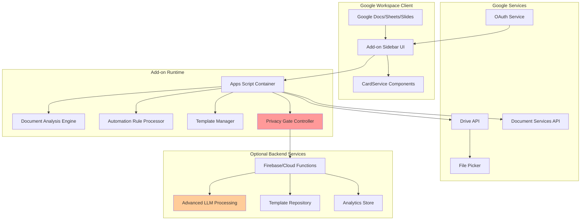
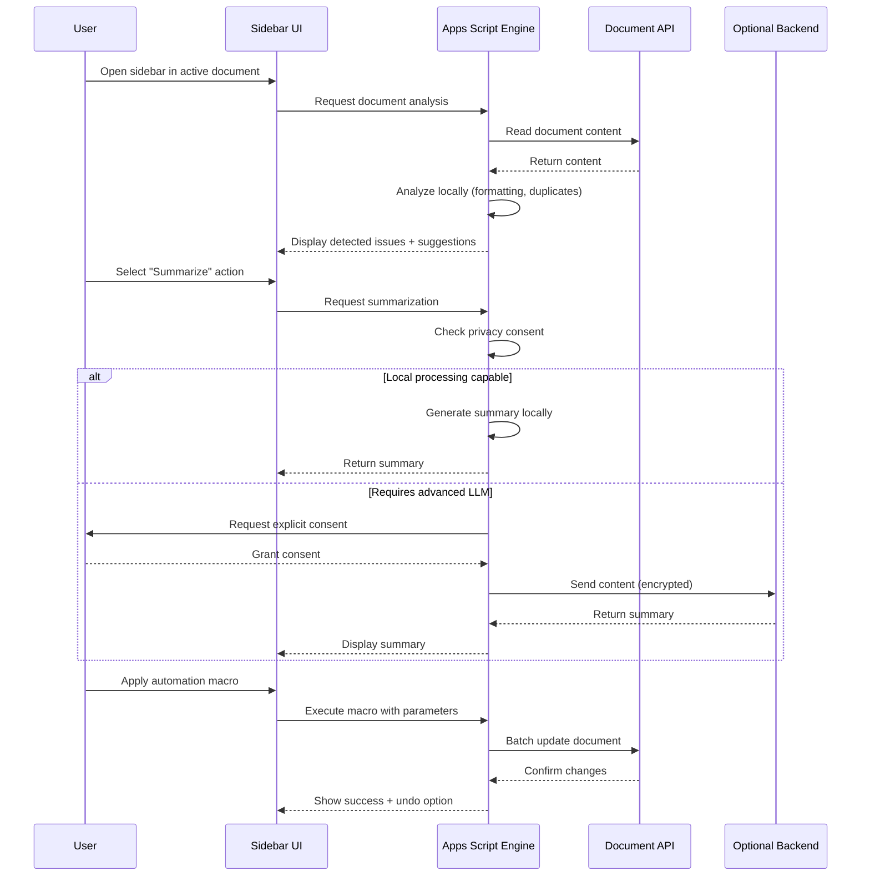
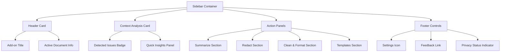
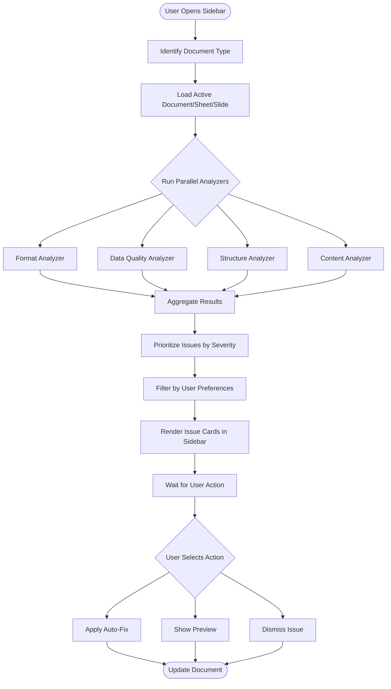
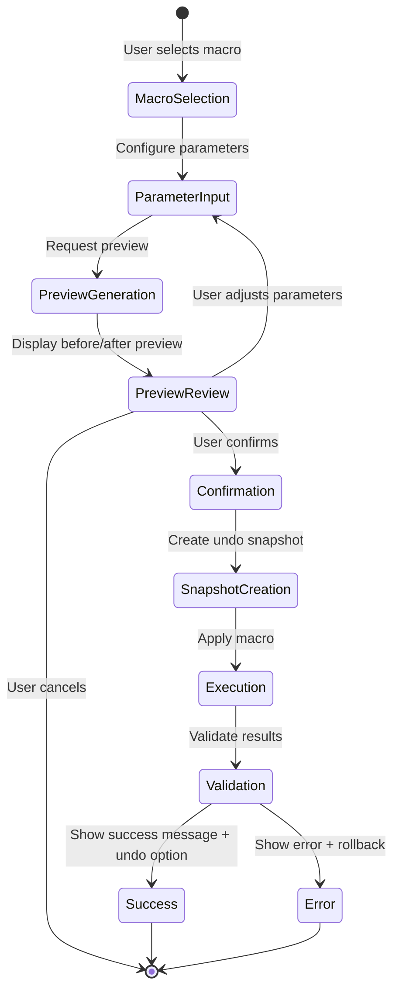
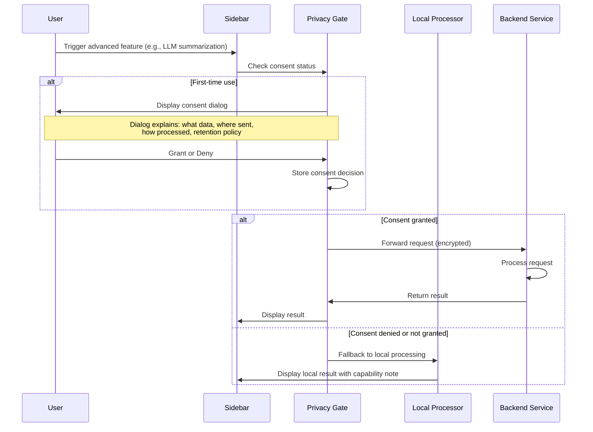
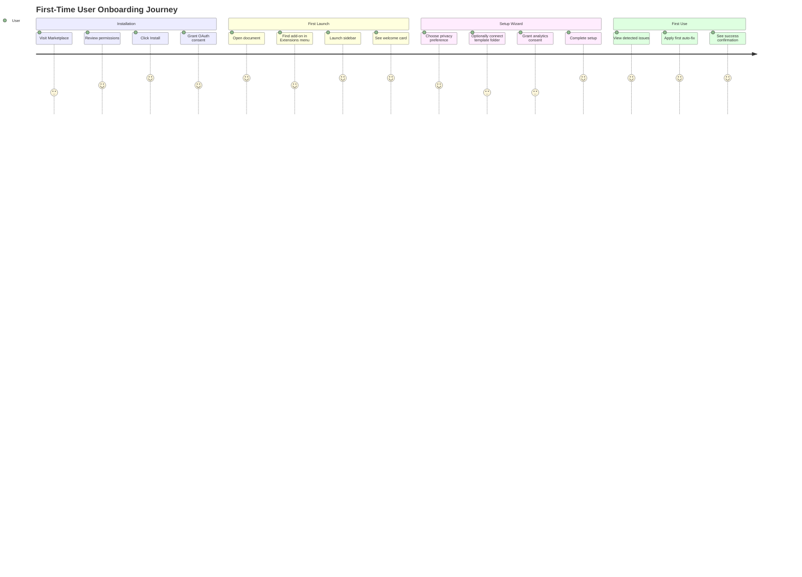

# Intelligent Document Automation - Google Workspace Add-on Design

## 1. Overview

### 1.1 Purpose
This design defines a Google Workspace Add-on that provides intelligent document automation capabilities directly within Google Docs, Sheets, and Slides through a contextual sidebar interface. The add-on enables users to automate repetitive formatting, perform smart analysis, redact sensitive information, and apply templates without leaving their active document.

### 1.2 Core Objectives
- Deliver seamless in-document automation through a sidebar UI that integrates with Docs, Sheets, and Slides
- Provide intelligent analysis and actionable suggestions for document cleanup and formatting
- Enable batch operations and macro-like automation across single or multiple files
- Ensure strong data privacy with local processing and transparent consent mechanisms
- Support domain-wide deployment for enterprise and educational institutions

### 1.3 Target Users
- **Educators**: Automate grading workflows, apply rubric templates, batch comment on student work
- **Legal Operations**: Redact PII, standardize contract formatting, apply clause templates
- **Sales Teams**: Clean and format data, apply proposal templates, standardize presentations
- **Administrative Staff**: Batch process documents, ensure formatting consistency, manage sensitive data

### 1.4 Success Criteria
- Users can perform document automation tasks without switching context or tools
- 80%+ reduction in time spent on repetitive formatting and cleaning tasks
- Zero unauthorized data transmission with full privacy transparency
- Adoption rate of 60%+ within pilot organizations within 90 days
- Admin deployment completable in under 15 minutes

## 2. System Architecture

### 2.1 Architecture Overview

### 2.2 Component Responsibilities

| Component | Responsibility | Processing Location |
|-----------|---------------|---------------------|
| **Sidebar UI Controller** | Render contextual interface, handle user interactions | Apps Script Client |
| **Document Analysis Engine** | Detect formatting issues, duplicates, anomalies | Apps Script Server |
| **Automation Rule Processor** | Execute macro operations, batch transformations | Apps Script Server |
| **Template Manager** | Load, preview, apply document templates | Apps Script Server + Drive |
| **Privacy Gate Controller** | Enforce consent, route data appropriately | Apps Script Server |
| **Redaction Service** | Identify and mask PII and sensitive data | Apps Script Server (local) |
| **Advanced LLM Processor** | Summarization, advanced content analysis | Optional Backend (user-controlled) |
| **Analytics Collector** | Track usage metrics without PII | Local Storage + Optional Backend |

### 2.3 Data Flow Patterns

## 3. User Interface Design

### 3.1 Sidebar Structure

The sidebar UI is the primary interaction surface and follows Google's CardService design principles for consistency with the Workspace environment.

**Layout Hierarchy:**

### 3.2 UI Cards and Sections

| Card/Section | Visibility Trigger | Key Elements | Actions |
|--------------|-------------------|--------------|----------|
| **Header Card** | Always visible | Add-on logo, document name, context type (Doc/Sheet/Slide) | Refresh analysis |
| **Context Analysis Card** | When issues detected | Issue count badge, expandable list of detected problems | View details, dismiss |
| **Summarize Section** | Always available | Selection indicator, length slider (brief/detailed), privacy consent toggle | Generate summary, copy result |
| **Redact Section** | Available for Docs/Sheets | PII type selector (names, emails, SSN, custom regex), preview mode toggle | Scan for PII, redact selected, undo |
| **Clean & Format Section** | Context-dependent | Detected anomalies checklist, batch action selector | Apply fixes, preview changes, rollback |
| **Templates Section** | Always available | Template category dropdown, thumbnail previews, Drive picker button | Browse templates, preview, apply |
| **Batch Operations Panel** | When multi-file mode active | File count indicator, progress bar, scope selector | Run on selection, cancel |

### 3.3 Contextual Adaptation

**Google Sheets Context:**
- Emphasize data cleaning: duplicate detection, format standardization, empty cell handling
- Show column-level analysis with data type inconsistencies
- Enable range selection for targeted operations

**Google Docs Context:**
- Focus on text summarization and redaction
- Highlight formatting inconsistencies (headings, fonts, spacing)
- Offer style template application

**Google Slides Context:**
- Surface layout consistency issues
- Provide design template quick-apply
- Suggest alignment and spacing corrections

### 3.4 Interaction Patterns

**Progressive Disclosure:**
- Initial view shows only top 3 detected issues
- "Show more" expands full analysis
- Advanced options hidden behind "Advanced" toggle

**Immediate Feedback:**
- All actions show loading spinners during processing
- Success states display green checkmark with action summary
- Errors show red alert with specific guidance and retry option

**Undo/Rollback Mechanism:**
- Every destructive action stores a snapshot reference
- "Undo" button appears for 30 seconds post-action in a toast notification
- Rollback available in history panel for last 10 operations

## 4. Core Feature Specifications

### 4.1 Smart Analysis Engine

**Purpose:** Automatically detect document quality issues and surface actionable recommendations.

**Analysis Capabilities by Document Type:**

| Analysis Type | Google Sheets | Google Docs | Google Slides |
|--------------|---------------|-------------|---------------|
| **Formatting Anomalies** | Date format inconsistencies, currency symbol mixing, number-as-text detection | Inconsistent heading styles, mixed fonts, spacing irregularities | Inconsistent text box fonts, misaligned elements |
| **Data Quality Issues** | Duplicate rows, empty cells in required columns, outlier values | Repeated paragraphs, orphaned bullet points | Duplicate slide content |
| **Structural Problems** | Mixed data types in columns, broken formulas, circular references | Missing heading hierarchy, broken list formatting | Missing slide numbers, inconsistent layouts |
| **Content Suggestions** | Column header clarity, formula optimization hints | Readability score, passive voice detection | Speaker notes completeness |

**Detection Logic Flow:**

**Issue Priority Scoring:**

- **Critical (Red Badge):** Data loss risk, broken functionality, accessibility violations
- **High (Orange Badge):** Formatting inconsistencies affecting professionalism, significant duplicates
- **Medium (Yellow Badge):** Minor formatting issues, style inconsistencies
- **Low (Blue Badge):** Optimization suggestions, content improvements

### 4.2 Summarization Feature

**Purpose:** Generate concise summaries of selected text or entire documents to aid comprehension and review.

**Functionality:**

**Input Modes:**
- Selected text range (minimum 100 characters)
- Entire active document
- Multiple documents via Drive picker (batch mode)

**Output Formats:**
- Brief (2-3 bullet points, ~50 words)
- Standard (paragraph format, ~150 words)
- Detailed (structured sections with key points, ~300 words)

**Processing Options:**

| Option | Behavior | Privacy Impact |
|--------|----------|----------------|
| **Local Extraction** | Use Apps Script to extract key sentences based on frequency analysis and position | Zero external data transmission |
| **Advanced LLM** | Send content to user-controlled backend for AI-powered summarization | Requires explicit consent, encrypted transmission |

**User Flow:**

1. User selects text or chooses "Summarize entire document"
2. Sidebar displays selection info and length selector
3. If advanced mode required, consent dialog appears with clear data handling explanation
4. User confirms or switches to local mode
5. Summary generated and displayed in expandable card
6. User can copy summary, insert as comment, or append to document

### 4.3 Redaction System

**Purpose:** Identify and mask sensitive information to protect privacy and comply with data protection regulations.

**Redactable Entity Types:**

| Entity Type | Detection Method | Redaction Format |
|-------------|------------------|------------------|
| **Email Addresses** | Regex pattern matching | `[EMAIL REDACTED]` |
| **Phone Numbers** | Multi-format regex (US, international) | `[PHONE REDACTED]` |
| **Social Security Numbers** | Pattern matching with validation | `[SSN REDACTED]` |
| **Names (PII)** | Pattern matching against common name lists + capitalization heuristics | `[NAME REDACTED]` |
| **Addresses** | Street pattern detection | `[ADDRESS REDACTED]` |
| **Custom Patterns** | User-defined regex patterns | User-specified replacement |
| **Column/Field Redaction (Sheets)** | Select entire column or named range | Mask all cells in range |

**Operation Modes:**

**Scan Mode:**
- Highlight detected sensitive data with colored overlays (non-destructive)
- Display count of each entity type in sidebar
- Allow user to review and confirm each detection before redaction

**Redact Mode:**
- Replace detected entities with redaction markers
- Create version snapshot before modification
- Offer undo for 30 seconds via toast notification

**Selective Redaction:**
- User can exclude specific detections from redaction list
- Whitelist mode: protect specific terms from redaction

**Privacy Guarantee:**
- All scanning and redaction performed locally within Apps Script runtime
- No sensitive content transmitted to external services
- Redaction log stored locally (not transmitted) for audit purposes

### 4.4 Clean & Format Automation

**Purpose:** Execute macro-like operations to standardize formatting and clean data inconsistencies.

**Available Macros:**

**For Google Sheets:**

| Macro Name | Operation | Parameters |
|------------|-----------|------------|
| **Remove Duplicates** | Delete duplicate rows based on key columns | Column selection, keep first/last option |
| **Standardize Dates** | Convert all date formats to consistent pattern | Target format (MM/DD/YYYY, YYYY-MM-DD, etc.) |
| **Normalize Currency** | Ensure consistent currency symbols and decimal places | Currency type, decimal precision |
| **Fill Empty Cells** | Populate empty cells with default value or forward-fill | Fill method, default value |
| **Convert Text to Numbers** | Fix numbers stored as text | Target columns |
| **Trim Whitespace** | Remove leading/trailing spaces from all cells | Apply to selection or entire sheet |
| **Title Case Headers** | Standardize column headers to Title Case | N/A |

**For Google Docs:**

| Macro Name | Operation | Parameters |
|------------|-----------|------------|
| **Standardize Headings** | Apply consistent heading styles throughout document | Heading style template |
| **Fix List Formatting** | Ensure consistent bullet/numbering styles | List style preference |
| **Normalize Spacing** | Standardize line and paragraph spacing | Spacing values |
| **Remove Extra Line Breaks** | Collapse multiple consecutive line breaks | Keep single or double |
| **Apply Style Template** | Apply font, color, and spacing template | Template selection |

**For Google Slides:**

| Macro Name | Operation | Parameters |
|------------|-----------|------------|
| **Align Elements** | Distribute and align text boxes and shapes | Alignment type (left, center, right, distribute) |
| **Standardize Fonts** | Apply consistent font across all slides | Font family, size rules |
| **Add Slide Numbers** | Insert slide numbers with consistent placement | Position, format, exclude title slide option |
| **Match Layout** | Apply consistent layout template | Layout template selection |

**Execution Flow:**

**Batch Processing:**
- User can select multiple files via Drive picker
- Same macro applied to all selected files sequentially
- Progress bar shows current file and overall completion
- Failed operations logged with specific error messages per file
- Summary report generated showing success/failure count

### 4.5 Template System

**Purpose:** Enable users to quickly apply pre-built templates for common document structures and workflows.

**Template Categories:**

| Category | Use Case | Template Examples |
|----------|----------|-------------------|
| **Education** | Grading and feedback workflows | Grading rubric tables, comment banks, assignment formatting |
| **Legal** | Contract and document standardization | Clause libraries, redaction templates, formatting standards |
| **Sales** | Proposal and presentation consistency | Proposal structure, pricing tables, pitch deck layouts |
| **Administrative** | Reports and communications | Meeting notes format, status report structures, memo templates |
| **Custom** | User-created templates | Organization-specific formats |

**Template Structure:**

Each template contains:
- **Metadata**: Name, description, category, author, version
- **Preview**: Thumbnail image or text snippet
- **Content**: Document structure, pre-filled sections, formatting rules
- **Placeholders**: Marked fields for user customization (e.g., `{{STUDENT_NAME}}`, `{{DATE}}`)
- **Apply Logic**: Instructions for merging template with existing content or creating new document

**Template Sources:**

1. **Built-in Templates**: Packaged with add-on, stored in Apps Script properties
2. **Drive Templates**: User's Drive folder designated for templates (configurable path)
3. **Domain Templates**: Admin-managed shared Drive location for organization-wide templates
4. **Template Marketplace** (future): Community-contributed templates with ratings

**Application Modes:**

**Mode 1: Apply to Current Document**
- Merge template content with existing document
- Preserve existing content, add template structure around it
- Prompt for placeholder values

**Mode 2: Create New from Template**
- Open new document pre-populated with template
- Prompt for all placeholder values upfront
- Save to user-specified Drive location

**Mode 3: Batch Apply**
- Apply template to multiple documents via Drive picker
- Use CSV or Sheets to supply placeholder values for batch personalization
- Example: Apply grading rubric template to 30 student submissions with individual names

**Template Preview:**
- Sidebar shows scrollable thumbnail preview
- Click to expand full-screen preview modal
- Preview highlights placeholders and customizable sections

## 5. Privacy and Security Architecture

### 5.1 Privacy-First Design Principles

**Core Commitments:**

1. **Local Processing Default**: All document analysis, redaction, and basic automation performed within Google's Apps Script runtime without external transmission
2. **Explicit Consent for Network Operations**: Any feature requiring external backend access must present clear consent dialog explaining what data leaves the environment
3. **No Third-Party Cloud Services**: Optional backend services must be deployed in user-controlled or domain-controlled infrastructure (Firebase project owned by organization)
4. **Transparent Data Handling**: Privacy dashboard shows all data processing activities, consent history, and data retention policies
5. **Minimal Data Collection**: Analytics track only feature usage counts and error types, never document content or user PII

### 5.2 Consent Flow

### 5.3 Data Processing Boundaries

| Operation | Processing Location | Data Transmitted | Consent Required |
|-----------|---------------------|------------------|------------------|
| **Format anomaly detection** | Apps Script local | None | No |
| **Duplicate detection** | Apps Script local | None | No |
| **PII redaction scanning** | Apps Script local | None | No |
| **Basic summarization (extraction)** | Apps Script local | None | No |
| **Advanced LLM summarization** | User-controlled backend | Selected text/document content | Yes |
| **Template application** | Apps Script local + Drive | None (Drive already authorized) | No |
| **Macro execution** | Apps Script local | None | No |
| **Usage analytics** | Local storage or user backend | Feature names, timestamps, error codes (no content) | Yes (one-time, during setup) |

### 5.4 OAuth Scopes and Permissions

**Requested OAuth Scopes:**

| Scope | Justification | When Requested |
|-------|---------------|----------------|
| `https://www.googleapis.com/auth/documents.currentonly` | Read and modify the currently active Google Doc | First launch in Docs |
| `https://www.googleapis.com/auth/spreadsheets.currentonly` | Read and modify the currently active Google Sheet | First launch in Sheets |
| `https://www.googleapis.com/auth/presentations.currentonly` | Read and modify the currently active Google Slide | First launch in Slides |
| `https://www.googleapis.com/auth/drive.file` | Access files created or opened by the add-on (for templates and batch operations) | When user selects Drive picker |
| `https://www.googleapis.com/auth/script.container.ui` | Display sidebar UI | Initial authorization |

**Scope Minimization Strategy:**
- Use `.currentonly` scopes to limit access to only the active document, not all user documents
- Never request `drive.readonly` or full Drive access
- Request `drive.file` only when user explicitly invokes Drive picker for batch operations or templates

**Permission Transparency:**
- First-run setup wizard explains each permission with plain-language justification
- Settings panel shows currently granted permissions with revoke option
- Add-on functions gracefully degrade if user revokes specific permissions

### 5.5 Security Measures

**Data in Transit:**
- All communication between Apps Script and optional backend uses HTTPS with TLS 1.3
- Sensitive content encrypted client-side before transmission using AES-256
- API keys and tokens stored in Apps Script Properties Service (encrypted at rest by Google)

**Data at Rest:**
- No document content stored persistently by the add-on
- User preferences and consent decisions stored in Apps Script Properties Service
- Undo snapshots stored temporarily in Apps Script Cache Service (6-hour expiration)
- Template metadata cached with 24-hour TTL

**Access Control:**
- Add-on executes within user's authorization context; cannot access documents user cannot access
- Admin-deployed templates accessible only to users within the same Workspace domain
- Optional backend implements domain verification to reject requests from unauthorized domains

**Audit Logging:**
- All privacy consent grants/revocations logged with timestamp
- Backend data transmissions logged (if backend enabled)
- Logs accessible to user via privacy dashboard in settings
- Domain admins can access aggregated audit logs (no user content, only metadata)

## 6. Deployment and Administration

### 6.1 Deployment Models

**Model 1: Individual User Installation**
- User installs from Google Workspace Marketplace
- Add-on runs in user's personal Apps Script project
- User manages own settings and consent

**Model 2: Domain-Wide Deployment**
- Admin installs add-on for entire Workspace domain
- Pre-configured settings deployed to all users
- Admin controls template repository and optional backend configuration
- Users can still manage personal consent and preferences

**Model 3: Managed Group Deployment**
- Admin assigns add-on to specific organizational units or groups
- Useful for piloting with specific teams (e.g., legal department, teachers)

### 6.2 Admin Configuration Panel

**Accessible via:**
- Google Admin Console integration (if domain-deployed)
- Standalone web app for add-on configuration

**Configuration Options:**

| Setting | Description | Default |
|---------|-------------|---------|
| **Enable Backend Services** | Toggle advanced LLM features | Disabled |
| **Backend Endpoint URL** | URL of user-controlled Firebase/Cloud Function backend | None |
| **Domain Template Drive Folder** | Shared Drive folder ID for organization-wide templates | None |
| **Default Privacy Mode** | Strict (local only) or Balanced (prompt for advanced) | Strict |
| **Allowed Redaction Types** | Which PII types users can scan for | All enabled |
| **Analytics Collection** | Enable usage analytics for admin reporting | Disabled |
| **Allowed Document Types** | Enable for Docs, Sheets, Slides | All enabled |
| **Batch Operation Limit** | Max files processable in single batch | 50 |

**Admin Reporting Dashboard:**
- Adoption metrics: installations, active users, feature usage frequency
- Error rate tracking by feature and document type
- Privacy consent statistics (% of users enabling advanced features)
- No access to user document content or personal data

### 6.3 Setup and Installation Process

**For Individual Users:**

1. Navigate to Google Workspace Marketplace
2. Search for "Intelligent Document Automation"
3. Click "Install" and review requested permissions
4. Grant OAuth consent
5. Open any Google Doc, Sheet, or Slide
6. Launch add-on from Extensions menu
7. Complete first-run wizard:
   - Choose privacy preferences
   - Optionally connect personal template Drive folder
   - Grant analytics consent (optional)
8. Begin using sidebar features

**For Domain Admins:**

1. Access Google Admin Console > Marketplace Apps
2. Search and select "Intelligent Document Automation"
3. Click "Domain Install"
4. Configure domain-wide settings:
   - Set default privacy mode
   - Provide domain template folder (if applicable)
   - Configure backend endpoint (if using advanced features)
   - Set batch operation limits
5. Assign to organizational units or entire domain
6. (Optional) Deploy backend infrastructure:
   - Deploy provided Firebase project to organization's GCP
   - Configure environment variables (API keys, domain whitelist)
   - Update admin panel with backend endpoint URL
7. Communicate rollout to users with usage guide

**Estimated Admin Setup Time:** 10-15 minutes (without backend), 30-45 minutes (with backend deployment)

### 6.4 Update and Maintenance Strategy

**Versioning:**
- Semantic versioning (MAJOR.MINOR.PATCH)
- Major version changes require re-authorization if scopes change
- Minor/patch updates auto-deploy transparently

**Update Channels:**
- **Stable**: Default channel, updates every 4-6 weeks after thorough testing
- **Beta**: Early access channel for domain admins to test before stable release
- **Rapid**: Latest features, updated weekly (opt-in only)

**Rollback Capability:**
- Admins can pin specific version for domain deployment
- Emergency rollback available via admin console within 48 hours of update

**Maintenance Windows:**
- Updates deployed during low-usage windows (configurable per domain timezone)
- Critical security patches deployed immediately with user notification

## 7. Technical Implementation Strategy

### 7.1 Apps Script Architecture

**Project Structure:**

The add-on is implemented as a standalone Apps Script project with the following module organization:

| Module | Responsibility |
|--------|----------------|
| **Main.gs** | Entry points for sidebar initialization, menu creation, and event handlers |
| **UI/CardBuilder.gs** | CardService UI generation for sidebar sections |
| **UI/DialogBuilder.gs** | Modal dialog construction for consent, previews, and confirmations |
| **Analysis/SheetAnalyzer.gs** | Spreadsheet-specific analysis logic |
| **Analysis/DocAnalyzer.gs** | Document-specific analysis logic |
| **Analysis/SlideAnalyzer.gs** | Presentation-specific analysis logic |
| **Automation/MacroEngine.gs** | Macro execution framework and operation handlers |
| **Automation/BatchProcessor.gs** | Multi-file operation orchestration |
| **Privacy/RedactionService.gs** | PII detection and masking logic |
| **Privacy/ConsentManager.gs** | Consent state management and enforcement |
| **Templates/TemplateLoader.gs** | Template discovery and loading from Drive |
| **Templates/TemplateApplier.gs** | Template merge and placeholder substitution |
| **Utils/DocumentWrapper.gs** | Abstraction layer for Document/Sheet/Slides APIs |
| **Utils/Analytics.gs** | Usage tracking and reporting |
| **Config.gs** | Configuration constants and user/admin settings |

**State Management:**
- User preferences: Apps Script Properties Service (persistent)
- Session state: Apps Script Cache Service (temporary)
- Undo snapshots: Cache Service with 6-hour TTL
- Consent decisions: Properties Service (persistent)

**Performance Optimization:**
- Lazy-load analysis modules based on active document type
- Batch API calls to minimize round-trips (e.g., batch read cells in Sheets)
- Use partial analysis for large documents (analyze visible portion first, expand on demand)
- Cache expensive computations (e.g., template thumbnails) with TTL

### 7.2 Optional Backend Architecture

**When Backend is Needed:**
- Advanced LLM-based summarization beyond simple extraction
- Centralized template repository with search and versioning
- Aggregated analytics for domain admin reporting

**Technology Stack:**
- **Runtime**: Firebase Cloud Functions (Node.js) or Google Cloud Functions
- **Database**: Firestore for template metadata and analytics
- **Storage**: Cloud Storage for template assets and thumbnails
- **AI/ML**: Vertex AI or self-hosted LLM for summarization

**Backend API Endpoints:**

| Endpoint | Method | Purpose | Input | Output |
|----------|--------|---------|-------|--------|
| `/summarize` | POST | Generate advanced summary | Document content (encrypted), length preference | Summary text |
| `/templates/search` | GET | Search template repository | Query string, category filter | Template metadata list |
| `/templates/{id}` | GET | Fetch specific template | Template ID | Template content and metadata |
| `/analytics/log` | POST | Record usage event | Event type, timestamp, user domain | Acknowledgment |
| `/health` | GET | Backend health check | None | Status object |

**Security Implementation:**
- Domain verification: Backend validates requests originate from authorized Workspace domain
- API authentication: Apps Script signs requests with shared secret (stored in Properties Service)
- Rate limiting: Per-user and per-domain quotas to prevent abuse
- Input sanitization: Validate and sanitize all incoming data to prevent injection attacks

### 7.3 Integration Points

**Google Workspace APIs:**

| API | Usage | Operations |
|-----|-------|------------|
| **Google Docs API** | Document content access and modification | Read paragraphs, apply styles, insert comments, replace text |
| **Google Sheets API** | Spreadsheet data access and manipulation | Read ranges, update cells, format cells, create sheets |
| **Google Slides API** | Presentation content access | Read slides, update text boxes, apply layouts |
| **Google Drive API** | File discovery and template storage | List files, get file metadata, create files, read file content |
| **Card Service** | Sidebar UI rendering | Build cards, sections, widgets, actions |

**Third-Party Services (Optional, User-Controlled):**
- **Vertex AI**: For advanced summarization if user enables backend
- **Cloud Storage**: For template asset hosting
- **Firestore**: For template metadata and analytics

All third-party services must be deployed within the organization's GCP project to maintain data sovereignty.

### 7.4 Error Handling and Resilience

**Error Categories and Responses:**

| Error Type | User-Facing Message | Recovery Action | Logging |
|------------|---------------------|-----------------|----------|
| **Permission Denied** | "Add-on needs permission to access this document. Please authorize in Extensions menu." | Prompt re-authorization | Log scope and document type |
| **Network Timeout (Backend)** | "Connection to backend timed out. Falling back to local processing." | Fallback to local mode | Log endpoint and timeout duration |
| **Invalid Document State** | "Unable to analyze document. Please ensure document is not corrupted." | Suggest document repair, offer manual mode | Log document ID (hashed) and error code |
| **Quota Exceeded** | "Daily operation limit reached. Upgrade or wait until tomorrow." | Display quota status, link to upgrade | Log user/domain quota status |
| **Macro Execution Failure** | "Macro encountered an error: [specific issue]. Document not modified." | Offer retry, support contact | Log macro type, parameters, stack trace |

**Resilience Patterns:**
- **Graceful Degradation**: If backend unavailable, fall back to local processing with reduced capability
- **Retry Logic**: Transient API errors retried with exponential backoff (max 3 attempts)
- **Circuit Breaker**: If backend fails repeatedly, disable backend features for 15 minutes before retry
- **Atomic Operations**: All document modifications wrapped in try-catch; rollback on failure using snapshot

**User Notification Strategy:**
- Critical errors: Modal dialog with clear explanation and next steps
- Non-blocking errors: Toast notification in sidebar with dismiss option
- Background errors: Silent logging with error badge in footer (click to view details)

## 8. User Experience Flows

### 8.1 First-Time User Onboarding

**Onboarding Checklist Presented in Welcome Card:**
- [ ] Review detected issues in your document
- [ ] Try an auto-fix suggestion
- [ ] Explore a template
- [ ] (Optional) Connect your template folder
- [ ] (Optional) Enable advanced summarization

### 8.2 Common Task Flows

**Flow 1: Quick Document Cleanup (Sheets)**

1. User opens spreadsheet with inconsistent date formats and duplicate rows
2. Launches add-on sidebar
3. Sidebar immediately shows:
   - "12 date format inconsistencies detected"
   - "5 duplicate rows found"
4. User clicks "Fix Dates" suggestion
5. Parameter dialog appears with detected formats and suggested standard format
6. User confirms
7. Preview modal shows before/after sample
8. User clicks "Apply"
9. Macro executes with progress indicator
10. Success toast appears with "Undo" button
11. User then clicks "Remove Duplicates"
12. Repeats confirmation and execution
13. Document now clean; issue badges cleared from sidebar

**Flow 2: Batch Template Application (Docs)**

1. Teacher has 30 student essay submissions in Drive folder
2. Opens add-on sidebar from any document
3. Clicks "Templates" section
4. Selects "Grading Rubric" template
5. Clicks "Apply to Multiple Files"
6. Drive picker opens, filtered to documents
7. User selects folder containing 30 essays
8. Confirmation dialog shows file count
9. User clicks "Apply to All"
10. Batch processor runs with progress bar ("Processing 5 of 30...")
11. Completion dialog shows:
    - 28 successful
    - 2 failed (with specific error messages)
12. User reviews failed files individually

**Flow 3: Redact PII Before Sharing (Docs)**

1. User has document containing student names and email addresses
2. Needs to share anonymized version with external reviewer
3. Launches sidebar
4. Clicks "Redact" section
5. Selects "Names" and "Email Addresses" checkboxes
6. Clicks "Scan for PII"
7. Sidebar shows:
    - "15 names detected"
    - "8 email addresses detected"
8. User clicks "Preview"
9. Document highlights detected entities in yellow
10. User reviews; notices two false positives (company names)
11. Clicks false positives in sidebar to exclude them
12. Clicks "Redact Selected"
13. Confirmation dialog explains action is reversible via undo
14. User confirms
15. Entities replaced with `[NAME REDACTED]` and `[EMAIL REDACTED]`
16. Success toast with undo option appears
17. User shares document confidently

### 8.3 Edge Cases and Handling

| Edge Case | Detection | User Experience |
|-----------|-----------|------------------|
| **Extremely large document (>10MB)** | Check document size on load | Display warning: "Large document detected. Analysis may take up to 30 seconds." Show progress bar. Offer partial analysis option. |
| **Insufficient permissions** | API call fails with 403 error | Display permission request dialog with specific scope needed and justification |
| **Conflicting changes (collaborative editing)** | Document version mismatch detected before macro application | Display warning: "Document changed by another user. Refresh analysis before proceeding?" |
| **No issues detected** | Analysis returns empty issue list | Sidebar shows green checkmark: "No issues detected! Your document looks great." Offer manual macro access. |
| **Backend unavailable** | Health check fails or timeout | Automatically fall back to local mode. Show info banner: "Advanced features temporarily unavailable. Using local processing." |
| **Template with missing placeholders** | User applies template but doesn't fill required placeholders | Validation error before application: "Please provide values for: {{STUDENT_NAME}}, {{DATE}}" |
| **Macro conflict (duplicate removal deletes all data)** | Preview shows >90% data removal | Warning dialog: "This operation will remove 95% of rows. Are you sure? Review parameters." |

## 9. Analytics and Feedback

### 9.1 Usage Analytics

**Collected Metrics (No PII or Document Content):**

| Metric | Purpose | Granularity |
|--------|---------|-------------|
| **Feature Activation Count** | Understand which features are most valuable | Per feature, per week |
| **Document Type Distribution** | Optimize for most-used environments | Docs vs Sheets vs Slides ratio |
| **Macro Execution Count** | Identify popular automation workflows | Per macro type, per week |
| **Template Usage** | Understand template adoption | Per template category, per month |
| **Error Rate** | Detect reliability issues | Per error type, per day |
| **Session Duration** | Measure engagement | Avg time sidebar is open |
| **Consent Opt-In Rate** | Track advanced feature adoption | % users enabling backend features |
| **Batch Operation Size** | Understand scale of use | Avg files per batch operation |

**Privacy-Preserving Implementation:**
- All metrics aggregated before storage (no individual user tracking)
- No document IDs, file names, or content logged
- User identifiers hashed before transmission
- Opt-in during setup; users can disable anytime
- Domain admins see only aggregated domain-wide stats

**Analytics Dashboard (Admin View):**
- Weekly active users trend graph
- Feature usage breakdown (pie chart)
- Error rate trend with anomaly detection
- Adoption funnel (installed → activated → regular user)

### 9.2 Feedback Mechanisms

**In-App Feedback:**
- "Send Feedback" link in sidebar footer
- Clicking opens modal with:
  - Issue category dropdown (Bug, Feature Request, General Feedback)
  - Description text area
  - Optional screenshot attachment
  - Checkbox: "Include anonymous diagnostic data"
- Submitted to feedback collection endpoint or email

**Issue Reporting:**
- When error occurs, "Report Issue" button appears in error message
- Auto-populates report with error code, timestamp, document type (not content)
- User can add description and submit

**Feature Requests:**
- Public roadmap page (linked from sidebar)
- Users can upvote existing requests
- Submit new requests via form
- High-voted requests reviewed quarterly for inclusion

**User Research Participation:**
- Occasional opt-in prompts for beta testing new features
- Link to join user research panel for interviews/surveys

### 9.3 Success Metrics and KPIs

| KPI | Target | Measurement Method |
|-----|--------|--------------------|
| **Adoption Rate (Pilot Orgs)** | 60% of users activate within 90 days | Track installations vs activations (sidebar opened) |
| **Retention Rate** | 70% weekly active users after 30 days | Track returning users week-over-week |
| **Time Savings** | 80% reduction in time for target tasks | User surveys + task completion time tracking (opt-in) |
| **Error Rate** | <2% of operations fail | Total errors / total operations |
| **User Satisfaction (NPS)** | >50 NPS score | Quarterly in-app survey |
| **Privacy Compliance** | Zero unauthorized data transmission incidents | Security audits + monitoring logs |
| **Admin Setup Completion** | <15 minutes avg setup time | Track setup start to completion timestamp |

## 10. Future Enhancements

### 10.1 Planned Features (Next 6 Months)

**Enhanced Template Ecosystem:**
- Template marketplace with community contributions
- Template versioning and update notifications
- Template creator tool within sidebar
- Multi-language template support

**Advanced AI Capabilities:**
- Sentiment analysis for document feedback
- Content suggestion and autocomplete for common sections
- Intelligent table extraction from unstructured text
- Translation integration for multi-language documents

**Collaboration Features:**
- Share macro configurations with team members
- Collaborative template editing
- Team analytics dashboard for managers
- Workflow automation triggers (e.g., auto-redact when sharing externally)

**Integration Expansions:**
- Gmail integration for email template application
- Google Forms integration for response data cleanup
- Calendar integration for meeting notes templates
- Chat integration for quick macro execution via slash commands

### 10.2 Long-Term Vision (12+ Months)

**Intelligent Workflow Learning:**
- Observe user patterns and suggest custom macro creation
- Predictive issue detection before problems occur
- Auto-apply frequently used macros with user confirmation

**Enterprise Compliance Module:**
- Regulatory compliance checking (GDPR, FERPA, HIPAA)
- Automated audit trail generation
- Policy enforcement engine (e.g., block sharing of documents with PII)

**Mobile Experience:**
- Lightweight mobile UI for Docs/Sheets mobile apps
- Priority given to quick actions (redact, apply template)

**API and Extensibility:**
- Public API for custom macro development
- Plugin system for third-party integrations
- Webhook support for external workflow triggers

## 11. Constraints and Assumptions

### 11.1 Technical Constraints

- **Apps Script Execution Limits**: Maximum 6-minute execution time per function call; batch operations must be chunked and resumable
- **API Quota Limits**: Google Workspace APIs have rate limits; add-on must implement exponential backoff and quota monitoring
- **Storage Limitations**: Apps Script Properties Service limited to 500KB per property; large templates must be stored in Drive
- **UI Rendering**: CardService has limited customization; complex UI interactions may require HTML Service dialogs
- **Browser Compatibility**: Sidebar rendering dependent on Workspace web app; no control over user's browser version

### 11.2 Assumptions

**User Environment:**
- Users have stable internet connectivity for Workspace access
- Users have basic familiarity with Google Docs, Sheets, and Slides
- Organizations have Google Workspace Business Standard or higher (for domain deployment features)

**Data and Content:**
- Documents are not password-protected or restricted in ways that block API access
- PII detection assumes English-language content for built-in patterns (custom regex required for other languages)
- Templates are well-formed Google documents (not corrupted or using unsupported features)

**Organizational Context:**
- Domain admins have GCP access if deploying optional backend
- Organizations have policies allowing third-party add-on installations
- Users have necessary permissions to install add-ons (not restricted by admin policy)

**Privacy and Compliance:**
- Organizations accept responsibility for data processing when enabling backend features
- Users understand distinction between local and backend processing
- Regulatory compliance (GDPR, etc.) is organization's responsibility; add-on provides tools but doesn't guarantee compliance

### 11.3 Out of Scope

**Explicitly Not Included in Initial Release:**
- Support for Microsoft Office formats (focus on Google Workspace native formats)
- Offline functionality (requires internet for Workspace access)
- Real-time collaborative editing awareness (macros may conflict with simultaneous edits)
- OCR or image content analysis
- Advanced grammar/style checking (defer to Grammarly and similar specialized tools)
- Financial data analysis or chart generation
- Integration with non-Google services (Slack, Microsoft Teams, etc.)
- Mobile-native app (web-only via Workspace mobile apps)

## 12. Acceptance Criteria

The add-on is considered production-ready when all following criteria are met:

### 12.1 Functional Criteria

- [ ] Sidebar launches successfully in Google Docs, Sheets, and Slides
- [ ] All core features operational:
  - [ ] Smart analysis detects at least 8 issue types across document types
  - [ ] Summarization works in local mode for selections and full documents
  - [ ] Redaction successfully detects and masks 6 PII types
  - [ ] At least 10 macro operations available and functional
  - [ ] Template system loads, previews, and applies templates correctly
- [ ] Batch operations process multiple files (tested with 25+ files)
- [ ] Undo/rollback functions correctly for all destructive operations
- [ ] Privacy consent flow blocks backend features until granted
- [ ] Drive picker integration allows file selection

### 12.2 Non-Functional Criteria

- [ ] Performance:
  - [ ] Sidebar loads in <3 seconds on standard broadband
  - [ ] Document analysis completes in <10 seconds for typical documents (<100 pages / 10K cells)
  - [ ] Macro execution processes at least 100 rows/paragraphs per second
- [ ] Reliability:
  - [ ] Error rate <2% across all operations in testing
  - [ ] No data loss in any failure scenario
  - [ ] Graceful degradation when backend unavailable
- [ ] Security:
  - [ ] All OAuth scopes justified and minimal
  - [ ] No sensitive data logged or transmitted without consent
  - [ ] Backend endpoints secured with authentication and domain verification
- [ ] Usability:
  - [ ] First-time user can complete onboarding in <2 minutes
  - [ ] All error messages provide actionable guidance
  - [ ] UI passes accessibility audit (WCAG 2.1 AA)

### 12.3 Deployment Criteria

- [ ] Documentation complete:
  - [ ] User guide with screenshots for all features
  - [ ] Admin deployment guide with step-by-step instructions
  - [ ] API documentation for optional backend
  - [ ] Privacy policy and terms of service
- [ ] Marketplace listing:
  - [ ] App title, description, and screenshots finalized
  - [ ] OAuth verification completed
  - [ ] Privacy policy linked and approved
- [ ] Admin panel functional:
  - [ ] Configuration options save and apply correctly
  - [ ] Analytics dashboard displays aggregated metrics
- [ ] Testing:
  - [ ] Passed end-to-end testing across 3 document types
  - [ ] Beta tested with at least 50 users across 3 organizations
  - [ ] Security audit completed with no critical vulnerabilities

### 12.4 Success Validation

**Pilot Program (First 90 Days):**
- Deploy to 3 pilot organizations (education, legal, sales)
- Achieve 60%+ activation rate
- Collect qualitative feedback via interviews
- Measure time savings via user surveys
- Track and resolve all reported bugs within 5 business days

**Production Readiness Gate:**
- NPS score >40 from pilot users
- <5 critical bugs in backlog
- Admin setup completable by non-technical admin in <20 minutes
- Zero security or privacy violations

---

**Design Status:** Ready for Review  
**Confidence Level:** High

**Confidence Basis:**
- Clear requirements with specific feature definitions and use cases
- Proven technology stack (Apps Script widely used for Workspace add-ons)
- Well-defined privacy architecture with explicit consent boundaries
- Comprehensive deployment and admin configuration strategy
- Success criteria and metrics clearly established
