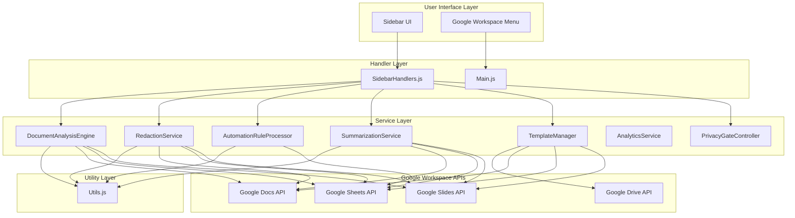
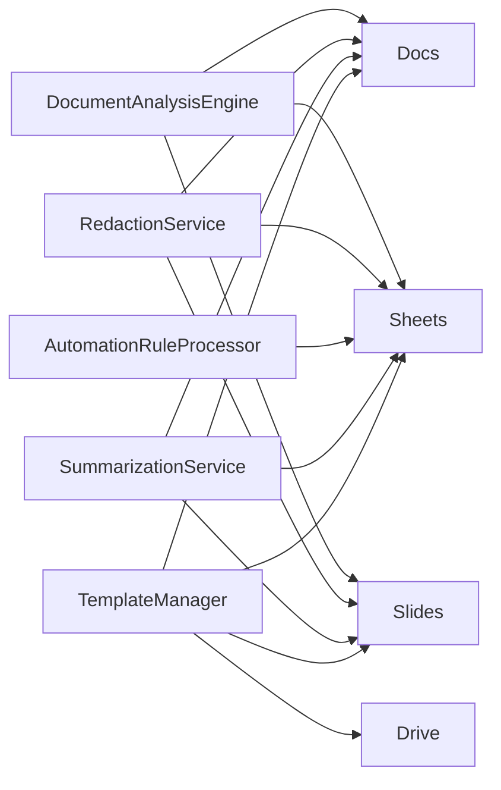

# API Reference

<cite>
**Referenced Files in This Document**
- [DocumentAnalysisEngine.js](file://src/services/DocumentAnalysisEngine.js)
- [RedactionService.js](file://src/services/RedactionService.js)
- [AutomationRuleProcessor.js](file://src/services/AutomationRuleProcessor.js)
- [AnalyticsService.js](file://src/services/AnalyticsService.js)
- [SummarizationService.js](file://src/services/SummarizationService.js)
- [TemplateManager.js](file://src/services/TemplateManager.js)
- [PrivacyGateController.js](file://src/services/PrivacyGateController.js)
- [Utils.js](file://src/utils/Utils.js)
- [SidebarHandlers.js](file://src/handlers/SidebarHandlers.js)
- [Main.js](file://src/Main.js)
- [appsscript.json](file://src/appsscript.json)
</cite>

## Table of Contents
1. [Introduction](#introduction)
2. [Service Architecture Overview](#service-architecture-overview)
3. [Core Service Modules](#core-service-modules)
4. [Utility Functions](#utility-functions)
5. [Event Handlers](#event-handlers)
6. [Integration Points](#integration-points)
7. [Error Handling Strategies](#error-handling-strategies)
8. [Rate Limiting and Asynchronous Operations](#rate-limiting-and-asynchronous-operations)
9. [Privacy and Consent Management](#privacy-and-consent-management)
10. [Usage Examples](#usage-examples)

## Introduction

The Intelligent Document Automation add-on provides a comprehensive suite of services for automating document processing tasks within Google Workspace applications. The system consists of modular service components that handle document analysis, redaction, automation rules, summarization, and template management, all integrated with robust privacy controls and analytics capabilities.

## Service Architecture Overview

The add-on follows a modular architecture with clear separation of concerns:



**Diagram sources**
- [SidebarHandlers.js](file://src/handlers/SidebarHandlers.js#L1-L172)
- [Main.js](file://src/Main.js#L1-L800)
- [DocumentAnalysisEngine.js](file://src/services/DocumentAnalysisEngine.js#L1-L739)
- [RedactionService.js](file://src/services/RedactionService.js#L1-L402)

## Core Service Modules

### DocumentAnalysisEngine

The DocumentAnalysisEngine provides comprehensive document analysis capabilities across all Google Workspace document types.

#### Public Methods

| Method | Parameters | Return Type | Description |
|--------|------------|-------------|-------------|
| `analyzeDocument()` | None | `Object` | Analyzes the current document and returns detected issues and suggestions |
| `getDocumentType()` | None | `string` | Determines the type of the current document (DOCUMENT/SPREADSHEET/PRESENTATION/UNKNOWN) |

#### Analysis Results Structure

```javascript
{
  issues: Array<string>,           // Detected formatting/anomaly issues
  suggestions: Array<string>,      // Actionable suggestions for improvement
  type: string                    // Document type identifier
}
```

#### Supported Document Types

- **Documents**: Google Docs with formatting, spelling, and structural analysis
- **Spreadsheets**: Google Sheets with data quality, formatting, and structural analysis
- **Presentations**: Google Slides with design consistency and content analysis

**Section sources**
- [DocumentAnalysisEngine.js](file://src/services/DocumentAnalysisEngine.js#L12-L739)

### RedactionService

The RedactionService handles detection and removal of Personally Identifiable Information (PII) from documents.

#### Public Methods

| Method | Parameters | Return Type | Description |
|--------|------------|-------------|-------------|
| `detectPIIInDocument()` | None | `Object` | Detects PII in the current document |
| `redactPIIInDocument(piiItems)` | `piiItems?: Array` | `Object` | Redacts detected PII from the document |
| `customRedaction(customPattern, replacement)` | `customPattern: string, replacement?: string` | `Object` | Applies custom redaction pattern |

#### PII Detection Patterns

The service detects the following PII types:

| Pattern Type | Example | Redaction Format |
|--------------|---------|------------------|
| Email Addresses | `user@example.com` | `[EMAIL REDACTED]` |
| Phone Numbers | `(555) 123-4567` | `[PHONE REDACTED]` |
| Social Security Numbers | `123-45-6789` | `[SSN REDACTED]` |
| Credit Card Numbers | `4111 1111 1111 1111` | `[CARD REDACTED]` |
| IP Addresses | `192.168.1.1` | `[IP REDACTED]` |
| Date of Birth | `01/15/1985` | `[DOB REDACTED]` |
| ZIP Codes | `12345-6789` | `[ZIP REDACTED]` |

#### Redaction Results Structure

```javascript
{
  success: boolean,               // Whether operation succeeded
  message: string,                // Human-readable status message
  count: number,                 // Number of items redacted
  found?: Array<Object>,         // Detected PII items (detect only)
  total?: number                 // Total PII count (detect only)
}
```

**Section sources**
- [RedactionService.js](file://src/services/RedactionService.js#L48-L402)

### AutomationRuleProcessor

The AutomationRuleProcessor provides batch transformation and cleanup operations for Google Sheets.

#### Public Methods

| Method | Parameters | Return Type | Description |
|--------|------------|-------------|-------------|
| `removeDuplicateRows()` | None | `Object` | Removes duplicate rows from the active spreadsheet |
| `standardizeDateFormats(targetFormat)` | `targetFormat?: string` | `Object` | Standardizes date formats across the spreadsheet |
| `fillEmptyCellsIntelligently()` | None | `Object` | Fills empty cells with intelligent default values |
| `removeEmptyRows()` | None | `Object` | Removes completely empty rows |
| `standardizeCurrencyFormats(currencySymbol)` | `currencySymbol?: string` | `Object` | Standardizes currency formats |
| `trimWhitespace()` | None | `Object` | Trims whitespace from all text cells |
| `capitalizeText(format)` | `format?: string` | `Object` | Applies text capitalization formatting |

#### Supported Text Formatting Options

- **UPPER**: Convert to uppercase
- **lower**: Convert to lowercase  
- **Title Case**: Convert to title case (First Letter Of Each Word)
- **Sentence case**: Convert to sentence case (First letter capitalized)

#### Operation Results Structure

```javascript
{
  success: boolean,              // Whether operation succeeded
  message: string,               // Human-readable status message
  count: number,                // Number of items processed
  method?: string              // Processing method used
}
```

**Section sources**
- [AutomationRuleProcessor.js](file://src/services/AutomationRuleProcessor.js#L12-L399)

### AnalyticsService

The AnalyticsService provides privacy-preserving usage tracking and reporting capabilities.

#### Public Methods

| Method | Parameters | Return Type | Description |
|--------|------------|-------------|-------------|
| `trackEvent(eventName, metadata)` | `eventName: string, metadata?: Object` | `void` | Tracks a user event with optional metadata |
| `getUsageStats()` | None | `Object` | Retrieves aggregated usage statistics |
| `getEventSummary()` | None | `Object` | Gets a summary of recent events |
| `generateReport(period)` | `period?: string` | `Object` | Generates analytics report for specified period |
| `exportAnalytics()` | None | `string` | Exports analytics data as CSV |
| `clearAnalytics()` | None | `Object` | Clears all analytics data |

#### Event Tracking Metadata Guidelines

Allowed metadata keys:
- `count`: Numeric count of items processed
- `type`: Item type/category
- `method`: Processing method used
- `format`: Format specification
- `category`: Functional category
- `docType`: Document type identifier
- `length`: Text/document length

#### Usage Statistics Structure

```javascript
{
  totalActions: number,          // Total number of actions performed
  timeSavedMinutes: number,      // Total estimated time saved in minutes
  timeSaved: string,            // Formatted time saved (e.g., "2h 30m")
  actions: Object,              // Action counts by type
  firstUsed: string,            // ISO timestamp of first usage
  lastUsed: string             // ISO timestamp of last usage
}
```

**Section sources**
- [AnalyticsService.js](file://src/services/AnalyticsService.js#L16-L395)

### SummarizationService

The SummarizationService provides document summarization capabilities with local and optional AI-powered processing.

#### Public Methods

| Method | Parameters | Return Type | Description |
|--------|------------|-------------|-------------|
| `summarizeDocument(selectionOnly)` | `selectionOnly?: boolean` | `Object` | Summarizes the current document or selection |
| `extractKeyPoints(text, numPoints)` | `text: string, numPoints?: number` | `Array<string>` | Extracts key points from text |
| `generateTitle(text)` | `text: string` | `string` | Generates a title from text content |
| `getTextStatistics(text)` | `text: string` | `Object` | Returns text analysis statistics |

#### Summarization Results Structure

```javascript
{
  success: boolean,              // Whether summarization succeeded
  summary: string,              // Generated summary text
  method: string,              // Processing method used ("local", "local-truncated", "backend")
  length?: number              // Original text length
}
```

#### Text Statistics Structure

```javascript
{
  words: number,                // Total word count
  sentences: number,            // Total sentence count
  paragraphs: number,           // Total paragraph count
  characters: number,           // Total character count
  avgWordsPerSentence: number,  // Average words per sentence
  avgSentencesPerParagraph: number, // Average sentences per paragraph
  readingTime: number           // Estimated reading time in minutes
}
```

**Section sources**
- [SummarizationService.js](file://src/services/SummarizationService.js#L16-L356)

### TemplateManager

The TemplateManager handles document template management with support for built-in and custom templates.

#### Public Methods

| Method | Parameters | Return Type | Description |
|--------|------------|-------------|-------------|
| `showTemplatePicker()` | None | `Object` | Opens the template picker dialog |
| `listTemplates(category)` | `category?: string` | `Array<Object>` | Lists available templates by category |
| `applyTemplate(templateId)` | `templateId: string` | `Object` | Applies a template to the current document |

#### Built-in Template Categories

- **Education**: Grading rubrics, academic templates
- **Business**: Professional document styles, presentation templates
- **Legal**: Contract templates, legal document formats
- **Sales**: Sales reports, CRM templates

#### Template Information Structure

```javascript
{
  id: string,                   // Template identifier
  name: string,                 // Display name
  description: string,          // Template description
  type: string,                 // Document type (DOCUMENT/SPREADSHEET/PRESENTATION)
  category: string,             // Template category
  source: string,              // Source type ("builtin" or "drive")
  url?: string                 // Drive file URL (custom templates only)
}
```

**Section sources**
- [TemplateManager.js](file://src/services/TemplateManager.js#L46-L479)

## Utility Functions

The Utils module provides essential helper functions used across the add-on.

### Date and Formatting Functions

| Function | Parameters | Return Type | Description |
|----------|------------|-------------|-------------|
| `formatDate(date, format)` | `date: Date, format?: string` | `string` | Formats a date according to specified pattern |
| `truncateText(text, maxLength, suffix)` | `text: string, maxLength: number, suffix?: string` | `string` | Truncates text with configurable suffix |

### Array and Collection Functions

| Function | Parameters | Return Type | Description |
|----------|------------|-------------|-------------|
| `chunkArray(array, size)` | `array: Array, size: number` | `Array<Array>` | Splits array into smaller chunks |
| `batchProcess(items, operation, batchSize)` | `items: Array, operation: Function, batchSize?: number` | `void` | Processes items in batches to avoid quota limits |

### String Manipulation Functions

| Function | Parameters | Return Type | Description |
|----------|------------|-------------|-------------|
| `escapeHtml(text)` | `text: string` | `string` | Escapes HTML special characters |
| `isValidEmail(email)` | `email: string` | `boolean` | Validates email address format |
| `safeJsonParse(jsonString, defaultValue)` | `jsonString: string, defaultValue?: any` | `any` | Safely parses JSON with fallback |

### Mathematical and Conversion Functions

| Function | Parameters | Return Type | Description |
|----------|------------|-------------|-------------|
| `getColumnLetter(index)` | `index: number` | `string` | Converts column index to Excel-style letter |
| `getColumnIndex(letter)` | `letter: string` | `number` | Converts Excel-style letter to column index |

### Control Flow Functions

| Function | Parameters | Return Type | Description |
|----------|------------|-------------|-------------|
| `debounce(func, wait)` | `func: Function, wait: number` | `Function` | Returns debounced version of function |
| `retryWithBackoff(func, maxRetries, baseDelay)` | `func: Function, maxRetries?: number, baseDelay?: number` | `any` | Retries function with exponential backoff |
| `measureTime(func, label)` | `func: Function, label?: string` | `any` | Measures execution time of function |

### Data Validation Functions

| Function | Parameters | Return Type | Description |
|----------|------------|-------------|-------------|
| `isEmpty(value)` | `value: any` | `boolean` | Checks if value is empty/undefined/null |
| `deepClone(obj)` | `obj: Object` | `Object` | Performs deep cloning of object |

**Section sources**
- [Utils.js](file://src/utils/Utils.js#L1-L258)

## Event Handlers

The SidebarHandlers module defines the interface between the UI and service modules.

### Document Analysis Handlers

| Handler | Service Method | Trigger | Description |
|---------|----------------|---------|-------------|
| `analyzeDocument()` | `DocumentAnalysisEngine.analyzeDocument()` | Sidebar button click | Analyzes current document for formatting issues |

### Redaction Handlers

| Handler | Service Method | Trigger | Description |
|---------|----------------|---------|-------------|
| `detectPIIInDocument()` | `RedactionService.detectPIIInDocument()` | Sidebar button click | Detects PII in current document |
| `redactPIIInDocument()` | `RedactionService.redactPIIInDocument()` | Sidebar button click | Redacts detected PII from document |

### Automation Handlers

| Handler | Service Method | Trigger | Description |
|---------|----------------|---------|-------------|
| `removeDuplicateRows()` | `AutomationRuleProcessor.removeDuplicateRows()` | Sidebar button click | Removes duplicate rows from spreadsheet |
| `standardizeDateFormats()` | `AutomationRuleProcessor.standardizeDateFormats()` | Sidebar button click | Standardizes date formats in spreadsheet |
| `fillEmptyCellsIntelligently()` | `AutomationRuleProcessor.fillEmptyCellsIntelligently()` | Sidebar button click | Fills empty cells with intelligent defaults |

### Template Handlers

| Handler | Service Method | Trigger | Description |
|---------|----------------|---------|-------------|
| `showTemplatePicker()` | `TemplateManager.showTemplatePicker()` | Sidebar button click | Opens template picker dialog |
| `applyTemplate(templateId)` | `TemplateManager.applyTemplate(templateId)` | Template selection | Applies selected template to document |

### Privacy Handlers

| Handler | Service Method | Trigger | Description |
|---------|----------------|---------|-------------|
| `handlePrivacyToggle(e)` | `PrivacyGateController.updateConsent()` | Privacy setting change | Updates privacy consent preferences |

**Section sources**
- [SidebarHandlers.js](file://src/handlers/SidebarHandlers.js#L1-L172)

## Integration Points

### Google Workspace API Integration

The add-on integrates with multiple Google Workspace APIs:

#### Document APIs
- **Google Docs API**: Document analysis, text extraction, formatting operations
- **Google Sheets API**: Spreadsheet analysis, data manipulation, formula operations
- **Google Slides API**: Presentation analysis, slide manipulation, design operations

#### Supporting APIs
- **Google Drive API**: Template storage, file operations, sharing
- **OAuth 2.0**: Authentication and authorization
- **URL Fetch API**: External service communication (optional)

#### Required OAuth Scopes

```json
[
  "https://www.googleapis.com/auth/documents.currentonly",
  "https://www.googleapis.com/auth/spreadsheets.currentonly", 
  "https://www.googleapis.com/auth/presentations.currentonly",
  "https://www.googleapis.com/auth/drive.file",
  "https://www.googleapis.com/auth/script.container.ui",
  "https://www.googleapis.com/auth/userinfo.email"
]
```

### Service Dependencies

Each service module depends on specific Google Workspace APIs:



**Diagram sources**
- [appsscript.json](file://src/appsscript.json#L29-L36)

**Section sources**
- [appsscript.json](file://src/appsscript.json#L1-L7)

## Error Handling Strategies

### Exception Management

The add-on implements comprehensive error handling across all service layers:

#### Service-Level Error Handling
- **Graceful Degradation**: Services continue operating with reduced functionality when individual components fail
- **Error Propagation**: Errors are propagated to UI handlers with meaningful messages
- **Logging**: All errors are logged to Google Apps Script logs for debugging

#### Error Response Structure

```javascript
{
  success: false,               // Indicates operation failure
  message: string,             // Human-readable error message
  error?: string,             // Technical error details (optional)
  count?: number              // Partial operation results (optional)
}
```

#### Common Error Scenarios

| Scenario | Handling Strategy | Recovery Action |
|----------|-------------------|-----------------|
| API Rate Limits | Automatic retry with backoff | Wait and retry operation |
| Insufficient Permissions | Request additional consent | Prompt user to grant permissions |
| Network Connectivity | Fallback to local processing | Use offline capabilities |
| Invalid Document State | Graceful degradation | Skip problematic operations |

### Privacy-Aware Error Handling

The PrivacyGateController manages error handling with privacy considerations:

- **PII Avoidance**: Error messages never contain document content
- **Consent-Based Logging**: Error logging respects user privacy preferences
- **Secure Error Reporting**: Technical errors are reported securely without exposing user data

**Section sources**
- [PrivacyGateController.js](file://src/services/PrivacyGateController.js#L1-L366)

## Rate Limiting and Asynchronous Operations

### Rate Limiting Strategies

The add-on implements several rate limiting mechanisms:

#### Batch Processing
- **Chunk Size**: 100 items per batch for most operations
- **Delay Between Batches**: 100ms pause to avoid quota limits
- **Progress Tracking**: Real-time feedback during long operations

#### API Quota Management
- **Automatic Retry**: Exponential backoff for transient failures
- **Operation Throttling**: Controlled frequency of API calls
- **Resource Monitoring**: Track API usage against quotas

### Asynchronous Operation Patterns

#### Promise-Based Operations
```javascript
// Example pattern for async operations
async function processLargeDataset(data) {
  try {
    const results = await Promise.all(
      data.map(item => processItemAsync(item))
    );
    return results;
  } catch (error) {
    console.error('Batch processing failed:', error);
    throw error;
  }
}
```

#### Progress Reporting
- **Real-time Updates**: UI receives progress updates during long operations
- **Cancellation Support**: Long-running operations can be cancelled
- **Timeout Management**: Operations timeout after reasonable duration

**Section sources**
- [Utils.js](file://src/utils/Utils.js#L224-L236)

## Privacy and Consent Management

### PrivacyGateController

The PrivacyGateController provides comprehensive privacy management with granular consent controls.

#### Consent Types

| Consent Type | Purpose | Default State | Required Scope |
|--------------|---------|---------------|----------------|
| `basic` | Core functionality | Enabled | None |
| `advancedAI` | AI-powered features | Disabled | External AI service |
| `redaction` | PII detection/redaction | Enabled | None |
| `analytics` | Usage analytics | Disabled | None |
| `templateSharing` | Template library access | Disabled | Google Drive |

#### Consent Management Methods

| Method | Parameters | Return Type | Description |
|--------|------------|-------------|-------------|
| `getConsent()` | None | `Object` | Retrieves current consent settings |
| `updateConsent(type, granted)` | `type: string, granted: boolean` | `Object` | Updates specific consent |
| `checkConsent(type)` | `type: string` | `boolean` | Checks if consent is granted |
| `requestConsent(type, reason)` | `type: string, reason: string` | `boolean` | Requests consent from user |

#### Privacy-Aware Processing

The system implements privacy gates that:

1. **Validate Data Processing**: Ensures operations respect user consent
2. **Fallback to Local Processing**: Uses local processing when consent is not granted
3. **Audit Trail**: Maintains logs of privacy-related events
4. **User Control**: Provides easy-to-use privacy settings interface

#### Data Processing Validation

```javascript
// Example privacy gate usage
const validation = PrivacyGateController.validateDataProcessing(
  'summarize', 
  documentContent
);

if (validation.allowed) {
  // Proceed with processing
  return processWithPrivacyGate('summarize', localFn, remoteFn);
} else {
  // Use fallback processing
  return localFn();
}
```

**Section sources**
- [PrivacyGateController.js](file://src/services/PrivacyGateController.js#L1-L366)

## Usage Examples

### Basic Document Analysis

```javascript
// Analyze current document
const analysisResults = DocumentAnalysisEngine.analyzeDocument();

if (analysisResults.issues.length > 0) {
  console.log(`Found ${analysisResults.issues.length} issues:`);
  analysisResults.issues.forEach(issue => console.log('- ' + issue));
}
```

### PII Detection and Redaction

```javascript
// Detect PII in document
const piiResults = RedactionService.detectPIIInDocument();

if (piiResults.total > 0) {
  console.log(`Detected ${piiResults.total} PII items`);
  
  // Redact all detected PII
  const redactionResults = RedactionService.redactPIIInDocument();
  console.log(`Redacted ${redactionResults.count} items`);
}
```

### Spreadsheet Automation

```javascript
// Clean up spreadsheet data
const operations = [
  AutomationRuleProcessor.removeDuplicateRows(),
  AutomationRuleProcessor.standardizeDateFormats('yyyy-MM-dd'),
  AutomationRuleProcessor.fillEmptyCellsIntelligently(),
  AutomationRuleProcessor.trimWhitespace()
];

operations.forEach(result => {
  if (result.success) {
    console.log(`✓ ${result.message}`);
  } else {
    console.error(`✗ ${result.message}`);
  }
});
```

### Document Summarization

```javascript
// Summarize document content
const summaryResult = SummarizationService.summarizeDocument(false);

if (summaryResult.success) {
  console.log('Summary:', summaryResult.summary);
  console.log('Method:', summaryResult.method);
} else {
  console.log('Failed to generate summary:', summaryResult.summary);
}
```

### Template Application

```javascript
// Show template picker
const pickerResult = TemplateManager.showTemplatePicker();

if (pickerResult.success) {
  // User selects template via UI
  // TemplateManager.applyTemplate(templateId) is called from UI
}
```

### Privacy Configuration

```javascript
// Check current privacy settings
const consent = PrivacyGateController.getConsent();

console.log('Advanced AI:', consent.advancedAI ? 'Enabled' : 'Disabled');
console.log('Analytics:', consent.analytics ? 'Enabled' : 'Disabled');

// Request consent for advanced features
if (!consent.advancedAI) {
  const granted = PrivacyGateController.requestConsent(
    'advancedAI', 
    'Enable AI-powered document analysis'
  );
  
  if (granted) {
    console.log('Advanced AI features now available');
  }
}
```

### Analytics Tracking

```javascript
// Track custom event
AnalyticsService.trackEvent('custom_operation', {
  count: 42,
  method: 'batch_process',
  category: 'data_cleanup'
});

// Get usage statistics
const stats = AnalyticsService.getUsageStats();
console.log(`Total actions: ${stats.totalActions}`);
console.log(`Time saved: ${stats.timeSaved}`);
```

### Error Handling Example

```javascript
try {
  const result = DocumentAnalysisEngine.analyzeDocument();
  
  if (result.issues.length > 0) {
    // Handle analysis results
    processAnalysisResults(result);
  }
} catch (error) {
  console.error('Analysis failed:', error.message);
  
  // Fallback to basic processing
  const basicResult = {
    issues: ['Analysis unavailable due to error'],
    suggestions: []
  };
  
  displayAnalysisResults(basicResult);
}
```

These examples demonstrate the core functionality and integration patterns for using the Intelligent Document Automation add-on services effectively.