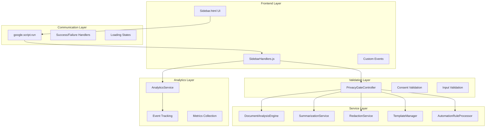
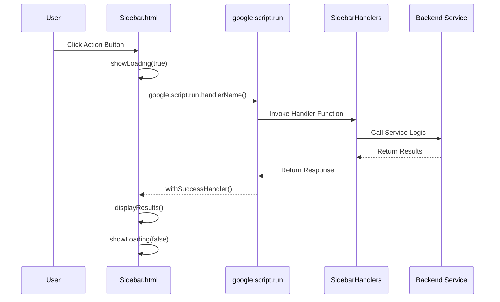
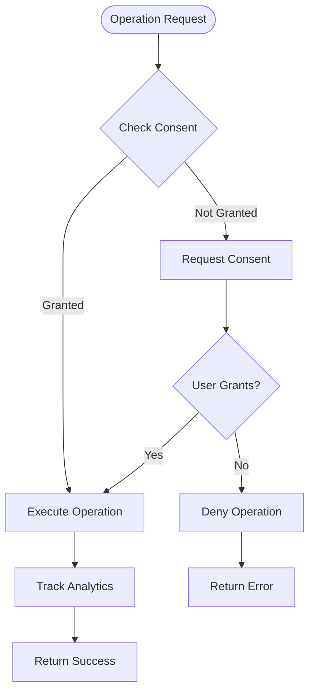
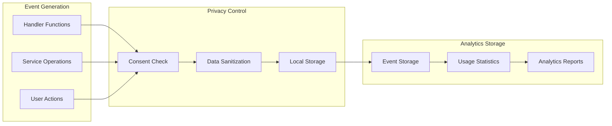

# Event Handlers API Documentation

<cite>
**Referenced Files in This Document**
- [SidebarHandlers.js](file://src/handlers/SidebarHandlers.js)
- [Sidebar.html](file://src/ui/Sidebar.html)
- [PrivacyGateController.js](file://src/services/PrivacyGateController.js)
- [Main.js](file://src/Main.js)
- [DocumentAnalysisEngine.js](file://src/services/DocumentAnalysisEngine.js)
- [SummarizationService.js](file://src/services/SummarizationService.js)
- [RedactionService.js](file://src/services/RedactionService.js)
- [TemplateManager.js](file://src/services/TemplateManager.js)
- [AnalyticsService.js](file://src/services/AnalyticsService.js)
- [AutomationRuleProcessor.js](file://src/services/AutomationRuleProcessor.js)
</cite>

## Table of Contents
1. [Introduction](#introduction)
2. [System Architecture](#system-architecture)
3. [Core Handler Functions](#core-handler-functions)
4. [Frontend Integration](#frontend-integration)
5. [Privacy and Consent Management](#privacy-and-consent-management)
6. [Error Handling and Validation](#error-handling-and-validation)
7. [Analytics Integration](#analytics-integration)
8. [Custom Events and Propagation](#custom-events-and-propagation)
9. [Implementation Examples](#implementation-examples)
10. [Best Practices](#best-practices)

## Introduction

The event handling system in the Intelligent Document Automation add-on serves as the critical bridge between the Google Workspace HTML sidebar interface and backend services. This system manages user interactions, validates inputs, executes business logic, and provides seamless feedback to users through asynchronous operations.

The system follows Google Apps Script's HtmlService architecture, utilizing `google.script.run` for client-server communication and implementing robust error handling, privacy controls, and analytics tracking throughout all operations.

## System Architecture

The event handling system operates on a layered architecture that separates concerns between frontend presentation, handler orchestration, and backend service execution.



**Diagram sources**
- [SidebarHandlers.js](file://src/handlers/SidebarHandlers.js#L1-L172)
- [Sidebar.html](file://src/ui/Sidebar.html#L306-L493)
- [PrivacyGateController.js](file://src/services/PrivacyGateController.js#L1-L366)

## Core Handler Functions

The system exposes several key handler functions that serve as the primary entry points for user interactions. Each handler follows a consistent pattern of validation, service invocation, error handling, and analytics tracking.

### Document Analysis Handler

**Function Signature:** `analyzeDocument()`

**Invocation Path:** `Sidebar.html → google.script.run → SidebarHandlers.analyzeDocument()`

**Expected Input:** None (automatically detects current document)

**Response Format:**
```javascript
{
  issues: Array<string>,
  suggestions: Array<string>
}
```

**Implementation Details:**
- Automatically detects document type using DocumentAnalysisEngine
- Executes platform-appropriate analysis (Documents, Spreadsheets, Presentations)
- Returns structured results with actionable suggestions
- Tracks analysis events for usage analytics

**Section sources**
- [SidebarHandlers.js](file://src/handlers/SidebarHandlers.js#L10-L20)
- [DocumentAnalysisEngine.js](file://src/services/DocumentAnalysisEngine.js#L12-L30)

### Document Summarization Handler

**Function Signature:** `summarizeDocument()`

**Invocation Path:** `Sidebar.html → google.script.run → SidebarHandlers.summarizeDocument()`

**Expected Input:** None (processes current document selection)

**Response Format:**
```javascript
{
  success: boolean,
  summary: string,
  method: string,
  error?: string
}
```

**Implementation Details:**
- Supports both full document and selection-based summarization
- Prioritizes AI-powered summarization when available
- Falls back to local summarization for unsupported lengths
- Tracks summarization methods and success rates

**Section sources**
- [SidebarHandlers.js](file://src/handlers/SidebarHandlers.js#L27-L40)
- [SummarizationService.js](file://src/services/SummarizationService.js#L16-L65)

### PII Detection Handler

**Function Signature:** `detectPIIInDocument()`

**Invocation Path:** `Sidebar.html → google.script.run → SidebarHandlers.detectPIIInDocument()`

**Expected Input:** None (analyzes current document)

**Response Format:**
```javascript
{
  found: Array<{
    type: string,
    preview: string,
    location: string,
    fullMatch: string
  }>,
  total: number,
  error?: string
}
```

**Implementation Details:**
- Detects multiple PII types (email, phone, SSN, credit cards, IP addresses)
- Provides masked previews for sensitive data
- Returns structured location information for each detection
- Integrates with PrivacyGateController for consent validation

**Section sources**
- [SidebarHandlers.js](file://src/handlers/SidebarHandlers.js#L47-L55)
- [RedactionService.js](file://src/services/RedactionService.js#L47-L135)

### PII Redaction Handler

**Function Signature:** `redactPIIInDocument()`

**Invocation Path:** `Sidebar.html → google.script.run → SidebarHandlers.redactPIIInDocument()`

**Expected Input:** None (redacts detected PII)

**Response Format:**
```javascript
{
  success: boolean,
  message: string,
  count: number,
  error?: string
}
```

**Implementation Details:**
- Requires redaction consent through PrivacyGateController
- Performs bulk redaction across all supported document types
- Tracks redaction counts and success metrics
- Provides immediate feedback on redaction results

**Section sources**
- [SidebarHandlers.js](file://src/handlers/SidebarHandlers.js#L62-L74)
- [RedactionService.js](file://src/services/RedactionService.js#L181-L208)

### Template Application Handler

**Function Signature:** `applyTemplate(templateId)`

**Invocation Path:** `Sidebar.html → google.script.run → SidebarHandlers.applyTemplate(templateId)`

**Expected Input:** `templateId: string`

**Response Format:**
```javascript
{
  success: boolean,
  message: string,
  error?: string
}
```

**Implementation Details:**
- Supports both built-in and custom templates
- Validates template compatibility with current document type
- Integrates with Google Drive for custom template storage
- Tracks template application events

**Section sources**
- [SidebarHandlers.js](file://src/handlers/SidebarHandlers.js#L138-L146)
- [TemplateManager.js](file://src/services/TemplateManager.js#L158-L202)

### Privacy Toggle Handler

**Function Signature:** `handlePrivacyToggle(e)`

**Invocation Path:** `Sidebar.html → google.script.run → SidebarHandlers.handlePrivacyToggle(e)`

**Expected Input:** Event object containing form inputs

**Response Format:**
```javascript
{
  notification: {
    text: string
  }
}
```

**Implementation Details:**
- Handles privacy consent changes from settings UI
- Updates consent preferences through PrivacyGateController
- Returns CardService-compatible response for Google Workspace integration
- Provides user feedback through notifications

**Section sources**
- [SidebarHandlers.js](file://src/handlers/SidebarHandlers.js#L153-L171)

## Frontend Integration

The frontend integration utilizes Google Apps Script's HtmlService to create a responsive sidebar interface that communicates seamlessly with backend handlers.

### HTML Structure and Event Binding

The sidebar HTML provides structured sections for different document operations, with each action button bound to specific JavaScript functions that initiate handler calls.



**Diagram sources**
- [Sidebar.html](file://src/ui/Sidebar.html#L327-L490)

### Asynchronous UI Updates

The system implements sophisticated loading states and real-time UI updates to provide responsive user feedback during long-running operations.

**Loading State Management:**
- Global loading spinner with progress indication
- Tab-specific loading states for multi-tab interfaces
- Immediate visual feedback for user actions
- Automatic loading state cleanup on completion

**Real-time Results Display:**
- Dynamic content insertion without page refresh
- Structured result formatting with appropriate styling
- Error message display with user-friendly messaging
- Success/failure state transitions

**Section sources**
- [Sidebar.html](file://src/ui/Sidebar.html#L301-L490)

### Custom Event System

The system implements a custom event propagation mechanism that handles error scenarios and provides consistent user feedback across all operations.

**Event Flow Pattern:**
1. User action triggers handler invocation
2. Handler executes business logic with validation
3. Service operations occur with error wrapping
4. Results propagate through success/failure callbacks
5. UI updates reflect operation outcomes

**Error Propagation Mechanism:**
- Centralized error handling with user-friendly messages
- Graceful degradation for unsupported operations
- Detailed logging for debugging and analytics
- User notification through alerts and UI updates

**Section sources**
- [Sidebar.html](file://src/ui/Sidebar.html#L480-L490)

## Privacy and Consent Management

The system implements comprehensive privacy controls through the PrivacyGateController, ensuring all sensitive operations require appropriate user consent before processing.

### Consent Types and Validation

The PrivacyGateController manages multiple consent categories, each with specific validation requirements:

| Consent Type | Purpose | Validation Level |
|--------------|---------|------------------|
| `basic` | Core functionality | Always required |
| `advancedAI` | AI-powered features | Explicit consent |
| `redaction` | PII redaction operations | Explicit consent |
| `analytics` | Usage analytics | Optional consent |
| `templateSharing` | Template library access | Optional consent |

### Consent Check Implementation

Each sensitive operation includes automatic consent validation:



**Diagram sources**
- [PrivacyGateController.js](file://src/services/PrivacyGateController.js#L78-L81)
- [PrivacyGateController.js](file://src/services/PrivacyGateController.js#L89-L147)

### Privacy Gate Integration

The PrivacyGateController acts as a central privacy enforcement layer, integrating with all sensitive operations:

**Consent Validation:**
- Automatic checking before sensitive operations
- User-friendly consent dialogs with clear explanations
- Persistent consent storage using Google Apps Script properties
- Audit logging for compliance requirements

**Data Processing Controls:**
- Local-first processing with fallback to consented remote processing
- Automatic data sanitization for analytics
- Transparent privacy policy display
- User control over data sharing preferences

**Section sources**
- [PrivacyGateController.js](file://src/services/PrivacyGateController.js#L170-L237)
- [RedactionService.js](file://src/services/RedactionService.js#L182-L208)

## Error Handling and Validation

The system implements comprehensive error handling at multiple levels, ensuring robust operation and meaningful user feedback.

### Handler-Level Error Wrapping

Each handler function implements consistent error handling patterns:

**Error Capture and Transformation:**
- Try-catch blocks around all service invocations
- Meaningful error messages with user context
- Logging of detailed error information for debugging
- Graceful degradation for non-critical failures

**Response Standardization:**
```javascript
// Error response format
{
  success: false,
  message: "Human-readable error message",
  error: "Technical error details (optional)"
}
```

### Input Validation Strategies

The system validates inputs at multiple stages:

**Frontend Validation:**
- Real-time input checking for forms
- User-friendly validation messages
- Preventive error handling before submission
- Input sanitization and formatting

**Backend Validation:**
- Service-level input verification
- Document type compatibility checking
- Resource availability validation
- Permission and consent verification

**Section sources**
- [SidebarHandlers.js](file://src/handlers/SidebarHandlers.js#L10-L74)
- [PrivacyGateController.js](file://src/services/PrivacyGateController.js#L170-L237)

### Client-Side Error Handling

The frontend implements sophisticated error handling for user experience:

**Error Display Mechanisms:**
- Modal dialogs for critical errors
- Inline error messages for form validation
- Toast notifications for non-blocking issues
- Detailed error logs for support teams

**Recovery Strategies:**
- Automatic retry for transient failures
- Fallback operations for unsupported features
- Graceful degradation for partial failures
- User guidance for manual resolution

**Section sources**
- [Sidebar.html](file://src/ui/Sidebar.html#L480-L490)

## Analytics Integration

The system integrates comprehensive analytics tracking through the AnalyticsService, providing insights into user behavior while maintaining privacy controls.

### Event Tracking Architecture



**Diagram sources**
- [AnalyticsService.js](file://src/services/AnalyticsService.js#L16-L45)
- [PrivacyGateController.js](file://src/services/PrivacyGateController.js#L170-L237)

### Event Categories and Metadata

The analytics system tracks various event categories with appropriate metadata:

**Document Operations:**
- `analyze_document`: Issue detection counts
- `summarize`: Method used, text length
- `redact_pii`: Item counts, document types
- `apply_template`: Template IDs, success rates

**System Interactions:**
- `remove_duplicates`: Row counts, processing time
- `standardize_dates`: Format conversions, success rates
- `fill_empty_cells`: Cell counts, fill strategies

**Privacy Events:**
- `consent_update`: Consent types, timestamps
- `privacy_event`: Event types, metadata
- `remote_processing`: Operation types, fallback reasons

### Data Sanitization and Privacy

The analytics system implements strict privacy controls:

**PII Removal:**
- Automatic removal of personally identifiable information
- Whitelist-based metadata filtering
- Anonymous session identification
- Compliance with privacy regulations

**Local-First Processing:**
- Analytics data stored locally by default
- Optional remote transmission with consent
- User control over analytics sharing
- Transparent data collection policies

**Section sources**
- [AnalyticsService.js](file://src/services/AnalyticsService.js#L234-L254)
- [AnalyticsService.js](file://src/services/AnalyticsService.js#L350-L367)

## Custom Events and Propagation

The system implements a custom event propagation mechanism that ensures consistent error handling and user feedback across all operations.

### Event Lifecycle Management

**Event Creation:**
- Automatic event generation for each operation
- Metadata capture including timestamps and parameters
- Session identification for user tracking
- Error context preservation

**Event Processing:**
- Centralized event routing and validation
- Privacy-compliant data sanitization
- Analytics integration and storage
- Error correlation and debugging support

**Event Consumption:**
- Real-time UI updates based on event results
- User notifications for successful operations
- Error reporting and user guidance
- Analytics dashboard integration

### Error Propagation Patterns

The system implements consistent error propagation patterns:

**Handler-Level Propagation:**
- Try-catch blocks with meaningful error messages
- Standardized error response formats
- Logging of detailed error contexts
- User-friendly error presentation

**UI-Level Propagation:**
- Centralized error handling with user feedback
- Graceful degradation for failed operations
- Progress indication during long-running tasks
- Clear success/failure state management

**Section sources**
- [SidebarHandlers.js](file://src/handlers/SidebarHandlers.js#L10-L74)
- [Sidebar.html](file://src/ui/Sidebar.html#L480-L490)

## Implementation Examples

### Basic Document Analysis Workflow

```javascript
// Frontend initiation
function runAnalysis() {
  showLoading(true);
  google.script.run
    .withSuccessHandler(displayAnalysisResults)
    .withFailureHandler(handleError)
    .analyzeDocument();
}

// Success handler
function displayAnalysisResults(results) {
  showLoading(false);
  const container = document.getElementById('analysis-results');
  const badge = document.getElementById('issues-badge');
  
  if (results.issues && results.issues.length > 0) {
    badge.style.display = 'inline-block';
    badge.textContent = results.issues.length + ' issues';
    badge.className = 'issue-badge warning';
    
    let html = '<div class="results"><div class="results-title">Found ' + results.issues.length + ' issues:</div>';
    results.issues.forEach(issue => {
      html += '<div style="margin: 4px 0; font-size: 12px;">• ' + issue + '</div>';
    });
    html += '</div>';
    container.innerHTML = html;
  } else {
    badge.style.display = 'inline-block';
    badge.textContent = '✓ No issues';
    badge.className = 'issue-badge info';
    container.innerHTML = '<div class="results"><div class="results-title">✅ Document looks great!</div></div>';
  }
}
```

### PII Redaction with Consent Validation

```javascript
// Handler implementation with privacy gate
function redactPIIInDocument() {
  try {
    // Privacy gate validation
    if (!PrivacyGateController.checkConsent('redaction')) {
      return {
        success: false,
        message: 'Privacy consent required for redaction',
        count: 0
      };
    }
    
    const results = RedactionService.redactPIIInDocument();
    
    if (results.success) {
      AnalyticsService.trackEvent('redact_pii', { count: results.count });
    }
    
    return results;
  } catch (e) {
    console.error('Error in redactPIIInDocument:', e);
    return { success: false, message: 'Error: ' + e.message, count: 0 };
  }
}
```

### Template Application with Error Handling

```javascript
// Template application with consent and validation
function applyTemplate(templateId) {
  try {
    const template = BUILTIN_TEMPLATES[templateId];
    
    if (!template) {
      // Try to load from Drive
      return applyDriveTemplate(templateId);
    }
    
    const docType = DocumentAnalysisEngine.getDocumentType();
    
    // Verify template type matches document type
    if (template.type !== docType) {
      return {
        success: false,
        message: `Template is for ${template.type} but current document is ${docType}`
      };
    }
    
    // Apply template based on type
    let result;
    switch(docType) {
      case 'SPREADSHEET':
        result = applySpreadsheetTemplate(templateId, template);
        break;
      case 'DOCUMENT':
        result = applyDocumentTemplate(templateId, template);
        break;
      case 'PRESENTATION':
        result = applyPresentationTemplate(templateId, template);
        break;
      default:
        return { success: false, message: 'Unsupported document type' };
    }
    
    if (result.success) {
      AnalyticsService.trackEvent('apply_template', { templateId });
    }
    
    return result;
  } catch (e) {
    console.error('Error applying template:', e);
    return { success: false, message: 'Error: ' + e.message };
  }
}
```

**Section sources**
- [Sidebar.html](file://src/ui/Sidebar.html#L327-L490)
- [SidebarHandlers.js](file://src/handlers/SidebarHandlers.js#L62-L74)
- [TemplateManager.js](file://src/services/TemplateManager.js#L158-L202)

## Best Practices

### Handler Design Principles

**Single Responsibility:**
- Each handler focuses on one primary operation
- Clear separation between validation, execution, and response
- Consistent error handling patterns across all handlers

**Input Validation:**
- Validate inputs at multiple levels (frontend, handler, service)
- Provide meaningful error messages for invalid inputs
- Sanitize inputs to prevent injection attacks

**Error Handling:**
- Implement comprehensive try-catch blocks
- Transform technical errors into user-friendly messages
- Log detailed error information for debugging
- Provide graceful degradation for non-critical failures

### Performance Optimization

**Async Operations:**
- Use `google.script.run.withSuccessHandler()` for all async calls
- Implement loading states to improve user experience
- Batch operations where possible to reduce API calls
- Cache frequently accessed data to minimize redundant requests

**Resource Management:**
- Monitor memory usage in long-running operations
- Implement timeout mechanisms for external service calls
- Use efficient data structures for large datasets
- Clean up resources after operations complete

### Security Considerations

**Privacy Controls:**
- Implement PrivacyGateController for all sensitive operations
- Validate user consent before processing PII
- Sanitize metadata for analytics to prevent data leakage
- Use HTTPS for all external communications

**Input Sanitization:**
- Validate all user inputs against expected formats
- Escape special characters in user-generated content
- Implement rate limiting for API calls
- Monitor for suspicious activity patterns

### User Experience Guidelines

**Feedback Mechanisms:**
- Provide immediate visual feedback for user actions
- Show progress indicators for long-running operations
- Display meaningful success/failure messages
- Offer helpful guidance for error resolution

**Accessibility:**
- Ensure keyboard navigation support
- Provide screen reader compatible error messages
- Use semantic HTML for better accessibility
- Implement responsive design for mobile devices

**Documentation and Support:**
- Maintain comprehensive API documentation
- Provide clear error messages with resolution guidance
- Implement self-service troubleshooting options
- Monitor user feedback for continuous improvement