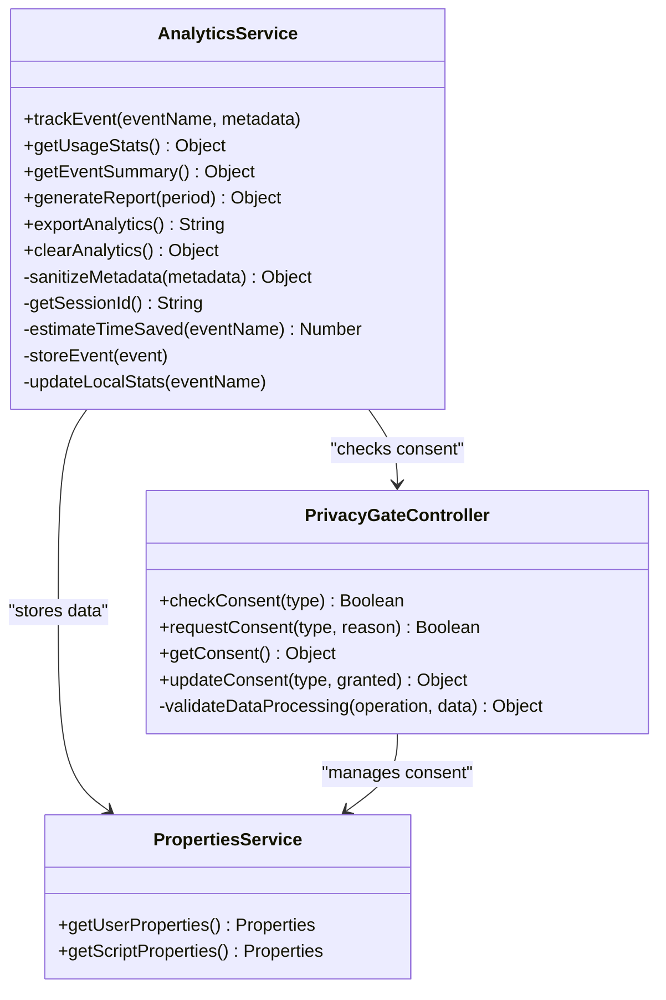
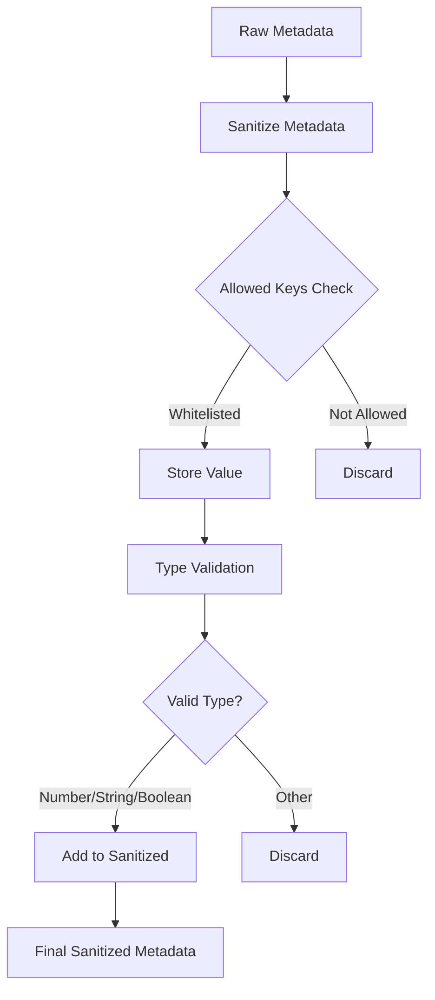
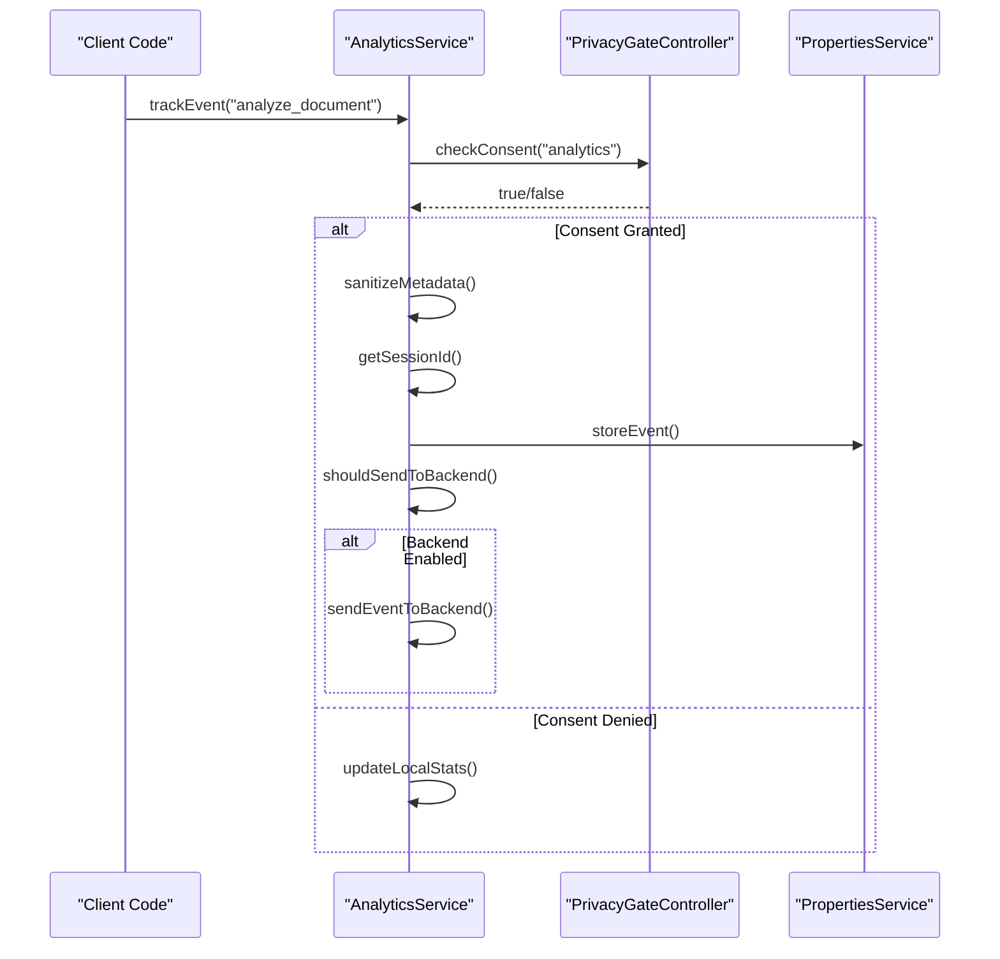
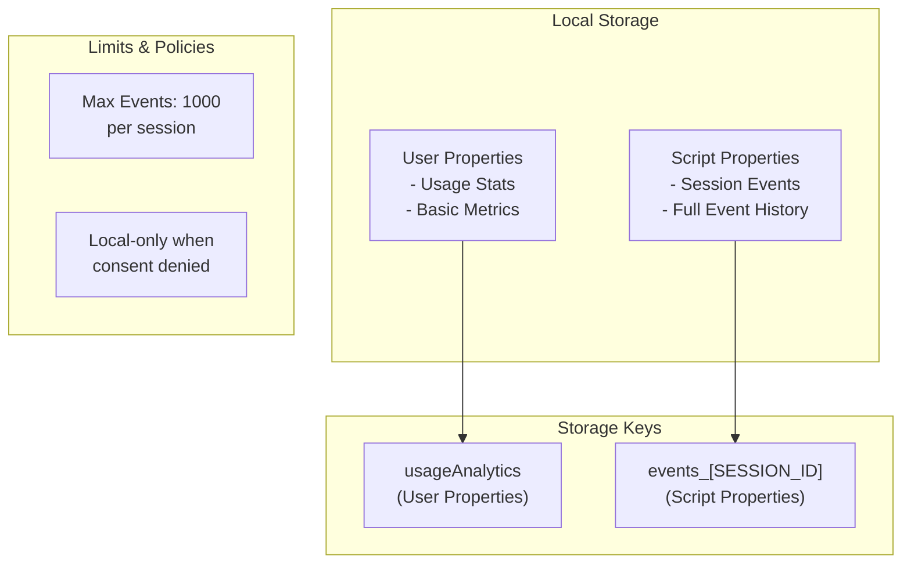
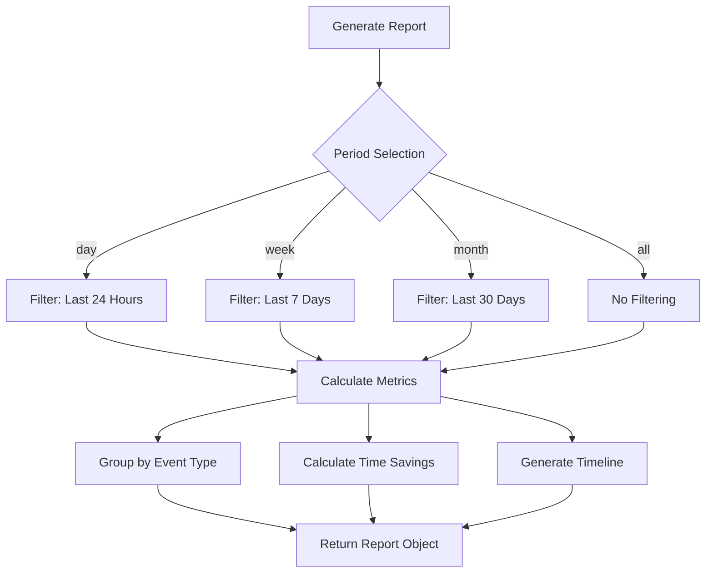
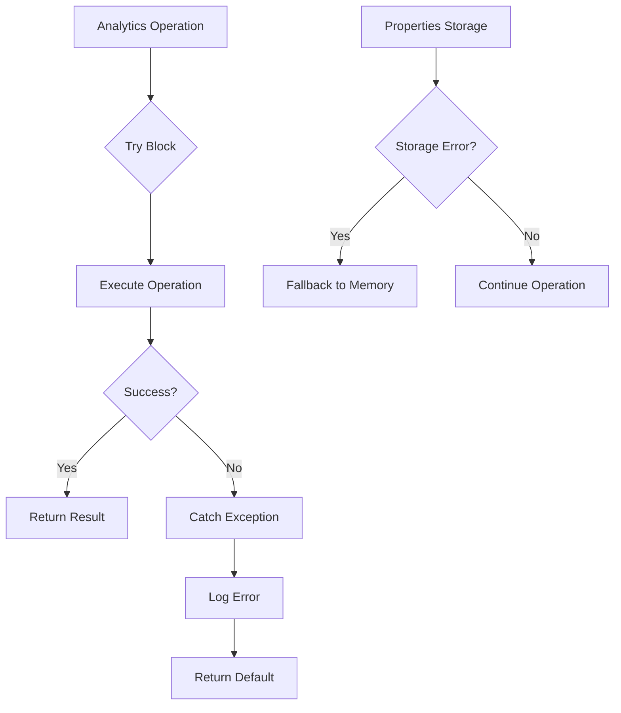

# Analytics Service API Documentation

<cite>
**Referenced Files in This Document**
- [AnalyticsService.js](file://src/services/AnalyticsService.js)
- [PrivacyGateController.js](file://src/services/PrivacyGateController.js)
- [Main.js](file://src/Main.js)
- [SidebarHandlers.js](file://src/handlers/SidebarHandlers.js)
- [AutomationRuleProcessor.js](file://src/services/AutomationRuleProcessor.js)
- [SummarizationService.js](file://src/services/SummarizationService.js)
- [RedactionService.js](file://src/services/RedactionService.js)
- [TemplateManager.js](file://src/services/TemplateManager.js)
- [Sidebar.html](file://src/ui/Sidebar.html)
</cite>

## Table of Contents
1. [Introduction](#introduction)
2. [Service Architecture](#service-architecture)
3. [Core Public Methods](#core-public-methods)
4. [Privacy-Preserving Implementation](#privacy-preserving-implementation)
5. [Integration with PrivacyGateController](#integration-with-privacygatecontroller)
6. [Event Tracking and Storage](#event-tracking-and-storage)
7. [Report Generation and Analytics](#report-generation-and-analytics)
8. [Usage Examples](#usage-examples)
9. [Error Handling and Performance](#error-handling-and-performance)
10. [Configuration and Time Savings Estimation](#configuration-and-time-savings-estimation)

## Introduction

The AnalyticsService is a comprehensive privacy-preserving analytics system designed for the Techno Browser extension. It provides detailed usage tracking, statistical analysis, and reporting capabilities while maintaining strict adherence to privacy principles. The service operates entirely locally when consent is not granted, ensuring user data remains protected.

The service tracks user interactions with various document automation features, generates insightful reports, and provides estimates of time savings achieved through automated processing. All analytics data is stored locally using Google Apps Script PropertiesService, with optional backend synchronization for enterprise deployments.

## Service Architecture

The AnalyticsService follows a modular architecture with clear separation of concerns:



**Diagram sources**
- [AnalyticsService.js](file://src/services/AnalyticsService.js#L6-L394)
- [PrivacyGateController.js](file://src/services/PrivacyGateController.js#L6-L365)

**Section sources**
- [AnalyticsService.js](file://src/services/AnalyticsService.js#L1-L394)
- [PrivacyGateController.js](file://src/services/PrivacyGateController.js#L1-L365)

## Core Public Methods

### trackEvent()

Tracks user interactions with document automation features.

**Signature:**
```javascript
trackEvent(eventName, metadata = {})
```

**Parameters:**
- `eventName` (string): Unique identifier for the tracked action
- `metadata` (Object, optional): Additional contextual information (must not contain PII)

**Implementation Details:**
- Checks analytics consent via PrivacyGateController
- Sanitizes metadata to prevent PII collection
- Records timestamp, session ID, and event details
- Stores locally using PropertiesService
- Optionally sends to backend (disabled by default)

**Section sources**
- [AnalyticsService.js](file://src/services/AnalyticsService.js#L15-L44)

### getUsageStats()

Retrieves comprehensive usage statistics and time savings calculations.

**Signature:**
```javascript
getUsageStats() => Object
```

**Returns:**
```javascript
{
  totalActions: Number,
  timeSavedMinutes: Number,
  timeSaved: String,
  actions: Object,
  firstUsed: String,
  lastUsed: String
}
```

**Features:**
- Aggregates action counts by feature type
- Calculates estimated time savings based on action patterns
- Maintains first and last usage timestamps
- Provides human-readable time formatting

**Section sources**
- [AnalyticsService.js](file://src/services/AnalyticsService.js#L51-L64)

### getEventSummary()

Provides a concise overview of tracked events and usage patterns.

**Signature:**
```javascript
getEventSummary() => Object
```

**Returns:**
```javascript
{
  totalActions: Number,
  timeSaved: String,
  topActions: Array,
  lastUsed: String
}
```

**Top Actions Format:**
```javascript
[
  { action: "Analyze Document", count: 15 },
  { action: "Remove Duplicates", count: 8 },
  { action: "Standardize Dates", count: 5 }
]
```

**Section sources**
- [AnalyticsService.js](file://src/services/AnalyticsService.js#L140-L160)

### generateReport()

Creates detailed analytics reports filtered by time periods.

**Signature:**
```javascript
generateReport(period = 'all') => Object
```

**Parameters:**
- `period` (string): Report timeframe ('day', 'week', 'month', 'all')

**Returns:**
```javascript
{
  period: String,
  totalEvents: Number,
  totalActions: Number,
  timeSaved: String,
  eventsByType: Object,
  timeline: Array
}
```

**Timeframe Calculations:**
- Day: Last 24 hours
- Week: Last 7 days
- Month: Last 30 days
- All: Entire history

**Section sources**
- [AnalyticsService.js](file://src/services/AnalyticsService.js#L168-L194)

### exportAnalytics()

Exports all analytics data in CSV format for external analysis.

**Signature:**
```javascript
exportAnalytics() => String
```

**CSV Format:**
```
Timestamp,Event,Metadata
2024-01-15T10:30:00Z,analyze_document,"{""issueCount"":5}"
2024-01-15T10:31:15Z,summarize,"{""method"":""local""}"
```

**Section sources**
- [AnalyticsService.js](file://src/services/AnalyticsService.js#L201-L210)

### clearAnalytics()

Removes all analytics data from local storage.

**Signature:**
```javascript
clearAnalytics() => Object
```

**Returns:**
```javascript
{
  success: Boolean,
  message: String
}
```

**Section sources**
- [AnalyticsService.js](file://src/services/AnalyticsService.js#L216-L229)

## Privacy-Preserving Implementation

### Metadata Sanitization

The service implements comprehensive PII prevention through strict metadata sanitization:



**Diagram sources**
- [AnalyticsService.js](file://src/services/AnalyticsService.js#L239-L251)

**Allowed Metadata Keys:**
- `count`: Numeric counts of processed items
- `type`: Classification of operations
- `method`: Processing approach used
- `format`: Output format specifications
- `category`: Feature categorization
- `docType`: Document type identification
- `length`: Text/document size measurements

**Section sources**
- [AnalyticsService.js](file://src/services/AnalyticsService.js#L239-L251)

### Local-Only Processing

When analytics consent is not granted, the service operates entirely locally:

- Minimal statistics tracking only
- No event transmission to external systems
- Local storage using PropertiesService
- Immediate user feedback without delay

**Section sources**
- [AnalyticsService.js](file://src/services/AnalyticsService.js#L18-L22)

## Integration with PrivacyGateController

The AnalyticsService seamlessly integrates with PrivacyGateController for comprehensive privacy management:



**Diagram sources**
- [AnalyticsService.js](file://src/services/AnalyticsService.js#L18-L44)
- [PrivacyGateController.js](file://src/services/PrivacyGateController.js#L78-L80)

### Consent Management Features

**Automatic Consent Checking:**
- Every trackEvent call validates current consent status
- Graceful degradation when consent is denied
- Transparent fallback to local-only mode

**Dynamic Consent Requests:**
- Users can grant analytics consent through privacy settings
- Clear explanations of data collection practices
- Granular control over analytics permissions

**Section sources**
- [AnalyticsService.js](file://src/services/AnalyticsService.js#L18-L22)
- [PrivacyGateController.js](file://src/services/PrivacyGateController.js#L89-L143)

## Event Tracking and Storage

### Event Storage Strategy

The service employs a dual-layer storage approach:



**Diagram sources**
- [AnalyticsService.js](file://src/services/AnalyticsService.js#L8-L10)
- [AnalyticsService.js](file://src/services/AnalyticsService.js#L104-L116)

### Session Management

Each user session receives a unique identifier for event correlation:

**Session ID Generation:**
- UUID-based session identifiers
- Persistent across browser sessions
- Automatic cleanup when analytics are cleared

**Event Correlation:**
- All events within a session share the same session ID
- Enables temporal analysis and user journey tracking
- Supports cross-session analytics when consent permits

**Section sources**
- [AnalyticsService.js](file://src/services/AnalyticsService.js#L260-L269)

### Event Structure

Stored events contain comprehensive but privacy-safe information:

```javascript
{
  name: "analyze_document",
  timestamp: "2024-01-15T10:30:00Z",
  metadata: {
    issueCount: 5,
    method: "local"
  },
  session: "uuid-session-id"
}
```

**Section sources**
- [AnalyticsService.js](file://src/services/AnalyticsService.js#L28-L33)

## Report Generation and Analytics

### Time Savings Estimation

The service provides sophisticated time savings calculations based on action types:

| Action Type | Estimated Time Saved |
|-------------|---------------------|
| analyze_document | 2 minutes |
| remove_duplicates | 5 minutes |
| standardize_dates | 3 minutes |
| fill_empty_cells | 4 minutes |
| redact_pii | 10 minutes |
| apply_template | 15 minutes |
| summarize | 8 minutes |
| remove_empty_rows | 2 minutes |
| standardize_currency | 3 minutes |
| trim_whitespace | 1 minute |
| capitalize_text | 2 minutes |

**Calculation Formula:**
```
totalTimeSaved = sum(estimatedTimePerAction × actionCount)
formattedTime = formatTimeSaved(totalTimeSaved)
```

**Section sources**
- [AnalyticsService.js](file://src/services/AnalyticsService.js#L277-L294)
- [AnalyticsService.js](file://src/services/AnalyticsService.js#L296-L316)

### Report Period Analysis

The service supports flexible time-based filtering:



**Diagram sources**
- [AnalyticsService.js](file://src/services/AnalyticsService.js#L335-L347)

**Section sources**
- [AnalyticsService.js](file://src/services/AnalyticsService.js#L168-L194)

## Usage Examples

### Basic Event Tracking

**Document Analysis:**
```javascript
// Called from sidebar handlers
function analyzeDocument() {
  try {
    const results = DocumentAnalysisEngine.analyzeDocument();
    AnalyticsService.trackEvent('analyze_document', { 
      issueCount: results.issues.length 
    });
    return results;
  } catch (e) {
    console.error('Error in analyzeDocument:', e);
    return { issues: ['Error: ' + e.message], suggestions: [] };
  }
}
```

**Section sources**
- [SidebarHandlers.js](file://src/handlers/SidebarHandlers.js#L12-L15)

### Data Processing Operations

**Automation Rule Processing:**
```javascript
// Called from automation processors
function removeDuplicateRows() {
  try {
    const sheet = SpreadsheetApp.getActiveSheet();
    const dataRange = sheet.getDataRange();
    const values = dataRange.getValues();
    
    // ... processing logic ...
    
    AnalyticsService.trackEvent('remove_duplicates', { 
      count: rowsToDelete.length 
    });
    
    return {
      success: true,
      message: `Removed ${rowsToDelete.length} duplicate row(s)`,
      count: rowsToDelete.length
    };
  } catch (e) {
    console.error('Error removing duplicates:', e);
    return { success: false, message: 'Error: ' + e.message, count: 0 };
  }
}
```

**Section sources**
- [AutomationRuleProcessor.js](file://src/services/AutomationRuleProcessor.js#L39-L40)

### AI and Advanced Features

**Summarization Service Integration:**
```javascript
// Called from summarization service
function summarizeLocally(text) {
  // ... summarization logic ...
  
  AnalyticsService.trackEvent('summarize', { 
    method: 'local', 
    length: text.length 
  });
  
  return summary + '.';
}

function summarizeWithBackend(text) {
  // ... backend summarization logic ...
  
  if (result.success) {
    AnalyticsService.trackEvent('summarize', { 
      method: 'backend', 
      length: text.length 
    });
    return result.summary;
  }
}
```

**Section sources**
- [SummarizationService.js](file://src/services/SummarizationService.js#L181-L182)
- [SummarizationService.js](file://src/services/SummarizationService.js#L259-L260)

### Redaction and Security Operations

**PII Detection and Redaction:**
```javascript
// Called from redaction service
function detectPIIInDocument() {
  try {
    const results = RedactionService.detectPIIInDocument();
    AnalyticsService.trackEvent('detect_pii', { 
      count: results.total 
    });
    return results;
  } catch (e) {
    console.error('Error in detectPIIInDocument:', e);
    return { found: [], total: 0, error: e.message };
  }
}

function redactPIIInDocument() {
  try {
    const results = RedactionService.redactPIIInDocument();
    
    if (results.success) {
      AnalyticsService.trackEvent('redact_pii', { 
        count: results.count 
      });
    }
    
    return results;
  } catch (e) {
    console.error('Error in redactPIIInDocument:', e);
    return { success: false, message: 'Error: ' + e.message, count: 0 };
  }
}
```

**Section sources**
- [SidebarHandlers.js](file://src/handlers/SidebarHandlers.js#L49-L50)
- [SidebarHandlers.js](file://src/handlers/SidebarHandlers.js#L66-L67)

## Error Handling and Performance

### Robust Error Management

The service implements comprehensive error handling to ensure reliability:



**Diagram sources**
- [AnalyticsService.js](file://src/services/AnalyticsService.js#L42-L44)
- [AnalyticsService.js](file://src/services/AnalyticsService.js#L52-L64)

### Performance Optimizations

**Storage Limits:**
- Maximum 1000 events per session to prevent memory bloat
- Automatic event trimming when limits exceeded
- Efficient JSON serialization/deserialization

**Memory Management:**
- Lazy loading of analytics data
- Minimal memory footprint during operations
- Garbage collection-friendly design

**Section sources**
- [AnalyticsService.js](file://src/services/AnalyticsService.js#L8-L10)
- [AnalyticsService.js](file://src/services/AnalyticsService.js#L111-L114)

### Backend Integration

**Optional Backend Synchronization:**
```javascript
// Currently disabled by default
function shouldSendToBackend() {
  return PrivacyGateController.checkConsent('analytics') && false;
}

function sendEventToBackend(event) {
  // Placeholder for future backend integration
  Logger.log('Backend analytics disabled');
}
```

**Section sources**
- [AnalyticsService.js](file://src/services/AnalyticsService.js#L354-L367)

## Configuration and Time Savings Estimation

### Configuration Options

**Event Storage Limits:**
- `MAX_EVENTS`: 1000 events per session
- Automatic cleanup of oldest events
- Configurable storage duration

**Privacy Settings:**
- Analytics consent required for full functionality
- Local-only mode when consent denied
- Granular privacy controls

### Time Savings Calculation

The service provides sophisticated time estimation based on action patterns:

**Calculation Methodology:**
1. **Action-Based Estimation:** Each action type has predefined time savings
2. **Cumulative Calculation:** Total savings = Σ(time_saved_per_action × count)
3. **Human-Readable Formatting:** Converts minutes to days/hours format

**Formatting Rules:**
- Minutes: Display as "X min" for < 60 minutes
- Hours: Display as "Xh Ym" for 60-1439 minutes
- Days: Display as "Xd Yh" for ≥ 1440 minutes

**Section sources**
- [AnalyticsService.js](file://src/services/AnalyticsService.js#L277-L316)

### Enterprise Features

**Scalable Architecture:**
- Session-based event correlation
- Hierarchical data organization
- Audit trail capabilities

**Reporting Capabilities:**
- Multi-period analysis
- Action frequency tracking
- Time savings aggregation
- Export functionality

**Section sources**
- [AnalyticsService.js](file://src/services/AnalyticsService.js#L168-L210)