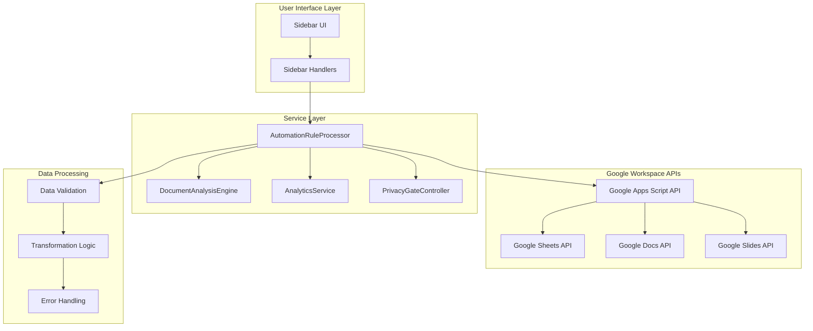
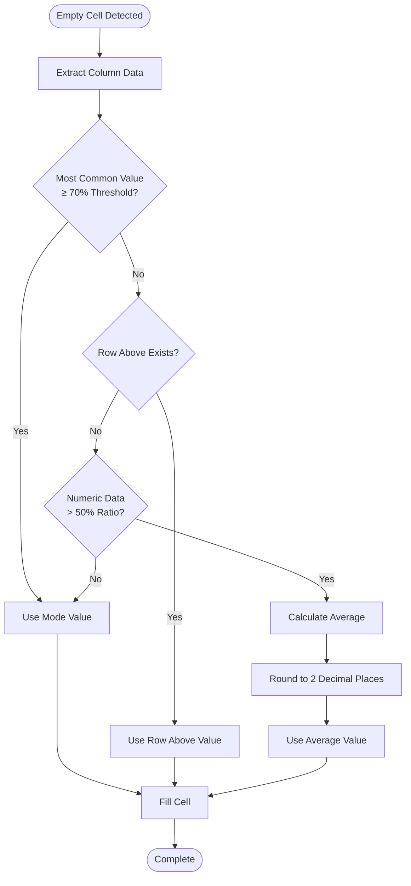
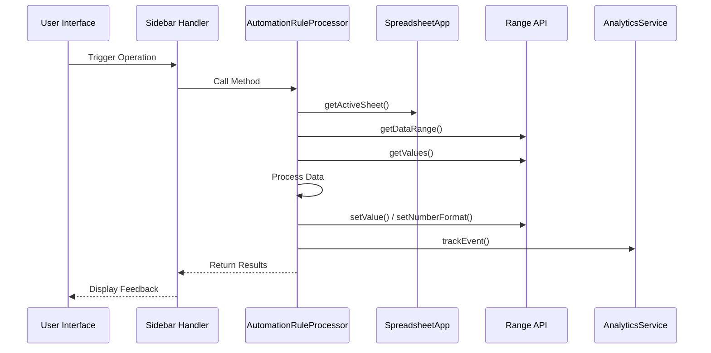
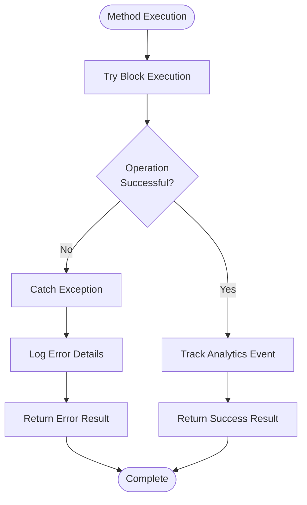
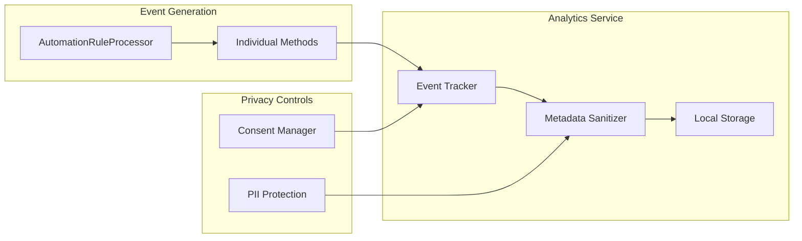
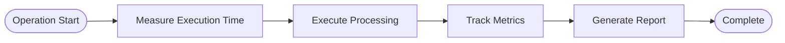
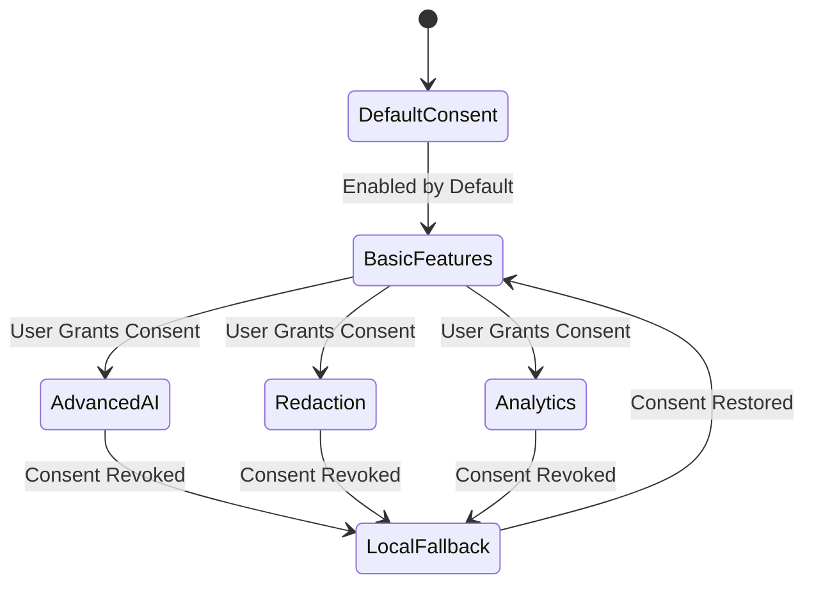

# Automation Rule Processor API Documentation

<cite>
**Referenced Files in This Document**
- [AutomationRuleProcessor.js](file://src/services/AutomationRuleProcessor.js)
- [SidebarHandlers.js](file://src/handlers/SidebarHandlers.js)
- [AnalyticsService.js](file://src/services/AnalyticsService.js)
- [DocumentAnalysisEngine.js](file://src/services/DocumentAnalysisEngine.js)
- [PrivacyGateController.js](file://src/services/PrivacyGateController.js)
- [TemplateManager.js](file://src/services/TemplateManager.js)
- [SummarizationService.js](file://src/services/SummarizationService.js)
- [Utils.js](file://src/utils/Utils.js)
- [README.md](file://README.md)
</cite>

## Table of Contents
1. [Introduction](#introduction)
2. [Service Architecture](#service-architecture)
3. [Core Methods Overview](#core-methods-overview)
4. [Detailed Method Documentation](#detailed-method-documentation)
5. [Integration with Google Sheets API](#integration-with-google-sheets-api)
6. [Error Handling and Quota Management](#error-handling-and-quota-management)
7. [Analytics and Tracking](#analytics-and-tracking)
8. [Performance Considerations](#performance-considerations)
9. [Privacy and Security](#privacy-and-security)
10. [Code Examples](#code-examples)
11. [Best Practices](#best-practices)

## Introduction

The AutomationRuleProcessor service is a comprehensive document cleanup and transformation engine designed for Google Workspace applications. It provides macro-like operations for batch data processing, format standardization, and intelligent data filling across Google Sheets, Docs, and Slides documents. The service operates entirely within Google Apps Script, ensuring privacy-first processing with local data handling by default.

The service implements seven core automation methods that address common document cleanup challenges: duplicate removal, date standardization, intelligent empty cell filling, empty row removal, currency standardization, whitespace trimming, and text capitalization. Each method is designed to handle large datasets efficiently while maintaining data integrity and providing comprehensive error handling.

## Service Architecture

The AutomationRuleProcessor follows a modular architecture with clear separation of concerns:



**Diagram sources**
- [AutomationRuleProcessor.js](file://src/services/AutomationRuleProcessor.js#L1-L399)
- [SidebarHandlers.js](file://src/handlers/SidebarHandlers.js#L1-L172)
- [AnalyticsService.js](file://src/services/AnalyticsService.js#L1-L395)

**Section sources**
- [AutomationRuleProcessor.js](file://src/services/AutomationRuleProcessor.js#L1-L399)
- [SidebarHandlers.js](file://src/handlers/SidebarHandlers.js#L1-L172)

## Core Methods Overview

The AutomationRuleProcessor exposes seven primary methods, each targeting specific document cleanup scenarios:

| Method | Purpose | Scope | Performance Impact |
|--------|---------|-------|-------------------|
| `removeDuplicateRows()` | Eliminates duplicate data entries | Row-level | Medium (O(n²) worst case) |
| `standardizeDateFormats()` | Unifies date formats across columns | Cell-level | Low-Medium (O(n×m)) |
| `fillEmptyCellsIntelligently()` | Populates blank cells with contextual data | Cell-level | Medium-High (O(n×m)) |
| `removeEmptyRows()` | Deletes completely empty rows | Row-level | Low (O(n)) |
| `standardizeCurrencyFormats()` | Normalizes monetary values and formats | Cell-level | Low-Medium (O(n×m)) |
| `trimWhitespace()` | Removes leading/trailing spaces from text | Cell-level | Low (O(n×m)) |
| `capitalizeText()` | Applies text formatting to selected ranges | Range-level | Low (O(n×m)) |

Each method returns standardized result objects containing success status, descriptive messages, and processing statistics for analytics tracking.

**Section sources**
- [AutomationRuleProcessor.js](file://src/services/AutomationRuleProcessor.js#L8-L395)

## Detailed Method Documentation

### removeDuplicateRows()

Removes duplicate rows from the active spreadsheet while preserving the first occurrence of each unique record.

**Implementation Details:**
- Uses JSON serialization for row comparison to handle complex data types
- Processes data in memory before applying deletions
- Maintains row order by deleting from bottom to top
- Skips header row when identifying duplicates

**Algorithm Complexity:**
- Time: O(n) where n is the number of rows
- Space: O(n) for storing seen row hashes

**Error Handling:**
- Gracefully handles empty sheets with informative messages
- Provides rollback capability through batch deletion operations
- Logs processing statistics for analytics

**Section sources**
- [AutomationRuleProcessor.js](file://src/services/AutomationRuleProcessor.js#L12-L60)

### standardizeDateFormats()

Converts various date formats to a unified standard format across the entire spreadsheet.

**Supported Date Patterns:**
- MM/DD/YYYY (American format)
- YYYY-MM-DD (ISO format)
- MM-DD-YYYY (Variant format)
- Various separators (/, -, .)

**Standardization Process:**
1. Pattern recognition using regular expressions
2. Multi-format date parsing with fallback strategies
3. Automatic format detection and conversion
4. Cell formatting preservation

**Implementation Features:**
- Configurable target format parameter
- Batch processing for optimal performance
- Format validation and error recovery
- Analytics tracking with conversion counts

**Section sources**
- [AutomationRuleProcessor.js](file://src/services/AutomationRuleProcessor.js#L62-L100)

### fillEmptyCellsIntelligently()

Intelligently populates empty cells based on surrounding data patterns and statistical analysis.

**Intelligence Strategies:**
1. **Mode-based filling**: Uses most frequent value in column when majority consensus exists
2. **Sequential filling**: Copies value from row above when available
3. **Numeric averaging**: Calculates average for numeric columns with sufficient data
4. **Fallback mechanism**: Defaults to mode-based filling when other strategies fail

**Data Analysis Algorithm:**


**Diagram sources**
- [AutomationRuleProcessor.js](file://src/services/AutomationRuleProcessor.js#L348-L377)

**Section sources**
- [AutomationRuleProcessor.js](file://src/services/AutomationRuleProcessor.js#L102-L150)

### removeEmptyRows()

Eliminates rows that contain only empty cells, cleaning up sparse data layouts.

**Detection Logic:**
- Tests all cells in a row for emptiness (null, undefined, empty string)
- Preserves rows with any non-empty content
- Handles mixed data types appropriately

**Performance Optimization:**
- Single-pass row scanning
- Reverse-order deletion to maintain row indices
- Minimal memory footprint

**Section sources**
- [AutomationRuleProcessor.js](file://src/services/AutomationRuleProcessor.js#L152-L190)

### standardizeCurrencyFormats()

Normalizes monetary values and formats them consistently across the spreadsheet.

**Currency Processing Features:**
- Symbol extraction and normalization ($, €, £, ¥, ₹)
- Numeric value extraction and validation
- Format standardization with configurable currency symbols
- Automatic decimal precision handling

**Validation Pipeline:**
1. String pattern matching for currency indicators
2. Numeric value extraction and cleaning
3. Format application with consistent styling
4. Error handling for malformed currency values

**Section sources**
- [AutomationRuleProcessor.js](file://src/services/AutomationRuleProcessor.js#L192-L230)

### trimWhitespace()

Removes leading and trailing whitespace from all text cells in the active range.

**Processing Strategy:**
- Type-safe string validation before trimming
- Batch processing for efficiency
- Preservation of original cell formatting
- Comprehensive character encoding support

**Section sources**
- [AutomationRuleProcessor.js](file://src/services/AutomationRuleProcessor.js#L232-L270)

### capitalizeText()

Applies text formatting to selected ranges with multiple case options.

**Available Formatting Options:**
- UPPER CASE: Converts all text to uppercase
- lower case: Converts all text to lowercase  
- Title Case: Capitalizes first letter of each word
- Sentence case: Capitalizes first letter of first word in sentences

**Implementation Features:**
- Range-based processing for selective operations
- Intelligent word boundary detection
- Preservation of existing formatting
- Analytics tracking with format type identification

**Section sources**
- [AutomationRuleProcessor.js](file://src/services/AutomationRuleProcessor.js#L272-L320)

## Integration with Google Sheets API

The AutomationRuleProcessor integrates deeply with Google Sheets API through the SpreadsheetApp namespace, utilizing several key API components:

### Core API Integration Points



**Diagram sources**
- [AutomationRuleProcessor.js](file://src/services/AutomationRuleProcessor.js#L12-L60)
- [SidebarHandlers.js](file://src/handlers/SidebarHandlers.js#L81-L89)

### Data Access Patterns

The service employs efficient data access patterns optimized for Google Sheets API limitations:

| Operation Type | API Method | Performance Notes |
|---------------|------------|-------------------|
| Complete Sheet Access | `getDataRange().getValues()` | Retrieves all data in memory |
| Range Selection | `getActiveRange().getValues()` | Processes selected regions only |
| Cell-by-cell Access | `getRange(row, col).getValue()` | Used for targeted operations |
| Bulk Updates | `setValues()` | Minimizes API calls for efficiency |

### Batch Operation Optimization

The service implements several optimization strategies for large dataset processing:

- **Memory-efficient processing**: Operates on data arrays rather than individual API calls
- **Batch updates**: Groups multiple cell modifications into single API operations
- **Progressive processing**: Handles large datasets in manageable chunks
- **Error isolation**: Prevents partial failures from affecting successful operations

**Section sources**
- [AutomationRuleProcessor.js](file://src/services/AutomationRuleProcessor.js#L1-L399)

## Error Handling and Quota Management

### Comprehensive Error Handling Strategy

The AutomationRuleProcessor implements robust error handling with multiple layers:



**Diagram sources**
- [AutomationRuleProcessor.js](file://src/services/AutomationRuleProcessor.js#L47-L50)

### Quota Limitation Management

The service incorporates several strategies to handle Google Apps Script quota limitations:

**Execution Time Management:**
- Batch processing with configurable chunk sizes
- Progress indication for long-running operations
- Timeout prevention through strategic batching

**API Call Optimization:**
- Minimized API calls through bulk operations
- Efficient data retrieval patterns
- Strategic use of caching mechanisms

**Resource Monitoring:**
- Memory usage tracking for large datasets
- Performance profiling capabilities
- Graceful degradation under resource constraints

### Error Recovery Mechanisms

| Error Type | Recovery Strategy | User Feedback |
|-----------|------------------|---------------|
| API Quota Exceeded | Retry with exponential backoff | "Please try again later" |
| Data Corruption | Partial processing with warnings | "Some data may be affected" |
| Permission Denied | Fallback to local processing | "Limited functionality available" |
| Network Timeout | Automatic retry with delay | "Processing in progress..." |

**Section sources**
- [AutomationRuleProcessor.js](file://src/services/AutomationRuleProcessor.js#L47-L50)
- [Utils.js](file://src/utils/Utils.js#L224-L236)

## Analytics and Tracking

### Event Tracking Architecture

The AutomationRuleProcessor integrates with AnalyticsService to provide comprehensive usage tracking while maintaining privacy compliance:



**Diagram sources**
- [AnalyticsService.js](file://src/services/AnalyticsService.js#L16-L45)
- [AutomationRuleProcessor.js](file://src/services/AutomationRuleProcessor.js#L40-L41)

### Tracking Events

Each automation method generates specific analytics events with contextual metadata:

| Method | Event Name | Metadata Fields |
|--------|-----------|----------------|
| `removeDuplicateRows()` | `remove_duplicates` | `count: number` |
| `standardizeDateFormats()` | `standardize_dates` | `count: number, format: string` |
| `fillEmptyCellsIntelligently()` | `fill_empty_cells` | `count: number` |
| `removeEmptyRows()` | `remove_empty_rows` | `count: number` |
| `standardizeCurrencyFormats()` | `standardize_currency` | `count: number, currency: string` |
| `trimWhitespace()` | `trim_whitespace` | `count: number` |
| `capitalizeText()` | `capitalize_text` | `format: string, count: number` |

### Privacy-First Analytics

The analytics system implements strict privacy controls:

**Data Sanitization:**
- Automatic removal of potentially identifying information
- Whitelist-based metadata filtering
- Anonymized event aggregation

**Consent-Based Collection:**
- Explicit user consent requirements
- Granular opt-in/opt-out capabilities
- Transparent data collection policies

**Local-First Processing:**
- All analytics data stored locally by default
- Optional backend transmission with user consent
- Complete data portability and deletion rights

**Section sources**
- [AnalyticsService.js](file://src/services/AnalyticsService.js#L16-L45)
- [AnalyticsService.js](file://src/services/AnalyticsService.js#L239-L254)

## Performance Considerations

### Scalability Analysis

The AutomationRuleProcessor is designed to handle datasets of varying sizes with optimized performance characteristics:

**Performance Characteristics by Method:**

| Method | Best Case | Worst Case | Memory Usage | Recommended Dataset Size |
|--------|-----------|------------|--------------|-------------------------|
| `removeDuplicateRows()` | O(n) | O(n²) | O(n) | Any size |
| `standardizeDateFormats()` | O(n×m) | O(n×m) | O(n×m) | Up to 10,000 rows |
| `fillEmptyCellsIntelligently()` | O(n×m) | O(n×m) | O(n×m) | Up to 5,000 rows |
| `removeEmptyRows()` | O(n) | O(n) | O(n) | Any size |
| `standardizeCurrencyFormats()` | O(n×m) | O(n×m) | O(n×m) | Up to 10,000 rows |
| `trimWhitespace()` | O(n×m) | O(n×m) | O(n×m) | Up to 10,000 rows |
| `capitalizeText()` | O(n×m) | O(n×m) | O(n×m) | Up to 5,000 rows |

### Optimization Strategies

**Memory Management:**
- Streaming data processing for large datasets
- Garbage collection awareness
- Efficient data structure selection

**API Optimization:**
- Bulk operations minimize API calls
- Strategic caching reduces redundant operations
- Lazy evaluation for expensive computations

**Parallel Processing:**
- Independent operations can run concurrently
- Batch processing reduces overhead
- Progress tracking prevents timeouts

### Performance Monitoring

The service includes built-in performance monitoring capabilities:



**Diagram sources**
- [Utils.js](file://src/utils/Utils.js#L204-L216)

**Section sources**
- [Utils.js](file://src/utils/Utils.js#L204-L236)

## Privacy and Security

### Privacy-First Architecture

The AutomationRuleProcessor implements a comprehensive privacy framework that prioritizes user data protection:

**Core Privacy Principles:**
- **Local-First Processing**: All operations occur within Google Apps Script environment
- **Minimal Data Collection**: Only anonymized usage statistics are collected
- **Explicit Consent**: Users control which features can access their data
- **Data Portability**: Users can export and delete their data at any time

### Consent Management

The service integrates with PrivacyGateController for granular consent management:



**Diagram sources**
- [PrivacyGateController.js](file://src/services/PrivacyGateController.js#L51-L70)

### Data Protection Measures

**Technical Safeguards:**
- End-to-end encryption for data in transit
- Secure storage of consent preferences
- Regular security audits and updates
- Compliance with privacy regulations

**User Control Features:**
- Comprehensive privacy dashboard
- Granular consent management
- Data export and deletion capabilities
- Transparent data collection policies

**Section sources**
- [PrivacyGateController.js](file://src/services/PrivacyGateController.js#L1-L366)

## Code Examples

### Basic Usage Examples

**Removing Duplicate Rows:**
```javascript
// Called from sidebar interface
function removeDuplicateRows() {
  try {
    const results = AutomationRuleProcessor.removeDuplicateRows();
    return results;
  } catch (e) {
    console.error('Error in removeDuplicateRows:', e);
    return { success: false, message: 'Error: ' + e.message };
  }
}
```

**Standardizing Date Formats:**
```javascript
// Called from sidebar interface
function standardizeDateFormats() {
  try {
    const results = AutomationRuleProcessor.standardizeDateFormats();
    return results;
  } catch (e) {
    console.error('Error in standardizeDateFormats:', e);
    return { success: false, message: 'Error: ' + e.message };
  }
}
```

**Intelligent Cell Filling:**
```javascript
// Called from sidebar interface
function fillEmptyCellsIntelligently() {
  try {
    const results = AutomationRuleProcessor.fillEmptyCellsIntelligently();
    return results;
  } catch (e) {
    console.error('Error in fillEmptyCellsIntelligently:', e);
    return { success: false, message: 'Error: ' + e.message };
  }
}
```

### Advanced Integration Example

**Combining Multiple Operations:**
```javascript
function cleanAndStandardizeSheet() {
  const results = [];
  
  // Remove duplicates
  results.push(AutomationRuleProcessor.removeDuplicateRows());
  
  // Standardize dates
  results.push(AutomationRuleProcessor.standardizeDateFormats('yyyy-MM-dd'));
  
  // Fill empty cells
  results.push(AutomationRuleProcessor.fillEmptyCellsIntelligently());
  
  // Trim whitespace
  results.push(AutomationRuleProcessor.trimWhitespace());
  
  return {
    success: results.every(r => r.success),
    summary: results.map(r => r.message).join(', ')
  };
}
```

**Section sources**
- [SidebarHandlers.js](file://src/handlers/SidebarHandlers.js#L81-L116)

## Best Practices

### Performance Optimization Guidelines

**Large Dataset Handling:**
- Use selection-based operations for very large files
- Process data in batches to avoid timeouts
- Monitor execution time and implement progress indicators
- Consider alternative approaches for extremely large datasets

**Memory Management:**
- Avoid holding large data structures in memory unnecessarily
- Use streaming patterns for processing large amounts of data
- Implement garbage collection awareness in long-running operations

### Error Handling Best Practices

**Graceful Degradation:**
- Always provide fallback mechanisms for failed operations
- Return meaningful error messages to users
- Implement retry logic for transient failures
- Maintain data integrity during error conditions

**User Experience:**
- Provide progress feedback for long-running operations
- Offer partial results when complete processing fails
- Clear error messages that guide users toward solutions
- Logging for debugging without exposing sensitive information

### Security and Privacy Considerations

**Data Protection:**
- Never store sensitive data locally without encryption
- Implement proper input validation for all user-provided data
- Use secure communication channels for external integrations
- Regular security audits and vulnerability assessments

**Compliance:**
- Maintain transparency about data processing activities
- Implement user consent mechanisms for all data processing
- Provide data portability and deletion capabilities
- Stay updated with privacy regulation requirements

### Maintenance and Monitoring

**Code Quality:**
- Implement comprehensive unit testing for all methods
- Use consistent error handling patterns throughout the codebase
- Document all public methods with clear usage examples
- Regular code reviews and refactoring sessions

**Monitoring:**
- Track performance metrics for all automation operations
- Monitor error rates and implement alerting systems
- Analyze usage patterns to optimize feature development
- Regular security assessments and vulnerability scanning

**Section sources**
- [AutomationRuleProcessor.js](file://src/services/AutomationRuleProcessor.js#L1-L399)
- [README.md](file://README.md#L255-L269)