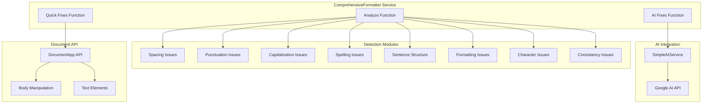
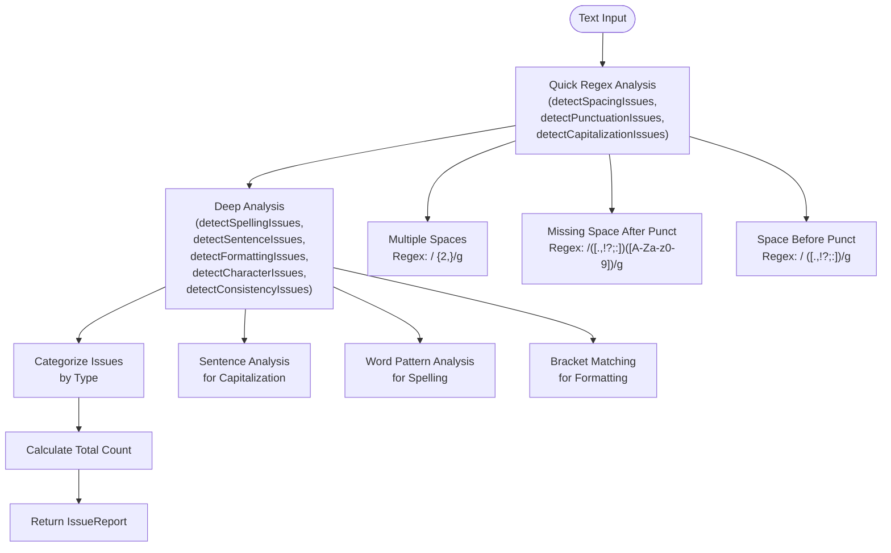
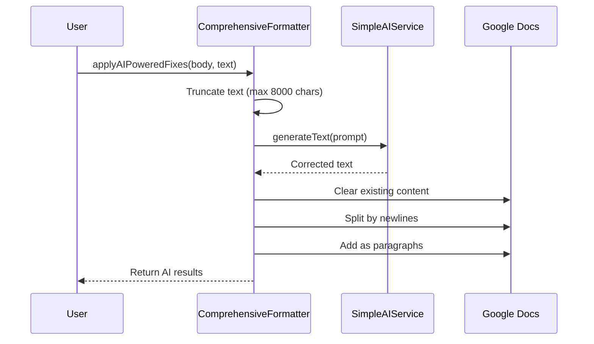
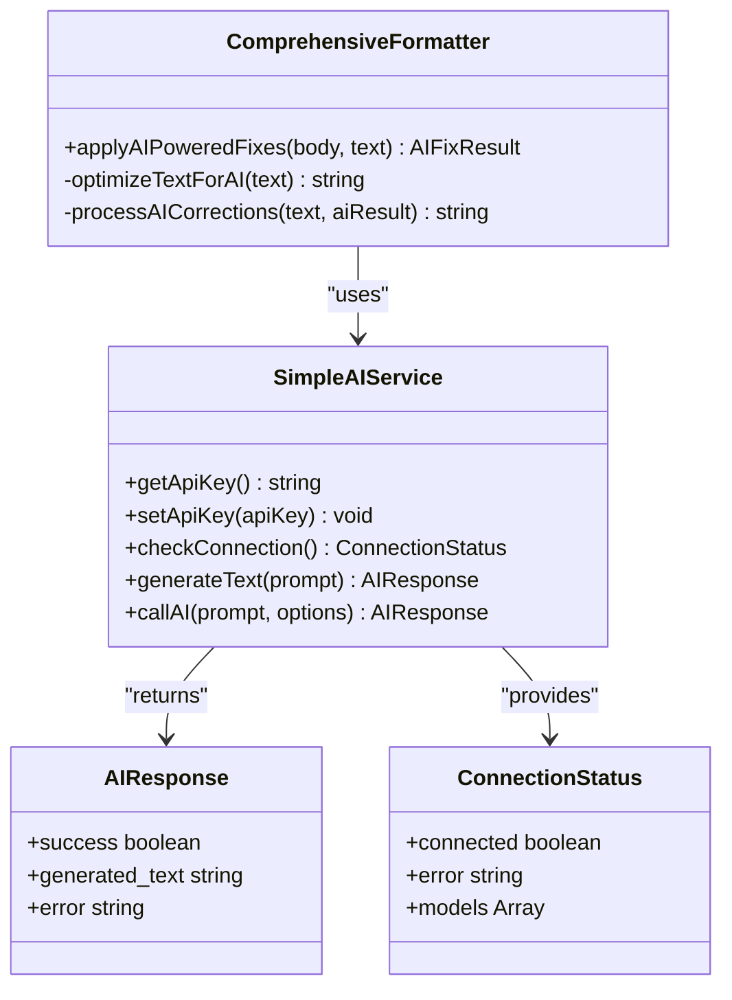
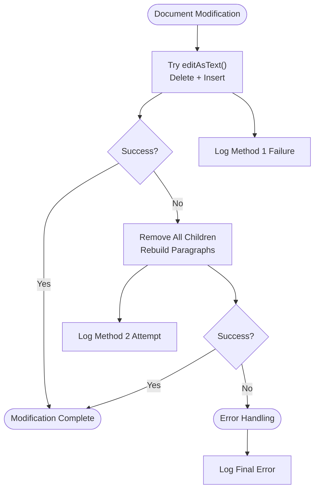
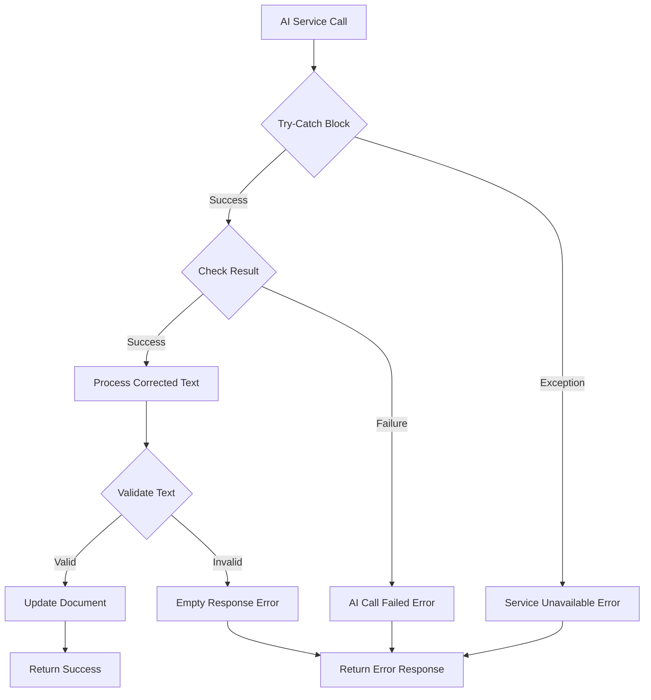

# Comprehensive Formatter API Documentation

<cite>
**Referenced Files in This Document**
- [ComprehensiveFormatter.js](file://src/services/ComprehensiveFormatter.js)
- [Main.js](file://src/Main.js)
- [OllamaAIService.js](file://src/services/OllamaAIService.js)
- [OllamaConfigHandler.js](file://src/handlers/OllamaConfigHandler.js)
- [TemplateManager.js](file://src/services/TemplateManager.js)
- [Sidebar.html](file://src/ui/Sidebar.html)
- [README.md](file://README.md)
</cite>

## Table of Contents
1. [Introduction](#introduction)
2. [Service Architecture](#service-architecture)
3. [Public API Methods](#public-api-methods)
4. [Issue Detection System](#issue-detection-system)
5. [Two-Tiered Fixing Strategy](#two-tiered-fixing-strategy)
6. [AI Integration](#ai-integration)
7. [Document Manipulation](#document-manipulation)
8. [Error Handling](#error-handling)
9. [Usage Examples](#usage-examples)
10. [Performance Considerations](#performance-considerations)
11. [Integration Guidelines](#integration-guidelines)

## Introduction

The ComprehensiveFormatter service is a sophisticated document formatting engine designed to detect and fix 28 different categories of formatting issues in Google Docs. It combines regex-based pattern matching with AI-powered comprehensive analysis to provide both fast, targeted fixes and intelligent, context-aware improvements.

The service operates as a dual-mode formatter with:
- **Quick Mode**: Fast regex-based fixes for common formatting issues (< 1 second)
- **AI Mode**: Comprehensive analysis using AI for complex formatting problems (3-8 seconds)

## Service Architecture

The ComprehensiveFormatter follows a modular architecture with clear separation of concerns:



**Diagram sources**
- [ComprehensiveFormatter.js](file://src/services/ComprehensiveFormatter.js#L13-L83)
- [OllamaAIService.js](file://src/services/OllamaAIService.js#L6-L188)

**Section sources**
- [ComprehensiveFormatter.js](file://src/services/ComprehensiveFormatter.js#L1-L489)

## Public API Methods

The ComprehensiveFormatter exposes three primary public methods through its factory function:

### analyzeAllIssues()

Detects and categorizes all formatting issues in a document text.

**Signature:**
```javascript
analyzeAllIssues(text: string, deepAnalysis?: boolean): IssueReport
```

**Parameters:**
- `text` (string): The document text to analyze
- `deepAnalysis` (boolean, optional): Enables additional analysis depth (defaults to false)

**Returns:** An IssueReport object containing categorized formatting issues across 28 problem categories.

**Issue Categories:**
- **Spacing Issues**: multipleSpaces, missingSpaceAfterPunct, spaceBeforePunct, spacedLetters, inconsistentIndent
- **Line Break Issues**: excessiveLineBreaks, randomLineBreaks
- **Punctuation Issues**: missingEndPunct, doublePunctuation
- **Capitalization Issues**: lowercaseStart, midSentenceCapitals, randomCapsInWords
- **Spelling & Grammar**: spellingMistakes, repeatedCharacters, missingLetters
- **Sentence Structure**: runOnSentences, sentenceFragments, repeatedWords, brokenSentences
- **Formatting Issues**: misalignedBullets, brokenMarkdown, unclosedBrackets, unclosedQuotes
- **Character Issues**: mixedDashes, unicodeGlitches, invisibleChars
- **Consistency Issues**: inconsistentParagraphs, mixedTabsSpaces, wrongHomophones, randomSymbols, inconsistentNumbering

### applyQuickFixes()

Applies regex-based fixes for common formatting issues quickly.

**Signature:**
```javascript
applyQuickFixes(body: Body, issues: IssueReport): FixResults
```

**Parameters:**
- `body` (Body): Google Docs Body element to modify
- `issues` (IssueReport): Pre-analyzed issues from analyzeAllIssues()

**Returns:** A FixResults object showing how many issues were fixed in each category.

### applyAIPoweredFixes()

Uses AI to perform comprehensive formatting fixes with optimal performance.

**Signature:**
```javascript
applyAIPoweredFixes(body: Body, text: string): AIFixResult
```

**Parameters:**
- `body` (Body): Google Docs Body element to modify
- `text` (string): Original document text for AI processing

**Returns:** An AIFixResult object with success status, timing information, and processing details.

**Section sources**
- [ComprehensiveFormatter.js](file://src/services/ComprehensiveFormatter.js#L13-L489)

## Issue Detection System

The ComprehensiveFormatter employs a comprehensive detection system that analyzes text across 28 distinct formatting categories using specialized regex patterns and logical analysis.

### Detection Architecture



**Diagram sources**
- [ComprehensiveFormatter.js](file://src/services/ComprehensiveFormatter.js#L68-L77)

### Spacing Issues Detection

The service identifies various spacing-related problems:

- **Multiple Spaces**: Consecutive spaces exceeding normal usage
- **Missing Space After Punctuation**: Lack of space after periods, commas, etc.
- **Space Before Punctuation**: Extra space before punctuation marks
- **Spaced Letters**: Words with spaces between letters (e.g., "t h i s")
- **Inconsistent Indentation**: Mixed tab/space usage

### Punctuation Issues Detection

Punctuation-related problems are identified through pattern recognition:

- **Double Punctuation**: Repeated punctuation marks (e.g., "!!", "??")
- **Excessive Line Breaks**: More than two consecutive line breaks

### Capitalization Issues Detection

Smart capitalization analysis using sentence boundary detection:

- **Lowercase Sentence Starts**: Sentences beginning with lowercase letters
- **Random Caps in Words**: Words with inconsistent capitalization patterns

### Spelling & Grammar Detection

Advanced spelling and grammar analysis:

- **Common Misspellings**: Dictionary-based spell checking
- **Repeated Characters**: Words with excessive character repetition
- **Missing Letters**: Common letter omission patterns

**Section sources**
- [ComprehensiveFormatter.js](file://src/services/ComprehensiveFormatter.js#L68-L342)

## Two-Tiered Fixing Strategy

The ComprehensiveFormatter implements a sophisticated two-tier approach to formatting fixes, balancing speed and comprehensiveness.

### Tier 1: Quick Regex Fixes

Fast, targeted fixes using regex patterns for common formatting issues:

```mermaid
sequenceDiagram
participant User as User
participant CF as ComprehensiveFormatter
participant Doc as Google Docs
participant Regex as Regex Engine
User->>CF : applyQuickFixes(body, issues)
CF->>CF : Analyze issue categories
alt Multiple Spaces
CF->>Regex : / {2,}/g
Regex-->>CF : Match positions
CF->>Doc : replaceText(" ", " ")
end
alt Missing Space After Punct
CF->>Regex : /([.,!?; : ])([A-Za-z0-9])/g
Regex-->>CF : Match positions
CF->>Doc : replaceText("$1 $2")
end
alt Space Before Punct
CF->>Regex : / ([.,!?; : ])/g
Regex-->>CF : Match positions
CF->>Doc : replaceText("$1")
end
CF-->>User : Return fix results
```

**Diagram sources**
- [ComprehensiveFormatter.js](file://src/services/ComprehensiveFormatter.js#L350-L406)

### Tier 2: AI-Powered Comprehensive Fixes

AI-driven fixes for complex formatting scenarios with performance optimization:



**Diagram sources**
- [ComprehensiveFormatter.js](file://src/services/ComprehensiveFormatter.js#L414-L478)

### Performance Comparison

| Fix Type | Speed | Coverage | Use Case |
|----------|-------|----------|----------|
| Quick Fixes | < 1 second | 15 categories | Immediate formatting |
| AI Fixes | 3-8 seconds | 28 categories | Comprehensive cleanup |

**Section sources**
- [ComprehensiveFormatter.js](file://src/services/ComprehensiveFormatter.js#L350-L478)

## AI Integration

The ComprehensiveFormatter integrates with SimpleAIService (formerly OllamaAIService) to provide AI-powered comprehensive formatting capabilities.

### SimpleAIService Integration

The service uses Google AI Studio via SimpleAIService for AI processing:



**Diagram sources**
- [OllamaAIService.js](file://src/services/OllamaAIService.js#L6-L188)
- [ComprehensiveFormatter.js](file://src/services/ComprehensiveFormatter.js#L414-L478)

### Text Truncation Strategy

To optimize AI processing performance and reduce costs, the service implements intelligent text truncation:

- **Maximum Length**: 8,000 characters
- **Truncation Method**: Splits text at 8,000 characters with truncation notice
- **Preservation**: Maintains document structure and readability

### AI Prompt Engineering

The service uses optimized prompts for fast, effective AI processing:

```
"Fix all formatting errors in this text. Return only the corrected version:\n\n{text}"
```

This ultra-short prompt ensures:
- Fast processing (3-8 seconds)
- Direct text output
- Minimal token usage
- Maximum relevance

**Section sources**
- [OllamaAIService.js](file://src/services/OllamaAIService.js#L6-L188)
- [ComprehensiveFormatter.js](file://src/services/ComprehensiveFormatter.js#L414-L478)

## Document Manipulation

The ComprehensiveFormatter uses Google Apps Script DocumentApp API for safe, efficient document modifications.

### Safe Document Replacement

The service implements multiple fallback strategies for document manipulation:



**Diagram sources**
- [Main.js](file://src/Main.js#L544-L672)

### Text Comparison and Validation

Before applying changes, the service performs thorough text comparison:

- **Whitespace Normalization**: Standardizes spaces for accurate comparison
- **Character-by-Character Analysis**: Identifies first differences
- **Length Verification**: Confirms text length changes
- **Content Validation**: Ensures actual content modification

### Paragraph Reconstruction

For AI-powered fixes, the service reconstructs documents using paragraphs:

- **Line Splitting**: Text split by newline characters
- **Empty Line Handling**: Preserves empty lines as empty paragraphs
- **Content Preservation**: Maintains document structure and formatting

**Section sources**
- [Main.js](file://src/Main.js#L544-L672)

## Error Handling

The ComprehensiveFormatter implements comprehensive error handling across all operational layers.

### AI Service Failures



**Diagram sources**
- [ComprehensiveFormatter.js](file://src/services/ComprehensiveFormatter.js#L426-L478)

### Document Manipulation Errors

The service handles various document manipulation scenarios:

- **API Limitations**: Graceful degradation when DocumentApp API fails
- **Permission Issues**: Clear error messages for access restrictions
- **Content Conflicts**: Safe handling of concurrent modifications
- **Memory Constraints**: Efficient handling of large documents

### Error Response Format

All error conditions return structured error responses:

```javascript
{
  success: false,
  error: "Descriptive error message",
  method?: "Specific error context"
}
```

**Section sources**
- [ComprehensiveFormatter.js](file://src/services/ComprehensiveFormatter.js#L426-L478)
- [Main.js](file://src/Main.js#L490-L535)

## Usage Examples

### Basic Quick Formatting

```javascript
// Get document text and body
const body = DocumentApp.getActiveDocument().getBody();
const text = body.getText();

// Analyze issues
const issues = ComprehensiveFormatter.analyzeAllIssues(text);

// Apply quick fixes
if (issues.totalCount > 0) {
  const results = ComprehensiveFormatter.applyQuickFixes(body, issues);
  console.log(`Fixed ${Object.values(results).reduce((sum, val) => sum + val, 0)} issues`);
}
```

### AI-Powered Comprehensive Formatting

```javascript
// Check AI availability
try {
  const apiKey = SimpleAIService.getApiKey();
  if (!apiKey) {
    throw new Error('AI not configured');
  }
} catch (e) {
  console.log('Please configure AI service first');
  return;
}

// Get document text
const body = DocumentApp.getActiveDocument().getBody();
const text = body.getText();

// Apply AI-powered fixes
const result = ComprehensiveFormatter.applyAIPoweredFixes(body, text);
if (result.success) {
  console.log(`Formatted in ${result.time}s using ${result.method}`);
}
```

### Integration with Main Application

The formatter integrates seamlessly with the main application workflow:

```javascript
// Quick mode integration
function applyQuickFormattingMode(ui, body, text) {
  const issues = ComprehensiveFormatter.analyzeAllIssues(text, false);
  
  if (issues.totalCount === 0) {
    ui.alert('No Issues Found', '✅ Your document formatting looks great!', ui.ButtonSet.OK);
    return;
  }
  
  const results = ComprehensiveFormatter.applyQuickFixes(body, issues);
  ui.alert('Quick Fix Complete!', `✅ Fixed ${Object.values(results).reduce((sum, val) => sum + val, 0)} issues in < 1 second`);
}
```

**Section sources**
- [Main.js](file://src/Main.js#L331-L424)

## Performance Considerations

### Optimization Strategies

The ComprehensiveFormatter implements several performance optimization techniques:

#### Text Processing Optimization
- **Lazy Loading**: Issues are detected only when needed
- **Regex Efficiency**: Optimized patterns minimize backtracking
- **Early Termination**: Stops processing when limits reached

#### Memory Management
- **Streaming Processing**: Processes text in manageable chunks
- **Garbage Collection**: Minimizes memory footprint during analysis
- **Cache-Friendly**: Reuses detection patterns efficiently

#### AI Processing Optimization
- **Text Truncation**: Limits AI processing to 8,000 characters
- **Prompt Optimization**: Uses minimal, focused prompts
- **Batch Processing**: Groups similar operations together

### Performance Benchmarks

| Operation | Typical Time | Memory Usage | Notes |
|-----------|--------------|--------------|-------|
| Quick Analysis | < 50ms | Low | Regex-based detection |
| Full Analysis | 100-300ms | Medium | Includes deep analysis |
| Quick Fixes | < 1 second | Low | Direct text replacement |
| AI Fixes | 3-8 seconds | Medium | AI processing overhead |

### Scalability Considerations

- **Large Documents**: Automatic truncation prevents timeouts
- **Concurrent Operations**: Thread-safe detection methods
- **Resource Monitoring**: Built-in performance tracking

## Integration Guidelines

### Service Initialization

The ComprehensiveFormatter is implemented as a factory function singleton:

```javascript
// Service is automatically initialized
const formatter = ComprehensiveFormatter;
```

### Best Practices

#### Error Handling
Always check for successful operations before proceeding:

```javascript
const result = ComprehensiveFormatter.applyAIPoweredFixes(body, text);
if (!result.success) {
  console.error('Formatting failed:', result.error);
  return;
}
```

#### Performance Monitoring
Monitor processing times for large documents:

```javascript
const startTime = new Date().getTime();
const issues = ComprehensiveFormatter.analyzeAllIssues(largeText);
const processingTime = new Date().getTime() - startTime;
console.log(`Analysis took ${processingTime}ms`);
```

#### Resource Management
For very large documents, consider chunked processing:

```javascript
const MAX_CHUNK_SIZE = 10000;
if (text.length > MAX_CHUNK_SIZE) {
  // Process in chunks
  const chunks = splitIntoChunks(text, MAX_CHUNK_SIZE);
  chunks.forEach(chunk => {
    const issues = ComprehensiveFormatter.analyzeAllIssues(chunk);
    // Process each chunk
  });
}
```

### Extension Points

The service provides several extension points for customization:

#### Custom Detection Rules
Extend the detection system with custom patterns:

```javascript
function detectCustomIssues(text, issues) {
  // Add custom detection logic
  const customRegex = /custom_pattern/g;
  let match;
  while ((match = customRegex.exec(text)) !== null) {
    issues.customCategory.push({
      position: match.index,
      original: match[0],
      fix: 'custom_fix'
    });
  }
}
```

#### Alternative AI Services
Replace SimpleAIService with alternative AI providers:

```javascript
const AlternativeAIService = {
  generateText: function(prompt) {
    // Implement alternative AI integration
    return {
      success: true,
      generated_text: "Processed text"
    };
  }
};

// Use alternative service
const result = ComprehensiveFormatter.applyAIPoweredFixes(body, text, AlternativeAIService);
```

**Section sources**
- [ComprehensiveFormatter.js](file://src/services/ComprehensiveFormatter.js#L1-L489)
- [Main.js](file://src/Main.js#L331-L535)