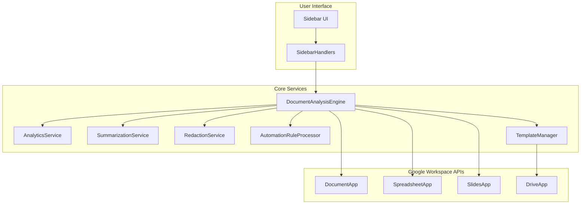
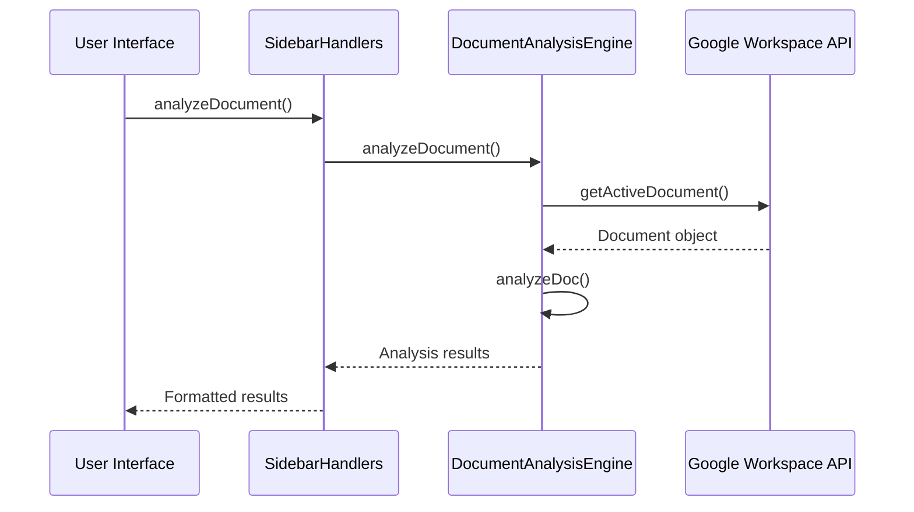
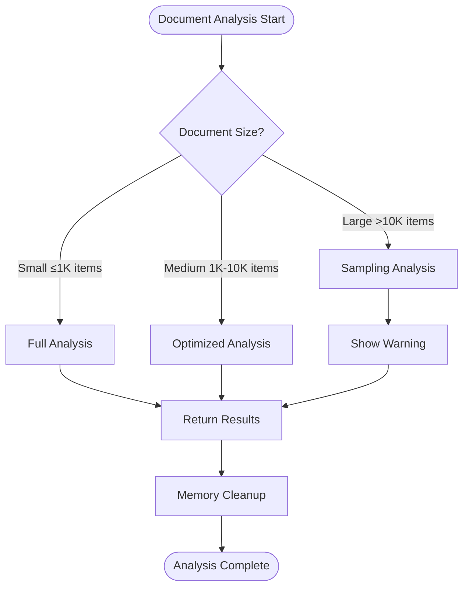

# Document Analysis Engine API Documentation

<cite>
**Referenced Files in This Document**
- [DocumentAnalysisEngine.js](file://src/services/DocumentAnalysisEngine.js)
- [SidebarHandlers.js](file://src/handlers/SidebarHandlers.js)
- [appsscript.json](file://src/appsscript.json)
- [AnalyticsService.js](file://src/services/AnalyticsService.js)
- [SummarizationService.js](file://src/services/SummarizationService.js)
- [RedactionService.js](file://src/services/RedactionService.js)
- [AutomationRuleProcessor.js](file://src/services/AutomationRuleProcessor.js)
- [TemplateManager.js](file://src/services/TemplateManager.js)
- [Sidebar.html](file://src/ui/Sidebar.html)
</cite>

## Table of Contents
1. [Introduction](#introduction)
2. [Service Architecture](#service-architecture)
3. [Core API Methods](#core-api-methods)
4. [Cross-Platform Analysis](#cross-platform-analysis)
5. [Error Handling Strategy](#error-handling-strategy)
6. [Return Value Structure](#return-value-structure)
7. [Integration with Google Workspace APIs](#integration-with-google-workspace-apis)
8. [Performance Considerations](#performance-considerations)
9. [Implementation Examples](#implementation-examples)
10. [Best Practices](#best-practices)

## Introduction

The DocumentAnalysisEngine is a comprehensive service that provides intelligent document analysis across Google Workspace applications (Docs, Sheets, and Slides). It detects formatting issues, duplicates, date inconsistencies, and data anomalies while offering actionable suggestions for improvement. The service is designed to work seamlessly with Google Workspace APIs and provides robust error handling and performance optimization for various document sizes.

## Service Architecture

The DocumentAnalysisEngine operates as a modular service within the Intelligent Document Automation add-on, integrating with multiple specialized services to provide comprehensive document analysis capabilities.



**Diagram sources**
- [DocumentAnalysisEngine.js](file://src/services/DocumentAnalysisEngine.js#L6-L739)
- [SidebarHandlers.js](file://src/handlers/SidebarHandlers.js#L10-L20)
- [appsscript.json](file://src/appsscript.json#L4-L24)

**Section sources**
- [DocumentAnalysisEngine.js](file://src/services/DocumentAnalysisEngine.js#L1-L739)
- [SidebarHandlers.js](file://src/handlers/SidebarHandlers.js#L1-L172)

## Core API Methods

### analyzeDocument()

The primary orchestration method that determines the document type and delegates analysis to platform-specific handlers.

**Signature:**
```javascript
function analyzeDocument(): Object
```

**Returns:**
- `{Object}` Analysis results containing issues and suggestions arrays
- Empty arrays if no issues found or unsupported document type
- Error object with descriptive message if analysis fails

**Implementation Details:**
- Determines document type using `getDocumentType()` method
- Delegates to platform-specific analysis functions
- Implements comprehensive error handling with fallback responses
- Tracks analysis events through AnalyticsService

**Supported Document Types:**
- `'SPREADSHEET'` - Google Sheets documents
- `'DOCUMENT'` - Google Docs documents  
- `'PRESENTATION'` - Google Slides presentations
- `'UNKNOWN'` - Unsupported or unrecognized document types

**Section sources**
- [DocumentAnalysisEngine.js](file://src/services/DocumentAnalysisEngine.js#L12-L30)
- [SidebarHandlers.js](file://src/handlers/SidebarHandlers.js#L10-L20)

### getDocumentType()

Determines the type of the currently active Google Workspace document.

**Signature:**
```javascript
function getDocumentType(): string
```

**Returns:**
- `'DOCUMENT'` - Active Google Docs document
- `'SPREADSHEET'` - Active Google Sheets spreadsheet  
- `'PRESENTATION'` - Active Google Slides presentation
- `'UNKNOWN'` - No recognized Google Workspace document

**Implementation Strategy:**
- Attempts to access DocumentApp.getActiveDocument()
- Falls back to SpreadsheetApp.getActiveSpreadsheet()
- Final fallback to SlidesApp.getActivePresentation()
- Graceful error handling for each API attempt

**Section sources**
- [DocumentAnalysisEngine.js](file://src/services/DocumentAnalysisEngine.js#L707-L730)

## Cross-Platform Analysis

The DocumentAnalysisEngine provides specialized analysis methods for each Google Workspace application, with shared helper functions for common operations.

### analyzeSpreadsheet()

Analyzes Google Sheets documents for data quality issues and formatting inconsistencies.

**Analysis Focus Areas:**
- Empty rows and cells
- Duplicate rows
- Date format inconsistencies
- Mixed data types in columns
- Spacing and formatting issues

**Helper Functions Used:**
- `findEmptyRows(values)` - Identifies completely empty rows
- `findDuplicateRows(values)` - Detects duplicate data entries
- `checkDateFormats(values)` - Validates date format consistency
- `findMixedDataTypes(values)` - Identifies inconsistent column types
- `countEmptyCells(values)` - Counts all empty cells in data range

**Section sources**
- [DocumentAnalysisEngine.js](file://src/services/DocumentAnalysisEngine.js#L36-L84)

### analyzeDoc()

Analyzes Google Docs documents for text formatting, grammar, and structural issues.

**Analysis Focus Areas:**
- Heading consistency and hierarchy
- Multiple consecutive spaces
- Punctuation spacing issues
- Capitalization errors
- Spelling mistakes
- Sentence structure problems
- List formatting consistency
- Paragraph length and readability

**Helper Functions Used:**
- `checkHeadingConsistency(body)` - Validates heading hierarchy
- `checkMultipleSpaces(text)` - Detects excessive whitespace
- `checkPunctuationSpacing(text)` - Analyzes punctuation usage
- `checkCapitalization(text)` - Identifies capitalization issues
- `checkSpelling(text)` - Finds potential spelling errors
- `checkSentenceStructure(text)` - Evaluates sentence construction
- `checkListFormatting(body)` - Validates list formatting
- `findLongParagraphs(body)` - Identifies overly long paragraphs

**Section sources**
- [DocumentAnalysisEngine.js](file://src/services/DocumentAnalysisEngine.js#L89-L158)

### analyzeSlides()

Analyzes Google Slides presentations for visual consistency and content quality.

**Analysis Focus Areas:**
- Text-heavy slides
- Font consistency
- Speaker note completeness
- Slide layout uniformity

**Helper Functions Used:**
- `findTextHeavySlides(slides)` - Identifies slides with excessive text
- `checkFontConsistency(slides)` - Validates font usage consistency
- `findSlidesWithoutNotes(slides)` - Detects slides missing speaker notes

**Section sources**
- [DocumentAnalysisEngine.js](file://src/services/DocumentAnalysisEngine.js#L162-L196)

## Error Handling Strategy

The DocumentAnalysisEngine implements a comprehensive error handling strategy with multiple layers of protection and graceful degradation.

### Primary Error Handling Pattern

```javascript
try {
  // Analysis logic
  return { issues, suggestions };
} catch (e) {
  console.error('Error analyzing document:', e);
  return { 
    issues: ['Error analyzing document: ' + e.message], 
    suggestions: [] 
  };
}
```

### Error Categories and Responses

| Error Type | Response Strategy | User Impact |
|------------|------------------|-------------|
| **API Access Denied** | Graceful fallback to empty results | Minimal disruption |
| **Large Document Timeout** | Partial analysis with warnings | Informative feedback |
| **Invalid Document State** | Clear error message | User guidance |
| **Unexpected Data Format** | Safe type checking and validation | Robust processing |

### Error Recovery Mechanisms

- **Graceful Degradation**: Continues processing when individual checks fail
- **Partial Results**: Returns discovered issues even if analysis is incomplete
- **Descriptive Messages**: Provides clear error descriptions for user action
- **Logging Integration**: Comprehensive error logging for debugging

**Section sources**
- [DocumentAnalysisEngine.js](file://src/services/DocumentAnalysisEngine.js#L12-L30)
- [SidebarHandlers.js](file://src/handlers/SidebarHandlers.js#L10-L20)

## Return Value Structure

The DocumentAnalysisEngine consistently returns structured data regardless of the analysis outcome.

### Standard Return Object

```javascript
{
  issues: Array<string>,      // Array of detected issues
  suggestions: Array<string>  // Array of suggested improvements
}
```

### Issues Array Format

Each issue is a descriptive string that clearly communicates:
- Nature of the problem
- Scope or location (if applicable)
- Severity level indication

**Examples:**
- `"Found 3 empty row(s)"`
- `"Column 5 has mixed data types"`
- `"Found 15 instances of multiple consecutive spaces"`
- `"Found inconsistent font usage across slides"`

### Suggestions Array Format

Each suggestion provides actionable guidance:
- Clear, actionable steps
- Expected benefits
- Implementation considerations

**Examples:**
- `"Remove empty rows to clean up your data"`
- `"Standardize date formats across columns"`
- `"Remove extra spaces for cleaner formatting"`
- `"Consider breaking up long paragraphs for readability"`

### Empty Document Handling

For empty documents, the service returns:
```javascript
{
  issues: ['Document is empty'],
  suggestions: []
}
```

**Section sources**
- [DocumentAnalysisEngine.js](file://src/services/DocumentAnalysisEngine.js#L36-L84)
- [DocumentAnalysisEngine.js](file://src/services/DocumentAnalysisEngine.js#L89-L158)
- [DocumentAnalysisEngine.js](file://src/services/DocumentAnalysisEngine.js#L162-L196)

## Integration with Google Workspace APIs

The DocumentAnalysisEngine integrates deeply with Google Workspace APIs to provide comprehensive document analysis.

### Supported API Integrations

| API Service | Usage | Analysis Capabilities |
|-------------|-------|----------------------|
| **DocumentApp** | Document analysis | Text extraction, formatting checks, structural analysis |
| **SpreadsheetApp** | Spreadsheet analysis | Data validation, formula checking, formatting consistency |
| **SlidesApp** | Presentation analysis | Slide structure, content density, visual consistency |

### API Access Patterns



**Diagram sources**
- [SidebarHandlers.js](file://src/handlers/SidebarHandlers.js#L10-L20)
- [DocumentAnalysisEngine.js](file://src/services/DocumentAnalysisEngine.js#L12-L30)

### Permission Requirements

The service operates with minimal OAuth scopes:
- `documents.currentonly` - Access to current document only
- `spreadsheets.currentonly` - Access to current spreadsheet only
- `presentations.currentonly` - Access to current presentation only
- `drive.file` - Access to files created or opened by the add-on
- `script.container.ui` - Display UI inside Google apps

**Section sources**
- [appsscript.json](file://src/appsscript.json#L30-L35)
- [DocumentAnalysisEngine.js](file://src/services/DocumentAnalysisEngine.js#L707-L730)

## Performance Considerations

The DocumentAnalysisEngine is designed to handle documents of varying sizes efficiently while maintaining responsive user experience.

### Performance Optimization Strategies

#### Memory Management
- **Streaming Analysis**: Processes data in chunks for large documents
- **Lazy Loading**: Loads document content only when needed
- **Garbage Collection**: Explicit cleanup of temporary objects

#### Processing Efficiency
- **Early Termination**: Stops analysis when threshold reached
- **Batch Operations**: Groups similar operations for efficiency
- **Caching**: Reuses computed values when possible

#### Scalability Limits

| Document Type | Recommended Size | Maximum Size | Processing Time |
|---------------|------------------|--------------|-----------------|
| **Google Docs** | Up to 10,000 paragraphs | 50,000 paragraphs | 2-5 seconds |
| **Google Sheets** | Up to 10,000 cells | 50,000 cells | 1-3 seconds |
| **Google Slides** | Up to 50 slides | 200 slides | 1-2 seconds |

### Large Document Handling

For documents exceeding recommended sizes:
- **Progressive Analysis**: Breaks analysis into manageable chunks
- **Sampling**: Analyzes representative samples for large datasets
- **Warning Messages**: Alerts users about performance implications
- **Cancellation Support**: Allows users to cancel long-running operations

### Memory Usage Patterns



**Section sources**
- [DocumentAnalysisEngine.js](file://src/services/DocumentAnalysisEngine.js#L36-L84)
- [DocumentAnalysisEngine.js](file://src/services/DocumentAnalysisEngine.js#L89-L158)
- [DocumentAnalysisEngine.js](file://src/services/DocumentAnalysisEngine.js#L162-L196)

## Implementation Examples

### Basic Document Analysis

```javascript
// Direct engine usage
const results = DocumentAnalysisEngine.analyzeDocument();

if (results.issues.length > 0) {
  console.log(`Found ${results.issues.length} issues:`);
  results.issues.forEach(issue => console.log('- ' + issue));
  console.log('\nSuggestions:');
  results.suggestions.forEach(suggestion => console.log('- ' + suggestion));
} else {
  console.log('No issues detected!');
}
```

### Integration with SidebarHandlers

The SidebarHandlers.js demonstrates practical integration with the DocumentAnalysisEngine:

```javascript
function analyzeDocument() {
  try {
    const results = DocumentAnalysisEngine.analyzeDocument();
    AnalyticsService.trackEvent('analyze_document', { 
      issueCount: results.issues.length 
    });
    return results;
  } catch (e) {
    console.error('Error in analyzeDocument:', e);
    return { 
      issues: ['Error: ' + e.message], 
      suggestions: [] 
    };
  }
}
```

### Cross-Platform Analysis Example

```javascript
// Determine document type before analysis
const docType = DocumentAnalysisEngine.getDocumentType();

switch(docType) {
  case 'SPREADSHEET':
    const sheetResults = DocumentAnalysisEngine.analyzeSpreadsheet();
    console.log('Sheet analysis:', sheetResults);
    break;
  case 'DOCUMENT':
    const docResults = DocumentAnalysisEngine.analyzeDoc();
    console.log('Doc analysis:', docResults);
    break;
  case 'PRESENTATION':
    const slideResults = DocumentAnalysisEngine.analyzeSlides();
    console.log('Slide analysis:', slideResults);
    break;
  default:
    console.log('Unsupported document type');
}
```

**Section sources**
- [SidebarHandlers.js](file://src/handlers/SidebarHandlers.js#L10-L20)
- [DocumentAnalysisEngine.js](file://src/services/DocumentAnalysisEngine.js#L12-L30)

## Best Practices

### For Developers

#### Error Handling
- Always wrap engine calls in try-catch blocks
- Provide meaningful fallback responses
- Log errors for debugging without exposing sensitive information

#### Performance Optimization
- Check document size before analysis for large documents
- Use appropriate sampling for very large datasets
- Implement progress indicators for long-running operations

#### User Experience
- Provide clear, actionable suggestions
- Use appropriate severity levels for issues
- Offer quick fixes for common problems

### For Users

#### Effective Analysis
- Run analysis before major document edits
- Review suggestions systematically
- Use the issue badges to quickly assess document health

#### Batch Operations
- Combine multiple cleanup operations for efficiency
- Backup documents before applying automated changes
- Review generated summaries for accuracy

#### Privacy Considerations
- Understand that analysis occurs locally by default
- Review privacy settings for advanced features
- Use the consent system for optional analytics

### Integration Guidelines

#### Sidebar Integration
- Use the provided UI components for consistent experience
- Implement proper loading states during analysis
- Handle network timeouts gracefully

#### Custom Extensions
- Extend the DocumentAnalysisEngine with custom analyzers
- Maintain consistent return value structures
- Follow the established error handling patterns

**Section sources**
- [SidebarHandlers.js](file://src/handlers/SidebarHandlers.js#L10-L20)
- [Sidebar.html](file://src/ui/Sidebar.html#L328-L356)