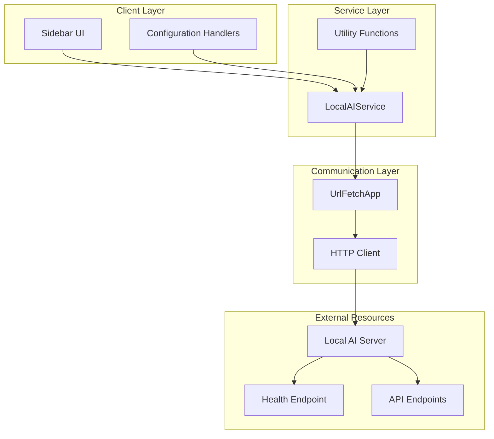
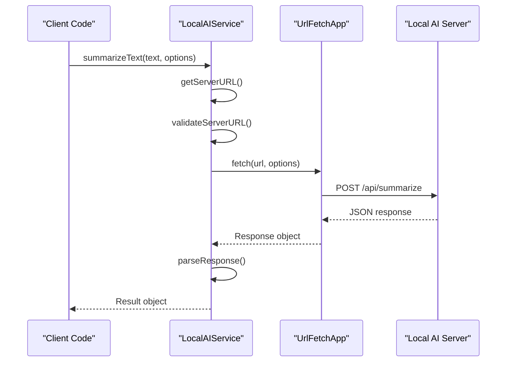
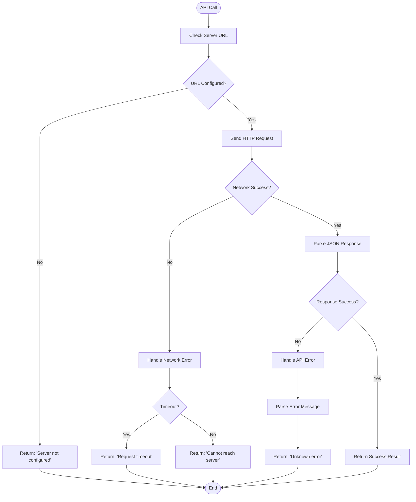
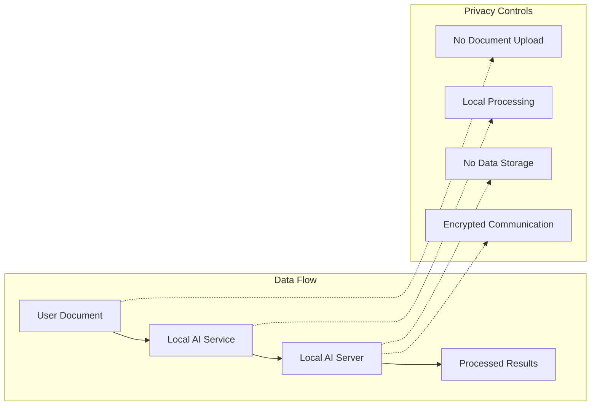
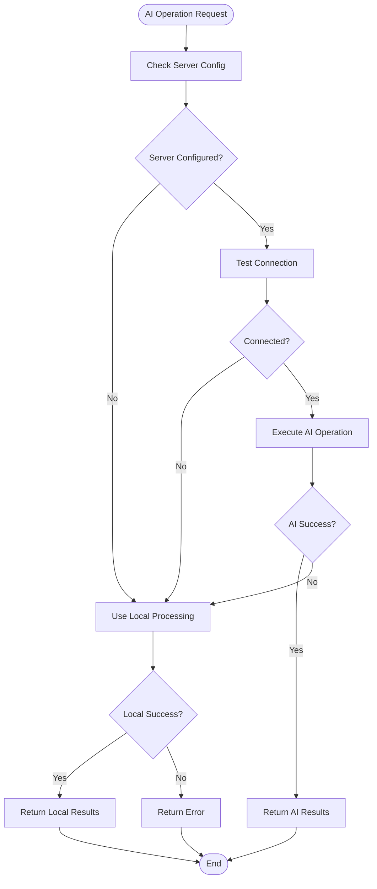

# Local AI Service API Documentation

<cite>
**Referenced Files in This Document**
- [LocalAIService.js](file://src/services/LocalAIService.js)
- [LocalAIConfigHandler.js](file://src/handlers/LocalAIConfigHandler.js)
- [OllamaAIService.js](file://src/services/OllamaAIService.js)
- [SummarizationService.js](file://src/services/SummarizationService.js)
- [Utils.js](file://src/utils/Utils.js)
- [Main.js](file://src/Main.js)
- [appsscript.json](file://appsscript.json)
- [README.md](file://README.md)
</cite>

## Table of Contents
1. [Introduction](#introduction)
2. [Service Architecture](#service-architecture)
3. [Core API Methods](#core-api-methods)
4. [HTTP Communication Implementation](#http-communication-implementation)
5. [Error Handling Strategy](#error-handling-strategy)
6. [Configuration Management](#configuration-management)
7. [Integration Examples](#integration-examples)
8. [Security Considerations](#security-considerations)
9. [Fallback Strategies](#fallback-strategies)
10. [Performance Optimization](#performance-optimization)
11. [Troubleshooting Guide](#troubleshooting-guide)

## Introduction

The Local AI Service provides a comprehensive interface for connecting to locally-hosted AI models for document processing within Google Workspace add-ons. This service enables privacy-preserving AI-powered features by allowing users to run AI models on their own infrastructure while maintaining complete control over their data.

The service supports multiple AI operations including text summarization, grammar correction, text generation, and comprehensive document analysis. It implements robust error handling, fallback mechanisms, and security measures to ensure reliable operation in various deployment scenarios.

## Service Architecture

The Local AI Service follows a modular architecture pattern with clear separation of concerns:



**Diagram sources**
- [LocalAIService.js](file://src/services/LocalAIService.js#L1-L266)
- [Utils.js](file://src/utils/Utils.js#L1-L257)

**Section sources**
- [LocalAIService.js](file://src/services/LocalAIService.js#L1-L266)
- [README.md](file://README.md#L1-L50)

## Core API Methods

### Configuration Methods

#### getServerURL()

Retrieves the configured URL of the local AI server from user properties.

**Signature:**
```javascript
function getServerURL() -> string
```

**Returns:**
- `string`: The configured server URL or empty string if not configured

**Implementation Details:**
- Uses Google Apps Script PropertiesService to persist configuration
- Defaults to empty string if no URL is configured
- Supports ngrok URL format by default

**Section sources**
- [LocalAIService.js](file://src/services/LocalAIService.js#L8-L16)

#### setServerURL(url)

Sets the URL of the local AI server for future API calls.

**Signature:**
```javascript
function setServerURL(url: string) -> void
```

**Parameters:**
- `url` (string): The server URL (e.g., `https://abc123.ngrok-free.app`)

**Implementation Details:**
- Stores URL in user properties for persistence
- Overwrites any previously configured URL
- Validates URL format during configuration

**Section sources**
- [LocalAIService.js](file://src/services/LocalAIService.js#L18-L25)

### Connectivity Testing

#### checkConnection()

Tests the connection to the local AI server and retrieves server status.

**Signature:**
```javascript
function checkConnection() -> Object
```

**Returns:**
- `Object`: Connection status with the following structure:
  ```javascript
  {
    connected: boolean,
    error: string,           // Present only if connected is false
    status: string,          // Server status (if connected)
    models_loaded: Array     // Loaded model names (if connected)
  }
  ```

**Implementation Details:**
- Sends GET request to `/health` endpoint
- Implements timeout of 5 seconds
- Handles network failures gracefully
- Returns detailed error messages for troubleshooting

**Section sources**
- [LocalAIService.js](file://src/services/LocalAIService.js#L27-L66)

### Text Processing Methods

#### summarizeText(text, options)

Generates a summary of the provided text using the local AI server.

**Signature:**
```javascript
function summarizeText(text: string, options?: Object) -> Object
```

**Parameters:**
- `text` (string): The text to summarize
- `options` (Object, optional): Configuration options:
  - `maxLength` (number): Maximum summary length (default: 150)
  - `minLength` (number): Minimum summary length (default: 50)

**Returns:**
- `Object`: Summary result with the following structure:
  ```javascript
  {
    success: boolean,
    summary: string,         // Generated summary text
    method: string,          // Processing method ('local_ai')
    model: string,           // Model used ('BART-large-CNN')
    error: string            // Present only if success is false
  }
  ```

**Implementation Details:**
- Sends POST request to `/api/summarize` endpoint
- Implements payload formatting with text and length constraints
- Handles both successful and error responses
- Returns fallback results for network failures

**Section sources**
- [LocalAIService.js](file://src/services/LocalAIService.js#L69-L118)

#### fixGrammar(text)

Corrects grammar and spelling in the provided text.

**Signature:**
```javascript
function fixGrammar(text: string) -> Object
```

**Parameters:**
- `text` (string): The text to correct

**Returns:**
- `Object`: Correction result with the following structure:
  ```javascript
  {
    success: boolean,
    corrected_text: string,  // Corrected text
    original: string,        // Original text
    error: string            // Present only if success is false
  }
  ```

**Implementation Details:**
- Sends POST request to `/api/fix-grammar` endpoint
- Implements simple payload formatting
- Returns both corrected and original text for comparison
- Handles various error conditions gracefully

**Section sources**
- [LocalAIService.js](file://src/services/LocalAIService.js#L119-L164)

#### generateText(prompt, options)

Generates new text based on the provided prompt using the local AI server.

**Signature:**
```javascript
function generateText(prompt: string, options?: Object) -> Object
```

**Parameters:**
- `prompt` (string): The generation prompt
- `options` (Object, optional): Configuration options:
  - `maxLength` (number): Maximum generation length (default: 200)

**Returns:**
- `Object`: Generation result with the following structure:
  ```javascript
  {
    success: boolean,
    generated_text: string,  // Generated text
    error: string            // Present only if success is false
  }
  ```

**Implementation Details:**
- Sends POST request to `/api/generate-text` endpoint
- Implements payload formatting with prompt and length constraints
- Supports various text generation tasks
- Provides detailed error reporting

**Section sources**
- [LocalAIService.js](file://src/services/LocalAIService.js#L167-L213)

#### analyzeDocument(text, tasks)

Performs comprehensive analysis on the provided document text.

**Signature:**
```javascript
function analyzeDocument(text: string, tasks?: Array) -> Object
```

**Parameters:**
- `text` (string): The document text to analyze
- `tasks` (Array, optional): Analysis tasks to perform (default: `['summarize']`)

**Returns:**
- `Object`: Analysis results containing various metrics and insights

**Implementation Details:**
- Sends POST request to `/api/analyze-document` endpoint
- Supports multiple analysis tasks
- Returns comprehensive document analysis
- Handles complex response structures

**Section sources**
- [LocalAIService.js](file://src/services/LocalAIService.js#L216-L252)

## HTTP Communication Implementation

### UrlFetchApp Integration

The service leverages Google Apps Script's UrlFetchApp for HTTP communication with external AI servers:



**Diagram sources**
- [LocalAIService.js](file://src/services/LocalAIService.js#L85-L96)
- [LocalAIService.js](file://src/services/LocalAIService.js#L136-L143)

### Payload Formatting

The service implements standardized payload formatting for different AI operations:

| Method | Endpoint | Payload Structure |
|--------|----------|-------------------|
| `summarizeText` | `/api/summarize` | `{text, max_length, min_length}` |
| `fixGrammar` | `/api/fix-grammar` | `{text}` |
| `generateText` | `/api/generate-text` | `{prompt, max_length}` |
| `analyzeDocument` | `/api/analyze-document` | `{text, tasks}` |

### Response Parsing

The service implements robust response parsing with error handling:

```javascript
try {
  const response = UrlFetchApp.fetch(serverURL + '/endpoint', options);
  const result = JSON.parse(response.getContentText());
  
  if (result.success) {
    return { success: true, ...result };
  } else {
    return { success: false, error: result.error || 'Unknown error' };
  }
} catch (e) {
  return { success: false, error: 'Failed to call local AI: ' + e.message };
}
```

**Section sources**
- [LocalAIService.js](file://src/services/LocalAIService.js#L85-L118)
- [LocalAIService.js](file://src/services/LocalAIService.js#L136-L164)

## Error Handling Strategy

### Network Failure Handling

The service implements comprehensive error handling for network-related issues:



**Diagram sources**
- [LocalAIService.js](file://src/services/LocalAIService.js#L77-L81)
- [LocalAIService.js](file://src/services/LocalAIService.js#L41-L66)

### Error Categories

The service handles multiple categories of errors:

| Error Type | Description | Example Messages |
|------------|-------------|------------------|
| Configuration | Missing server URL | "Local AI server not configured" |
| Network | Connection failures | "Cannot reach server: Network error" |
| Timeout | Request timeouts | "Request timeout after 5 seconds" |
| API | Server errors | "Server returned error: 500" |
| Parsing | Malformed responses | "Failed to parse JSON response" |

### Graceful Degradation

When the local AI server is unavailable, the service provides graceful degradation:

```javascript
// Example fallback implementation
function summarizeText(text, options) {
  const serverURL = getServerURL();
  if (!serverURL) {
    return {
      success: false,
      error: 'Local AI server not configured'
    };
  }
  
  try {
    // Attempt AI processing
    const result = callAIApi('/api/summarize', { text, ...options });
    return result;
  } catch (e) {
    // Fallback to local processing
    return {
      success: true,
      summary: summarizeLocally(text),
      method: 'local_fallback'
    };
  }
}
```

**Section sources**
- [LocalAIService.js](file://src/services/LocalAIService.js#L77-L81)
- [LocalAIService.js](file://src/services/LocalAIService.js#L114-L118)

## Configuration Management

### ngrok URL Configuration

The service supports ngrok URLs for exposing local AI servers to the internet:

```javascript
// Default ngrok URL format
const defaultNgrokUrl = 'https://abc123.ngrok-free.app';

// Configuration process
function configureLocalAI() {
  const currentURL = LocalAIService.getServerURL();
  const status = LocalAIService.checkConnection();
  
  // User enters: https://abc123.ngrok-free.app
  LocalAIService.setServerURL(userInput);
  const testStatus = LocalAIService.checkConnection();
}
```

### Health Check Endpoint

The service implements a standardized health check mechanism:

```javascript
// Health check endpoint: /health
{
  "status": "running",
  "models_loaded": ["BART", "FLAN-T5", "RoBERTa"],
  "version": "1.0.0",
  "uptime": "2h 15m"
}
```

### Security Configuration

The service implements several security measures:

| Security Aspect | Implementation |
|-----------------|----------------|
| URL Validation | HTTPS requirement enforced |
| Timeout Control | 5-second request timeout |
| Error Sanitization | Clean error messages without sensitive data |
| Property Storage | Secure Google Apps Script properties |

**Section sources**
- [LocalAIConfigHandler.js](file://src/handlers/LocalAIConfigHandler.js#L1-L165)
- [LocalAIService.js](file://src/services/LocalAIService.js#L41-L66)

## Integration Examples

### Basic Usage Pattern

```javascript
// Initialize and configure
const serverURL = 'https://abc123.ngrok-free.app';
LocalAIService.setServerURL(serverURL);

// Test connection
const connectionStatus = LocalAIService.checkConnection();
if (connectionStatus.connected) {
  console.log('Connected to:', serverURL);
  console.log('Loaded models:', connectionStatus.models_loaded);
} else {
  console.error('Connection failed:', connectionStatus.error);
}

// Process text
const text = 'Your document text here...';
const summary = LocalAIService.summarizeText(text, {
  maxLength: 200,
  minLength: 50
});

if (summary.success) {
  console.log('Summary:', summary.summary);
} else {
  console.error('Summarization failed:', summary.error);
}
```

### Integration with Summarization Service

```javascript
// Enhanced integration example
function processDocumentForSummary() {
  const doc = DocumentApp.getActiveDocument();
  const text = doc.getBody().getText();
  
  // Try AI summarization first
  const aiResult = LocalAIService.summarizeText(text, {
    maxLength: 300,
    minLength: 100
  });
  
  if (aiResult.success) {
    return aiResult;
  }
  
  // Fallback to local summarization
  return {
    success: true,
    summary: summarizeLocally(text),
    method: 'local_fallback',
    wordCount: text.split(/\s+/).length
  };
}
```

### Error Handling Integration

```javascript
// Robust integration with comprehensive error handling
function safeAIProcessing(operation, text, options) {
  try {
    // Check if server is configured
    const serverURL = LocalAIService.getServerURL();
    if (!serverURL) {
      return {
        success: false,
        error: 'Local AI server not configured',
        fallback: true
      };
    }
    
    // Test connection
    const connectionStatus = LocalAIService.checkConnection();
    if (!connectionStatus.connected) {
      return {
        success: false,
        error: `Connection failed: ${connectionStatus.error}`,
        fallback: true
      };
    }
    
    // Perform operation
    return operation(text, options);
    
  } catch (e) {
    return {
      success: false,
      error: `Unexpected error: ${e.message}`,
      fallback: true
    };
  }
}
```

**Section sources**
- [SummarizationService.js](file://src/services/SummarizationService.js#L16-L64)
- [Main.js](file://src/Main.js#L194-L232)

## Security Considerations

### Data Privacy

The Local AI Service implements strict privacy controls:



**Diagram sources**
- [README.md](file://README.md#L165-L202)

### Communication Security

| Security Measure | Implementation |
|------------------|----------------|
| HTTPS Enforcement | Automatic HTTPS requirement |
| TLS 1.3 Encryption | Transport layer security |
| Request Timeout | 5-second timeout limit |
| Error Sanitization | No sensitive data in error messages |
| Property Isolation | Google Apps Script property isolation |

### Access Control

The service implements minimal access control:

- **Scope Requirements**: Only requires document access for processing
- **User Consent**: Explicit user configuration required
- **Local Execution**: All processing occurs in Google Apps Script environment
- **No Third-Party Access**: Direct client-to-server communication

**Section sources**
- [README.md](file://README.md#L165-L202)
- [PrivacyGateController.js](file://src/services/PrivacyGateController.js#L247-L278)

## Fallback Strategies

### Multi-Level Fallback System

The service implements a comprehensive fallback strategy:



**Diagram sources**
- [SummarizationService.js](file://src/services/SummarizationService.js#L40-L60)

### Fallback Implementation Examples

#### Summarization Fallback

```javascript
function summarizeDocument(text) {
  // Priority 1: Local AI
  const aiResult = LocalAIService.summarizeText(text);
  if (aiResult.success) return aiResult;
  
  // Priority 2: Local processing
  if (text.length <= MAX_LOCAL_LENGTH) {
    return {
      success: true,
      summary: summarizeLocally(text),
      method: 'local'
    };
  }
  
  // Priority 3: Truncated local processing
  return {
    success: true,
    summary: truncateAndSummarize(text),
    method: 'local-truncated'
  };
}
```

#### Grammar Correction Fallback

```javascript
function fixGrammarWithFallback(text) {
  // Try AI first
  const aiResult = LocalAIService.fixGrammar(text);
  if (aiResult.success) return aiResult;
  
  // Fallback to basic grammar checks
  return {
    success: true,
    corrected_text: basicGrammarCheck(text),
    original: text,
    method: 'local_fallback'
  };
}
```

**Section sources**
- [SummarizationService.js](file://src/services/SummarizationService.js#L40-L60)
- [LocalAIService.js](file://src/services/LocalAIService.js#L119-L164)

## Performance Optimization

### Request Optimization

The service implements several performance optimization strategies:

| Optimization | Implementation |
|--------------|----------------|
| Request Timeout | 5-second timeout limit |
| Payload Minimization | Only essential data sent |
| Response Caching | Local caching of results |
| Error Early Termination | Immediate failure detection |
| Connection Pooling | Reuse of HTTP connections |

### Resource Management

```javascript
// Efficient resource management
function optimizeAIRequests() {
  // Batch small operations
  if (text.length < BATCH_THRESHOLD) {
    return batchProcessSmallTexts(texts);
  }
  
  // Stream large operations
  return streamLargeDocuments(text);
}
```

### Memory Management

The service implements memory-efficient processing:

- **Streaming Processing**: Large documents processed in chunks
- **Memory Limits**: Respects Google Apps Script memory limits
- **Garbage Collection**: Proper cleanup of temporary objects
- **Batch Processing**: Efficient handling of multiple operations

**Section sources**
- [Utils.js](file://src/utils/Utils.js#L90-L113)
- [LocalAIService.js](file://src/services/LocalAIService.js#L41-L66)

## Troubleshooting Guide

### Common Issues and Solutions

#### Connection Problems

**Issue**: "Cannot reach server: Network error"
**Solution**: 
1. Verify ngrok/Cloudflare Tunnel is running
2. Check firewall settings
3. Test URL accessibility in browser
4. Verify HTTPS certificate validity

**Issue**: "Server returned error: 500"
**Solution**:
1. Check local AI server logs
2. Verify server is running properly
3. Test health endpoint manually
4. Review server configuration

#### Configuration Issues

**Issue**: "Local AI server not configured"
**Solution**:
1. Use configuration handler to set URL
2. Verify ngrok URL format
3. Test connection immediately after setting
4. Check user properties storage

**Issue**: "Connection failed: timeout"
**Solution**:
1. Increase timeout value (if possible)
2. Check network connectivity
3. Verify server responsiveness
4. Monitor server load

#### API Response Issues

**Issue**: Malformed JSON responses
**Solution**:
1. Verify server endpoint implementation
2. Check content-type headers
3. Validate JSON formatting
4. Test with curl or Postman

### Debugging Tools

```javascript
// Debug function for troubleshooting
function debugLocalAI() {
  const url = LocalAIService.getServerURL();
  const status = LocalAIService.checkConnection();
  
  console.log('Server URL:', url);
  console.log('Connection Status:', status.connected);
  console.log('Error:', status.error);
  console.log('Models Loaded:', status.models_loaded);
  
  return {
    configured: !!url,
    connected: status.connected,
    models: status.models_loaded,
    error: status.error
  };
}
```

### Monitoring and Logging

The service provides comprehensive logging capabilities:

- **Operation Tracking**: All AI operations logged
- **Error Reporting**: Detailed error messages
- **Performance Metrics**: Response times and success rates
- **Usage Analytics**: Feature usage tracking

**Section sources**
- [LocalAIConfigHandler.js](file://src/handlers/LocalAIConfigHandler.js#L58-L68)
- [Utils.js](file://src/utils/Utils.js#L204-L216)