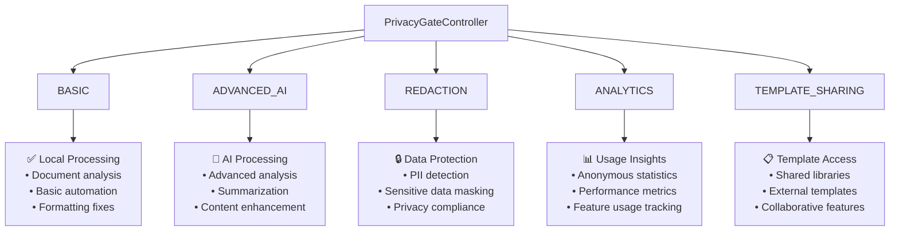
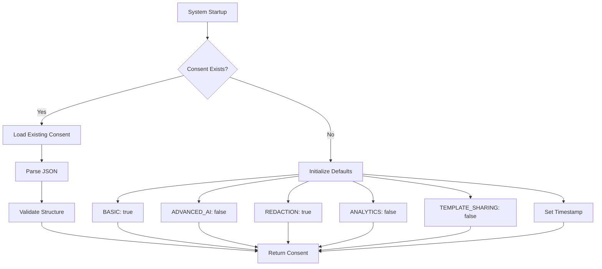
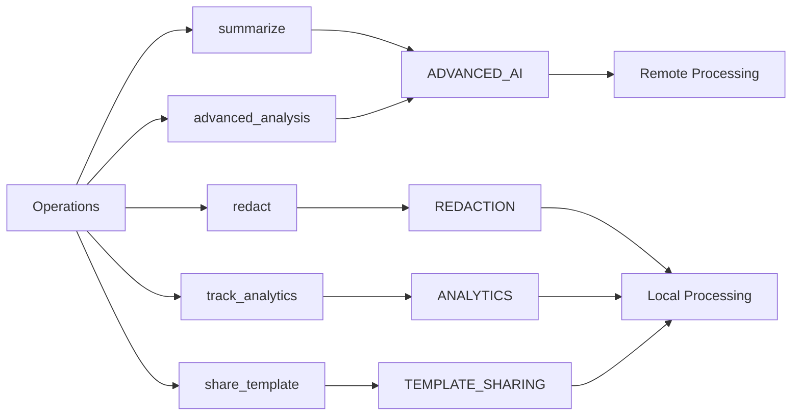
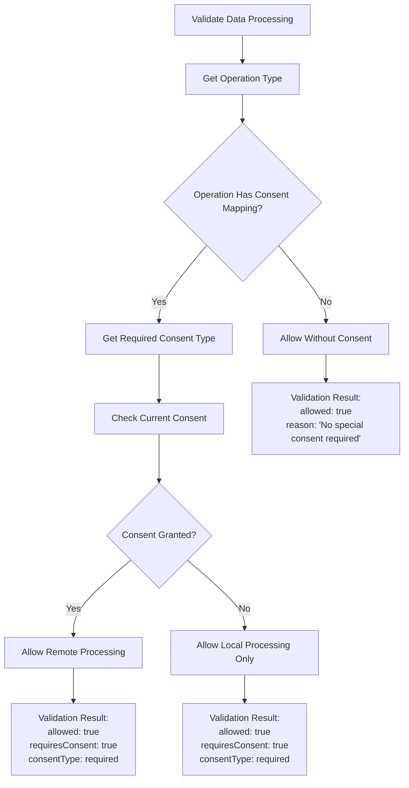
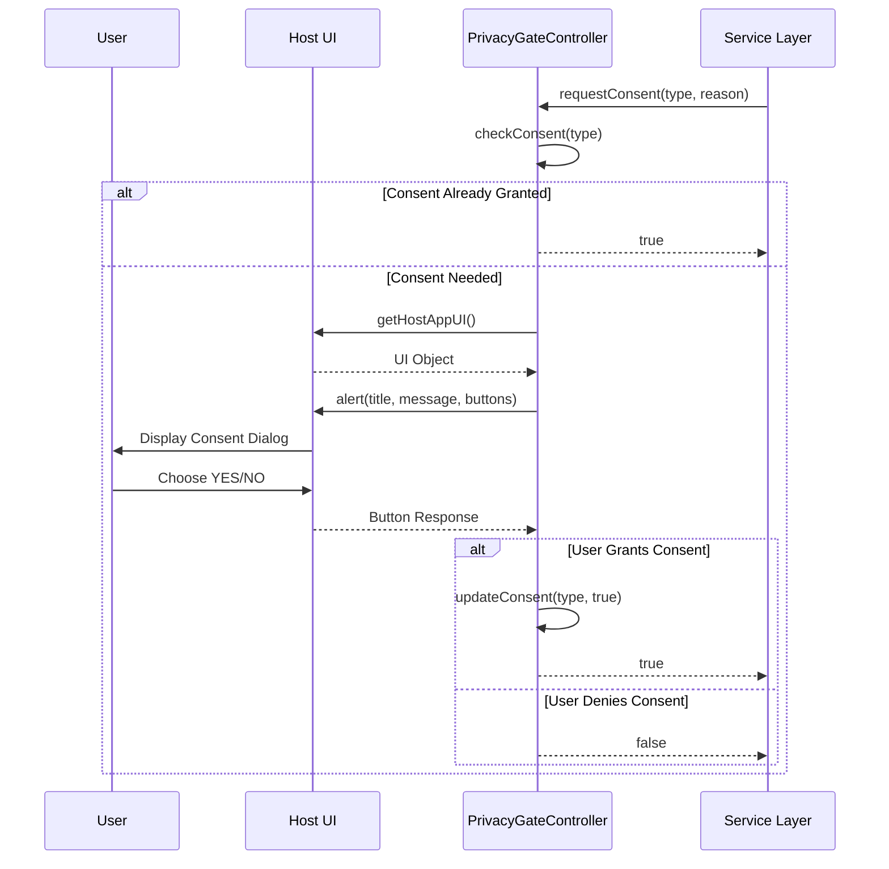
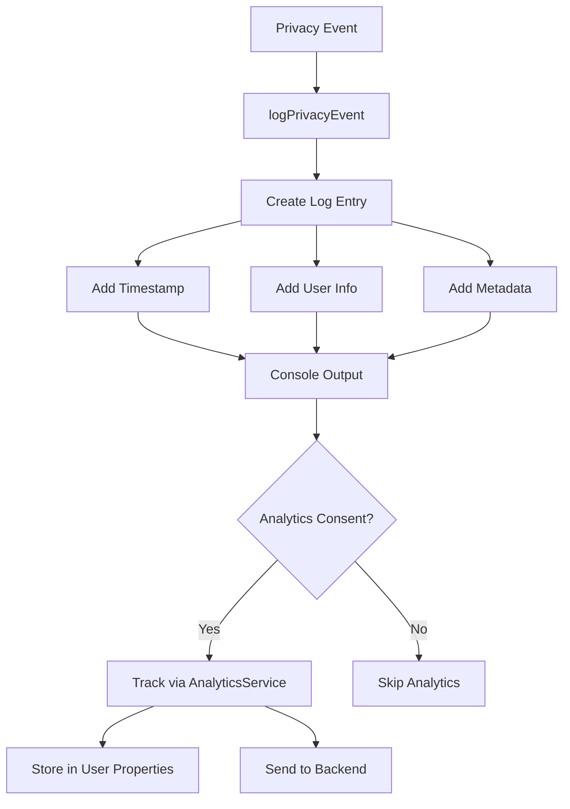

# Privacy Gate Controller API Documentation

<cite>
**Referenced Files in This Document**
- [PrivacyGateController.js](file://src/services/PrivacyGateController.js)
- [AnalyticsService.js](file://src/services/AnalyticsService.js)
- [RedactionService.js](file://src/services/RedactionService.js)
- [TemplateManager.js](file://src/services/TemplateManager.js)
- [Sidebar.html](file://src/ui/Sidebar.html)
- [Main.js](file://src/Main.js)
</cite>

## Table of Contents
1. [Introduction](#introduction)
2. [Core Consent Types](#core-consent-types)
3. [Public API Methods](#public-api-methods)
4. [Consent Management](#consent-management)
5. [Data Processing Validation](#data-processing-validation)
6. [Privacy Policy Integration](#privacy-policy-integration)
7. [UI Integration](#ui-integration)
8. [Audit Logging](#audit-logging)
9. [Error Handling](#error-handling)
10. [Usage Examples](#usage-examples)
11. [Best Practices](#best-practices)

## Introduction

The PrivacyGateController is a comprehensive privacy management system that governs user consent and enforces privacy policies for data processing within the Intelligent Document Automation add-on. It provides granular control over different types of data processing operations while maintaining strict privacy standards.

The controller operates on a principle of "privacy-first" processing, ensuring that all document analysis and automation runs locally by default unless explicit consent is granted for advanced features that may involve external processing.

## Core Consent Types

The PrivacyGateController manages five distinct consent types, each governing specific categories of data processing:



**Diagram sources**
- [PrivacyGateController.js](file://src/services/PrivacyGateController.js#L9-L14)

### Consent Type Details

| Consent Type | Purpose | Default State | Storage Location |
|--------------|---------|---------------|------------------|
| `BASIC` | Core functionality | Enabled | PropertiesService |
| `ADVANCED_AI` | AI-powered processing | Disabled | PropertiesService |
| `REDACTION` | Privacy protection | Enabled | PropertiesService |
| `ANALYTICS` | Usage tracking | Disabled | PropertiesService |
| `TEMPLATE_SHARING` | Template access | Disabled | PropertiesService |

**Section sources**
- [PrivacyGateController.js](file://src/services/PrivacyGateController.js#L9-L14)

## Public API Methods

### Core Retrieval Methods

#### `getConsent()`
Retrieves current consent settings for all types.

**Returns:** Object containing consent status for each type and timestamp
**Storage:** PropertiesService with key `'privacyConsent'`

#### `checkConsent(consentType)`
Verifies if consent is granted for a specific operation type.

**Parameters:**
- `consentType` (string): Type of consent to check (from CONSENT_TYPES)

**Returns:** Boolean indicating whether consent is granted

#### `getPrivacyPolicy()`
Provides the complete privacy policy text for display to users.

**Returns:** String containing the full privacy policy

#### `showPrivacyDashboard()`
Displays the current privacy settings in a user-friendly dashboard format.

**Returns:** Void - opens UI alert dialog

**Section sources**
- [PrivacyGateController.js](file://src/services/PrivacyGateController.js#L21-L289)

### Consent Modification Methods

#### `updateConsent(consentType, granted)`
Updates consent settings for a specific type and logs the change.

**Parameters:**
- `consentType` (string): Type of consent to modify
- `granted` (boolean): Whether consent is granted

**Returns:** Updated consent object with timestamp

#### `requestConsent(consentType, reason)`
Prompts users for consent with contextual messaging and updates settings if approved.

**Parameters:**
- `consentType` (string): Type of consent being requested
- `reason` (string): Explanation for why consent is needed

**Returns:** Boolean indicating whether consent was granted

#### `revokeAllConsent()`
Resets all consent settings to default values and logs the revocation.

**Returns:** Default consent object

**Section sources**
- [PrivacyGateController.js](file://src/services/PrivacyGateController.js#L51-L166)

### Data Processing Methods

#### `validateDataProcessing(operation, data)`
Validates whether a specific operation can proceed based on current consent settings.

**Parameters:**
- `operation` (string): Name of the operation being validated
- `data` (Object): Data to be processed (currently unused in validation)

**Returns:** Object with validation results:
- `allowed` (boolean): Whether operation is permitted
- `reason` (string): Explanation for the decision
- `requiresConsent` (boolean): Whether consent is required
- `consentType` (string): Type of consent needed (if required)

#### `processWithPrivacyGate(operation, localFn, remoteFn)`
Routes operations to appropriate processing functions based on consent validation.

**Parameters:**
- `operation` (string): Operation to perform
- `localFn` (Function): Function to execute locally (always permitted)
- `remoteFn` (Function): Function to execute remotely (requires consent)

**Returns:** Result from either localFn() or remoteFn(), depending on consent

**Section sources**
- [PrivacyGateController.js](file://src/services/PrivacyGateController.js#L175-L236)

## Consent Management

### Default Consent Configuration

The system initializes with conservative privacy settings, enabling only basic functionality by default:



**Diagram sources**
- [PrivacyGateController.js](file://src/services/PrivacyGateController.js#L30-L38)

### Consent Storage Implementation

Consent settings are persisted using Google Apps Script's PropertiesService with JSON serialization:

**Storage Key:** `'privacyConsent'`
**Format:** JSON string containing all consent types and timestamp
**Scope:** User-scoped properties

**Section sources**
- [PrivacyGateController.js](file://src/services/PrivacyGateController.js#L8-L38)

## Data Processing Validation

### Operation-to-Consent Mapping

The system maps specific operations to required consent types:



**Diagram sources**
- [PrivacyGateController.js](file://src/services/PrivacyGateController.js#L184-L189)

### Validation Logic Flow



**Diagram sources**
- [PrivacyGateController.js](file://src/services/PrivacyGateController.js#L175-L212)

**Section sources**
- [PrivacyGateController.js](file://src/services/PrivacyGateController.js#L175-L212)

## Privacy Policy Integration

### Policy Content Structure

The privacy policy provides comprehensive information about data processing practices:

**Key Sections:**
1. **Local-First Processing**: Emphasizes default local processing
2. **Data Collection**: Explicitly states what data is collected
3. **Optional Features**: Explains advanced features requiring consent
4. **Analytics**: Describes anonymous usage tracking
5. **User Rights**: Outlines privacy rights and controls
6. **Security Measures**: Details encryption and access controls

### Policy Display Integration

The privacy policy is accessible through multiple channels:
- Direct API access via `getPrivacyPolicy()`
- UI integration in settings panels
- Help system access

**Section sources**
- [PrivacyGateController.js](file://src/services/PrivacyGateController.js#L243-L269)

## UI Integration

### Consent Dialog Implementation

The system provides contextual consent dialogs with detailed explanations:



**Diagram sources**
- [PrivacyGateController.js](file://src/services/PrivacyGateController.js#L96-L143)

### Dashboard Integration

Privacy settings are displayed in user-friendly dashboards:

**Features:**
- Real-time consent status
- Clear enable/disable indicators
- Last update timestamps
- Actionable consent requests

**Section sources**
- [PrivacyGateController.js](file://src/services/PrivacyGateController.js#L275-L289)
- [Sidebar.html](file://src/ui/Sidebar.html#L1-L636)

## Audit Logging

### Event Tracking System

The PrivacyGateController implements comprehensive audit logging:



**Diagram sources**
- [PrivacyGateController.js](file://src/services/PrivacyGateController.js#L297-L314)

### Logged Events

**Consent Management Events:**
- `consent_update`: Individual consent changes
- `consent_revoke_all`: Complete consent reset

**Processing Events:**
- `remote_processing`: Successful remote processing
- `local_processing_fallback`: Forced local processing

**Section sources**
- [PrivacyGateController.js](file://src/services/PrivacyGateController.js#L297-L314)

## Error Handling

### Property Storage Errors

The system implements robust error handling for property storage operations:

**Error Scenarios:**
- Property service unavailability
- JSON parsing failures
- Network connectivity issues
- Permission restrictions

**Recovery Mechanisms:**
- Graceful degradation to defaults
- Error logging with stack traces
- Fallback consent states
- User notification where appropriate

### UI Access Errors

**UI Availability Checks:**
- Host application detection
- UI object validation
- Fallback to alternative interfaces
- Graceful failure handling

**Section sources**
- [PrivacyGateController.js](file://src/services/PrivacyGateController.js#L40-L42)
- [PrivacyGateController.js](file://src/services/PrivacyGateController.js#L96-L98)
- [PrivacyGateController.js](file://src/services/PrivacyGateController.js#L336-L349)

## Usage Examples

### Service Integration Patterns

#### Analytics Service Integration
```javascript
// Check consent before tracking events
if (!PrivacyGateController.checkConsent('analytics')) {
    // Store minimal local stats only
    updateLocalStats(eventName);
    return;
}

// Full analytics processing with consent
AnalyticsService.trackEvent('summarize', { method: 'local', length: text.length });
```

#### Redaction Service Integration
```javascript
// Validate redaction consent before processing
if (!PrivacyGateController.checkConsent('redaction')) {
    return {
        success: false,
        message: 'Privacy consent required for redaction',
        count: 0
    };
}

// Proceed with PII redaction
const result = redactPIIInDocument(piiItems);
```

#### Template Manager Integration
```javascript
// Request template sharing consent
if (!PrivacyGateController.checkConsent('templateSharing')) {
    const granted = PrivacyGateController.requestConsent(
        'templateSharing',
        'Access template library from Google Drive'
    );
    
    if (!granted) {
        return { success: false, message: 'Template access requires Drive permission' };
    }
}
```

**Section sources**
- [AnalyticsService.js](file://src/services/AnalyticsService.js#L18-L23)
- [RedactionService.js](file://src/services/RedactionService.js#L183-L190)
- [TemplateManager.js](file://src/services/TemplateManager.js#L48-L61)

### Privacy Gate Processing Pattern

```javascript
// Use PrivacyGate to route operations
const result = PrivacyGateController.processWithPrivacyGate(
    'summarize',                    // Operation name
    () => summarizeLocally(text),   // Local fallback function
    () => summarizeRemotely(text)   // Remote processing function
);
```

**Section sources**
- [PrivacyGateController.js](file://src/services/PrivacyGateController.js#L222-L236)

## Best Practices

### Consent Management Guidelines

1. **Always Check First**: Verify consent before performing sensitive operations
2. **Contextual Requests**: Provide clear explanations for consent requests
3. **Graceful Degradation**: Offer local alternatives when remote processing isn't possible
4. **Audit Trail**: Log all consent changes for compliance purposes

### Service Integration Recommendations

1. **Early Validation**: Check consent early in the operation lifecycle
2. **Progressive Enhancement**: Start with local processing and upgrade with consent
3. **User Communication**: Inform users about privacy implications
4. **Fallback Options**: Always provide local processing alternatives

### Security Considerations

1. **Local Processing Preference**: Default to local processing when possible
2. **Data Minimization**: Only collect and process necessary data
3. **Encryption**: Ensure all remote communications use TLS 1.3
4. **Regular Audits**: Monitor consent usage and processing patterns

### Performance Optimization

1. **Lazy Loading**: Load consent settings only when needed
2. **Caching**: Cache consent results for repeated operations
3. **Batch Processing**: Group consent checks for efficiency
4. **Async Operations**: Use asynchronous processing where appropriate