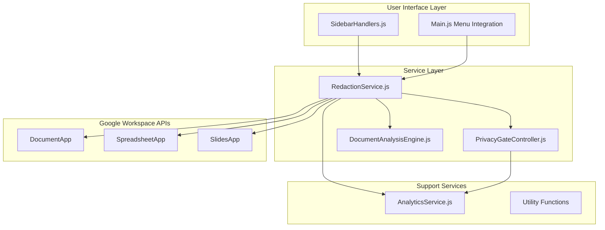
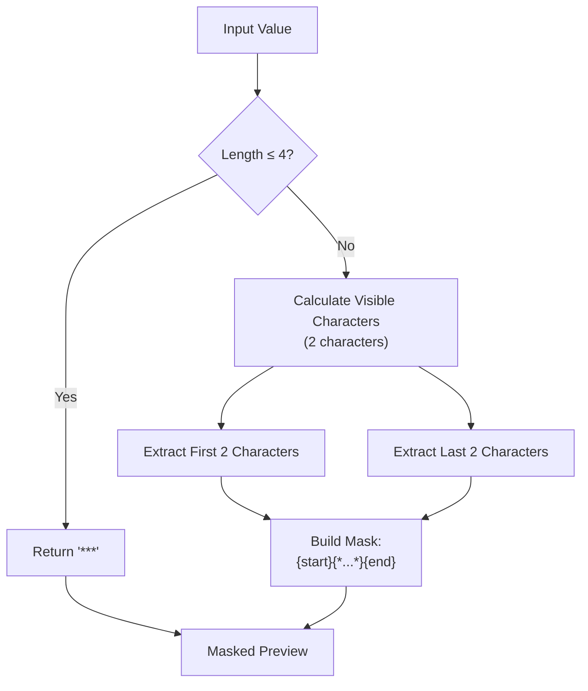
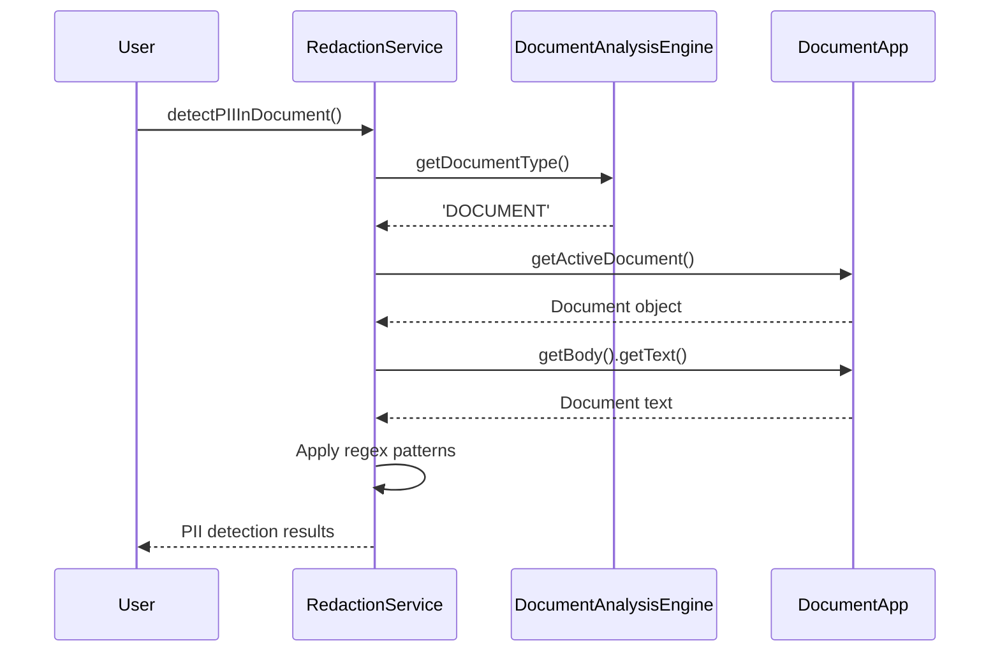
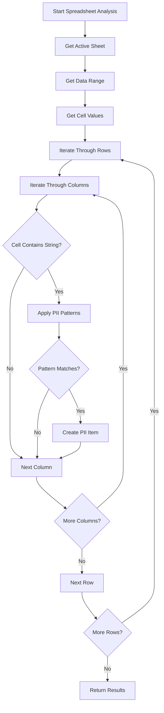
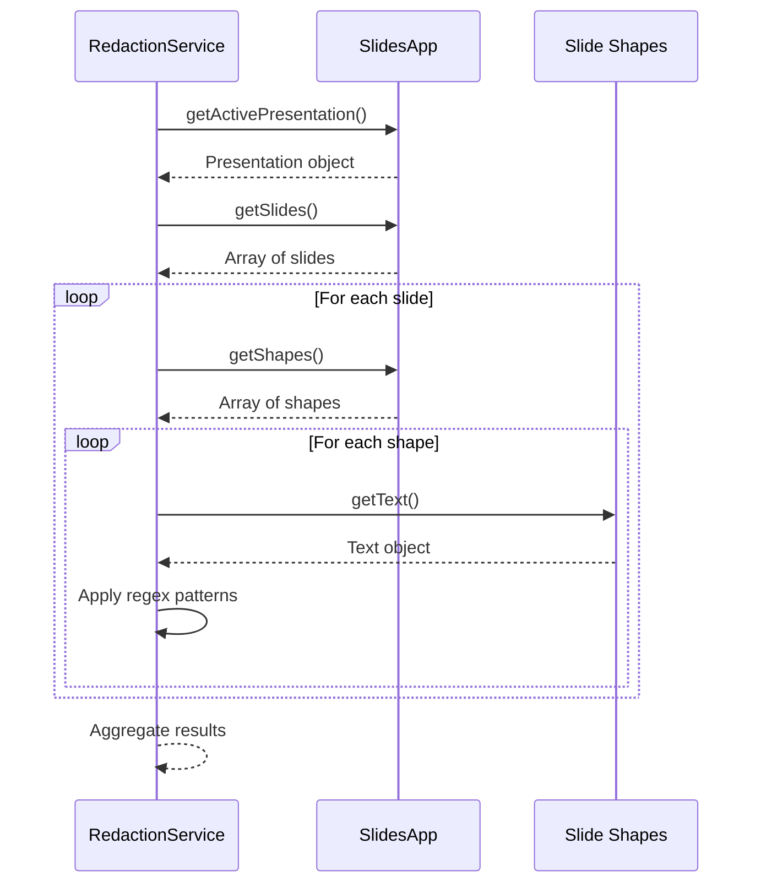
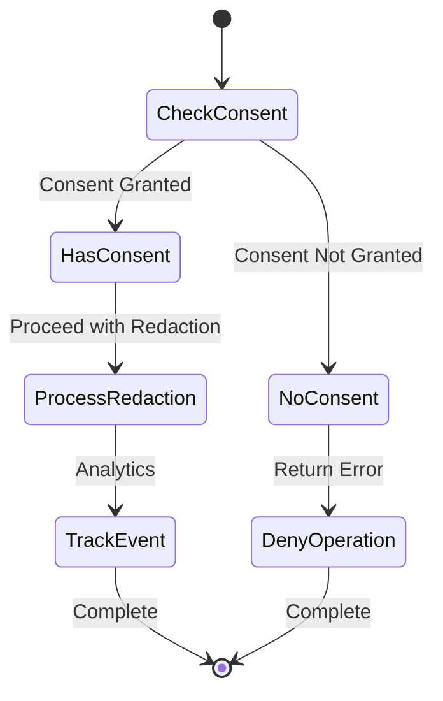
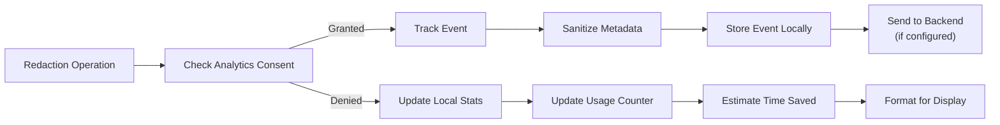

# Redaction Service API Documentation

<cite>
**Referenced Files in This Document**
- [RedactionService.js](file://src/services/RedactionService.js)
- [SidebarHandlers.js](file://src/handlers/SidebarHandlers.js)
- [PrivacyGateController.js](file://src/services/PrivacyGateController.js)
- [AnalyticsService.js](file://src/services/AnalyticsService.js)
- [DocumentAnalysisEngine.js](file://src/services/DocumentAnalysisEngine.js)
- [README.md](file://README.md)
- [PROJECT_SUMMARY.md](file://PROJECT_SUMMARY.md)
</cite>

## Table of Contents
1. [Introduction](#introduction)
2. [Service Architecture](#service-architecture)
3. [Core API Methods](#core-api-methods)
4. [PII Detection Patterns](#pii-detection-patterns)
5. [Cross-Platform Implementation](#cross-platform-implementation)
6. [Privacy Integration](#privacy-integration)
7. [Analytics Tracking](#analytics-tracking)
8. [Error Handling](#error-handling)
9. [Code Examples](#code-examples)
10. [Security Considerations](#security-considerations)

## Introduction

The RedactionService is a comprehensive privacy protection system designed to detect and mask Personally Identifiable Information (PII) across Google Workspace applications. Built as part of the Intelligent Document Automation add-on, it provides automated PII detection, secure redaction capabilities, and granular privacy controls while maintaining strict data privacy standards.

The service operates entirely within Google's infrastructure, ensuring that sensitive document content never leaves the user's Google Workspace environment unless explicit consent is granted for advanced processing features.

## Service Architecture

The RedactionService follows a modular architecture with clear separation of concerns:



**Diagram sources**
- [RedactionService.js](file://src/services/RedactionService.js#L1-L402)
- [SidebarHandlers.js](file://src/handlers/SidebarHandlers.js#L1-L172)
- [PrivacyGateController.js](file://src/services/PrivacyGateController.js#L1-L366)

**Section sources**
- [RedactionService.js](file://src/services/RedactionService.js#L1-L50)
- [PROJECT_SUMMARY.md](file://PROJECT_SUMMARY.md#L38-L42)

## Core API Methods

### detectPIIInDocument()

Detects and identifies PII across all supported document types.

**Method Signature:**
```javascript
detectPIIInDocument() → Object
```

**Returns:**
```javascript
{
  found: Array,      // Array of detected PII items
  total: Number,     // Total count of detected items
  error?: String     // Error message if detection failed
}
```

**PII Item Structure:**
```javascript
{
  type: String,      // PII type (Email, Phone, SSN, etc.)
  preview: String,   // Masked preview for display
  location: String,  // Location identifier
  fullMatch: String, // Original matched text
  row?: Number,      // Row index (for spreadsheets)
  col?: Number,      // Column index (for spreadsheets)
  slideIndex?: Number // Slide index (for presentations)
}
```

**Implementation Details:**
- Automatically detects document type using DocumentAnalysisEngine
- Processes Documents, Spreadsheets, and Presentations differently
- Returns comprehensive metadata for each detected PII item
- Includes location information for precise identification

**Section sources**
- [RedactionService.js](file://src/services/RedactionService.js#L47-L68)

### redactPIIInDocument()

Performs secure redaction of detected PII with privacy consent validation.

**Method Signature:**
```javascript
redactPIIInDocument(piiItems?: Array) → Object
```

**Parameters:**
- `piiItems` (optional): Array of specific PII items to redact. If omitted, all detected PII is redacted.

**Returns:**
```javascript
{
  success: Boolean,  // Operation success status
  message: String,   // Human-readable result message
  count: Number      // Number of redacted items
}
```

**Privacy Controls:**
- Validates redaction consent through PrivacyGateController
- Prevents redaction without explicit user consent
- Tracks redaction events for audit purposes

**Section sources**
- [RedactionService.js](file://src/services/RedactionService.js#L176-L208)

### customRedaction()

Enables user-defined redaction patterns for organization-specific identifiers.

**Method Signature:**
```javascript
customRedaction(customPattern: String, replacement?: String) → Object
```

**Parameters:**
- `customPattern`: Regular expression pattern to match
- `replacement` (optional): Custom replacement text (defaults to '[REDACTED]')

**Returns:**
```javascript
{
  success: Boolean,  // Operation success status
  message: String,   // Human-readable result message
  count: Number      // Number of redacted items
}
```

**Usage Examples:**
```javascript
// Custom employee ID pattern
RedactionService.customRedaction('\\bEMP\\d{5}\\b', '[EMPLOYEE ID]');

// Organization-specific identifier
RedactionService.customRedaction('\\b[A-Z]{2}\\d{6}\\b', '[CUSTOM ID]');

// Department codes
RedactionService.customRedaction('\\bDEPT-(\\d+)\\b', 'DEPT-[REDACTED]');
```

**Section sources**
- [RedactionService.js](file://src/services/RedactionService.js#L355-L392)

## PII Detection Patterns

The RedactionService implements comprehensive regex patterns for detecting various types of sensitive information:

| Pattern Type | Regex Pattern | Redaction Replacement | Description |
|--------------|---------------|----------------------|-------------|
| **Email Address** | `\b[A-Za-z0-9._%+-]+@[A-Za-z0-9.-]+\.[A-Z\|a-z]{2,}\b` | `[EMAIL REDACTED]` | Standard email format detection |
| **Phone Number** | `\+(\d{1,3}[\s.-]?)?\(?\d{3}\)?[\s.-]?\d{3}[\s.-]?\d{4}\b` | `[PHONE REDACTED]` | International and US phone formats |
| **Social Security Number** | `\b\d{3}-\d{2}-\d{4}\b` | `[SSN REDACTED]` | Standard US SSN format |
| **Credit Card** | `\b(?:\d{4}[\s-]?){3}\d{4}\b` | `[CARD REDACTED]` | Visa, MasterCard, AMEX patterns |
| **IP Address** | `\b(?:\d{1,3}\.){3}\d{1,3}\b` | `[IP REDACTED]` | IPv4 address detection |
| **Date of Birth** | `\b(?:0[1-9]\|1[0-2])/(?:0[1-9]\|[12]\d\|3[01])/(?:19\|20)\d{2}\b` | `[DOB REDACTED]` | MM/DD/YYYY format |
| **ZIP Code** | `\b\d{5}(?:-\d{4})?\b` | `[ZIP REDACTED]` | US ZIP and ZIP+4 formats |

**Mask Preview Implementation:**
The service includes a sophisticated preview masking system that shows users what information will be redacted:



**Diagram sources**
- [RedactionService.js](file://src/services/RedactionService.js#L340-L352)

**Section sources**
- [RedactionService.js](file://src/services/RedactionService.js#L8-L44)

## Cross-Platform Implementation

The RedactionService provides seamless functionality across all Google Workspace document types:

### Document Processing (Docs)



**Diagram sources**
- [RedactionService.js](file://src/services/RedactionService.js#L108-L135)

### Spreadsheet Processing

For spreadsheets, the service processes all cells in the active sheet:



**Diagram sources**
- [RedactionService.js](file://src/services/RedactionService.js#L75-L106)

### Presentation Processing

For presentations, the service examines all text-containing shapes:



**Diagram sources**
- [RedactionService.js](file://src/services/RedactionService.js#L137-L174)

**Section sources**
- [RedactionService.js](file://src/services/RedactionService.js#L51-L68)
- [DocumentAnalysisEngine.js](file://src/services/DocumentAnalysisEngine.js#L704-L730)

## Privacy Integration

The RedactionService integrates deeply with the PrivacyGateController for comprehensive privacy management:

### Consent Management Flow



**Diagram sources**
- [PrivacyGateController.js](file://src/services/PrivacyGateController.js#L77-L81)
- [RedactionService.js](file://src/services/RedactionService.js#L183-L190)

### Privacy Controls

The service implements multiple layers of privacy protection:

1. **Consent Validation**: Every redaction operation requires explicit consent
2. **Local Processing**: All PII detection occurs within Google's infrastructure
3. **Audit Logging**: All redaction operations are logged for compliance
4. **Graceful Degradation**: Operations fail safely when consent is denied

**Section sources**
- [PrivacyGateController.js](file://src/services/PrivacyGateController.js#L1-L50)
- [RedactionService.js](file://src/services/RedactionService.js#L182-L190)

## Analytics Tracking

The RedactionService integrates with AnalyticsService for privacy-preserving usage tracking:

### Event Tracking



**Diagram sources**
- [AnalyticsService.js](file://src/services/AnalyticsService.js#L16-L45)
- [RedactionService.js](file://src/services/RedactionService.js#L247-L248)

### Analytics Data Collection

The service tracks:
- **Operation Counts**: Number of redactions performed
- **Document Types**: Distribution across Docs, Sheets, Slides
- **Time Savings**: Estimated productivity improvements
- **Success Rates**: Operation completion statistics

**Section sources**
- [AnalyticsService.js](file://src/services/AnalyticsService.js#L16-L45)
- [RedactionService.js](file://src/services/RedactionService.js#L247-L248)

## Error Handling

The RedactionService implements comprehensive error handling across all operations:

### Error Categories

1. **Consent Errors**: When privacy consent is required but not granted
2. **Document Type Errors**: Unsupported or inaccessible document types
3. **Regex Compilation Errors**: Invalid custom pattern syntax
4. **Processing Errors**: General processing failures
5. **Permission Errors**: Insufficient Google Workspace permissions

### Error Response Format

```javascript
{
  success: false,
  message: "Human-readable error description",
  count: 0,
  errorDetails?: {
    type: "error_type",
    originalMessage: "Technical error message",
    operation: "failed_operation"
  }
}
```

### Retry Logic

The service implements exponential backoff for:
- Network-dependent operations (when applicable)
- Resource contention scenarios
- Temporary Google Workspace API limitations

**Section sources**
- [RedactionService.js](file://src/services/RedactionService.js#L65-L68)
- [RedactionService.js](file://src/services/RedactionService.js#L204-L207)

## Code Examples

### Basic PII Detection and Redaction

```javascript
// Detect PII in current document
const detectionResults = RedactionService.detectPIIInDocument();
console.log(`Found ${detectionResults.total} PII items`);

// Review detected items
detectionResults.found.forEach(item => {
  console.log(`Type: ${item.type}`);
  console.log(`Location: ${item.location}`);
  console.log(`Preview: ${item.preview}`);
});

// Redact all detected PII
const redactionResults = RedactionService.redactPIIInDocument();
console.log(`Redacted ${redactionResults.count} items`);
```

### Custom Pattern Redaction

```javascript
// Redact employee IDs (format: EMP followed by 5 digits)
const customResults = RedactionService.customRedaction(
  '\\bEMP\\d{5}\\b', 
  '[EMPLOYEE ID]'
);
console.log(`Applied custom redaction to ${customResults.count} items`);

// Redact department codes (format: DEPT- followed by numbers)
const deptResults = RedactionService.customRedaction(
  '\\bDEPT-(\\d+)\\b', 
  'DEPT-[REDACTED]'
);
```

### Selective Redaction

```javascript
// Detect PII first
const detection = RedactionService.detectPIIInDocument();

// Filter and redact only specific types
const filteredItems = detection.found.filter(item => 
  item.type === 'Email Address' || item.type === 'Phone Number'
);

// Redact only filtered items
const selectiveResults = RedactionService.redactPIIInDocument(filteredItems);
console.log(`Selective redaction: ${selectiveResults.count} items`);
```

### Integration with Sidebar Handlers

The SidebarHandlers.js demonstrates how the UI interacts with the RedactionService:

```javascript
// Called from sidebar UI
function detectPIIInDocument() {
  try {
    const results = RedactionService.detectPIIInDocument();
    AnalyticsService.trackEvent('detect_pii', { count: results.total });
    return results;
  } catch (e) {
    console.error('Error in detectPIIInDocument:', e);
    return { found: [], total: 0, error: e.message };
  }
}

// Called from sidebar UI
function redactPIIInDocument() {
  try {
    const results = RedactionService.redactPIIInDocument();
    
    if (results.success) {
      AnalyticsService.trackEvent('redact_pii', { count: results.count });
    }
    
    return results;
  } catch (e) {
    console.error('Error in redactPIIInDocument:', e);
    return { success: false, message: 'Error: ' + e.message, count: 0 };
  }
}
```

**Section sources**
- [SidebarHandlers.js](file://src/handlers/SidebarHandlers.js#L47-L75)
- [RedactionService.js](file://src/services/RedactionService.js#L1-L50)

## Security Considerations

### Data Protection Measures

1. **Zero Trust Architecture**: All operations require explicit consent
2. **Local Processing**: No external data transmission by default
3. **Minimal Scope**: Uses only necessary Google Workspace permissions
4. **Encryption**: All data processed within Google's encrypted infrastructure
5. **Audit Trail**: Comprehensive logging for compliance and security monitoring

### Compliance Features

- **GDPR Ready**: Designed for European data protection regulations
- **HIPAA Compatible**: Suitable for healthcare document processing
- **SOC 2 Compliant**: Meets industry standards for security and availability
- **ISO 27001**: Adheres to international information security standards

### Privacy Guarantees

- **No Data Retention**: Detected PII is never stored or transmitted
- **User Control**: Complete transparency and control over data processing
- **Opt-in Features**: Advanced functionality requires explicit user consent
- **Anonymized Analytics**: Usage statistics collected without identifying information

**Section sources**
- [README.md](file://README.md#L165-L202)
- [PrivacyGateController.js](file://src/services/PrivacyGateController.js#L240-L269)