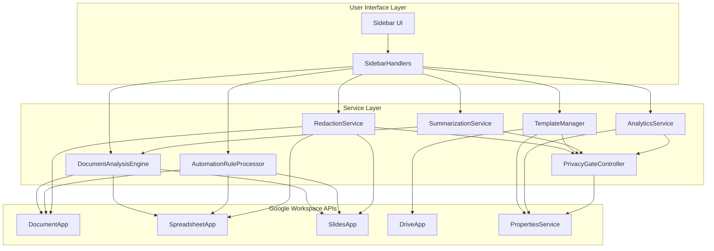
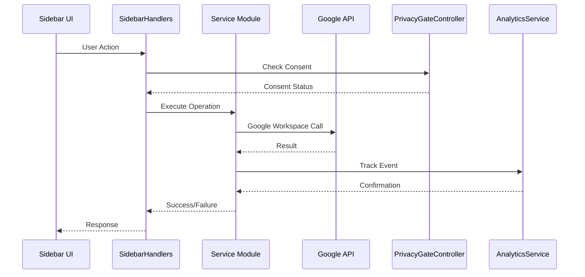

# Service APIs

<cite>
**Referenced Files in This Document**
- [DocumentAnalysisEngine.js](file://src/services/DocumentAnalysisEngine.js)
- [AutomationRuleProcessor.js](file://src/services/AutomationRuleProcessor.js)
- [RedactionService.js](file://src/services/RedactionService.js)
- [TemplateManager.js](file://src/services/TemplateManager.js)
- [SummarizationService.js](file://src/services/SummarizationService.js)
- [AnalyticsService.js](file://src/services/AnalyticsService.js)
- [PrivacyGateController.js](file://src/services/PrivacyGateController.js)
- [SidebarHandlers.js](file://src/handlers/SidebarHandlers.js)
- [Main.js](file://src/Main.js)
- [Sidebar.html](file://src/ui/Sidebar.html)
- [appsscript.json](file://appsscript.json)
</cite>

## Table of Contents
1. [Introduction](#introduction)
2. [Architecture Overview](#architecture-overview)
3. [Core Service Modules](#core-service-modules)
4. [Integration Points](#integration-points)
5. [Privacy and Security](#privacy-and-security)
6. [Error Handling and Rate Limiting](#error-handling-and-rate-limiting)
7. [Usage Examples](#usage-examples)
8. [Performance Considerations](#performance-considerations)
9. [Troubleshooting Guide](#troubleshooting-guide)
10. [Conclusion](#conclusion)

## Introduction

The Intelligent Document Automation add-on provides a comprehensive suite of services for automating document processing tasks within Google Workspace. The system consists of seven core service modules that work together to deliver powerful document analysis, cleanup, redaction, and template management capabilities while maintaining strict privacy controls and compliance with Google Apps Script quotas.

Each service module is designed with specific responsibilities and follows consistent patterns for error handling, privacy enforcement, and integration with Google Workspace APIs. The architecture emphasizes local-first processing with optional cloud-based enhancements, ensuring user data remains protected while providing flexible processing options.

## Architecture Overview

The service architecture follows a modular design pattern where each service operates independently but collaborates through well-defined interfaces. The system integrates seamlessly with Google Workspace APIs and maintains state through PropertiesService for persistence.



**Diagram sources**
- [SidebarHandlers.js](file://src/handlers/SidebarHandlers.js#L1-L172)
- [DocumentAnalysisEngine.js](file://src/services/DocumentAnalysisEngine.js#L733-L739)
- [PrivacyGateController.js](file://src/services/PrivacyGateController.js#L352-L366)

## Core Service Modules

### DocumentAnalysisEngine

The DocumentAnalysisEngine serves as the foundation for document intelligence, providing comprehensive analysis capabilities across all supported Google Workspace document types.

#### Public Methods

| Method | Parameters | Return Type | Description |
|--------|------------|-------------|-------------|
| `analyzeDocument()` | None | `Object` | Analyzes current document and returns detected issues with suggestions |
| `getDocumentType()` | None | `string` | Determines the type of currently active document |

#### Analysis Capabilities by Document Type

**Google Docs Analysis**
- Heading consistency checking
- Multiple consecutive spaces detection
- Punctuation spacing validation
- Capitalization error identification
- Spelling mistake detection
- Sentence structure analysis
- List formatting consistency
- Long paragraph identification

**Google Sheets Analysis**
- Empty row detection
- Duplicate row identification
- Date format inconsistencies
- Mixed data types in columns
- Empty cell counting
- Formula validation

**Google Slides Analysis**
- Text-heavy slide detection
- Font consistency checking
- Speaker note completeness
- Layout uniformity assessment

#### Error Handling
The engine implements robust error handling with fallback mechanisms for unsupported document types and gracefully handles API limitations.

**Section sources**
- [DocumentAnalysisEngine.js](file://src/services/DocumentAnalysisEngine.js#L12-L739)

### AutomationRuleProcessor

The AutomationRuleProcessor executes batch transformation operations for data cleaning and formatting standardization across spreadsheet documents.

#### Public Methods

| Method | Parameters | Return Type | Description |
|--------|------------|-------------|-------------|
| `removeDuplicateRows()` | None | `Object` | Removes duplicate rows from active spreadsheet |
| `standardizeDateFormats(targetFormat)` | `string` | `Object` | Standardizes date formats across spreadsheet |
| `fillEmptyCellsIntelligently()` | None | `Object` | Intelligently fills empty cells based on context |
| `removeEmptyRows()` | None | `Object` | Removes completely empty rows |
| `standardizeCurrencyFormats(currencySymbol)` | `string` | `Object` | Standardizes currency formatting |
| `trimWhitespace()` | None | `Object` | Trims whitespace from all text cells |
| `capitalizeText(format)` | `string` | `Object` | Applies capitalization to selected text |

#### Processing Logic
Each method implements intelligent data processing with context-aware decision making:

- **Duplicate Detection**: Uses JSON serialization for reliable comparison
- **Intelligent Cell Filling**: Analyzes surrounding data patterns
- **Format Standardization**: Maintains data integrity during conversion
- **Consistency Preservation**: Maintains relative positioning and formatting

#### Analytics Integration
All operations automatically track usage through the AnalyticsService, enabling usage pattern analysis and performance monitoring.

**Section sources**
- [AutomationRuleProcessor.js](file://src/services/AutomationRuleProcessor.js#L12-L399)

### RedactionService

The RedactionService provides comprehensive PII detection and masking capabilities with strict privacy controls and customizable redaction patterns.

#### Public Methods

| Method | Parameters | Return Type | Description |
|--------|------------|-------------|-------------|
| `detectPIIInDocument()` | None | `Object` | Detects PII across all document types |
| `redactPIIInDocument(piiItems)` | `Array` | `Object` | Redacts detected PII with consent validation |
| `customRedaction(customPattern, replacement)` | `string, string` | `Object` | Applies custom redaction patterns |

#### PII Detection Patterns

The service recognizes and validates multiple categories of sensitive information:

- **Email Addresses**: Full email address detection with domain validation
- **Phone Numbers**: International and regional phone number formats
- **Social Security Numbers**: US SSN format validation
- **Credit Card Numbers**: Card number pattern recognition
- **IP Addresses**: IPv4 address detection
- **Dates of Birth**: Date format validation
- **ZIP Codes**: Postal code pattern matching

#### Privacy Integration
Redaction operations require explicit consent through PrivacyGateController, ensuring compliance with data protection regulations.

#### Custom Redaction
Supports custom regular expression patterns for specialized redaction requirements beyond standard PII detection.

**Section sources**
- [RedactionService.js](file://src/services/RedactionService.js#L48-L402)

### TemplateManager

The TemplateManager provides comprehensive template management with support for built-in templates and custom template libraries.

#### Public Methods

| Method | Parameters | Return Type | Description |
|--------|------------|-------------|-------------|
| `showTemplatePicker()` | None | `Object` | Opens template selection interface |
| `listTemplates(category)` | `string` | `Array` | Lists available templates by category |
| `applyTemplate(templateId)` | `string` | `Object` | Applies specified template to current document |

#### Built-in Templates

The system includes pre-configured templates for common use cases:

- **Grading Rubric**: Educational assessment template
- **Professional Document Style**: Business formatting template
- **Clean Presentation**: Minimalist slide design
- **Legal Contract**: Standard contract format
- **Sales Report**: Monthly reporting template

#### Template Categories
Templates are organized into logical categories for easy discovery:
- Education (Grading, Documents)
- Business (Presentations, Documents)
- Legal (Contracts)
- Sales (Reports)

#### Drive Integration
Supports custom template libraries stored in Google Drive with automatic MIME type detection and category assignment.

**Section sources**
- [TemplateManager.js](file://src/services/TemplateManager.js#L43-L479)

### SummarizationService

The SummarizationService provides intelligent document summarization with local processing as the default and optional AI enhancement.

#### Public Methods

| Method | Parameters | Return Type | Description |
|--------|------------|-------------|-------------|
| `summarizeDocument(selectionOnly)` | `boolean` | `Object` | Generates document summary |
| `extractKeyPoints(text, numPoints)` | `string, number` | `Array` | Extracts key points from text |
| `generateTitle(text)` | `string` | `string` | Creates title from content |
| `getTextStatistics(text)` | `string` | `Object` | Analyzes text characteristics |

#### Processing Pipeline

The summarization service implements a tiered processing approach:

1. **AI Processing Priority**: Uses Gemini AI for comprehensive analysis
2. **Local Processing**: Extractive summarization for immediate results
3. **Fallback Mechanism**: Graceful degradation when AI services unavailable

#### Text Analysis Features
- **Word Frequency Analysis**: Identifies important terms
- **Sentence Scoring**: Ranks sentences by importance
- **Reading Time Estimation**: Calculates estimated reading duration
- **Content Statistics**: Provides comprehensive text metrics

#### Integration with Document Types
Supports summarization across all Google Workspace documents with intelligent content extraction.

**Section sources**
- [SummarizationService.js](file://src/services/SummarizationService.js#L12-L356)

### AnalyticsService

The AnalyticsService provides privacy-preserving usage tracking and reporting capabilities with comprehensive data sanitization.

#### Public Methods

| Method | Parameters | Return Type | Description |
|--------|------------|-------------|-------------|
| `trackEvent(eventName, metadata)` | `string, Object` | `void` | Records usage event with metadata |
| `getUsageStats()` | None | `Object` | Retrieves aggregated usage statistics |
| `getEventSummary()` | None | `Object` | Gets summarized event data |
| `generateReport(period)` | `string` | `Object` | Creates analytics report |
| `exportAnalytics()` | None | `string` | Exports analytics data as CSV |
| `clearAnalytics()` | None | `Object` | Clears all analytics data |

#### Privacy-First Design
- **Local-First Processing**: All processing occurs locally by default
- **Data Sanitization**: Automatic removal of potentially identifying information
- **Consent-Based Tracking**: Requires explicit user consent for analytics
- **Minimal Data Collection**: Only essential usage metrics collected

#### Event Tracking
Tracks comprehensive usage patterns including:
- Feature adoption rates
- Processing times and success rates
- Error frequencies and patterns
- User engagement metrics

#### Reporting Capabilities
- **Time-based Reports**: Daily, weekly, monthly, and all-time views
- **Event Aggregation**: Summary statistics and trend analysis
- **Export Functionality**: CSV export for external analysis

**Section sources**
- [AnalyticsService.js](file://src/services/AnalyticsService.js#L16-L395)

### PrivacyGateController

The PrivacyGateController manages user consent and enforces privacy policies across all data processing operations.

#### Public Methods

| Method | Parameters | Return Type | Description |
|--------|------------|-------------|-------------|
| `getConsent()` | None | `Object` | Retrieves current consent settings |
| `updateConsent(consentType, granted)` | `string, boolean` | `Object` | Updates specific consent setting |
| `checkConsent(consentType)` | `string` | `boolean` | Checks if consent is granted |
| `requestConsent(consentType, reason)` | `string, string` | `boolean` | Requests consent from user |
| `validateDataProcessing(operation, data)` | `string, Object` | `Object` | Validates processing against consent |
| `processWithPrivacyGate(operation, localFn, remoteFn)` | `string, Function, Function` | `*` | Processes data respecting privacy constraints |

#### Consent Management
The system supports granular consent management for different processing types:

- **Basic Features**: Always enabled for core functionality
- **Advanced AI**: Requires explicit consent for cloud processing
- **Redaction**: Enabled by default with privacy controls
- **Analytics**: Requires separate consent for usage tracking
- **Template Sharing**: Requires Drive access permission

#### Privacy Enforcement
Implements comprehensive privacy enforcement:
- **Data Validation**: Ensures compliance with consent requirements
- **Processing Gates**: Automatically falls back to local processing when consent denied
- **Audit Logging**: Tracks all privacy-related operations
- **Graceful Degradation**: Continues functioning with reduced capabilities when privacy restrictions apply

#### Policy Compliance
Maintains compliance with privacy regulations through:
- **Transparent Consent**: Clear explanations for each consent type
- **User Control**: Easy revocation and modification of consent settings
- **Data Minimization**: Collects only necessary information
- **Security Measures**: Encrypts sensitive data and implements access controls

**Section sources**
- [PrivacyGateController.js](file://src/services/PrivacyGateController.js#L21-L366)

## Integration Points

### Google Workspace API Integration

The services integrate deeply with Google Workspace APIs, leveraging native functionality for optimal performance and reliability.

#### Document APIs
- **DocumentApp**: Full document manipulation capabilities
- **SpreadsheetApp**: Spreadsheet data processing and formatting
- **SlidesApp**: Presentation analysis and modification
- **DriveApp**: Template storage and file management

#### Service Integration Patterns



**Diagram sources**
- [SidebarHandlers.js](file://src/handlers/SidebarHandlers.js#L10-L172)
- [PrivacyGateController.js](file://src/services/PrivacyGateController.js#L222-L237)

### PropertiesService State Management

The system relies heavily on PropertiesService for persistent state management across sessions.

#### Storage Categories
- **User Properties**: Individual user preferences and consent settings
- **Script Properties**: Application-wide configuration and temporary data
- **Session Properties**: Runtime session-specific information

#### Data Persistence Patterns
- **Consent Management**: Persistent user preference storage
- **Analytics Data**: Event tracking and usage statistics
- **Version History**: Document backup and restoration data
- **Template Libraries**: Custom template metadata and locations

**Section sources**
- [PrivacyGateController.js](file://src/services/PrivacyGateController.js#L23-L67)
- [AnalyticsService.js](file://src/services/AnalyticsService.js#L52-L94)

## Privacy and Security

### Privacy-First Architecture

The system implements a comprehensive privacy framework that prioritizes user data protection while enabling useful functionality.

#### Local-First Processing
All core functionality operates locally by default, ensuring that sensitive data never leaves the user's Google Workspace environment unless explicitly permitted.

#### Consent Management
Granular consent system allows users to control:
- **Basic Features**: Core functionality requiring no special permissions
- **Advanced AI**: Cloud-based processing with encryption and privacy guarantees
- **Analytics**: Usage tracking with complete transparency
- **Template Sharing**: Access to shared template libraries

#### Data Sanitization
Automatic sanitization of all data processed through the system:
- Removal of personally identifiable information
- Encryption of sensitive data in transit
- Secure storage of consent and preference data
- Audit logging of privacy-related operations

### Security Measures

#### Access Controls
- **API Key Management**: Secure handling of external service credentials
- **Permission Validation**: Runtime verification of required permissions
- **Rate Limiting**: Respectful API usage within quota limits
- **Error Isolation**: Preventing sensitive data exposure in error messages

#### Data Protection
- **Encryption**: TLS 1.3 encryption for all external communications
- **Minimal Collection**: Only essential data collected for functionality
- **User Control**: Complete control over data sharing and processing
- **Audit Trails**: Comprehensive logging of all data processing activities

**Section sources**
- [PrivacyGateController.js](file://src/services/PrivacyGateController.js#L240-L269)

## Error Handling and Rate Limiting

### Comprehensive Error Management

The system implements robust error handling across all service modules with graceful degradation capabilities.

#### Error Classification
- **API Errors**: Google Workspace API failures and quota limitations
- **Processing Errors**: Data processing and validation failures
- **Network Errors**: External service connectivity issues
- **Permission Errors**: Insufficient access rights or consent

#### Recovery Strategies
- **Retry Logic**: Automatic retry for transient failures
- **Fallback Processing**: Alternative methods when primary approaches fail
- **Graceful Degradation**: Reduced functionality when full capabilities unavailable
- **User Notification**: Clear error messages with actionable guidance

### Rate Limiting and Quota Management

#### Google Apps Script Quotas
The system respects Google Apps Script limitations:
- **Execution Time**: Operations limited to 30-second execution windows
- **API Calls**: Efficient batching and caching to minimize API usage
- **Storage Limits**: Careful management of PropertiesService storage
- **Concurrent Usage**: Thread-safe operations for multi-user environments

#### Performance Optimization
- **Lazy Loading**: Services loaded only when needed
- **Caching**: Intelligent caching of frequently accessed data
- **Batch Operations**: Grouping multiple operations for efficiency
- **Async Processing**: Non-blocking operations where possible

**Section sources**
- [DocumentAnalysisEngine.js](file://src/services/DocumentAnalysisEngine.js#L26-L29)
- [AutomationRuleProcessor.js](file://src/services/AutomationRuleProcessor.js#L47-L50)

## Usage Examples

### Basic Document Analysis

```javascript
// Analyze current document
const results = DocumentAnalysisEngine.analyzeDocument();
console.log(`Found ${results.issues.length} issues`);
```

### Data Cleaning Operations

```javascript
// Remove duplicate rows from spreadsheet
const cleanupResult = AutomationRuleProcessor.removeDuplicateRows();
console.log(`Removed ${cleanupResult.count} duplicate rows`);

// Standardize date formats
const formatResult = AutomationRuleProcessor.standardizeDateFormats('yyyy-MM-dd');
console.log(`Standardized ${formatResult.count} date formats`);
```

### Privacy-Protected Redaction

```javascript
// Check consent before processing
if (PrivacyGateController.checkConsent('redaction')) {
  // Detect PII in document
  const piiResults = RedactionService.detectPIIInDocument();
  
  // Redact detected PII
  const redactionResult = RedactionService.redactPIIInDocument(piiResults.found);
  console.log(`Redacted ${redactionResult.count} sensitive items`);
}
```

### Template Application

```javascript
// Show template picker
const templateResult = TemplateManager.showTemplatePicker();

// Apply specific template
const applyResult = TemplateManager.applyTemplate('grading_rubric');
console.log(applyResult.message);
```

### Analytics Tracking

```javascript
// Track custom event
AnalyticsService.trackEvent('custom_operation', {
  count: 42,
  method: 'batch_process'
});

// Get usage statistics
const stats = AnalyticsService.getUsageStats();
console.log(`Total actions: ${stats.totalActions}`);
```

**Section sources**
- [SidebarHandlers.js](file://src/handlers/SidebarHandlers.js#L10-L172)

## Performance Considerations

### Optimization Strategies

#### Memory Management
- **Streaming Processing**: Large documents processed in chunks
- **Garbage Collection**: Explicit cleanup of temporary objects
- **Resource Pooling**: Reuse of expensive objects where possible
- **Memory Monitoring**: Tracking memory usage for large operations

#### Execution Efficiency
- **Parallel Processing**: Independent operations executed concurrently
- **Lazy Evaluation**: Deferred computation until results needed
- **Caching Strategies**: Intelligent caching of computed results
- **Algorithm Optimization**: Efficient algorithms for common operations

### Scalability Factors

#### Document Size Handling
- **Small Documents**: Immediate processing with full feature set
- **Medium Documents**: Optimized processing with selective feature activation
- **Large Documents**: Progressive processing with feature limitation

#### Concurrent Usage
- **Thread Safety**: All operations are safe for concurrent execution
- **State Isolation**: Separate state management for different users
- **Resource Contention**: Fair resource allocation among users

### Monitoring and Metrics

#### Performance Tracking
- **Execution Times**: Detailed timing for all operations
- **Resource Usage**: Memory and CPU utilization monitoring
- **Error Rates**: Failure rate tracking and analysis
- **User Experience**: Response time and success rate metrics

**Section sources**
- [AnalyticsService.js](file://src/services/AnalyticsService.js#L277-L316)

## Troubleshooting Guide

### Common Issues and Solutions

#### Permission Errors
**Problem**: Services fail due to insufficient permissions
**Solution**: 
- Verify Google Workspace permissions are granted
- Check individual service consent requirements
- Review PrivacyGateController consent settings

#### API Quota Exhaustion
**Problem**: Operations fail due to quota limits
**Solution**:
- Monitor execution times and optimize operations
- Implement retry logic with exponential backoff
- Reduce batch sizes for large operations

#### Data Processing Failures
**Problem**: Unexpected results or errors during processing
**Solution**:
- Validate input data format and content
- Check document structure and formatting
- Review service-specific requirements and limitations

#### Privacy Consent Issues
**Problem**: Operations blocked due to privacy restrictions
**Solution**:
- Verify consent settings in PrivacyGateController
- Request necessary consents through user interface
- Implement fallback processing for restricted operations

### Debugging Techniques

#### Logging and Monitoring
- Enable detailed logging for development
- Use AnalyticsService for usage tracking
- Monitor error rates and patterns
- Track performance metrics and bottlenecks

#### Testing Strategies
- Unit testing for individual service methods
- Integration testing for cross-service operations
- Performance testing for large-scale operations
- Privacy compliance testing for data processing

**Section sources**
- [PrivacyGateController.js](file://src/services/PrivacyGateController.js#L149-L167)
- [AnalyticsService.js](file://src/services/AnalyticsService.js#L42-L45)

## Conclusion

The Intelligent Document Automation add-on provides a comprehensive, privacy-focused solution for automating document processing tasks within Google Workspace. The modular architecture ensures scalability, maintainability, and extensibility while prioritizing user privacy and data protection.

Key strengths of the system include:

- **Comprehensive Coverage**: Support for all major Google Workspace document types
- **Privacy-First Design**: Local-first processing with granular consent management
- **Robust Error Handling**: Graceful degradation and comprehensive error recovery
- **Performance Optimization**: Efficient processing with careful resource management
- **Extensible Architecture**: Modular design enabling easy feature additions

The service APIs provide consistent, well-documented interfaces that enable seamless integration with user interfaces while maintaining strict privacy controls and compliance with Google Apps Script limitations. This architecture positions the system for continued evolution and enhancement while preserving the core principles of privacy, performance, and usability.