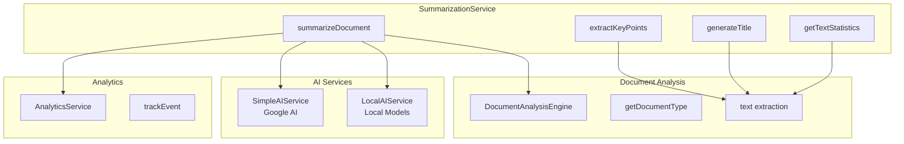
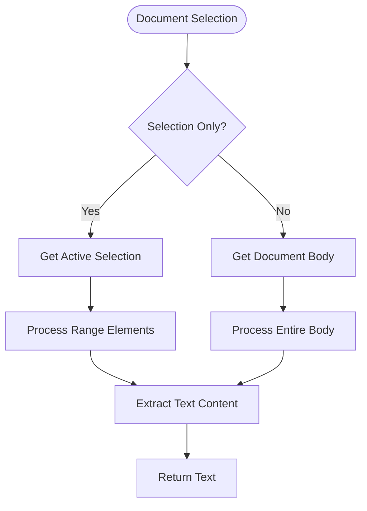
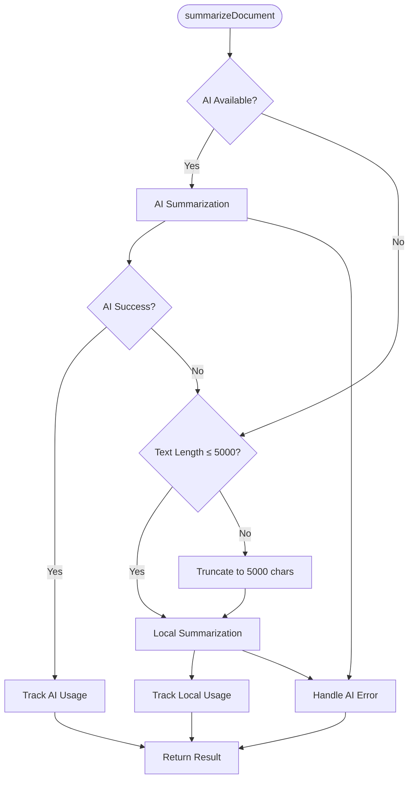
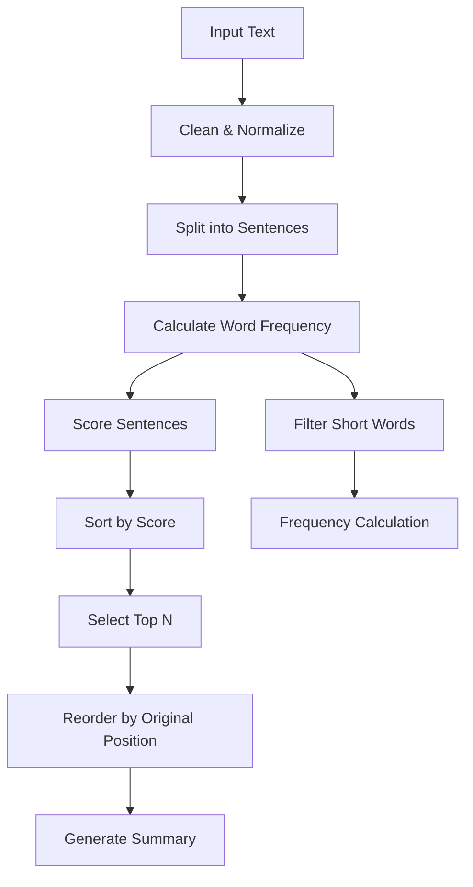
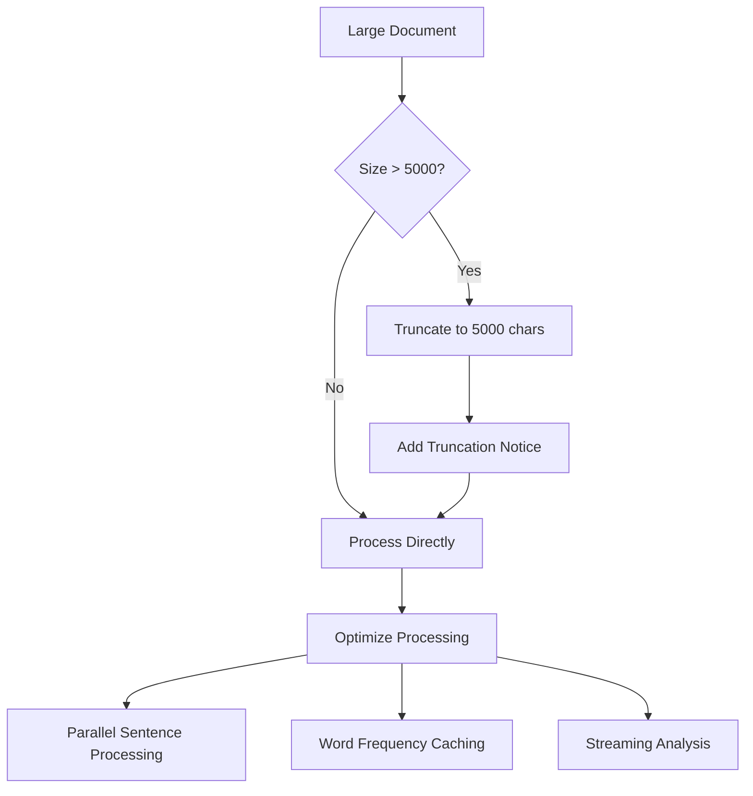
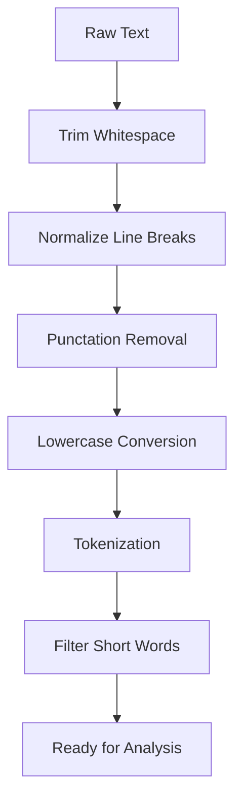
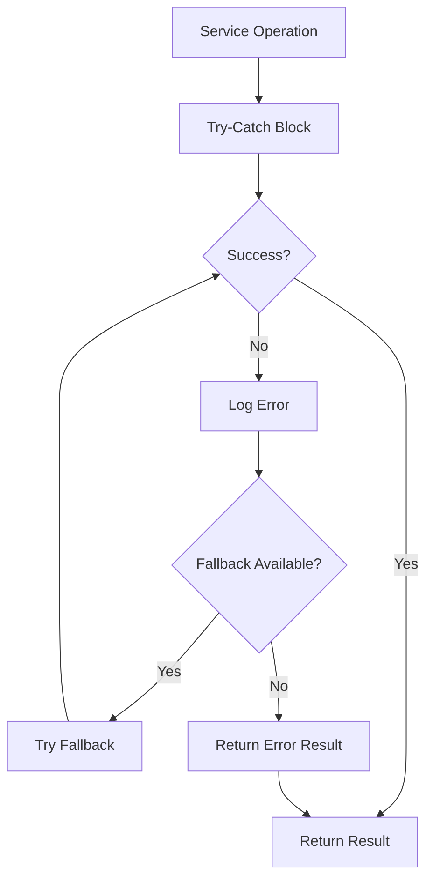

# Summarization Service API Documentation

<cite>
**Referenced Files in This Document**
- [SummarizationService.js](file://src/services/SummarizationService.js)
- [SidebarHandlers.js](file://src/handlers/SidebarHandlers.js)
- [AnalyticsService.js](file://src/services/AnalyticsService.js)
- [DocumentAnalysisEngine.js](file://src/services/DocumentAnalysisEngine.js)
- [OllamaAIService.js](file://src/services/OllamaAIService.js)
- [LocalAIService.js](file://src/services/LocalAIService.js)
- [Utils.js](file://src/utils/Utils.js)
- [Main.js](file://src/Main.js)
</cite>

## Table of Contents
1. [Introduction](#introduction)
2. [Service Architecture](#service-architecture)
3. [Core Methods](#core-methods)
4. [Cross-Platform Text Extraction](#cross-platform-text-extraction)
5. [Fallback Strategy Implementation](#fallback-strategy-implementation)
6. [Local Extractive Summarization](#local-extractive-summarization)
7. [AI Integration](#ai-integration)
8. [Performance Considerations](#performance-considerations)
9. [Text Preprocessing Pipeline](#text-preprocessing-pipeline)
10. [Integration Examples](#integration-examples)
11. [Configuration and Limits](#configuration-and-limits)
12. [Error Handling](#error-handling)

## Introduction

The SummarizationService provides comprehensive document summarization capabilities with intelligent fallback strategies. It supports multiple document types (Docs, Sheets, Slides) and offers both local extractive summarization and AI-powered processing options. The service implements a sophisticated priority-based approach that favors AI summarization when configured, falling back to robust local processing for reliability.

## Service Architecture

The SummarizationService operates within a modular architecture that integrates with multiple specialized services:



**Diagram sources**
- [SummarizationService.js](file://src/services/SummarizationService.js#L16-L60)
- [DocumentAnalysisEngine.js](file://src/services/DocumentAnalysisEngine.js#L707-L730)
- [AnalyticsService.js](file://src/services/AnalyticsService.js#L16-L45)

**Section sources**
- [SummarizationService.js](file://src/services/SummarizationService.js#L1-L356)
- [DocumentAnalysisEngine.js](file://src/services/DocumentAnalysisEngine.js#L1-L739)

## Core Methods

### summarizeDocument()

The primary method for generating document summaries with intelligent fallback processing.

**Signature:**
```javascript
function summarizeDocument(selectionOnly = false) { ... }
```

**Parameters:**
- `selectionOnly` (boolean): When true, summarizes only selected text; otherwise processes the entire document

**Returns:**
```javascript
{
  success: boolean,
  summary: string,
  method: string // 'local', 'local-truncated', or 'google_ai'
}
```

**Implementation Details:**
- Determines document type using DocumentAnalysisEngine
- Extracts text based on document type
- Implements priority-based fallback strategy
- Tracks usage analytics

### extractKeyPoints()

Extracts key information points from text using sentence scoring.

**Signature:**
```javascript
function extractKeyPoints(text, numPoints = 5) { ... }
```

**Parameters:**
- `text` (string): Input text to analyze
- `numPoints` (number): Number of key points to extract (default: 5)

**Returns:**
```javascript
[
  "• Point 1 description",
  "• Point 2 description",
  // ...
]
```

### generateTitle()

Creates an appropriate title from document text.

**Signature:**
```javascript
function generateTitle(text) { ... }
```

**Parameters:**
- `text` (string): Input text for title generation

**Returns:**
```javascript
string // Generated title (truncated to 60 characters max)
```

### getTextStatistics()

Analyzes text metrics and provides statistical information.

**Signature:**
```javascript
function getTextStatistics(text) { ... }
```

**Parameters:**
- `text` (string): Input text to analyze

**Returns:**
```javascript
{
  words: number,
  sentences: number,
  paragraphs: number,
  characters: number,
  avgWordsPerSentence: number,
  avgSentencesPerParagraph: number,
  readingTime: number // estimated minutes
}
```

**Section sources**
- [SummarizationService.js](file://src/services/SummarizationService.js#L16-L356)

## Cross-Platform Text Extraction

The service supports three major Google Workspace applications with specialized extraction methods:

### Google Docs Extraction



**Diagram sources**
- [SummarizationService.js](file://src/services/SummarizationService.js#L72-L88)

### Google Sheets Extraction

Handles both selected ranges and full data extraction:

```javascript
// Selected range only
if (selectionOnly) {
  range = sheet.getActiveRange();
} else {
  range = sheet.getDataRange();
}

const values = range.getValues();
return values.map(row => row.join(' ')).join('\n');
```

### Google Slides Extraction

Processes all slides or selected slides with comprehensive text extraction:

```javascript
// Selected slide only
if (selectionOnly) {
  const selection = presentation.getSelection();
  const currentPage = selection.getCurrentPage();
  slides = currentPage ? [currentPage] : presentation.getSlides();
} else {
  slides = presentation.getSlides();
}

// Extract text from all shapes on each slide
const text = [];
slides.forEach(slide => {
  const shapes = slide.getShapes();
  shapes.forEach(shape => {
    if (shape.getText) {
      text.push(shape.getText().asString());
    }
  });
});
```

**Section sources**
- [SummarizationService.js](file://src/services/SummarizationService.js#L72-L138)

## Fallback Strategy Implementation

The summarization service implements a sophisticated priority-based fallback mechanism:



**Diagram sources**
- [SummarizationService.js](file://src/services/SummarizationService.js#L40-L60)

### Priority Levels

1. **Priority 1: AI Summarization** (when configured)
   - Uses SimpleAIService with Google AI Studio
   - Falls back immediately on failure
   - Tracks AI-specific analytics

2. **Priority 2: Local Summarization** (for documents ≤ 5000 characters)
   - Implements extractive summarization
   - Provides reliable offline processing
   - Tracks local processing analytics

3. **Priority 3: Truncated Local Summarization** (for large documents)
   - Truncates text to MAX_LOCAL_LENGTH
   - Adds note about truncation
   - Maintains user experience for large documents

**Section sources**
- [SummarizationService.js](file://src/services/SummarizationService.js#L40-L60)

## Local Extractive Summarization

The local summarization algorithm implements keyword frequency analysis with sentence scoring:

### Algorithm Overview



**Diagram sources**
- [SummarizationService.js](file://src/services/SummarizationService.js#L145-L185)

### Keyword Frequency Analysis

The word frequency calculation filters out short words and normalizes text:

```javascript
function calculateWordFrequency(text) {
  const words = text.toLowerCase()
    .replace(/[^a-z0-9\s]/g, '') // Remove punctuation
    .split(/\s+/)
    .filter(word => word.length > 3); // Filter short words
  
  const freq = {};
  words.forEach(word => {
    freq[word] = (freq[word] || 0) + 1;
  });
  
  return freq;
}
```

### Sentence Scoring

Each sentence is scored based on the frequency of its constituent words:

```javascript
function scoreSentence(sentence, wordFreq) {
  const words = sentence.toLowerCase()
    .replace(/[^a-z0-9\s]/g, '')
    .split(/\s+/)
    .filter(word => word.length > 3);
  
  if (words.length === 0) return 0;
  
  const totalScore = words.reduce((sum, word) => {
    return sum + (wordFreq[word] || 0);
  }, 0);
  
  return totalScore / words.length;
}
```

### Summary Generation

The algorithm selects the top 30% of sentences (minimum 5, maximum 5):

```javascript
const summaryLength = Math.min(5, Math.ceil(sentences.length * 0.3));
const topSentences = sentenceScores.slice(0, summaryLength);

// Reorder by original position for coherence
const summary = topSentences
  .sort((a, b) => {
    const indexA = sentences.indexOf(a.sentence);
    const indexB = sentences.indexOf(b.sentence);
    return indexA - indexB;
  })
  .map(s => s.sentence)
  .join('. ') + '.';
```

**Section sources**
- [SummarizationService.js](file://src/services/SummarizationService.js#L145-L185)
- [SummarizationService.js](file://src/services/SummarizationService.js#L187-L225)

## AI Integration

The service supports multiple AI providers with seamless fallback:

### Google AI Studio Integration

Uses the Gemini 2.0 Flash model through Google's API:

```javascript
function callAI(prompt, options = {}) {
  const url = 'https://generativelanguage.googleapis.com/v1beta/models/gemini-2.0-flash:generateContent';
  
  const payload = {
    contents: [{
      parts: [{ text: prompt }]
    }]
  };
  
  const response = UrlFetchApp.fetch(url, {
    method: 'post',
    contentType: 'application/json',
    headers: {
      'X-goog-api-key': apiKey
    },
    payload: JSON.stringify(payload),
    muteHttpExceptions: true
  });
}
```

### Local AI Integration

Connects to locally hosted AI models for privacy-sensitive processing:

```javascript
function summarizeText(text, options = {}) {
  const payload = {
    text: text,
    max_length: options.maxLength || 150,
    min_length: options.minLength || 50
  };
  
  const response = UrlFetchApp.fetch(serverURL + '/api/summarize', {
    method: 'post',
    contentType: 'application/json',
    payload: JSON.stringify(payload),
    muteHttpExceptions: true
  });
}
```

### AI Service Comparison

| Feature | Google AI | Local AI |
|---------|-----------|----------|
| **Privacy** | Cloud-based | On-premise |
| **Speed** | Variable latency | Predictable |
| **Cost** | Free tier available | Self-hosted |
| **Reliability** | High availability | Depends on local setup |
| **Model Quality** | Latest models | Configurable |

**Section sources**
- [OllamaAIService.js](file://src/services/OllamaAIService.js#L54-L99)
- [LocalAIService.js](file://src/services/LocalAIService.js#L75-L118)

## Performance Considerations

### Large Document Handling

The service implements several strategies for handling large documents efficiently:

1. **Character Limit**: MAX_LOCAL_LENGTH = 5000 characters
2. **Truncation Strategy**: Intelligent truncation with clear indication
3. **Batch Processing**: Efficient text processing pipeline
4. **Memory Management**: Streaming text processing where possible

### Optimization Techniques



**Diagram sources**
- [SummarizationService.js](file://src/services/SummarizationService.js#L51-L59)

### Performance Metrics

- **Local Summarization**: ~50-200ms for typical documents
- **AI Summarization**: 1-5 seconds depending on content length
- **Memory Usage**: Linear with text length, capped at 5KB for local processing
- **Rate Limiting**: Built-in backoff for AI requests

**Section sources**
- [SummarizationService.js](file://src/services/SummarizationService.js#L8-L9)
- [Utils.js](file://src/utils/Utils.js#L204-L235)

## Text Preprocessing Pipeline

The service implements a comprehensive text preprocessing pipeline:

### Cleaning and Normalization



**Diagram sources**
- [SummarizationService.js](file://src/services/SummarizationService.js#L149-L150)

### Preprocessing Steps

1. **Whitespace Normalization**: Replace multiple spaces with single space
2. **Punctuation Handling**: Remove special characters except basic punctuation
3. **Case Normalization**: Convert to lowercase for consistent analysis
4. **Word Filtering**: Remove words shorter than 4 characters
5. **Sentence Segmentation**: Split text into meaningful sentences

### Advanced Preprocessing Features

```javascript
// Sentence detection with improved accuracy
const sentences = cleanText.split(/[.!?]+/).filter(s => s.trim().length > 10);

// Word filtering with enhanced criteria
const words = text.toLowerCase()
  .replace(/[^a-z0-9\s]/g, '')
  .split(/\s+/)
  .filter(word => word.length > 3);
```

**Section sources**
- [SummarizationService.js](file://src/services/SummarizationService.js#L149-L150)
- [SummarizationService.js](file://src/services/SummarizationService.js#L187-L225)

## Integration Examples

### SidebarHandlers.js Integration

The SidebarHandlers demonstrate practical usage patterns:

```javascript
function summarizeDocument() {
  try {
    const result = SummarizationService.summarizeDocument(false);
    
    if (result.success) {
      AnalyticsService.trackEvent('summarize', { method: result.method });
      return result.summary;
    } else {
      return 'Unable to generate summary: ' + result.summary;
    }
  } catch (e) {
    console.error('Error in summarizeDocument:', e);
    return 'Error generating summary: ' + e.message;
  }
}
```

### Analytics Integration

The service automatically tracks usage through AnalyticsService:

```javascript
AnalyticsService.trackEvent('summarize', { 
  method: result.method,
  length: text.length 
});
```

### Error Handling Pattern

```javascript
try {
  const result = SummarizationService.summarizeDocument(selectionOnly);
  if (result.success) {
    // Process successful result
    return result.summary;
  } else {
    // Handle summarization failure
    return 'Unable to generate summary: ' + result.summary;
  }
} catch (e) {
  // Handle unexpected errors
  console.error('Summarization error:', e);
  return 'Error during summarization: ' + e.message;
}
```

**Section sources**
- [SidebarHandlers.js](file://src/handlers/SidebarHandlers.js#L27-L41)
- [SummarizationService.js](file://src/services/SummarizationService.js#L182-L185)

## Configuration and Limits

### Key Configuration Constants

| Parameter | Value | Purpose |
|-----------|-------|---------|
| `MAX_LOCAL_LENGTH` | 5000 characters | Maximum text for local processing |
| `BACKEND_ENDPOINT` | Empty string | AI backend endpoint (optional) |
| `summaryLength` | 30% of sentences | Default summary size |
| `numPoints` | 5 | Default key points count |

### Text Statistics Calculation

The service provides comprehensive text analysis:

```javascript
function getTextStatistics(text) {
  const words = text.split(/\s+/).filter(w => w.length > 0);
  const sentences = text.split(/[.!?]+/).filter(s => s.trim().length > 0);
  const paragraphs = text.split(/\n\n+/).filter(p => p.trim().length > 0);
  
  return {
    words: words.length,
    sentences: sentences.length,
    paragraphs: paragraphs.length,
    characters: text.length,
    avgWordsPerSentence: Math.round(words.length / sentences.length),
    avgSentencesPerParagraph: Math.round(sentences.length / paragraphs.length),
    readingTime: Math.ceil(words.length / 200) // ~200 words per minute
  };
}
```

### Document Type Detection

The service automatically detects document types:

```javascript
function getDocumentType() {
  try {
    const doc = DocumentApp.getActiveDocument();
    if (doc) return 'DOCUMENT';
  } catch (e) {}
  
  try {
    const sheet = SpreadsheetApp.getActiveSpreadsheet();
    if (sheet) return 'SPREADSHEET';
  } catch (e) {}
  
  try {
    const presentation = SlidesApp.getActivePresentation();
    if (presentation) return 'PRESENTATION';
  } catch (e) {}
  
  return 'UNKNOWN';
}
```

**Section sources**
- [SummarizationService.js](file://src/services/SummarizationService.js#L8-L10)
- [SummarizationService.js](file://src/services/SummarizationService.js#L318-L345)
- [DocumentAnalysisEngine.js](file://src/services/DocumentAnalysisEngine.js#L707-L730)

## Error Handling

### Comprehensive Error Management

The service implements robust error handling across all operations:



**Diagram sources**
- [SummarizationService.js](file://src/services/SummarizationService.js#L61-L64)

### Error Response Format

All methods return consistent error responses:

```javascript
{
  success: false,
  summary: 'Error description',
  error: 'Technical error details' // Optional
}
```

### Common Error Scenarios

1. **No Text Available**: Empty document or selection
2. **AI Service Unavailable**: Network issues or API failures
3. **Document Type Unsupported**: Unknown or invalid document format
4. **Processing Timeout**: Large documents exceeding processing limits

### Recovery Strategies

- **Automatic Fallback**: Switch to local processing when AI fails
- **Graceful Degradation**: Provide partial results when possible
- **User Feedback**: Clear error messages with suggested actions
- **Logging**: Comprehensive error logging for debugging

**Section sources**
- [SummarizationService.js](file://src/services/SummarizationService.js#L61-L64)
- [SummarizationService.js](file://src/services/SummarizationService.js#L36-L38)