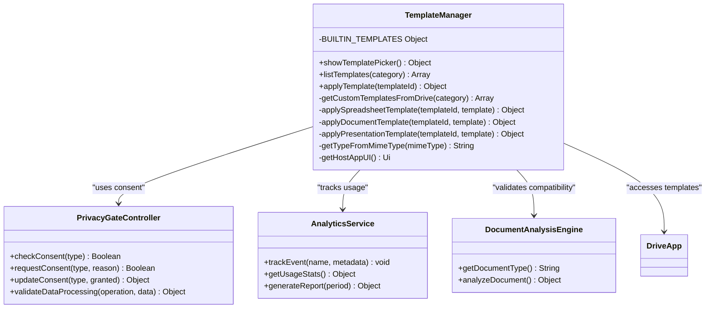
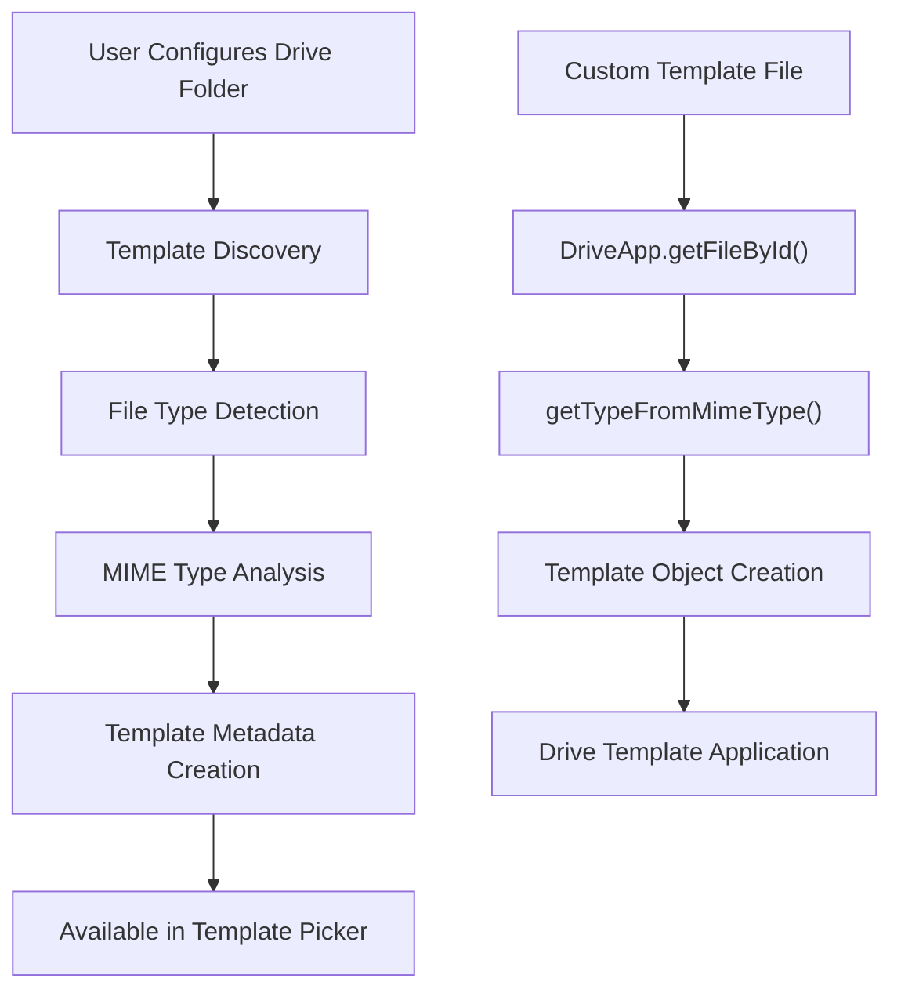
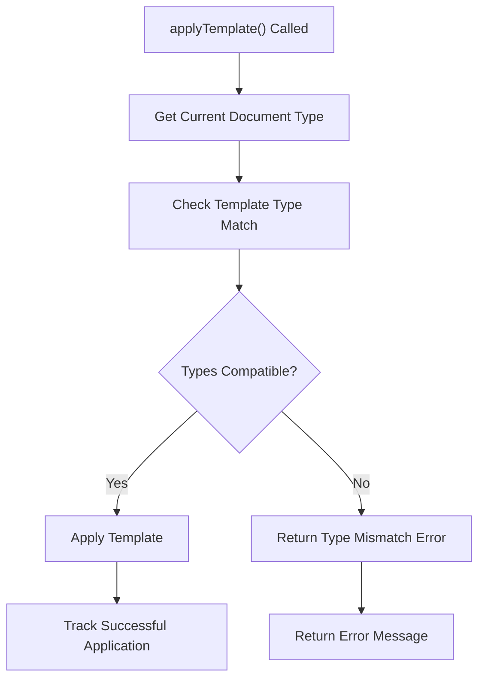
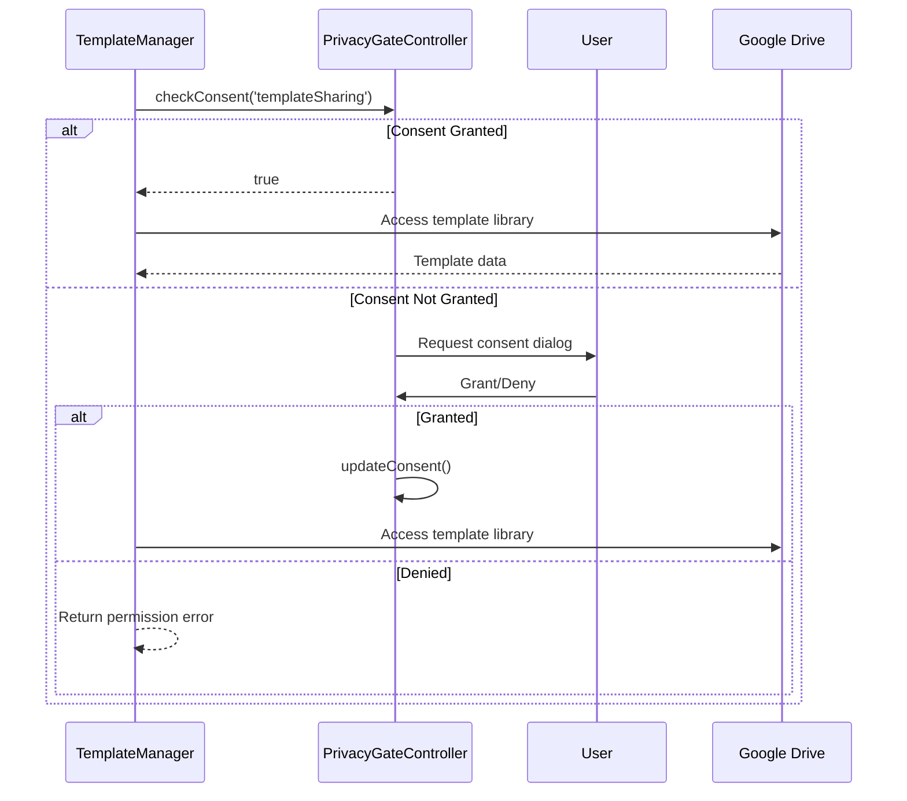
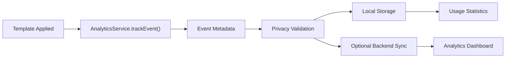
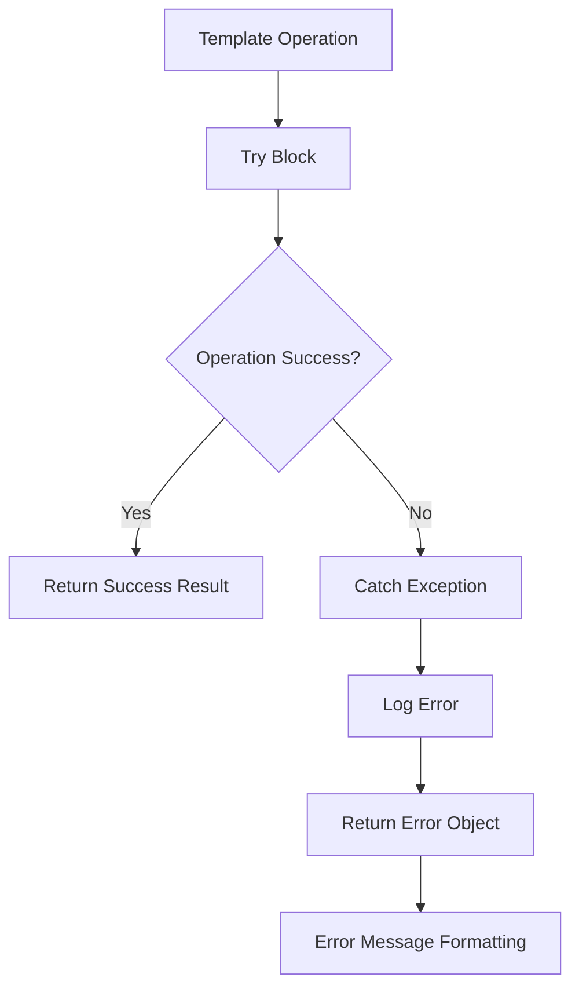

# Template Manager API Documentation

<cite>
**Referenced Files in This Document**
- [TemplateManager.js](file://src/services/TemplateManager.js)
- [SidebarHandlers.js](file://src/handlers/SidebarHandlers.js)
- [PrivacyGateController.js](file://src/services/PrivacyGateController.js)
- [AnalyticsService.js](file://src/services/AnalyticsService.js)
- [DocumentAnalysisEngine.js](file://src/services/DocumentAnalysisEngine.js)
- [Sidebar.html](file://src/ui/Sidebar.html)
</cite>

## Table of Contents
1. [Introduction](#introduction)
2. [Service Architecture](#service-architecture)
3. [Public API Methods](#public-api-methods)
4. [Built-in Templates](#built-in-templates)
5. [Drive Integration](#drive-integration)
6. [Document Type Compatibility](#document-type-compatibility)
7. [Privacy and Security](#privacy-and-security)
8. [Usage Tracking](#usage-tracking)
9. [Error Handling](#error-handling)
10. [Integration Examples](#integration-examples)
11. [Troubleshooting](#troubleshooting)

## Introduction

The TemplateManager service is a comprehensive document formatting solution that provides intelligent template selection, application, and management capabilities for Google Workspace documents. It offers both built-in templates and custom template support through Google Drive integration, with robust privacy controls and usage analytics.

The service operates as a singleton module that manages template libraries, validates document compatibility, applies formatting according to template specifications, and maintains user consent preferences for template sharing functionality.

## Service Architecture

The TemplateManager follows a modular architecture with clear separation of concerns:



**Diagram sources**
- [TemplateManager.js](file://src/services/TemplateManager.js#L6-L479)
- [PrivacyGateController.js](file://src/services/PrivacyGateController.js#L6-L366)
- [AnalyticsService.js](file://src/services/AnalyticsService.js#L6-L395)
- [DocumentAnalysisEngine.js](file://src/services/DocumentAnalysisEngine.js#L6-L739)

**Section sources**
- [TemplateManager.js](file://src/services/TemplateManager.js#L6-L479)

## Public API Methods

### showTemplatePicker()

Displays the template selection UI dialog for browsing and selecting available templates.

**Method Signature:**
```javascript
showTemplatePicker() : Object
```

**Returns:**
- `{success: boolean, message: string}` - Operation result

**Implementation Details:**
- Checks user consent for template sharing via PrivacyGateController
- Validates UI availability across different Google Workspace applications
- Creates modal dialog with built-in and custom templates
- Returns success/failure status with descriptive messages

**Usage Example:**
```javascript
// Called from SidebarHandlers.js
function showTemplatePicker() {
  try {
    const results = TemplateManager.showTemplatePicker();
    return results;
  } catch (e) {
    console.error('Error in showTemplatePicker:', e);
    return { success: false, message: 'Error: ' + e.message };
  }
}
```

**Section sources**
- [TemplateManager.js](file://src/services/TemplateManager.js#L46-L80)
- [SidebarHandlers.js](file://src/handlers/SidebarHandlers.js#L123-L130)

### listTemplates()

Retrieves available templates filtered by optional category parameter.

**Method Signature:**
```javascript
listTemplates(category?: string) : Array
```

**Parameters:**
- `category` (optional): Template category filter (e.g., 'Education', 'Business')

**Returns:**
- Array of template objects with properties:
  - `id`: Template identifier
  - `name`: Display name
  - `description`: Template description
  - `type`: Document type (DOCUMENT, SPREADSHEET, PRESENTATION)
  - `category`: Template category
  - `source`: Template source ('builtin' or 'drive')

**Implementation Details:**
- Combines built-in templates with custom Drive templates
- Filters templates by category when specified
- Handles errors gracefully during custom template loading

**Section sources**
- [TemplateManager.js](file://src/services/TemplateManager.js#L87-L114)

### applyTemplate()

Applies a selected template to the currently active document with type validation.

**Method Signature:**
```javascript
applyTemplate(templateId: string) : Object
```

**Parameters:**
- `templateId`: Identifier of template to apply

**Returns:**
- `{success: boolean, message: string}` - Application result

**Implementation Details:**
- Validates document type compatibility
- Routes to appropriate template application function
- Tracks successful applications via AnalyticsService
- Handles both built-in and Drive-based templates

**Section sources**
- [TemplateManager.js](file://src/services/TemplateManager.js#L158-L202)

## Built-in Templates

The TemplateManager includes five pre-built templates categorized by document type and purpose:

### Grading Rubric Template
- **Type:** SPREADSHEET
- **Category:** Education
- **Features:** Student grading matrix with automatic scoring formulas
- **Application:** Sets up student assessment grid with weighted criteria

### Professional Document Style
- **Type:** DOCUMENT
- **Category:** Business
- **Features:** Standardized typography and formatting
- **Application:** Applies consistent heading sizes and font families

### Clean Presentation Template
- **Type:** PRESENTATION
- **Category:** Business
- **Features:** Minimalist slide design
- **Application:** Standardizes slide text formatting

### Legal Contract Template
- **Type:** DOCUMENT
- **Category:** Legal
- **Features:** Standard contract format with clause structure
- **Application:** Provides legal document formatting foundation

### Sales Report Template
- **Type:** SPREADSHEET
- **Category:** Sales
- **Features:** Monthly sales tracking with calculations
- **Application:** Sets up sales data grid with formula fields

**Section sources**
- [TemplateManager.js](file://src/services/TemplateManager.js#L8-L40)

## Drive Integration

### Custom Template Storage

Templates stored in Google Drive are automatically discovered and made available:



**Diagram sources**
- [TemplateManager.js](file://src/services/TemplateManager.js#L117-L151)

### Template Retrieval Process

The service discovers custom templates by:

1. **Folder Configuration**: User specifies template folder in user properties
2. **File Enumeration**: Iterates through files in configured folder
3. **Type Detection**: Determines document type from MIME type
4. **Metadata Extraction**: Creates template objects with file details
5. **Availability**: Makes templates available in picker interface

**Section sources**
- [TemplateManager.js](file://src/services/TemplateManager.js#L117-L151)

## Document Type Compatibility

### Type Validation System

The TemplateManager implements strict document type compatibility checking:



**Diagram sources**
- [TemplateManager.js](file://src/services/TemplateManager.js#L167-L191)

### Supported Document Types

| Template Type | Document Type | Application Method |
|---------------|---------------|-------------------|
| SPREADSHEET | Google Sheets | Sheet manipulation with formulas |
| DOCUMENT | Google Docs | Text formatting and styling |
| PRESENTATION | Google Slides | Slide and shape formatting |

### Type Detection Logic

The service uses MIME type analysis to determine document compatibility:

- **Spreadsheet Detection**: MIME types containing "spreadsheet"
- **Document Detection**: MIME types containing "document"
- **Presentation Detection**: MIME types containing "presentation"

**Section sources**
- [TemplateManager.js](file://src/services/TemplateManager.js#L447-L456)
- [DocumentAnalysisEngine.js](file://src/services/DocumentAnalysisEngine.js#L704-L730)

## Privacy and Security

### Consent Management

The TemplateManager integrates with PrivacyGateController for comprehensive privacy controls:



**Diagram sources**
- [TemplateManager.js](file://src/services/TemplateManager.js#L48-L61)
- [PrivacyGateController.js](file://src/services/PrivacyGateController.js#L89-L144)

### Privacy Controls

- **Template Sharing Consent**: Explicit permission required for Drive template access
- **Data Processing**: Local-first approach with optional remote processing
- **Audit Logging**: Comprehensive event logging for privacy compliance
- **User Control**: Full revocation capability for all privacy settings

**Section sources**
- [PrivacyGateController.js](file://src/services/PrivacyGateController.js#L89-L144)
- [TemplateManager.js](file://src/services/TemplateManager.js#L48-L61)

## Usage Tracking

### Analytics Integration

Template applications are tracked through AnalyticsService for usage insights:



**Diagram sources**
- [TemplateManager.js](file://src/services/TemplateManager.js#L193-L198)
- [AnalyticsService.js](file://src/services/AnalyticsService.js#L16-L45)

### Tracking Metrics

- **Template Applications**: Count by template ID and document type
- **Usage Patterns**: Frequency and timing of template usage
- **Success Rates**: Application success vs. failure rates
- **User Preferences**: Popular templates and categories

**Section sources**
- [AnalyticsService.js](file://src/services/AnalyticsService.js#L16-L45)
- [TemplateManager.js](file://src/services/TemplateManager.js#L193-L198)

## Error Handling

### Comprehensive Error Management

The TemplateManager implements multi-layered error handling:



**Diagram sources**
- [TemplateManager.js](file://src/services/TemplateManager.js#L48-L80)
- [TemplateManager.js](file://src/services/TemplateManager.js#L158-L202)

### Error Categories

| Error Type | Description | Recovery Strategy |
|------------|-------------|------------------|
| Permission Denied | Drive access denied | Request consent |
| Document Type Mismatch | Template incompatible | Show compatible alternatives |
| Template Not Found | Built-in template missing | Fallback to default |
| Network Issues | Drive connectivity problems | Retry with exponential backoff |
| Invalid Parameters | Malformed template ID | Validate input parameters |

### Error Response Format

All methods return standardized error objects:
```javascript
{
  success: false,
  message: "Descriptive error message"
}
```

**Section sources**
- [TemplateManager.js](file://src/services/TemplateManager.js#L48-L80)
- [TemplateManager.js](file://src/services/TemplateManager.js#L158-L202)

## Integration Examples

### Sidebar Integration

The TemplateManager integrates seamlessly with the sidebar interface:

```javascript
// From SidebarHandlers.js - Template picker invocation
function showTemplatePicker() {
  try {
    const results = TemplateManager.showTemplatePicker();
    return results;
  } catch (e) {
    console.error('Error in showTemplatePicker:', e);
    return { success: false, message: 'Error: ' + e.message };
  }
}

// From SidebarHandlers.js - Template application
function applyTemplate(templateId) {
  try {
    const results = TemplateManager.applyTemplate(templateId);
    return results;
  } catch (e) {
    console.error('Error in applyTemplate:', e);
    return { success: false, message: 'Error: ' + e.message };
  }
}
```

### HTML Interface Integration

The sidebar HTML provides intuitive template interaction:

```html
<!-- Template picker button -->
<button class="btn btn-primary" onclick="openTemplatePicker()">
  📁 Browse Templates
</button>

<!-- Direct template buttons -->
<div class="action-card" onclick="applyGradingRubric()">
  <div class="action-card-title">🎓 Grading Rubric</div>
  <div class="action-card-desc">Apply standard grading template</div>
</div>
```

**Section sources**
- [SidebarHandlers.js](file://src/handlers/SidebarHandlers.js#L123-L146)
- [Sidebar.html](file://src/ui/Sidebar.html#L283-L295)

## Troubleshooting

### Common Issues and Solutions

#### Template Access Denied
**Symptom**: Error message about Drive permission
**Solution**: 
1. Check privacy settings in sidebar
2. Grant template sharing consent
3. Verify Google Drive access permissions

#### Document Type Mismatch
**Symptom**: Template fails to apply with type error
**Solution**:
1. Verify current document type matches template type
2. Use appropriate template for document format
3. Check DocumentAnalysisEngine.getDocumentType() result

#### Custom Templates Not Loading
**Symptom**: Drive templates not appearing in picker
**Solution**:
1. Verify template folder configuration
2. Check file permissions in Drive
3. Ensure files have proper MIME types

#### Template Application Failures
**Symptom**: Template loads but formatting doesn't apply
**Solution**:
1. Check for document protection conflicts
2. Verify sufficient document permissions
3. Review browser console for JavaScript errors

### Debug Information

Enable detailed logging by:
1. Checking browser developer console
2. Reviewing Google Apps Script execution logs
3. Monitoring AnalyticsService usage statistics
4. Examining PrivacyGateController consent history

**Section sources**
- [TemplateManager.js](file://src/services/TemplateManager.js#L48-L80)
- [PrivacyGateController.js](file://src/services/PrivacyGateController.js#L298-L315)