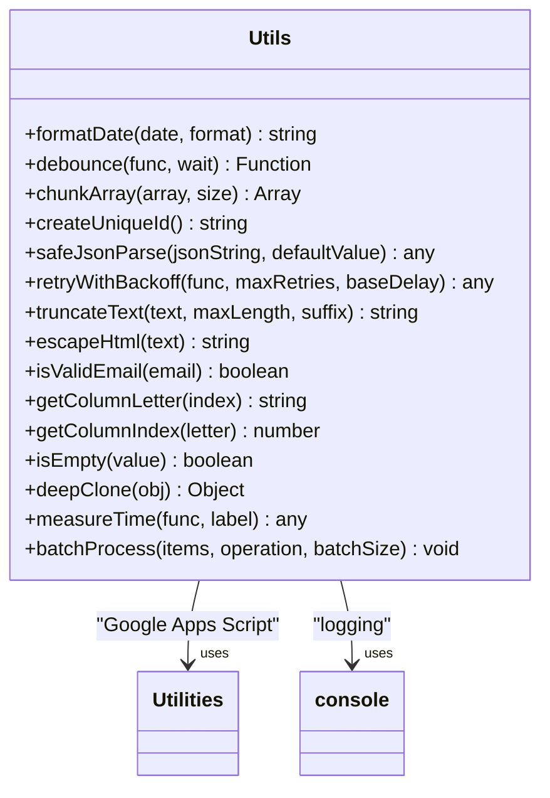
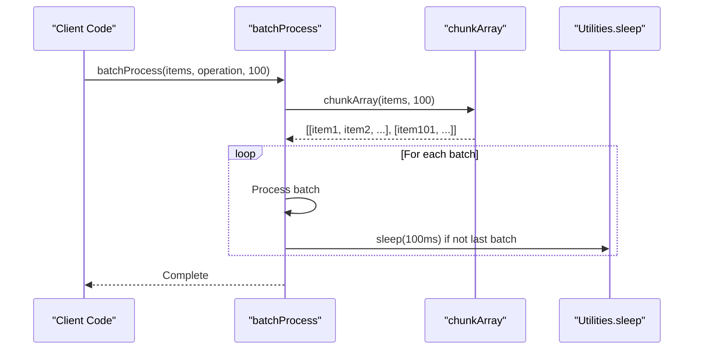
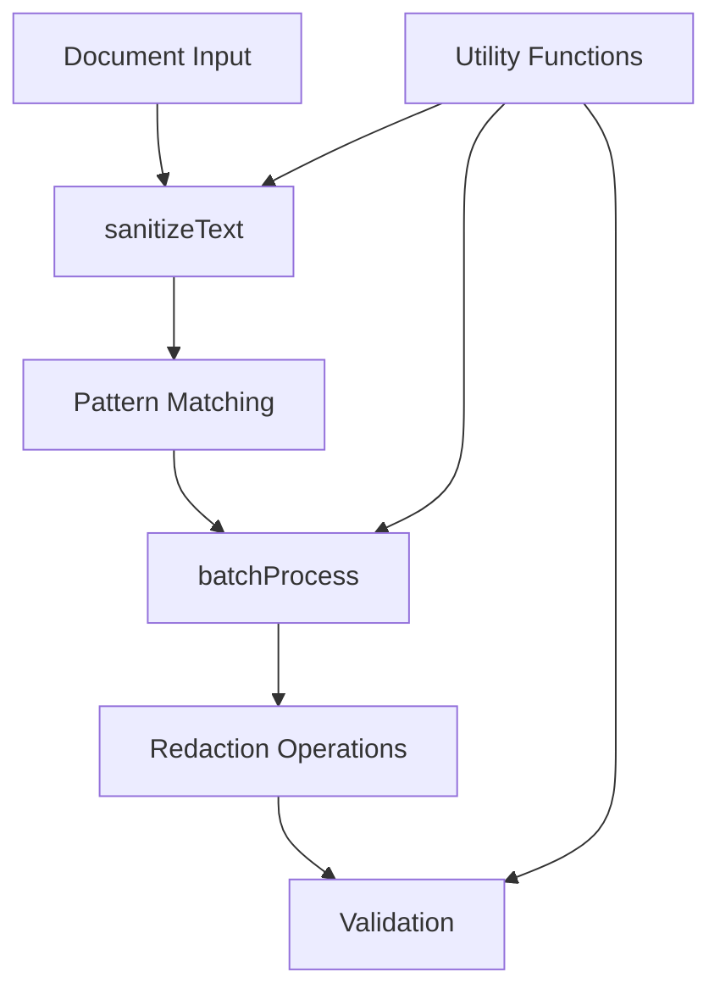

# Utility Functions Documentation

<cite>
**Referenced Files in This Document**
- [Utils.js](file://src/utils/Utils.js)
- [AutomationRuleProcessor.js](file://src/services/AutomationRuleProcessor.js)
- [RedactionService.js](file://src/services/RedactionService.js)
- [DocumentAnalysisEngine.js](file://src/services/DocumentAnalysisEngine.js)
- [Main.js](file://src/Main.js)
</cite>

## Table of Contents
1. [Introduction](#introduction)
2. [Core Utility Functions](#core-utility-functions)
3. [Date and Time Utilities](#date-and-time-utilities)
4. [Array and Data Processing](#array-and-data-processing)
5. [String Manipulation](#string-manipulation)
6. [Validation and Sanitization](#validation-and-sanitization)
7. [Performance and Error Handling](#performance-and-error-handling)
8. [Usage Patterns Across Services](#usage-patterns-across-services)
9. [Performance Considerations](#performance-considerations)
10. [Best Practices and Guidelines](#best-practices-and-guidelines)
11. [Extending the Utility Library](#extending-the-utility-library)

## Introduction

The Utils.js module serves as the foundational utility library for the Intelligent Document Automation Google Workspace add-on. This comprehensive collection of helper functions provides essential functionality for date formatting, data processing, validation, and performance optimization across all major services in the application.

The utility functions are designed with Google Apps Script's constraints in mind, particularly focusing on handling large datasets within execution time limits and providing robust error handling for production environments.

## Core Utility Functions

### Module Structure and Initialization

The Utils module follows an Immediately Invoked Function Expression (IIFE) pattern, encapsulating all utility functions within a private scope while exposing a public API through a returned object.



**Diagram sources**
- [Utils.js](file://src/utils/Utils.js#L6-L257)

**Section sources**
- [Utils.js](file://src/utils/Utils.js#L6-L257)

## Date and Time Utilities

### formatDate Function

The `formatDate` function provides flexible date formatting capabilities with support for multiple format patterns.

#### Function Signature
```javascript
function formatDate(date, format = 'YYYY-MM-DD')
```

#### Parameters
- **date** (`Date`): JavaScript Date object or date-compatible value
- **format** (`string`, optional): Format string using placeholders (YYYY, MM, DD, HH, mm, ss)

#### Return Value
Returns a formatted date string according to the specified format pattern.

#### Usage Context
The formatDate function is extensively used across services for consistent timestamp generation, audit trails, and user-facing date displays.

#### Performance Considerations
- **Efficiency**: Uses native Date methods for optimal performance
- **Caching**: Results are not cached internally; call sites should cache frequently used formats
- **Memory**: Minimal memory footprint with string concatenation

**Section sources**
- [Utils.js](file://src/utils/Utils.js#L14-L33)

## Array and Data Processing

### batchProcess Function

The `batchProcess` function is the cornerstone utility for handling large datasets within Google Apps Script's execution time constraints.

#### Function Signature
```javascript
function batchProcess(items, operation, batchSize = 100)
```

#### Parameters
- **items** (`Array`): Collection of items to process
- **operation** (`Function`): Function to apply to each item
- **batchSize** (`number`, optional): Size of each processing batch (default: 100)

#### Side Effects
- **Logging**: Outputs progress information to console
- **Timing**: Implements small delays between batches to avoid rate limiting
- **Resource Management**: Prevents execution timeouts by chunking operations

#### Implementation Details
The function uses the `chunkArray` utility internally to divide large collections into manageable batches, processing each batch sequentially with controlled timing.

#### Usage in AutomationRuleProcessor
The batchProcess function is crucial for handling large spreadsheet operations where individual cell modifications could exceed Google Apps Script's execution limits.



**Diagram sources**
- [Utils.js](file://src/utils/Utils.js#L224-L236)
- [AutomationRuleProcessor.js](file://src/services/AutomationRuleProcessor.js#L1-L50)

#### Performance Impact
- **Execution Time**: Divides processing time across multiple executions
- **Rate Limiting**: Prevents quota violations through strategic delays
- **Progress Monitoring**: Provides visibility into long-running operations

**Section sources**
- [Utils.js](file://src/utils/Utils.js#L224-L236)

### chunkArray Function

The `chunkArray` function divides arrays into smaller, manageable chunks for batch processing.

#### Function Signature
```javascript
function chunkArray(array, size)
```

#### Parameters
- **array** (`Array`): Target array to split
- **size** (`number`): Size of each chunk

#### Return Value
Returns an array of arrays, where each inner array contains up to `size` elements from the original array.

#### Internal Usage
This function serves as a building block for batch processing operations and is used internally by `batchProcess`.

**Section sources**
- [Utils.js](file://src/utils/Utils.js#L59-L65)

## String Manipulation

### truncateText Function

The `truncateText` function provides intelligent text truncation with customizable suffixes.

#### Function Signature
```javascript
function truncateText(text, maxLength, suffix = '...')
```

#### Parameters
- **text** (`string`): Text to potentially truncate
- **maxLength** (`number`): Maximum allowed length
- **suffix** (`string`, optional): Suffix to append when truncating

#### Return Value
Returns the original text if under maxLength, otherwise returns truncated text with suffix.

#### Usage Patterns
- **Preview Generation**: Creating summary previews for large documents
- **UI Constraints**: Respecting display limitations in user interfaces
- **Data Normalization**: Standardizing text lengths for consistent processing

**Section sources**
- [Utils.js](file://src/utils/Utils.js#L122-L127)

### escapeHtml Function

The `escapeHtml` function safely escapes HTML special characters to prevent XSS vulnerabilities.

#### Function Signature
```javascript
function escapeHtml(text)
```

#### Parameters
- **text** (`string`): Text containing HTML characters to escape

#### Return Value
Returns HTML-escaped string with special characters replaced by entity equivalents.

#### Security Implications
- **XSS Prevention**: Blocks cross-site scripting attacks
- **Content Safety**: Ensures safe display of user-generated content
- **Performance**: Uses efficient character replacement with regex

**Section sources**
- [Utils.js](file://src/utils/Utils.js#L134-L143)

## Validation and Sanitization

### isValidEmail Function

The `isValidEmail` function provides basic email validation using regular expressions.

#### Function Signature
```javascript
function isValidEmail(email)
```

#### Parameters
- **email** (`string`): Email address to validate

#### Return Value
Returns `true` if the email appears valid, `false` otherwise.

#### Validation Scope
- **Basic Syntax**: Checks for proper @ symbol placement
- **Domain Structure**: Validates domain name format
- **Limitations**: Does not verify domain existence or deliverability

**Section sources**
- [Utils.js](file://src/utils/Utils.js#L150-L153)

### safeJsonParse Function

The `safeJsonParse` function provides robust JSON parsing with graceful error handling.

#### Function Signature
```javascript
function safeJsonParse(jsonString, defaultValue = null)
```

#### Parameters
- **jsonString** (`string`): JSON-formatted string to parse
- **defaultValue** (`any`, optional): Value to return if parsing fails

#### Return Value
Returns parsed JSON object or the default value if parsing fails.

#### Error Handling Strategy
- **Graceful Degradation**: Continues operation even with malformed JSON
- **Logging**: Records parsing errors for debugging
- **Fallback Values**: Provides sensible defaults for missing data

**Section sources**
- [Utils.js](file://src/utils/Utils.js#L81-L88)

## Performance and Error Handling

### retryWithBackoff Function

The `retryWithBackoff` function implements exponential backoff retry logic for resilient operations.

#### Function Signature
```javascript
function retryWithBackoff(func, maxRetries = 3, baseDelay = 1000)
```

#### Parameters
- **func** (`Function`): Function to execute and potentially retry
- **maxRetries** (`number`, optional): Maximum retry attempts (default: 3)
- **baseDelay** (`number`, optional): Initial delay in milliseconds (default: 1000)

#### Return Value
Returns the result of the successful function execution or throws the last encountered error.

#### Exponential Backoff Algorithm
- **Delay Calculation**: `baseDelay * Math.pow(2, attempt)`
- **Progressive Increase**: Delays increase exponentially with each retry
- **Maximum Protection**: Prevents excessive resource consumption during failures

#### Usage Context
Critical for operations involving external APIs, network requests, or unreliable external systems.

**Section sources**
- [Utils.js](file://src/utils/Utils.js#L97-L113)

### measureTime Function

The `measureTime` function provides performance monitoring capabilities for function execution.

#### Function Signature
```javascript
function measureTime(func, label = 'Operation')
```

#### Parameters
- **func** (`Function`): Function to measure
- **label** (`string`, optional): Label for logging output

#### Return Value
Returns the result of the measured function while logging execution time.

#### Performance Monitoring
- **Debugging Aid**: Helps identify performance bottlenecks
- **Optimization Tool**: Tracks improvement effectiveness
- **User Experience**: Provides transparency for long-running operations

**Section sources**
- [Utils.js](file://src/utils/Utils.js#L210-L216)

## Usage Patterns Across Services

### Integration with RedactionService

The RedactionService extensively utilizes utility functions for PII detection and processing.

#### Pattern Matching and Text Processing


**Diagram sources**
- [RedactionService.js](file://src/services/RedactionService.js#L80-L105)
- [Utils.js](file://src/utils/Utils.js#L122-L143)

#### Key Utility Usage in RedactionService
- **sanitizeText**: Pre-processes document content for consistent pattern matching
- **batchProcess**: Handles large document redaction in chunks
- **safeJsonParse**: Parses configuration data for custom redaction rules
- **escapeHtml**: Ensures safe display of redaction previews

**Section sources**
- [RedactionService.js](file://src/services/RedactionService.js#L80-L105)

### AutomationRuleProcessor Integration

The AutomationRuleProcessor leverages utilities for bulk data operations and performance optimization.

#### Bulk Operation Handling
- **batchProcess**: Processes large spreadsheet ranges efficiently
- **chunkArray**: Divides data into manageable processing units
- **measureTime**: Monitors operation performance for user feedback

#### Performance Optimization Strategies
- **Chunked Processing**: Avoids Google Apps Script execution timeouts
- **Progress Reporting**: Keeps users informed during long operations
- **Resource Management**: Prevents quota violations through careful timing

**Section sources**
- [AutomationRuleProcessor.js](file://src/services/AutomationRuleProcessor.js#L12-L50)

### DocumentAnalysisEngine Dependencies

The DocumentAnalysisEngine relies on utilities for comprehensive document analysis.

#### Analysis Pipeline Utilization
- **isEmpty**: Validates data completeness before analysis
- **deepClone**: Creates safe copies of analysis data
- **measureTime**: Tracks analysis performance for optimization

#### Data Processing Workflows
The utilities enable efficient data transformation and validation throughout the analysis pipeline.

**Section sources**
- [DocumentAnalysisEngine.js](file://src/services/DocumentAnalysisEngine.js#L200-L250)

## Performance Considerations

### Google Apps Script Execution Limits

Understanding and working within Google Apps Script's constraints is crucial for reliable operation.

#### Execution Time Management
- **Timeout Prevention**: Batch processing prevents exceeding 6-minute execution limit
- **Progress Indicators**: Users receive feedback during long operations
- **Resource Optimization**: Efficient algorithms minimize computational overhead

#### Memory and Quota Considerations
- **Array Processing**: Chunked operations reduce memory pressure
- **String Operations**: Efficient text manipulation minimizes memory usage
- **Error Recovery**: Robust error handling prevents resource leaks

### Optimization Strategies

#### Batch Processing Best Practices
1. **Adaptive Batch Sizes**: Adjust batch sizes based on operation complexity
2. **Progress Monitoring**: Implement user-visible progress indicators
3. **Error Isolation**: Prevent single failures from affecting entire operations

#### Caching and Memoization
While not explicitly implemented in the current utilities, the architecture supports caching patterns for expensive computations.

### Performance Monitoring

#### Built-in Metrics
- **Execution Timing**: Measure operation duration for optimization
- **Batch Progress**: Track processing completion for user feedback
- **Error Rates**: Monitor failure patterns for reliability improvements

## Best Practices and Guidelines

### Function Usage Guidelines

#### Parameter Validation
- **Type Checking**: Verify parameter types before processing
- **Default Values**: Provide sensible defaults for optional parameters
- **Error Messages**: Include helpful context for debugging

#### Error Handling Patterns
- **Graceful Degradation**: Provide fallback behavior for failures
- **Logging Strategy**: Balance debugging information with performance
- **User Communication**: Inform users of recoverable vs. unrecoverable errors

### Extension Guidelines

#### Adding New Utility Functions
1. **Naming Convention**: Follow established naming patterns
2. **Parameter Design**: Use clear, descriptive parameter names
3. **Documentation**: Include comprehensive JSDoc comments
4. **Testing**: Ensure thorough testing across different scenarios

#### Performance Considerations for Extensions
- **Algorithm Efficiency**: Choose optimal algorithms for the problem
- **Memory Usage**: Minimize memory footprint for large operations
- **Execution Time**: Design for Google Apps Script constraints

### Common Pitfalls to Avoid

#### Overuse in Performance-Critical Paths
- **Avoid Heavy Utilities**: Use lightweight alternatives for frequent operations
- **Cache Results**: Store computed values when appropriate
- **Batch Operations**: Group related operations to minimize overhead

#### Resource Management
- **Memory Leaks**: Properly dispose of large objects when done
- **Quota Monitoring**: Track API usage to prevent unexpected failures
- **Error Propagation**: Handle errors appropriately without silent failures

## Extending the Utility Library

### Adding New Functions

#### Template for New Utility Functions
```javascript
/**
 * Description of the function's purpose
 * @param {Type} param1 - Description of parameter 1
 * @param {Type} param2 - Description of parameter 2
 * @returns {ReturnType} Description of return value
 */
function newUtilityFunction(param1, param2) {
    // Implementation here
}
```

#### Integration with Existing Architecture
New functions should integrate seamlessly with the existing utility pattern, maintaining consistency in:
- **Naming Conventions**: Use descriptive, verb-based names
- **Parameter Patterns**: Follow established parameter ordering
- **Return Values**: Provide clear, documented return values
- **Error Handling**: Implement consistent error handling approaches

### Maintenance and Evolution

#### Version Compatibility
- **Backward Compatibility**: Maintain API stability for existing code
- **Deprecation Strategy**: Provide clear migration paths for deprecated functions
- **Documentation Updates**: Keep documentation synchronized with code changes

#### Testing and Quality Assurance
- **Unit Testing**: Ensure comprehensive test coverage
- **Performance Testing**: Validate performance characteristics
- **Integration Testing**: Verify compatibility with existing services

### Future Enhancements

#### Potential Utility Additions
- **Advanced String Processing**: Regular expression utilities and text analysis tools
- **Data Transformation**: Serialization and deserialization utilities
- **Async Operations**: Promise-based utilities for asynchronous operations
- **Caching Utilities**: Memoization and caching mechanisms

#### Architectural Improvements
- **Modular Design**: Consider splitting specialized utilities into separate modules
- **Configuration Management**: Centralized configuration for utility behavior
- **Plugin Architecture**: Extensible framework for custom utility functions

**Section sources**
- [Utils.js](file://src/utils/Utils.js#L6-L257)