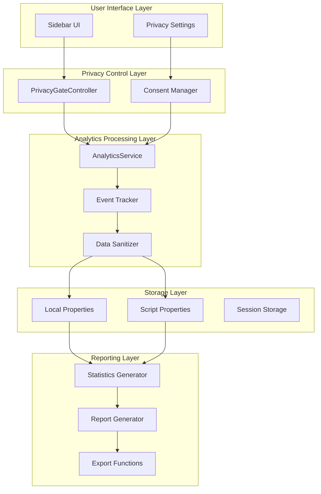
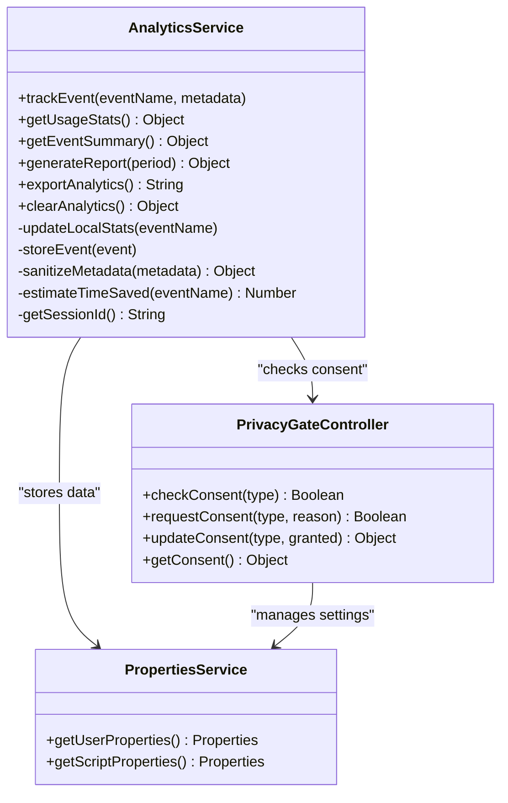
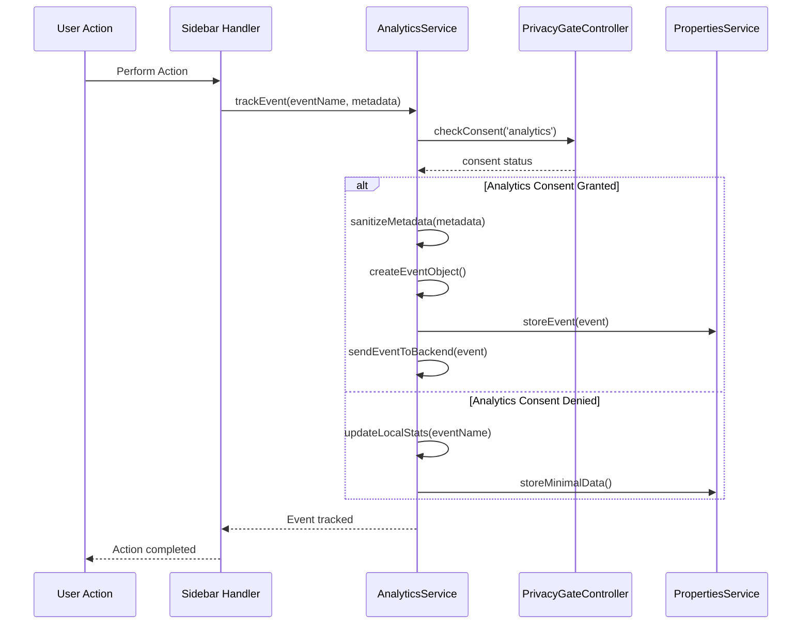
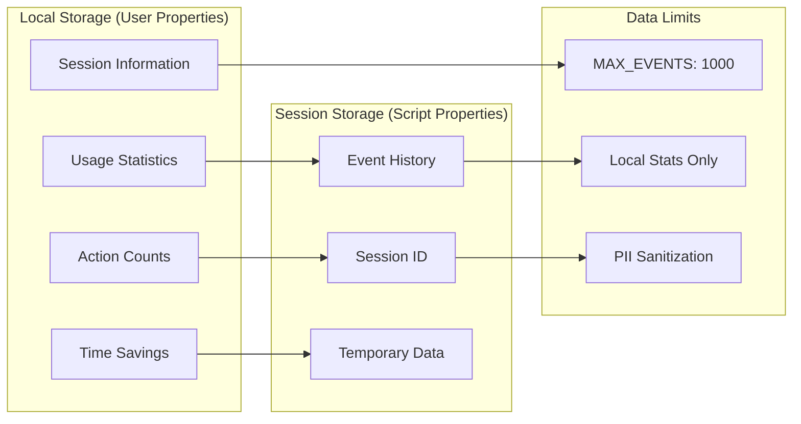
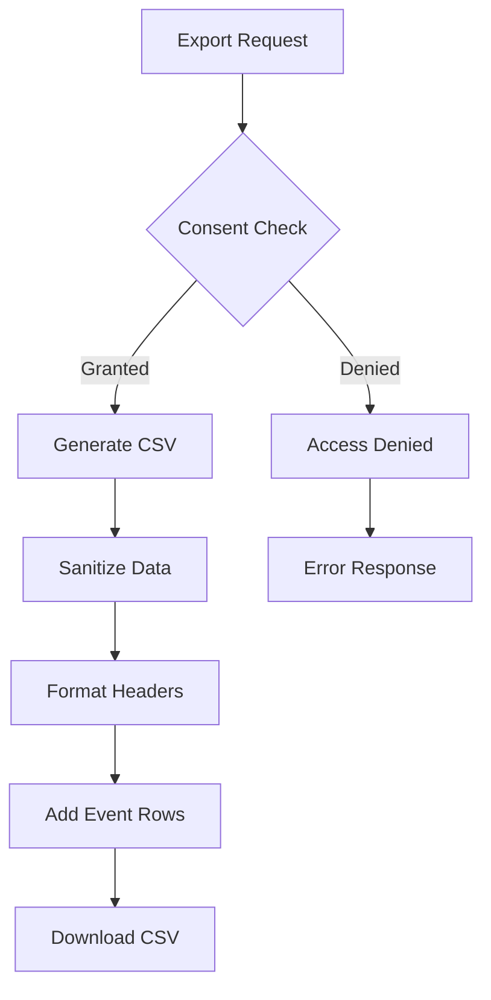

# Analytics and Reporting

<cite>
**Referenced Files in This Document**
- [AnalyticsService.js](file://src/services/AnalyticsService.js)
- [PrivacyGateController.js](file://src/services/PrivacyGateController.js)
- [Main.js](file://src/Main.js)
- [AutomationRuleProcessor.js](file://src/services/AutomationRuleProcessor.js)
- [RedactionService.js](file://src/services/RedactionService.js)
- [SummarizationService.js](file://src/services/SummarizationService.js)
- [SidebarHandlers.js](file://src/handlers/SidebarHandlers.js)
- [appsscript.json](file://src/appsscript.json)
</cite>

## Table of Contents
1. [Introduction](#introduction)
2. [Privacy-First Analytics Architecture](#privacy-first-analytics-architecture)
3. [Analytics Service Core Components](#analytics-service-core-components)
4. [Event Tracking Implementation](#event-tracking-implementation)
5. [Data Collection and Storage](#data-collection-and-storage)
6. [Reporting and Visualization](#reporting-and-visualization)
7. [Administrator Access and Compliance](#administrator-access-and-compliance)
8. [Export and Data Portability](#export-and-data-portability)
9. [Performance and Scalability](#performance-and-scalability)
10. [Best Practices and Product Improvements](#best-practices-and-product-improvements)

## Introduction

The Intelligent Document Automation add-on implements a comprehensive analytics system designed to track usage statistics while maintaining strict privacy standards. The analytics capabilities provide valuable insights into feature adoption, time savings, and operational success rates without compromising user privacy or data security.

The system operates on a privacy-by-design principle, requiring explicit consent for analytics collection and implementing robust data sanitization to prevent personal information leakage. All analytics data remains stored locally within Google Workspace environments, ensuring complete data sovereignty for organizations.

## Privacy-First Analytics Architecture

The analytics system follows a multi-layered privacy architecture that prioritizes user consent and data protection at every level.



**Diagram sources**
- [PrivacyGateController.js](file://src/services/PrivacyGateController.js#L1-L200)
- [AnalyticsService.js](file://src/services/AnalyticsService.js#L1-L394)

### Consent Management Framework

The system implements granular consent management through the PrivacyGateController, which manages five distinct consent categories:

| Consent Type | Purpose | Default State |
|--------------|---------|---------------|
| Basic Features | Core functionality without data processing | Enabled |
| Advanced AI | AI-powered processing requiring external services | Disabled |
| Redaction | Sensitive data detection and masking | Enabled |
| Analytics | Usage statistics collection | Disabled |
| Template Sharing | Access to shared template library | Disabled |

**Section sources**
- [PrivacyGateController.js](file://src/services/PrivacyGateController.js#L8-L15)
- [PrivacyGateController.js](file://src/services/PrivacyGateController.js#L30-L38)

## Analytics Service Core Components

The AnalyticsService serves as the central hub for all analytics functionality, providing comprehensive tracking, storage, and reporting capabilities.



**Diagram sources**
- [AnalyticsService.js](file://src/services/AnalyticsService.js#L6-L394)
- [PrivacyGateController.js](file://src/services/PrivacyGateController.js#L1-L366)

### Event Tracking Mechanism

The event tracking system captures user interactions with the extension through a standardized interface that ensures consistent data collection across all features.

**Section sources**
- [AnalyticsService.js](file://src/services/AnalyticsService.js#L16-L44)
- [SidebarHandlers.js](file://src/handlers/SidebarHandlers.js#L12-L31)

## Event Tracking Implementation

The extension implements comprehensive event tracking across all major functionality areas, with each service module contributing specific event types and metadata.

### Feature-Specific Event Tracking

| Feature Category | Events Tracked | Metadata Fields | Time Savings Estimation |
|------------------|----------------|-----------------|------------------------|
| Document Analysis | `analyze_document` | `issueCount` | 2 minutes |
| Summarization | `summarize` | `method`, `length` | 8 minutes |
| PII Detection | `detect_pii` | `count` | N/A |
| PII Redaction | `redact_pii` | `count`, `docType` | 10 minutes |
| Data Cleanup | `remove_duplicates`, `standardize_dates`, `fill_empty_cells` | `count` | 3-5 minutes |
| Template Application | `apply_template` | `templateId` | 15 minutes |

### Event Lifecycle Flow



**Diagram sources**
- [AnalyticsService.js](file://src/services/AnalyticsService.js#L16-L44)
- [SidebarHandlers.js](file://src/handlers/SidebarHandlers.js#L12-L31)
- [AutomationRuleProcessor.js](file://src/services/AutomationRuleProcessor.js#L39-L41)

**Section sources**
- [AutomationRuleProcessor.js](file://src/services/AutomationRuleProcessor.js#L39-L41)
- [RedactionService.js](file://src/services/RedactionService.js#L246-L285)
- [SummarizationService.js](file://src/services/SummarizationService.js#L181-L183)

## Data Collection and Storage

The analytics system implements a dual-tier storage architecture that balances data retention with privacy requirements.

### Storage Architecture



**Diagram sources**
- [AnalyticsService.js](file://src/services/AnalyticsService.js#L8-L9)
- [AnalyticsService.js](file://src/services/AnalyticsService.js#L100-L117)

### Data Sanitization Process

The system implements comprehensive data sanitization to prevent personal information leakage:

| Data Type | Allowed Fields | Sanitization Method |
|-----------|----------------|-------------------|
| Action Metadata | `count`, `type`, `method`, `format`, `category`, `docType`, `length` | Whitelist filtering |
| Session Data | `timestamp`, `session` | Automatic generation |
| Event Data | `name`, `metadata` | PII removal |

**Section sources**
- [AnalyticsService.js](file://src/services/AnalyticsService.js#L234-L254)

## Reporting and Visualization

The analytics system provides multiple reporting mechanisms for different use cases and audiences.

### Usage Statistics Dashboard

The primary reporting interface displays key metrics in an intuitive dashboard format:

```mermaid
graph TB
subgraph "Dashboard Metrics"
A[Total Actions]
B[Time Saved (Est.)]
C[Top Actions]
D[Last Used]
end
subgraph "Time Savings Calculation"
E[Action Frequency]
F[Time Per Action]
G[Total Minutes]
H[Formatted Display]
end
A --> E
B --> G
C --> E
D --> E
E --> F
F --> G
G --> H
```

**Diagram sources**
- [AnalyticsService.js](file://src/services/AnalyticsService.js#L140-L161)
- [Main.js](file://src/Main.js#L1209-L1222)

### Report Generation Capabilities

The system supports multiple report periods and export formats:

| Report Period | Time Range | Use Case |
|---------------|------------|----------|
| Day | Last 24 hours | Daily monitoring |
| Week | Last 7 days | Weekly analysis |
| Month | Last 30 days | Monthly trends |
| All | Entire history | Comprehensive analysis |

**Section sources**
- [AnalyticsService.js](file://src/services/AnalyticsService.js#L163-L195)

## Administrator Access and Compliance

The system provides administrators with controlled access to analytics data while maintaining user privacy and organizational compliance requirements.

### Administrative Interfaces

Administrators can access analytics through multiple channels:

1. **Built-in Dashboard**: Real-time usage statistics within the add-on interface
2. **Export Functionality**: CSV exports for external analysis
3. **Clear Analytics**: Complete data removal capability
4. **Privacy Controls**: Consent management and audit trails

### Compliance Considerations

The system addresses key compliance requirements:

- **Data Minimization**: Only essential usage data collected
- **Purpose Limitation**: Analytics data used solely for product improvement
- **Transparency**: Clear consent mechanisms and data usage disclosure
- **Data Retention**: Configurable limits with manual deletion capability
- **Audit Trail**: Comprehensive logging of privacy events

**Section sources**
- [PrivacyGateController.js](file://src/services/PrivacyGateController.js#L274-L309)

## Export and Data Portability

The analytics system provides comprehensive export capabilities for data portability and external analysis.

### Export Formats

The system generates CSV exports containing:

- **Timestamp**: ISO 8601 formatted event timestamps
- **Event Name**: Descriptive action identifiers
- **Metadata**: Sanitized event-specific data
- **Session ID**: Unique session identification

### Data Portability Features



**Diagram sources**
- [AnalyticsService.js](file://src/services/AnalyticsService.js#L197-L211)

**Section sources**
- [AnalyticsService.js](file://src/services/AnalyticsService.js#L197-L211)

## Performance and Scalability

The analytics system is designed for high performance and scalability within Google Workspace constraints.

### Performance Optimizations

- **Local Storage**: All analytics data stored locally to minimize latency
- **Event Limits**: Maximum 1000 events per session to prevent memory issues
- **Lazy Loading**: Statistics loaded on-demand for optimal performance
- **Efficient Serialization**: JSON-based storage for compact data representation

### Scalability Considerations

- **Session Isolation**: Each user session maintains separate analytics data
- **Memory Management**: Automatic cleanup of old events beyond limits
- **Concurrent Access**: Thread-safe property access patterns
- **Graceful Degradation**: Analytics failures don't impact core functionality

**Section sources**
- [AnalyticsService.js](file://src/services/AnalyticsService.js#L8-L9)
- [AnalyticsService.js](file://src/services/AnalyticsService.js#L111-L114)

## Best Practices and Product Improvements

The analytics system provides valuable insights that drive continuous product improvement and feature development.

### Analytics-Driven Insights

Organizations can leverage analytics data to:

1. **Feature Adoption Analysis**: Identify popular features and underutilized functionality
2. **Time Savings Calculation**: Quantify productivity improvements achieved
3. **User Behavior Patterns**: Understand how users interact with different features
4. **Performance Monitoring**: Track operation success rates and error frequencies
5. **Resource Planning**: Estimate training needs based on feature usage patterns

### Continuous Improvement Opportunities

Based on analytics data, potential product enhancements include:

- **Feature Prioritization**: Focus development on frequently used features
- **User Experience Optimization**: Improve interfaces based on usage patterns
- **Performance Tuning**: Optimize slow-performing operations
- **Documentation Enhancement**: Create targeted tutorials for popular features
- **Integration Development**: Build integrations based on common workflows

### Example Analytics Scenarios

**Scenario 1: Feature Adoption Analysis**
- Track `analyze_document` events to measure document analysis adoption
- Monitor `summarize` events to assess content comprehension features
- Analyze `redact_pii` events to gauge privacy feature importance

**Scenario 2: Time Savings Calculation**
- Calculate estimated time savings from automation features
- Compare manual vs. automated processing times
- Identify bottlenecks in document processing workflows

**Scenario 3: Operational Success Rates**
- Monitor success/failure ratios for different operations
- Identify common error patterns and root causes
- Track feature reliability over time

The analytics system provides a robust foundation for understanding user behavior, measuring productivity impacts, and driving continuous product improvement while maintaining the highest standards of privacy and data protection.