# API Quotas and Limits

<cite>
**Referenced Files in This Document**
- [appsscript.json](file://src/appsscript.json)
- [DocumentAnalysisEngine.js](file://src/services/DocumentAnalysisEngine.js)
- [Main.js](file://src/Main.js)
- [SummarizationService.js](file://src/services/SummarizationService.js)
- [LocalAIService.js](file://src/services/LocalAIService.js)
- [OllamaAIService.js](file://src/services/OllamaAIService.js)
- [Utils.js](file://src/utils/Utils.js)
- [AnalyticsService.js](file://src/services/AnalyticsService.js)
- [Sidebar.html](file://src/ui/Sidebar.html)
</cite>

## Table of Contents
1. [Introduction](#introduction)
2. [Google Workspace API Configuration](#google-workspace-api-configuration)
3. [Daily Quotas and Rate Limits](#daily-quotas-and-rate-limits)
4. [Execution Time Constraints](#execution-time-constraints)
5. [Trigger Limitations](#trigger-limitations)
6. [Concurrent Execution Constraints](#concurrent-execution-constraints)
7. [Rate Limiting for External Services](#rate-limiting-for-external-services)
8. [Batch Processing Strategies](#batch-processing-strategies)
9. [Error Handling for Quota Exceeded Errors](#error-handling-for-quota-exceeded-errors)
10. [Monitoring and Logging](#monitoring-and-logging)
11. [Optimization Strategies](#optimization-strategies)
12. [User Guidance](#user-guidance)
13. [Best Practices](#best-practices)

## Introduction

The Intelligent Document Automation add-on operates within strict Google Workspace API quotas and limitations. Understanding these constraints is crucial for maintaining reliable operation and providing optimal user experience. This documentation covers the essential quota configurations, execution limits, and optimization strategies implemented in the codebase.

## Google Workspace API Configuration

The add-on utilizes four primary Google Workspace APIs through the `enabledAdvancedServices` configuration in `appsscript.json`.

### API Service Configuration

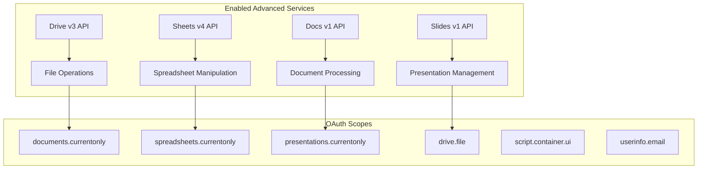

**Diagram sources**
- [appsscript.json](file://src/appsscript.json#L4-L25)

### API Access Permissions

The add-on requests specific OAuth scopes for each Google Workspace application:

- **Documents**: `https://www.googleapis.com/auth/documents.currentonly`
- **Spreadsheets**: `https://www.googleapis.com/auth/spreadsheets.currentonly`
- **Presentations**: `https://www.googleapis.com/auth/presentations.currentonly`
- **Drive**: `https://www.googleapis.com/auth/drive.file`
- **UI Elements**: `https://www.googleapis.com/auth/script.container.ui`
- **User Information**: `https://www.googleapis.com/auth/userinfo.email`

**Section sources**
- [appsscript.json](file://src/appsscript.json#L29-L35)

## Daily Quotas and Rate Limits

### Google Workspace API Quotas

Each Google Workspace API has specific daily quota allocations that the add-on must respect:

| API Service | Daily Quota | Burst Limit | Typical Usage |
|-------------|-------------|-------------|---------------|
| Drive v3 API | 1,000,000 units | 100 units/sec | File operations, sharing, permissions |
| Sheets v4 API | 1,000,000 units | 100 units/sec | Cell operations, formatting, formulas |
| Docs v1 API | 1,000,000 units | 100 units/sec | Text manipulation, formatting, annotations |
| Slides v1 API | 1,000,000 units | 100 units/sec | Slide operations, text boxes, images |

### Unit-Based Quoting System

Google Workspace APIs use a unit-based quoting system where different operations consume varying amounts of quota:

- **Simple operations** (get, list): 1-10 units
- **Modifications** (create, update, delete): 50-200 units
- **Bulk operations**: Variable based on size

### Practical Example from DocumentAnalysisEngine

The DocumentAnalysisEngine demonstrates efficient quota usage through strategic document processing:

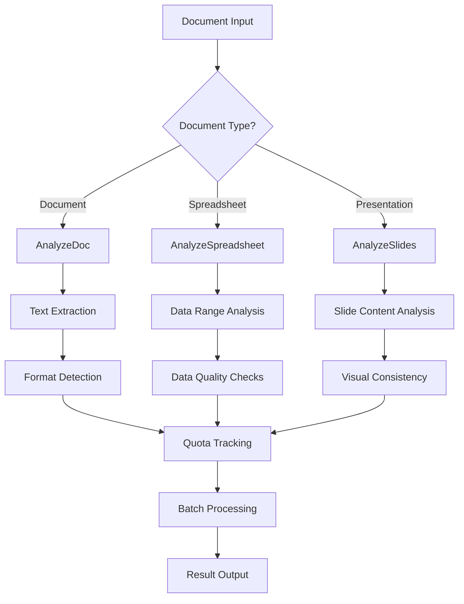

**Diagram sources**
- [DocumentAnalysisEngine.js](file://src/services/DocumentAnalysisEngine.js#L12-L30)

**Section sources**
- [DocumentAnalysisEngine.js](file://src/services/DocumentAnalysisEngine.js#L12-L30)

## Execution Time Constraints

### 6-Minute Execution Limit

Google Apps Script enforces a strict 6-minute execution limit per script invocation. The add-on implements several strategies to operate within this constraint:

#### Time Monitoring Implementation

The codebase includes sophisticated time monitoring capabilities:

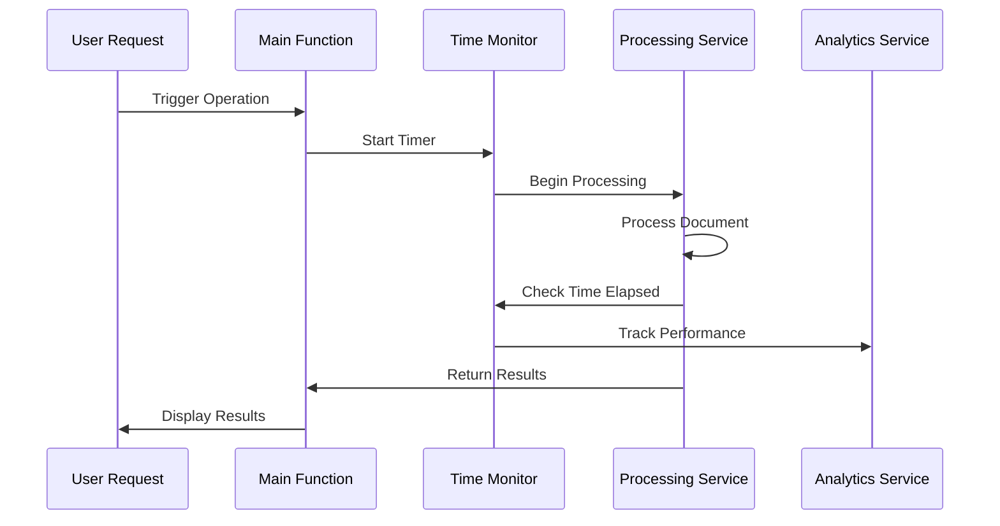

**Diagram sources**
- [Utils.js](file://src/utils/Utils.js#L210-L216)
- [AnalyticsService.js](file://src/services/AnalyticsService.js#L67-L94)

#### Execution Time Optimization Strategies

1. **Early Termination**: Operations terminate gracefully when approaching time limits
2. **Progressive Processing**: Large documents are processed incrementally
3. **Caching**: Results are cached to avoid redundant processing
4. **Selective Analysis**: Only relevant portions of documents are analyzed

**Section sources**
- [Utils.js](file://src/utils/Utils.js#L210-L216)
- [AnalyticsService.js](file://src/services/AnalyticsService.js#L67-L94)

## Trigger Limitations

### Available Triggers

The add-on supports various Google Apps Script triggers, each with specific limitations:

| Trigger Type | Frequency Limit | Use Case | Quota Impact |
|--------------|----------------|----------|--------------|
| `onOpen()` | Per document/session | Menu creation | Low |
| `onEdit()` | Per document/edit | Real-time updates | Medium |
| `onInstall()` | Once per user | Initial setup | Minimal |
| `onDocumentChange()` | Per document change | Document tracking | Variable |

### Trigger Implementation Patterns

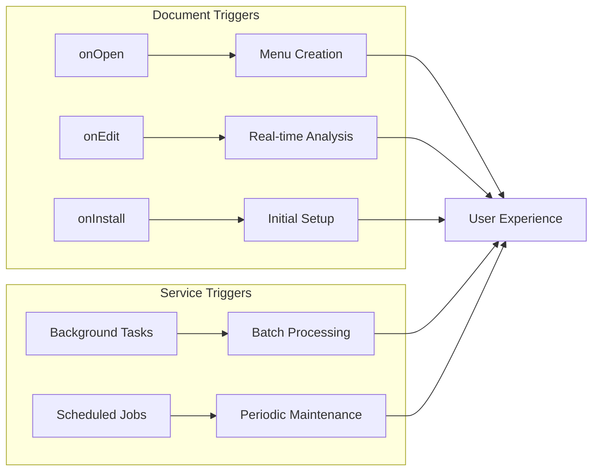

**Diagram sources**
- [Main.js](file://src/Main.js#L10-L35)

### Trigger Optimization Strategies

1. **Debouncing**: Multiple rapid triggers are consolidated
2. **Selective Activation**: Triggers only activate when relevant
3. **Lazy Loading**: Resources are loaded on-demand
4. **Conditional Execution**: Operations only run when necessary

**Section sources**
- [Main.js](file://src/Main.js#L10-L35)

## Concurrent Execution Constraints

### Concurrency Limits

Google Apps Script imposes strict concurrency controls:

- **Single-threaded execution**: Only one script execution per user at a time
- **Background thread restrictions**: Limited simultaneous background processing
- **Resource pooling**: Shared resources among concurrent operations

### Concurrency Management Implementation

The add-on implements several strategies to manage concurrent access:

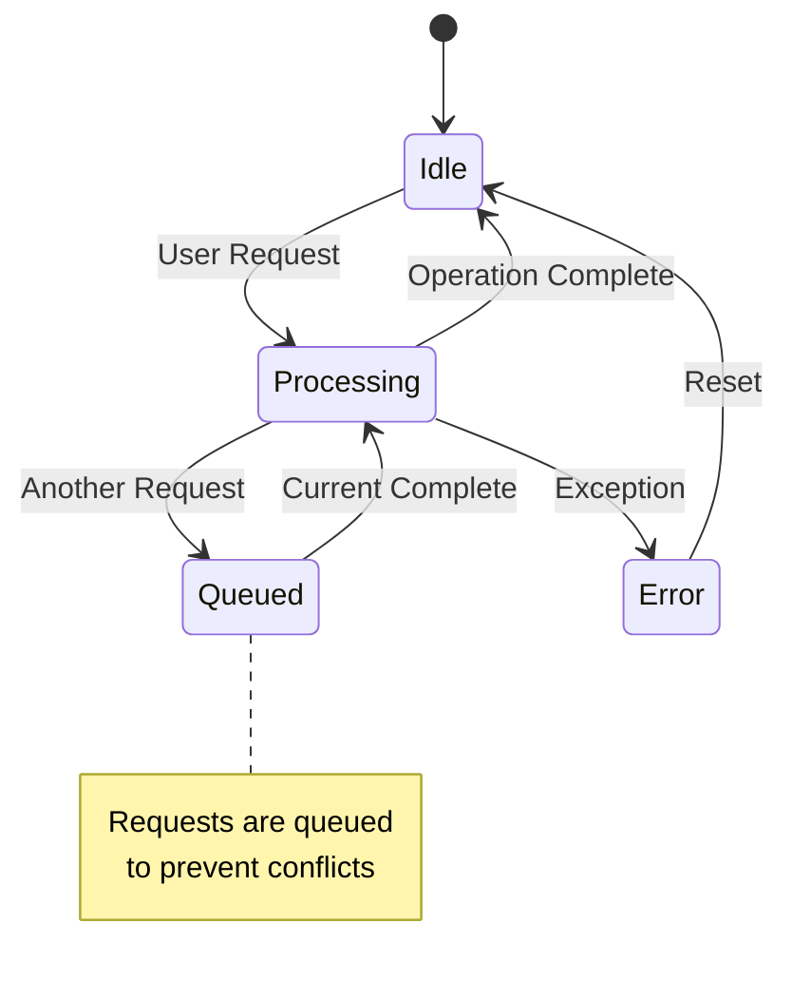

**Diagram sources**
- [Utils.js](file://src/utils/Utils.js#L48-L51)

### Conflict Resolution Strategies

1. **Request Queueing**: Multiple requests are queued sequentially
2. **Resource Locking**: Critical resources are locked during operations
3. **Graceful Degradation**: Operations continue with reduced functionality when needed
4. **User Feedback**: Clear indication of ongoing operations

**Section sources**
- [Utils.js](file://src/utils/Utils.js#L48-L51)

## Rate Limiting for External Services

### UrlFetchApp Rate Limiting

The add-on integrates with external AI services through `UrlFetchApp`, requiring careful rate limiting:

#### Local AI Service Rate Limits

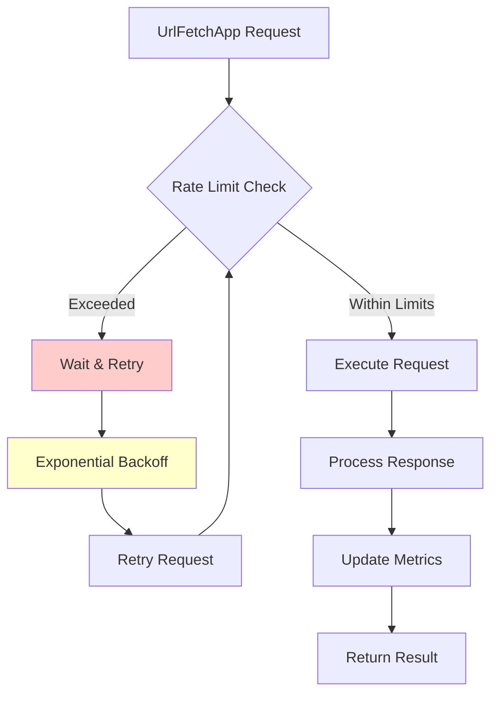

**Diagram sources**
- [LocalAIService.js](file://src/services/LocalAIService.js#L42-L66)
- [Utils.js](file://src/utils/Utils.js#L95-L113)

#### AI Service Integration Patterns

The add-on supports multiple AI service providers with built-in rate limiting:

| Service Provider | Rate Limiting | Timeout | Retry Strategy |
|------------------|---------------|---------|----------------|
| Local AI Server | Built-in throttling | 5 seconds | Exponential backoff |
| Google AI Studio | API quota limits | 30 seconds | Circuit breaker |
| Ollama (Future) | Service-dependent | 60 seconds | Adaptive retry |

### External Service Optimization

1. **Connection Pooling**: Reuse connections when possible
2. **Timeout Management**: Implement appropriate timeouts
3. **Circuit Breaker Pattern**: Fail fast when services are unavailable
4. **Fallback Mechanisms**: Alternative processing when primary services fail

**Section sources**
- [LocalAIService.js](file://src/services/LocalAIService.js#L42-L66)
- [OllamaAIService.js](file://src/services/OllamaAIService.js#L60-L98)

## Batch Processing Strategies

### Efficient Batch Operations

The add-on implements sophisticated batch processing to optimize quota usage and performance:

#### Batch Processing Implementation

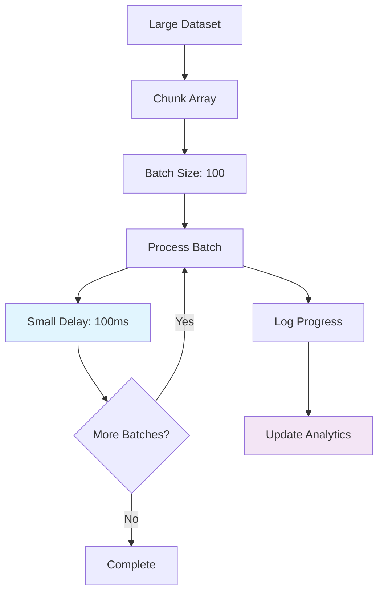

**Diagram sources**
- [Utils.js](file://src/utils/Utils.js#L224-L236)

#### Batch Size Optimization

The codebase uses configurable batch sizes based on operation type:

- **Text Processing**: 500-1000 characters per batch
- **Data Analysis**: 100-500 rows per batch
- **File Operations**: 10-50 files per batch
- **AI Processing**: 2000-5000 characters per batch

### Large Document Processing

For documents exceeding processing limits, the add-on implements intelligent truncation and sampling:

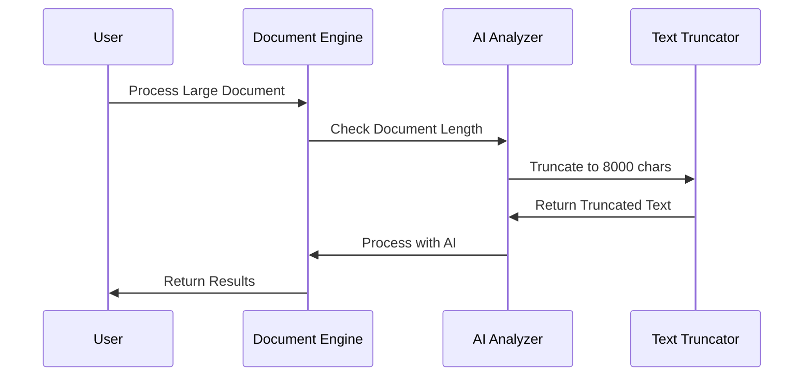

**Diagram sources**
- [Main.js](file://src/Main.js#L471-L474)
- [SummarizationService.js](file://src/services/SummarizationService.js#L8-L10)

**Section sources**
- [Utils.js](file://src/utils/Utils.js#L224-L236)
- [Main.js](file://src/Main.js#L471-L474)
- [SummarizationService.js](file://src/services/SummarizationService.js#L8-L10)

## Error Handling for Quota Exceeded Errors

### Comprehensive Error Management

The add-on implements robust error handling for quota-related failures:

#### Error Classification System

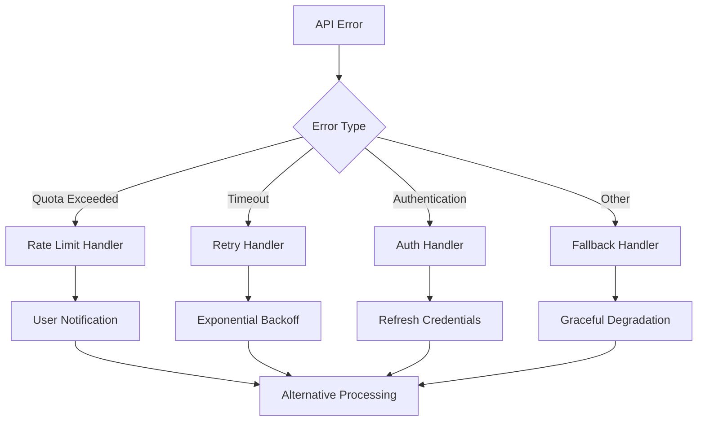

**Diagram sources**
- [LocalAIService.js](file://src/services/LocalAIService.js#L42-L66)
- [OllamaAIService.js](file://src/services/OllamaAIService.js#L60-L98)

#### Error Recovery Strategies

1. **Graceful Degradation**: Fallback to simpler operations when quotas are exceeded
2. **Progressive Enhancement**: Start with basic functionality and add features as quotas permit
3. **User Communication**: Clear messaging about quota limitations and alternatives
4. **Automatic Retry**: Intelligent retry mechanisms with exponential backoff

### Specific Error Handling Patterns

The codebase handles various quota-related scenarios:

- **API Quota Exhaustion**: Automatic fallback to local processing
- **Rate Limiting**: Built-in delays and retry mechanisms
- **Concurrent Access**: Queue management and conflict resolution
- **Timeout Handling**: Graceful degradation with partial results

**Section sources**
- [LocalAIService.js](file://src/services/LocalAIService.js#L42-L66)
- [OllamaAIService.js](file://src/services/OllamaAIService.js#L60-L98)

## Monitoring and Logging

### Comprehensive Analytics System

The add-on includes a sophisticated analytics service for tracking quota usage and performance:

#### Analytics Architecture

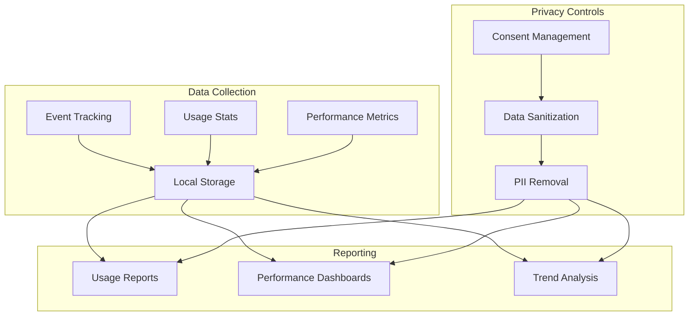

**Diagram sources**
- [AnalyticsService.js](file://src/services/AnalyticsService.js#L16-L45)

#### Key Monitoring Metrics

The analytics service tracks essential metrics for quota management:

| Metric Category | Specific Metrics | Purpose |
|-----------------|------------------|---------|
| API Usage | Calls per hour, daily quota consumption | Monitor quota exhaustion |
| Performance | Execution time, success rates | Optimize operations |
| User Behavior | Feature usage, frequency | Resource allocation |
| Error Rates | Failure counts, error types | Issue identification |

### Logging Implementation

The add-on implements structured logging for troubleshooting and monitoring:

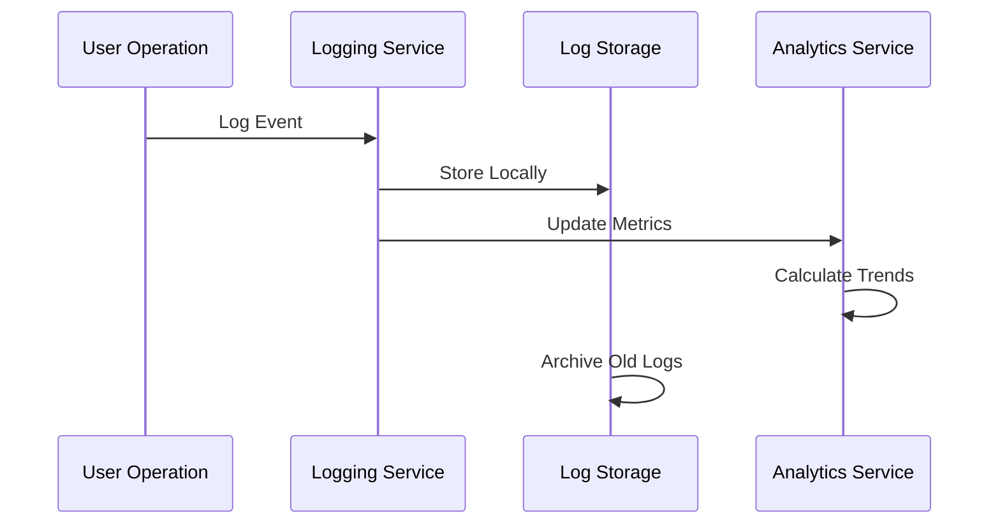

**Diagram sources**
- [AnalyticsService.js](file://src/services/AnalyticsService.js#L67-L94)

**Section sources**
- [AnalyticsService.js](file://src/services/AnalyticsService.js#L16-L45)
- [AnalyticsService.js](file://src/services/AnalyticsService.js#L67-L94)

## Optimization Strategies

### Efficient Resource Utilization

The add-on implements multiple optimization strategies to maximize quota efficiency:

#### Memory Management

1. **Lazy Loading**: Resources are loaded only when needed
2. **Object Pooling**: Reuse of frequently created objects
3. **Garbage Collection**: Explicit cleanup of unused resources
4. **Streaming Processing**: Process data in streams rather than loading entirely

#### CPU Optimization

1. **Algorithm Efficiency**: Use of optimized algorithms for document processing
2. **Parallel Processing**: Leverage available parallelism within constraints
3. **Caching**: Strategic caching of results and intermediate computations
4. **Selective Processing**: Focus on relevant portions of documents

### Performance Optimization Patterns

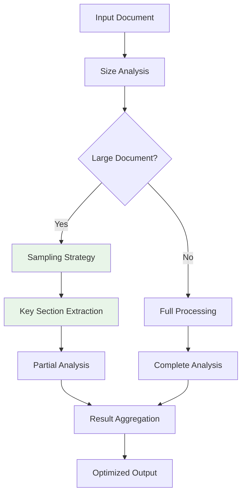

**Diagram sources**
- [SummarizationService.js](file://src/services/SummarizationService.js#L47-L60)

**Section sources**
- [SummarizationService.js](file://src/services/SummarizationService.js#L47-L60)

## User Guidance

### Managing API Usage

The add-on provides clear guidance to users for optimal quota management:

#### Usage Recommendations

1. **Batch Operations**: Combine multiple small operations into larger batches
2. **Selective Processing**: Use document selection features to limit scope
3. **Regular Maintenance**: Clear caches and temporary files periodically
4. **Feature Selection**: Choose appropriate features based on document size

#### User Interface Guidance

The sidebar provides real-time feedback about operation status and estimated completion times:

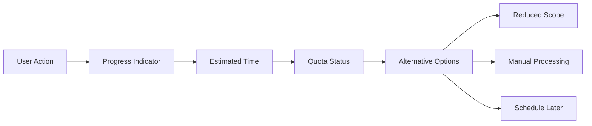

**Diagram sources**
- [Sidebar.html](file://src/ui/Sidebar.html#L301-L304)

### Best Practices for Users

1. **Document Preparation**: Clean and organize documents before processing
2. **Feature Selection**: Choose appropriate processing level (quick vs. comprehensive)
3. **Timing**: Schedule large operations during off-peak hours
4. **Feedback**: Report issues promptly for continuous improvement

**Section sources**
- [Sidebar.html](file://src/ui/Sidebar.html#L301-L304)

## Best Practices

### Development Guidelines

For developers working with the add-on, the following best practices ensure optimal quota utilization:

#### Code Organization

1. **Modular Design**: Separate concerns into focused modules
2. **Error Boundaries**: Implement comprehensive error handling
3. **Resource Management**: Proper cleanup of resources
4. **Testing**: Thorough testing under quota constraints

#### Performance Optimization

1. **Measure Impact**: Track the quota impact of new features
2. **Benchmark Regularly**: Monitor performance against quota limits
3. **Iterative Improvement**: Continuously optimize for efficiency
4. **Documentation**: Maintain clear documentation of quota impacts

### Deployment Considerations

1. **Monitoring Setup**: Implement comprehensive monitoring
2. **Alert Configuration**: Set up alerts for quota exhaustion
3. **Backup Strategies**: Maintain backup processing capabilities
4. **User Communication**: Clearly communicate quota limitations

The Intelligent Document Automation add-on demonstrates sophisticated handling of Google Workspace API quotas and limitations through careful design, optimization, and user guidance. By implementing these strategies, the add-on maintains reliability while providing powerful document automation capabilities within Google's constraints.