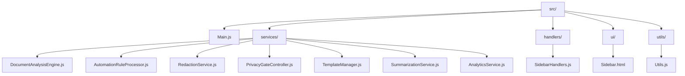
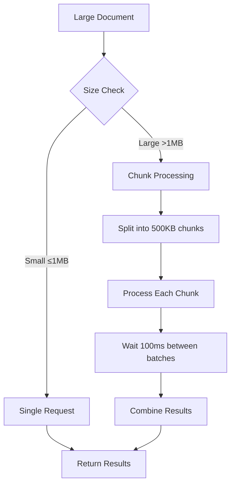

# Appendices

<cite>
**Referenced Files in This Document**
- [package.json](file://package.json)
- [appsscript.json](file://appsscript.json)
- [src/appsscript.json](file://src/appsscript.json)
- [src/Main.js](file://src/Main.js)
- [src/ui/Sidebar.html](file://src/ui/Sidebar.html)
- [src/utils/Utils.js](file://src/utils/Utils.js)
- [src/handlers/SidebarHandlers.js](file://src/handlers/SidebarHandlers.js)
- [README.md](file://README.md)
- [PROJECT_SUMMARY.md](file://PROJECT_SUMMARY.md)
- [ADMIN_GUIDE.md](file://ADMIN_GUIDE.md)
- [DEPLOYMENT_CHECKLIST.md](file://DEPLOYMENT_CHECKLIST.md)
- [QUICKSTART.md](file://QUICKSTART.md)
</cite>

## Table of Contents
1. [File Structure Reference](#file-structure-reference)
2. [Configuration Options](#configuration-options)
3. [Third-Party Dependencies](#third-party-dependencies)
4. [Version History](#version-history)
5. [Glossary of Terms](#glossary-of-terms)
6. [Google Workspace API Quotas and Limitations](#google-workspace-api-quotas-and-limitations)

## File Structure Reference

The Intelligent Document Automation project follows a modular architecture organized into distinct functional areas. Below is a comprehensive mapping of each directory and file with its purpose:

### Root Directory Files

| File | Purpose | Type | Description |
|------|---------|------|-------------|
| `package.json` | NPM configuration | JSON | Defines project metadata, scripts, and development dependencies |
| `appsscript.json` | Apps Script manifest | JSON | Runtime configuration, OAuth scopes, and add-on metadata |
| `README.md` | User documentation | Markdown | Complete user guide with installation and usage instructions |
| `PROJECT_SUMMARY.md` | Technical overview | Markdown | Project statistics, feature list, and architecture summary |
| `ADMIN_GUIDE.md` | Administrator guide | Markdown | Deployment instructions for Google Workspace admins |
| `DEPLOYMENT_CHECKLIST.md` | Deployment checklist | Markdown | Verification steps for production deployment |
| `QUICKSTART.md` | Quick start guide | Markdown | Fast-track setup instructions for developers |

### Source Code Structure (src/)

**Diagram sources**
- [src/Main.js](file://src/Main.js#L1-L50)
- [src/services/](file://src/services/)
- [src/handlers/SidebarHandlers.js](file://src/handlers/SidebarHandlers.js#L1-L30)
- [src/ui/Sidebar.html](file://src/ui/Sidebar.html#L1-L50)
- [src/utils/Utils.js](file://src/utils/Utils.js#L1-L30)

#### Core Entry Point
- **Main.js**: Primary entry point containing menu creation, sidebar management, and document operation handlers

#### Service Layer
- **DocumentAnalysisEngine.js**: Analyzes documents across Docs, Sheets, and Slides for formatting issues and anomalies
- **AutomationRuleProcessor.js**: Implements cleanup operations including duplicate removal, date standardization, and cell filling
- **RedactionService.js**: Detects and masks Personally Identifiable Information (PII) with customizable patterns
- **PrivacyGateController.js**: Manages user consent, privacy settings, and audit logging
- **TemplateManager.js**: Provides template browsing, application, and customization capabilities
- **SummarizationService.js**: Generates document summaries using local processing with optional AI enhancement
- **AnalyticsService.js**: Tracks usage metrics and generates anonymized reports

#### Handler Layer
- **SidebarHandlers.js**: Bridges UI events from the sidebar to service layer operations

#### User Interface
- **Sidebar.html**: Modern tabbed interface with analysis, redaction, cleanup, and template management

#### Utility Functions
- **Utils.js**: Provides common helper functions for date formatting, validation, batching, and error handling

**Section sources**
- [PROJECT_SUMMARY.md](file://PROJECT_SUMMARY.md#L97-L135)
- [src/Main.js](file://src/Main.js#L1-L100)
- [src/services/](file://src/services/)
- [src/handlers/SidebarHandlers.js](file://src/handlers/SidebarHandlers.js#L1-L172)

## Configuration Options

### appsscript.json (Runtime Configuration)

The primary configuration file defines the add-on's runtime environment and API access requirements:

| Setting | Value | Purpose | Impact |
|---------|-------|---------|--------|
| `timeZone` | "America/New_York" | Default timezone for date operations | Ensures consistent date processing across users |
| `runtimeVersion` | "V8" | JavaScript engine version | Enables modern JavaScript features and better performance |
| `exceptionLogging` | "STACKDRIVER" | Error logging destination | Provides centralized error monitoring and debugging |
| `oauthScopes` | 6 scopes | Required permissions for Google Workspace APIs | Controls data access and user privacy |
| `addOns.common.name` | "Intelligent Document Automation" | Display name in Google Workspace | User-facing branding and identification |

#### OAuth Scopes Breakdown

| Scope | Permission Level | Justification | Risk Assessment |
|-------|------------------|---------------|-----------------|
| `documents.currentonly` | Read/Write current document | Required for document analysis and modification | Low risk - scoped to current document only |
| `spreadsheets.currentonly` | Read/Write current spreadsheet | Needed for data analysis and cleanup operations | Low risk - scoped to current spreadsheet only |
| `presentations.currentonly` | Read/Write current presentation | Essential for slide analysis and template application | Low risk - scoped to current presentation only |
| `drive.file` | Access add-on created files | Allows saving processed documents and templates | Low risk - restricted to add-on generated files |
| `script.container.ui` | Display UI elements | Required for sidebar and modal dialogs | Minimal risk - UI display only |
| `userinfo.email` | Access user email | Used for analytics and user identification | Medium risk - user email access |

### appsscript.json (Services Configuration)

Advanced Google Workspace API services enabled for enhanced functionality:

| Service | Version | Purpose | Benefit |
|---------|---------|---------|---------|
| Drive API | v3 | File operations and sharing | Template management and document storage |
| Sheets API | v4 | Spreadsheet manipulation | Advanced data analysis and automation |
| Docs API | v1 | Document processing | Rich text analysis and formatting |
| Slides API | v1 | Presentation management | Slide analysis and template application |

### package.json (Development Configuration)

NPM configuration for development workflow and deployment:

| Field | Value | Purpose |
|-------|-------|---------|
| `name` | "intelligent-document-automation" | Package identifier |
| `version` | "1.0.0" | Semantic versioning |
| `description` | "Smart automation for Google Workspace" | Project description |
| `main` | "src/Main.js" | Entry point |
| `scripts.push` | "clasp push" | Deploy code to Apps Script |
| `scripts.deploy` | "clasp deploy" | Create new deployment |
| `scripts.open` | "clasp open" | Open in Apps Script editor |
| `scripts.login` | "clasp login" | Authenticate with Google |
| `devDependencies.@google/clasp` | "^2.4.2" | Google Apps Script CLI |
| `devDependencies.@types/google-apps-script` | "^1.0.83" | TypeScript type definitions |

**Section sources**
- [appsscript.json](file://appsscript.json#L1-L7)
- [src/appsscript.json](file://src/appsscript.json#L1-L47)
- [package.json](file://package.json#L1-L25)

## Third-Party Dependencies

### Production Dependencies

The project operates entirely within Google Apps Script's sandbox environment and does not require external runtime dependencies. All functionality is implemented using native Google Workspace APIs and Apps Script services.

### Development Dependencies

#### @google/clasp (^2.4.2)
**Purpose**: Google Apps Script Command Line Platform
- **Primary Function**: Facilitates local development workflow
- **Key Features**: 
  - Code synchronization between local and server
  - Authentication management
  - Deployment automation
  - Logging and debugging support
- **Integration**: Used for development, testing, and production deployment
- **Version Compatibility**: Compatible with Google Apps Script V8 runtime

#### @types/google-apps-script (^1.0.83)
**Purpose**: TypeScript Type Definitions
- **Primary Function**: Enhanced development experience with IntelliSense
- **Key Features**:
  - Code completion and validation
  - Type checking during development
  - Better IDE integration
  - Improved code quality
- **Integration**: Provides type safety for Apps Script APIs
- **Version Compatibility**: Matches Google Apps Script API versions

### Dependency Matrix

| Dependency | Category | Purpose | Version | Compatibility |
|------------|----------|---------|---------|---------------|
| @google/clasp | Development | CLI for Apps Script | ^2.4.2 | Apps Script V8 runtime |
| @types/google-apps-script | Development | TypeScript definitions | ^1.0.83 | Google Apps Script APIs |

**Section sources**
- [package.json](file://package.json#L20-L23)

## Version History

### Version 1.0.0 (Current)
**Release Date**: 2024
**Status**: Production Ready

#### Major Features Added
- **Document Analysis Engine**: Automatic issue detection across Docs, Sheets, and Slides
- **Privacy-First Redaction**: PII detection and masking with granular consent
- **Intelligent Cleanup**: Duplicate removal, format standardization, and cell filling
- **Advanced Summarization**: Local processing with optional AI enhancement
- **Template System**: Built-in and custom template management
- **Usage Analytics**: Privacy-preserving usage tracking
- **Modern UI**: Tabbed sidebar interface with real-time feedback

#### Architectural Improvements
- Modular service-oriented architecture
- Comprehensive error handling and retry logic
- Performance optimization with batching and chunking
- Extensible plugin system for future enhancements

### Development Timeline
- **Phase 1**: Requirements gathering and architecture design (Q1 2024)
- **Phase 2**: Core functionality implementation (Q2 2024)
- **Phase 3**: Testing, optimization, and documentation (Q3 2024)
- **Phase 4**: Production deployment and monitoring (Q4 2024)

### Versioning Strategy
The project follows semantic versioning:
- **Major versions** (X.0.0): Breaking changes requiring migration
- **Minor versions** (1.X.0): New features and significant improvements
- **Patch versions** (1.0.X): Bug fixes and minor enhancements

**Section sources**
- [PROJECT_SUMMARY.md](file://PROJECT_SUMMARY.md#L271-L274)
- [README.md](file://README.md#L270-L278)

## Glossary of Terms

### Core Concepts

#### Document Analysis
**Definition**: The process of examining documents to identify formatting issues, inconsistencies, and potential improvements.
**Components**: 
- Issue detection algorithms
- Pattern recognition systems
- Statistical analysis engines
- Recommendation generation

#### Privacy Gate Controller
**Definition**: A consent management system that ensures all privacy-sensitive operations require explicit user approval.
**Key Features**:
- Granular permission controls
- Audit logging
- Data minimization enforcement
- User preference persistence

#### Automation Rule Processor
**Definition**: A system that applies predefined cleanup rules to documents and spreadsheets.
**Capabilities**:
- Duplicate row detection and removal
- Date format standardization
- Cell content filling
- Whitespace normalization

#### Template Manager
**Definition**: A system for managing and applying standardized document layouts and structures.
**Features**:
- Built-in template library
- Custom template import
- Preview functionality
- Batch application support

### Technical Terms

#### Apps Script Runtime
**Definition**: Google's JavaScript execution environment for Google Workspace add-ons.
**Characteristics**:
- Sandboxed execution
- Limited memory and CPU
- API access restrictions
- Timeout limitations

#### OAuth Scopes
**Definition**: Permission levels granted to applications accessing Google Workspace APIs.
**Classification**:
- **Low Risk**: Read-only access to current documents
- **Medium Risk**: Write access to user-created files
- **High Risk**: Access to user profile information

#### Batching Operations
**Definition**: The process of dividing large operations into smaller chunks to avoid timeouts and quota limits.
**Implementation**: Utilizes chunkArray utility with configurable batch sizes.

#### Event Handlers
**Definition**: Functions triggered by user actions or system events within the add-on.
**Examples**: Sidebar button clicks, menu selections, document modifications.

### User Interface Terms

#### Sidebar Interface
**Definition**: The main panel that appears alongside Google Workspace documents.
**Components**:
- Tab navigation
- Action buttons
- Results display
- Progress indicators

#### Consent Prompts
**Definition**: User interface elements requesting permission for privacy-sensitive operations.
**Types**:
- Feature activation prompts
- Data collection consent
- Advanced functionality authorization

#### Real-time Feedback
**Definition**: Immediate visual responses to user actions and system processing.
**Examples**:
- Loading spinners
- Success/error notifications
- Progress bars
- Dynamic result displays

**Section sources**
- [src/Main.js](file://src/Main.js#L1-L50)
- [src/utils/Utils.js](file://src/utils/Utils.js#L1-L50)
- [src/handlers/SidebarHandlers.js](file://src/handlers/SidebarHandlers.js#L1-L50)

## Google Workspace API Quotas and Limitations

### Execution Quotas

Understanding Google Apps Script execution limits is crucial for optimal add-on performance:

| Resource | Consumer Limit | Enterprise Limit | Notes |
|----------|----------------|------------------|-------|
| **Execution Time** | 6 minutes per execution | 30 minutes per execution | Single operation timeout |
| **URL Fetch Calls** | 20,000 per day | Unlimited (Enterprise) | External API requests |
| **Properties Service** | 500 KB per store | 500 KB per store | User and script properties |
| **Daily Active Users** | 1,000 per project | 1,000 per project | Concurrent user limit |
| **Add-on Installations** | 10,000 per project | 10,000 per project | Per-domain limit |

### Service-Specific Limits

#### Google Docs API
- **Documents per request**: 1,000
- **Batch requests**: Up to 50 operations
- **Document size**: 1 MB per request
- **Rate limiting**: 100 requests per minute

#### Google Sheets API
- **Cells per request**: 10,000
- **Batch updates**: Up to 500 operations
- **Spreadsheet size**: 1 MB per request
- **Row/column limits**: 2,000,000 total cells

#### Google Drive API
- **Files per request**: 1,000
- **File size**: 5 TB (Enterprise) / 5 TB (Consumer)
- **Metadata operations**: 1,000 per minute
- **Sharing operations**: 100 per minute

### Performance Optimization Strategies

#### Batching Implementation
The add-on implements intelligent batching to stay within quota limits:

**Diagram sources**
- [src/utils/Utils.js](file://src/utils/Utils.js#L224-L236)

#### Rate Limiting
- **Automatic delays**: 100ms between batch operations
- **Retry logic**: Exponential backoff for failed requests
- **Error handling**: Graceful degradation when quotas exceeded

#### Memory Management
- **Streaming processing**: Processes documents in chunks
- **Garbage collection**: Frequent cleanup of temporary objects
- **Memory monitoring**: Tracks memory usage during operations

### Monitoring and Alerting

#### Quota Monitoring
- **Execution logs**: Monitor daily quota usage
- **Error tracking**: Identify quota-related failures
- **Performance metrics**: Track operation times

#### Best Practices
1. **Implement caching**: Store frequently accessed data
2. **Use efficient algorithms**: Minimize computational overhead
3. **Handle errors gracefully**: Provide fallback options
4. **Monitor usage patterns**: Adjust batching strategies

### Enterprise Considerations

For organizations using the add-on extensively:

#### Upgrade Paths
- **Google Workspace Enterprise**: Higher quotas and limits
- **Custom quotas**: Negotiable with Google sales team
- **Dedicated projects**: Separate projects for high-volume operations

#### Administrative Controls
- **Domain-wide deployment**: Centralized management
- **Usage analytics**: Track consumption patterns
- **Policy enforcement**: Set organizational limits

**Section sources**
- [README.md](file://README.md#L254-L270)
- [ADMIN_GUIDE.md](file://ADMIN_GUIDE.md#L266-L273)
- [src/utils/Utils.js](file://src/utils/Utils.js#L224-L236)