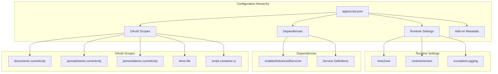
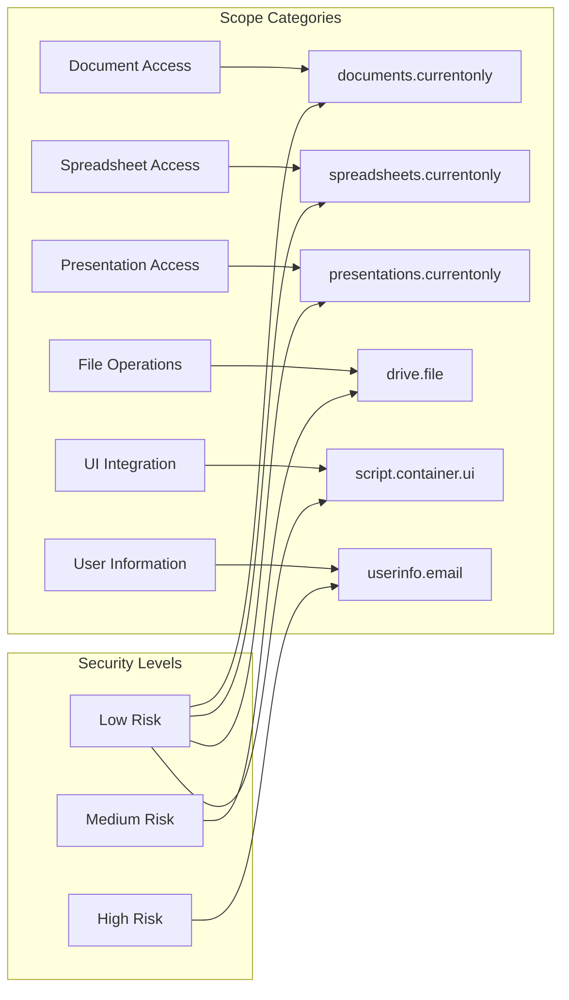
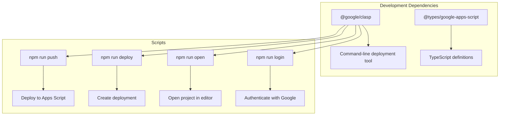
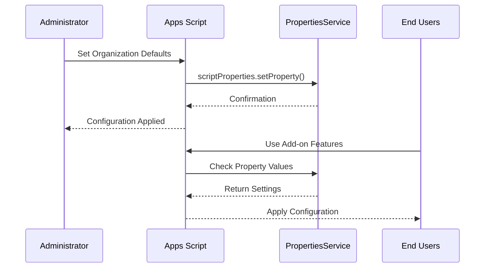
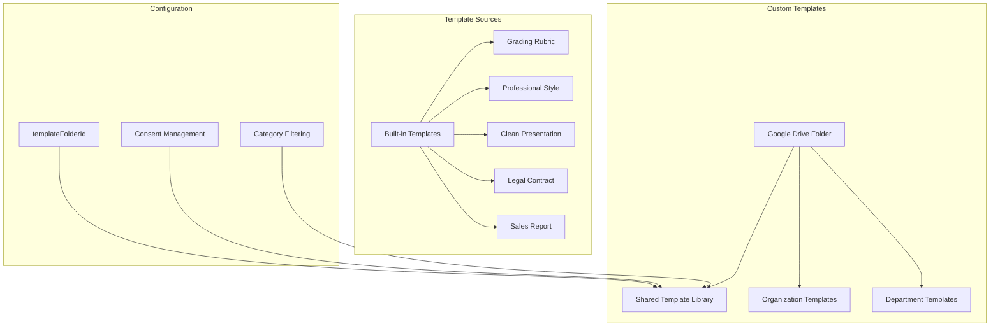
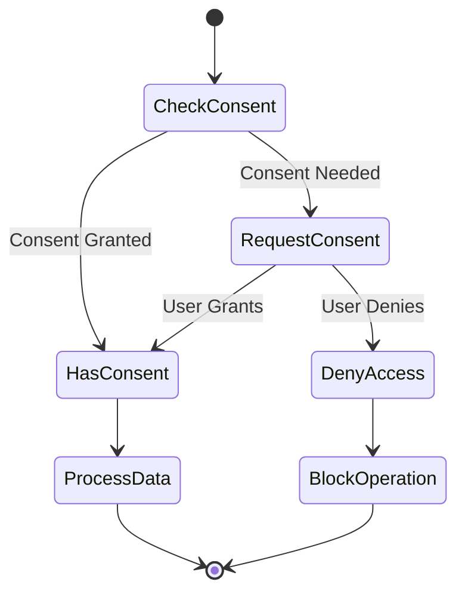
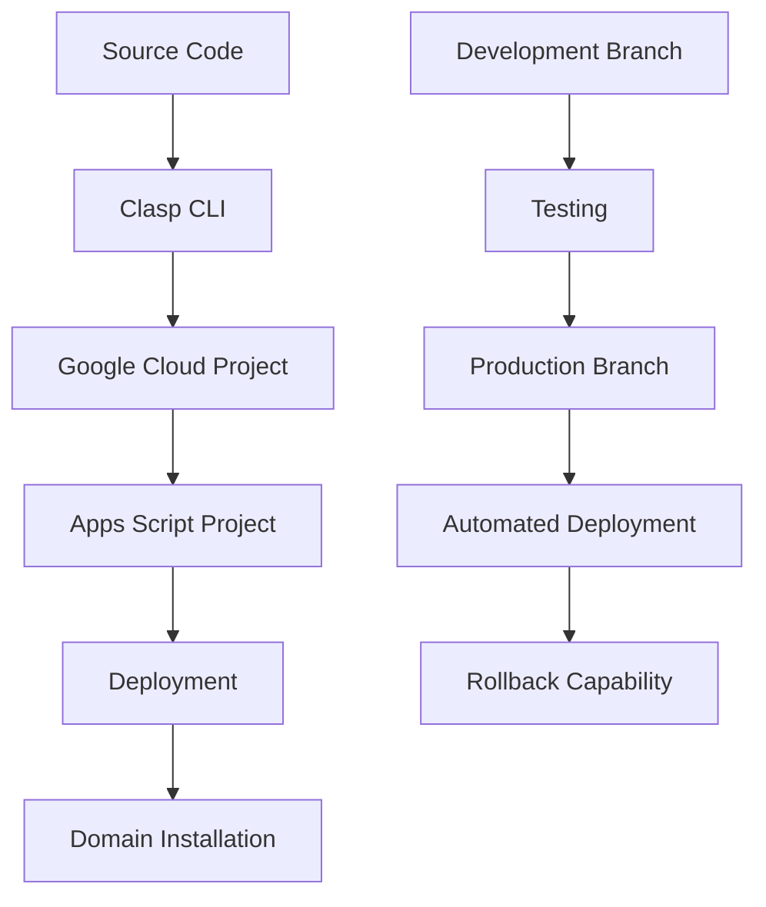

# Configuration Options

<cite>
**Referenced Files in This Document**
- [appsscript.json](file://appsscript.json)
- [src/appsscript.json](file://src/appsscript.json)
- [package.json](file://package.json)
- [ADMIN_GUIDE.md](file://ADMIN_GUIDE.md)
- [src/Main.js](file://src/Main.js)
- [src/services/AnalyticsService.js](file://src/services/AnalyticsService.js)
- [src/services/PrivacyGateController.js](file://src/services/PrivacyGateController.js)
- [src/services/TemplateManager.js](file://src/services/TemplateManager.js)
</cite>

## Table of Contents
1. [Introduction](#introduction)
2. [Core Configuration Files](#core-configuration-files)
3. [Runtime Configuration](#runtime-configuration)
4. [OAuth Scopes and Security](#oauth-scopes-and-security)
5. [Package Dependencies](#package-dependencies)
6. [Organization-Wide Settings](#organization-wide-settings)
7. [Template Management Configuration](#template-management-configuration)
8. [Analytics and Privacy Configuration](#analytics-and-privacy-configuration)
9. [Deployment Workflow Configuration](#deployment-workflow-configuration)
10. [Common Configuration Issues](#common-configuration-issues)
11. [Troubleshooting Guide](#troubleshooting-guide)

## Introduction

The Intelligent Document Automation add-on provides extensive configuration options that control its functionality, security, and behavior across Google Workspace environments. These configurations are managed through multiple configuration files and runtime settings that administrators and developers can customize to meet organizational requirements.

This documentation covers all configuration aspects including runtime versions, OAuth scopes, dependency management, organization-wide settings, and deployment workflows using modern development tools.

## Core Configuration Files

### appsscript.json Manifest

The primary configuration file defines the add-on's runtime environment, dependencies, and security requirements.



**Diagram sources**
- [appsscript.json](file://appsscript.json#L1-L7)
- [src/appsscript.json](file://src/appsscript.json#L1-L47)

**Section sources**
- [appsscript.json](file://appsscript.json#L1-L7)
- [src/appsscript.json](file://src/appsscript.json#L1-L47)

## Runtime Configuration

### runtimeVersion

Controls the JavaScript runtime engine used by the add-on.

| Setting | Impact | Security Level | Performance |
|---------|--------|----------------|-------------|
| V8 | Modern ES6+ features, better performance | High | Excellent |
| Legacy | Basic JavaScript support | Medium | Good |

**Configuration Example:**
```json
{
  "runtimeVersion": "V8"
}
```

**Impact on Functionality:**
- Enables modern JavaScript features like arrow functions, template literals, and async/await
- Provides better performance for complex operations
- Allows use of advanced Google Apps Script APIs

### timeZone

Defines the timezone for date/time operations and scheduling.

**Default:** `"America/New_York"`

**Impact on Functionality:**
- Affects timestamp generation in analytics
- Influences scheduled operations and reminders
- Determines display format for localized dates

### exceptionLogging

Controls error logging behavior for debugging and monitoring.

**Options:**
- `"STACKDRIVER"`: Logs to Google Cloud Stackdriver
- `"NONE"`: Disables logging

**Section sources**
- [appsscript.json](file://appsscript.json#L1-L7)
- [src/appsscript.json](file://src/appsscript.json#L1-L47)

## OAuth Scopes and Security

### Required OAuth Scopes

The add-on requests specific OAuth scopes to access Google Workspace APIs securely.



**Diagram sources**
- [src/appsscript.json](file://src/appsscript.json#L29-L35)

| Scope | Purpose | Risk Level | Justification |
|-------|---------|------------|---------------|
| `documents.currentonly` | Read/write current document only | Low | Document manipulation requires access to active document |
| `spreadsheets.currentonly` | Read/write current spreadsheet only | Low | Spreadsheet operations require sheet access |
| `presentations.currentonly` | Read/write current presentation only | Low | Presentation editing needs slide access |
| `drive.file` | Access only add-on created files | Low | Limited to files created by the add-on |
| `script.container.ui` | Display sidebar interface | Minimal | Required for user interface functionality |
| `userinfo.email` | Access user email for analytics | Medium | Used for user identification in analytics |

### Security Best Practices

**Administrative Configuration:**
```javascript
// Enable strict security mode
function configureSecurity() {
  const scriptProps = PropertiesService.getScriptProperties();
  
  // Enforce consent for sensitive operations
  scriptProps.setProperty('requireConsentForAI', 'true');
  scriptProps.setProperty('requireConsentForAnalytics', 'true');
  
  // Limit data processing locations
  scriptProps.setProperty('dataProcessingLocation', 'LOCAL_ONLY');
}
```

**Section sources**
- [src/appsscript.json](file://src/appsscript.json#L29-L35)
- [ADMIN_GUIDE.md](file://ADMIN_GUIDE.md#L208-L216)

## Package Dependencies

### npm Dependencies

The project uses modern development tools for streamlined deployment and management.



**Diagram sources**
- [package.json](file://package.json#L20-L23)

### Dependency Management

**@google/clasp Configuration:**
- Enables command-line deployment
- Supports automated CI/CD pipelines
- Provides version control integration
- Facilitates team collaboration

**Development Workflow:**
1. **Clone Project:** `clasp clone <SCRIPT_ID>`
2. **Make Changes:** Edit local files
3. **Push Changes:** `npm run push`
4. **Deploy:** `npm run deploy`

**Section sources**
- [package.json](file://package.json#L1-L25)

## Organization-Wide Settings

### PropertiesService Configuration

The add-on uses Google Apps Script PropertiesService to manage organization-wide settings.



**Diagram sources**
- [ADMIN_GUIDE.md](file://ADMIN_GUIDE.md#L149-L164)

### Core Organization Settings

| Setting | Default Value | Description | Impact |
|---------|---------------|-------------|--------|
| `defaultDateFormat` | `"yyyy-MM-dd"` | Global date format preference | Affects all date operations |
| `autoAnalyze` | `"false"` | Enable automatic document analysis | Controls initial behavior |
| `templateFolderId` | `""` | Shared template library folder | Enables template access |
| `defaultAnalyticsConsent` | `"false"` | Analytics collection preference | Privacy compliance |
| `defaultAdvancedAI` | `"false"` | AI feature availability | Feature accessibility |

### Configuration Examples

**Basic Organization Setup:**
```javascript
function setOrganizationDefaults() {
  const scriptProps = PropertiesService.getScriptProperties();
  
  // Default date format
  scriptProps.setProperty('defaultDateFormat', 'yyyy-MM-dd');
  
  // Auto-analyze on document open
  scriptProps.setProperty('autoAnalyze', 'false');
  
  // Template library folder ID (optional)
  scriptProps.setProperty('templateFolderId', 'YOUR_FOLDER_ID');
  
  // Analytics enabled by default
  scriptProps.setProperty('defaultAnalyticsConsent', 'false');
}
```

**Privacy Compliance Configuration:**
```javascript
function setPrivacyDefaults() {
  const scriptProps = PropertiesService.getScriptProperties();
  
  // Disable advanced AI by default
  scriptProps.setProperty('defaultAdvancedAI', 'false');
  
  // Enable redaction by default
  scriptProps.setProperty('defaultRedaction', 'true');
  
  // Privacy policy URL
  scriptProps.setProperty('privacyPolicyUrl', 'https://yourorg.com/privacy');
}
```

**Section sources**
- [ADMIN_GUIDE.md](file://ADMIN_GUIDE.md#L149-L183)

## Template Management Configuration

### Template Library Setup

The add-on supports both built-in and custom template libraries.



**Diagram sources**
- [src/services/TemplateManager.js](file://src/services/TemplateManager.js#L8-L41)

### Template Configuration Options

**Built-in Template Categories:**
- **Education:** Grading rubrics, academic templates
- **Business:** Professional styles, report templates
- **Legal:** Contract formats, legal documents
- **Sales:** Sales reports, CRM templates

**Custom Template Setup:**
1. **Create Shared Folder:** `Document Automation Templates`
2. **Share with Organization:** "Anyone in organization with link"
3. **Upload Templates:** Use consistent naming conventions
4. **Configure Add-on:** Set `templateFolderId` property

**Template Access Control:**
```javascript
// Check template access consent
if (!PrivacyGateController.checkConsent('templateSharing')) {
  const granted = PrivacyGateController.requestConsent(
    'templateSharing',
    'Access template library from Google Drive'
  );
}
```

**Section sources**
- [src/services/TemplateManager.js](file://src/services/TemplateManager.js#L1-L479)
- [ADMIN_GUIDE.md](file://ADMIN_GUIDE.md#L186-L201)

## Analytics and Privacy Configuration

### Privacy Gate Controller

Manages user consent and ensures privacy-compliant data processing.



**Diagram sources**
- [src/services/PrivacyGateController.js](file://src/services/PrivacyGateController.js#L1-L216)

### Consent Types and Management

| Consent Type | Default | Purpose | Data Impact |
|--------------|---------|---------|-------------|
| `basic` | `true` | Core add-on functionality | None |
| `advancedAI` | `false` | AI-powered features | May process sensitive content |
| `redaction` | `true` | Data redaction operations | Processes personal data |
| `analytics` | `false` | Usage tracking | Aggregated statistics |
| `templateSharing` | `false` | Template library access | File system access |

### Analytics Configuration

**Local Analytics Storage:**
- Events stored in Script Properties
- Maximum 1000 events per session
- Automatic cleanup of old events
- Privacy-preserving event filtering

**Analytics Features:**
```javascript
// Track usage events
AnalyticsService.trackEvent('document_analyzed', {
  documentType: 'DOCUMENT',
  wordCount: 1500,
  processingTime: 2.3
});

// Get usage statistics
const stats = AnalyticsService.getUsageStats();
console.log(`Total actions: ${stats.totalActions}`);
console.log(`Time saved: ${stats.timeSaved}`);
```

**Section sources**
- [src/services/PrivacyGateController.js](file://src/services/PrivacyGateController.js#L1-L216)
- [src/services/AnalyticsService.js](file://src/services/AnalyticsService.js#L1-L395)

## Deployment Workflow Configuration

### Clasp Deployment Pipeline

Modern deployment using Google's official toolchain.



**Diagram sources**
- [package.json](file://package.json#L7-L10)

### Deployment Scripts

**Available Commands:**
- `npm run push`: Deploy latest changes to Apps Script
- `npm run deploy`: Create new deployment version
- `npm run open`: Open project in web editor
- `npm run login`: Authenticate with Google account

**Deployment Process:**
1. **Authentication:** `npm run login`
2. **Clone Project:** `clasp clone <SCRIPT_ID>`
3. **Make Changes:** Modify source files
4. **Push Changes:** `npm run push`
5. **Create Deployment:** `npm run deploy`
6. **Update Installation:** Replace deployment ID in Admin Console

### Environment Configuration

**Development Environment:**
```json
{
  "name": "intelligent-document-automation-dev",
  "scripts": {
    "push": "clasp push",
    "deploy": "clasp deploy --description \"Development Build\"",
    "test": "echo \"Running tests\""
  }
}
```

**Production Environment:**
```json
{
  "name": "intelligent-document-automation-prod",
  "scripts": {
    "push": "clasp push",
    "deploy": "clasp deploy --description \"Production Release v1.0.1\"",
    "promote": "clasp deployments promote --deploymentId <NEW_DEPLOYMENT_ID>"
  }
}
```

**Section sources**
- [package.json](file://package.json#L6-L10)

## Common Configuration Issues

### Runtime Version Compatibility

**Issue:** Add-on fails with V8 runtime errors
**Solution:** 
- Verify V8 features are supported in your environment
- Check for deprecated legacy JavaScript syntax
- Test with `runtimeVersion: "V8"` in development

**Issue:** Legacy runtime limitations
**Solution:**
- Use `runtimeVersion: "LEGACY"` for compatibility
- Avoid modern JavaScript features
- Test thoroughly in target environment

### OAuth Scope Conflicts

**Issue:** Permission denied errors
**Solution:**
- Verify OAuth scopes match manifest configuration
- Check Cloud Console API configuration
- Ensure proper domain-wide delegation

**Issue:** Insufficient scope warnings
**Solution:**
- Review scope justification matrix
- Implement least-privilege principle
- Document scope requirements for security review

### Template Library Issues

**Issue:** Templates not loading
**Solution:**
- Verify `templateFolderId` is set correctly
- Check folder sharing permissions
- Ensure consent for template access

**Issue:** Custom templates not appearing
**Solution:**
- Verify MIME type detection
- Check file naming conventions
- Review folder structure organization

### Analytics Configuration Problems

**Issue:** Analytics not collecting data
**Solution:**
- Verify analytics consent setting
- Check privacy gate controller configuration
- Review event tracking implementation

**Issue:** Data privacy compliance issues
**Solution:**
- Implement proper consent management
- Sanitize metadata before storage
- Regular audit of collected data

## Troubleshooting Guide

### Configuration Validation

**Runtime Configuration Check:**
```javascript
function validateRuntimeConfig() {
  const config = {
    runtimeVersion: ScriptApp.getScriptId(),
    timeZone: Session.getTimeZone(),
    exceptionLogging: ScriptApp.getExceptionLogging()
  };
  
  console.log('Runtime Configuration:', config);
  return config;
}
```

**OAuth Scope Verification:**
```javascript
function verifyOAuthScopes() {
  const scopes = ScriptApp.getOAuthScopes();
  console.log('Current OAuth Scopes:', scopes);
  
  // Check for required scopes
  const required = [
    'https://www.googleapis.com/auth/documents.currentonly',
    'https://www.googleapis.com/auth/drive.file'
  ];
  
  const missing = required.filter(scope => !scopes.includes(scope));
  return { hasAllRequired: missing.length === 0, missing };
}
```

### Common Error Patterns

**Configuration Loading Errors:**
- **Symptom:** Settings not persisting
- **Cause:** PropertiesService quota exceeded
- **Solution:** Implement caching and batch operations

**Template Access Errors:**
- **Symptom:** "Permission denied" when accessing templates
- **Cause:** Missing template folder ID or consent
- **Solution:** Verify folder sharing and consent settings

**Analytics Collection Errors:**
- **Symptom:** Events not appearing in reports
- **Cause:** Analytics consent not granted
- **Solution:** Check consent settings and user preferences

### Debugging Tools

**Configuration Inspector:**
```javascript
function inspectConfiguration() {
  const scriptProps = PropertiesService.getScriptProperties();
  const userProps = PropertiesService.getUserProperties();
  
  const configKeys = [
    'defaultDateFormat',
    'autoAnalyze',
    'templateFolderId',
    'defaultAnalyticsConsent'
  ];
  
  const config = {};
  configKeys.forEach(key => {
    config[key] = scriptProps.getProperty(key) || userProps.getProperty(key);
  });
  
  console.log('Current Configuration:', config);
  return config;
}
```

**Consent Status Checker:**
```javascript
function checkConsentStatus() {
  const consent = PrivacyGateController.getConsent();
  console.log('User Consent Status:', consent);
  
  const operations = [
    'basic', 'advancedAI', 'redaction', 'analytics', 'templateSharing'
  ];
  
  operations.forEach(op => {
    console.log(`${op}: ${consent[op]}`);
  });
  
  return consent;
}
```

**Section sources**
- [src/services/PrivacyGateController.js](file://src/services/PrivacyGateController.js#L17-L216)
- [src/services/AnalyticsService.js](file://src/services/AnalyticsService.js#L1-L200)