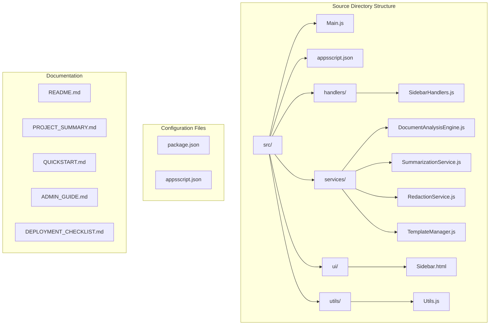
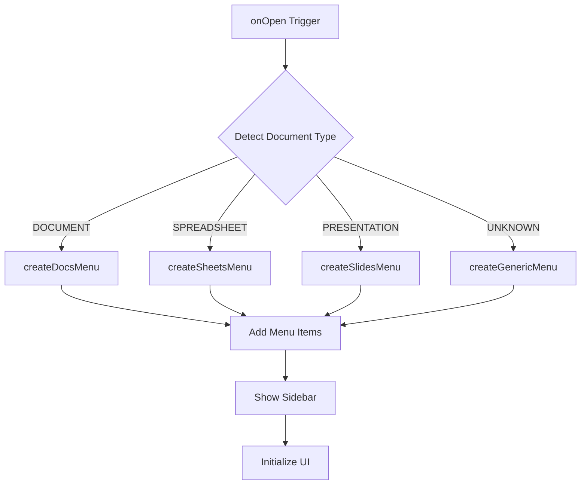
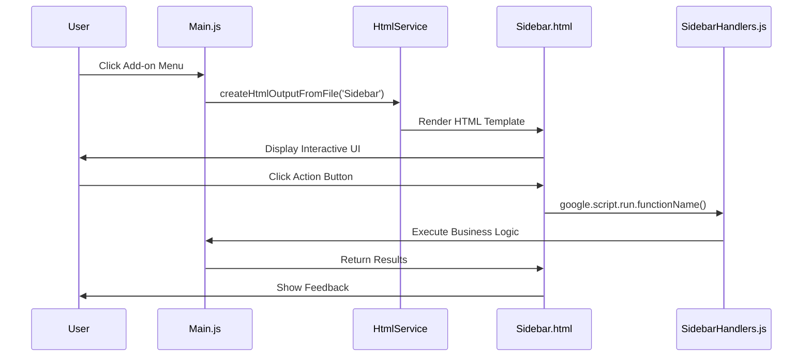
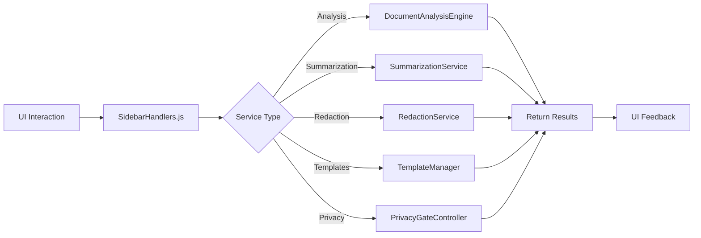
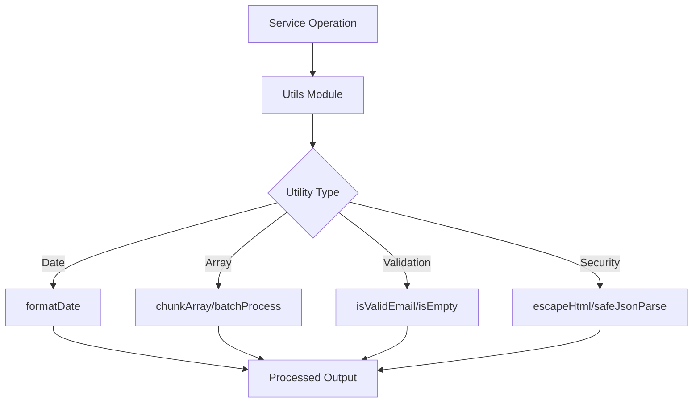
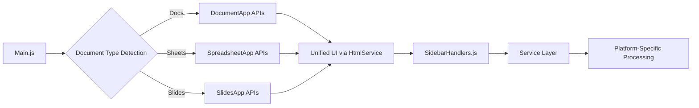
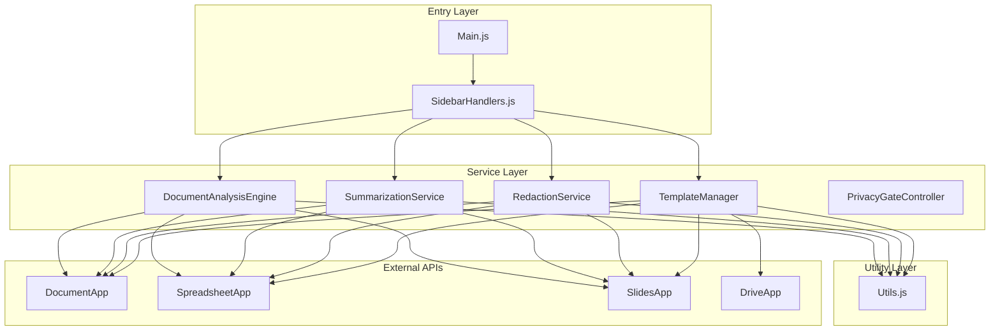

# File Structure Reference

<cite>
**Referenced Files in This Document**
- [src/Main.js](file://src/Main.js)
- [src/appsscript.json](file://src/appsscript.json)
- [src/handlers/SidebarHandlers.js](file://src/handlers/SidebarHandlers.js)
- [src/ui/Sidebar.html](file://src/ui/Sidebar.html)
- [src/services/DocumentAnalysisEngine.js](file://src/services/DocumentAnalysisEngine.js)
- [src/services/SummarizationService.js](file://src/services/SummarizationService.js)
- [src/services/RedactionService.js](file://src/services/RedactionService.js)
- [src/services/TemplateManager.js](file://src/services/TemplateManager.js)
- [src/utils/Utils.js](file://src/utils/Utils.js)
- [package.json](file://package.json)
- [README.md](file://README.md)
</cite>

## Table of Contents
1. [Introduction](#introduction)
2. [Repository Structure Overview](#repository-structure-overview)
3. [Core Entry Point - Main.js](#core-entry-point---mainjs)
4. [UI Layer - Sidebar and HTML Templates](#ui-layer---sidebar-and-html-templates)
5. [Handler Layer - SidebarHandlers.js](#handler-layer---sidebarhandlersjs)
6. [Service Layer Architecture](#service-layer-architecture)
7. [Utility Functions](#utility-functions)
8. [Configuration Files](#configuration-files)
9. [Integration Points](#integration-points)
10. [Component Relationships](#component-relationships)
11. [Deployment Configuration](#deployment-configuration)

## Introduction

The Intelligent Document Automation Google Workspace Add-on is structured as a modular, service-oriented architecture that leverages Google Apps Script's capabilities to provide automated document processing across Google Docs, Sheets, and Slides. The project follows a clear separation of concerns with distinct layers for UI, business logic, and data processing.

This documentation provides a comprehensive overview of the file structure, explaining the purpose and relationships between each component in the Google Workspace Add-on ecosystem.

## Repository Structure Overview

The project follows a well-organized structure that separates concerns across different directories:

**Diagram sources**
- [src/Main.js](file://src/Main.js#L1-L50)
- [src/appsscript.json](file://src/appsscript.json#L1-L47)
- [src/handlers/SidebarHandlers.js](file://src/handlers/SidebarHandlers.js#L1-L20)
- [src/services/DocumentAnalysisEngine.js](file://src/services/DocumentAnalysisEngine.js#L1-L50)

**Section sources**
- [src/Main.js](file://src/Main.js#L1-L100)
- [src/appsscript.json](file://src/appsscript.json#L1-L47)

## Core Entry Point - Main.js

The [`Main.js`](file://src/Main.js) file serves as the primary entry point for the Google Workspace Add-on, handling installation events, menu creation, and UI initialization across all supported Google Workspace applications.

### Key Responsibilities

**Installation and Initialization**
- Handles `onInstall()` and `onOpen()` triggers for add-on lifecycle management
- Detects the current Google Workspace application type (Docs, Sheets, or Slides)
- Creates application-specific menus with contextual actions

**Menu Management**
- Dynamically generates menus based on document type
- Provides unified access to all add-on features through a consistent interface
- Supports fallback menus for unsupported document types

**UI Management**
- Implements the sidebar opening mechanism
- Coordinates with Google Apps Script's UI framework
- Handles cross-application UI consistency

### Architecture Pattern

The Main.js follows a factory pattern for menu creation, with specialized functions for each Google Workspace application:

**Diagram sources**
- [src/Main.js](file://src/Main.js#L19-L120)

**Section sources**
- [src/Main.js](file://src/Main.js#L1-L200)

## UI Layer - Sidebar and HTML Templates

The UI layer consists of HTML templates and JavaScript handlers that provide the user interface for the add-on's interactive features.

### Sidebar.html Structure

The [`Sidebar.html`](file://src/ui/Sidebar.html) file defines the main user interface with a tabbed layout:

**UI Architecture**
- **Responsive Design**: Adapts to different screen sizes and device orientations
- **Tabbed Interface**: Organized into logical sections (Analyze, Redact, Clean, Templates)
- **Interactive Elements**: Real-time feedback and progress indicators
- **CSS Styling**: Modern Material Design-inspired styling with animations

**Component Breakdown**

| Tab | Purpose | Key Features |
|-----|---------|--------------|
| Analyze | Document analysis and summarization | Issue detection, suggestions, summary generation |
| Redact | Privacy protection | PII detection, redaction, custom patterns |
| Clean | Data cleanup operations | Duplicate removal, formatting standardization |
| Templates | Template management | Built-in templates, custom libraries |

### HTML Service Integration

The UI leverages Google Apps Script's HtmlService to render web-based interfaces within Google Workspace applications:

**Diagram sources**
- [src/Main.js](file://src/Main.js#L152-L161)
- [src/ui/Sidebar.html](file://src/ui/Sidebar.html#L306-L493)

**Section sources**
- [src/ui/Sidebar.html](file://src/ui/Sidebar.html#L1-L493)

## Handler Layer - SidebarHandlers.js

The [`SidebarHandlers.js`](file://src/handlers/SidebarHandlers.js) file acts as the bridge between the UI and business logic, handling all user interactions and coordinating service operations.

### Handler Architecture

**Function Categories**
- **Document Analysis**: Coordinate with DocumentAnalysisEngine for issue detection
- **Content Processing**: Manage summarization, redaction, and cleanup operations  
- **Template Management**: Handle template browsing and application
- **Privacy Controls**: Manage consent and privacy settings

**Error Handling Strategy**
- Centralized error catching with meaningful user feedback
- Graceful degradation when services are unavailable
- Logging for debugging and monitoring

### Service Coordination Pattern

**Diagram sources**
- [src/handlers/SidebarHandlers.js](file://src/handlers/SidebarHandlers.js#L10-L172)

**Section sources**
- [src/handlers/SidebarHandlers.js](file://src/handlers/SidebarHandlers.js#L1-L172)

## Service Layer Architecture

The service layer contains specialized modules that encapsulate business logic for different functional areas.

### DocumentAnalysisEngine.js

The [`DocumentAnalysisEngine.js`](file://src/services/DocumentAnalysisEngine.js) provides comprehensive document analysis capabilities with platform-specific implementations:

**Cross-Platform Analysis**
- **Google Docs**: Paragraph-level analysis, heading consistency, formatting issues
- **Google Sheets**: Data quality checks, duplicate detection, format standardization
- **Google Slides**: Layout consistency, text density analysis, slide structure

**Analysis Categories**
- **Formatting Issues**: Multiple spaces, punctuation spacing, capitalization errors
- **Data Quality**: Duplicates, mixed data types, empty cells
- **Structural Problems**: Long paragraphs, inconsistent lists, missing elements

### SummarizationService.js

The [`SummarizationService.js`](file://src/services/SummarizationService.js) offers intelligent document summarization with fallback mechanisms:

**Processing Strategy**
1. **AI Processing**: Uses external AI services when configured
2. **Local Processing**: Built-in extractive summarization for immediate results
3. **Fallback Processing**: Truncated summaries for large documents

**Summarization Methods**
- **Extractive Summarization**: Based on keyword frequency and sentence position
- **AI Integration**: Optional advanced processing with configurable backends
- **Content Adaptation**: Different algorithms for different document types

### RedactionService.js

The [`RedactionService.js`](file://src/services/RedactionService.js) provides comprehensive privacy protection with customizable patterns:

**PII Detection Patterns**
- Email addresses, phone numbers, Social Security Numbers
- Credit card numbers, IP addresses, ZIP codes
- Custom pattern support for organization-specific identifiers

**Privacy Compliance**
- Consent-based processing for sensitive operations
- Configurable redaction patterns
- Audit trail for redaction operations

### TemplateManager.js

The [`TemplateManager.js`](file://src/services/TemplateManager.js) manages document templating with both built-in and custom template support:

**Template Types**
- **Built-in Templates**: Pre-configured templates for common use cases
- **Custom Templates**: Integration with Google Drive for personal templates
- **Dynamic Application**: Automatic adaptation to document type

**Template Categories**
- **Education**: Grading rubrics, academic templates
- **Business**: Professional documents, presentations
- **Legal**: Contracts, agreements, formal documents

**Section sources**
- [src/services/DocumentAnalysisEngine.js](file://src/services/DocumentAnalysisEngine.js#L1-L200)
- [src/services/SummarizationService.js](file://src/services/SummarizationService.js#L1-L150)
- [src/services/RedactionService.js](file://src/services/RedactionService.js#L1-L200)
- [src/services/TemplateManager.js](file://src/services/TemplateManager.js#L1-L200)

## Utility Functions

The [`Utils.js`](file://src/utils/Utils.js) file provides essential helper functions used throughout the application:

### Core Utility Categories

**Date and Time Management**
- Flexible date formatting with multiple patterns
- Time measurement for performance monitoring
- Timezone-aware operations

**Data Processing**
- Array manipulation utilities (chunking, batching)
- JSON parsing with error handling
- String manipulation and sanitization

**Validation and Safety**
- Input validation and type checking
- XSS prevention through HTML escaping
- Email format validation

**Performance Optimization**
- Debouncing for UI responsiveness
- Retry mechanisms with exponential backoff
- Batch processing for large datasets

### Utility Usage Patterns

**Diagram sources**
- [src/utils/Utils.js](file://src/utils/Utils.js#L1-L258)

**Section sources**
- [src/utils/Utils.js](file://src/utils/Utils.js#L1-L258)

## Configuration Files

### appsscript.json

The [`appsscript.json`](file://src/appsscript.json) file defines the add-on's metadata and Google Workspace integration:

**Key Configuration Areas**
- **OAuth Scopes**: Minimal permissions for document access
- **Advanced Services**: Integration with Drive, Sheets, Docs, and Slides APIs
- **Add-on Metadata**: Name, logo, branding, and localization settings
- **Runtime Configuration**: V8 runtime and exception logging

**Security Configuration**
- Document-specific scopes (`documents.currentonly`, `spreadsheets.currentonly`)
- UI container access for seamless integration
- Drive file access for template management

### package.json

The [`package.json`](file://package.json) file provides development and deployment configuration:

**Development Scripts**
- `push`: Deploy code to Google Apps Script
- `deploy`: Create new deployment versions
- `open`: Open project in Apps Script editor
- `login`: Authenticate with Google Cloud Platform

**Project Metadata**
- Version management and semantic versioning
- Dependencies for development workflow
- Author and licensing information

**Section sources**
- [src/appsscript.json](file://src/appsscript.json#L1-L47)
- [package.json](file://package.json#L1-L25)

## Integration Points

### Google Apps Script Integration

The add-on integrates deeply with Google Apps Script's ecosystem:

**Trigger System**
- Install triggers for initial setup
- Open triggers for menu creation
- Custom functions for UI callbacks

**Service Integration**
- DocumentApp for document manipulation
- SpreadsheetApp for spreadsheet operations
- SlidesApp for presentation editing
- DriveApp for file management

### Cross-Application Compatibility

The architecture ensures consistent functionality across all supported Google Workspace applications:

**Diagram sources**
- [src/Main.js](file://src/Main.js#L707-L730)

## Component Relationships

### Dependency Graph

The services maintain loose coupling through well-defined interfaces:

**Diagram sources**
- [src/Main.js](file://src/Main.js#L1-L50)
- [src/handlers/SidebarHandlers.js](file://src/handlers/SidebarHandlers.js#L1-L50)
- [src/services/DocumentAnalysisEngine.js](file://src/services/DocumentAnalysisEngine.js#L1-L50)

### Communication Patterns

**Event-Driven Architecture**
- UI interactions trigger handler functions
- Handlers coordinate service operations
- Services return results through callback mechanisms

**Error Propagation**
- Centralized error handling in handlers
- Graceful degradation for service failures
- User-friendly error messages

**Data Flow**
- Input validation through utility functions
- Service-specific processing logic
- Result formatting for UI presentation

**Section sources**
- [src/Main.js](file://src/Main.js#L1-L300)
- [src/handlers/SidebarHandlers.js](file://src/handlers/SidebarHandlers.js#L1-L172)

## Deployment Configuration

### Google Workspace Marketplace Integration

The add-on is designed for marketplace distribution with proper configuration:

**Deployment Requirements**
- Proper OAuth consent screens
- Domain verification for enterprise deployment
- Security scanning compliance

**Version Management**
- Semantic versioning for updates
- Rollback capabilities for problematic releases
- Gradual rollout strategies

### Development Workflow

The project supports modern development practices:

**Version Control**
- Git-based source control
- Branch-based feature development
- Pull request workflows

**Continuous Integration**
- Automated testing capabilities
- Deployment pipeline integration
- Quality assurance checks

**Section sources**
- [README.md](file://README.md#L44-L115)
- [package.json](file://package.json#L6-L11)