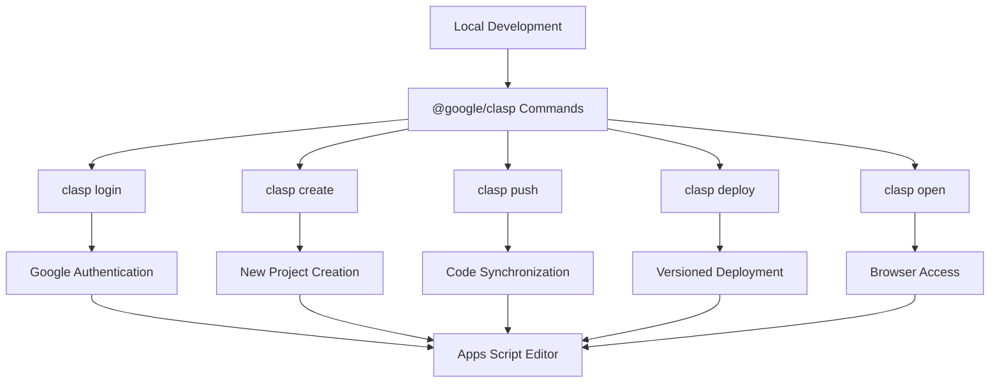
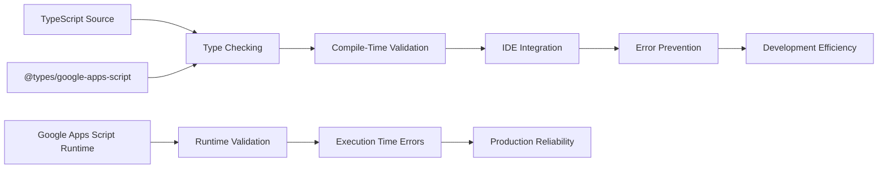
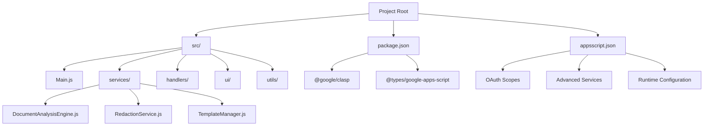
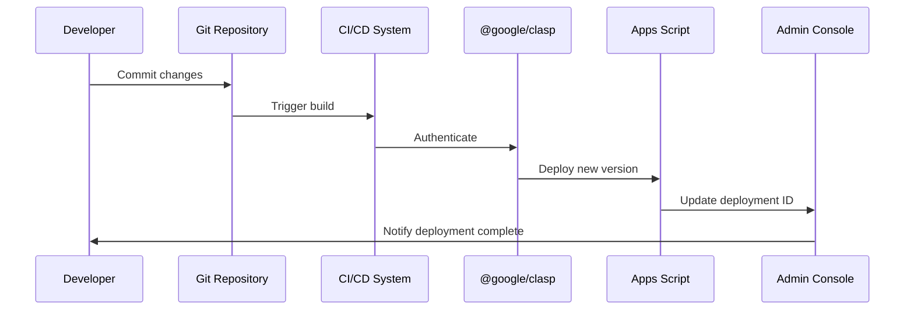
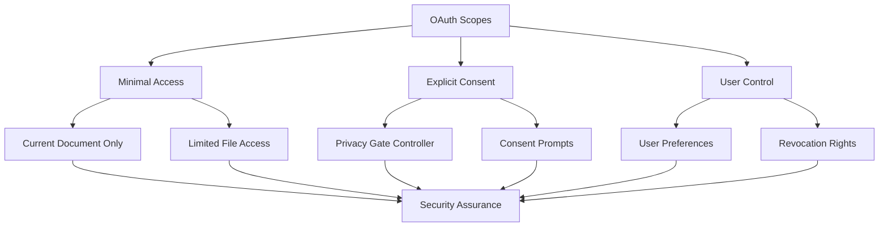

# Third-Party Dependencies

<cite>
**Referenced Files in This Document**
- [package.json](file://package.json)
- [appsscript.json](file://appsscript.json)
- [src/appsscript.json](file://src/appsscript.json)
- [src/Main.js](file://src/Main.js)
- [src/services/TemplateManager.js](file://src/services/TemplateManager.js)
- [src/ui/Sidebar.html](file://src/ui/Sidebar.html)
- [README.md](file://README.md)
- [QUICKSTART.md](file://QUICKSTART.md)
- [ADMIN_GUIDE.md](file://ADMIN_GUIDE.md)
- [DEPLOYMENT_CHECKLIST.md](file://DEPLOYMENT_CHECKLIST.md)
</cite>

## Table of Contents
1. [Introduction](#introduction)
2. [Core Dependencies Overview](#core-dependencies-overview)
3. [@google/clasp - Deployment Tool](#google-clasp---deployment-tool)
4. [@types/google-apps-script - TypeScript Definitions](#typesgoogle-apps-script---typescript-definitions)
5. [Integration with Local Development Workflow](#integration-with-local-development-workflow)
6. [CI/CD and Deployment Processes](#cicd-and-deployment-processes)
7. [Version Compatibility and Management](#version-compatibility-and-management)
8. [Common Dependency Issues and Solutions](#common-dependency-issues-and-solutions)
9. [Security Considerations](#security-considerations)
10. [Best Practices](#best-practices)

## Introduction

The Intelligent Document Automation add-on for Google Workspace relies on two critical third-party dependencies that form the foundation of its development and deployment ecosystem. These dependencies enable seamless development workflows, type safety, and efficient deployment processes while maintaining security and compatibility standards.

This documentation covers the essential third-party dependencies used in the project, focusing on their roles, configurations, and integration patterns within the Google Apps Script ecosystem.

## Core Dependencies Overview

The project utilizes two primary third-party dependencies:

### Primary Dependencies

| Dependency | Purpose | Version | Role |
|------------|---------|---------|------|
| `@google/clasp` | Google Apps Script CLI tool | ^2.4.2 | Deployment, development workflow |
| `@types/google-apps-script` | TypeScript definitions | ^1.0.83 | Type checking, IDE support |

### Advanced Services Integration

The project also integrates with Google's Advanced Services through the Apps Script manifest:

| Service | Version | Purpose |
|---------|---------|---------|
| Drive API | v3 | File operations, template management |
| Sheets API | v4 | Spreadsheet manipulation |
| Docs API | v1 | Document processing |
| Slides API | v1 | Presentation handling |

**Section sources**
- [package.json](file://package.json#L20-L23)
- [appsscript.json](file://appsscript.json#L3-L25)
- [src/appsscript.json](file://src/appsscript.json#L3-L25)

## @google/clasp - Deployment Tool

### Overview and Purpose

`@google/clasp` serves as the primary deployment and development tool for Google Apps Script projects. It provides a command-line interface that bridges the gap between local development environments and Google's Apps Script platform.

### Key Capabilities

#### Development Workflow Integration
- **Project Creation**: Automated project initialization with proper manifest configuration
- **Code Synchronization**: Bidirectional sync between local files and Apps Script project
- **Deployment Management**: Versioned deployments with descriptive release notes
- **Authentication**: Secure OAuth-based authentication with Google accounts

#### Command-Line Operations



**Diagram sources**
- [package.json](file://package.json#L7-L10)
- [README.md](file://README.md#L58-L73)

### Installation and Setup

#### Global Installation
```bash
npm install -g @google/clasp
```

#### Authentication Process
```bash
# Login to Google account
clasp login

# Verify authentication
clasp whoami
```

#### Project Initialization
```bash
# Create new standalone project
clasp create --type standalone --title "Intelligent Document Automation"

# Clone existing project
clasp clone <SCRIPT_ID>
```

### Development Scripts Integration

The project defines several npm scripts that leverage clasp for streamlined development:

| Script | Command | Purpose |
|--------|---------|---------|
| `npm run push` | `clasp push` | Deploy local changes to Apps Script |
| `npm run deploy` | `clasp deploy` | Create new production deployment |
| `npm run open` | `clasp open` | Open project in Apps Script editor |
| `npm run login` | `clasp login` | Authenticate with Google |

### Advanced Clasp Features

#### Watch Mode for Development
```bash
# Auto-push changes on file modification
clasp push --watch
```

#### Logging and Debugging
```bash
# View execution logs
clasp logs

# View last 100 log entries
clasp logs --json
```

#### Branch Management
```bash
# Create branch for feature development
clasp push --branch feature/new-feature

# Deploy from specific branch
clasp deploy --branch feature/new-feature
```

**Section sources**
- [package.json](file://package.json#L7-L10)
- [README.md](file://README.md#L58-L73)
- [QUICKSTART.md](file://QUICKSTART.md#L48-L62)

## @types/google-apps-script - TypeScript Definitions

### Purpose and Benefits

The `@types/google-apps-script` package provides comprehensive TypeScript definitions for Google Apps Script APIs, enabling:

- **Type Safety**: Compile-time error detection for API usage
- **IDE Support**: Enhanced IntelliSense and code completion
- **Refactoring Confidence**: Safe code modifications with type checking
- **Documentation**: Inline API documentation through type definitions

### Integration with Google Apps Script

#### Automatic Type Availability
Google Apps Script automatically recognizes and utilizes the TypeScript definitions provided by this package. The definitions cover:

- **Core Apps Script APIs**: DocumentApp, SpreadsheetApp, SlidesApp
- **Advanced Services**: Drive, Sheets, Docs, Slides APIs
- **Utility Classes**: PropertiesService, Logger, HtmlService
- **Event Objects**: Trigger and authorization events

#### Type Checking Benefits



**Diagram sources**
- [package.json](file://package.json#L22)
- [src/Main.js](file://src/Main.js#L133-L146)

### Version Compatibility

#### Current Version: ^1.0.83
The project uses TypeScript definitions compatible with Google Apps Script's V8 runtime and latest API features.

#### Compatibility Matrix

| Google Apps Script Feature | TypeScript Definition Coverage | Status |
|----------------------------|--------------------------------|--------|
| Core APIs | Complete | ✅ Supported |
| Advanced Services | Partial | ⚠️ Limited |
| Event Objects | Complete | ✅ Supported |
| Properties Service | Complete | ✅ Supported |
| HTML Service | Complete | ✅ Supported |

### IDE Integration Benefits

#### Enhanced Development Experience
- **IntelliSense**: Automatic code completion for Apps Script APIs
- **Type Validation**: Real-time type checking during development
- **Documentation**: Inline API documentation pop-ups
- **Refactoring**: Safe code refactoring with type preservation

#### Example Usage Patterns

The TypeScript definitions enable sophisticated development patterns:

```javascript
// Type-safe property access
const userProps = PropertiesService.getUserProperties();
const value = userProps.getProperty('key'); // TypeScript knows return type

// Event-driven programming with typed triggers
function onEdit(e: GoogleAppsScript.Events.SheetsOnEditTriggerSource) {
  const range = e.range;
  // TypeScript provides autocomplete for range methods
}
```

**Section sources**
- [package.json](file://package.json#L22)
- [src/Main.js](file://src/Main.js#L133-L146)

## Integration with Local Development Workflow

### Project Structure and Dependency Management

The project organizes dependencies and development assets in a structured manner:



**Diagram sources**
- [package.json](file://package.json#L1-L24)
- [src/appsscript.json](file://src/appsscript.json#L1-L47)

### Development Environment Setup

#### Prerequisites
1. **Node.js**: Required for npm and clasp
2. **npm**: Package manager for dependencies
3. **@google/clasp**: Google Apps Script CLI tool
4. **@types/google-apps-script**: TypeScript definitions

#### Setup Process

```bash
# 1. Clone repository
git clone https://github.com/AayushBhat07/intelligent-document-automation.git
cd intelligent-document-automation

# 2. Install dependencies
npm install

# 3. Login to Google
clasp login

# 4. Create new Apps Script project
clasp create --type standalone --title "Intelligent Document Automation"

# 5. Push initial code
clasp push

# 6. Open in browser
clasp open
```

### File Synchronization Strategy

#### Local-to-Remote Sync
- **Push Operation**: Uploads local JavaScript files to Apps Script project
- **Pull Operation**: Downloads remote changes to local files
- **Watch Mode**: Continuous monitoring for file changes with auto-push

#### Conflict Resolution
- **Merge Strategies**: Manual conflict resolution for complex changes
- **Backup Systems**: Automatic versioning through Apps Script deployments
- **Rollback Capability**: Easy reversion to previous deployments

**Section sources**
- [QUICKSTART.md](file://QUICKSTART.md#L40-L62)
- [README.md](file://README.md#L285-L301)

## CI/CD and Deployment Processes

### Automated Deployment Pipeline

The project supports automated deployment through various CI/CD platforms:



**Diagram sources**
- [ADMIN_GUIDE.md](file://ADMIN_GUIDE.md#L96-L107)
- [DEPLOYMENT_CHECKLIST.md](file://DEPLOYMENT_CHECKLIST.md#L50-L69)

### Deployment Strategies

#### Development Deployment
```bash
# Create development deployment
clasp deploy --description "Development build"

# Test in isolated environment
clasp deploy --version 1 --description "Test deployment"
```

#### Production Deployment
```bash
# Create production deployment
clasp deploy --description "v1.0.0 - Production Release"

# Note deployment ID for domain-wide installation
```

#### Staged Rollout
```bash
# Deploy to small user group first
clasp deploy --description "Beta release for pilot users"

# Monitor and promote to larger audience
clasp deploy --description "Production rollout"
```

### Quality Assurance Integration

#### Pre-deployment Checks
- **Type Validation**: TypeScript compilation verification
- **Linting**: Code quality enforcement
- **Testing**: Unit test execution (if applicable)
- **Security Scan**: OAuth scope validation

#### Post-deployment Verification
- **Functionality Testing**: Core feature validation
- **Performance Monitoring**: Execution time tracking
- **Error Rate Monitoring**: Exception tracking
- **User Feedback Collection**: Usage analytics

**Section sources**
- [ADMIN_GUIDE.md](file://ADMIN_GUIDE.md#L96-L107)
- [DEPLOYMENT_CHECKLIST.md](file://DEPLOYMENT_CHECKLIST.md#L50-L69)

## Version Compatibility and Management

### Dependency Version Strategy

#### Current Versions
- **@google/clasp**: ^2.4.2 (latest stable)
- **@types/google-apps-script**: ^1.0.83 (latest definitions)

#### Compatibility Matrix

| Component | Version | Compatibility | Notes |
|-----------|---------|---------------|-------|
| Google Apps Script | V8 Runtime | ✅ Full Support | Latest features enabled |
| TypeScript | 4.x+ | ✅ Compatible | Full definition coverage |
| Node.js | 16.x+ | ✅ Supported | For development tools |
| npm | 8.x+ | ✅ Compatible | Package management |

### Version Management Best Practices

#### Semantic Versioning
The project follows semantic versioning principles:
- **Major versions**: Breaking changes requiring migration
- **Minor versions**: New features with backward compatibility
- **Patch versions**: Bug fixes and minor improvements

#### Dependency Updates
```bash
# Check for updates
npm outdated

# Update dependencies
npm update @google/clasp @types/google-apps-script

# Install specific versions
npm install @google/clasp@^2.4.2 @types/google-apps-script@^1.0.83
```

### Migration Strategies

#### Breaking Change Management
- **Gradual Migration**: Phased adoption of new features
- **Backward Compatibility**: Maintaining API stability
- **Migration Guides**: Clear documentation for breaking changes
- **Testing Prototypes**: Preview new features in development

**Section sources**
- [package.json](file://package.json#L20-L23)
- [README.md](file://README.md#L271-L278)

## Common Dependency Issues and Solutions

### Authentication Problems

#### Issue: "Authorization required" Errors
**Symptoms**: Users receive authorization prompts despite having permissions
**Causes**: 
- Expired OAuth tokens
- Insufficient permissions
- Domain policy restrictions

**Solutions**:
```bash
# Re-authenticate
clasp logout
clasp login

# Verify permissions
clasp status

# Check OAuth scopes in Apps Script
# Go to script.google.com → Project Settings → OAuth Scopes
```

#### Issue: "Invalid client" Errors
**Symptoms**: Authentication fails with client validation errors
**Causes**:
- Outdated clasp version
- Google account restrictions
- Network connectivity issues

**Solutions**:
```bash
# Update clasp
npm install -g @google/clasp@latest

# Check network connectivity
ping script.google.com

# Reset Google account settings
# Go to Google Account → Security → Manage third-party access
```

### Type Definition Issues

#### Issue: "Cannot find module" Errors
**Symptoms**: TypeScript compiler complains about missing definitions
**Causes**:
- Missing @types/google-apps-script package
- Version mismatches
- Incorrect TypeScript configuration

**Solutions**:
```bash
# Install correct version
npm install @types/google-apps-script@^1.0.83

# Verify TypeScript configuration
# Check tsconfig.json for proper compiler options
```

#### Issue: "Property does not exist" Errors
**Symptoms**: TypeScript reports undefined properties
**Causes**:
- Outdated type definitions
- API changes not reflected in definitions
- Incorrect type assertions

**Solutions**:
```javascript
// Use type assertions for known APIs
const doc = DocumentApp.getActiveDocument() as GoogleAppsScript.Documents.Document;

// Check for API availability
if (typeof SomeApi !== 'undefined') {
  // Use safely
}
```

### Deployment Issues

#### Issue: "Project not found" Errors
**Symptoms**: Deployment fails with project identification errors
**Causes**:
- Incorrect script ID
- Deleted or moved project
- Permission issues

**Solutions**:
```bash
# Verify project ID
clasp list

# Clone correct project
clasp clone <CORRECT_SCRIPT_ID>

# Check permissions
clasp status
```

#### Issue: "Quota exceeded" Errors
**Symptoms**: Deployment fails due to API limits
**Causes**:
- Excessive API calls
- Rate limiting
- Resource constraints

**Solutions**:
```bash
# Reduce API calls
clasp push --force

# Wait for quota reset
sleep 3600

# Upgrade Google Workspace account for higher limits
```

### Performance Issues

#### Issue: Slow Deployment Times
**Symptoms**: Long delays during push/deploy operations
**Causes**:
- Large file sizes
- Network latency
- Concurrent operations

**Solutions**:
```bash
# Optimize file structure
# Minimize file sizes and dependencies

# Use watch mode for development
clasp push --watch

# Deploy incrementally
clasp push --files "src/Main.js"
```

**Section sources**
- [README.md](file://README.md#L225-L246)
- [ADMIN_GUIDE.md](file://ADMIN_GUIDE.md#L278-L294)

## Security Considerations

### OAuth Scope Management

The project requests minimal OAuth scopes to ensure user privacy and security:

#### Requested Scopes
- **`documents.currentonly`**: Access to current Google Doc only
- **`spreadsheets.currentonly`**: Access to current Google Sheet only
- **`presentations.currentonly`**: Access to current Google Slide only
- **`drive.file`**: Access only to files created by the add-on
- **`script.container.ui`**: Display sidebar interface
- **`userinfo.email`**: Access to user email for analytics

#### Security Best Practices



**Diagram sources**
- [src/services/TemplateManager.js](file://src/services/TemplateManager.js#L50-L61)
- [src/appsscript.json](file://src/appsscript.json#L29-L36)

### Data Privacy and Protection

#### Local Processing Guarantees
- **No External API Calls**: All processing occurs within Google Apps Script runtime
- **No Data Transmission**: User documents never leave Google's infrastructure
- **Local Storage**: All data processed and stored locally

#### Privacy Controls
```javascript
// Privacy Gate Controller implementation
const granted = PrivacyGateController.requestConsent(
  'templateSharing',
  'Access template library from Google Drive'
);

if (!granted) {
  return {
    success: false,
    message: 'Template access requires Drive permission'
  };
}
```

### External Dependencies Security

#### Dependency Verification
- **Package Integrity**: Verify npm packages through checksums
- **Supply Chain Security**: Monitor dependency vulnerabilities
- **Regular Updates**: Keep dependencies current with security patches

#### Security Monitoring
```bash
# Check for vulnerabilities
npm audit

# Update vulnerable packages
npm audit fix

# Review dependency tree
npm ls --depth=0
```

### Administrative Security

#### Domain-Wide Deployment Security
- **OAuth Consent Screen**: Properly configured for organizational use
- **API Restrictions**: Limited to necessary Google APIs
- **Monitoring**: Regular security audits and log reviews

#### Access Control
- **Principle of Least Privilege**: Minimal permissions requested
- **User Consent**: Explicit approval for sensitive operations
- **Audit Trails**: Comprehensive logging of sensitive actions

**Section sources**
- [src/services/TemplateManager.js](file://src/services/TemplateManager.js#L50-L61)
- [src/appsscript.json](file://src/appsscript.json#L29-L36)
- [ADMIN_GUIDE.md](file://ADMIN_GUIDE.md#L207-L228)

## Best Practices

### Development Workflow Optimization

#### Efficient Development Practices
1. **Use Watch Mode**: Enable continuous development with `clasp push --watch`
2. **Incremental Deployment**: Deploy small changes frequently
3. **Version Control**: Maintain clean commit history
4. **Testing Strategy**: Implement comprehensive testing approaches

#### Code Organization
```javascript
// Modular architecture pattern
const IntelligentDocumentAutomation = (() => {
  // Core functionality
  const Core = {
    // Utility functions
  };
  
  // Service layer
  const Services = {
    // Business logic
  };
  
  // UI handlers
  const Handlers = {
    // Event handlers
  };
  
  return {
    // Public API
  };
})();
```

### Performance Optimization

#### Resource Management
- **Memory Usage**: Monitor and optimize memory consumption
- **Execution Time**: Keep operations within Google Apps Script limits
- **API Calls**: Minimize external API calls and optimize batch operations

#### Caching Strategies
```javascript
// Implement caching for expensive operations
const cache = CacheService.getScriptCache();

function getCachedData(key) {
  const cached = cache.get(key);
  if (cached) return JSON.parse(cached);
  
  const data = expensiveOperation();
  cache.put(key, JSON.stringify(data), 3600); // Cache for 1 hour
  return data;
}
```

### Maintenance and Updates

#### Regular Maintenance Tasks
1. **Dependency Updates**: Regularly update npm packages
2. **Security Audits**: Review OAuth scopes and permissions
3. **Performance Monitoring**: Track execution metrics
4. **User Feedback**: Implement feedback collection systems

#### Documentation Standards
- **Code Comments**: Document complex algorithms and business logic
- **API Documentation**: Maintain up-to-date API references
- **Troubleshooting Guides**: Comprehensive error resolution documentation

### Team Collaboration

#### Development Standards
- **Code Reviews**: Implement mandatory peer review process
- **Testing Requirements**: Ensure comprehensive test coverage
- **Documentation**: Maintain living documentation standards
- **Communication**: Establish clear communication protocols

#### Deployment Procedures
- **Staging Environment**: Use separate environment for testing
- **Rollback Plans**: Maintain clear rollback procedures
- **Monitoring**: Implement comprehensive monitoring systems
- **Incident Response**: Establish incident response protocols

**Section sources**
- [DEPLOYMENT_CHECKLIST.md](file://DEPLOYMENT_CHECKLIST.md#L174-L203)
- [ADMIN_GUIDE.md](file://ADMIN_GUIDE.md#L344-L373)