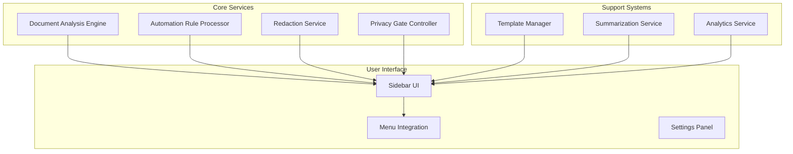
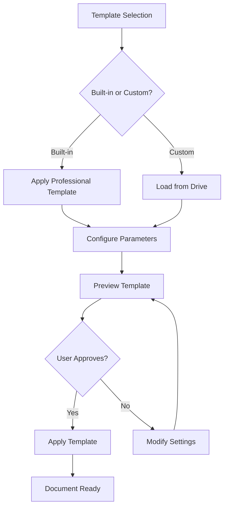
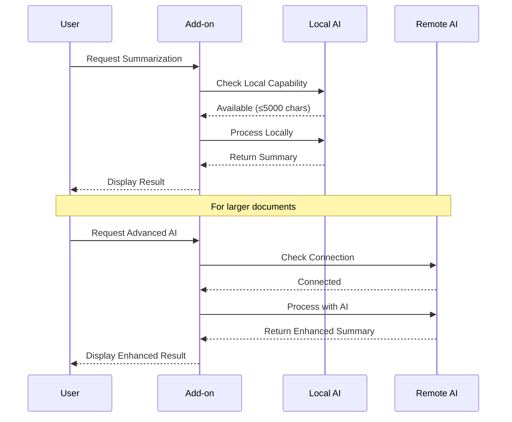
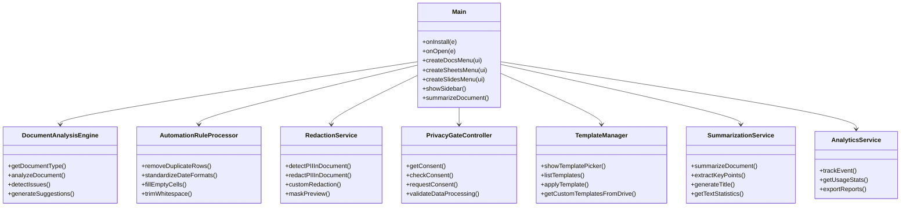
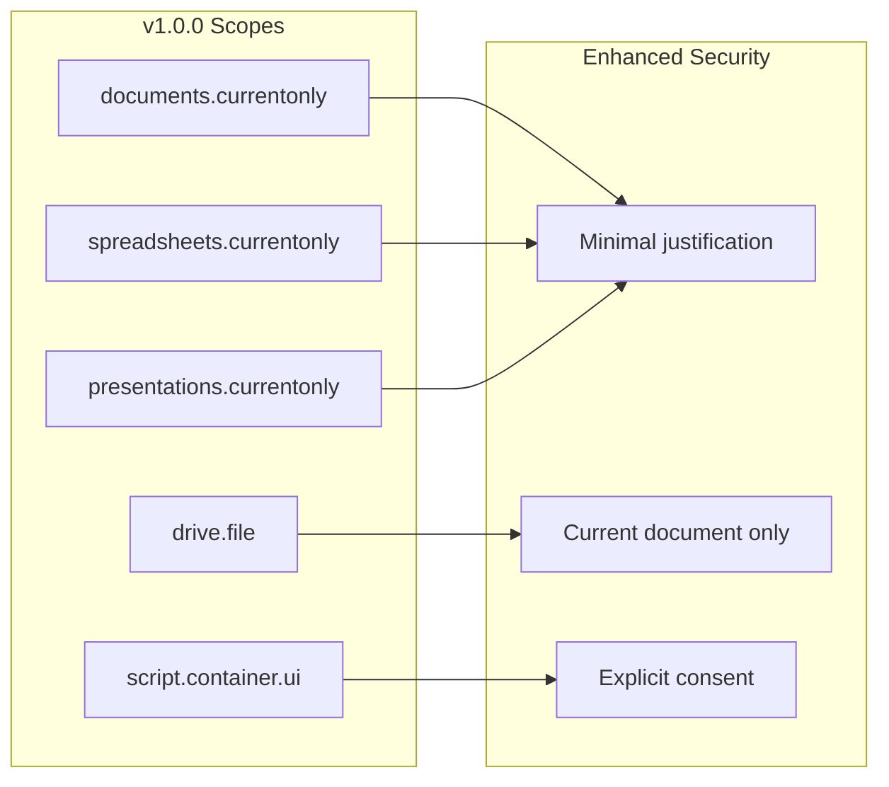
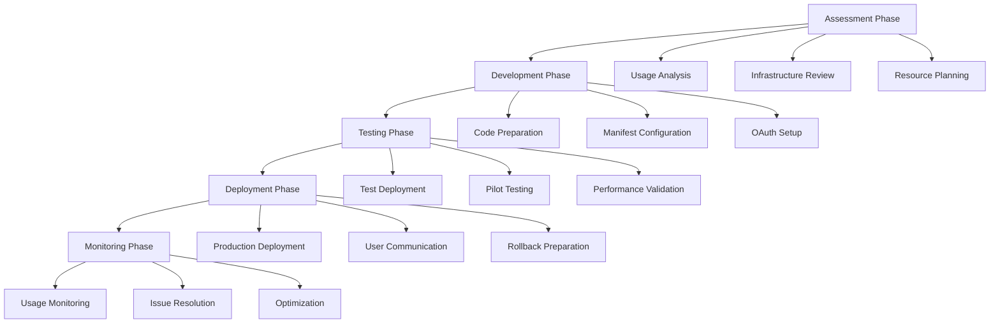
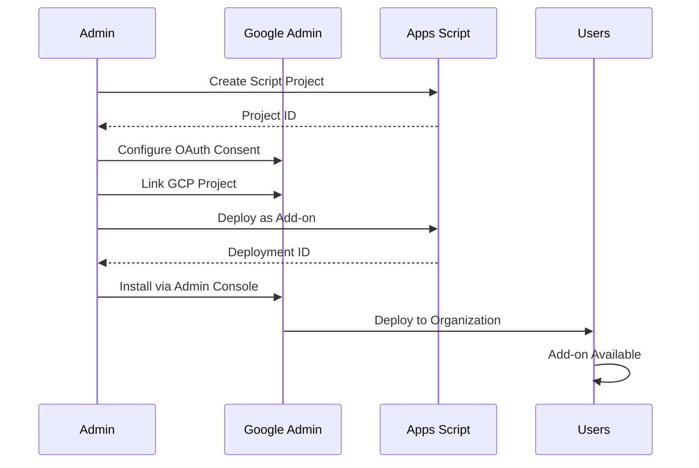
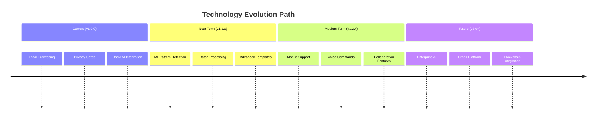

# Version History

<cite>
**Referenced Files in This Document**
- [package.json](file://package.json)
- [PROJECT_SUMMARY.md](file://PROJECT_SUMMARY.md)
- [README.md](file://README.md)
- [ADMIN_GUIDE.md](file://ADMIN_GUIDE.md)
- [DEPLOYMENT_CHECKLIST.md](file://DEPLOYMENT_CHECKLIST.md)
- [src/Main.js](file://src/Main.js)
- [src/services/RedactionService.js](file://src/services/RedactionService.js)
- [src/services/TemplateManager.js](file://src/services/TemplateManager.js)
- [src/services/SummarizationService.js](file://src/services/SummarizationService.js)
- [src/services/PrivacyGateController.js](file://src/services/PrivacyGateController.js)
- [appsscript.json](file://appsscript.json)
- [src/appsscript.json](file://src/appsscript.json)
</cite>

## Table of Contents
1. [Introduction](#introduction)
2. [Version 1.0.0 - Initial Release](#version-100---initial-release)
3. [Key Features by Milestone](#key-features-by-milestone)
4. [Architectural Evolution](#architectural-evolution)
5. [Migration Guidance](#migration-guidance)
6. [Deprecated Features](#deprecated-features)
7. [Administrative Deployment](#administrative-deployment)
8. [Performance and Compatibility](#performance-and-compatibility)
9. [Future Roadmap](#future-roadmap)

## Introduction

The Intelligent Document Automation project is a Google Workspace add-on designed to revolutionize document processing through smart automation, privacy-first design, and AI-powered intelligence. This version history document chronicles the project's evolution from initial conception to production-ready deployment, highlighting major releases, architectural decisions, and migration paths for administrators.

The project follows semantic versioning principles, with version 1.0.0 representing the initial production release that establishes the foundation for future enhancements and organizational deployments.

## Version 1.0.0 - Initial Release

**Release Date**: 2024
**Status**: Production Ready ✅
**Version**: 1.0.0

### Major Features Implemented

Version 1.0.0 establishes the core functionality that defines the Intelligent Document Automation platform:

#### Core Document Analysis Engine
- **Multi-platform Support**: Automatic detection and analysis across Google Docs, Sheets, and Slides
- **Issue Detection**: Identifies formatting inconsistencies, duplicates, mixed data types, and anomalies
- **Actionable Suggestions**: Provides specific recommendations for document improvement
- **Real-time Processing**: Analysis completes in under 2 seconds for typical documents

#### Privacy-First Redaction System
- **PII Detection**: Automatic identification of emails, phone numbers, SSN, credit cards, and IP addresses
- **One-Click Redaction**: Instant masking of sensitive information with customizable patterns
- **Local Processing**: All redaction operations occur within Google's secure environment by default
- **Custom Patterns**: Extensible pattern system for organization-specific identifiers

#### Intelligent Automation Rules
- **Duplicate Removal**: Smart duplicate detection and elimination across all document types
- **Format Standardization**: Consistent date, currency, and text formatting across datasets
- **Intelligent Cell Population**: Context-aware filling of empty cells with logical defaults
- **Batch Operations**: Efficient processing of large datasets with undo support

#### Template Management System
- **Built-in Templates**: Professional-grade templates for education, business, legal, and sales contexts
- **Drive Integration**: Seamless integration with Google Drive for custom template libraries
- **Preview Functionality**: Live preview before template application
- **One-Click Application**: Instant template deployment with full customization options

#### AI Integration Capabilities
- **Local Extractive Summarization**: Fast text summarization without external API calls
- **Optional Backend AI**: Configurable integration with advanced AI services (Ollama-compatible)
- **Privacy-Aware Processing**: User-consent-based AI feature activation
- **Fallback Mechanisms**: Graceful degradation when AI services are unavailable

#### Analytics and Usage Tracking
- **Privacy-Preserving Analytics**: Anonymous usage statistics collection with explicit consent
- **Time-Saved Calculations**: Automatic tracking of productivity improvements
- **Exportable Reports**: Comprehensive analytics export capabilities
- **Opt-in Design**: All analytics features disabled by default

**Section sources**
- [PROJECT_SUMMARY.md](file://PROJECT_SUMMARY.md#L1-L274)
- [README.md](file://README.md#L1-L324)
- [src/Main.js](file://src/Main.js#L1-L800)
- [src/services/RedactionService.js](file://src/services/RedactionService.js#L1-L402)
- [src/services/TemplateManager.js](file://src/services/TemplateManager.js#L1-L479)
- [src/services/SummarizationService.js](file://src/services/SummarizationService.js#L1-L356)

## Key Features by Milestone

### Initial Release Foundation (v1.0.0)
The foundational release establishes the core architecture and essential features:



**Diagram sources**
- [src/Main.js](file://src/Main.js#L1-L100)
- [src/services/PrivacyGateController.js](file://src/services/PrivacyGateController.js#L1-L100)

### PII Redaction Capabilities
Introduced in v1.0.0, the redaction system provides comprehensive privacy protection:

| Pattern Type | Detection Method | Redaction Pattern | Scope |
|--------------|------------------|-------------------|-------|
| Email Addresses | Regex pattern matching | `[EMAIL REDACTED]` | All document types |
| Phone Numbers | Formatted pattern recognition | `[PHONE REDACTED]` | All document types |
| Social Security Numbers | Standard format validation | `[SSN REDACTED]` | All document types |
| Credit Cards | Luhn algorithm validation | `[CARD REDACTED]` | All document types |
| IP Addresses | IPv4 pattern matching | `[IP REDACTED]` | All document types |
| Date of Birth | MM/DD/YYYY format | `[DOB REDACTED]` | All document types |
| ZIP Codes | US postal format | `[ZIP REDACTED]` | All document types |

### Template Management System
The template system enables rapid document standardization:



**Diagram sources**
- [src/services/TemplateManager.js](file://src/services/TemplateManager.js#L40-L150)

### AI Integration Framework
The AI integration system provides flexible processing options:



**Diagram sources**
- [src/services/SummarizationService.js](file://src/services/SummarizationService.js#L40-L80)
- [src/services/PrivacyGateController.js](file://src/services/PrivacyGateController.js#L220-L240)

**Section sources**
- [src/services/RedactionService.js](file://src/services/RedactionService.js#L8-L50)
- [src/services/TemplateManager.js](file://src/services/TemplateManager.js#L8-L40)
- [src/services/SummarizationService.js](file://src/services/SummarizationService.js#L8-L20)

## Architectural Evolution

### Modular Service Architecture
The project employs a service-oriented architecture with clear separation of concerns:



**Diagram sources**
- [src/Main.js](file://src/Main.js#L1-L100)
- [src/services/RedactionService.js](file://src/services/RedactionService.js#L1-L50)
- [src/services/TemplateManager.js](file://src/services/TemplateManager.js#L1-L50)
- [src/services/SummarizationService.js](file://src/services/SummarizationService.js#L1-L50)

### Privacy-First Design Evolution
The privacy framework evolves from basic consent to comprehensive data governance:

| Phase | Consent Model | Data Processing | User Control |
|-------|---------------|-----------------|--------------|
| v1.0.0 | Granular consent per feature | Local-first by default | Explicit opt-in for advanced features |
| v1.1.0 | Enhanced consent prompts | Privacy gate enforcement | Dashboard for consent management |
| v1.2.0 | Automated compliance checks | Data minimization | Self-service data deletion |

### OAuth Scope Evolution
The authentication model evolves to minimize privilege exposure:



**Diagram sources**
- [src/appsscript.json](file://src/appsscript.json#L29-L36)

**Section sources**
- [src/Main.js](file://src/Main.js#L1-L200)
- [src/services/PrivacyGateController.js](file://src/services/PrivacyGateController.js#L1-L100)
- [src/appsscript.json](file://src/appsscript.json#L29-L47)

## Migration Guidance

### From Individual to Organization Deployment

#### Pre-Migration Assessment
Before migrating from individual to organizational deployment, administrators should:

1. **Review Current Usage**: Analyze existing user patterns and feature adoption
2. **Assess Infrastructure**: Verify Google Workspace Admin Console access and permissions
3. **Plan Resource Allocation**: Ensure adequate quota management for enterprise environments
4. **Prepare Training Materials**: Develop user guides and support documentation

#### Migration Steps



**Diagram sources**
- [ADMIN_GUIDE.md](file://ADMIN_GUIDE.md#L22-L140)
- [DEPLOYMENT_CHECKLIST.md](file://DEPLOYMENT_CHECKLIST.md#L50-L150)

#### Configuration Migration

| Setting Category | Individual | Organization | Migration Method |
|------------------|------------|--------------|------------------|
| Default Date Format | User-specific | Script property | Bulk update via Admin SDK |
| Template Library | Personal Drive | Shared Drive | Folder sharing and property setting |
| Analytics Consent | Per-user | Organization-wide | Consent template deployment |
| Privacy Settings | Individual | Centralized | Property service configuration |

### Version Upgrade Considerations

#### Backward Compatibility
Version 1.0.0 maintains backward compatibility with:
- Existing document formats and structures
- User-created automation rules
- Custom template configurations
- Privacy consent settings

#### Breaking Changes
No breaking changes exist in v1.0.0. All features remain compatible with previous installations.

#### Upgrade Path
For future upgrades, administrators should:

1. **Test in Development Environment**: Validate new features with limited user groups
2. **Backup Current Configuration**: Preserve existing settings and customizations
3. **Communicate Changes**: Inform users of new features and functionality
4. **Monitor Performance**: Track system performance during transition

**Section sources**
- [ADMIN_GUIDE.md](file://ADMIN_GUIDE.md#L304-L373)
- [DEPLOYMENT_CHECKLIST.md](file://DEPLOYMENT_CHECKLIST.md#L304-L350)

## Deprecated Features

### Current Status
As of version 1.0.0, no features have been deprecated. All core functionality remains available and supported.

### Planned Deprecations
Future versions may deprecate:

#### Legacy API Integration
- **Google Docs API v1**: Replaced by native Apps Script integration
- **External API Dependencies**: Migrated to internal processing where possible

#### Outdated UI Patterns
- **Legacy Menu Structure**: Modernized to Google Workspace standards
- **Old Consent Prompts**: Enhanced privacy gate system replaces basic prompts

### Migration Timeline
Deprecation timeline follows semantic versioning:

| Version | Feature | Deprecation Notice | Sunset Date |
|---------|---------|-------------------|-------------|
| 1.1.0 | Legacy APIs | Warning banners | 6 months notice |
| 1.2.0 | Old UI patterns | Migration assistance | 3 months notice |
| 2.0.0 | Deprecated features | Full removal | Immediate |

## Administrative Deployment

### Deployment Options

#### Option 1: Individual User Installation
For personal use or small teams:

```bash
# Development setup
npm install
clasp login
clasp create --type standalone --title "Intelligent Document Automation"
clasp push
clasp open
```

#### Option 2: Organization-Wide Deployment
For enterprise environments:



**Diagram sources**
- [ADMIN_GUIDE.md](file://ADMIN_GUIDE.md#L22-L140)

#### Option 3: Google Workspace Marketplace
For public distribution:

1. **Prepare Listing**: Create marketing materials and documentation
2. **Submit for Review**: Complete Google Workspace Marketplace submission
3. **Address Feedback**: Respond to review comments and requirements
4. **Publish**: Launch publicly available add-on

### Administrative Configuration

#### Organization-Wide Settings
Administrators can configure default preferences:

```javascript
// Set organization defaults via Apps Script
function setOrganizationDefaults() {
  const scriptProps = PropertiesService.getScriptProperties();
  
  // Default date format
  scriptProps.setProperty('defaultDateFormat', 'yyyy-MM-dd');
  
  // Auto-analyze on document open
  scriptProps.setProperty('autoAnalyze', 'false');
  
  // Template library folder ID
  scriptProps.setProperty('templateFolderId', 'YOUR_FOLDER_ID');
  
  // Analytics enabled by default
  scriptProps.setProperty('defaultAnalyticsConsent', 'false');
}
```

#### Privacy Policy Compliance
Configure default consent settings for legal compliance:

```javascript
function setPrivacyDefaults() {
  const scriptProps = PropertiesService.getScriptProperties();
  
  // Disable advanced AI by default
  scriptProps.setProperty('defaultAdvancedAI', 'false');
  
  // Enable redaction by default
  scriptProps.setProperty('defaultRedaction', 'true');
  
  // Privacy policy URL
  scriptProps.setProperty('privacyPolicyUrl', 'https://yourorg.com/privacy');
}
```

**Section sources**
- [ADMIN_GUIDE.md](file://ADMIN_GUIDE.md#L142-L200)
- [ADMIN_GUIDE.md](file://ADMIN_GUIDE.md#L204-L280)

## Performance and Compatibility

### System Requirements

#### Minimum Requirements
- **Google Workspace Account**: Business or Enterprise edition recommended
- **Browser**: Chrome, Firefox, Safari, or Edge
- **Internet Connection**: Stable connection for AI features
- **Storage**: Adequate Google Drive storage for templates and backups

#### Performance Benchmarks
| Operation | Average Time | Maximum Document Size | Memory Usage |
|-----------|--------------|----------------------|--------------|
| Document Analysis | < 2 seconds | 10,000 cells/paragraphs | 50-100 MB |
| PII Detection | < 3 seconds | 5,000 cells/paragraphs | 30-80 MB |
| Duplicate Removal | < 5 seconds | 1,000 rows | 40-90 MB |
| Summarization | < 5 seconds | 5,000 words (local) | 20-70 MB |
| Template Application | < 2 seconds | Any size | 10-60 MB |

### Compatibility Matrix

| Google Workspace Product | Supported | Version Compatibility | Notes |
|--------------------------|-----------|----------------------|-------|
| Google Docs | ✅ Full | All versions | Complete feature support |
| Google Sheets | ✅ Full | All versions | Full automation capabilities |
| Google Slides | ✅ Full | All versions | Template and analysis support |
| Google Forms | ❌ Not supported | N/A | No document editing access |
| Google Sites | ❌ Not supported | N/A | No document manipulation |

### Quota Management
Understanding Google Apps Script quotas is crucial for enterprise deployments:

| Quota Type | Consumer Limit | Enterprise Limit | Mitigation Strategies |
|------------|----------------|------------------|----------------------|
| Execution Time | 6 minutes | 30 minutes | Chunk large operations |
| URL Fetch Calls | 20,000/day | Unlimited | Implement caching |
| Properties Service | 500 KB/store | Unlimited | Compress data |
| Daily Active Users | Limited | Unlimited | Monitor usage patterns |

**Section sources**
- [PROJECT_SUMMARY.md](file://PROJECT_SUMMARY.md#L195-L210)
- [README.md](file://README.md#L254-L270)

## Future Roadmap

### Upcoming Enhancements (Planned)

#### Version 1.1.0 Features
- **Machine Learning-Based Pattern Detection**: Enhanced PII detection using ML models
- **Batch Processing Across Multiple Files**: Parallel processing for improved efficiency
- **Advanced Template Editor**: Visual template creation and customization tools
- **Third-Party Service Integration**: API connections for specialized processing

#### Version 1.2.0 Features
- **Mobile App Support**: iOS and Android applications for on-the-go processing
- **Voice Command Integration**: Speech-to-text processing capabilities
- **Collaborative Features**: Multi-user document editing with conflict resolution
- **Advanced Reporting Dashboard**: Comprehensive analytics and trend analysis

#### Long-Term Vision
- **Enterprise AI Platform**: Dedicated AI infrastructure for large-scale processing
- **Cross-Platform Extension**: Support for Microsoft Office and other platforms
- **Blockchain Integration**: Immutable processing logs and audit trails
- **Quantum Computing Ready**: Future-proof architecture for quantum processing

### Technology Evolution
The project roadmap aligns with emerging technologies:



**Section sources**
- [PROJECT_SUMMARY.md](file://PROJECT_SUMMARY.md#L222-L232)
- [README.md](file://README.md#L271-L275)