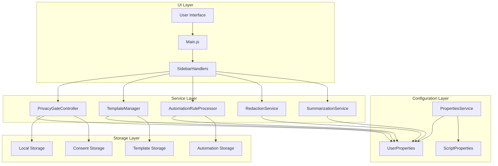
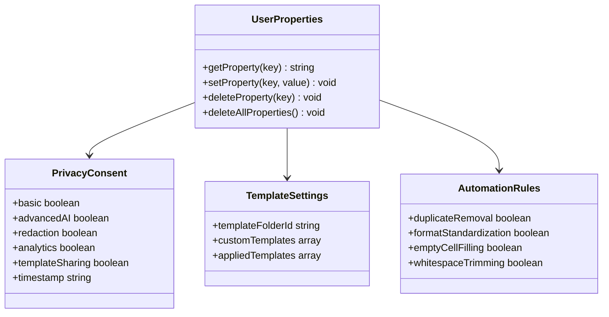
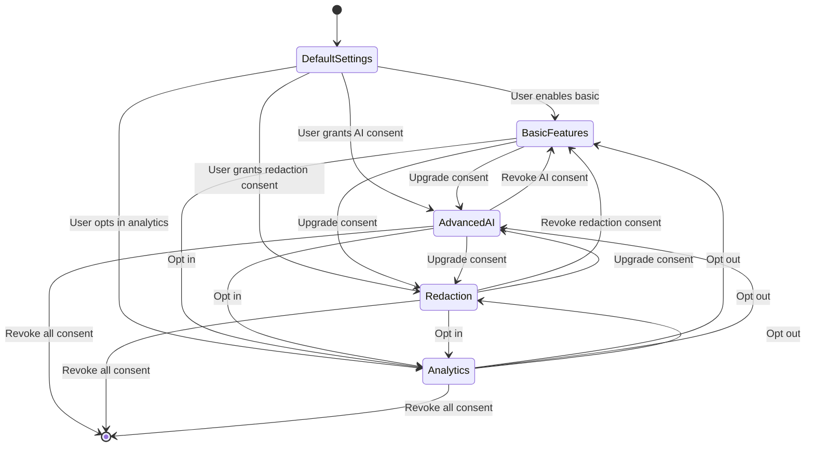
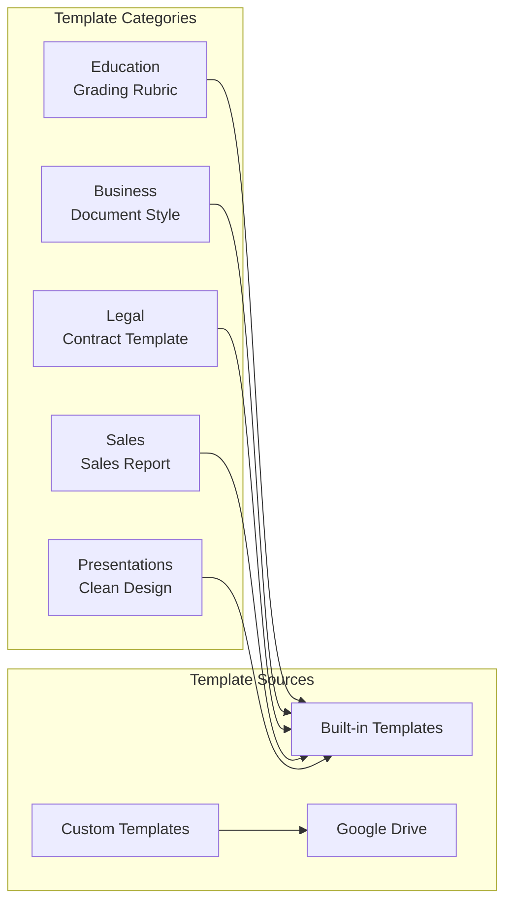
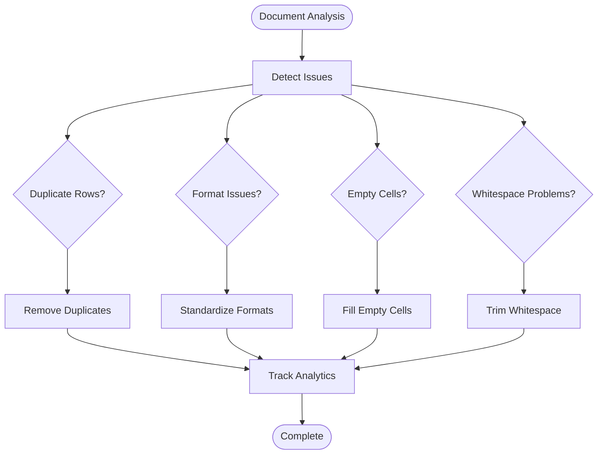
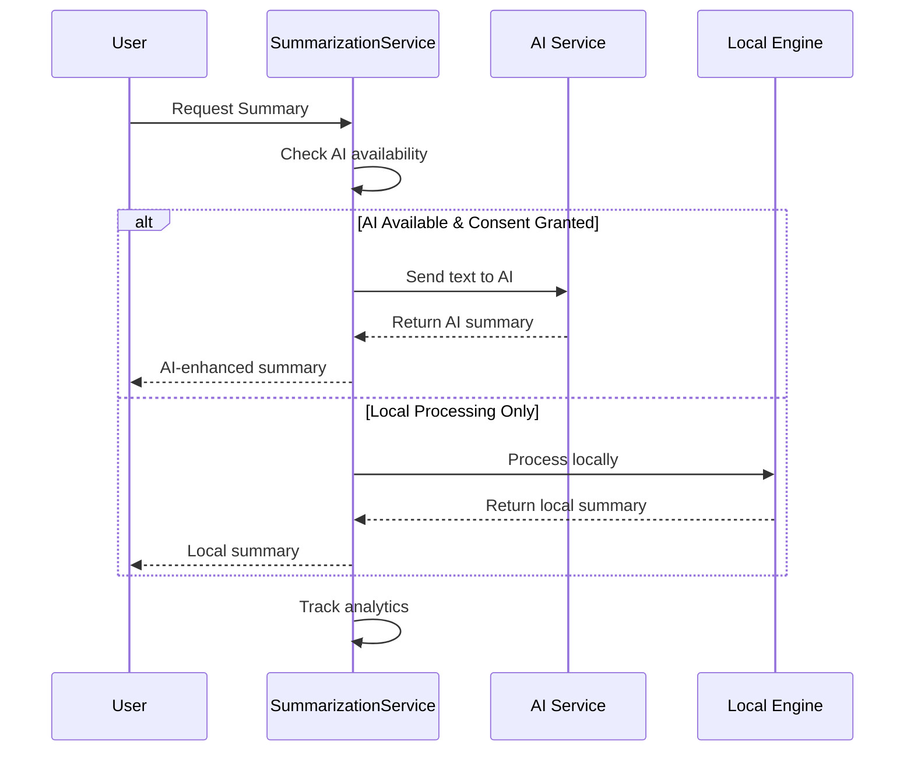
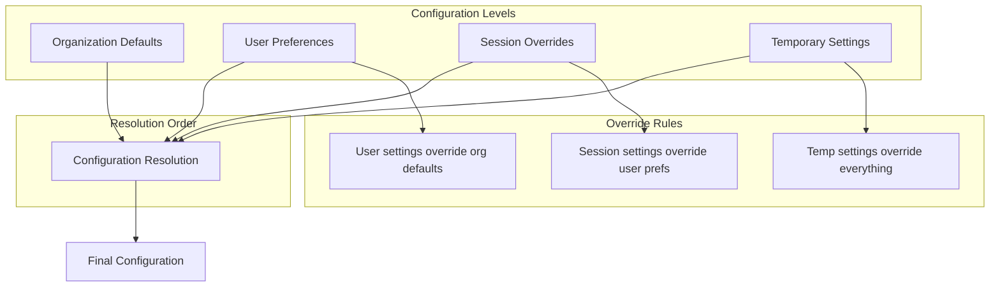
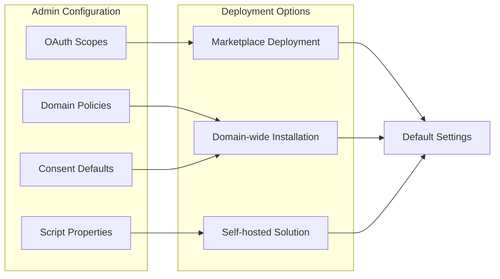
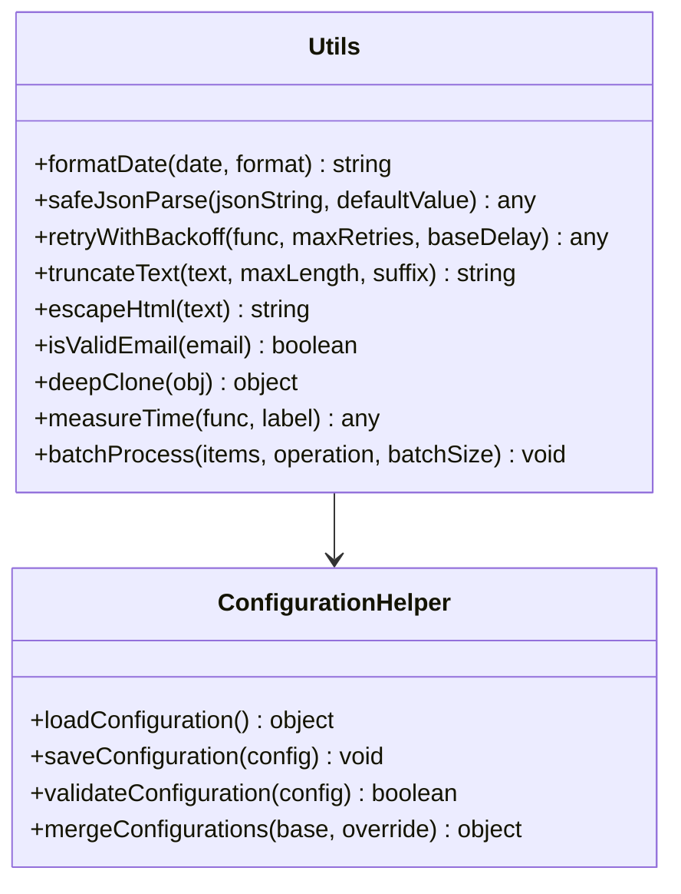

# Configuration and Settings

<cite>
**Referenced Files in This Document**
- [src/Main.js](file://src/Main.js)
- [src/utils/Utils.js](file://src/utils/Utils.js)
- [src/services/TemplateManager.js](file://src/services/TemplateManager.js)
- [src/services/PrivacyGateController.js](file://src/services/PrivacyGateController.js)
- [src/services/AutomationRuleProcessor.js](file://src/services/AutomationRuleProcessor.js)
- [src/services/RedactionService.js](file://src/services/RedactionService.js)
- [src/services/SummarizationService.js](file://src/services/SummarizationService.js)
- [src/handlers/SidebarHandlers.js](file://src/handlers/SidebarHandlers.js)
- [src/appsscript.json](file://src/appsscript.json)
- [appsscript.json](file://appsscript.json)
- [README.md](file://README.md)
</cite>

## Table of Contents
1. [Introduction](#introduction)
2. [Configuration Architecture](#configuration-architecture)
3. [PropertiesService Management](#propertiesservice-management)
4. [Privacy Settings Configuration](#privacy-settings-configuration)
5. [Template Library Configuration](#template-library-configuration)
6. [Automation Rules Configuration](#automation-rules-configuration)
7. [Redaction Patterns Configuration](#redaction-patterns-configuration)
8. [Summarization Settings](#summarization-settings)
9. [Configuration Inheritance and Override Patterns](#configuration-inheritance-and-override-patterns)
10. [Administrator Configuration Options](#administrator-configuration-options)
11. [Configuration Utilities](#configuration-utilities)
12. [Best Practices](#best-practices)

## Introduction

The Techno Browser extension implements a comprehensive configuration and settings system that manages user preferences, privacy controls, template libraries, automation rules, and redaction patterns. The system is built around Google Apps Script's PropertiesService infrastructure, providing both user-level and organizational-level configuration capabilities with robust privacy enforcement.

The configuration system follows a hierarchical approach where user preferences override organizational defaults, ensuring flexibility while maintaining security and compliance requirements. All configuration data is stored locally using ScriptProperties and UserProperties, respecting the privacy-first design philosophy.

## Configuration Architecture

The configuration system is structured around several key components that work together to provide comprehensive settings management:



**Diagram sources**
- [src/services/PrivacyGateController.js](file://src/services/PrivacyGateController.js#L1-L366)
- [src/services/TemplateManager.js](file://src/services/TemplateManager.js#L1-L479)
- [src/services/AutomationRuleProcessor.js](file://src/services/AutomationRuleProcessor.js#L1-L399)

**Section sources**
- [src/services/PrivacyGateController.js](file://src/services/PrivacyGateController.js#L1-L50)
- [src/Main.js](file://src/Main.js#L1-L100)

## PropertiesService Management

The extension uses Google Apps Script's PropertiesService to store and retrieve configuration data. Two primary property stores are utilized:

### UserProperties for Personal Settings

UserProperties store individual user preferences and settings that persist across sessions:



**Diagram sources**
- [src/services/PrivacyGateController.js](file://src/services/PrivacyGateController.js#L21-L38)
- [src/services/TemplateManager.js](file://src/services/TemplateManager.js#L125-L150)

### ScriptProperties for Shared Configuration

ScriptProperties store organizational-level settings and shared configurations:

| Property Key | Purpose | Scope | Default Value |
|--------------|---------|-------|---------------|
| `templateFolderId` | Custom template storage location | User | null |
| `privacyConsent` | User consent preferences | User | Default settings |
| `DOC_VERSION_*` | Document version history | User | Auto-generated |
| `usageAnalytics` | Analytics event storage | User | Disabled |

**Section sources**
- [src/services/PrivacyGateController.js](file://src/services/PrivacyGateController.js#L21-L60)
- [src/services/TemplateManager.js](file://src/services/TemplateManager.js#L125-L150)
- [src/Main.js](file://src/Main.js#L592-L624)

## Privacy Settings Configuration

The PrivacyGateController manages comprehensive privacy settings and consent mechanisms:

### Consent Types and Management



**Diagram sources**
- [src/services/PrivacyGateController.js](file://src/services/PrivacyGateController.js#L8-L15)
- [src/services/PrivacyGateController.js](file://src/services/PrivacyGateController.js#L32-L38)

### Privacy Policy Configuration

The system implements a comprehensive privacy policy with configurable consent levels:

| Consent Type | Default State | Required Permission | Data Impact |
|--------------|---------------|-------------------|-------------|
| `BASIC` | Enabled | None | Local processing only |
| `ADVANCED_AI` | Disabled | Explicit consent | Optional AI processing |
| `REDACTION` | Enabled | None | Sensitive data masking |
| `ANALYTICS` | Disabled | Explicit consent | Anonymous usage stats |
| `TEMPLATE_SHARING` | Disabled | Explicit consent | Drive template access |

**Section sources**
- [src/services/PrivacyGateController.js](file://src/services/PrivacyGateController.js#L8-L15)
- [src/services/PrivacyGateController.js](file://src/services/PrivacyGateController.js#L30-L38)

## Template Library Configuration

The TemplateManager provides comprehensive template management with customizable library locations:

### Built-in Template Categories



**Diagram sources**
- [src/services/TemplateManager.js](file://src/services/TemplateManager.js#L8-L40)
- [src/services/TemplateManager.js](file://src/services/TemplateManager.js#L87-L114)

### Template Storage Configuration

Templates can be managed through multiple storage mechanisms:

| Storage Type | Configuration Method | Access Level | Privacy Impact |
|--------------|---------------------|--------------|----------------|
| Built-in | Pre-configured | Public | None |
| Custom Drive | Folder ID setting | User-controlled | Requires Drive access |
| Shared Library | Organization-wide | Domain-wide | Requires sharing permissions |

**Section sources**
- [src/services/TemplateManager.js](file://src/services/TemplateManager.js#L8-L40)
- [src/services/TemplateManager.js](file://src/services/TemplateManager.js#L125-L150)

## Automation Rules Configuration

The AutomationRuleProcessor implements configurable cleanup and formatting rules:

### Available Automation Rules



**Diagram sources**
- [src/services/AutomationRuleProcessor.js](file://src/services/AutomationRuleProcessor.js#L12-L47)
- [src/services/AutomationRuleProcessor.js](file://src/services/AutomationRuleProcessor.js#L58-L89)

### Automation Rule Configuration Options

| Rule Type | Configuration Options | Default Behavior | Performance Impact |
|-----------|----------------------|------------------|-------------------|
| Duplicate Removal | Header handling, comparison method | Skip header, exact match | Low |
| Date Standardization | Format string, locale support | 'yyyy-MM-dd', US format | Medium |
| Empty Cell Filling | Strategy selection, context awareness | Row above, fallback mode | Medium |
| Whitespace Trimming | Character sets, selective processing | Standard whitespace | Low |
| Currency Standardization | Symbol, precision, grouping | '$', 2 decimal places | Low |
| Text Capitalization | Case style, selection scope | Title case, active range | Low |

**Section sources**
- [src/services/AutomationRuleProcessor.js](file://src/services/AutomationRuleProcessor.js#L12-L399)

## Redaction Patterns Configuration

The RedactionService provides comprehensive PII detection and redaction with customizable patterns:

### Built-in Redaction Patterns

```mermaid
graph TB
subgraph "PII Detection Patterns"
EMAIL[Email Addresses<br/>Pattern: \b[A-Za-z0-9._%+-]+@[A-Za-z0-9.-]+\.[A-Z|a-z]{2,}\b]
PHONE[Phone Numbers<br/>Pattern: (\+\d{1,3}[\s.-]?)?\(?\d{3}\)?[\s.-]?\d{3}[\s.-]?\d{4}\b]
SSN[Social Security<br/>Pattern: \b\d{3}-\d{2}-\d{4}\b]
CC[Credi Card Numbers<br/>Pattern: \b(?:\d{4}[\s-]?){3}\d{4}\b]
IP[IP Addresses<br/>Pattern: \b(?:\d{1,3}\.){3}\d{1,3}\b]
DOB[Date of Birth<br/>Pattern: \b(?:0[1-9]|1[0-2])\/(?:0[1-9]|[12]\d|3[01])\/(?:19|20)\d{2}\b]
ZIP[ZIP Codes<br/>Pattern: \b\d{5}(?:-\d{4})?\b]
end
subgraph "Redaction Behavior"
DETECT[Detection]
MARK[Marking]
REPLACE[Replacement]
end
EMAIL --> DETECT
PHONE --> DETECT
SSN --> DETECT
CC --> DETECT
IP --> DETECT
DOB --> DETECT
ZIP --> DETECT
DETECT --> MARK
MARK --> REPLACE
```

**Diagram sources**
- [src/services/RedactionService.js](file://src/services/RedactionService.js#L8-L45)
- [src/services/RedactionService.js](file://src/services/RedactionService.js#L360-L392)

### Custom Redaction Pattern Configuration

Users can define custom redaction patterns for organization-specific identifiers:

| Pattern Type | Example Pattern | Replacement Text | Use Case |
|--------------|----------------|------------------|----------|
| Employee ID | `\b[A-Z]{2}\d{6}\b` | `[EMPLOYEE ID REDACTED]` | Internal employee codes |
| Project Code | `\bPROJ-\d{4}\b` | `[PROJECT CODE REDACTED]` | Project identification |
| Department | `\bDEPT-[A-Z]{2}\b` | `[DEPARTMENT REDACTED]` | Department codes |
| Confidential | `CONFIDENTIAL` | `[CLASSIFIED]` | General confidentiality |

**Section sources**
- [src/services/RedactionService.js](file://src/services/RedactionService.js#L8-L45)
- [src/services/RedactionService.js](file://src/services/RedactionService.js#L360-L392)

## Summarization Settings

The SummarizationService provides configurable text summarization with multiple processing modes:

### Summarization Configuration Options



**Diagram sources**
- [src/services/SummarizationService.js](file://src/services/SummarizationService.js#L16-L46)
- [src/services/SummarizationService.js](file://src/services/SummarizationService.js#L232-L269)

### Summarization Configuration Parameters

| Parameter | Default Value | Range | Description |
|-----------|---------------|-------|-------------|
| `maxLength` | 200 | 50-2000 | Maximum summary length |
| `minLength` | 50 | 10-500 | Minimum summary length |
| `style` | 'concise' | 'concise', 'detailed', 'bullet' | Output format style |
| `method` | 'auto' | 'local', 'ai', 'auto' | Processing method preference |

**Section sources**
- [src/services/SummarizationService.js](file://src/services/SummarizationService.js#L16-L46)
- [src/services/SummarizationService.js](file://src/services/SummarizationService.js#L232-L269)

## Configuration Inheritance and Override Patterns

The system implements a sophisticated configuration inheritance model where user settings override organizational defaults:

### Configuration Hierarchy



**Diagram sources**
- [src/services/PrivacyGateController.js](file://src/services/PrivacyGateController.js#L21-L38)
- [src/services/TemplateManager.js](file://src/services/TemplateManager.js#L125-L150)

### Configuration Override Patterns

| Configuration Type | Override Priority | Persistence | Scope |
|-------------------|------------------|-------------|-------|
| Privacy Consent | Highest | Persistent | User-level |
| Template Library | High | Persistent | User-level |
| Automation Rules | Medium | Persistent | User-level |
| Redaction Patterns | Medium | Persistent | User-level |
| Summarization Settings | Low | Session | Temporary |
| UI Preferences | Low | Persistent | User-level |

**Section sources**
- [src/services/PrivacyGateController.js](file://src/services/PrivacyGateController.js#L21-L60)
- [src/services/TemplateManager.js](file://src/services/TemplateManager.js#L125-L150)

## Administrator Configuration Options

Administrators can configure organization-wide defaults and enforce policies through multiple mechanisms:

### Administrative Configuration Methods



**Diagram sources**
- [src/appsscript.json](file://src/appsscript.json#L1-L47)
- [appsscript.json](file://appsscript.json#L1-L7)

### Administrator Configuration Options

| Setting Category | Configuration Method | Scope | Impact |
|------------------|---------------------|-------|--------|
| OAuth Scopes | Manifest configuration | Global | Security boundaries |
| Default Consent | Script properties | Organization | Privacy defaults |
| Template Library | Drive folder assignment | Organization | Resource access |
| AI Service Configuration | Environment variables | Organization | Processing capabilities |
| Analytics Collection | Admin console settings | Organization | Data collection |
| Rate Limits | Quota management | Organization | Performance control |

**Section sources**
- [src/appsscript.json](file://src/appsscript.json#L1-L47)
- [appsscript.json](file://appsscript.json#L1-L7)

## Configuration Utilities

The Utils.js module provides essential configuration utilities and helper functions:

### Utility Functions for Configuration



**Diagram sources**
- [src/utils/Utils.js](file://src/utils/Utils.js#L6-L258)

### Configuration Validation and Safety

The utility functions ensure configuration safety and reliability:

| Function | Purpose | Safety Feature | Error Handling |
|----------|---------|----------------|----------------|
| `safeJsonParse` | Parse JSON safely | Catch exceptions | Return default value |
| `retryWithBackoff` | Retry operations | Exponential backoff | Max retry limit |
| `deepClone` | Deep copy objects | Prevent mutation | Recursive protection |
| `measureTime` | Performance monitoring | Execution timing | Logging |
| `batchProcess` | Large dataset handling | Chunk processing | Progress tracking |

**Section sources**
- [src/utils/Utils.js](file://src/utils/Utils.js#L77-L113)
- [src/utils/Utils.js](file://src/utils/Utils.js#L200-L258)

## Best Practices

### Configuration Management Best Practices

1. **Privacy-First Design**: All configuration defaults prioritize user privacy and local processing
2. **Incremental Consent**: Advanced features require explicit user consent before activation
3. **Hierarchical Configuration**: User settings override organizational defaults with clear precedence
4. **Validation and Safety**: All configuration changes are validated and safely persisted
5. **Audit Trail**: Configuration changes are logged for accountability and debugging
6. **Graceful Degradation**: Systems continue functioning even when configuration access is limited
7. **Performance Optimization**: Configuration caching reduces property service calls
8. **Security Boundaries**: OAuth scopes are minimized to reduce attack surface

### Implementation Guidelines

- **Use PropertiesService Appropriately**: UserProperties for user-specific settings, ScriptProperties for shared configuration
- **Implement Configuration Validation**: Always validate configuration values before applying
- **Provide Clear Error Messages**: User-friendly error messages for configuration failures
- **Maintain Configuration Backwards Compatibility**: Ensure new versions work with existing configurations
- **Document Configuration Options**: Comprehensive documentation for all configurable parameters
- **Test Configuration Scenarios**: Thorough testing of configuration inheritance and override patterns

**Section sources**
- [src/services/PrivacyGateController.js](file://src/services/PrivacyGateController.js#L1-L366)
- [src/utils/Utils.js](file://src/utils/Utils.js#L1-L258)