# Automation & Cleanup

<cite>
**Referenced Files in This Document**
- [AutomationRuleProcessor.js](file://src/services/AutomationRuleProcessor.js)
- [RedactionService.js](file://src/services/RedactionService.js)
- [PrivacyGateController.js](file://src/services/PrivacyGateController.js)
- [TemplateManager.js](file://src/services/TemplateManager.js)
- [Main.js](file://src/Main.js)
- [DocumentAnalysisEngine.js](file://src/services/DocumentAnalysisEngine.js)
- [SummarizationService.js](file://src/services/SummarizationService.js)
- [Sidebar.html](file://src/ui/Sidebar.html)
</cite>

## Table of Contents
1. [Introduction](#introduction)
2. [System Architecture](#system-architecture)
3. [Core Components](#core-components)
4. [Automation Rule Processor](#automation-rule-processor)
5. [Privacy & Data Protection](#privacy--data-protection)
6. [Template Management](#template-management)
7. [Document Analysis Engine](#document-analysis-engine)
8. [Summarization Service](#summarization-service)
9. [Integration Patterns](#integration-patterns)
10. [Configuration & Usage](#configuration--usage)
11. [Error Handling & Troubleshooting](#error-handling--troubleshooting)
12. [Performance Considerations](#performance-considerations)

## Introduction

The Automation & Cleanup subsystem forms the core intelligence engine of the Intelligent Document Automation add-on, providing automated data cleaning, privacy protection, template management, and document enhancement capabilities. This system operates under strict privacy-first principles, ensuring all processing occurs locally by default while offering optional advanced AI-powered features with explicit user consent.

The subsystem encompasses five primary services:
- **Automation Rule Processor**: Executes batch transformations and cleanup operations
- **Privacy Gate Controller**: Manages consent and enforces privacy policies
- **Redaction Service**: Detects and removes sensitive information
- **Template Manager**: Provides document templating and customization
- **Document Analysis Engine**: Performs comprehensive document analysis

## System Architecture

The Automation & Cleanup system follows a modular architecture with clear separation of concerns and robust privacy enforcement mechanisms.

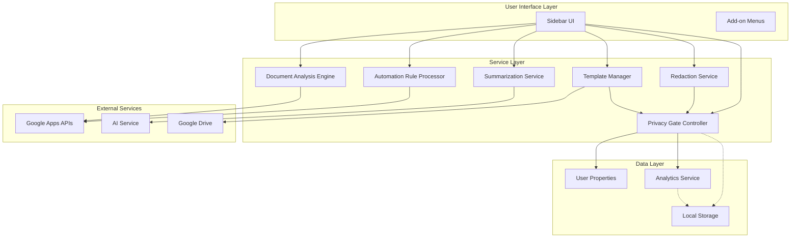

**Diagram sources**
- [Main.js](file://src/Main.js#L1-L100)
- [AutomationRuleProcessor.js](file://src/services/AutomationRuleProcessor.js#L1-L50)
- [PrivacyGateController.js](file://src/services/PrivacyGateController.js#L1-L50)

## Core Components

### Service Registration Pattern

Each automation service follows a consistent registration pattern using Immediately Invoked Function Expressions (IIFE):

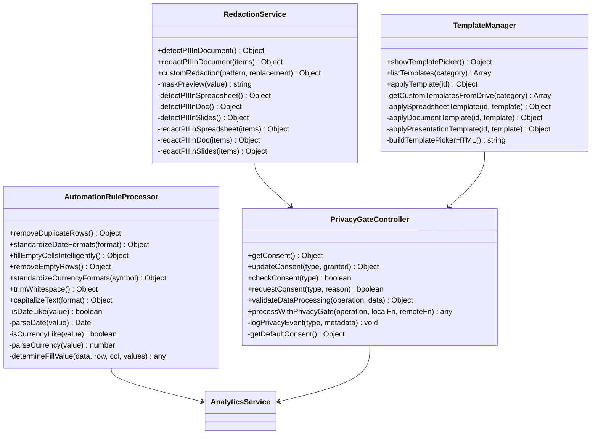

**Diagram sources**
- [AutomationRuleProcessor.js](file://src/services/AutomationRuleProcessor.js#L388-L399)
- [RedactionService.js](file://src/services/RedactionService.js#L395-L402)
- [PrivacyGateController.js](file://src/services/PrivacyGateController.js#L352-L366)
- [TemplateManager.js](file://src/services/TemplateManager.js#L472-L479)

**Section sources**
- [AutomationRuleProcessor.js](file://src/services/AutomationRuleProcessor.js#L1-L399)
- [RedactionService.js](file://src/services/RedactionService.js#L1-L402)
- [PrivacyGateController.js](file://src/services/PrivacyGateController.js#L1-L366)
- [TemplateManager.js](file://src/services/TemplateManager.js#L1-L479)

## Automation Rule Processor

The Automation Rule Processor serves as the primary engine for batch data transformations and cleanup operations, providing intelligent data cleaning capabilities across all supported document types.

### Core Operations

#### Duplicate Removal
Removes duplicate rows from spreadsheets while preserving the first occurrence:

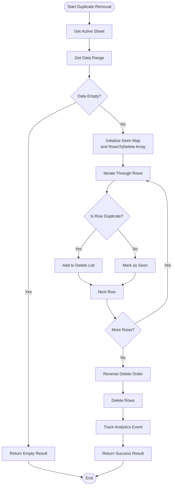

**Diagram sources**
- [AutomationRuleProcessor.js](file://src/services/AutomationRuleProcessor.js#L12-L67)

#### Intelligent Cell Filling
Fills empty cells using sophisticated pattern recognition and statistical analysis:

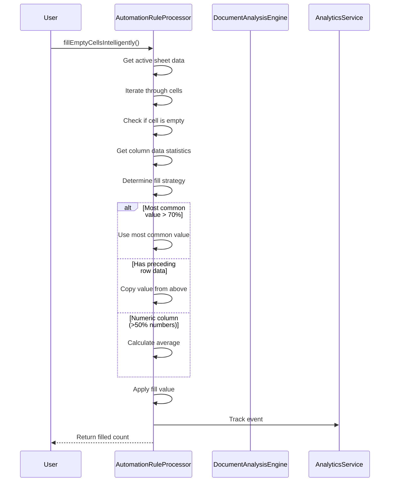

**Diagram sources**
- [AutomationRuleProcessor.js](file://src/services/AutomationRuleProcessor.js#L96-L131)

### Supported Operations

| Operation | Description | Parameters | Return Type |
|-----------|-------------|------------|-------------|
| `removeDuplicateRows()` | Removes duplicate rows from active sheet | None | `{success: boolean, message: string, count: number}` |
| `standardizeDateFormats(format)` | Standardizes date formats across sheet | `format: string = 'yyyy-MM-dd'` | `{success: boolean, message: string, count: number}` |
| `fillEmptyCellsIntelligently()` | Intelligently fills empty cells | None | `{success: boolean, message: string, count: number}` |
| `removeEmptyRows()` | Removes completely empty rows | None | `{success: boolean, message: string, count: number}` |
| `standardizeCurrencyFormats(symbol)` | Standardizes currency formats | `symbol: string = '$'` | `{success: boolean, message: string, count: number}` |
| `trimWhitespace()` | Trims whitespace from text cells | None | `{success: boolean, message: string, count: number}` |
| `capitalizeText(format)` | Applies text capitalization | `format: string = 'Title Case'` | `{success: boolean, message: string, count: number}` |

### Implementation Details

The processor utilizes Google Apps Script's SpreadsheetApp API for data manipulation, implementing several optimization strategies:

- **Reverse Deletion Order**: Ensures row numbers remain consistent during bulk deletions
- **Batch Processing**: Groups similar operations to minimize API calls
- **Error Recovery**: Implements comprehensive error handling with fallback mechanisms
- **Analytics Integration**: Tracks all operations for usage insights

**Section sources**
- [AutomationRuleProcessor.js](file://src/services/AutomationRuleProcessor.js#L12-L399)

## Privacy & Data Protection

The Privacy Gate Controller implements a comprehensive privacy framework ensuring all data processing adheres to strict privacy principles and user consent requirements.

### Consent Management System

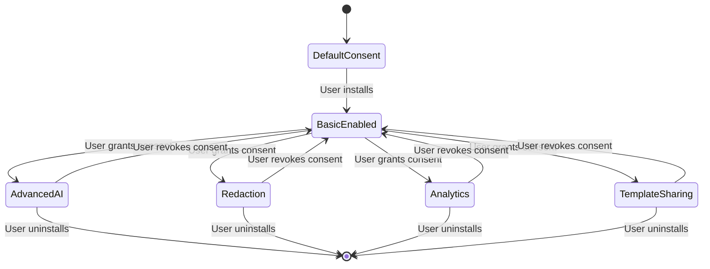

**Diagram sources**
- [PrivacyGateController.js](file://src/services/PrivacyGateController.js#L8-L15)

### Privacy Policy Framework

The system implements a layered privacy approach:

1. **Local-First Processing**: All operations occur locally by default
2. **Explicit Consent**: Advanced features require explicit user approval
3. **Data Minimization**: Only necessary data is processed
4. **Transparency**: Clear indication of data processing activities

### Consent Types

| Consent Type | Purpose | Default State | Required For |
|--------------|---------|---------------|--------------|
| `BASIC` | Core functionality | Enabled | All operations |
| `ADVANCED_AI` | AI-powered features | Disabled | Summarization, Advanced analysis |
| `REDACTION` | Sensitive data removal | Enabled | PII detection/redaction |
| `ANALYTICS` | Usage tracking | Disabled | Analytics collection |
| `TEMPLATE_SHARING` | Template access | Disabled | Template library access |

### Privacy Gate Pattern

The system employs a privacy gate pattern for conditional processing:

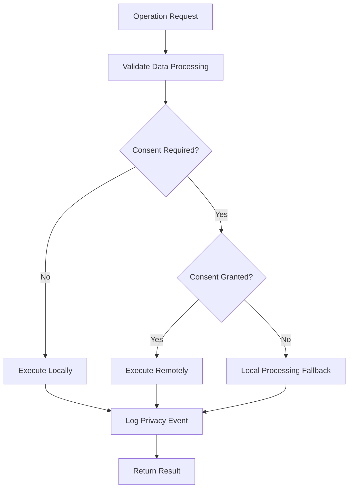

**Diagram sources**
- [PrivacyGateController.js](file://src/services/PrivacyGateController.js#L222-L237)

**Section sources**
- [PrivacyGateController.js](file://src/services/PrivacyGateController.js#L1-L366)

## Template Management

The Template Manager provides comprehensive document templating capabilities with support for built-in templates and custom template libraries.

### Built-in Template Catalog

The system includes five pre-built templates across different document types:

| Template ID | Type | Category | Description |
|-------------|------|----------|-------------|
| `grading_rubric` | SPREADSHEET | Education | Standard grading rubric for educators |
| `document_style` | DOCUMENT | Business | Professional formatting template for documents |
| `presentation_clean` | PRESENTATION | Business | Minimalist slide design template |
| `contract_template` | DOCUMENT | Legal | Standard contract format with clauses |
| `sales_report` | SPREADSHEET | Sales | Monthly sales report template |

### Template Application Process

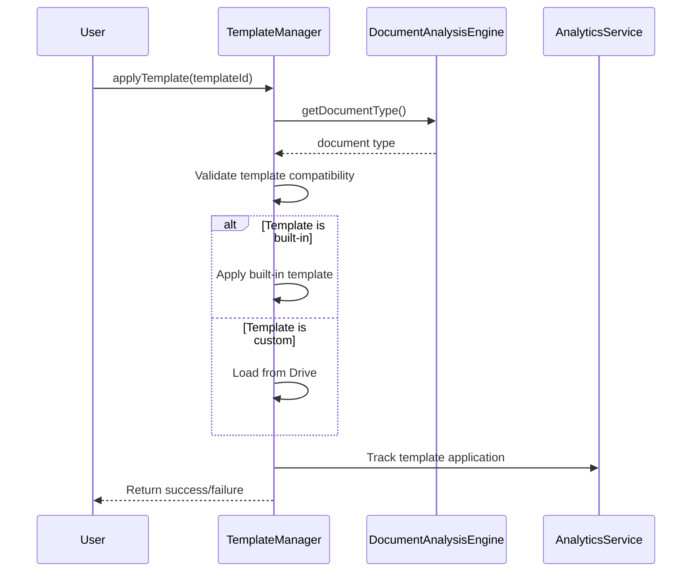

**Diagram sources**
- [TemplateManager.js](file://src/services/TemplateManager.js#L158-L202)

### Custom Template Integration

The system supports custom templates stored in Google Drive:

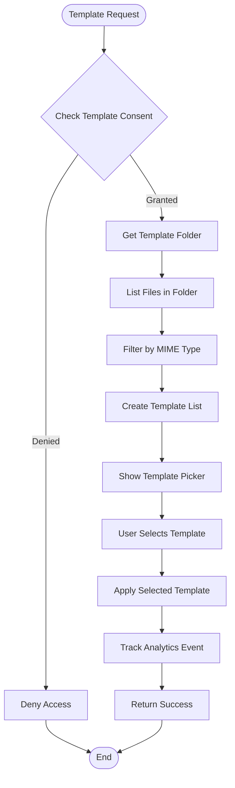

**Diagram sources**
- [TemplateManager.js](file://src/services/TemplateManager.js#L46-L80)

### Template Categories

The system organizes templates into logical categories:

- **Education**: Academic and educational templates
- **Business**: Professional and corporate templates  
- **Legal**: Contract and legal document templates
- **Sales**: Sales and reporting templates
- **Custom**: User-defined templates from Drive

**Section sources**
- [TemplateManager.js](file://src/services/TemplateManager.js#L1-L479)

## Document Analysis Engine

The Document Analysis Engine provides comprehensive document assessment capabilities, identifying formatting issues, data quality problems, and suggesting improvements.

### Multi-Document Type Analysis

The engine adapts its analysis approach based on the document type:

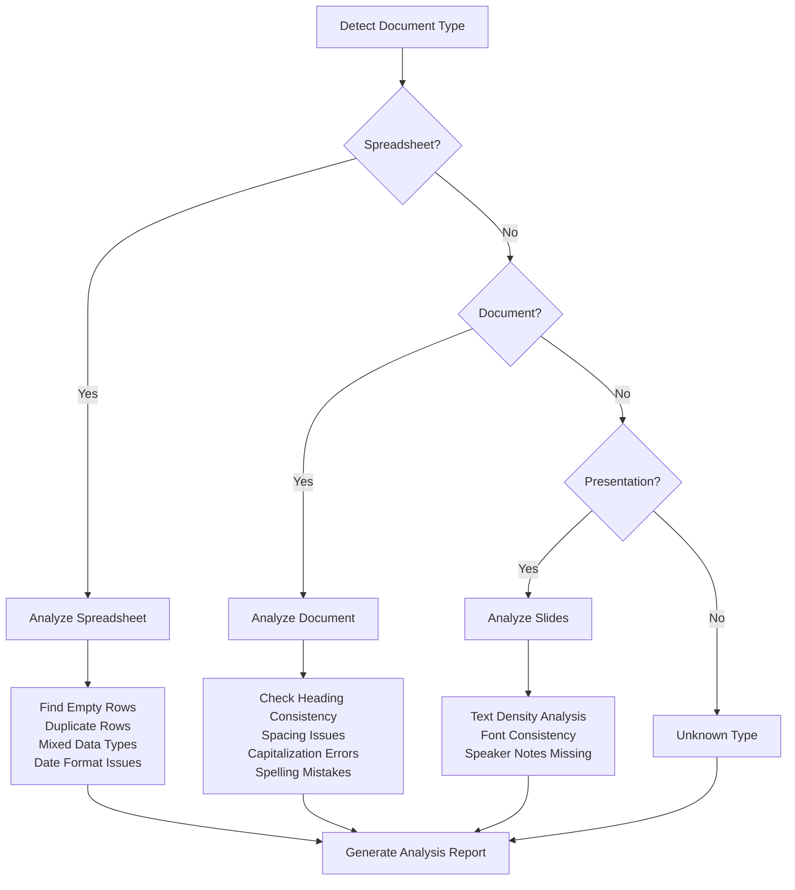

**Diagram sources**
- [DocumentAnalysisEngine.js](file://src/services/DocumentAnalysisEngine.js#L12-L30)

### Analysis Capabilities

#### Spreadsheet Analysis
- **Empty Row Detection**: Identifies completely empty rows
- **Duplicate Detection**: Finds duplicate records across all columns
- **Data Type Consistency**: Detects mixed data types in columns
- **Date Format Standardization**: Identifies inconsistent date formats
- **Empty Cell Analysis**: Counts and locates empty cells

#### Document Analysis
- **Heading Consistency**: Ensures uniform heading styles
- **Spacing Issues**: Detects improper punctuation spacing
- **Capitalization Errors**: Identifies inconsistent capitalization
- **Spelling Mistakes**: Flags common spelling errors
- **Sentence Structure**: Analyzes sentence construction quality

#### Presentation Analysis
- **Text Density**: Evaluates slide text load
- **Font Consistency**: Checks for uniform typography
- **Speaker Notes**: Identifies slides without speaker notes
- **Visual Balance**: Assesses slide composition

### Issue Classification System

The engine categorizes issues into severity levels:

| Severity | Description | Example Issues |
|----------|-------------|----------------|
| Critical | Blocks document functionality | Empty sheets, corrupted data |
| High | Significant quality impact | Duplicate records, major formatting |
| Medium | Noticeable quality issues | Minor inconsistencies, formatting |
| Low | Cosmetic improvements | Spacing adjustments, minor errors |

**Section sources**
- [DocumentAnalysisEngine.js](file://src/services/DocumentAnalysisEngine.js#L1-L739)

## Summarization Service

The Summarization Service provides intelligent document summarization with both local and AI-powered processing capabilities.

### Processing Pipeline

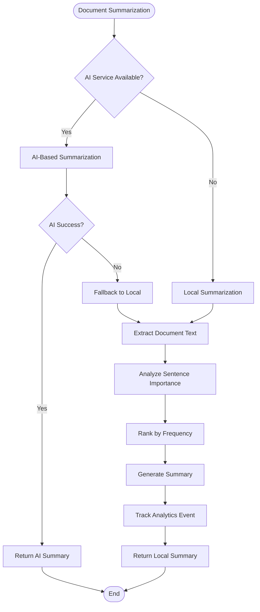

**Diagram sources**
- [SummarizationService.js](file://src/services/SummarizationService.js#L16-L65)

### Summarization Methods

#### Local Summarization
Uses extractive summarization with keyword frequency analysis:

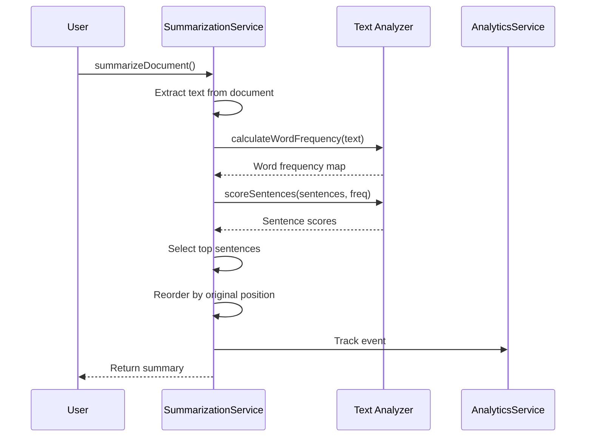

**Diagram sources**
- [SummarizationService.js](file://src/services/SummarizationService.js#L145-L225)

#### AI-Powered Summarization
Leverages external AI services for advanced summarization:

- **Context Preservation**: Maintains important context and meaning
- **Style Adaptation**: Adapts to different writing styles
- **Length Control**: Respects specified summary lengths
- **Domain Knowledge**: Understands specialized terminology

### Text Analysis Features

The service provides comprehensive text analysis:

| Feature | Description | Output |
|---------|-------------|--------|
| Word Count | Total word count | Number |
| Sentence Count | Total sentence count | Number |
| Paragraph Count | Total paragraph count | Number |
| Character Count | Total character count | Number |
| Average Words/Sentence | Average sentence length | Number |
| Average Sentences/Paragraph | Paragraph density | Number |
| Reading Time | Estimated reading time | Minutes |

**Section sources**
- [SummarizationService.js](file://src/services/SummarizationService.js#L1-L356)

## Integration Patterns

### Sidebar Integration

The automation features integrate seamlessly with the main sidebar interface:

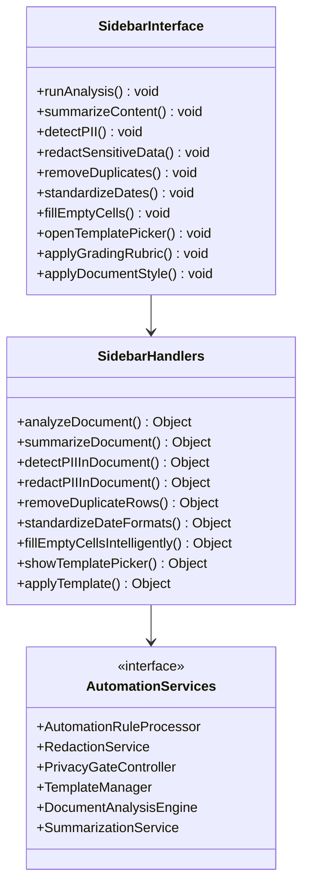

**Diagram sources**
- [Sidebar.html](file://src/ui/Sidebar.html#L200-L493)
- [Main.js](file://src/Main.js#L58-L117)

### Menu Integration

The system integrates with Google Workspace add-on menus:

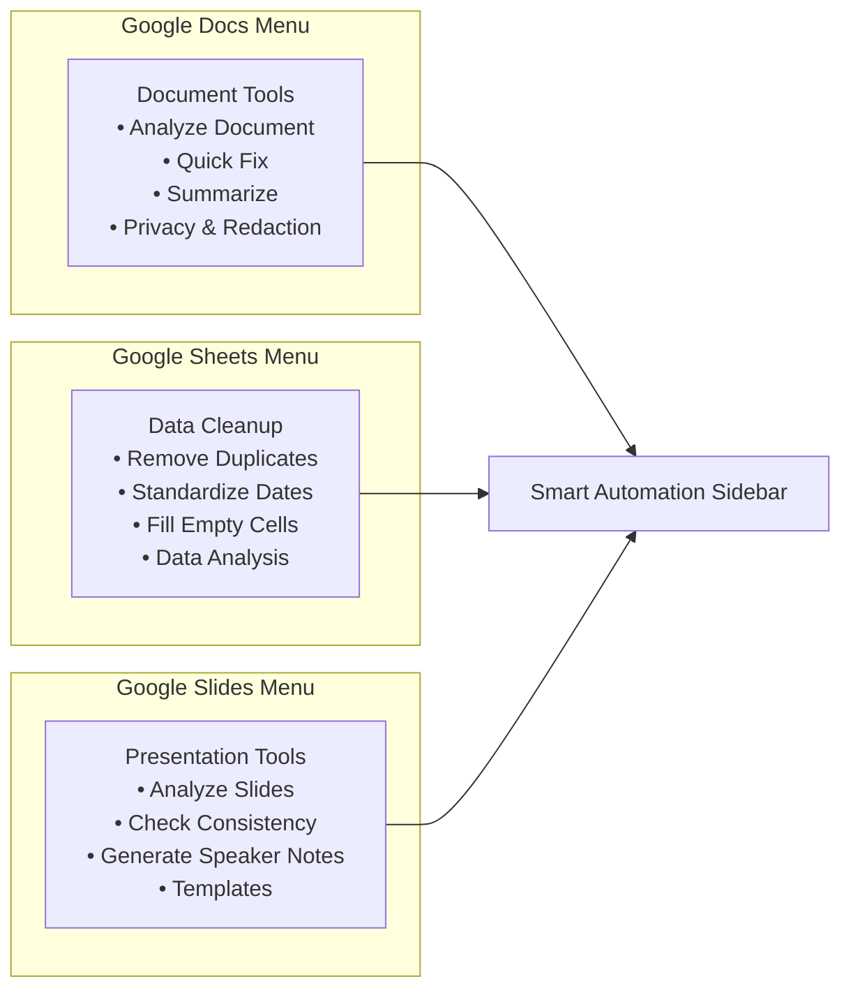

**Diagram sources**
- [Main.js](file://src/Main.js#L38-L112)

### Event Tracking Integration

All automation operations integrate with the analytics system:

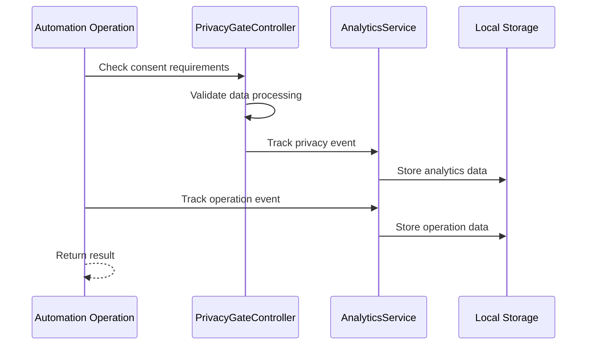

**Diagram sources**
- [PrivacyGateController.js](file://src/services/PrivacyGateController.js#L308-L315)

**Section sources**
- [Main.js](file://src/Main.js#L1-L1335)
- [Sidebar.html](file://src/ui/Sidebar.html#L1-L493)

## Configuration & Usage

### Basic Setup

The automation system requires minimal configuration:

1. **Installation**: Install the add-on from the Chrome Web Store
2. **Permissions**: Grant necessary Google Workspace permissions
3. **Consent**: Review and adjust privacy consent settings

### Usage Patterns

#### Quick Data Cleanup
1. Open a Google Sheets document
2. Navigate to "Data Cleanup" in the add-on menu
3. Select desired cleanup operation
4. Review results and confirm execution

#### Privacy Protection
1. Open any Google Workspace document
2. Go to "Privacy & Redaction" in the add-on menu
3. Click "Detect PII" to scan for sensitive information
4. Review findings and click "Redact Sensitive Data"

#### Template Application
1. Open a document requiring formatting
2. Navigate to "Templates" in the add-on menu
3. Browse available templates or customize existing ones
4. Apply selected template to enhance document structure

### Parameter Configuration

#### Automation Rule Processor Parameters
- **Date Formats**: Customize date standardization formats
- **Currency Symbols**: Configure currency symbol preferences
- **Text Capitalization**: Choose between UPPER, lower, Title Case, Sentence case
- **Whitespace Handling**: Configure trim preferences

#### Privacy Settings
- **Consent Levels**: Enable/disable specific privacy features
- **Analytics Collection**: Control usage data collection
- **AI Processing**: Configure advanced AI feature access

#### Template Preferences
- **Default Templates**: Set preferred template categories
- **Custom Libraries**: Configure Google Drive template folders
- **Application Behavior**: Customize template application rules

**Section sources**
- [Main.js](file://src/Main.js#L1-L100)
- [PrivacyGateController.js](file://src/services/PrivacyGateController.js#L21-L81)

## Error Handling & Troubleshooting

### Common Issues and Solutions

#### Permission Errors
**Symptom**: Operations fail with permission denied messages
**Solution**: 
- Verify Google Workspace permissions are granted
- Check individual service permissions in add-on settings
- Reinstall add-on if permissions are lost

#### Memory Limitations
**Symptom**: Large documents cause timeout or memory errors
**Solution**:
- Use selection-only mode for partial processing
- Break large documents into smaller sections
- Consider upgrading to premium AI services for larger files

#### AI Service Connectivity
**Symptom**: AI-powered features fail to load or produce errors
**Solution**:
- Verify internet connectivity
- Check AI service configuration
- Fall back to local processing mode

#### Template Loading Issues
**Symptom**: Custom templates fail to load from Google Drive
**Solution**:
- Verify Drive API permissions
- Check template folder accessibility
- Ensure template files are properly formatted

### Debug Information

The system provides comprehensive logging for troubleshooting:

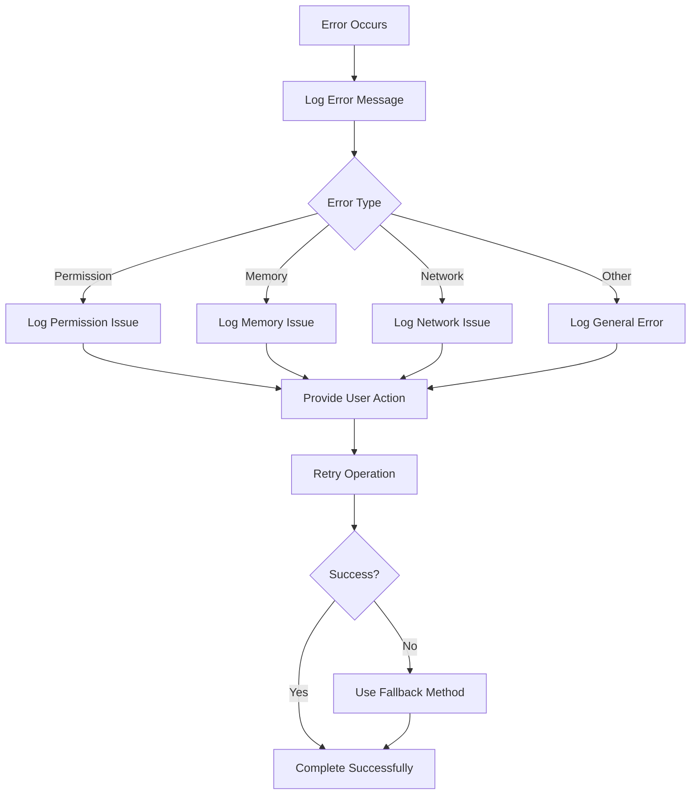

**Diagram sources**
- [PrivacyGateController.js](file://src/services/PrivacyGateController.js#L308-L315)

### Performance Monitoring

The system tracks key performance metrics:

- **Operation Duration**: Time taken for each automation operation
- **Success Rates**: Percentage of successful operations
- **Error Frequencies**: Common error patterns and frequencies
- **Resource Usage**: Memory and processing resource consumption

**Section sources**
- [PrivacyGateController.js](file://src/services/PrivacyGateController.js#L308-L315)
- [Main.js](file://src/Main.js#L801-L820)

## Performance Considerations

### Optimization Strategies

#### Batch Processing
The system optimizes performance through strategic batching:

- **Bulk Operations**: Group similar operations to minimize API calls
- **Parallel Processing**: Execute independent operations concurrently
- **Lazy Loading**: Load resources only when needed
- **Caching**: Store frequently accessed data in memory

#### Memory Management
Efficient memory usage prevents performance degradation:

- **Streaming Processing**: Process large datasets in chunks
- **Garbage Collection**: Explicitly manage memory cleanup
- **Resource Limits**: Monitor and enforce memory boundaries
- **Progressive Loading**: Load data progressively rather than all at once

#### Scalability Patterns
The system scales efficiently across different document sizes:

- **Adaptive Algorithms**: Adjust processing complexity based on data size
- **Progressive Enhancement**: Start with basic processing, enhance with AI when available
- **Resource Pooling**: Share computational resources across operations
- **Load Balancing**: Distribute processing load across available resources

### Performance Metrics

| Metric | Target | Measurement |
|--------|--------|-------------|
| Document Analysis | < 2 seconds | Analysis completion time |
| Automation Operation | < 5 seconds | Single operation execution |
| Template Application | < 3 seconds | Template processing time |
| AI Summarization | < 8 seconds | AI-based summarization |
| Memory Usage | < 50MB peak | Resource consumption |

### Best Practices

#### For Users
- Process documents in smaller sections when dealing with large files
- Use selection-only mode for targeted operations
- Regular maintenance of Google Drive template libraries
- Monitor privacy consent settings regularly

#### For Developers
- Implement proper error handling and recovery mechanisms
- Use asynchronous processing for long-running operations
- Monitor performance metrics and optimize accordingly
- Maintain backward compatibility for existing templates

The Automation & Cleanup subsystem represents a comprehensive solution for intelligent document processing, combining powerful automation capabilities with strict privacy controls and user-friendly interfaces. Its modular architecture ensures scalability and maintainability while providing robust functionality for modern document management workflows.