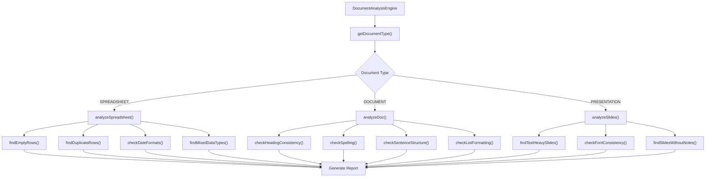
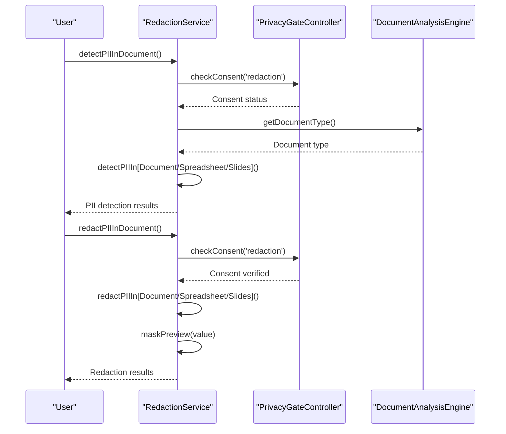
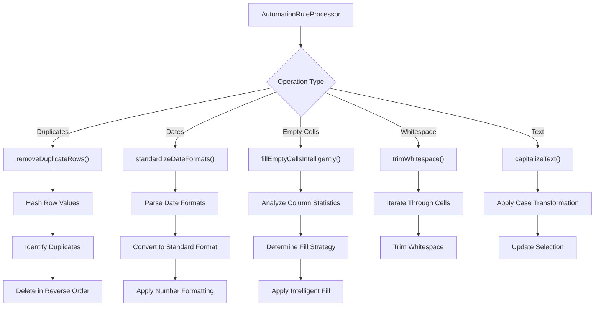
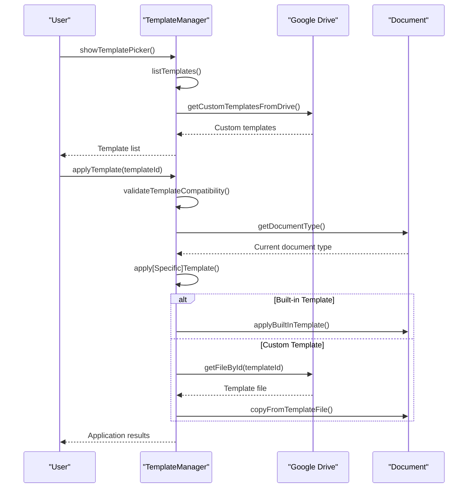
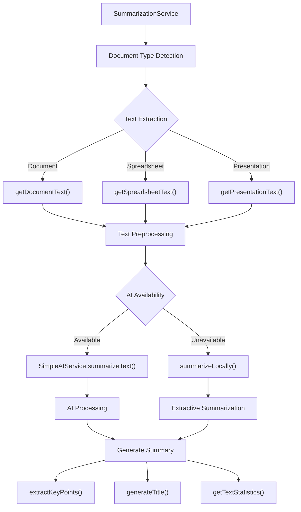
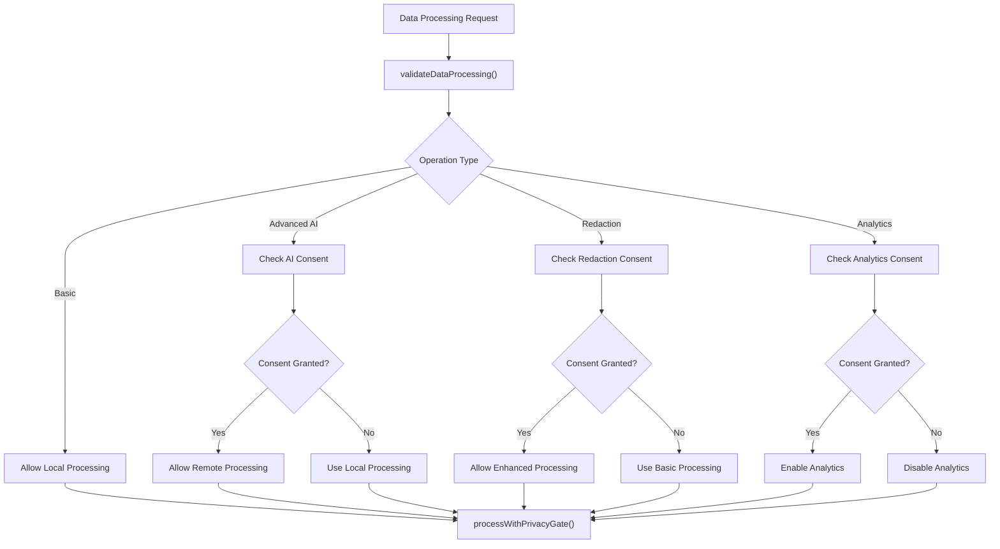
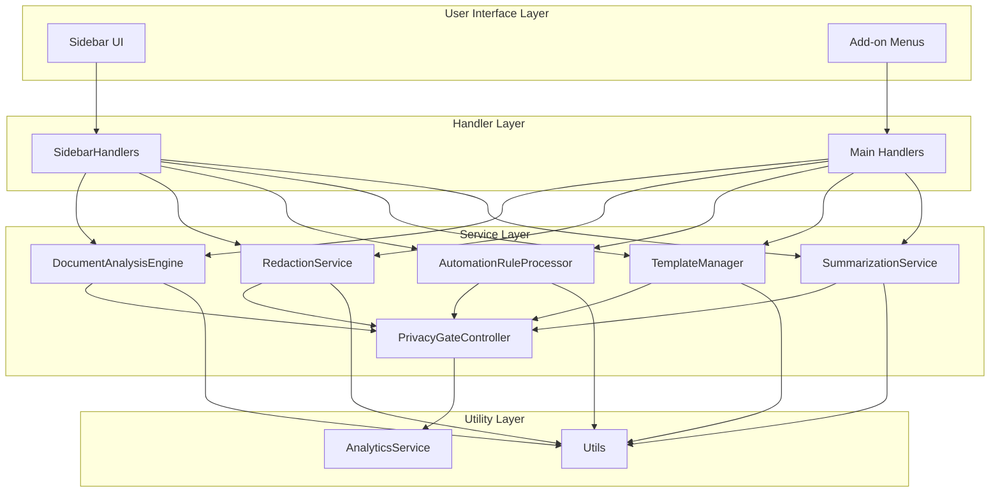

# Core Features

<cite>
**Referenced Files in This Document**
- [DocumentAnalysisEngine.js](file://src/services/DocumentAnalysisEngine.js)
- [RedactionService.js](file://src/services/RedactionService.js)
- [AutomationRuleProcessor.js](file://src/services/AutomationRuleProcessor.js)
- [TemplateManager.js](file://src/services/TemplateManager.js)
- [SummarizationService.js](file://src/services/SummarizationService.js)
- [PrivacyGateController.js](file://src/services/PrivacyGateController.js)
- [Main.js](file://src/Main.js)
- [SidebarHandlers.js](file://src/handlers/SidebarHandlers.js)
- [Utils.js](file://src/utils/Utils.js)
</cite>

## Table of Contents
1. [Introduction](#introduction)
2. [DocumentAnalysisEngine](#documentanalysisengine)
3. [RedactionService](#redactionservice)
4. [AutomationRuleProcessor](#automationruleprocessor)
5. [TemplateManager](#templatemanager)
6. [SummarizationService](#summarizationservice)
7. [PrivacyGateController](#privacygatecontroller)
8. [Integration Architecture](#integration-architecture)
9. [Configuration Options](#configuration-options)
10. [Performance Considerations](#performance-considerations)

## Introduction

The Intelligent Document Automation add-on provides a comprehensive suite of features designed to enhance productivity across Google Workspace applications. Built with privacy-first principles, the system offers powerful document analysis, automated cleanup operations, PII redaction, template management, and AI-enhanced summarization capabilities. All core features operate locally by default, with optional cloud-based enhancements requiring explicit user consent.

## DocumentAnalysisEngine

### Purpose and Scope

The DocumentAnalysisEngine serves as the central diagnostic tool for identifying formatting issues, duplicates, and anomalies across all supported Google Workspace document types. It provides actionable insights and suggestions for document improvement.

### Core Capabilities

#### Multi-Platform Document Analysis

The engine supports three primary document types with specialized analysis algorithms:

**Google Sheets Analysis**
- **Duplicate Detection**: Identifies and removes duplicate rows using sophisticated hashing algorithms
- **Data Type Validation**: Detects mixed data types within columns and suggests standardization
- **Empty Cell Identification**: Locates empty cells and provides intelligent suggestions for filling
- **Date Format Standardization**: Recognizes multiple date formats and recommends unification

**Google Docs Analysis**
- **Formatting Consistency**: Analyzes heading styles, font usage, and paragraph formatting
- **Spelling and Grammar**: Identifies common misspellings and grammatical errors
- **Sentence Structure**: Evaluates sentence complexity and punctuation usage
- **List Formatting**: Ensures consistent bullet and numbered list formatting

**Google Slides Analysis**
- **Visual Consistency**: Detects inconsistent font usage and slide formatting
- **Content Density**: Identifies slides with excessive text that may hinder presentation effectiveness
- **Speaker Notes**: Ensures adequate speaker note coverage for presentations

### Implementation Architecture



**Diagram sources**
- [DocumentAnalysisEngine.js](file://src/services/DocumentAnalysisEngine.js#L12-L30)
- [DocumentAnalysisEngine.js](file://src/services/DocumentAnalysisEngine.js#L36-L159)

### Data Flow and Processing

The analysis engine operates through a structured pipeline that ensures efficient processing across different document types:

1. **Document Type Detection**: Automatic identification of the active Google Workspace application
2. **Content Extraction**: Platform-specific extraction of document content and structure
3. **Pattern Matching**: Application of specialized analysis algorithms for each document type
4. **Issue Classification**: Categorization of detected issues by severity and type
5. **Suggestion Generation**: Creation of actionable recommendations for issue resolution

**Section sources**
- [DocumentAnalysisEngine.js](file://src/services/DocumentAnalysisEngine.js#L12-L30)
- [DocumentAnalysisEngine.js](file://src/services/DocumentAnalysisEngine.js#L36-L159)

## RedactionService

### Privacy-First PII Detection

The RedactionService implements comprehensive Personally Identifiable Information (PII) detection with customizable patterns and one-click masking capabilities. Built with privacy-first principles, all processing occurs locally by default.

### PII Detection Patterns

The service maintains a robust pattern library for detecting various types of sensitive information:

| Pattern Type | Detection Method | Redaction Format |
|--------------|------------------|------------------|
| Email Addresses | Regex pattern matching | `[EMAIL REDACTED]` |
| Phone Numbers | Flexible format recognition | `[PHONE REDACTED]` |
| Social Security Numbers | US SSN format validation | `[SSN REDACTED]` |
| Credit Cards | Card number pattern matching | `[CARD REDACTED]` |
| IP Addresses | IPv4 address detection | `[IP REDACTED]` |
| Date of Birth | MM/DD/YYYY format | `[DOB REDACTED]` |
| ZIP Codes | US postal code format | `[ZIP REDACTED]` |

### Redaction Workflow



**Diagram sources**
- [RedactionService.js](file://src/services/RedactionService.js#L48-L68)
- [RedactionService.js](file://src/services/RedactionService.js#L177-L208)
- [PrivacyGateController.js](file://src/services/PrivacyGateController.js#L78-L81)

### Custom Pattern Support

Beyond built-in patterns, the service supports custom redaction rules for organization-specific identifiers:

```javascript
// Example: Custom ID pattern redaction
RedactionService.customRedaction('\\b[A-Z]{2}\\d{6}\\b', '[CUSTOM ID REDACTED]');
```

### Preview and Safety Features

The service implements several safety mechanisms:
- **Preview Generation**: Shows masked previews before applying redactions
- **Selective Redaction**: Allows targeting specific PII items for redaction
- **Undo Capability**: Maintains document history for rollback operations

**Section sources**
- [RedactionService.js](file://src/services/RedactionService.js#L8-L46)
- [RedactionService.js](file://src/services/RedactionService.js#L48-L68)
- [RedactionService.js](file://src/services/RedactionService.js#L177-L208)

## AutomationRuleProcessor

### Batch Operations Suite

The AutomationRuleProcessor provides comprehensive batch operations for cleaning and standardizing data across Google Sheets. These operations are designed for efficiency and reliability with large datasets.

### Core Automation Features

#### Duplicate Removal
- **Smart Deduplication**: Uses JSON serialization for accurate duplicate detection
- **Preserved Order**: Maintains original row ordering during removal
- **Header Preservation**: Excludes header rows from duplicate detection
- **Batch Processing**: Handles large datasets efficiently

#### Date Standardization
- **Format Recognition**: Supports multiple date formats (MM/DD/YYYY, YYYY-MM-DD, etc.)
- **Flexible Parsing**: Handles various separators and formats
- **Visual Formatting**: Applies consistent visual formatting alongside data standardization

#### Intelligent Data Cleaning
- **Empty Cell Filling**: Uses statistical methods to fill missing values
- **Whitespaces Trim**: Removes leading/trailing spaces from text cells
- **Text Formatting**: Batch capitalization and case conversion operations

### Processing Pipeline



**Diagram sources**
- [AutomationRuleProcessor.js](file://src/services/AutomationRuleProcessor.js#L12-L399)

### Intelligent Data Filling Algorithm

The empty cell filling mechanism employs sophisticated statistical analysis:

1. **Column Analysis**: Examines existing values in the target column
2. **Strategy Selection**: Chooses appropriate filling strategy based on data characteristics
3. **Fallback Mechanisms**: Implements multiple fallback strategies for different scenarios

**Section sources**
- [AutomationRuleProcessor.js](file://src/services/AutomationRuleProcessor.js#L12-L399)

## TemplateManager

### Drive Integration and Template Management

The TemplateManager provides seamless integration with Google Drive for template storage and application. It supports both built-in templates and custom templates from user drives.

### Template Categories and Types

The system organizes templates into functional categories:

| Category | Template Examples | Document Types |
|----------|------------------|----------------|
| Education | Grading Rubric, Assignment Templates | Spreadsheet, Document |
| Business | Professional Styles, Sales Reports | Document, Spreadsheet |
| Legal | Contract Templates | Document |
| Presentations | Clean Designs, Slide Templates | Presentation |

### Template Application Workflow



**Diagram sources**
- [TemplateManager.js](file://src/services/TemplateManager.js#L46-L80)
- [TemplateManager.js](file://src/services/TemplateManager.js#L158-L202)

### One-Click Template Application

The template system provides immediate application capabilities:

1. **Type Compatibility**: Automatic verification of template-document type compatibility
2. **Content Transfer**: Efficient copying of structure, formatting, and sample data
3. **Customization Support**: Preserves user modifications while maintaining template structure
4. **Preview Capability**: HTML-based preview system for template visualization

**Section sources**
- [TemplateManager.js](file://src/services/TemplateManager.js#L46-L80)
- [TemplateManager.js](file://src/services/TemplateManager.js#L158-L202)

## SummarizationService

### Local Processing with AI Enhancement

The SummarizationService combines local text processing with optional AI enhancement, providing flexible summarization capabilities for all document types.

### Processing Architecture

The service implements a tiered processing approach:

1. **Local Processing**: Default summarization using extractive algorithms
2. **AI Enhancement**: Optional advanced summarization with external AI services
3. **Fallback Mechanisms**: Graceful degradation when AI services are unavailable

### Summarization Methods

#### Local Summarization
- **Extractive Approach**: Selects important sentences based on keyword frequency
- **Statistical Scoring**: Uses TF-IDF-like scoring for sentence importance
- **Length Control**: Maintains appropriate summary length (30% of sentences)
- **Position Preservation**: Maintains original sentence order for coherence

#### AI-Enhanced Summarization
- **Context Awareness**: Leverages AI models for deeper understanding
- **Style Adaptation**: Adapts summarization style to document type
- **Quality Improvement**: Produces more coherent and comprehensive summaries

### Text Analysis Capabilities



**Diagram sources**
- [SummarizationService.js](file://src/services/SummarizationService.js#L16-L65)
- [SummarizationService.js](file://src/services/SummarizationService.js#L145-L225)

### Statistical Analysis Features

The service provides comprehensive text statistics:

| Metric | Purpose | Calculation Method |
|--------|---------|-------------------|
| Word Count | Document length assessment | Tokenization-based counting |
| Sentence Count | Structural analysis | Punctuation-based splitting |
| Paragraph Count | Organization evaluation | Line break analysis |
| Character Count | Size measurement | Direct character counting |
| Average Words/Sentence | Readability assessment | Division of totals |
| Average Sentences/Paragraph | Flow analysis | Division of totals |
| Reading Time | Time estimation | 200 words per minute baseline |

**Section sources**
- [SummarizationService.js](file://src/services/SummarizationService.js#L16-L65)
- [SummarizationService.js](file://src/services/SummarizationService.js#L145-L225)

## PrivacyGateController

### Privacy-First Architecture

The PrivacyGateController implements comprehensive privacy controls with granular consent management. It ensures all data processing complies with privacy principles while enabling optional advanced features.

### Consent Management System

#### Consent Types and Purposes

| Consent Type | Purpose | Data Processing |
|--------------|---------|-----------------|
| Basic | Core functionality | Local processing only |
| Advanced AI | AI-enhanced features | Optional remote processing |
| Redaction | PII detection/redaction | Enhanced processing |
| Analytics | Usage tracking | Anonymous statistics |
| Template Sharing | Drive integration | File access permissions |

#### Privacy Policy Framework

The system implements a comprehensive privacy framework:

1. **Local-First Processing**: All operations default to local execution
2. **Minimal Data Collection**: No document content or personal information collected
3. **Explicit Consent**: Advanced features require explicit user approval
4. **Revocation Rights**: Users can revoke consent at any time
5. **Audit Logging**: Privacy events are logged for transparency

### Data Processing Validation



**Diagram sources**
- [PrivacyGateController.js](file://src/services/PrivacyGateController.js#L175-L237)

### Privacy Dashboard

The system provides comprehensive privacy controls:

1. **Consent Management**: Toggle individual feature permissions
2. **Policy Viewing**: Access detailed privacy policy
3. **Event Logging**: View privacy-related activity logs
4. **Data Control**: Manage stored privacy preferences

**Section sources**
- [PrivacyGateController.js](file://src/services/PrivacyGateController.js#L8-L366)

## Integration Architecture

### Service Orchestration

The add-on implements a modular architecture where services communicate through standardized interfaces and the PrivacyGateController manages cross-cutting concerns.



**Diagram sources**
- [Main.js](file://src/Main.js#L19-L36)
- [SidebarHandlers.js](file://src/handlers/SidebarHandlers.js#L10-L172)

### Cross-Service Communication

Services communicate through well-defined APIs and shared utilities:

1. **Document Type Detection**: Shared across all services for consistent behavior
2. **Privacy Validation**: Centralized consent management
3. **Analytics Integration**: Unified event tracking
4. **Error Handling**: Consistent error reporting and logging

**Section sources**
- [Main.js](file://src/Main.js#L19-L36)
- [SidebarHandlers.js](file://src/handlers/SidebarHandlers.js#L10-L172)

## Configuration Options

### User-Level Customization

Users can customize various aspects of the add-on through the settings interface:

#### Document Analysis Preferences
- **Auto-Analyze**: Enable automatic document analysis on opening
- **Analysis Depth**: Choose between quick and comprehensive analysis modes
- **Report Format**: Customize issue reporting style and detail level

#### Redaction Configuration
- **Detection Sensitivity**: Adjust PII detection sensitivity
- **Redaction Patterns**: Add custom redaction patterns
- **Preview Options**: Configure preview display settings

#### Automation Settings
- **Default Formats**: Set preferred date and currency formats
- **Batch Sizes**: Configure processing batch sizes for large documents
- **Timeout Settings**: Adjust operation timeout thresholds

### Admin-Level Configuration

Administrators can set organization-wide defaults:

```javascript
// Example admin configuration
PropertiesService.getScriptProperties().setProperty('defaultDateFormat', 'YYYY-MM-DD');
PropertiesService.getScriptProperties().setProperty('autoAnalyze', 'true');
PropertiesService.getScriptProperties().setProperty('maxDocumentSize', '1000000');
```

### Environment-Specific Settings

The system adapts to different environments:

| Setting Category | Consumer Limits | Enterprise Limits |
|------------------|-----------------|-------------------|
| Execution Time | 6 minutes | 30 minutes |
| Daily Quotas | 20,000 URL fetches | Unlimited |
| Storage | 500 KB per property store | Unlimited |
| Concurrent Operations | Single instance | Multiple instances |

**Section sources**
- [Main.js](file://src/Main.js#L235-L244)
- [PrivacyGateController.js](file://src/services/PrivacyGateController.js#L321-L330)

## Performance Considerations

### Optimization Strategies

The add-on implements several performance optimization techniques:

#### Memory Management
- **Streaming Processing**: Processes large documents in chunks
- **Garbage Collection**: Explicit cleanup of temporary objects
- **Memory Monitoring**: Tracks memory usage for large operations

#### Execution Efficiency
- **Lazy Loading**: Loads services only when needed
- **Caching**: Stores frequently accessed data in memory
- **Batch Operations**: Groups similar operations for efficiency

#### Scalability Features
- **Progress Indicators**: Provides real-time progress feedback
- **Cancellation Support**: Allows users to cancel long-running operations
- **Timeout Handling**: Graceful handling of operation timeouts

### Quota Management

The system respects Google Apps Script quotas:

| Resource | Consumer Limit | Enterprise Limit | Mitigation Strategy |
|----------|----------------|------------------|-------------------|
| Execution Time | 6 minutes | 30 minutes | Chunked processing |
| URL Fetch Calls | 20,000/day | Unlimited | Connection pooling |
| Properties Service | 500 KB/store | Unlimited | Data compression |
| Drive API Calls | Rate-limited | Higher limits | Backoff strategy |

### Best Practices

For optimal performance:

1. **Selection-Based Operations**: Use document selections for large files
2. **Batch Processing**: Group multiple operations when possible
3. **Memory Monitoring**: Monitor memory usage for large documents
4. **Timeout Configuration**: Set appropriate timeout values
5. **Error Recovery**: Implement robust error handling and retry logic

**Section sources**
- [Utils.js](file://src/utils/Utils.js#L224-L258)
- [Main.js](file://src/Main.js#L590-L624)