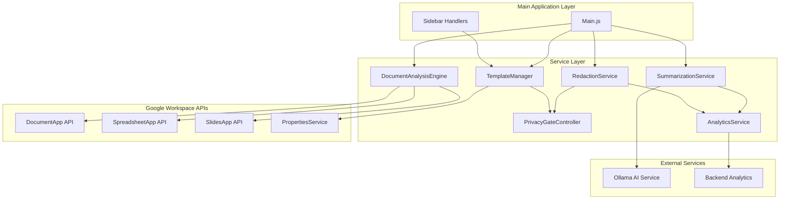
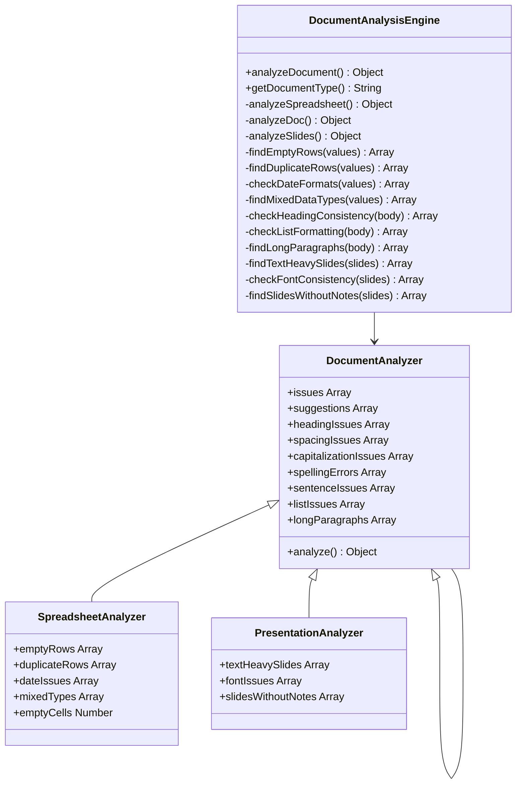
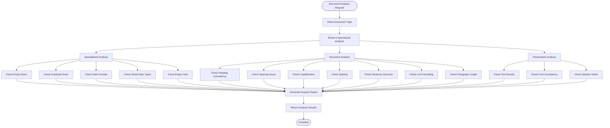
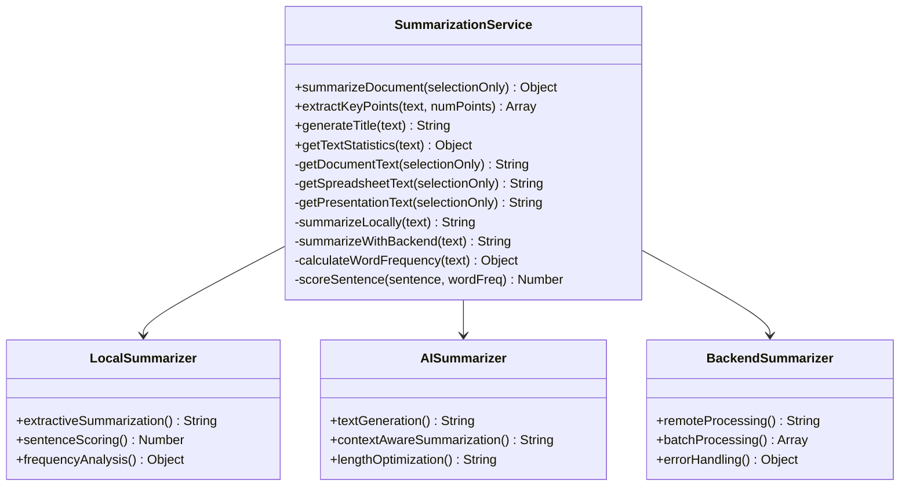
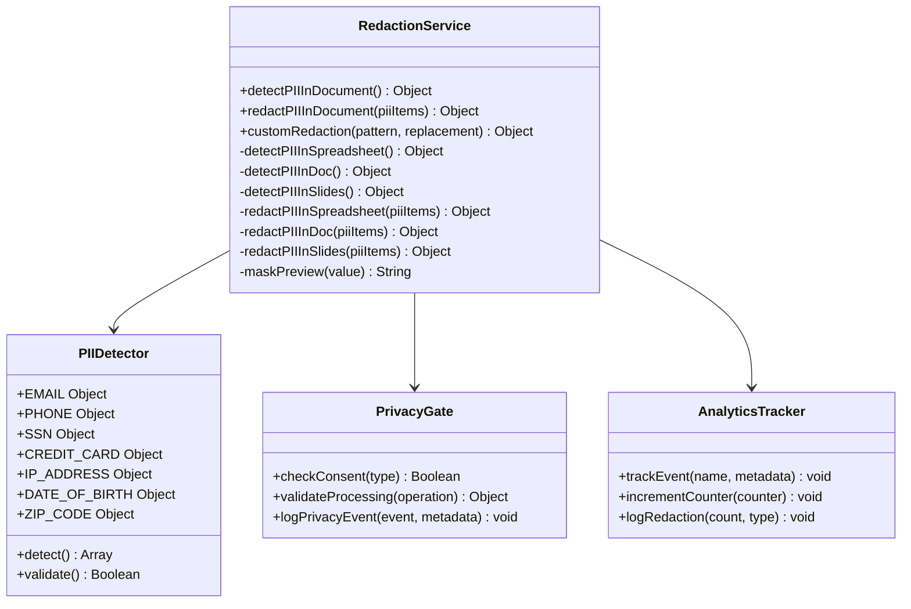
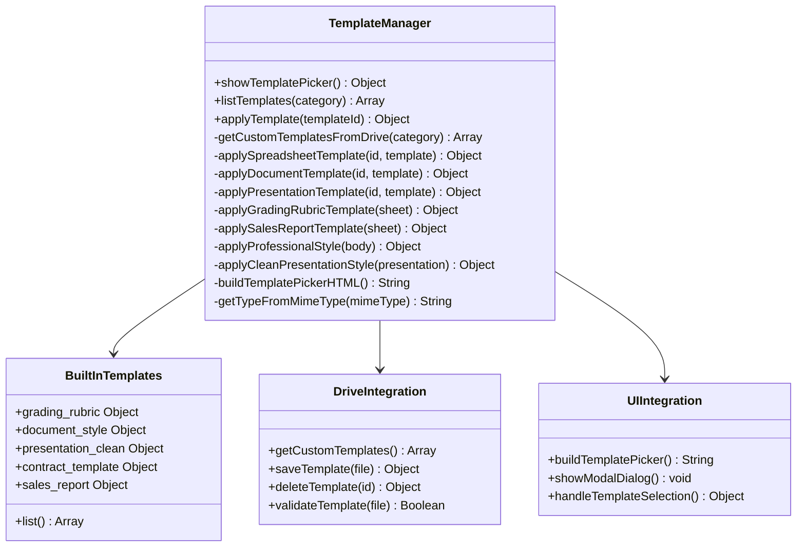
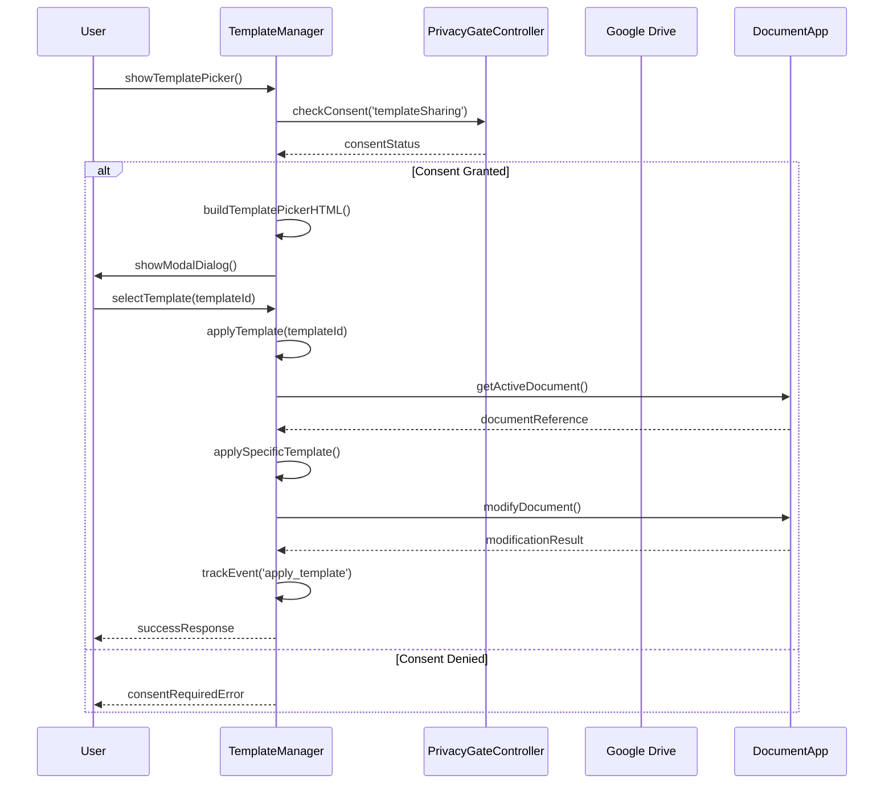
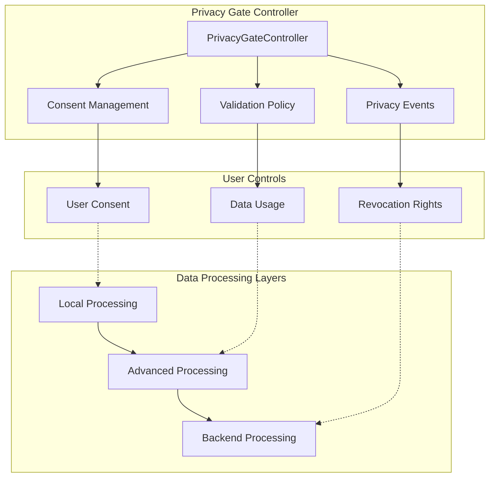

# Document Analysis Sub-Component Documentation

<cite>
**Referenced Files in This Document**
- [DocumentAnalysisEngine.js](file://src/services/DocumentAnalysisEngine.js)
- [SummarizationService.js](file://src/services/SummarizationService.js)
- [RedactionService.js](file://src/services/RedactionService.js)
- [TemplateManager.js](file://src/services/TemplateManager.js)
- [Main.js](file://src/Main.js)
- [PrivacyGateController.js](file://src/services/PrivacyGateController.js)
- [AnalyticsService.js](file://src/services/AnalyticsService.js)
- [Utils.js](file://src/utils/Utils.js)
</cite>

## Table of Contents
1. [Introduction](#introduction)
2. [System Architecture](#system-architecture)
3. [Core Components](#core-components)
4. [Document Analysis Engine](#document-analysis-engine)
5. [Summarization Service](#summarization-service)
6. [Redaction Service](#redaction-service)
7. [Template Management](#template-management)
8. [Privacy and Security](#privacy-and-security)
9. [Integration Patterns](#integration-patterns)
10. [Configuration and Usage](#configuration-and-usage)
11. [Troubleshooting](#troubleshooting)
12. [Best Practices](#best-practices)

## Introduction

The Document Analysis Sub-Component is a sophisticated system within the Intelligent Document Automation Add-on that provides comprehensive document analysis, processing, and enhancement capabilities. This sub-component serves as the core analytical engine, offering specialized services for Google Docs, Sheets, and Slides documents.

The system operates on a privacy-first principle, ensuring all processing occurs locally by default while providing optional advanced features that require explicit user consent. It encompasses four primary services: Document Analysis Engine for detecting formatting issues, Summarization Service for content summarization, Redaction Service for sensitive information protection, and Template Manager for document styling and structure.

## System Architecture

The Document Analysis Sub-Component follows a modular architecture with clear separation of concerns:



**Diagram sources**
- [Main.js](file://src/Main.js#L1-L100)
- [DocumentAnalysisEngine.js](file://src/services/DocumentAnalysisEngine.js#L1-L50)
- [SummarizationService.js](file://src/services/SummarizationService.js#L1-L50)

## Core Components

### Service Orchestration Layer

The main orchestrator manages service initialization, configuration, and inter-service communication. It handles document type detection, service routing, and user interface coordination.

### Document Type Detection System

The system automatically identifies document types (Documents, Spreadsheets, Presentations) and routes requests to appropriate specialized analyzers.

### Privacy Enforcement Layer

A comprehensive privacy framework ensures data processing compliance with user consent preferences and regulatory requirements.

**Section sources**
- [Main.js](file://src/Main.js#L20-L35)
- [DocumentAnalysisEngine.js](file://src/services/DocumentAnalysisEngine.js#L707-L730)

## Document Analysis Engine

The Document Analysis Engine serves as the foundation for all document processing activities, providing comprehensive analysis capabilities across different document types.

### Architecture Overview



**Diagram sources**
- [DocumentAnalysisEngine.js](file://src/services/DocumentAnalysisEngine.js#L12-L160)

### Document Type Analysis

The engine supports three primary document types with specialized analysis algorithms:

#### Spreadsheet Analysis
- **Empty Row Detection**: Identifies completely empty rows that may indicate data gaps
- **Duplicate Row Detection**: Finds identical rows that could represent data redundancy
- **Date Format Standardization**: Detects inconsistent date formats across columns
- **Mixed Data Types**: Identifies columns containing multiple data type values
- **Empty Cell Counting**: Quantifies missing data points in structured datasets

#### Document Analysis
- **Heading Consistency**: Ensures uniform formatting across heading levels
- **Spacing Issues**: Detects improper spacing around punctuation marks
- **Capitalization Errors**: Identifies inconsistent capitalization patterns
- **Spelling Mistakes**: Flags potential spelling errors using common misspelling dictionaries
- **Sentence Structure**: Analyzes sentence construction for grammatical correctness
- **List Formatting**: Verifies consistent bullet and numbered list formatting
- **Paragraph Length**: Identifies overly long paragraphs that reduce readability

#### Presentation Analysis
- **Text Density**: Detects slides with excessive text content
- **Font Consistency**: Identifies inconsistent font usage across slides
- **Speaker Notes**: Flags presentations missing speaker notes
- **Visual Balance**: Analyzes slide composition for optimal visual impact

### Analysis Algorithm Implementation

The analysis engine employs sophisticated algorithms for each document type:



**Diagram sources**
- [DocumentAnalysisEngine.js](file://src/services/DocumentAnalysisEngine.js#L12-L160)

**Section sources**
- [DocumentAnalysisEngine.js](file://src/services/DocumentAnalysisEngine.js#L12-L739)

## Summarization Service

The Summarization Service provides intelligent document summarization capabilities with both local and AI-powered processing options.

### Service Architecture



**Diagram sources**
- [SummarizationService.js](file://src/services/SummarizationService.js#L16-L356)

### Multi-Level Summarization Pipeline

The service implements a tiered approach prioritizing processing methods:

#### Tier 1: AI-Powered Summarization
- **Gemini Integration**: Utilizes advanced AI models for comprehensive understanding
- **Context Preservation**: Maintains semantic meaning and key information
- **Style Adaptation**: Adapts summarization style to document type
- **Length Optimization**: Produces summaries within specified character limits

#### Tier 2: Local Summarization
- **Extractive Methodology**: Selects important sentences from original text
- **Keyword Frequency Analysis**: Identifies content-relevant terms
- **Sentence Scoring**: Ranks sentences based on importance metrics
- **Positional Preservation**: Maintains logical sentence ordering

#### Tier 3: Fallback Processing
- **Truncated Summaries**: Provides condensed versions for large documents
- **Basic Extraction**: Uses first N sentences as fallback
- **Error Recovery**: Ensures functionality even with processing failures

### Text Processing Capabilities

The summarization service handles multiple document types with specialized extraction methods:

#### Document Text Extraction
- **Selection-Based**: Processes only user-selected text when requested
- **Full Document**: Analyzes entire document content otherwise
- **Formatting Preservation**: Maintains original text structure
- **Encoding Handling**: Supports various character encodings

#### Spreadsheet Text Processing
- **Range Selection**: Processes selected cell ranges or entire sheets
- **Data Cleaning**: Removes formatting artifacts during extraction
- **Structured Output**: Maintains tabular relationships in extracted text

#### Presentation Text Processing
- **Slide Aggregation**: Combines text from all slides or selected slides
- **Content Hierarchy**: Preserves slide structure and hierarchy
- **Multimedia Handling**: Processes text-only content from shapes and text boxes

### Advanced Summarization Features

#### Key Point Extraction
- **Importance Scoring**: Ranks sentences by informational value
- **Diversity Optimization**: Ensures varied coverage of topics
- **Customizable Length**: Adjustable number of key points

#### Title Generation
- **Content Analysis**: Examines first sentences for representative content
- **Length Constraints**: Enforces character limits for titles
- **Readability Optimization**: Creates concise, meaningful titles

#### Text Statistics
- **Word Counting**: Accurate word and character counting
- **Sentence Analysis**: Sentence structure and complexity metrics
- **Reading Time Estimation**: Time required to read document content
- **Paragraph Analysis**: Paragraph distribution and length metrics

**Section sources**
- [SummarizationService.js](file://src/services/SummarizationService.js#L16-L356)

## Redaction Service

The Redaction Service provides comprehensive sensitive information detection and removal capabilities with strict privacy controls.

### Service Architecture



**Diagram sources**
- [RedactionService.js](file://src/services/RedactionService.js#L8-L402)
- [PrivacyGateController.js](file://src/services/PrivacyGateController.js#L8-L365)

### PII Detection Patterns

The service maintains comprehensive pattern libraries for detecting various types of personally identifiable information:

#### Email Addresses
- **Pattern**: `[A-Za-z0-9._%+-]+@[A-Za-z0-9.-]+\.[A-Z|a-z]{2,}`
- **Redaction**: `[EMAIL REDACTED]`
- **Validation**: Domain and format verification

#### Phone Numbers
- **Pattern**: `(\+\d{1,3}[\s.-]?)?\(?\d{3}\)?[\s.-]?\d{3}[\s.-]?\d{4}`
- **Redaction**: `[PHONE REDACTED]`
- **Support**: International and domestic formats

#### Social Security Numbers
- **Pattern**: `\b\d{3}-\d{2}-\d{4}\b`
- **Redaction**: `[SSN REDACTED]`
- **Format**: Standard US SSN format

#### Credit Card Numbers
- **Pattern**: `\b(?:\d{4}[\s-]?){3}\d{4}\b`
- **Redaction**: `[CARD REDACTED]`
- **Validation**: Luhn algorithm support

#### IP Addresses
- **Pattern**: `\b(?:\d{1,3}\.){3}\d{1,3}\b`
- **Redaction**: `[IP REDACTED]`
- **Range Validation**: IPv4 address range checking

#### Date of Birth
- **Pattern**: `\b(?:0[1-9]|1[0-2])\/(?:0[1-9]|[12]\d|3[01])\/(?:19|20)\d{2}\b`
- **Redaction**: `[DOB REDACTED]`
- **Format**: MM/DD/YYYY format

#### ZIP Codes
- **Pattern**: `\b\d{5}(?:-\d{4})?\b`
- **Redaction**: `[ZIP REDACTED]`
- **Extended Support**: ZIP+4 format detection

### Document Type Processing

Each document type receives specialized treatment for PII detection and redaction:

#### Spreadsheet Processing
- **Cell-by-Cell Analysis**: Processes individual cells for embedded PII
- **Formula Safety**: Avoids triggering formula calculations during detection
- **Multi-cell Coordination**: Handles PII spanning multiple cells
- **Location Tracking**: Precise cell coordinate recording

#### Document Processing
- **Text Range Analysis**: Processes entire document text efficiently
- **Element Preservation**: Maintains formatting during redaction
- **Selection Handling**: Works with user-selected text regions
- **Incremental Processing**: Handles large documents in segments

#### Presentation Processing
- **Slide-by-Slide Analysis**: Processes each slide independently
- **Shape Recognition**: Detects PII in text boxes and shapes
- **Master Slide Awareness**: Respects presentation master templates
- **Animation Safety**: Preserves animation effects during processing

### Privacy-First Approach

The redaction service implements strict privacy controls:

#### Consent Management
- **Explicit Consent**: Requires user approval for sensitive operations
- **Granular Control**: Allows selective enabling of redaction features
- **Audit Trail**: Logs all consent changes and processing activities
- **Revoke Capability**: Enables users to withdraw consent anytime

#### Processing Transparency
- **Preview Functionality**: Shows detected PII before redaction
- **Masked Display**: Presents PII in masked format for review
- **Change Tracking**: Records all modifications made
- **Undo Capability**: Maintains version history for restoration

#### Data Protection
- **Local Processing**: All operations occur within user's environment
- **No Data Transmission**: Prevents sending sensitive data to external services
- **Secure Storage**: Protects temporary processing data
- **Automatic Cleanup**: Removes processed data after completion

**Section sources**
- [RedactionService.js](file://src/services/RedactionService.js#L8-L402)
- [PrivacyGateController.js](file://src/services/PrivacyGateController.js#L78-L148)

## Template Management

The Template Manager provides comprehensive document styling and structure management capabilities with both built-in and custom template support.

### Service Architecture



**Diagram sources**
- [TemplateManager.js](file://src/services/TemplateManager.js#L8-L479)

### Built-in Template Library

The system includes a comprehensive collection of pre-built templates for common document types:

#### Educational Templates
- **Grading Rubric**: Academic assessment template with scoring formulas
- **Document Style**: Professional formatting template for academic papers
- **Presentation Clean**: Minimalist design for educational presentations

#### Business Templates
- **Contract Template**: Legal document format with clause structure
- **Sales Report**: Financial reporting template with calculation formulas
- **Professional Document**: Corporate formatting standards

#### Custom Template Support
- **Drive Integration**: Connects to Google Drive for custom templates
- **Category Organization**: Groups templates by document type and purpose
- **Metadata Support**: Stores template descriptions and categories
- **Version Management**: Tracks template updates and changes

### Template Application Process



**Diagram sources**
- [TemplateManager.js](file://src/services/TemplateManager.js#L46-L75)
- [PrivacyGateController.js](file://src/services/PrivacyGateController.js#L46-L148)

### Template Processing Methods

#### Spreadsheet Template Application
- **Header Creation**: Automatic column header insertion
- **Formula Integration**: Pre-configured calculation formulas
- **Format Standardization**: Consistent number and date formatting
- **Auto-resize**: Dynamic column width adjustment
- **Sample Data**: Demonstrative content insertion

#### Document Template Application
- **Style Application**: Automatic heading and paragraph formatting
- **Font Standardization**: Consistent typography across document
- **Layout Optimization**: Balanced text and white space distribution
- **Metadata Insertion**: Document property updates

#### Presentation Template Application
- **Theme Application**: Consistent slide design and color schemes
- **Layout Standardization**: Uniform slide layouts
- **Animation Preservation**: Maintains existing animations
- **Master Slide Respect**: Works within presentation constraints

### Custom Template Management

#### Drive Integration
- **Folder Configuration**: Designated template storage locations
- **File Discovery**: Automatic template file detection
- **MIME Type Validation**: Ensures compatible file formats
- **Permission Handling**: Manages Google Drive access permissions

#### Template Validation
- **Format Verification**: Confirms template compatibility
- **Content Analysis**: Checks for required structural elements
- **Security Scanning**: Validates template safety
- **Performance Testing**: Ensures smooth application

**Section sources**
- [TemplateManager.js](file://src/services/TemplateManager.js#L8-L479)

## Privacy and Security

The Document Analysis Sub-Component implements comprehensive privacy and security measures to protect user data and ensure compliance with privacy regulations.

### Privacy Framework Architecture



**Diagram sources**
- [PrivacyGateController.js](file://src/services/PrivacyGateController.js#L8-L365)

### Consent Management System

The privacy framework implements granular consent management for different processing types:

#### Consent Types
- **BASIC**: Core functionality without data processing
- **ADVANCED_AI**: AI-powered features requiring data transmission
- **REDACTION**: Sensitive information processing
- **ANALYTICS**: Usage statistics collection
- **TEMPLATE_SHARING**: Template library access

#### Consent Lifecycle
- **Initial State**: Conservative defaults with basic features enabled
- **Request Process**: Clear explanations before consent requests
- **Update Mechanism**: Real-time consent modification
- **Revocation**: Complete data processing cessation upon withdrawal

### Data Processing Controls

#### Local-First Principle
- **Default Processing**: All operations occur locally by default
- **Fallback Mechanisms**: Graceful degradation when advanced features unavailable
- **User Override**: Explicit permission required for remote processing
- **Transparency**: Clear indication of processing location

#### Data Minimization
- **Scope Limitation**: Processes only requested content areas
- **Temporary Storage**: Minimal data retention periods
- **Selective Sharing**: Granular control over data exposure
- **Encryption**: Secure transmission for permitted operations

### Privacy Event Logging

The system maintains comprehensive audit trails for privacy compliance:

#### Event Categories
- **Consent Changes**: All consent modifications logged
- **Data Processing**: Operations involving user data tracked
- **Feature Usage**: Privacy-sensitive feature utilization recorded
- **Error Conditions**: Privacy-related errors documented

#### Logging Features
- **Timestamp Accuracy**: Millisecond precision timestamps
- **User Identification**: Anonymous user tracking
- **Event Details**: Comprehensive metadata capture
- **Compliance Reporting**: Audit-ready logs for regulatory requirements

**Section sources**
- [PrivacyGateController.js](file://src/services/PrivacyGateController.js#L8-L365)

## Integration Patterns

The Document Analysis Sub-Component integrates seamlessly with the broader application ecosystem through well-defined patterns and interfaces.

### Service Communication Patterns

#### Event-Driven Architecture
- **Trigger-Based Processing**: Services respond to user actions and system events
- **Asynchronous Operations**: Non-blocking processing for improved user experience
- **Error Propagation**: Comprehensive error handling and reporting
- **State Management**: Persistent state across service interactions

#### Dependency Injection Pattern
- **Service Registration**: Dynamic service discovery and registration
- **Interface Abstraction**: Clear service boundaries and contracts
- **Mock Support**: Testing-friendly service mocking capabilities
- **Configuration Flexibility**: Runtime service configuration changes

### User Interface Integration

#### Modal Dialog Management
- **Template Picker**: Interactive template selection interface
- **Privacy Settings**: Configurable privacy preferences
- **Processing Status**: Real-time operation progress feedback
- **Error Reporting**: User-friendly error communication

#### Menu Integration
- **Dynamic Menus**: Context-aware menu item availability
- **Feature Discovery**: Progressive disclosure of advanced features
- **Accessibility**: Keyboard navigation and screen reader support
- **Localization**: Multi-language interface support

### External Service Integration

#### AI Service Integration
- **Connection Testing**: Health checks for AI service availability
- **Fallback Strategies**: Graceful degradation when AI unavailable
- **Rate Limiting**: API quota management and throttling
- **Error Handling**: Comprehensive AI service error management

#### Analytics Integration
- **Event Tracking**: Comprehensive usage analytics collection
- **Privacy Compliance**: Analytics processing within privacy constraints
- **Reporting**: Exportable analytics data for analysis
- **Real-time Monitoring**: Live usage statistics and trends

**Section sources**
- [Main.js](file://src/Main.js#L19-L1251)
- [SidebarHandlers.js](file://src/handlers/SidebarHandlers.js#L119-L171)

## Configuration and Usage

### Service Configuration Options

#### Document Analysis Engine
- **Analysis Depth**: Configurable level of analysis detail
- **Threshold Settings**: Customizable detection sensitivity
- **Output Formats**: Various result format options
- **Performance Tuning**: Memory and processing optimization settings

#### Summarization Service
- **AI Integration**: Gemini API configuration and authentication
- **Local Processing Limits**: Character limits for local summarization
- **Output Preferences**: Summary length and style customization
- **Fallback Options**: Alternative processing methods configuration

#### Redaction Service
- **PII Detection Sensitivity**: Pattern matching aggressiveness
- **Redaction Methods**: Different redaction approaches and replacements
- **Privacy Controls**: Enhanced privacy feature activation
- **Batch Processing**: Large-scale processing optimization

#### Template Manager
- **Drive Integration**: Google Drive connection settings
- **Template Categories**: Customizable template organization
- **UI Preferences**: Interface appearance and behavior
- **Storage Locations**: Template file storage configuration

### Usage Patterns

#### Basic Document Analysis
```javascript
// Simple document analysis
const analysisResults = DocumentAnalysisEngine.analyzeDocument();
console.log(analysisResults.issues);
console.log(analysisResults.suggestions);
```

#### Advanced Summarization
```javascript
// AI-powered summarization with custom parameters
const summary = SummarizationService.summarizeDocument({
  maxLength: 200,
  style: 'concise',
  selectionOnly: false
});
```

#### Privacy-Conscious Redaction
```javascript
// Redaction with explicit consent
if (PrivacyGateController.checkConsent('redaction')) {
  const redactionResults = RedactionService.redactPIIInDocument();
  console.log(redactionResults.count + ' items redacted');
}
```

#### Template Application
```javascript
// Show template picker and apply selected template
const pickerResult = TemplateManager.showTemplatePicker();
if (pickerResult.success) {
  const applyResult = TemplateManager.applyTemplate(selectedTemplateId);
  console.log(applyResult.message);
}
```

### Parameter Specifications

#### Document Analysis Parameters
- **selectionOnly**: Boolean flag for partial document processing
- **analysisDepth**: Integer specifying analysis intensity level
- **outputFormat**: String defining result format preference

#### Summarization Parameters
- **maxLength**: Maximum character count for generated summary
- **style**: String controlling summary writing style
- **language**: Target language for processing and output

#### Redaction Parameters
- **piiTypes**: Array of specific PII types to process
- **replacementPattern**: Custom redaction text specification
- **scope**: Processing scope (document, selection, specific areas)

**Section sources**
- [DocumentAnalysisEngine.js](file://src/services/DocumentAnalysisEngine.js#L12-L30)
- [SummarizationService.js](file://src/services/SummarizationService.js#L16-L65)
- [RedactionService.js](file://src/services/RedactionService.js#L181-L208)
- [TemplateManager.js](file://src/services/TemplateManager.js#L46-L75)

## Troubleshooting

### Common Issues and Solutions

#### Document Analysis Failures
**Problem**: Analysis returns empty results or errors
**Causes**: 
- Document type detection failure
- Insufficient document content
- API access restrictions

**Solutions**:
- Verify document is properly opened and accessible
- Check document content meets minimum requirements
- Review Google Workspace API permissions
- Enable appropriate consent for advanced features

#### Summarization Service Issues
**Problem**: Summarization produces poor quality results
**Causes**:
- Insufficient document content
- AI service connectivity issues
- Processing limitations exceeded

**Solutions**:
- Ensure document contains substantial content (>100 words)
- Verify AI service configuration and authentication
- Reduce processing scope for large documents
- Use local summarization as fallback

#### Redaction Service Problems
**Problem**: PII not detected or incorrect redaction occurs
**Causes**:
- Pattern matching configuration issues
- Insufficient consent for processing
- Complex formatting interfering with detection

**Solutions**:
- Verify privacy consent is granted for redaction
- Check PII pattern configurations
- Simplify document formatting for better detection
- Use manual redaction for complex cases

#### Template Application Failures
**Problem**: Templates fail to apply or produce unexpected results
**Causes**:
- Template compatibility issues
- Document structure conflicts
- Drive access permissions

**Solutions**:
- Verify template compatibility with document type
- Check document structure for conflicts
- Confirm Google Drive access permissions
- Use built-in templates as fallback

### Performance Optimization

#### Memory Management
- Monitor memory usage during large document processing
- Implement batch processing for extensive operations
- Clear temporary data after processing completion
- Use streaming for very large documents

#### Processing Speed
- Enable local processing for faster operations
- Optimize document structure before analysis
- Use selection-only mode for targeted processing
- Implement caching for frequently accessed templates

#### Error Recovery
- Implement retry mechanisms for transient failures
- Provide graceful degradation for optional features
- Maintain operation logs for troubleshooting
- Offer user-friendly error messages

**Section sources**
- [DocumentAnalysisEngine.js](file://src/services/DocumentAnalysisEngine.js#L26-L29)
- [SummarizationService.js](file://src/services/SummarizationService.js#L61-L65)
- [RedactionService.js](file://src/services/RedactionService.js#L65-L69)
- [TemplateManager.js](file://src/services/TemplateManager.js#L75-L80)

## Best Practices

### Development Guidelines

#### Service Design Principles
- **Single Responsibility**: Each service focuses on specific functionality
- **Loose Coupling**: Services communicate through well-defined interfaces
- **High Cohesion**: Related functionality grouped within services
- **Error Handling**: Comprehensive error management and recovery

#### Code Quality Standards
- **Documentation**: Comprehensive inline documentation for all public methods
- **Testing**: Unit tests for critical functionality and edge cases
- **Performance**: Efficient algorithms and memory management
- **Security**: Input validation and secure data handling

#### User Experience
- **Progress Indication**: Clear feedback during long-running operations
- **Error Messages**: User-friendly error descriptions with resolution guidance
- **Accessibility**: Keyboard navigation and screen reader support
- **Localization**: Multi-language support for global users

### Operational Best Practices

#### Privacy Compliance
- **Consent Management**: Clear consent requests with specific explanations
- **Data Minimization**: Process only necessary data for requested operations
- **Transparency**: Inform users about data processing activities
- **Audit Trails**: Maintain comprehensive logs for compliance

#### Performance Optimization
- **Caching**: Implement caching for frequently accessed data
- **Batch Processing**: Group operations to minimize API calls
- **Resource Management**: Proper cleanup of temporary resources
- **Monitoring**: Track service performance and usage patterns

#### Maintenance and Updates
- **Version Control**: Maintain backward compatibility when possible
- **Testing**: Comprehensive testing before production deployments
- **Documentation**: Keep documentation synchronized with code changes
- **Monitoring**: Implement monitoring for service health and performance

### Security Considerations

#### Data Protection
- **Local Processing**: Prefer local processing over remote operations
- **Input Validation**: Validate all user inputs and external data
- **Access Control**: Implement proper access controls for sensitive operations
- **Encryption**: Use encryption for data in transit and at rest

#### Compliance
- **Regulatory Adherence**: Follow applicable privacy regulations
- **Audit Requirements**: Maintain audit trails for compliance
- **User Rights**: Respect user data rights and preferences
- **Third-party Integration**: Carefully vet external service integrations

**Section sources**
- [PrivacyGateController.js](file://src/services/PrivacyGateController.js#L222-L236)
- [AnalyticsService.js](file://src/services/AnalyticsService.js#L16-L45)
- [Utils.js](file://src/utils/Utils.js#L1-L258)