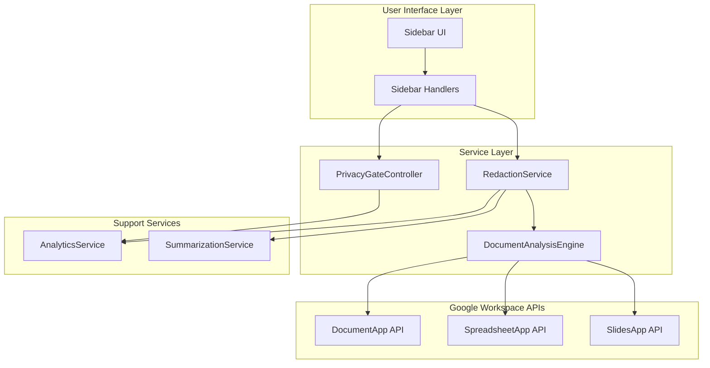
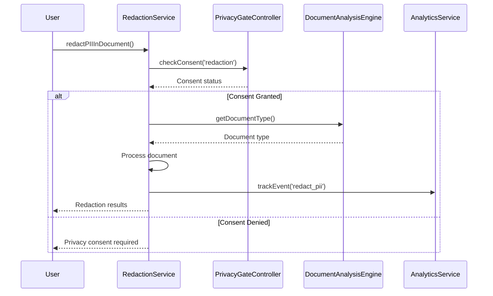
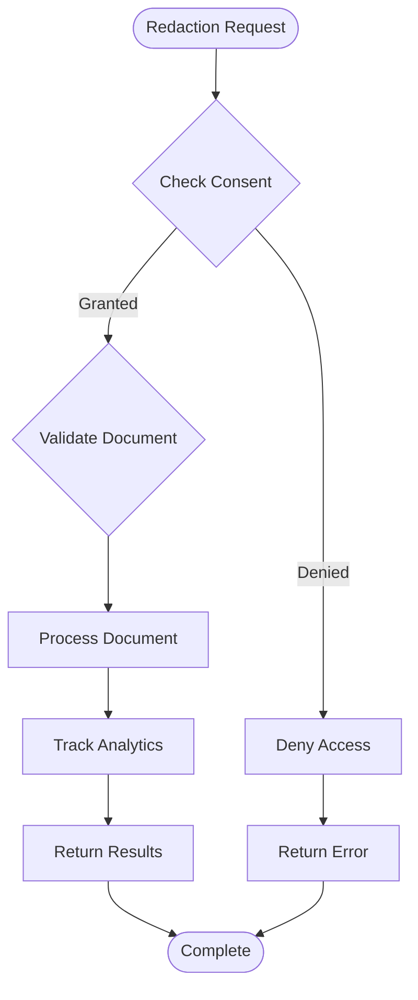
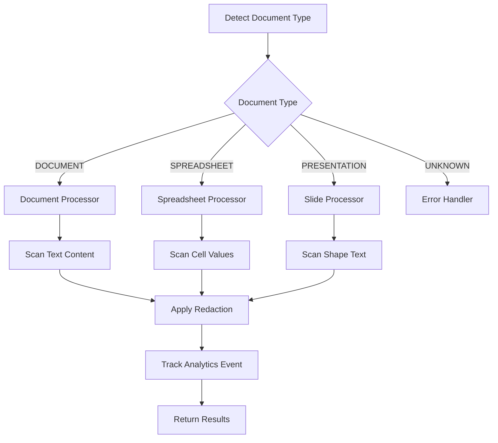
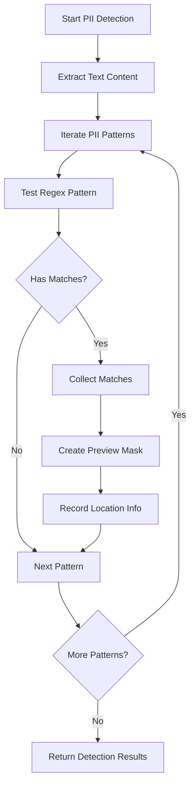
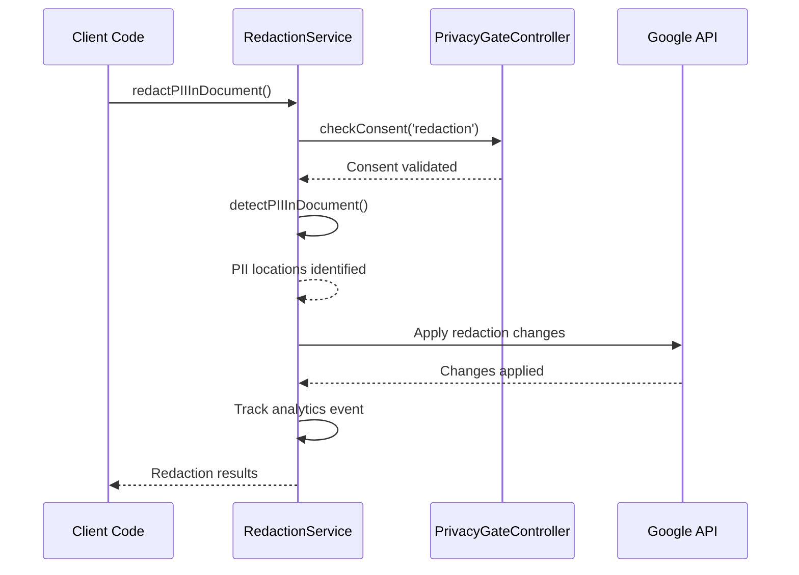
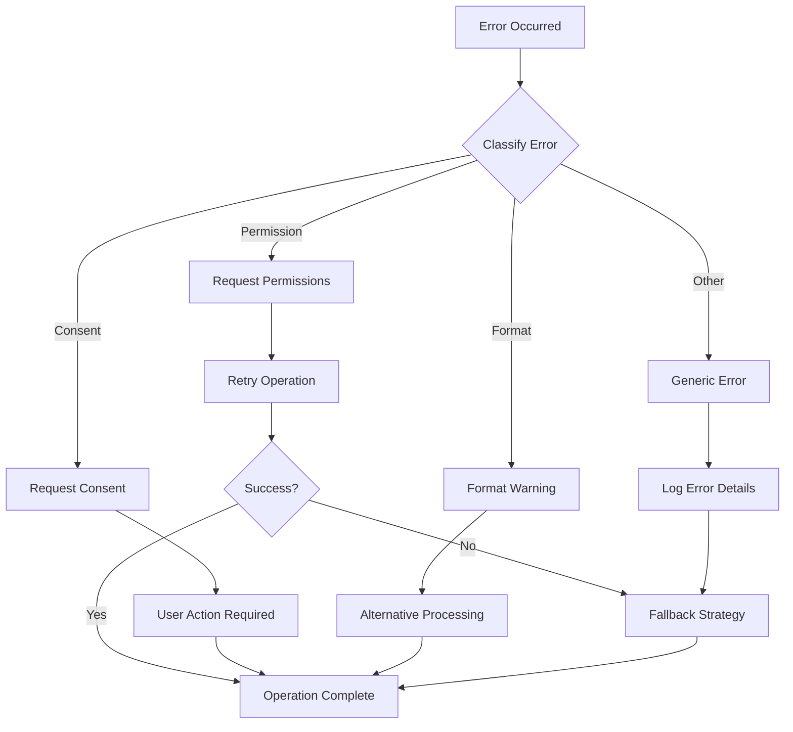

# Redaction Service

<cite>
**Referenced Files in This Document**
- [RedactionService.js](file://src/services/RedactionService.js)
- [PrivacyGateController.js](file://src/services/PrivacyGateController.js)
- [DocumentAnalysisEngine.js](file://src/services/DocumentAnalysisEngine.js)
- [Main.js](file://src/Main.js)
- [SidebarHandlers.js](file://src/handlers/SidebarHandlers.js)
- [Sidebar.html](file://src/ui/Sidebar.html)
- [SummarizationService.js](file://src/services/SummarizationService.js)
</cite>

## Table of Contents
1. [Introduction](#introduction)
2. [System Architecture](#system-architecture)
3. [Core Components](#core-components)
4. [Privacy and Consent Management](#privacy-and-consent-management)
5. [Document Type Detection](#document-type-detection)
6. [PII Detection Patterns](#pii-detection-patterns)
7. [Implementation Details](#implementation-details)
8. [Usage Patterns](#usage-patterns)
9. [Configuration Options](#configuration-options)
10. [Error Handling and Edge Cases](#error-handling-and-edge-cases)
11. [Performance Considerations](#performance-considerations)
12. [Troubleshooting Guide](#troubleshooting-guide)
13. [Best Practices](#best-practices)

## Introduction

The Redaction Service is a comprehensive privacy protection system designed to detect and redact Personally Identifiable Information (PII) and sensitive data from Google Workspace documents. Built as part of the Intelligent Document Automation add-on, it provides automated privacy compliance capabilities with granular control over data processing consent.

The service operates on three primary document types: Google Docs, Google Sheets, and Google Slides, offering specialized detection and redaction algorithms for each format. It integrates seamlessly with the broader privacy framework, ensuring all operations comply with user consent preferences and data protection regulations.

## System Architecture

The Redaction Service follows a modular architecture with clear separation of concerns:



**Diagram sources**
- [RedactionService.js](file://src/services/RedactionService.js#L1-L402)
- [PrivacyGateController.js](file://src/services/PrivacyGateController.js#L1-L366)
- [DocumentAnalysisEngine.js](file://src/services/DocumentAnalysisEngine.js#L1-L739)

**Section sources**
- [RedactionService.js](file://src/services/RedactionService.js#L1-L50)
- [PrivacyGateController.js](file://src/services/PrivacyGateController.js#L1-L80)

## Core Components

### RedactionService Module

The RedactionService is implemented as an Immediately Invoked Function Expression (IIFE) that encapsulates all PII detection and redaction functionality. It provides three primary public methods:

- **`detectPIIInDocument()`**: Scans the current document for PII patterns and returns detailed findings
- **`redactPIIInDocument()`**: Performs automated redaction of detected PII with consent validation
- **`customRedaction()`**: Allows custom pattern-based redaction with user-defined replacements

### PrivacyGateController Integration

The service integrates deeply with the PrivacyGateController for comprehensive privacy management:



**Diagram sources**
- [RedactionService.js](file://src/services/RedactionService.js#L180-L208)
- [PrivacyGateController.js](file://src/services/PrivacyGateController.js#L78-L81)

**Section sources**
- [RedactionService.js](file://src/services/RedactionService.js#L395-L398)
- [PrivacyGateController.js](file://src/services/PrivacyGateController.js#L352-L363)

## Privacy and Consent Management

### Consent Types and Validation

The PrivacyGateController manages four primary consent types relevant to redaction operations:

| Consent Type | Purpose | Default State | Required For |
|--------------|---------|---------------|--------------|
| `basic` | Core functionality | Enabled | All operations |
| `redaction` | PII detection/redaction | Enabled | PII operations |
| `advancedAI` | AI-powered processing | Disabled | Advanced features |
| `analytics` | Usage tracking | Disabled | Analytics |

### Consent Validation Workflow



**Diagram sources**
- [PrivacyGateController.js](file://src/services/PrivacyGateController.js#L170-L213)
- [RedactionService.js](file://src/services/RedactionService.js#L180-L208)

**Section sources**
- [PrivacyGateController.js](file://src/services/PrivacyGateController.js#L8-L15)
- [PrivacyGateController.js](file://src/services/PrivacyGateController.js#L170-L213)

## Document Type Detection

The DocumentAnalysisEngine provides sophisticated document type detection that enables service-specific processing:

### Supported Document Types

| Document Type | Detection Method | Processing Capabilities |
|---------------|------------------|------------------------|
| `DOCUMENT` | `DocumentApp.getActiveDocument()` | Full-text scanning, formatting preservation |
| `SPREADSHEET` | `SpreadsheetApp.getActiveSpreadsheet()` | Cell-by-cell analysis, formula handling |
| `PRESENTATION` | `SlidesApp.getActivePresentation()` | Slide-by-slide processing, shape analysis |

### Document Processing Flow



**Diagram sources**
- [DocumentAnalysisEngine.js](file://src/services/DocumentAnalysisEngine.js#L704-L730)
- [RedactionService.js](file://src/services/RedactionService.js#L51-L68)

**Section sources**
- [DocumentAnalysisEngine.js](file://src/services/DocumentAnalysisEngine.js#L704-L730)
- [RedactionService.js](file://src/services/RedactionService.js#L51-L68)

## PII Detection Patterns

The RedactionService employs comprehensive regular expression patterns for detecting various types of sensitive information:

### PII Pattern Categories

| Pattern Type | Regular Expression | Redaction Replacement | Example Match |
|--------------|-------------------|----------------------|---------------|
| Email Address | `\b[A-Za-z0-9._%+-]+@[A-Za-z0-9.-]+\.[A-Z\|a-z]{2,}\b` | `[EMAIL REDACTED]` | `john.doe@example.com` |
| Phone Number | `(\+\d{1,3}[\s.-]?)?\(?\d{3}\)?[\s.-]?\d{3}[\s.-]?\d{4}\b` | `[PHONE REDACTED]` | `(555) 123-4567` |
| Social Security Number | `\b\d{3}-\d{2}-\d{4}\b` | `[SSN REDACTED]` | `123-45-6789` |
| Credit Card Number | `\b(?:\d{4}[\s-]?){3}\d{4}\b` | `[CARD REDACTED]` | `4111 1111 1111 1111` |
| IP Address | `\b(?:\d{1,3}\.){3}\d{1,3}\b` | `[IP REDACTED]` | `192.168.1.1` |
| Date of Birth | `\b(?:0[1-9]|1[0-2])\/(?:0[1-9]|[12]\d\|3[01])\/(?:19\|20)\d{2}\b` | `[DOB REDACTED]` | `12/25/1985` |
| ZIP Code | `\b\d{5}(?:-\d{4})?\b` | `[ZIP REDACTED]` | `12345-6789` |

### Detection Algorithm



**Diagram sources**
- [RedactionService.js](file://src/services/RedactionService.js#L118-L134)
- [RedactionService.js](file://src/services/RedactionService.js#L340-L352)

**Section sources**
- [RedactionService.js](file://src/services/RedactionService.js#L9-L44)
- [RedactionService.js](file://src/services/RedactionService.js#L118-L134)

## Implementation Details

### Document-Specific Processing

Each document type requires specialized processing approaches:

#### Google Docs Processing
- **Text Extraction**: Uses `DocumentApp.getBody().getText()` for full document content
- **Pattern Matching**: Searches entire text content with regex engines
- **Location Tracking**: Records as "Document body" for UI display
- **Preservation**: Maintains document formatting during redaction

#### Google Sheets Processing
- **Cell Iteration**: Processes all cells in the active data range
- **Type Checking**: Validates string content before pattern matching
- **Coordinate Tracking**: Records row and column indices for precise location
- **Batch Operations**: Updates multiple cells efficiently

#### Google Slides Processing
- **Shape Analysis**: Iterates through all shapes containing text
- **Slide Indexing**: Tracks slide numbers for navigation
- **Text Range Management**: Handles complex text formatting within shapes

### Redaction Execution



**Diagram sources**
- [RedactionService.js](file://src/services/RedactionService.js#L180-L208)
- [SidebarHandlers.js](file://src/handlers/SidebarHandlers.js#L61-L74)

**Section sources**
- [RedactionService.js](file://src/services/RedactionService.js#L180-L208)
- [RedactionService.js](file://src/services/RedactionService.js#L210-L337)

### Custom Redaction Feature

The service supports custom pattern-based redaction for specialized use cases:

```javascript
// Example custom redaction usage
const result = RedactionService.customRedaction(
  '\\b[A-Z]{2}\\d{6}\\b', // Custom pattern for license numbers
  '[LICENSE REDACTED]'    // Custom replacement
);
```

**Section sources**
- [RedactionService.js](file://src/services/RedactionService.js#L355-L393)

## Usage Patterns

### Basic PII Detection

```javascript
// Detect PII in current document
const detectionResults = RedactionService.detectPIIInDocument();

if (detectionResults.found.length > 0) {
  console.log(`Found ${detectionResults.total} sensitive items`);
  detectionResults.found.forEach(item => {
    console.log(`${item.type}: ${item.preview} (${item.location})`);
  });
}
```

### Automated Redaction

```javascript
// Perform automatic redaction
const redactionResults = RedactionService.redactPIIInDocument();

if (redactionResults.success) {
  console.log(`Successfully redacted ${redactionResults.count} items`);
} else {
  console.log(`Redaction failed: ${redactionResults.message}`);
}
```

### Selective Redaction

```javascript
// Detect PII first
const detectionResults = RedactionService.detectPIIInDocument();

// Redact only specific items
const selectedItems = detectionResults.found.filter(item => 
  item.type === 'Email Address' || item.type === 'Phone Number'
);

const redactionResults = RedactionService.redactPIIInDocument(selectedItems);
```

### Custom Pattern Redaction

```javascript
// Custom redaction for proprietary identifiers
const customResults = RedactionService.customRedaction(
  '\\bPRO\\d{8}\\b', // Pattern for PRO-XXXXXX format
  '[INTERNAL ID REDACTED]'
);
```

**Section sources**
- [SidebarHandlers.js](file://src/handlers/SidebarHandlers.js#L46-L74)
- [Sidebar.html](file://src/ui/Sidebar.html#L374-L411)

## Configuration Options

### Consent Management

The PrivacyGateController provides comprehensive consent management:

```javascript
// Check current consent status
const consent = PrivacyGateController.getConsent();
console.log('Redaction consent:', consent.redaction);

// Request consent for redaction operations
const granted = PrivacyGateController.requestConsent(
  'redaction', 
  'Need to protect sensitive information'
);

// Update consent programmatically
PrivacyGateController.updateConsent('redaction', true);
```

### Analytics Integration

The service tracks all redaction operations for monitoring and improvement:

| Event Type | Parameters | Purpose |
|------------|------------|---------|
| `detect_pii` | `{count: number}` | Track detection frequency |
| `redact_pii` | `{count: number, docType: string}` | Monitor redaction volume |
| `custom_redaction` | `{count: number}` | Track custom pattern usage |

**Section sources**
- [PrivacyGateController.js](file://src/services/PrivacyGateController.js#L170-L213)
- [RedactionService.js](file://src/services/RedactionService.js#L247-L248)

## Error Handling and Edge Cases

### Common Error Scenarios

#### Document Access Errors
- **Cause**: User lacks permissions or document is closed
- **Handling**: Graceful fallback with error reporting
- **Resolution**: Verify document accessibility and user permissions

#### Consent Denial
- **Cause**: User denies privacy consent for redaction
- **Handling**: Clear error messaging and alternative suggestions
- **Resolution**: Guide user to privacy settings to grant consent

#### Unsupported Document Types
- **Cause**: Document format not recognized
- **Handling**: Return empty results with informative message
- **Resolution**: Convert document to supported format

### Error Recovery Strategies



**Diagram sources**
- [RedactionService.js](file://src/services/RedactionService.js#L66-L68)
- [RedactionService.js](file://src/services/RedactionService.js#L204-L207)

**Section sources**
- [RedactionService.js](file://src/services/RedactionService.js#L66-L68)
- [RedactionService.js](file://src/services/RedactionService.js#L204-L207)

## Performance Considerations

### Processing Efficiency

The service implements several optimization strategies:

#### Document Size Management
- **Threshold**: Documents larger than 5000 characters trigger truncation warnings
- **Strategy**: Process only the first portion for performance
- **Fallback**: Local summarization for unsupported lengths

#### Pattern Optimization
- **Compiled Regex**: Patterns are pre-compiled for faster matching
- **Early Termination**: Stop processing when sufficient matches found
- **Memory Management**: Efficient string manipulation to minimize memory usage

### Scalability Factors

| Factor | Impact | Mitigation Strategy |
|--------|--------|-------------------|
| Document Size | Linear processing time | Truncate large documents |
| Pattern Complexity | Exponential matching cost | Optimize regex patterns |
| Concurrent Operations | Resource contention | Queue processing requests |
| Memory Usage | Out-of-memory errors | Stream processing approach |

**Section sources**
- [SummarizationService.js](file://src/services/SummarizationService.js#L8-L9)
- [SummarizationService.js](file://src/services/SummarizationService.js#L47-L60)

## Troubleshooting Guide

### Common Issues and Solutions

#### Issue: Redaction Not Working
**Symptoms**: Redaction button appears inactive or fails silently
**Causes**: 
- Missing consent for redaction operations
- Document contains no detectable PII
- Insufficient document permissions

**Solutions**:
1. Check privacy settings: `PrivacyGateController.getConsent()`
2. Verify document accessibility: Test with simple text operations
3. Review browser console for JavaScript errors

#### Issue: False Positives in Detection
**Symptoms**: Non-sensitive text marked as PII
**Causes**:
- Overly broad regex patterns
- Ambiguous text patterns

**Solutions**:
1. Review detection patterns in `PII_PATTERNS` constant
2. Implement custom validation logic
3. Use selective redaction with filtered results

#### Issue: Performance Problems
**Symptoms**: Slow detection or redaction operations
**Causes**:
- Large document sizes
- Complex regex patterns
- Network latency (for AI features)

**Solutions**:
1. Process documents in smaller chunks
2. Optimize regex patterns for performance
3. Implement caching for frequently accessed patterns

### Debugging Tools

#### Enable Debug Logging
```javascript
// Enable verbose logging for redaction operations
console.log('Redaction Service Status:', {
  detectionEnabled: PrivacyGateController.checkConsent('redaction'),
  documentType: DocumentAnalysisEngine.getDocumentType(),
  piiPatterns: Object.keys(RedactionService.PI_PATTERN_TYPES)
});
```

#### Monitor Analytics Events
```javascript
// Track redaction operations for performance analysis
AnalyticsService.getEvents('redact_pii').forEach(event => {
  console.log('Redaction Event:', event);
});
```

**Section sources**
- [PrivacyGateController.js](file://src/services/PrivacyGateController.js#L352-L363)
- [DocumentAnalysisEngine.js](file://src/services/DocumentAnalysisEngine.js#L704-L730)

## Best Practices

### Security and Privacy

1. **Consent First**: Always check user consent before processing sensitive data
2. **Minimal Processing**: Process only the data necessary for the operation
3. **Local Processing**: Prefer local processing over remote operations when possible
4. **Audit Trails**: Maintain logs of all redaction operations for compliance

### Performance Optimization

1. **Batch Operations**: Group multiple redactions into single operations
2. **Caching**: Cache detection results for repeated operations
3. **Progressive Loading**: Show progress indicators for large documents
4. **Resource Cleanup**: Properly dispose of temporary resources

### User Experience

1. **Clear Feedback**: Provide immediate feedback on operation status
2. **Selective Options**: Allow users to choose which PII types to redact
3. **Undo Capability**: Implement undo functionality for reversible operations
4. **Documentation**: Provide clear explanations of what data is being processed

### Integration Guidelines

1. **Error Handling**: Implement robust error handling for all operations
2. **Graceful Degradation**: Provide fallback options when features are unavailable
3. **Testing**: Thoroughly test with various document types and sizes
4. **Monitoring**: Implement monitoring for service health and performance

**Section sources**
- [PrivacyGateController.js](file://src/services/PrivacyGateController.js#L240-L270)
- [RedactionService.js](file://src/services/RedactionService.js#L395-L398)