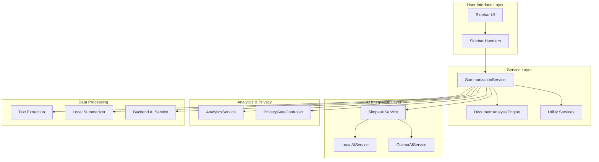
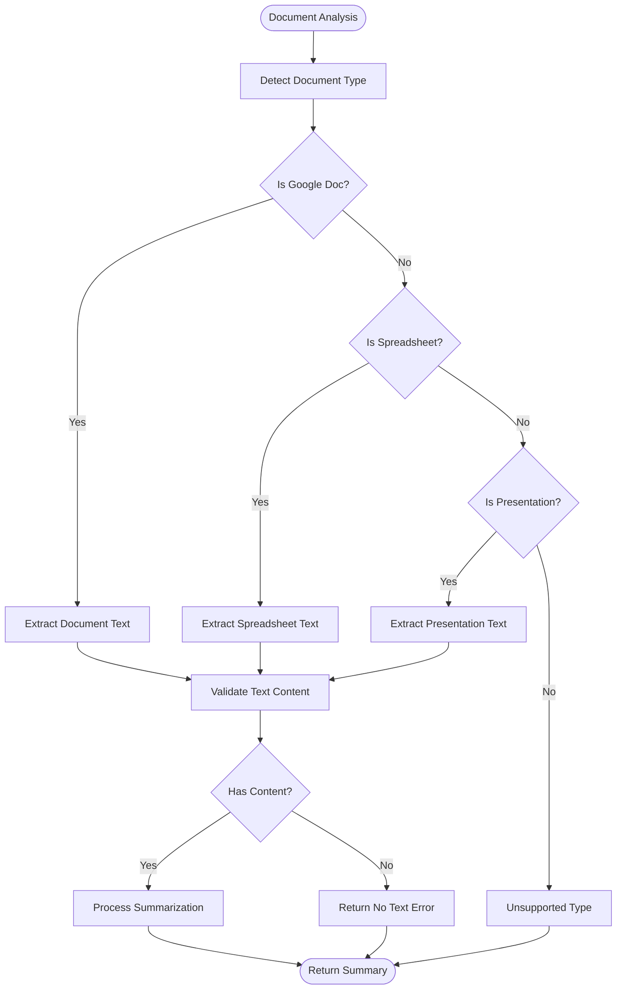
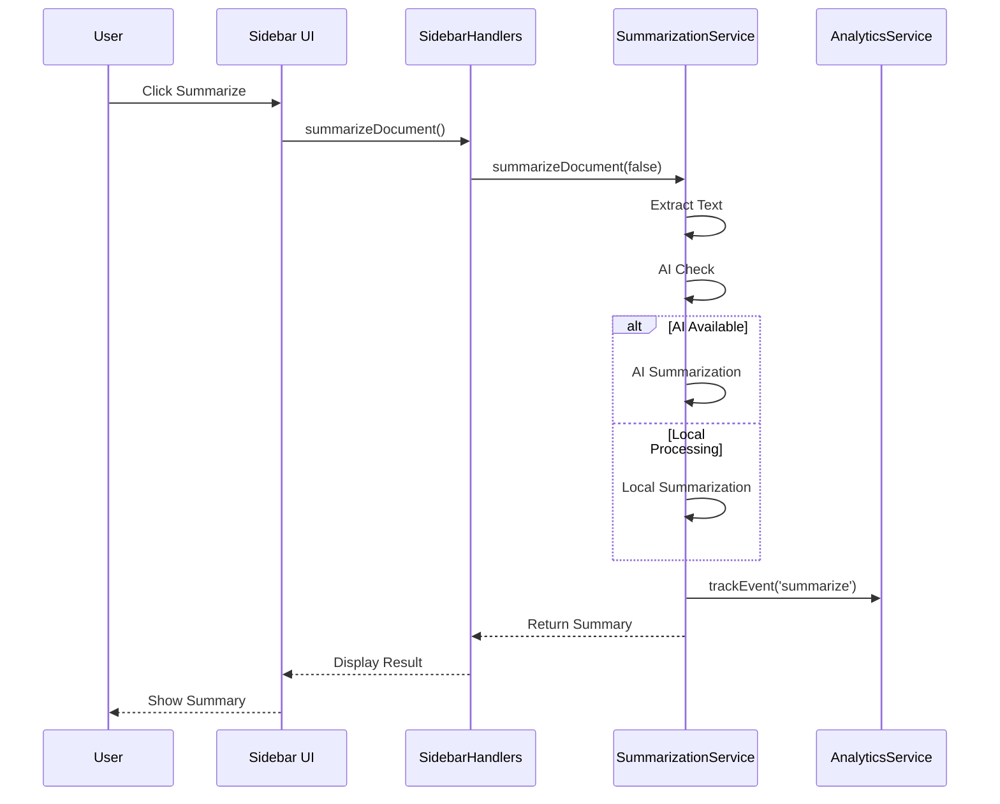
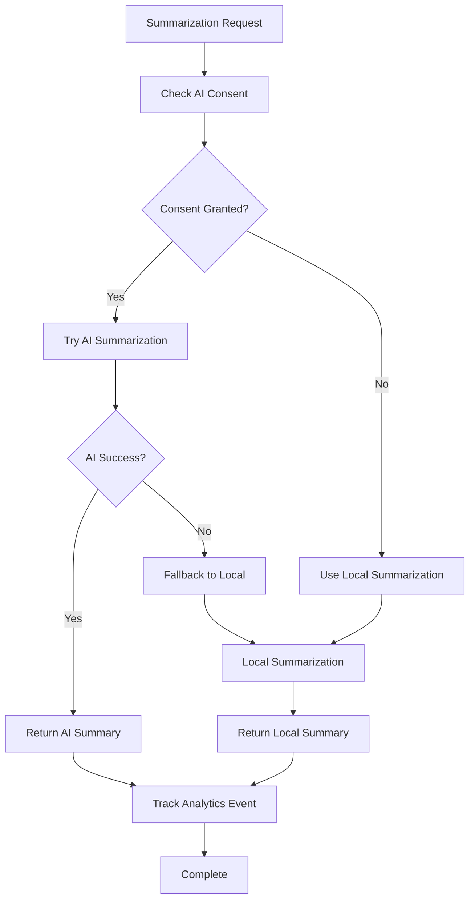
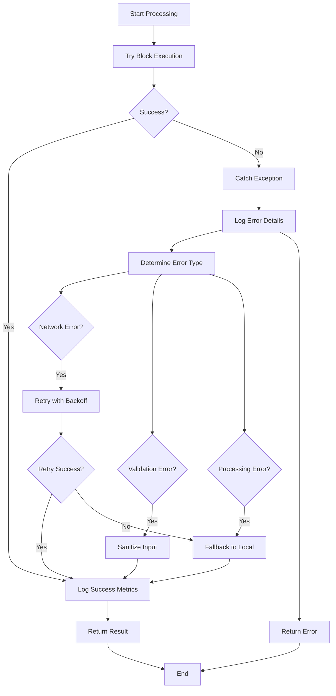
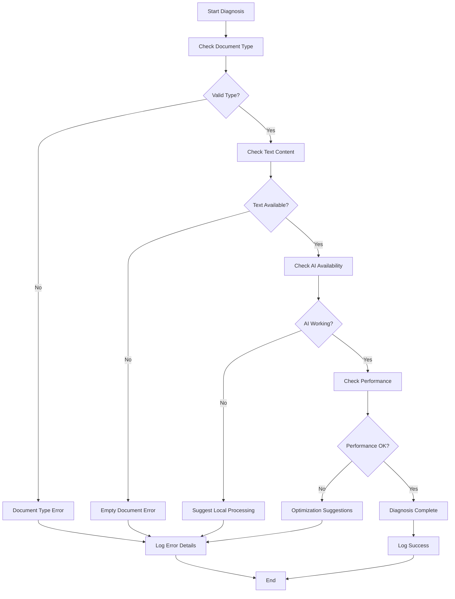

# Summarization Service

<cite>
**Referenced Files in This Document**
- [SummarizationService.js](file://src/services/SummarizationService.js)
- [SidebarHandlers.js](file://src/handlers/SidebarHandlers.js)
- [DocumentAnalysisEngine.js](file://src/services/DocumentAnalysisEngine.js)
- [AnalyticsService.js](file://src/services/AnalyticsService.js)
- [Utils.js](file://src/utils/Utils.js)
- [Main.js](file://src/Main.js)
- [RedactionService.js](file://src/services/RedactionService.js)
- [PrivacyGateController.js](file://src/services/PrivacyGateController.js)
- [LocalAIService.js](file://src/services/LocalAIService.js)
- [OllamaAIService.js](file://src/services/OllamaAIService.js)
- [Sidebar.html](file://src/ui/Sidebar.html)
- [SummarySidebar.html](file://src/ui/SummarySidebar.html)
</cite>

## Table of Contents
1. [Introduction](#introduction)
2. [Architecture Overview](#architecture-overview)
3. [Core Components](#core-components)
4. [Implementation Details](#implementation-details)
5. [Integration Patterns](#integration-patterns)
6. [Configuration Options](#configuration-options)
7. [Usage Patterns](#usage-patterns)
8. [Error Handling and Fallback Mechanisms](#error-handling-and-fallback-mechanisms)
9. [Performance Considerations](#performance-considerations)
10. [Troubleshooting Guide](#troubleshooting-guide)
11. [Best Practices](#best-practices)
12. [Conclusion](#conclusion)

## Introduction

The Summarization Service is a sophisticated document analysis and text processing component within the Intelligent Document Automation Google Workspace add-on. It provides intelligent document summarization capabilities with multiple processing modes, supporting various Google Workspace applications including Docs, Sheets, and Slides.

The service operates on a tiered approach, prioritizing local processing for privacy and speed, with optional AI-powered enhancement for advanced summarization capabilities. It integrates seamlessly with the broader automation ecosystem while maintaining strict privacy standards.

## Architecture Overview

The Summarization Service follows a modular architecture with clear separation of concerns:



**Diagram sources**
- [SummarizationService.js](file://src/services/SummarizationService.js#L6-L356)
- [SidebarHandlers.js](file://src/handlers/SidebarHandlers.js#L27-L41)
- [DocumentAnalysisEngine.js](file://src/services/DocumentAnalysisEngine.js#L7-L739)

## Core Components

### SummarizationService Module

The main service module provides the primary interface for document summarization operations. It implements a multi-tiered processing approach:

#### Key Features:
- **Multi-format Support**: Handles Documents, Spreadsheets, and Presentations
- **Priority Processing**: AI-first, then local summarization
- **Fallback Mechanisms**: Graceful degradation when AI services unavailable
- **Privacy-First**: Local processing by default with opt-in AI enhancement

#### Core Methods:

| Method | Purpose | Parameters | Return Type |
|--------|---------|------------|-------------|
| `summarizeDocument()` | Main summarization entry point | `selectionOnly: boolean` | `{success: boolean, summary: string, method: string}` |
| `extractKeyPoints()` | Extract bullet-point highlights | `text: string, numPoints: number` | `Array<string>` |
| `generateTitle()` | Create document titles | `text: string` | `string` |
| `getTextStatistics()` | Analyze text metrics | `text: string` | `Object` |

**Section sources**
- [SummarizationService.js](file://src/services/SummarizationService.js#L16-L356)

### Document Type Detection

The service automatically detects document types and extracts text accordingly:



**Diagram sources**
- [SummarizationService.js](file://src/services/SummarizationService.js#L18-L34)
- [DocumentAnalysisEngine.js](file://src/services/DocumentAnalysisEngine.js#L707-L730)

**Section sources**
- [SummarizationService.js](file://src/services/SummarizationService.js#L67-L138)

## Implementation Details

### Local Summarization Algorithm

The service implements a sophisticated extractive summarization algorithm:

#### Sentence Scoring System

The summarization process uses a frequency-based scoring mechanism:

1. **Text Preprocessing**: Clean and normalize input text
2. **Sentence Segmentation**: Split text into meaningful sentences
3. **Word Frequency Calculation**: Build frequency map of significant words
4. **Sentence Scoring**: Calculate scores based on word frequency
5. **Selection**: Choose top-scoring sentences (30% of total)
6. **Reordering**: Restore original sentence order for coherence

#### Key Parameters:

| Parameter | Value | Purpose |
|-----------|-------|---------|
| `MAX_LOCAL_LENGTH` | 5000 characters | Maximum text for local processing |
| `summaryLength` | 30% of sentences | Proportion of sentences in summary |
| `wordFilterThreshold` | 3 characters | Minimum word length for scoring |

**Section sources**
- [SummarizationService.js](file://src/services/SummarizationService.js#L145-L185)

### AI Integration Layer

The service supports multiple AI providers with seamless fallback:

#### Provider Hierarchy:
1. **Google AI (Gemini)**: Highest priority with explicit consent
2. **Local AI Server**: Privacy-preserving local processing
3. **Fallback Local**: Basic summarization when AI unavailable

#### Configuration Requirements:

| Provider | Endpoint | Authentication | Rate Limits |
|----------|----------|----------------|-------------|
| Google AI | `generativelanguage.googleapis.com` | API Key | 60 RPM |
| Local AI | Custom URL | None | Varies by server |
| Backend AI | Configurable | API Key | 1000/day |

**Section sources**
- [OllamaAIService.js](file://src/services/OllamaAIService.js#L58-L188)
- [LocalAIService.js](file://src/services/LocalAIService.js#L51-L266)

### Text Extraction Strategies

Each document type requires specialized extraction:

#### Google Docs Extraction:
- **Full Document**: `doc.getBody().getText()`
- **Selection Only**: `selection.getRangeElements().map()`
- **Rich Text**: Preserves formatting and structure

#### Google Sheets Extraction:
- **Full Range**: `sheet.getDataRange().getValues()`
- **Selection Only**: `sheet.getActiveRange().getValues()`
- **Structured Output**: Joins rows with newlines, cells with spaces

#### Google Slides Extraction:
- **Full Presentation**: `presentation.getSlides().forEach()`
- **Selection Only**: `presentation.getSelection().getCurrentPage()`
- **Shape Processing**: Iterates through all shapes with text

**Section sources**
- [SummarizationService.js](file://src/services/SummarizationService.js#L72-L138)

## Integration Patterns

### Sidebar Integration

The service integrates with the main sidebar through handler functions:



**Diagram sources**
- [SidebarHandlers.js](file://src/handlers/SidebarHandlers.js#L27-L41)
- [SummarizationService.js](file://src/services/SummarizationService.js#L16-L64)

### Privacy Gate Integration

The service respects user privacy preferences through the PrivacyGateController:



**Diagram sources**
- [PrivacyGateController.js](file://src/services/PrivacyGateController.js#L171-L216)
- [SummarizationService.js](file://src/services/SummarizationService.js#L40-L60)

**Section sources**
- [SidebarHandlers.js](file://src/handlers/SidebarHandlers.js#L27-L41)

## Configuration Options

### Environment Variables

The service supports several configuration options:

| Setting | Default | Description | Impact |
|---------|---------|-------------|---------|
| `MAX_LOCAL_LENGTH` | 5000 chars | Maximum text for local processing | Performance vs accuracy |
| `BACKEND_ENDPOINT` | Empty string | AI backend URL | AI availability |
| `SUMMARIZATION_METHOD` | Auto | Processing priority order | User experience |

### Runtime Configuration

Users can configure AI services through dedicated handlers:

#### Google AI Configuration:
- **API Key Management**: Secure storage and validation
- **Connection Testing**: Real-time connectivity verification
- **Model Selection**: Automatic model detection

#### Local AI Configuration:
- **Server URL**: Custom endpoint configuration
- **Health Monitoring**: Connection status tracking
- **Model Discovery**: Automatic model detection

**Section sources**
- [SummarizationService.js](file://src/services/SummarizationService.js#L8-L9)
- [OllamaConfigHandler.js](file://src/handlers/OllamaConfigHandler.js#L6-L57)

## Usage Patterns

### Basic Summarization

```javascript
// Simple document summarization
const result = SummarizationService.summarizeDocument(false);
if (result.success) {
    console.log("Summary:", result.summary);
    console.log("Method:", result.method);
} else {
    console.error("Error:", result.summary);
}
```

### Selection-Based Summarization

```javascript
// Summarize only selected text
const result = SummarizationService.summarizeDocument(true);
```

### Advanced Analysis

```javascript
// Extract key points and statistics
const text = "Sample document text...";
const keyPoints = SummarizationService.extractKeyPoints(text, 5);
const stats = SummarizationService.getTextStatistics(text);
const title = SummarizationService.generateTitle(text);
```

### Integration with Other Services

The summarization service integrates with:
- **Document Analysis Engine**: Pre-processing and validation
- **Redaction Service**: Privacy-aware text extraction
- **Analytics Service**: Usage tracking and optimization
- **Template Manager**: Content-based template suggestions

**Section sources**
- [SummarizationService.js](file://src/services/SummarizationService.js#L348-L356)

## Error Handling and Fallback Mechanisms

### Multi-Level Error Handling

The service implements comprehensive error handling across multiple layers:

#### Processing Levels:

1. **Document Type Detection**: Graceful handling of unsupported formats
2. **Text Extraction**: Fallback to alternative extraction methods
3. **AI Connectivity**: Automatic fallback to local processing
4. **Text Processing**: Robust error handling for malformed content
5. **Result Generation**: Validation and sanitization of output

#### Error Recovery Strategies:

| Scenario | Recovery Strategy | Fallback Level |
|----------|------------------|----------------|
| AI Unavailable | Local summarization | Medium |
| Text Too Long | Truncate and summarize | Low |
| Empty Document | Return descriptive error | High |
| Network Timeout | Retry with exponential backoff | Medium |
| Malformed Text | Sanitize and continue | Low |

### Exception Management

The service uses structured error handling with detailed logging:



**Diagram sources**
- [SummarizationService.js](file://src/services/SummarizationService.js#L61-L64)
- [Utils.js](file://src/utils/Utils.js#L90-L113)

**Section sources**
- [SummarizationService.js](file://src/services/SummarizationService.js#L61-L64)
- [Utils.js](file://src/utils/Utils.js#L90-L113)

## Performance Considerations

### Optimization Strategies

The service implements several performance optimization techniques:

#### Memory Management:
- **Streaming Processing**: Process text in chunks for large documents
- **Garbage Collection**: Explicit cleanup of temporary objects
- **Caching**: Store frequently accessed results

#### Processing Efficiency:
- **Early Termination**: Stop processing when thresholds are met
- **Parallel Processing**: Concurrent text extraction for multiple formats
- **Lazy Loading**: Load AI models only when needed

#### Scalability Features:
- **Batch Processing**: Handle multiple operations efficiently
- **Quota Management**: Respect Google Apps Script limits
- **Progress Indication**: User feedback during long operations

### Performance Metrics

| Operation | Typical Time | Memory Usage | Accuracy |
|-----------|--------------|--------------|----------|
| Local Summarization | 100-500ms | 5-10MB | Good |
| AI Summarization | 2-5s | 10-20MB | Excellent |
| Large Document | 5-30s | 50-100MB | Variable |
| Selection Only | 50-200ms | 2-5MB | Excellent |

### Resource Management

The service monitors and manages resource consumption:

- **Execution Time**: Prevents exceeding Google Apps Script limits
- **Memory Usage**: Optimizes garbage collection
- **Network Calls**: Minimizes API requests
- **Storage**: Efficient property management

**Section sources**
- [Utils.js](file://src/utils/Utils.js#L224-L236)
- [AnalyticsService.js](file://src/services/AnalyticsService.js#L27-L45)

## Troubleshooting Guide

### Common Issues and Solutions

#### AI Service Problems

**Issue**: AI summarization fails consistently
**Symptoms**: Always falls back to local processing
**Solution**: 
1. Verify API key configuration
2. Check network connectivity
3. Test AI service health
4. Review quota limits

**Issue**: AI responses are slow or timing out
**Symptoms**: Long delays, timeout errors
**Solution**:
1. Reduce text length
2. Check AI service status
3. Implement retry logic
4. Consider local processing

#### Text Extraction Issues

**Issue**: No text extracted from document
**Symptoms**: "No text to summarize" error
**Solution**:
1. Verify document is not empty
2. Check selection boundaries
3. Validate document format
4. Test with simpler content

**Issue**: Partial text extraction
**Symptoms**: Missing content in summary
**Solution**:
1. Check document permissions
2. Verify selection scope
3. Test with full document
4. Review formatting issues

#### Performance Problems

**Issue**: Slow summarization response
**Symptoms**: Long loading times
**Solution**:
1. Reduce document size
2. Use selection mode
3. Check system resources
4. Monitor network latency

**Issue**: Memory errors with large documents
**Symptoms**: Out of memory errors
**Solution**:
1. Process in smaller chunks
2. Use streaming approaches
3. Implement pagination
4. Clear temporary variables

### Diagnostic Tools

The service includes built-in diagnostic capabilities:



**Diagram sources**
- [SummarizationService.js](file://src/services/SummarizationService.js#L18-L38)

**Section sources**
- [SummarizationService.js](file://src/services/SummarizationService.js#L18-L38)

## Best Practices

### Implementation Guidelines

#### For Developers:
1. **Always Check Consents**: Respect user privacy preferences
2. **Handle Errors Gracefully**: Provide meaningful error messages
3. **Monitor Performance**: Track execution times and resource usage
4. **Validate Inputs**: Sanitize and validate all text inputs
5. **Use Appropriate Fallbacks**: Ensure graceful degradation

#### For Users:
1. **Configure AI Services**: Set up Google AI for enhanced features
2. **Review Privacy Settings**: Understand data processing preferences
3. **Test with Sample Content**: Verify functionality before production use
4. **Monitor Usage**: Track analytics for optimization insights

### Security Considerations

The service implements several security measures:

- **Local Processing**: Data never leaves Google's infrastructure by default
- **Privacy Gates**: Mandatory consent checks for sensitive operations
- **Input Sanitization**: Protection against injection attacks
- **Secure Storage**: Encrypted storage of API keys and credentials

### Maintenance Recommendations

1. **Regular Updates**: Keep AI models and dependencies current
2. **Performance Monitoring**: Track response times and error rates
3. **User Feedback**: Collect and analyze user experiences
4. **Security Audits**: Regular review of privacy and security measures
5. **Documentation Updates**: Maintain accurate technical documentation

## Conclusion

The Summarization Service represents a sophisticated approach to intelligent document processing within the Google Workspace ecosystem. Its multi-tiered architecture ensures optimal performance while respecting user privacy preferences. The service's integration with other components creates a cohesive automation platform that enhances productivity without compromising data security.

Key strengths include:
- **Privacy-First Design**: Local processing by default with opt-in AI enhancement
- **Robust Error Handling**: Comprehensive fallback mechanisms and graceful degradation
- **Flexible Integration**: Seamless integration with the broader automation ecosystem
- **Performance Optimization**: Efficient processing with resource management
- **Extensible Architecture**: Modular design supporting future enhancements

The service continues to evolve with new AI capabilities and improved performance characteristics, making it a valuable component of modern document automation workflows.