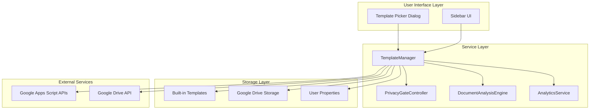
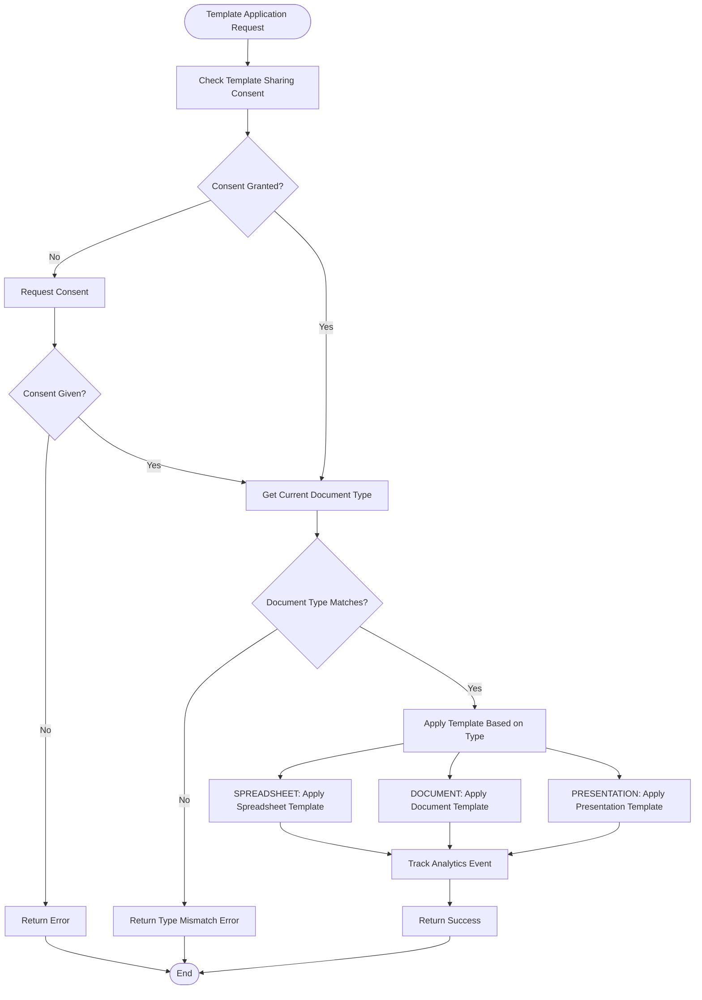
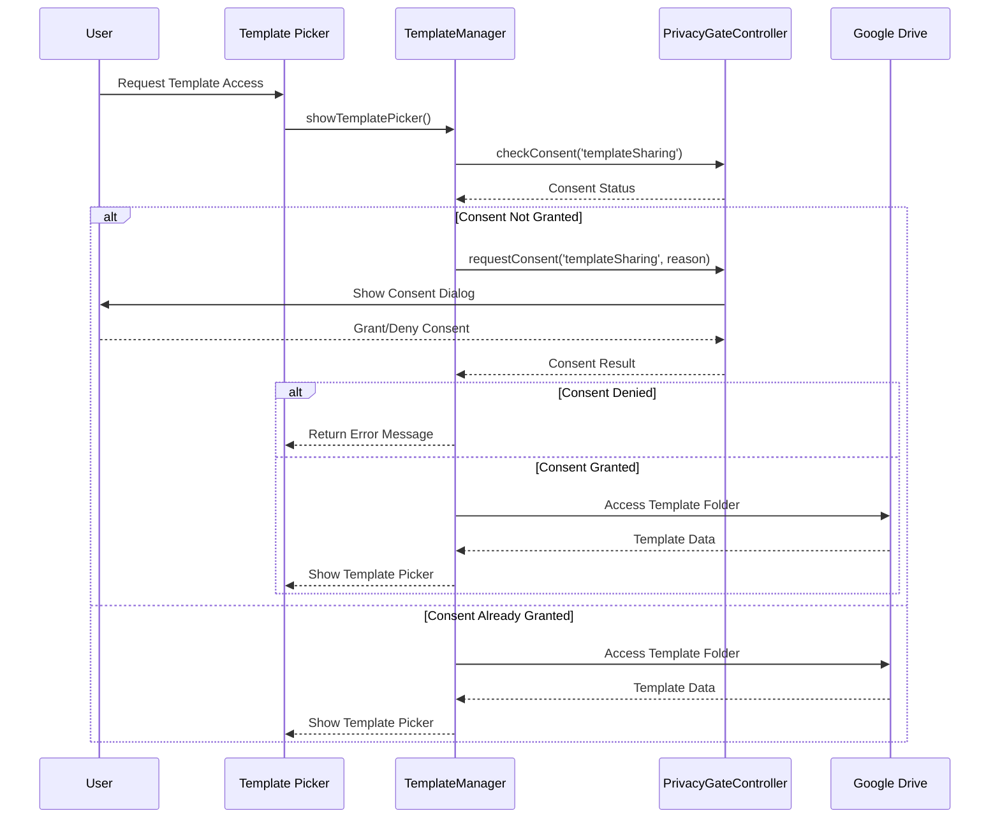
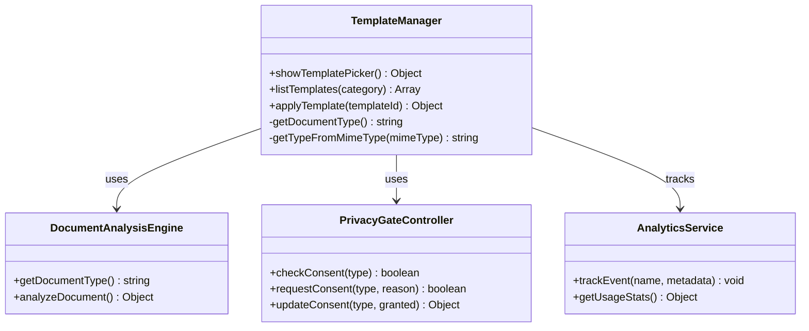
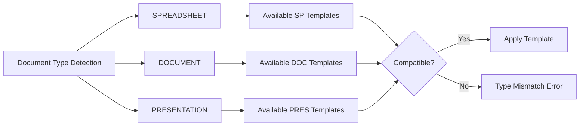
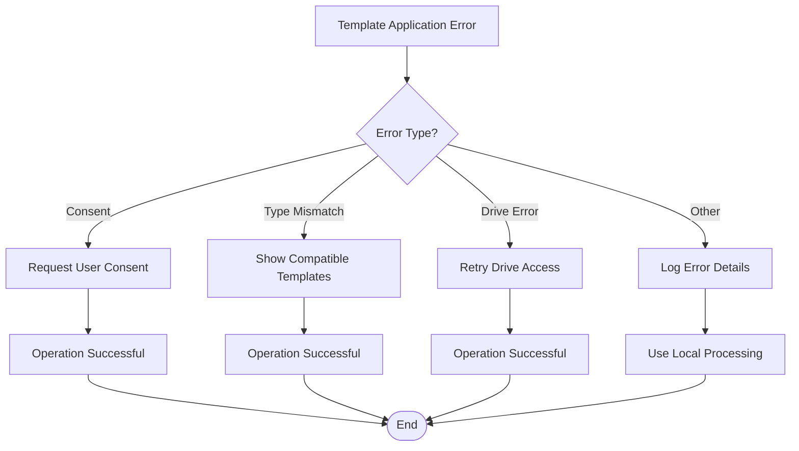

# Template Management

<cite>
**Referenced Files in This Document**
- [TemplateManager.js](file://src/services/TemplateManager.js)
- [Main.js](file://src/Main.js)
- [SidebarHandlers.js](file://src/handlers/SidebarHandlers.js)
- [Sidebar.html](file://src/ui/Sidebar.html)
- [PrivacyGateController.js](file://src/services/PrivacyGateController.js)
- [DocumentAnalysisEngine.js](file://src/services/DocumentAnalysisEngine.js)
- [AnalyticsService.js](file://src/services/AnalyticsService.js)
</cite>

## Table of Contents
1. [Introduction](#introduction)
2. [System Architecture](#system-architecture)
3. [Core Components](#core-components)
4. [Template Types and Categories](#template-types-and-categories)
5. [Privacy and Security](#privacy-and-security)
6. [Integration with Other Services](#integration-with-other-services)
7. [Usage Patterns](#usage-patterns)
8. [Configuration Options](#configuration-options)
9. [Error Handling](#error-handling)
10. [Troubleshooting Guide](#troubleshooting-guide)
11. [Best Practices](#best-practices)
12. [Conclusion](#conclusion)

## Introduction

The Template Management system is a core component of the Intelligent Document Automation Add-on that provides users with access to pre-built templates for Google Docs, Sheets, and Slides. This system enables rapid document creation and formatting through a combination of built-in templates and custom Google Drive-based templates, all while maintaining strict privacy controls and user consent management.

The template system serves as a foundation for productivity automation, allowing users to quickly apply professional formatting, standardized layouts, and industry-specific templates to their documents. It integrates seamlessly with the broader automation framework while providing granular privacy controls and analytics tracking.

## System Architecture

The Template Management system follows a modular architecture with clear separation of concerns:



**Diagram sources**
- [TemplateManager.js](file://src/services/TemplateManager.js#L6-L478)
- [PrivacyGateController.js](file://src/services/PrivacyGateController.js#L6-L366)
- [DocumentAnalysisEngine.js](file://src/services/DocumentAnalysisEngine.js#L6-L739)

**Section sources**
- [TemplateManager.js](file://src/services/TemplateManager.js#L1-L478)
- [Main.js](file://src/Main.js#L1-L800)

## Core Components

### TemplateManager Service

The TemplateManager is the central orchestrator for all template-related operations. It provides three primary public interfaces:

#### Public API Methods

| Method | Purpose | Parameters | Return Type |
|--------|---------|------------|-------------|
| `showTemplatePicker()` | Opens the template selection dialog | None | `{success: boolean, message: string}` |
| `listTemplates(category?: string)` | Retrieves available templates | Optional category filter | `Array<Template>` |
| `applyTemplate(templateId: string)` | Applies a template to current document | Template identifier | `{success: boolean, message: string}` |

#### Template Data Structure

Each template object contains the following properties:

| Property | Type | Description |
|----------|------|-------------|
| `id` | string | Unique template identifier |
| `name` | string | Human-readable template name |
| `description` | string | Template description |
| `type` | string | Document type (SPREADSHEET, DOCUMENT, PRESENTATION) |
| `category` | string | Template category |
| `source` | string | Template source (builtin/drive) |
| `url` | string | Drive file URL (for custom templates) |

**Section sources**
- [TemplateManager.js](file://src/services/TemplateManager.js#L472-L478)

### Built-in Template Catalog

The system includes five pre-defined templates organized by category:

#### Education Templates
- **Grading Rubric Template**: Academic grading spreadsheet with student scoring and total calculations
- **Sales Report Template**: Business reporting spreadsheet with date, product, quantity, and financial data

#### Business Templates
- **Professional Document Style**: Standard formatting for Google Docs with hierarchical heading styles
- **Clean Presentation Template**: Minimalist slide design for Google Slides

#### Legal Templates
- **Legal Contract Template**: Standard legal document formatting

**Section sources**
- [TemplateManager.js](file://src/services/TemplateManager.js#L8-L40)

### Template Application Engine

The template application process varies by document type:



**Diagram sources**
- [TemplateManager.js](file://src/services/TemplateManager.js#L158-L201)

**Section sources**
- [TemplateManager.js](file://src/services/TemplateManager.js#L158-L201)

## Template Types and Categories

### Supported Document Types

The template system supports three Google Workspace document types:

| Type | Description | Template Examples |
|------|-------------|-------------------|
| SPREADSHEET | Google Sheets documents | Grading Rubric, Sales Report |
| DOCUMENT | Google Docs documents | Professional Style, Contract Template |
| PRESENTATION | Google Slides documents | Clean Presentation |

### Category Organization

Templates are categorized for easy discovery:

- **Education**: Academic and educational templates
- **Business**: Professional formatting and reporting templates  
- **Legal**: Legal document formatting templates
- **Sales**: Business reporting and analysis templates

**Section sources**
- [TemplateManager.js](file://src/services/TemplateManager.js#L8-L40)

## Privacy and Security

### Consent Management

The template system implements comprehensive privacy controls through the PrivacyGateController:



**Diagram sources**
- [TemplateManager.js](file://src/services/TemplateManager.js#L47-L61)
- [PrivacyGateController.js](file://src/services/PrivacyGateController.js#L89-L147)

### Privacy Controls

| Control | Purpose | Implementation |
|---------|---------|----------------|
| Template Sharing Consent | Requires explicit permission for Drive access | PrivacyGateController |
| Local Processing | All operations run locally by default | TemplateManager fallback |
| Data Sanitization | Prevents PII in analytics | AnalyticsService sanitization |
| Audit Logging | Tracks privacy-related events | PrivacyGateController logging |

**Section sources**
- [PrivacyGateController.js](file://src/services/PrivacyGateController.js#L89-L147)
- [TemplateManager.js](file://src/services/TemplateManager.js#L47-L61)

## Integration with Other Services

### Document Analysis Integration

The template system integrates with DocumentAnalysisEngine to ensure template compatibility:



**Diagram sources**
- [TemplateManager.js](file://src/services/TemplateManager.js#L167-L170)
- [DocumentAnalysisEngine.js](file://src/services/DocumentAnalysisEngine.js#L707-L730)

### Menu Integration

Templates are accessible through multiple interface points:

| Location | Menu Item | Handler Function |
|----------|-----------|------------------|
| Google Docs | "📋 Templates" submenu | `showTemplatePicker()` |
| Google Sheets | "📋 Templates" submenu | `showTemplatePicker()` |
| Google Slides | "📋 Templates" submenu | `showTemplatePicker()` |
| Sidebar | "📋 Templates" tab | `showTemplatePicker()` |

**Section sources**
- [Main.js](file://src/Main.js#L89-L111)
- [SidebarHandlers.js](file://src/handlers/SidebarHandlers.js#L123-L145)

## Usage Patterns

### Basic Template Application Workflow

1. **Template Discovery**: User opens template picker from sidebar or menu
2. **Consent Verification**: System checks and requests template sharing consent if needed
3. **Template Selection**: User chooses desired template from list
4. **Application**: System validates document compatibility and applies template
5. **Feedback**: User receives success/error notification

### Programmatic Usage

Templates can be applied programmatically through the public API:

```javascript
// Example: Apply grading rubric template
const result = TemplateManager.applyTemplate('grading_rubric');
if (result.success) {
    console.log('Template applied successfully');
} else {
    console.error('Failed to apply template:', result.message);
}
```

### Bulk Template Operations

The system supports batch operations through the sidebar interface, allowing users to quickly apply templates across multiple documents or projects.

**Section sources**
- [SidebarHandlers.js](file://src/handlers/SidebarHandlers.js#L123-L145)

## Configuration Options

### Template Folder Configuration

Custom templates are stored in a designated Google Drive folder. The folder ID is stored in user properties:

| Property | Key | Purpose |
|----------|-----|---------|
| Template Folder ID | `templateFolderId` | Stores custom template storage location |

### Consent Settings

Template sharing requires explicit user consent:

| Setting | Default | Purpose |
|---------|---------|---------|
| Template Sharing | `false` | Controls Drive template access |
| Analytics Tracking | `false` | Enables usage analytics |

### Document Type Compatibility

The system automatically detects document types and ensures template compatibility:



**Diagram sources**
- [TemplateManager.js](file://src/services/TemplateManager.js#L167-L174)

**Section sources**
- [TemplateManager.js](file://src/services/TemplateManager.js#L8-L9)
- [PrivacyGateController.js](file://src/services/PrivacyGateController.js#L30-L38)

## Error Handling

### Common Error Scenarios

| Error Type | Cause | Resolution |
|------------|-------|------------|
| Consent Required | Template sharing not permitted | Request template sharing consent |
| Type Mismatch | Template incompatible with document | Select compatible template |
| Drive Access Error | Unable to access template folder | Check Drive permissions |
| Template Not Found | Specified template unavailable | Verify template exists |
| Document Empty | No content to apply template | Add content to document |

### Error Recovery Strategies



**Diagram sources**
- [TemplateManager.js](file://src/services/TemplateManager.js#L158-L201)

**Section sources**
- [TemplateManager.js](file://src/services/TemplateManager.js#L158-L201)

## Troubleshooting Guide

### Template Access Issues

**Problem**: Template picker shows no templates
**Solution**: 
1. Check template sharing consent in privacy settings
2. Verify Google Drive connectivity
3. Ensure template folder is properly configured

**Problem**: Templates not applying to documents
**Solution**:
1. Verify document type compatibility
2. Check for document protection or read-only mode
3. Ensure document has sufficient content

### Performance Issues

**Problem**: Slow template loading
**Solution**:
1. Reduce number of custom templates in Drive folder
2. Clear browser cache and refresh
3. Check internet connectivity for Drive access

### Privacy Concerns

**Problem**: Template sharing consent required frequently
**Solution**:
1. Review privacy settings in add-on preferences
2. Grant template sharing consent for seamless access
3. Understand data processing limitations

**Section sources**
- [PrivacyGateController.js](file://src/services/PrivacyGateController.js#L89-L147)

## Best Practices

### Template Design Guidelines

1. **Consistency**: Maintain uniform formatting across templates
2. **Accessibility**: Ensure templates are accessible to all users
3. **Documentation**: Provide clear descriptions and usage instructions
4. **Testing**: Validate templates across different document sizes and content types

### User Experience Recommendations

1. **Progressive Disclosure**: Show relevant templates based on document type
2. **Visual Hierarchy**: Use clear categorization and filtering
3. **Feedback**: Provide immediate success/error notifications
4. **Performance**: Minimize loading times through efficient resource management

### Security Considerations

1. **Data Minimization**: Only collect necessary template usage data
2. **Encryption**: Use TLS 1.3 for all template data transmission
3. **Audit Trails**: Maintain logs of template access and application
4. **User Control**: Provide granular privacy controls for template usage

**Section sources**
- [PrivacyGateController.js](file://src/services/PrivacyGateController.js#L240-L269)
- [AnalyticsService.js](file://src/services/AnalyticsService.js#L235-L254)

## Conclusion

The Template Management system provides a robust, privacy-conscious solution for document templating within the Google Workspace ecosystem. Through its modular architecture, comprehensive privacy controls, and seamless integration with other automation services, it enables users to achieve consistent, professional document formatting while maintaining complete control over their data.

The system's dual-layer approach—combining built-in templates with customizable Drive-based templates—provides flexibility for both standard and specialized use cases. The privacy-first design ensures that users can leverage powerful automation capabilities without compromising their data security or privacy preferences.

Future enhancements could include expanded template libraries, collaborative template sharing, and advanced customization options while maintaining the system's commitment to privacy and user control.