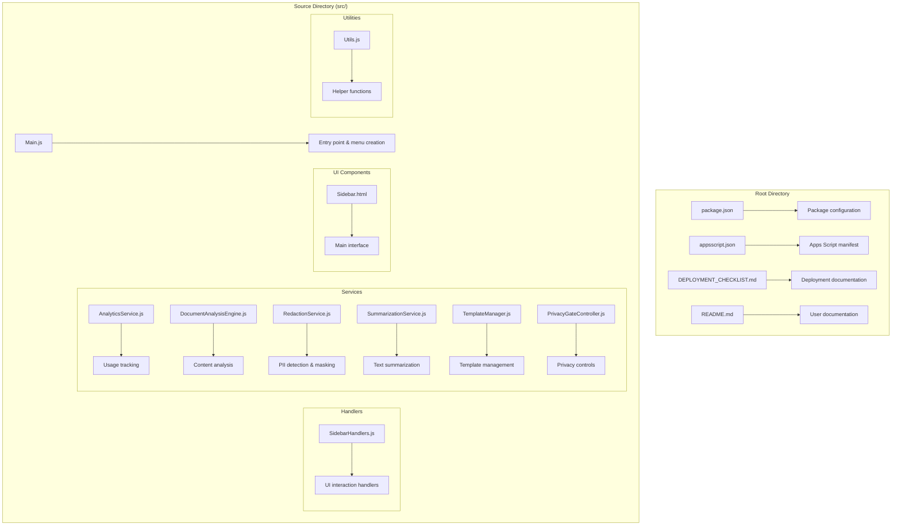
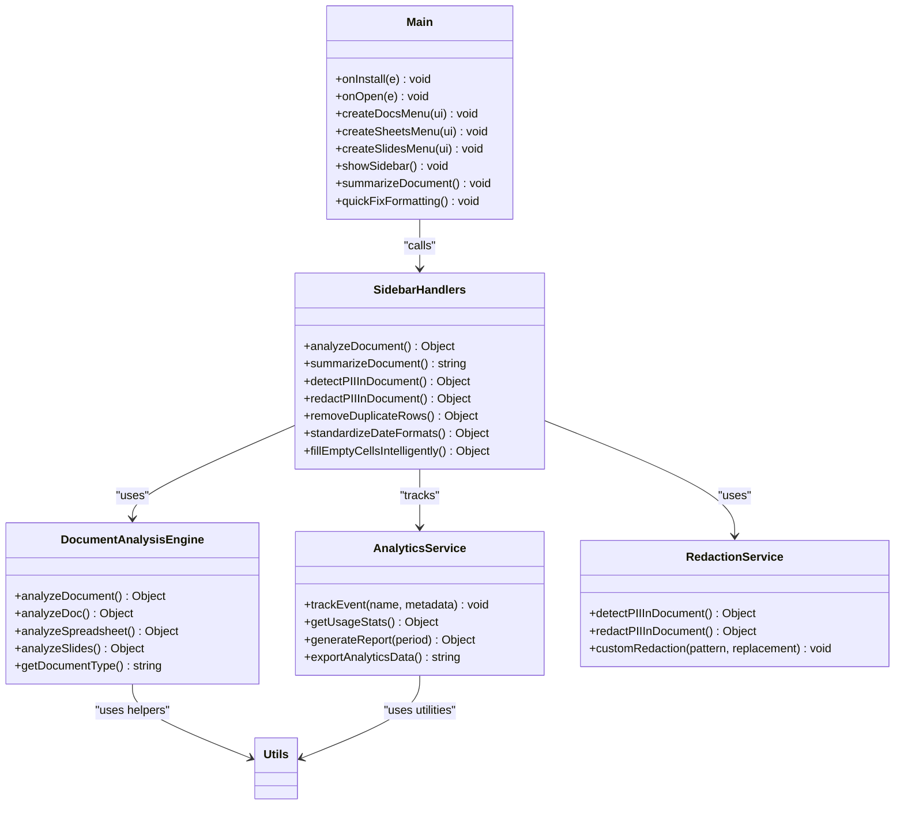

# Development Guide

<cite>
**Referenced Files in This Document**
- [package.json](file://package.json)
- [src/Main.js](file://src/Main.js)
- [src/appsscript.json](file://src/appsscript.json)
- [DEPLOYMENT_CHECKLIST.md](file://DEPLOYMENT_CHECKLIST.md)
- [README.md](file://README.md)
- [src/services/AnalyticsService.js](file://src/services/AnalyticsService.js)
- [src/services/DocumentAnalysisEngine.js](file://src/services/DocumentAnalysisEngine.js)
- [src/ui/Sidebar.html](file://src/ui/Sidebar.html)
- [src/utils/Utils.js](file://src/utils/Utils.js)
- [src/handlers/SidebarHandlers.js](file://src/handlers/SidebarHandlers.js)
</cite>

## Table of Contents
1. [Introduction](#introduction)
2. [Project Structure](#project-structure)
3. [Code Architecture](#code-architecture)
4. [Development Environment Setup](#development-environment-setup)
5. [Contribution Guidelines](#contribution-guidelines)
6. [Testing Strategies](#testing-strategies)
7. [Deployment Process](#deployment-process)
8. [Debugging Techniques](#debugging-techniques)
9. [Performance Optimization](#performance-optimization)
10. [Best Practices](#best-practices)

## Introduction

The Techno Browser extension is a sophisticated Google Workspace add-on built with Google Apps Script that provides intelligent document automation capabilities. This development guide covers the complete workflow for contributing to and maintaining the project, from initial setup to deployment and ongoing maintenance.

The add-on offers comprehensive document analysis, privacy-first redaction, intelligent cleanup operations, and AI-powered summarization across Google Docs, Sheets, and Slides. It follows a modular architecture with clear separation of concerns across handlers, services, UI components, and utilities.

## Project Structure

The project follows a well-organized directory structure that promotes maintainability and scalability:



**Diagram sources**
- [package.json](file://package.json#L1-L25)
- [src/Main.js](file://src/Main.js#L1-L50)
- [src/appsscript.json](file://src/appsscript.json#L1-L47)

### Directory Organization

The `src/` directory is organized into four main categories:

1. **Handlers** (`src/handlers/`): UI interaction handlers that bridge the sidebar interface with service logic
2. **Services** (`src/services/`): Core business logic modules for document analysis, redaction, summarization, and management
3. **UI** (`src/ui/`): Frontend components including the main sidebar interface
4. **Utils** (`src/utils/`): Shared utility functions and helpers

**Section sources**
- [src/Main.js](file://src/Main.js#L1-L100)
- [src/handlers/SidebarHandlers.js](file://src/handlers/SidebarHandlers.js#L1-L50)

## Code Architecture

The application follows a modular, service-oriented architecture with clear separation of concerns:



**Diagram sources**
- [src/Main.js](file://src/Main.js#L6-L100)
- [src/handlers/SidebarHandlers.js](file://src/handlers/SidebarHandlers.js#L6-L172)
- [src/services/DocumentAnalysisEngine.js](file://src/services/DocumentAnalysisEngine.js#L6-L200)
- [src/services/AnalyticsService.js](file://src/services/AnalyticsService.js#L6-L200)

### Core Components

#### Main Entry Point
The [`Main.js`](file://src/Main.js) file serves as the primary entry point, handling add-on installation, menu creation, and sidebar management. It provides platform-specific menu creation for Docs, Sheets, and Slides while maintaining a consistent user experience.

#### Handler Layer
The handler layer (`SidebarHandlers.js`) acts as a bridge between the UI and business logic, providing clean interfaces for UI interactions while delegating complex operations to specialized services.

#### Service Layer
The service layer contains the core business logic:
- **DocumentAnalysisEngine**: Comprehensive content analysis with issue detection and suggestions
- **AnalyticsService**: Privacy-preserving usage tracking and reporting
- **RedactionService**: PII detection and automated redaction with customizable patterns
- **SummarizationService**: Text summarization with local and AI-enhanced processing
- **TemplateManager**: Template discovery, preview, and application
- **PrivacyGateController**: Consent management and privacy compliance

**Section sources**
- [src/Main.js](file://src/Main.js#L1-L1248)
- [src/handlers/SidebarHandlers.js](file://src/handlers/SidebarHandlers.js#L1-L172)

## Development Environment Setup

### Prerequisites

Before starting development, ensure you have the following tools installed:

1. **Node.js** (version 14 or higher)
2. **npm** (comes with Node.js)
3. **Google Apps Script CLI** (`@google/clasp`)
4. **Git** for version control

### Initial Setup

```bash
# Clone the repository
git clone https://github.com/AayushBhat07/intelligent-document-automation.git
cd intelligent-document-automation

# Install dependencies
npm install

# Login to Google Cloud Platform
clasp login

# Create a new Apps Script project
clasp create --type standalone --title "Intelligent Document Automation"

# Push code to Apps Script
clasp push

# Open in Apps Script editor
clasp open
```

### Development Workflow

The development workflow follows these steps:

1. **Code Changes**: Modify files in the `src/` directory
2. **Push Changes**: Use `clasp push` to deploy to Apps Script
3. **Testing**: Test in Google Workspace applications
4. **Iteration**: Repeat until satisfied

**Section sources**
- [package.json](file://package.json#L6-L11)
- [README.md](file://README.md#L283-L302)

## Contribution Guidelines

### Coding Standards

#### JavaScript Standards
- Use strict mode (`'use strict';`)
- Follow ES5 syntax for Apps Script compatibility
- Implement comprehensive error handling
- Use meaningful variable and function names
- Include JSDoc comments for all public functions

#### Code Organization
- Group related functions in logical blocks
- Use consistent indentation (2 spaces)
- Separate concerns into dedicated modules
- Maintain backward compatibility when possible

#### Error Handling
Implement robust error handling with:
- Try-catch blocks around critical operations
- Meaningful error messages
- Graceful degradation when services are unavailable
- Logging for debugging purposes

### Pull Request Workflow

1. **Fork the Repository**: Create your fork from the main branch
2. **Create Feature Branch**: Use descriptive branch names
3. **Make Changes**: Follow coding standards and add tests
4. **Commit Changes**: Write clear, concise commit messages
5. **Create Pull Request**: Include detailed description of changes
6. **Code Review**: Address reviewer feedback
7. **Merge**: Once approved, merge to main branch

### Testing Requirements

Each contribution must include:
- Unit tests for new functionality
- Integration tests for service interactions
- UI tests for new interface elements
- Performance tests for resource-intensive operations

## Testing Strategies

### Unit Testing

For Google Apps Script projects, testing focuses on:

#### Service Module Testing
Test individual service modules in isolation:

```javascript
// Example testing pattern for DocumentAnalysisEngine
function testAnalyzeDocument() {
  // Mock document content
  const mockDoc = DocumentApp.create('Test Document');
  const body = mockDoc.getBody();
  body.appendParagraph('Test content with multiple spaces  and punctuation errors.');
  
  // Test analysis
  const result = DocumentAnalysisEngine.analyzeDocument();
  
  // Assert expectations
  assertEquals(1, result.issues.length);
  assertTrue(result.suggestions.length > 0);
}
```

#### Utility Function Testing
Test utility functions with various input scenarios:
- Edge cases (empty strings, null values)
- Boundary conditions
- Invalid inputs
- Performance under load

### Integration Testing

Test service interactions and data flow:

1. **End-to-End Workflows**: Test complete user journeys
2. **Cross-Service Communication**: Verify service interactions
3. **Data Persistence**: Test property storage and retrieval
4. **External API Calls**: Mock external service interactions

### UI Testing

Test user interface interactions:

1. **Sidebar Functionality**: Test all sidebar operations
2. **Menu Interactions**: Verify menu item behavior
3. **Form Validation**: Test form submission and validation
4. **Error Handling**: Verify error messages display correctly

### Performance Testing

Monitor and optimize performance:

1. **Execution Time**: Measure operation duration
2. **Memory Usage**: Monitor memory consumption
3. **API Rate Limits**: Respect quota limitations
4. **Large Document Handling**: Test with substantial content

## Deployment Process

### Using Clasp Scripts

The project includes predefined deployment scripts in [`package.json`](file://package.json#L6-L11):

```json
{
  "scripts": {
    "push": "clasp push",
    "deploy": "clasp deploy",
    "open": "clasp open",
    "login": "clasp login"
  }
}
```

### Deployment Workflow

1. **Pre-deployment Verification**: Complete the checklist in [`DEPLOYMENT_CHECKLIST.md`](file://DEPLOYMENT_CHECKLIST.md#L1-L260)
2. **Local Testing**: Thoroughly test all functionality
3. **Code Push**: Use `npm run push` to deploy to Apps Script
4. **Manual Testing**: Verify in Google Workspace applications
5. **Deployment**: Use `npm run deploy` to publish the add-on

### Deployment Checklist

The [`DEPLOYMENT_CHECKLIST.md`](file://DEPLOYMENT_CHECKLIST.md#L1-L260) provides comprehensive verification steps:

#### Code Quality Verification
- [ ] All source files created and syntactically correct
- [ ] No syntax errors in JavaScript files
- [ ] HTML file properly structured
- [ ] All functions properly documented
- [ ] Error handling implemented across all services
- [ ] Consistent code style throughout

#### Feature Completeness
- [ ] Document Analysis Engine implemented
- [ ] Automation Rule Processor functional
- [ ] Redaction Service operational
- [ ] Privacy Gate Controller working
- [ ] Template Manager functional
- [ ] Summarization Service operational
- [ ] Analytics Service implemented
- [ ] Sidebar UI with tabs functional
- [ ] Event handlers complete
- [ ] Utility functions implemented

#### Security & Privacy
- [ ] Minimal OAuth scopes requested
- [ ] Privacy-first design enforced
- [ ] Consent management system functional
- [ ] No PII in analytics
- [ ] Audit logging capabilities

**Section sources**
- [package.json](file://package.json#L6-L11)
- [DEPLOYMENT_CHECKLIST.md](file://DEPLOYMENT_CHECKLIST.md#L1-L260)

## Debugging Techniques

### Apps Script Execution Logs

Google Apps Script provides comprehensive logging capabilities:

#### Console Logging
Use `console.log()` for debugging:
```javascript
console.log('Debug information:', variable);
console.log('Operation started at:', new Date().toISOString());
```

#### Error Logging
Capture and log errors appropriately:
```javascript
try {
  // Risky operation
} catch (e) {
  console.error('Operation failed:', e.message);
  console.error('Stack trace:', e.stack);
}
```

### Debugging Tools

#### Apps Script Editor
- **Execution Transcript**: View detailed execution logs
- **Breakpoints**: Set breakpoints for step-through debugging
- **Variables Panel**: Inspect variable values during execution

#### Google Cloud Console
- **Stackdriver Logging**: Access detailed execution logs
- **Quota Monitoring**: Track API usage and limits
- **Error Reporting**: Monitor runtime errors

### Common Debugging Scenarios

#### Performance Issues
1. **Measure Execution Time**: Use `new Date().getTime()` to track duration
2. **Identify Bottlenecks**: Profile code sections
3. **Optimize Loops**: Reduce iteration counts where possible
4. **Batch Operations**: Process data in chunks

#### Memory Issues
1. **Monitor Memory Usage**: Use Apps Script quotas API
2. **Clear Variables**: Nullify unused objects
3. **Limit Data Size**: Process data in smaller batches
4. **Use Efficient Data Structures**: Choose optimal data structures

#### API Integration Issues
1. **Check Authentication**: Verify OAuth tokens
2. **Handle Rate Limits**: Implement exponential backoff
3. **Validate Requests**: Ensure proper API request formatting
4. **Test Responses**: Handle various API response scenarios

## Performance Optimization

### Google Apps Script Quotas

Understand and optimize within Apps Script limitations:

| Resource | Consumer Limit | Enterprise Limit |
|----------|---------------|------------------|
| Execution Time | 6 minutes | 30 minutes |
| URL Fetch Calls | 20,000/day | Unlimited |
| Properties Service | 500 KB/store | 500 KB/store |
| Daily Active Users | 1,000 | 1,000 |

### Optimization Strategies

#### Code-Level Optimizations
1. **Minimize API Calls**: Batch operations where possible
2. **Efficient Loops**: Use forward loops and minimize iterations
3. **String Operations**: Avoid excessive string concatenation
4. **Object Creation**: Reuse objects when possible

#### Data Processing Optimizations
1. **Chunk Processing**: Process large datasets in smaller chunks
2. **Selective Processing**: Only process selected portions when possible
3. **Caching**: Cache frequently accessed data
4. **Lazy Loading**: Load data only when needed

#### Memory Management
1. **Variable Scope**: Limit variable lifetime
2. **Array Management**: Clear arrays when no longer needed
3. **Object References**: Manage object references carefully
4. **Garbage Collection**: Allow garbage collection by nullifying references

### Best Practices for Performance

#### Document Processing
- Process documents in sections for large files
- Use selection-based operations when possible
- Implement progress indicators for long operations
- Provide cancellation mechanisms for user-initiated operations

#### Service Integration
- Implement connection pooling for external APIs
- Use asynchronous operations where available
- Cache API responses when appropriate
- Handle network failures gracefully

#### User Experience
- Show loading indicators for async operations
- Provide immediate feedback for user actions
- Implement optimistic updates where safe
- Offer cancel buttons for long-running operations

**Section sources**
- [README.md](file://README.md#L254-L270)

## Best Practices

### Security Best Practices

#### Data Protection
1. **Privacy-First Design**: Process data locally by default
2. **Minimal Permissions**: Request only necessary OAuth scopes
3. **Consent Management**: Implement clear consent mechanisms
4. **Data Minimization**: Collect only essential data

#### Code Security
1. **Input Validation**: Validate all user inputs
2. **Sanitization**: Sanitize data before processing
3. **Error Handling**: Avoid exposing sensitive information in error messages
4. **Secure Storage**: Use appropriate storage mechanisms

### Maintenance Best Practices

#### Code Quality
1. **Documentation**: Maintain comprehensive inline documentation
2. **Comments**: Explain complex logic and algorithms
3. **Version Control**: Use semantic versioning
4. **Changelog**: Maintain change logs for releases

#### Testing
1. **Automated Tests**: Implement comprehensive test suites
2. **Continuous Integration**: Set up automated testing workflows
3. **Performance Monitoring**: Track performance metrics
4. **User Feedback**: Collect and act on user feedback

#### Deployment
1. **Staging Environment**: Test in staging before production
2. **Rollback Plans**: Have rollback procedures ready
3. **Monitoring**: Set up monitoring and alerting
4. **Documentation**: Maintain deployment documentation

### User Experience Best Practices

#### Interface Design
1. **Consistency**: Maintain consistent design patterns
2. **Accessibility**: Ensure accessibility compliance
3. **Responsiveness**: Provide immediate feedback
4. **Error Messages**: Use clear, actionable error messages

#### Feature Design
1. **Progress Indicators**: Show progress for long operations
2. **Undo/Redo**: Implement undo functionality where possible
3. **Customization**: Allow user customization
4. **Help Systems**: Provide contextual help

**Section sources**
- [src/services/PrivacyGateController.js](file://src/services/PrivacyGateController.js#L1-L100)
- [src/services/AnalyticsService.js](file://src/services/AnalyticsService.js#L1-L200)