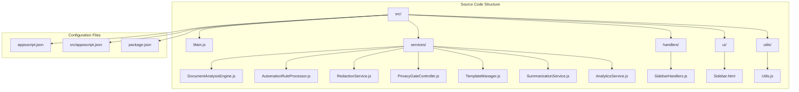
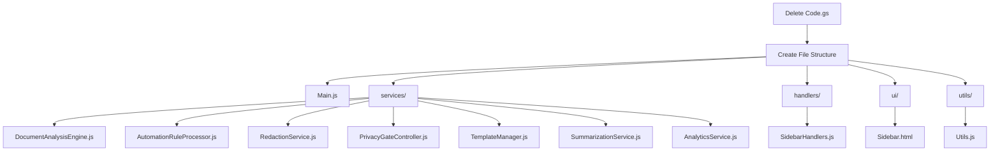
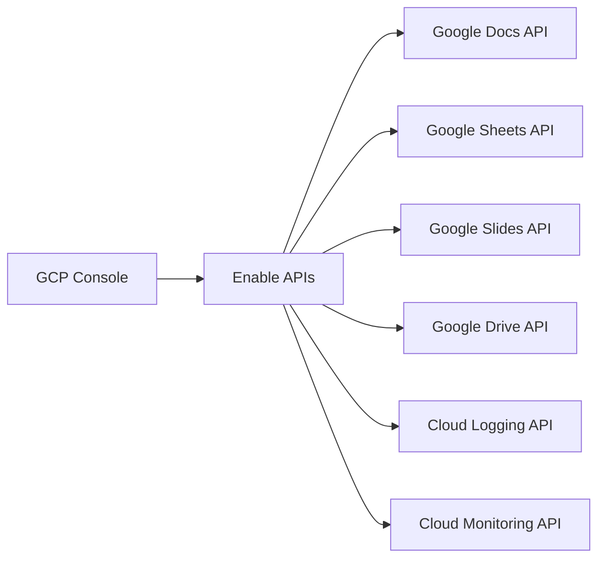
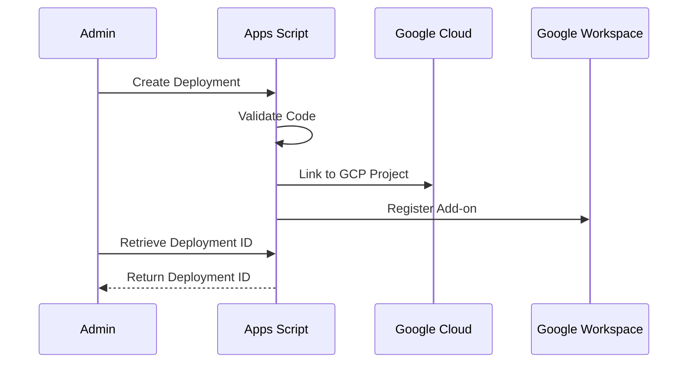
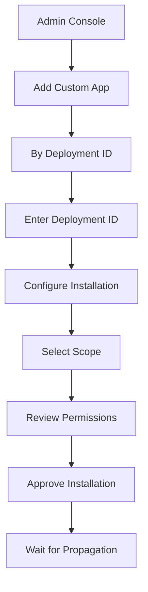
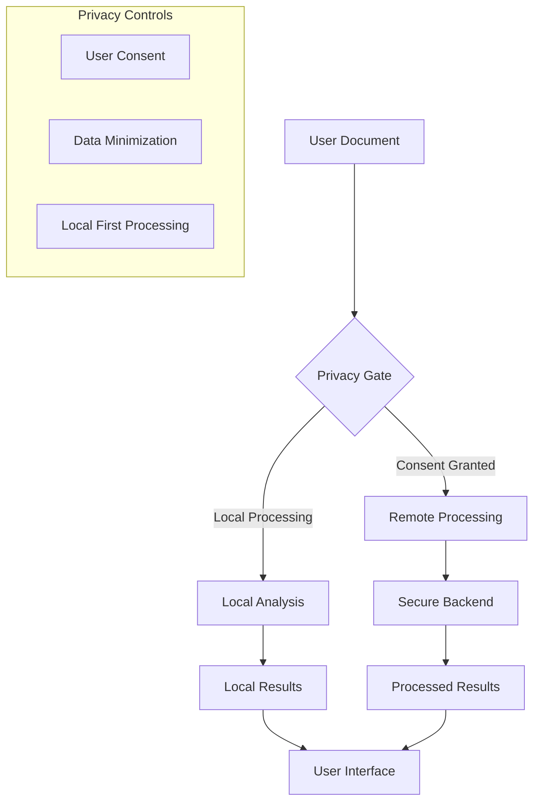
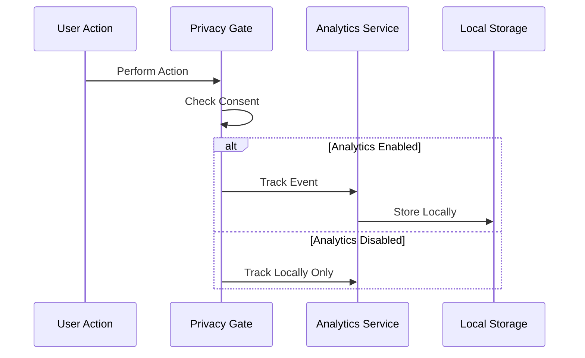
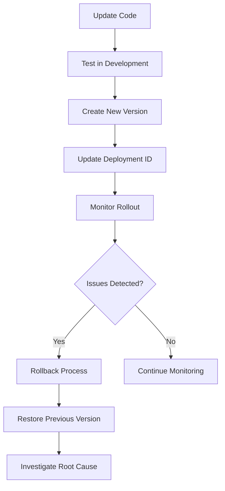

# Administrator Deployment

<cite>
**Referenced Files in This Document**
- [ADMIN_GUIDE.md](file://ADMIN_GUIDE.md)
- [DEPLOYMENT_CHECKLIST.md](file://DEPLOYMENT_CHECKLIST.md)
- [appsscript.json](file://appsscript.json)
- [src/appsscript.json](file://src/appsscript.json)
- [src/Main.js](file://src/Main.js)
- [src/services/PrivacyGateController.js](file://src/services/PrivacyGateController.js)
- [src/services/AnalyticsService.js](file://src/services/AnalyticsService.js)
- [src/utils/Utils.js](file://src/utils/Utils.js)
- [README.md](file://README.md)
</cite>

## Table of Contents
1. [Introduction](#introduction)
2. [Prerequisites](#prerequisites)
3. [Project Structure Overview](#project-structure-overview)
4. [Creating Apps Script Project](#creating-apps-script-project)
5. [Configuring the Manifest File](#configuring-the-manifest-file)
6. [Linking to Google Cloud Platform](#linking-to-google-cloud-platform)
7. [OAuth Consent Screen Configuration](#oauth-consent-screen-configuration)
8. [Deployment Process](#deployment-process)
9. [Domain-Wide Installation](#domain-wide-installation)
10. [Organization-Wide Configuration](#organization-wide-configuration)
11. [Security and Compliance](#security-and-compliance)
12. [Monitoring and Analytics](#monitoring-and-analytics)
13. [Troubleshooting Common Issues](#troubleshooting-common-issues)
14. [Rollback and Maintenance](#rollback-and-maintenance)

## Introduction

The Intelligent Document Automation add-on for Google Workspace provides powerful document processing capabilities with a privacy-first approach. This comprehensive guide covers the complete deployment workflow for Google Workspace administrators, from initial setup through ongoing maintenance.

The add-on offers automated document analysis, redaction of sensitive information, data cleanup operations, and AI-powered summarization while maintaining strict privacy controls and compliance with organizational policies.

## Prerequisites

Before beginning deployment, ensure your environment meets all requirements:

### Administrative Access
- **Google Workspace Super Admin or delegated admin privileges**
- Access to Google Admin Console
- Domain-wide delegation enabled for Apps Script API
- Google Cloud Platform project access

### Technical Requirements
- **Apps Script API enabled** in Google Cloud Console
- **OAuth consent screen configured** for internal use
- **Understanding of Google Workspace add-on deployment** processes
- **Basic knowledge of Google Cloud Platform** for advanced configurations

### Organizational Requirements
- Completed **organizational privacy/compliance review**
- Approved **OAuth scope justification** from security team
- Legal review and approval of **privacy policy** documentation
- Support team training and preparedness

**Section sources**
- [ADMIN_GUIDE.md](file://ADMIN_GUIDE.md#L9-L18)

## Project Structure Overview

The add-on follows a modular architecture organized into distinct functional areas:



**Diagram sources**
- [src/Main.js](file://src/Main.js#L1-L50)
- [src/appsscript.json](file://src/appsscript.json#L1-L47)

### Core Components

| Component | Purpose | Key Functions |
|-----------|---------|---------------|
| **Main.js** | Entry point and menu management | Document type detection, menu creation, sidebar management |
| **PrivacyGateController.js** | Consent management and privacy enforcement | User consent tracking, data processing validation, audit logging |
| **DocumentAnalysisEngine.js** | Document intelligence and issue detection | Format analysis, duplicate detection, anomaly identification |
| **RedactionService.js** | Sensitive data protection | PII detection, custom pattern matching, data masking |
| **AnalyticsService.js** | Usage tracking and reporting | Event logging, anonymous analytics, compliance reporting |

**Section sources**
- [src/Main.js](file://src/Main.js#L1-L100)
- [src/services/PrivacyGateController.js](file://src/services/PrivacyGateController.js#L1-L50)

## Creating Apps Script Project

### Step 1: Initialize the Project

Navigate to the Apps Script platform and create a new project:

1. **Access Apps Script**: Go to [script.google.com](https://script.google.com)
2. **Sign in**: Use your Google Workspace admin account
3. **Create Project**: Click **New Project**
4. **Name Project**: "Intelligent Document Automation"

### Step 2: Upload Source Files

Delete the default `Code.gs` file and upload the complete source structure:



**Diagram sources**
- [ADMIN_GUIDE.md](file://ADMIN_GUIDE.md#L33-L53)

### Step 3: Configure Project Settings

Access project settings to enable advanced features:

1. Click **Project Settings** (gear icon)
2. Enable **Show "appsscript.json" manifest file**
3. Replace content with the provided manifest configuration

**Section sources**
- [ADMIN_GUIDE.md](file://ADMIN_GUIDE.md#L23-L59)

## Configuring the Manifest File

The `appsscript.json` manifest defines the add-on's capabilities, permissions, and configuration:

### Core Manifest Configuration

```json
{
  "timeZone": "America/New_York",
  "dependencies": {
    "enabledAdvancedServices": [
      {
        "userSymbol": "Drive",
        "version": "v3",
        "serviceId": "drive"
      },
      {
        "userSymbol": "Sheets",
        "version": "v4",
        "serviceId": "sheets"
      },
      {
        "userSymbol": "Docs",
        "version": "v1",
        "serviceId": "docs"
      },
      {
        "userSymbol": "Slides",
        "version": "v1",
        "serviceId": "slides"
      }
    ]
  },
  "exceptionLogging": "STACKDRIVER",
  "runtimeVersion": "V8",
  "oauthScopes": [
    "https://www.googleapis.com/auth/documents.currentonly",
    "https://www.googleapis.com/auth/spreadsheets.currentonly",
    "https://www.googleapis.com/auth/presentations.currentonly",
    "https://www.googleapis.com/auth/drive.file",
    "https://www.googleapis.com/auth/script.container.ui",
    "https://www.googleapis.com/auth/userinfo.email"
  ],
  "addOns": {
    "common": {
      "name": "Intelligent Document Automation",
      "logoUrl": "https://www.gstatic.com/images/branding/product/1x/apps_script_48dp.png",
      "layoutProperties": {
        "primaryColor": "#4285f4"
      },
      "useLocaleFromApp": true
    }
  }
}
```

### OAuth Scopes Breakdown

| Scope | Purpose | Risk Level | Justification |
|-------|---------|------------|---------------|
| `documents.currentonly` | Read/write current document only | Low | Required for document analysis and modification |
| `spreadsheets.currentonly` | Read/write current spreadsheet only | Low | Needed for data cleaning and analysis operations |
| `presentations.currentonly` | Read/write current presentation only | Low | Supports slide analysis and template application |
| `drive.file` | Access only add-on created files | Low | Enables template library and file management |
| `script.container.ui` | Display sidebar interface | Minimal | Essential for user interaction |
| `userinfo.email` | Access user email for analytics | Low | Used for anonymous user identification |

**Section sources**
- [src/appsscript.json](file://src/appsscript.json#L1-L47)
- [appsscript.json](file://appsscript.json#L1-L7)

## Linking to Google Cloud Platform

### Step 1: Connect Cloud Project

Establish the connection between Apps Script and your Google Cloud Platform project:

1. **Access Project Settings**: In Apps Script, click **Project Settings**
2. **Change Project**: Under "Google Cloud Platform (GCP) Project", click **Change project**
3. **Enter Project Number**: Input your organization's GCP project number
4. **Confirm Connection**: Click **Set project**

### Step 2: Enable Required APIs

Configure the necessary Google Cloud APIs for full functionality:



**Diagram sources**
- [ADMIN_GUIDE.md](file://ADMIN_GUIDE.md#L68-L73)

### Step 3: Verify API Configuration

Ensure all required APIs are properly enabled and accessible:

- **Google Docs API v1**: Document manipulation and analysis
- **Google Sheets API v4**: Spreadsheet operations and data processing
- **Google Slides API v1**: Presentation analysis and template management
- **Google Drive API v3**: File management and template library access

**Section sources**
- [ADMIN_GUIDE.md](file://ADMIN_GUIDE.md#L60-L73)

## OAuth Consent Screen Configuration

### Internal User Configuration

Configure the OAuth consent screen for domain-wide deployment:

1. **Access GCP Console**: Navigate to Google Cloud Console → APIs & Services → OAuth consent screen
2. **Select User Type**: Choose **Internal** for domain-only deployment
3. **Complete App Information**:
   - **App name**: "Intelligent Document Automation"
   - **User support email**: Your admin email address
   - **Developer contact information**: Admin email
   - **Authorized domains**: Your Google Workspace domain

### Scope Validation

The manifest automatically populates OAuth scopes. Verify that all required scopes are present:

- `https://www.googleapis.com/auth/documents.currentonly`
- `https://www.googleapis.com/auth/spreadsheets.currentonly`
- `https://www.googleapis.com/auth/presentations.currentonly`
- `https://www.googleapis.com/auth/drive.file`
- `https://www.googleapis.com/auth/script.container.ui`

### Consent Screen Benefits

- **Reduced User Friction**: Users won't see consent screens for internal applications
- **Enhanced Security**: Limited to authorized domains only
- **Simplified Deployment**: Streamlined installation process for administrators

**Section sources**
- [ADMIN_GUIDE.md](file://ADMIN_GUIDE.md#L74-L81)

## Deployment Process

### Method 1: Apps Script Editor Deployment

Follow the standard deployment workflow through the Apps Script interface:



**Diagram sources**
- [ADMIN_GUIDE.md](file://ADMIN_GUIDE.md#L84-L94)

#### Deployment Steps

1. **Create New Deployment**: Click **Deploy** → **New deployment**
2. **Select Type**: Choose **Editor Add-on**
3. **Provide Description**: "v1.0.0 - Production Release"
4. **Deploy**: Click **Deploy**
5. **Copy ID**: Note the deployment ID (format: `AKfyc...`)

### Method 2: Command Line Deployment (clasp)

For automated or CI/CD deployment scenarios:

```bash
# Install clasp globally
npm install -g @google/clasp

# Clone existing project
clasp clone <SCRIPT_ID>

# Deploy with specific ID
clasp deploy --deploymentId <DEPLOYMENT_ID> --description "v1.0.0"
```

### Deployment Verification

After deployment, verify functionality:

- **Test in Apps Script**: Open the project and test core functions
- **Validate UI**: Ensure the sidebar and menus appear correctly
- **Check Permissions**: Verify OAuth scopes are properly configured
- **Test Across Platforms**: Validate functionality in Docs, Sheets, and Slides

**Section sources**
- [ADMIN_GUIDE.md](file://ADMIN_GUIDE.md#L84-L108)
- [DEPLOYMENT_CHECKLIST.md](file://DEPLOYMENT_CHECKLIST.md#L50-L73)

## Domain-Wide Installation

### Admin Console Navigation

Access the Google Workspace Admin Console for domain-wide deployment:

1. **Navigate to Admin Console**: Go to [admin.google.com](https://admin.google.com)
2. **Access Marketplace**: Navigate to **Apps** → **Google Workspace Marketplace apps**

### Installation Process



**Diagram sources**
- [ADMIN_GUIDE.md](file://ADMIN_GUIDE.md#L110-L139)

### Installation Options

Choose the appropriate installation scope based on organizational needs:

| Installation Type | Coverage | Use Case |
|------------------|----------|----------|
| **Domain Install** | All users in organization | Full organization rollout |
| **Specific OUs** | Selected organizational units | Departmental deployment |
| **Groups** | Specific user groups | Pilot programs or specialized teams |

### Permission Review

Verify the requested OAuth scopes before approval:

- **Document Access**: Current document only
- **Spreadsheet Access**: Current sheet only  
- **Presentation Access**: Current slides only
- **File Management**: Add-on created files only
- **UI Display**: Sidebar interface rendering

### Propagation Timeline

Allow 5-10 minutes for the installation to propagate across the organization. Domain-wide installations may take up to 24 hours to fully distribute.

**Section sources**
- [ADMIN_GUIDE.md](file://ADMIN_GUIDE.md#L110-L139)

## Organization-Wide Configuration

### Setting Default Preferences

Configure organization-wide defaults using the PropertiesService to establish baseline settings:

```javascript
function setOrganizationDefaults() {
  const scriptProps = PropertiesService.getScriptProperties();
  
  // Default date format
  scriptProps.setProperty('defaultDateFormat', 'yyyy-MM-dd');
  
  // Auto-analyze on document open
  scriptProps.setProperty('autoAnalyze', 'false');
  
  // Template library folder ID (optional)
  scriptProps.setProperty('templateFolderId', 'YOUR_FOLDER_ID');
  
  // Analytics enabled by default
  scriptProps.setProperty('defaultAnalyticsConsent', 'false');
}
```

### Privacy Policy Configuration

Establish default consent settings for compliance teams:

```javascript
function setPrivacyDefaults() {
  const scriptProps = PropertiesService.getScriptProperties();
  
  // Disable advanced AI by default
  scriptProps.setProperty('defaultAdvancedAI', 'false');
  
  // Enable redaction by default
  scriptProps.setProperty('defaultRedaction', 'true');
  
  // Privacy policy URL
  scriptProps.setProperty('privacyPolicyUrl', 'https://yourorg.com/privacy');
}
```

### Template Library Setup

Create and configure a shared template library:

1. **Create Shared Folder**: Create a Google Drive folder named "Document Automation Templates"
2. **Share with Organization**: Set sharing permissions to "Anyone in organization with link"
3. **Upload Templates**: Add organization-specific templates with consistent naming conventions
4. **Configure Access**: Set the template folder ID in the add-on configuration

### Configuration Best Practices

| Setting | Recommended Value | Rationale |
|---------|------------------|-----------|
| **defaultDateFormat** | `yyyy-MM-dd` | ISO standard for global compatibility |
| **autoAnalyze** | `false` | Prevents unexpected document modifications |
| **defaultAnalyticsConsent** | `false` | Respects user privacy preferences |
| **defaultRedaction** | `true` | Proactive data protection |

**Section sources**
- [ADMIN_GUIDE.md](file://ADMIN_GUIDE.md#L144-L202)

## Security and Compliance

### OAuth Scope Justification

The add-on requests minimal OAuth scopes to ensure user privacy and security:

| Scope | Justification | Risk Level | Mitigation |
|-------|---------------|------------|------------|
| `documents.currentonly` | Read/write current document only | Low | Scope-limited to active document |
| `spreadsheets.currentonly` | Read/write current sheet only | Low | Scope-limited to active spreadsheet |
| `presentations.currentonly` | Read/write current slides only | Low | Scope-limited to active presentation |
| `drive.file` | Access only add-on created files | Low | Restricted to add-on generated content |
| `script.container.ui` | Display sidebar interface | Minimal | UI display only, no data access |

### Data Processing Architecture

The add-on implements a privacy-first data processing model:



**Diagram sources**
- [src/services/PrivacyGateController.js](file://src/services/PrivacyGateController.js#L215-L237)

### Audit Logging Implementation

Enable comprehensive audit logging for compliance requirements:

```javascript
function enableAuditLogging() {
  // Log all privacy-sensitive operations
  const scriptProps = PropertiesService.getScriptProperties();
  scriptProps.setProperty('auditLogging', 'true');
  scriptProps.setProperty('auditLogSpreadsheet', 'SPREADSHEET_ID');
}
```

### Compliance Features

The add-on includes several compliance-enabling features:

- **100% Local Processing**: By default, all operations occur within Google Apps Script runtime
- **Minimal Data Collection**: No document content or metadata is collected
- **Explicit Consent Management**: Users must explicitly agree to advanced features
- **Audit Trail Generation**: Comprehensive logging of privacy-sensitive operations
- **Data Export Capabilities**: Users can export their consent and usage data

### Privacy Policy Framework

The add-on implements a comprehensive privacy framework:

- **Transparency**: Clear disclosure of data processing activities
- **User Control**: Granular consent management for all features
- **Data Minimization**: Only necessary data is processed or stored
- **Security Measures**: Encryption in transit and access controls
- **Accountability**: Comprehensive audit logging and reporting

**Section sources**
- [ADMIN_GUIDE.md](file://ADMIN_GUIDE.md#L205-L241)
- [src/services/PrivacyGateController.js](file://src/services/PrivacyGateController.js#L270-L315)

## Monitoring and Analytics

### Usage Reporting System

Implement comprehensive usage monitoring for organizational insights:

```javascript
function getOrganizationUsageStats() {
  // Query UserProperties across organization
  // Aggregate anonymous usage data
  // Generate reports
}
```

### Error Monitoring Configuration

Set up comprehensive error monitoring:

1. **Stackdriver Integration**: Automatic error logging to Stackdriver
2. **Console Access**: View logs through Apps Script → **View** → **Logs**
3. **Advanced Monitoring**: Link to GCP project logs for detailed analysis
4. **Alert Configuration**: Set up alerts for quota approaching limits

### Performance Metrics

Monitor key performance indicators:

| Metric | Monitoring Method | Threshold |
|--------|------------------|-----------|
| **Execution Time** | Apps Script Executions | < 5 seconds typical |
| **Error Rate** | Stackdriver Logs | < 1% error rate |
| **Quota Usage** | Apps Script Quotas | Monitor daily limits |
| **User Adoption** | Analytics Service | Track feature usage |

### Analytics Service Configuration

The add-on includes a privacy-preserving analytics system:



**Diagram sources**
- [src/services/AnalyticsService.js](file://src/services/AnalyticsService.js#L16-L53)

**Section sources**
- [ADMIN_GUIDE.md](file://ADMIN_GUIDE.md#L244-L273)

## Troubleshooting Common Issues

### Add-on Installation Problems

#### Issue: Add-on Not Appearing for Users

**Symptoms**: Users cannot find the add-on in their Google Workspace applications

**Solutions**:
- **Verify Installation Scope**: Confirm domain-wide installation was completed
- **Check User Access**: Ensure users belong to the correct organizational units or groups
- **Refresh Applications**: Ask users to refresh their Google Workspace apps
- **Propagation Time**: Allow 24 hours for domain-wide installations to propagate

#### Issue: Permission Errors

**Symptoms**: "Authorization required" or permission denied errors

**Solutions**:
- **OAuth Consent Screen**: Verify internal consent screen is properly configured
- **Cloud Project Link**: Confirm GCP project is correctly linked to Apps Script
- **APIs Enabled**: Ensure all required APIs are enabled in GCP Console
- **Admin Approval**: Check that admin has approved OAuth scopes

### Quota and Performance Issues

#### Issue: Quota Exceeded Errors

**Symptoms**: Operations fail with quota exceeded messages

**Solutions**:
- **Review Quotas**: Check Apps Script quotas at [developers.google.com/apps-script/guides/services/quotas](https://developers.google.com/apps-script/guides/services/quotas)
- **Upgrade Account**: Consider Google Workspace Enterprise for higher limits
- **Rate Limiting**: Implement client-side rate limiting in code
- **Batch Processing**: Process large datasets in smaller batches

#### Issue: Slow Performance

**Symptoms**: Operations take longer than expected or timeout

**Solutions**:
- **Document Size**: Process smaller document sections
- **Network Connectivity**: Ensure stable internet connection
- **Caching**: Implement caching for repeated operations
- **Async Processing**: Use asynchronous operations where possible

### Configuration Issues

#### Issue: Template Library Not Working

**Symptoms**: Template picker shows empty or inaccessible templates

**Solutions**:
- **Folder Permissions**: Verify shared folder permissions are set correctly
- **Folder ID**: Confirm the template folder ID is properly configured
- **Network Access**: Ensure users can access shared Google Drive folders
- **Template Format**: Verify templates are in supported formats

**Section sources**
- [ADMIN_GUIDE.md](file://ADMIN_GUIDE.md#L277-L300)

## Rollback and Maintenance

### Update Deployment Process

Implement a systematic approach to add-on updates:



**Diagram sources**
- [ADMIN_GUIDE.md](file://ADMIN_GUIDE.md#L303-L342)

### Version Management Strategy

Establish clear versioning guidelines:

| Version Type | Update Frequency | Approval Requirements |
|--------------|------------------|----------------------|
| **Major** | Quarterly | Executive approval required |
| **Minor** | Monthly | Technical review |
| **Patch** | Weekly | Automated testing |

### Rollback Procedures

#### Immediate Rollback

1. **Access Apps Script**: Navigate to project management
2. **Switch Deployment**: Select previous version deployment ID
3. **Verify Functionality**: Test core features immediately
4. **Notify Users**: Inform affected users of temporary unavailability

#### Emergency Rollback

1. **Disable Add-on**: Temporarily turn off the add-on in Admin Console
2. **Assess Impact**: Determine scope of the issue
3. **Communicate**: Notify stakeholders and support teams
4. **Investigate**: Analyze logs and user reports

### Maintenance Schedule

Establish regular maintenance procedures:

- **Weekly**: Monitor quota usage and error rates
- **Monthly**: Review user adoption metrics and feature usage
- **Quarterly**: Update privacy policies and consent mechanisms
- **Annually**: Comprehensive security audit and compliance review

**Section sources**
- [ADMIN_GUIDE.md](file://ADMIN_GUIDE.md#L303-L342)
- [DEPLOYMENT_CHECKLIST.md](file://DEPLOYMENT_CHECKLIST.md#L180-L201)