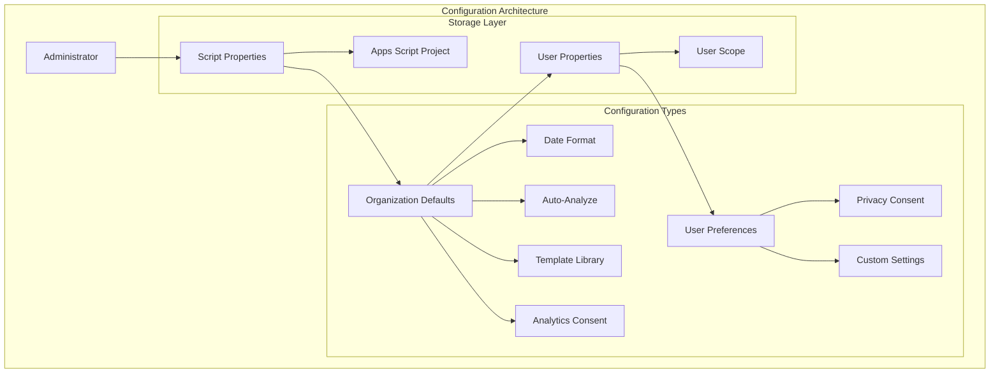
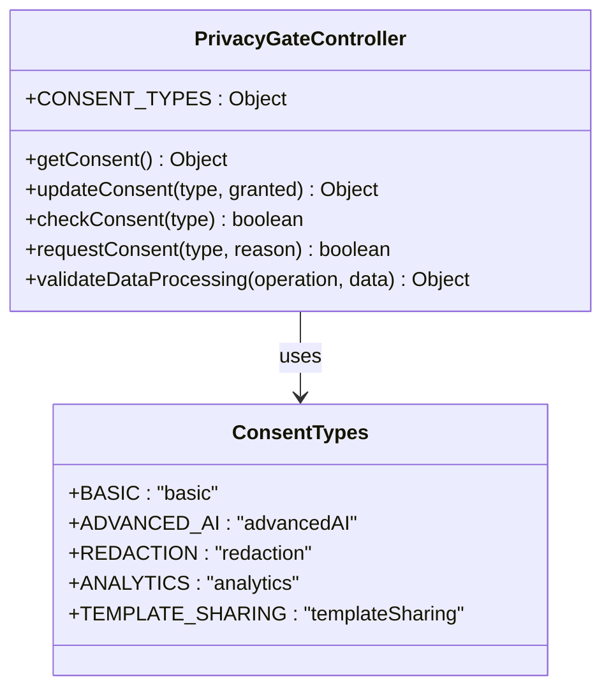
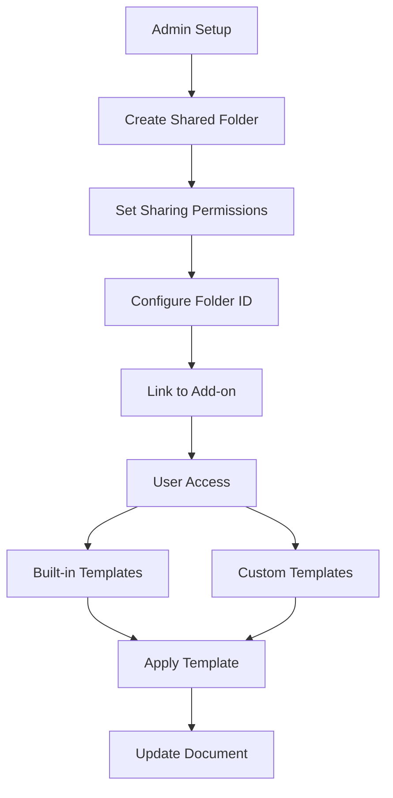
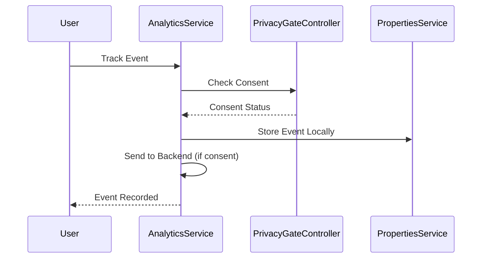
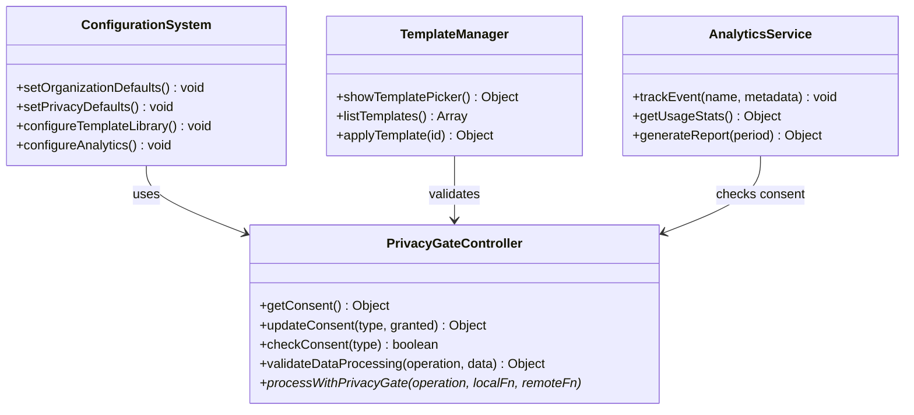
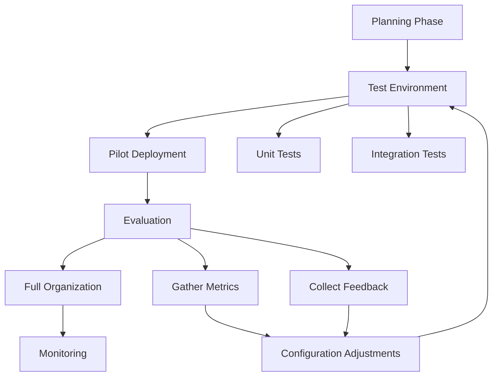

# Configuration

<cite>
**Referenced Files in This Document**
- [ADMIN_GUIDE.md](file://ADMIN_GUIDE.md)
- [src/services/AnalyticsService.js](file://src/services/AnalyticsService.js)
- [src/services/PrivacyGateController.js](file://src/services/PrivacyGateController.js)
- [src/services/TemplateManager.js](file://src/services/TemplateManager.js)
- [src/Main.js](file://src/Main.js)
- [src/appsscript.json](file://src/appsscript.json)
- [src/ui/Sidebar.html](file://src/ui/Sidebar.html)
</cite>

## Table of Contents
1. [Introduction](#introduction)
2. [Organization-Wide Configuration Overview](#organization-wide-configuration-overview)
3. [Setting Organization Defaults](#setting-organization-defaults)
4. [Privacy Policy Configuration](#privacy-policy-configuration)
5. [Template Library Setup](#template-library-setup)
6. [Analytics and Tracking Configuration](#analytics-and-tracking-configuration)
7. [Integration with PrivacyGateController](#integration-with-privacygatecontroller)
8. [Common Configuration Issues](#common-configuration-issues)
9. [Testing and Deployment Best Practices](#testing-and-deployment-best-practices)
10. [Troubleshooting Guide](#troubleshooting-guide)

## Introduction

The Techno Browser extension provides comprehensive organization-wide configuration capabilities through Google Apps Script's PropertiesService. Administrators can set default preferences, configure privacy policies, establish template libraries, and manage analytics consent across their entire organization. This configuration system ensures consistent user experiences while maintaining strict privacy controls and organizational compliance requirements.

The configuration framework operates through two primary property systems:
- **Script Properties**: Stored in the Apps Script project, accessible to all users
- **User Properties**: Individual user settings that override script properties

## Organization-Wide Configuration Overview

The extension's configuration system is built around Google Apps Script's PropertiesService, which provides persistent storage for configuration values. The system distinguishes between organization-wide defaults (script properties) and individual user preferences (user properties).



**Diagram sources**
- [src/services/PrivacyGateController.js](file://src/services/PrivacyGateController.js#L1-L50)
- [src/services/AnalyticsService.js](file://src/services/AnalyticsService.js#L1-L50)

## Setting Organization Defaults

Organization-wide defaults are configured using the `setOrganizationDefaults()` function, which sets script properties that apply to all users in the organization.

### Core Configuration Functions

The primary configuration function establishes baseline settings:

```javascript
function setOrganizationDefaults() {
  const scriptProps = PropertiesService.getScriptProperties();
  
  // Default date format
  scriptProps.setProperty('defaultDateFormat', 'yyyy-MM-dd');
  
  // Auto-analyze on document open
  scriptProps.setProperty('autoAnalyze', 'false');
  
  // Template library folder ID (optional)
  scriptProps.setProperty('templateFolderId', 'YOUR_FOLDER_ID');
  
  // Analytics enabled by default
  scriptProps.setProperty('defaultAnalyticsConsent', 'false');
}
```

### Configuration Parameters

| Parameter | Description | Default Value | Impact |
|-----------|-------------|---------------|---------|
| `defaultDateFormat` | Standard date format for all users | `'yyyy-MM-dd'` | Applied to date standardization features |
| `autoAnalyze` | Enable automatic document analysis | `'false'` | Controls whether documents analyze automatically when opened |
| `templateFolderId` | Google Drive folder ID for shared templates | `undefined` | Links to shared template library |
| `defaultAnalyticsConsent` | Analytics tracking consent state | `'false'` | Determines if usage analytics are collected |

### Advanced Configuration Options

Administrators can extend the default configuration with additional settings:

```javascript
function setExtendedOrganizationDefaults() {
  const scriptProps = PropertiesService.getScriptProperties();
  
  // Redaction settings
  scriptProps.setProperty('defaultRedaction', 'true');
  
  // Advanced AI features
  scriptProps.setProperty('defaultAdvancedAI', 'false');
  
  // UI behavior preferences
  scriptProps.setProperty('sidebarWidth', '320');
  scriptProps.setProperty('themeMode', 'light');
  
  // Automation rules
  scriptProps.setProperty('enableDuplicateDetection', 'true');
  scriptProps.setProperty('enableFormattingCleanup', 'true');
}
```

**Section sources**
- [ADMIN_GUIDE.md](file://ADMIN_GUIDE.md#L148-L165)

## Privacy Policy Configuration

Privacy configuration is managed through the `setPrivacyDefaults()` function, which establishes default consent states and privacy policies for the organization.

### Privacy Configuration Implementation

```javascript
function setPrivacyDefaults() {
  const scriptProps = PropertiesService.getScriptProperties();
  
  // Disable advanced AI by default
  scriptProps.setProperty('defaultAdvancedAI', 'false');
  
  // Enable redaction by default
  scriptProps.setProperty('defaultRedaction', 'true');
  
  // Privacy policy URL
  scriptProps.setProperty('privacyPolicyUrl', 'https://yourorg.com/privacy');
}
```

### Privacy Consent Types

The PrivacyGateController manages five distinct consent categories:



**Diagram sources**
- [src/services/PrivacyGateController.js](file://src/services/PrivacyGateController.js#L8-L15)

### Default Privacy States

| Consent Type | Default State | Description | Impact |
|--------------|---------------|-------------|---------|
| `basic` | `true` | Core functionality consent | Enables fundamental features |
| `advancedAI` | `false` | AI-powered processing consent | Disables AI features by default |
| `redaction` | `true` | Data redaction consent | Enables privacy protection features |
| `analytics` | `false` | Usage analytics consent | Disables tracking by default |
| `templateSharing` | `false` | Template library access | Restricts template access |

### Privacy Policy Integration

Organizations can customize their privacy policy URL and messaging:

```javascript
function configurePrivacyPolicy() {
  const scriptProps = PropertiesService.getScriptProperties();
  
  // Custom privacy policy URL
  scriptProps.setProperty('privacyPolicyUrl', 'https://yourcompany.com/data-privacy');
  
  // Legal/compliance contact
  scriptProps.setProperty('privacyContactEmail', 'privacy@yourcompany.com');
  
  // Data retention policy
  scriptProps.setProperty('dataRetentionDays', '90');
}
```

**Section sources**
- [ADMIN_GUIDE.md](file://ADMIN_GUIDE.md#L171-L184)
- [src/services/PrivacyGateController.js](file://src/services/PrivacyGateController.js#L17-L38)

## Template Library Setup

The template library configuration enables organizations to establish shared template repositories in Google Drive, providing standardized document formats across the organization.

### Template Library Architecture



**Diagram sources**
- [src/services/TemplateManager.js](file://src/services/TemplateManager.js#L8-L40)

### Template Library Configuration Process

1. **Create Shared Template Folder**:
   - Navigate to Google Drive
   - Create folder named "Document Automation Templates"
   - Set sharing permissions to "Anyone in organization with link"

2. **Add Default Templates**:
   - Upload organization-specific templates
   - Use naming convention: `[Category] Template Name`
   - Ensure proper MIME type detection

3. **Configure in Add-on**:
   ```javascript
   PropertiesService.getScriptProperties()
     .setProperty('templateFolderId', 'YOUR_FOLDER_ID');
   ```

### Template Management Functions

The TemplateManager provides comprehensive template handling capabilities:

```javascript
// List available templates
function listAvailableTemplates() {
  const templates = TemplateManager.listTemplates();
  return templates.filter(t => t.source === 'builtin');
}

// Get custom templates from Drive
function getCustomTemplates() {
  const customTemplates = TemplateManager.getCustomTemplatesFromDrive();
  return customTemplates;
}

// Apply template to document
function applyOrganizationTemplate(templateId) {
  const result = TemplateManager.applyTemplate(templateId);
  return result;
}
```

### Built-in Template Categories

The system includes several pre-configured template categories:

| Category | Templates | Purpose |
|----------|-----------|---------|
| Education | Grading Rubric | Academic assessment |
| Business | Professional Document Style, Clean Presentation | Corporate communication |
| Legal | Legal Contract Template | Contract management |
| Sales | Sales Report | Business reporting |

**Section sources**
- [ADMIN_GUIDE.md](file://ADMIN_GUIDE.md#L186-L202)
- [src/services/TemplateManager.js](file://src/services/TemplateManager.js#L8-L40)

## Analytics and Tracking Configuration

The analytics system provides privacy-preserving usage tracking with configurable consent management and reporting capabilities.

### Analytics Configuration Architecture



**Diagram sources**
- [src/services/AnalyticsService.js](file://src/services/AnalyticsService.js#L16-L45)
- [src/services/PrivacyGateController.js](file://src/services/PrivacyGateController.js#L78-L81)

### Analytics Configuration Functions

```javascript
// Enable audit logging
function enableAuditLogging() {
  const scriptProps = PropertiesService.getScriptProperties();
  scriptProps.setProperty('auditLogging', 'true');
  scriptProps.setProperty('auditLogSpreadsheet', 'SPREADSHEET_ID');
}

// Configure analytics consent
function configureAnalyticsConsent() {
  const scriptProps = PropertiesService.getScriptProperties();
  scriptProps.setProperty('defaultAnalyticsConsent', 'true');
  scriptProps.setProperty('analyticsBackendEnabled', 'false');
}

// Set analytics reporting period
function setAnalyticsReportingPeriod() {
  const scriptProps = PropertiesService.getScriptProperties();
  scriptProps.setProperty('analyticsReportPeriod', 'monthly');
}
```

### Analytics Data Collection

The system collects anonymized usage statistics:

| Metric | Description | Privacy Level |
|--------|-------------|---------------|
| `totalActions` | Total feature usage count | Anonymous |
| `timeSaved` | Estimated time savings | Calculated locally |
| `topActions` | Most frequently used features | Aggregated |
| `lastUsed` | Last usage timestamp | Local storage only |

### Analytics Export and Reporting

```javascript
// Generate usage report
function generateUsageReport() {
  const report = AnalyticsService.generateReport('month');
  return {
    totalEvents: report.totalEvents,
    topFeatures: report.eventsByType,
    timeSaved: report.timeSaved
  };
}

// Export analytics data
function exportAnalyticsData() {
  const csvData = AnalyticsService.exportAnalytics();
  return csvData;
}
```

**Section sources**
- [src/services/AnalyticsService.js](file://src/services/AnalyticsService.js#L1-L100)
- [ADMIN_GUIDE.md](file://ADMIN_GUIDE.md#L233-L240)

## Integration with PrivacyGateController

The PrivacyGateController serves as the central authority for privacy and consent management, integrating seamlessly with all configuration systems.

### Privacy Integration Patterns



**Diagram sources**
- [src/services/PrivacyGateController.js](file://src/services/PrivacyGateController.js#L1-L50)
- [src/services/TemplateManager.js](file://src/services/TemplateManager.js#L46-L61)

### Consent Validation Integration

Configuration functions integrate with privacy gates:

```javascript
// Template library configuration with consent validation
function configureTemplateLibrary(folderId) {
  const scriptProps = PropertiesService.getScriptProperties();
  
  // Check if template access is permitted
  if (PrivacyGateController.checkConsent('templateSharing')) {
    scriptProps.setProperty('templateFolderId', folderId);
    return { success: true, message: 'Template library configured' };
  } else {
    return { 
      success: false, 
      message: 'Template access requires consent' 
    };
  }
}

// Analytics configuration with privacy gate
function configureAnalytics(enabled) {
  const scriptProps = PropertiesService.getScriptProperties();
  
  // Privacy gate prevents unauthorized analytics activation
  if (PrivacyGateController.checkConsent('analytics')) {
    scriptProps.setProperty('defaultAnalyticsConsent', String(enabled));
    return { success: true, message: 'Analytics configured' };
  } else {
    return { 
      success: false, 
      message: 'Analytics requires consent' 
    };
  }
}
```

### Privacy-Aware Configuration Functions

```javascript
// Privacy-aware organization defaults
function setPrivacyAwareDefaults() {
  const scriptProps = PropertiesService.getScriptProperties();
  
  // Respect privacy-first defaults
  scriptProps.setProperty('defaultAdvancedAI', 'false');
  scriptProps.setProperty('defaultRedaction', 'true');
  scriptProps.setProperty('defaultAnalyticsConsent', 'false');
  
  // Enable privacy controls
  scriptProps.setProperty('enablePrivacyDashboard', 'true');
}
```

**Section sources**
- [src/services/PrivacyGateController.js](file://src/services/PrivacyGateController.js#L170-L237)
- [src/services/TemplateManager.js](file://src/services/TemplateManager.js#L46-L61)

## Common Configuration Issues

Understanding common configuration problems helps administrators avoid deployment pitfalls and ensure smooth organization-wide rollouts.

### Property Scope Confusion

**Problem**: Mixing user properties with script properties
```javascript
// INCORRECT - User properties override script properties
function configureIncorrectly() {
  const userProps = PropertiesService.getUserProperties();
  userProps.setProperty('templateFolderId', 'FOLDER_ID'); // Overrides script property
}
```

**Solution**: Use script properties for organization-wide settings
```javascript
// CORRECT - Script properties for organization defaults
function configureCorrectly() {
  const scriptProps = PropertiesService.getScriptProperties();
  scriptProps.setProperty('templateFolderId', 'FOLDER_ID');
}
```

### Folder ID Configuration Errors

**Problem**: Incorrect Google Drive folder IDs
```javascript
// INCORRECT - Using file ID instead of folder ID
const wrongFolderId = '1ABC2345def67890ghijklmnopqrstuvwxyz';
```

**Solution**: Verify folder ID format and permissions
```javascript
// VALIDATION FUNCTION
function validateFolderId(folderId) {
  try {
    const folder = DriveApp.getFolderById(folderId);
    return { 
      valid: true, 
      name: folder.getName(),
      permissions: getFolderPermissions(folder)
    };
  } catch (e) {
    return { valid: false, error: e.message };
  }
}
```

### Propagation Delays

**Problem**: Configuration changes not immediately available
```javascript
// INCORRECT - Assuming immediate availability
function checkConfiguration() {
  const folderId = PropertiesService.getScriptProperties().getProperty('templateFolderId');
  // May be empty due to propagation delay
}
```

**Solution**: Implement retry logic with delays
```javascript
// DELAYED CONFIGURATION CHECK
function waitForConfiguration(propertyKey, timeoutMs = 30000) {
  const startTime = new Date();
  
  while (new Date() - startTime < timeoutMs) {
    const value = PropertiesService.getScriptProperties().getProperty(propertyKey);
    if (value) return value;
    
    Utilities.sleep(1000); // Wait 1 second
  }
  
  throw new Error(`Configuration property "${propertyKey}" not available after ${timeoutMs}ms`);
}
```

### Configuration Validation

```javascript
// COMPREHENSIVE VALIDATION
function validateConfiguration() {
  const results = {
    scriptProperties: {},
    userProperties: {},
    permissions: {},
    connectivity: {}
  };
  
  // Check script properties
  const scriptProps = PropertiesService.getScriptProperties();
  results.scriptProperties.templateFolderId = scriptProps.getProperty('templateFolderId');
  results.scriptProperties.defaultDateFormat = scriptProps.getProperty('defaultDateFormat');
  
  // Validate folder accessibility
  const folderId = results.scriptProperties.templateFolderId;
  if (folderId) {
    try {
      const folder = DriveApp.getFolderById(folderId);
      results.permissions.folderAccessible = true;
    } catch (e) {
      results.permissions.folderAccessible = false;
      results.permissions.error = e.message;
    }
  }
  
  return results;
}
```

## Testing and Deployment Best Practices

Successful configuration deployment requires careful planning and systematic testing approaches.

### Pilot Group Testing

```javascript
// Pilot configuration deployment
function deployToPilotGroup(groupEmails) {
  const scriptProps = PropertiesService.getScriptProperties();
  
  // Set conservative defaults for pilot
  scriptProps.setProperty('defaultAdvancedAI', 'false');
  scriptProps.setProperty('defaultAnalyticsConsent', 'false');
  scriptProps.setProperty('enableBetaFeatures', 'false');
  
  // Monitor pilot group separately
  scriptProps.setProperty('pilotGroupEmails', groupEmails.join(','));
  
  return { success: true, message: 'Pilot configuration deployed' };
}
```

### Configuration Rollout Strategy



### Configuration Backup and Recovery

```javascript
// Backup current configuration
function backupConfiguration() {
  const scriptProps = PropertiesService.getScriptProperties();
  const backup = {};
  
  // Extract all configuration properties
  const keys = scriptProps.getKeys();
  keys.forEach(key => {
    backup[key] = scriptProps.getProperty(key);
  });
  
  // Store backup with timestamp
  const timestamp = new Date().toISOString();
  scriptProps.setProperty(`backup_${timestamp}`, JSON.stringify(backup));
  
  return { success: true, timestamp: timestamp };
}

// Restore configuration from backup
function restoreConfiguration(timestamp) {
  const scriptProps = PropertiesService.getScriptProperties();
  const backupJson = scriptProps.getProperty(`backup_${timestamp}`);
  
  if (!backupJson) {
    throw new Error(`Backup not found for timestamp: ${timestamp}`);
  }
  
  const backup = JSON.parse(backupJson);
  Object.keys(backup).forEach(key => {
    scriptProps.setProperty(key, backup[key]);
  });
  
  return { success: true, restored: Object.keys(backup).length };
}
```

### Configuration Monitoring

```javascript
// Monitor configuration health
function monitorConfigurationHealth() {
  const health = {
    scriptProperties: {
      count: PropertiesService.getScriptProperties().getKeys().length,
      lastUpdated: new Date().toISOString()
    },
    userPreferences: {
      active: 0,
      recentChanges: 0
    },
    templateLibrary: {
      connected: false,
      templateCount: 0
    }
  };
  
  // Check template library connection
  const folderId = PropertiesService.getScriptProperties().getProperty('templateFolderId');
  if (folderId) {
    try {
      const folder = DriveApp.getFolderById(folderId);
      health.templateLibrary.connected = true;
      health.templateLibrary.templateCount = folder.getFiles().hasNext() ? 1 : 0;
    } catch (e) {
      health.templateLibrary.error = e.message;
    }
  }
  
  return health;
}
```

## Troubleshooting Guide

Common configuration issues and their resolution strategies.

### Configuration Not Applying

**Symptoms**: Settings appear to be set but don't take effect

**Diagnosis Steps**:
1. Verify property scope (script vs user properties)
2. Check for propagation delays
3. Validate property values
4. Review error logs

**Resolution**:
```javascript
// Diagnostic function for configuration issues
function diagnoseConfigurationIssues() {
  const diagnostics = {
    scriptProperties: PropertiesService.getScriptProperties().getKeys(),
    userProperties: PropertiesService.getUserProperties().getKeys(),
    values: {},
    errors: []
  };
  
  // Check critical configuration values
  const criticalKeys = ['templateFolderId', 'defaultDateFormat', 'privacyPolicyUrl'];
  criticalKeys.forEach(key => {
    diagnostics.values[key] = PropertiesService.getScriptProperties().getProperty(key);
  });
  
  // Validate template folder
  const folderId = diagnostics.values.templateFolderId;
  if (folderId) {
    try {
      const folder = DriveApp.getFolderById(folderId);
      diagnostics.templateValidation = { 
        exists: true, 
        name: folder.getName(),
        files: folder.getFiles().hasNext() ? 'found' : 'empty'
      };
    } catch (e) {
      diagnostics.errors.push(`Template folder error: ${e.message}`);
    }
  }
  
  return diagnostics;
}
```

### Permission-Related Issues

**Symptoms**: Template access denied or analytics not working

**Common Causes**:
- Incorrect Google Drive sharing settings
- Insufficient OAuth scopes
- Privacy consent not granted

**Resolution Workflow**:
```javascript
// Permission validation and correction
function validateAndFixPermissions() {
  const results = {
    templateAccess: validateTemplateAccess(),
    analyticsConsent: validateAnalyticsConsent(),
    oauthScopes: validateOAuthScopes()
  };
  
  // Attempt automatic fixes
  if (!results.templateAccess.granted) {
    results.templateAccess.fixed = fixTemplateAccess();
  }
  
  if (!results.analyticsConsent.granted) {
    results.analyticsConsent.fixed = fixAnalyticsConsent();
  }
  
  return results;
}
```

### Performance Issues

**Symptoms**: Slow configuration loading or timeouts

**Optimization Strategies**:
```javascript
// Optimized configuration loading
function loadConfigurationOptimized() {
  const cacheKey = 'config_cache';
  const cachedConfig = PropertiesService.getScriptProperties().getProperty(cacheKey);
  
  if (cachedConfig) {
    return JSON.parse(cachedConfig);
  }
  
  // Load configuration with timeout
  const config = loadConfigurationWithTimeout(5000);
  
  // Cache for future requests
  PropertiesService.getScriptProperties().setProperty(cacheKey, JSON.stringify(config));
  
  return config;
}
```

**Section sources**
- [ADMIN_GUIDE.md](file://ADMIN_GUIDE.md#L277-L300)