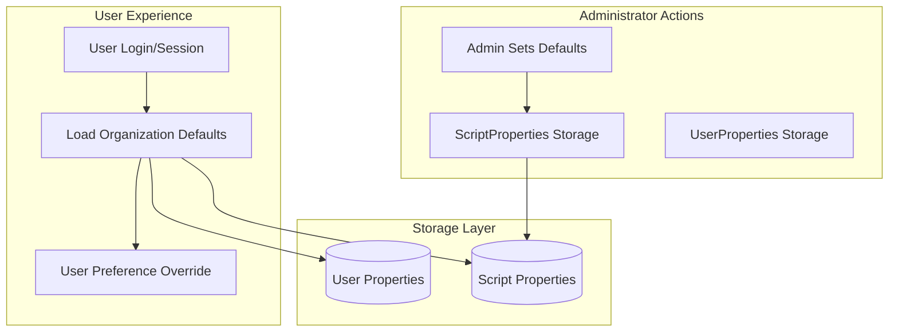
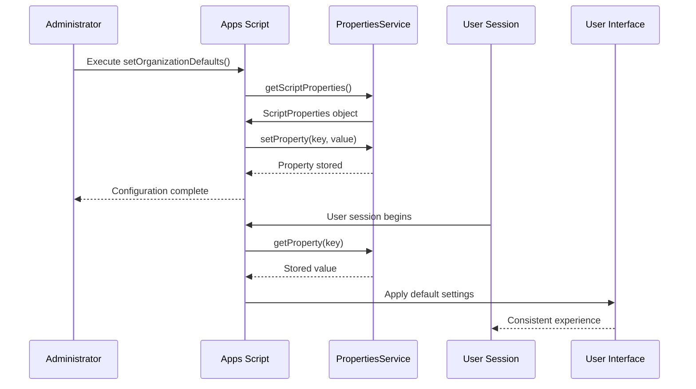
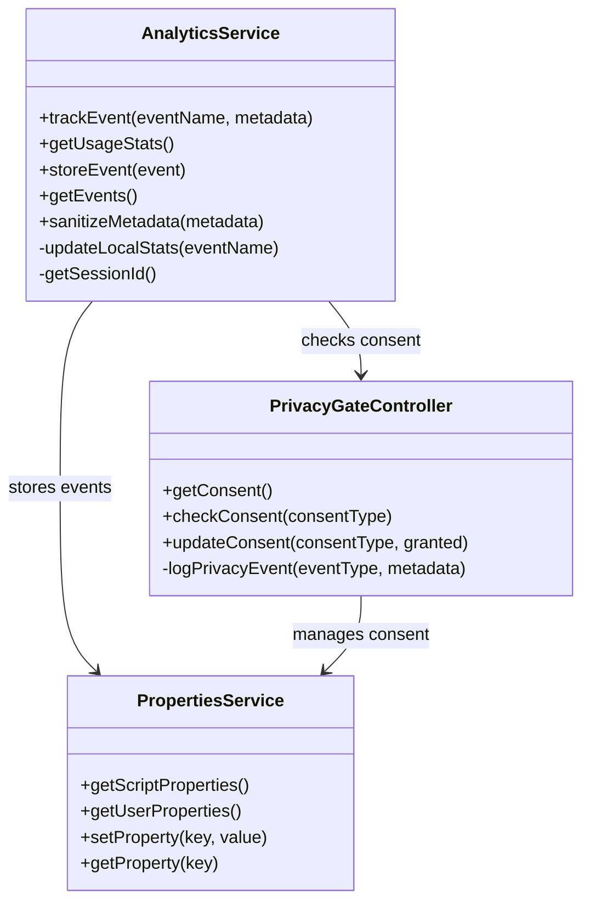
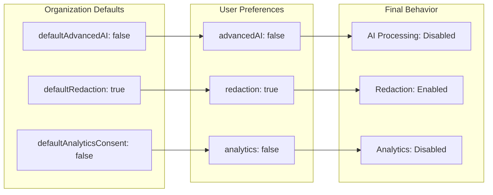

# Organization-Wide Settings

<cite>
**Referenced Files in This Document**
- [ADMIN_GUIDE.md](file://ADMIN_GUIDE.md)
- [src/services/AnalyticsService.js](file://src/services/AnalyticsService.js)
- [src/services/PrivacyGateController.js](file://src/services/PrivacyGateController.js)
- [src/Main.js](file://src/Main.js)
- [src/appsscript.json](file://src/appsscript.json)
- [appsscript.json](file://appsscript.json)
- [src/handlers/SidebarHandlers.js](file://src/handlers/SidebarHandlers.js)
- [src/utils/Utils.js](file://src/utils/Utils.js)
</cite>

## Table of Contents
1. [Introduction](#introduction)
2. [Understanding PropertiesService Scopes](#understanding-propertiesservice-scopes)
3. [Organization-Wide Default Settings](#organization-wide-default-settings)
4. [Configuration Implementation](#configuration-implementation)
5. [Integration with AnalyticsService](#integration-with-analyticsservice)
6. [Privacy and Consent Management](#privacy-and-consent-management)
7. [Common Configuration Patterns](#common-configuration-patterns)
8. [Testing and Validation](#testing-and-validation)
9. [Troubleshooting](#troubleshooting)
10. [Best Practices](#best-practices)

## Introduction

The Techno Browser extension provides administrators with powerful capabilities to configure organization-wide default settings through Google Apps Script's PropertiesService. These settings establish baseline configurations that ensure consistency across all users while maintaining flexibility for individual customization. This comprehensive guide covers the implementation, integration, and management of organization-wide preferences.

Organization-wide settings serve as the foundation for user experience, influencing everything from default date formats to analytics consent behavior. By leveraging the PropertiesService effectively, administrators can create standardized environments that align with organizational policies and compliance requirements.

## Understanding PropertiesService Scopes

Google Apps Script's PropertiesService provides two distinct scopes for storing configuration data, each serving different purposes in the organization-wide settings architecture.

### UserProperties vs ScriptProperties Comparison

| Aspect | UserProperties | ScriptProperties |
|--------|----------------|------------------|
| **Scope** | Per-user storage | Organization-wide storage |
| **Accessibility** | Only accessible by individual user | Accessible by all users in organization |
| **Propagation** | Immediate availability | May take 5-10 minutes to propagate |
| **Use Case** | Personal preferences | Global defaults and policies |
| **Persistence** | User session dependent | Persistent across sessions |

### Implementation Architecture



**Diagram sources**
- [src/services/AnalyticsService.js](file://src/services/AnalyticsService.js#L93-L117)
- [src/services/PrivacyGateController.js](file://src/services/PrivacyGateController.js#L21-L67)

**Section sources**
- [src/services/AnalyticsService.js](file://src/services/AnalyticsService.js#L93-L117)
- [src/services/PrivacyGateController.js](file://src/services/PrivacyGateController.js#L21-L67)

## Organization-Wide Default Settings

The core organization-wide settings are managed through the `setOrganizationDefaults()` function, which establishes baseline configurations that all users inherit upon first access.

### Core Configuration Function

The primary function for setting organization-wide defaults demonstrates the proper use of ScriptProperties for global configuration:

```javascript
function setOrganizationDefaults() {
  const scriptProps = PropertiesService.getScriptProperties();
  
  // Default date format
  scriptProps.setProperty('defaultDateFormat', 'yyyy-MM-dd');
  
  // Auto-analyze on document open
  scriptProps.setProperty('autoAnalyze', 'false');
  
  // Template library folder ID (optional)
  scriptProps.setProperty('templateFolderId', 'YOUR_FOLDER_ID');
  
  // Analytics enabled by default
  scriptProps.setProperty('defaultAnalyticsConsent', 'false');
}
```

### Privacy Policy Compliance Settings

Additional privacy-focused defaults can be configured to ensure compliance with organizational policies:

```javascript
function setPrivacyDefaults() {
  const scriptProps = PropertiesService.getScriptProperties();
  
  // Disable advanced AI by default
  scriptProps.setProperty('defaultAdvancedAI', 'false');
  
  // Enable redaction by default
  scriptProps.setProperty('defaultRedaction', 'true');
  
  // Privacy policy URL
  scriptProps.setProperty('privacyPolicyUrl', 'https://yourorg.com/privacy');
}
```

### Setting Propagation Mechanism



**Diagram sources**
- [ADMIN_GUIDE.md](file://ADMIN_GUIDE.md#L149-L164)
- [src/services/PrivacyGateController.js](file://src/services/PrivacyGateController.js#L21-L67)

**Section sources**
- [ADMIN_GUIDE.md](file://ADMIN_GUIDE.md#L149-L201)
- [src/services/PrivacyGateController.js](file://src/services/PrivacyGateController.js#L21-L67)

## Configuration Implementation

### Template Library Integration

Organizations can configure shared template libraries by setting the template folder ID in ScriptProperties:

```javascript
// Configure template library
PropertiesService.getScriptProperties()
  .setProperty('templateFolderId', 'YOUR_FOLDER_ID');
```

This setting enables automatic loading of organization-specific templates during document processing, ensuring consistent formatting and branding across all user interactions.

### Date Format Standardization

The default date format configuration ensures uniform presentation across all user interfaces:

```javascript
// Set regional date format preference
scriptProps.setProperty('defaultDateFormat', 'yyyy-MM-dd');
```

This setting influences how dates are displayed in various contexts, from document analysis reports to template applications.

### Analytics Consent Management

The analytics consent setting controls whether users automatically receive analytics opt-in prompts:

```javascript
// Control default analytics behavior
scriptProps.setProperty('defaultAnalyticsConsent', 'false');
```

When set to `false`, users must explicitly grant analytics consent, enhancing privacy compliance while still allowing for optional data collection.

**Section sources**
- [ADMIN_GUIDE.md](file://ADMIN_GUIDE.md#L149-L201)
- [src/services/AnalyticsService.js](file://src/services/AnalyticsService.js#L93-L117)

## Integration with AnalyticsService

The AnalyticsService integrates closely with organization-wide settings to provide privacy-preserving usage tracking while respecting user consent preferences.

### Analytics Property Management



**Diagram sources**
- [src/services/AnalyticsService.js](file://src/services/AnalyticsService.js#L6-L395)
- [src/services/PrivacyGateController.js](file://src/services/PrivacyGateController.js#L6-L309)

### Event Tracking with Consent

The AnalyticsService implements a sophisticated consent-checking mechanism that respects both organization-wide defaults and individual user preferences:

```javascript
function trackEvent(eventName, metadata = {}) {
  try {
    // Check if analytics consent is granted
    if (!PrivacyGateController.checkConsent('analytics')) {
      // Store minimal local stats only
      updateLocalStats(eventName);
      return;
    }
    
    // Sanitize metadata to ensure no PII
    const sanitizedMetadata = sanitizeMetadata(metadata);
    
    const event = {
      name: eventName,
      timestamp: new Date().toISOString(),
      metadata: sanitizedMetadata,
      session: getSessionId()
    };
    
    // Store locally
    storeEvent(event);
    
    // Optionally send to backend (if configured and consented)
    if (shouldSendToBackend()) {
      sendEventToBackend(event);
    }
  } catch (e) {
    console.error('Error tracking event:', e);
  }
}
```

### Session-Based Event Storage

The service uses session-based keys to organize events by user session, enabling efficient aggregation and reporting:

```javascript
function storeEvent(event) {
  updateLocalStats(event.name);
  
  // Store full event details if analytics consent is granted
  const scriptProperties = PropertiesService.getScriptProperties();
  const eventsKey = 'events_' + getSessionId();
  const eventsJson = scriptProperties.getProperty(eventsKey);
  
  let events = eventsJson ? JSON.parse(eventsJson) : [];
  events.push(event);
  
  // Limit stored events
  if (events.length > MAX_EVENTS) {
    events = events.slice(-MAX_EVENTS);
  }
  
  scriptProperties.setProperty(eventsKey, JSON.stringify(events));
}
```

**Section sources**
- [src/services/AnalyticsService.js](file://src/services/AnalyticsService.js#L16-L42)
- [src/services/AnalyticsService.js](file://src/services/AnalyticsService.js#L96-L117)

## Privacy and Consent Management

The PrivacyGateController manages user consent preferences while respecting organization-wide default settings, creating a layered privacy protection system.

### Consent Types and Defaults



**Diagram sources**
- [src/services/PrivacyGateController.js](file://src/services/PrivacyGateController.js#L8-L15)
- [src/services/PrivacyGateController.js](file://src/services/PrivacyGateController.js#L30-L42)

### Consent Retrieval and Application

The PrivacyGateController implements a hierarchical consent system where organization defaults serve as fallbacks for individual user preferences:

```javascript
function getConsent() {
  try {
    const userProperties = PropertiesService.getUserProperties();
    const consentJson = userProperties.getProperty(CONSENT_PROPERTY_KEY);
    
    if (consentJson) {
      return JSON.parse(consentJson);
    }
    
    // Default consent settings - only basic features enabled
    return {
      basic: true,
      advancedAI: false,
      redaction: true,
      analytics: false,
      templateSharing: false,
      timestamp: new Date().toISOString()
    };
  } catch (e) {
    console.error('Error getting consent:', e);
    return getDefaultConsent();
  }
}
```

### Dynamic Consent Updates

Users can modify their consent preferences through the privacy settings interface, with changes immediately affecting service behavior:

```javascript
function updateConsent(consentType, granted) {
  try {
    const currentConsent = getConsent();
    currentConsent[consentType] = granted;
    currentConsent.timestamp = new Date().toISOString();
    
    const userProperties = PropertiesService.getUserProperties();
    userProperties.setProperty(CONSENT_PROPERTY_KEY, JSON.stringify(currentConsent));
    
    // Log consent change
    logPrivacyEvent('consent_update', {
      type: consentType,
      granted: granted
    });
    
    return currentConsent;
  } catch (e) {
    console.error('Error updating consent:', e);
    return getConsent();
  }
}
```

**Section sources**
- [src/services/PrivacyGateController.js](file://src/services/PrivacyGateController.js#L21-L67)
- [src/services/PrivacyGateController.js](file://src/services/PrivacyGateController.js#L46-L67)

## Common Configuration Patterns

### Pilot Group Testing

Administrators should implement gradual rollout strategies using pilot groups to validate configuration changes:

```javascript
// Pilot configuration function
function setPilotDefaults() {
  const scriptProps = PropertiesService.getScriptProperties();
  
  // Conservative defaults for initial rollout
  scriptProps.setProperty('defaultAnalyticsConsent', 'false');
  scriptProps.setProperty('defaultAdvancedAI', 'false');
  scriptProps.setProperty('autoAnalyze', 'false');
  
  // Monitor usage patterns before expanding
  scriptProps.setProperty('pilotGroupEnabled', 'true');
}
```

### Environment-Specific Settings

Different environments (development, staging, production) may require different default configurations:

```javascript
function setEnvironmentDefaults(environment) {
  const scriptProps = PropertiesService.getScriptProperties();
  
  switch(environment) {
    case 'development':
      scriptProps.setProperty('defaultAnalyticsConsent', 'true');
      scriptProps.setProperty('debugMode', 'true');
      break;
      
    case 'production':
      scriptProps.setProperty('defaultAnalyticsConsent', 'false');
      scriptProps.setProperty('debugMode', 'false');
      break;
  }
}
```

### Compliance-Focused Configuration

For organizations with strict compliance requirements:

```javascript
function setComplianceDefaults() {
  const scriptProps = PropertiesService.getScriptProperties();
  
  // Maximum privacy defaults
  scriptProps.setProperty('defaultAdvancedAI', 'false');
  scriptProps.setProperty('defaultRedaction', 'true');
  scriptProps.setProperty('defaultAnalyticsConsent', 'false');
  scriptProps.setProperty('enableAuditLogging', 'true');
  
  // Legal compliance settings
  scriptProps.setProperty('privacyPolicyUrl', 'https://legal.yourorg.com/privacy-policy');
  scriptProps.setProperty('dataRetentionPeriod', '30'); // Days
}
```

## Testing and Validation

### Diagnostic Scripts

Implement comprehensive diagnostic scripts to validate configuration propagation and functionality:

```javascript
function validateOrganizationSettings() {
  const scriptProps = PropertiesService.getScriptProperties();
  const userProps = PropertiesService.getUserProperties();
  
  const diagnostics = {
    scriptProperties: {
      defaultDateFormat: scriptProps.getProperty('defaultDateFormat'),
      autoAnalyze: scriptProps.getProperty('autoAnalyze'),
      templateFolderId: scriptProps.getProperty('templateFolderId'),
      defaultAnalyticsConsent: scriptProps.getProperty('defaultAnalyticsConsent')
    },
    userProperties: {
      privacyConsent: userProps.getProperty('privacyConsent'),
      sessionId: userProps.getProperty('sessionId')
    },
    timestamp: new Date().toISOString()
  };
  
  return diagnostics;
}
```

### Propagation Verification

Monitor configuration propagation delays and ensure consistency across user sessions:

```javascript
function verifySettingsPropagation() {
  const scriptProps = PropertiesService.getScriptProperties();
  
  // Check if settings are available
  const dateFormat = scriptProps.getProperty('defaultDateFormat');
  const analyticsConsent = scriptProps.getProperty('defaultAnalyticsConsent');
  
  return {
    settingsAvailable: dateFormat !== null && analyticsConsent !== null,
    propagationDelay: calculatePropagationDelay(),
    consistencyScore: assessConsistency()
  };
}
```

### Automated Testing Framework

Implement automated testing to ensure configuration changes don't break functionality:

```javascript
function testConfigurationChanges() {
  const testResults = [];
  
  // Test date format consistency
  testResults.push(testDateFormatSetting());
  
  // Test analytics consent behavior
  testResults.push(testAnalyticsConsent());
  
  // Test template loading
  testResults.push(testTemplateLibrary());
  
  return {
    overallStatus: testResults.every(result => result.passed),
    details: testResults
  };
}
```

**Section sources**
- [src/services/AnalyticsService.js](file://src/services/AnalyticsService.js#L22-L42)
- [src/services/PrivacyGateController.js](file://src/services/PrivacyGateController.js#L21-L67)

## Troubleshooting

### Common Configuration Issues

#### Incorrect Property Scoping

**Problem**: Settings not applying consistently across users
**Solution**: Verify correct use of ScriptProperties vs UserProperties

```javascript
// Correct: Organization-wide settings
PropertiesService.getScriptProperties().setProperty('key', 'value');

// Incorrect: Individual user settings
PropertiesService.getUserProperties().setProperty('key', 'value');
```

#### Invalid Data Types

**Problem**: Settings not functioning due to improper data types
**Solution**: Ensure proper serialization of complex data structures

```javascript
// Correct: String representation for boolean values
scriptProps.setProperty('autoAnalyze', 'false');

// Correct: JSON string for complex objects
const settings = { 
  dateFormat: 'yyyy-MM-dd', 
  autoAnalyze: false 
};
scriptProps.setProperty('complexSettings', JSON.stringify(settings));
```

#### Deployment Propagation Delays

**Problem**: Configuration changes taking hours to propagate
**Solution**: Implement monitoring and validation scripts

```javascript
function monitorDeploymentPropagation() {
  const startTime = new Date();
  let attempts = 0;
  
  while (attempts < 10) {
    try {
      const scriptProps = PropertiesService.getScriptProperties();
      const testValue = scriptProps.getProperty('testKey');
      
      if (testValue) {
        return {
          success: true,
          propagationTime: new Date() - startTime,
          attempts: attempts + 1
        };
      }
    } catch (e) {
      // Continue trying
    }
    
    Utilities.sleep(30000); // 30 seconds
    attempts++;
  }
  
  return {
    success: false,
    errorMessage: 'Propagation timeout exceeded'
  };
}
```

### Error Recovery Procedures

#### Configuration Rollback

```javascript
function rollbackConfiguration() {
  const scriptProps = PropertiesService.getScriptProperties();
  
  // Remove problematic settings
  scriptProps.deleteProperty('problematicSetting');
  
  // Restore known good defaults
  setOrganizationDefaults();
  
  return { success: true, message: 'Configuration rolled back' };
}
```

#### Graceful Degradation

```javascript
function getSafeDefault(key, fallbackValue) {
  try {
    const scriptProps = PropertiesService.getScriptProperties();
    const value = scriptProps.getProperty(key);
    
    return value !== null ? value : fallbackValue;
  } catch (e) {
    console.error('Error retrieving property:', e);
    return fallbackValue;
  }
}
```

**Section sources**
- [src/services/AnalyticsService.js](file://src/services/AnalyticsService.js#L93-L117)
- [src/services/PrivacyGateController.js](file://src/services/PrivacyGateController.js#L21-L67)

## Best Practices

### Configuration Management

#### Version Control Integration

```javascript
function backupCurrentSettings() {
  const scriptProps = PropertiesService.getScriptProperties();
  const backup = {};
  
  // List of settings to backup
  const settingsToBackup = [
    'defaultDateFormat',
    'autoAnalyze',
    'templateFolderId',
    'defaultAnalyticsConsent',
    'defaultAdvancedAI',
    'defaultRedaction'
  ];
  
  settingsToBackup.forEach(setting => {
    backup[setting] = scriptProps.getProperty(setting);
  });
  
  // Store backup with timestamp
  const timestamp = new Date().toISOString();
  scriptProps.setProperty(`backup_${timestamp}`, JSON.stringify(backup));
  
  return { success: true, timestamp: timestamp };
}
```

#### Change Documentation

```javascript
function documentConfigurationChange(changeDetails) {
  const scriptProps = PropertiesService.getScriptProperties();
  
  const historyEntry = {
    timestamp: new Date().toISOString(),
    admin: Session.getActiveUser().getEmail(),
    changes: changeDetails,
    notes: changeDetails.notes || ''
  };
  
  const historyJson = scriptProps.getProperty('configurationHistory');
  const history = historyJson ? JSON.parse(historyJson) : [];
  
  history.push(historyEntry);
  
  scriptProps.setProperty('configurationHistory', JSON.stringify(history));
}
```

### Performance Optimization

#### Efficient Property Access

```javascript
// Batch property operations
function updateMultipleSettings(settings) {
  const scriptProps = PropertiesService.getScriptProperties();
  
  // Collect all updates
  Object.keys(settings).forEach(key => {
    scriptProps.setProperty(key, settings[key]);
  });
  
  // Force immediate flush for critical settings
  if (settings.forceFlush) {
    scriptProps.setProperty('forceFlush', 'true');
  }
}
```

#### Caching Strategies

```javascript
function getCachedSetting(key, defaultValue) {
  const cacheKey = `cached_${key}`;
  const scriptProps = PropertiesService.getScriptProperties();
  
  // Check cache first
  const cachedValue = scriptProps.getProperty(cacheKey);
  if (cachedValue) {
    return JSON.parse(cachedValue);
  }
  
  // Fetch from storage
  const value = scriptProps.getProperty(key) || defaultValue;
  
  // Cache the value
  scriptProps.setProperty(cacheKey, JSON.stringify(value));
  
  return value;
}
```

### Security Considerations

#### Secure Property Storage

```javascript
function secureSetProperty(key, value) {
  const scriptProps = PropertiesService.getScriptProperties();
  
  // Encrypt sensitive values
  if (isSensitiveKey(key)) {
    value = encryptValue(value);
  }
  
  scriptProps.setProperty(key, value);
}

function secureGetProperty(key) {
  const scriptProps = PropertiesService.getScriptProperties();
  const value = scriptProps.getProperty(key);
  
  if (value && isSensitiveKey(key)) {
    return decryptValue(value);
  }
  
  return value;
}
```

#### Access Control

```javascript
function validateAdminAccess() {
  const userEmail = Session.getActiveUser().getEmail();
  const adminList = ['admin@yourorg.com', 'superadmin@yourorg.com'];
  
  return adminList.includes(userEmail);
}

function restrictedSetProperty(key, value) {
  if (!validateAdminAccess()) {
    throw new Error('Access denied: Insufficient privileges');
  }
  
  PropertiesService.getScriptProperties().setProperty(key, value);
}
```

### Monitoring and Alerting

#### Configuration Health Checks

```javascript
function healthCheckConfiguration() {
  const scriptProps = PropertiesService.getScriptProperties();
  const health = {
    settingsPresent: {},
    validationErrors: [],
    timestamp: new Date().toISOString()
  };
  
  const requiredSettings = [
    'defaultDateFormat',
    'defaultAnalyticsConsent',
    'templateFolderId'
  ];
  
  requiredSettings.forEach(setting => {
    const value = scriptProps.getProperty(setting);
    health.settingsPresent[setting] = value !== null;
    
    if (!value) {
      health.validationErrors.push(`Missing required setting: ${setting}`);
    }
  });
  
  return health;
}
```

#### Automated Alerts

```javascript
function sendConfigurationAlert(subject, message) {
  const adminEmail = 'admin@yourorg.com';
  
  MailApp.sendEmail({
    to: adminEmail,
    subject: `[Tech Browser] ${subject}`,
    body: message
  });
}
```

These best practices ensure robust, secure, and maintainable organization-wide settings configuration for the Techno Browser extension, providing administrators with the tools needed to manage complex deployment scenarios effectively.