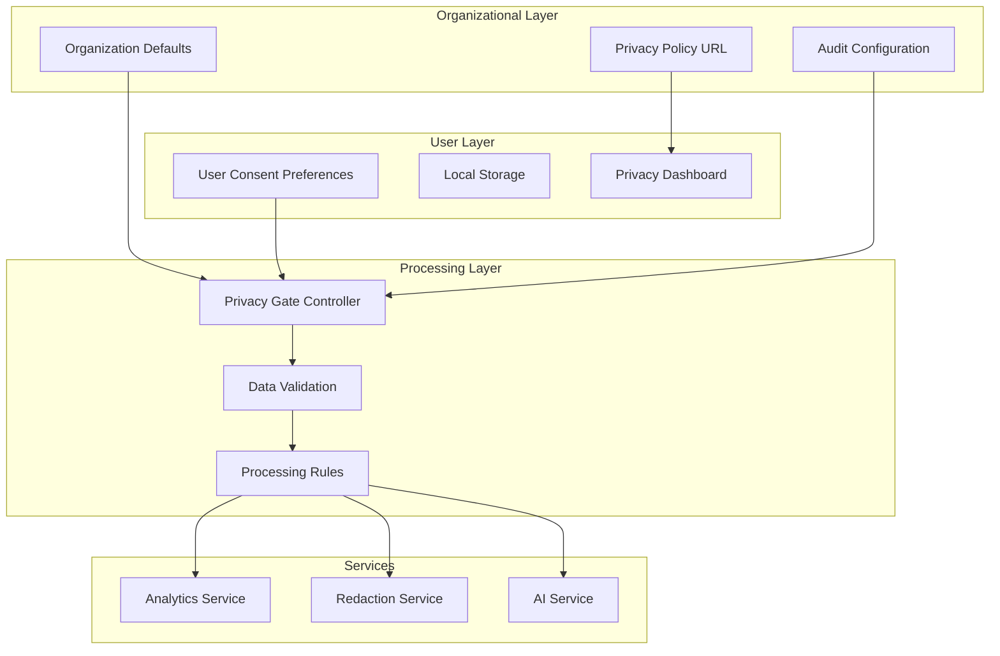
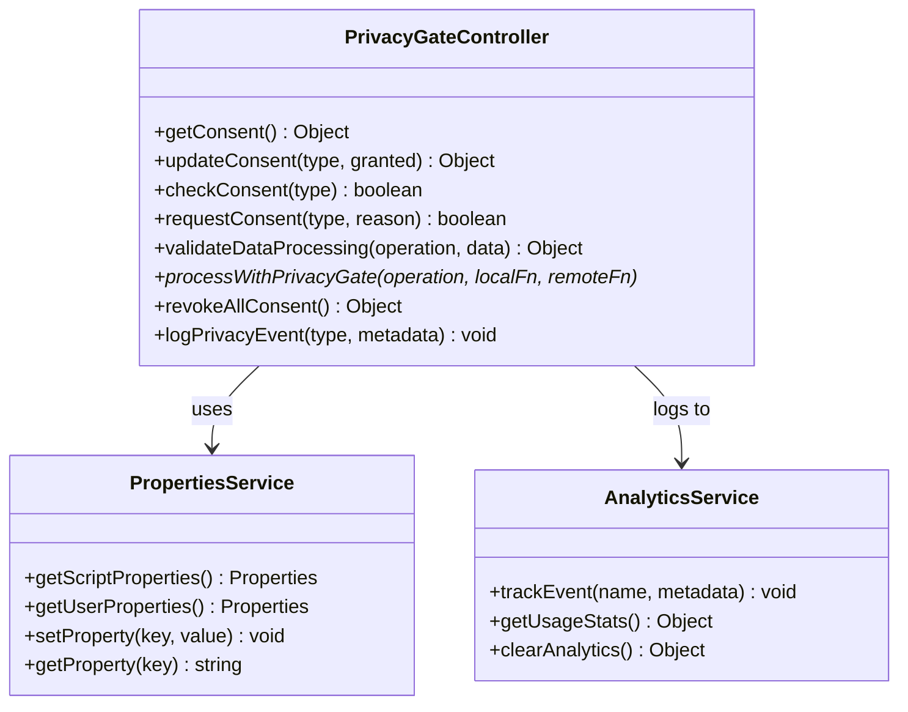
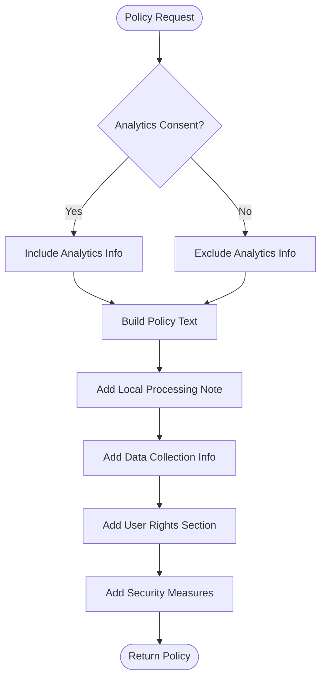
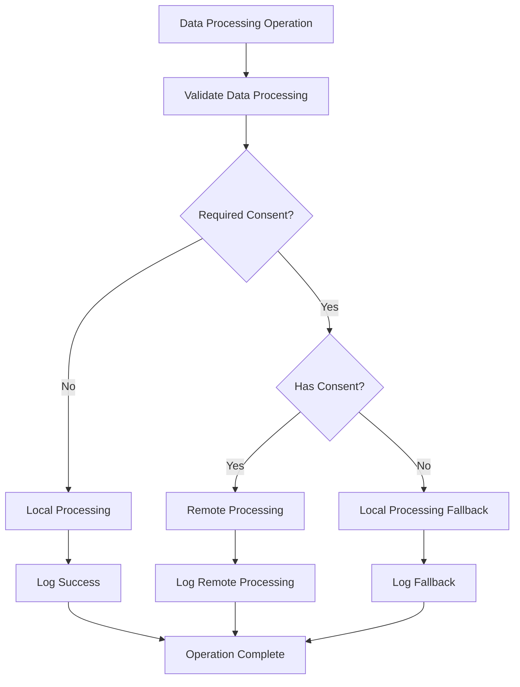
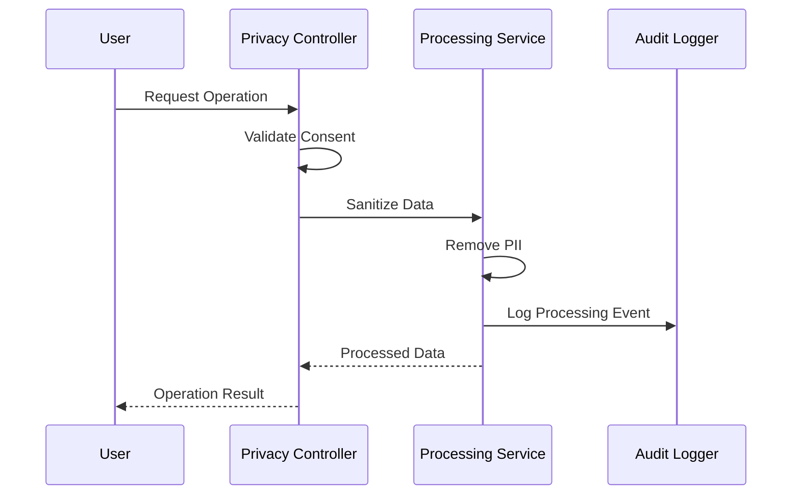
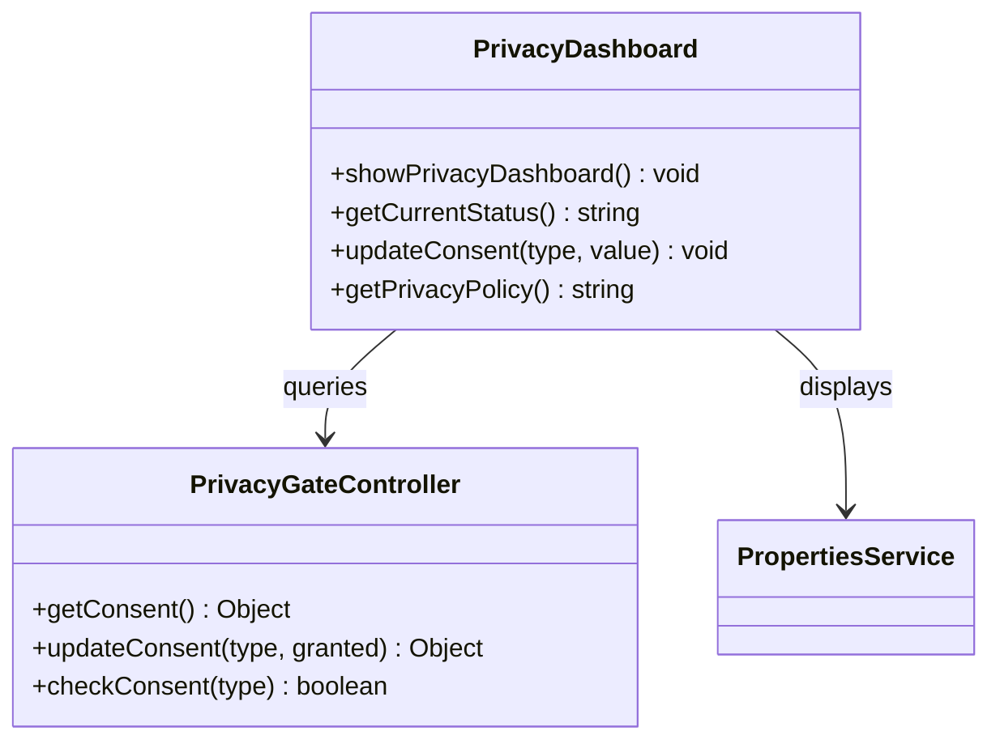

# Privacy Configuration

<cite>
**Referenced Files in This Document**
- [ADMIN_GUIDE.md](file://ADMIN_GUIDE.md)
- [src/services/PrivacyGateController.js](file://src/services/PrivacyGateController.js)
- [src/services/AnalyticsService.js](file://src/services/AnalyticsService.js)
- [src/services/RedactionService.js](file://src/services/RedactionService.js)
- [src/Main.js](file://src/Main.js)
</cite>

## Table of Contents
1. [Introduction](#introduction)
2. [Privacy Architecture Overview](#privacy-architecture-overview)
3. [Setting Default Privacy States](#setting-default-privacy-states)
4. [Privacy Policy Configuration](#privacy-policy-configuration)
5. [Audit Logging and Compliance](#audit-logging-and-compliance)
6. [Data Processing Rules](#data-processing-rules)
7. [Administrative Configuration](#administrative-configuration)
8. [Common Configuration Pitfalls](#common-configuration-pitfalls)
9. [Regulatory Compliance Framework](#regulatory-compliance-framework)
10. [Best Practices](#best-practices)
11. [Troubleshooting Guide](#troubleshooting-guide)

## Introduction

The Techno Browser extension implements a comprehensive privacy configuration system designed to protect user data while enabling intelligent document automation. The system follows a "privacy-first" approach, ensuring that sensitive operations require explicit consent and providing granular control over data processing capabilities.

The privacy configuration framework consists of several key components:
- **PrivacyGateController**: Central consent management and enforcement engine
- **PropertiesService Integration**: Persistent storage of privacy settings
- **Audit Logging**: Comprehensive tracking of privacy-related events
- **Regulatory Compliance**: Built-in support for GDPR, CCPA, and other frameworks

## Privacy Architecture Overview

The privacy system operates on a layered architecture that separates user-level preferences from organizational defaults:



**Diagram sources**
- [src/services/PrivacyGateController.js](file://src/services/PrivacyGateController.js#L1-L366)
- [src/services/AnalyticsService.js](file://src/services/AnalyticsService.js#L1-L375)

**Section sources**
- [src/services/PrivacyGateController.js](file://src/services/PrivacyGateController.js#L1-L50)

## Setting Default Privacy States

### The setPrivacyDefaults() Function

The primary mechanism for configuring privacy defaults is the `setPrivacyDefaults()` function, which administrators can use to establish baseline privacy settings for their organization:

```javascript
function setPrivacyDefaults() {
  const scriptProps = PropertiesService.getScriptProperties();
  
  // Disable advanced AI by default
  scriptProps.setProperty('defaultAdvancedAI', 'false');
  
  // Enable redaction by default
  scriptProps.setProperty('defaultRedaction', 'true');
  
  // Privacy policy URL
  scriptProps.setProperty('privacyPolicyUrl', 'https://yourorg.com/privacy');
}
```

### Privacy Consent Types

The system manages five distinct consent categories:

| Consent Type | Purpose | Default State | Scope |
|--------------|---------|---------------|-------|
| `basic` | Core functionality | Enabled | Always |
| `advancedAI` | AI-powered processing | Disabled | Optional |
| `redaction` | PII detection and removal | Enabled | Optional |
| `analytics` | Usage tracking | Disabled | Optional |
| `templateSharing` | Shared template access | Disabled | Optional |

### Implementation Details

The PrivacyGateController manages these consent states through a centralized properties system:



**Diagram sources**
- [src/services/PrivacyGateController.js](file://src/services/PrivacyGateController.js#L6-L366)
- [src/services/AnalyticsService.js](file://src/services/AnalyticsService.js#L6-L375)

**Section sources**
- [ADMIN_GUIDE.md](file://ADMIN_GUIDE.md#L171-L184)
- [src/services/PrivacyGateController.js](file://src/services/PrivacyGateController.js#L8-L15)

## Privacy Policy Configuration

### Policy URL Management

Organizations must configure a privacy policy URL that users can access through the privacy dashboard. This URL should point to a comprehensive privacy policy document that outlines data processing practices, user rights, and compliance information.

### Policy Content Requirements

The privacy policy should address:

- **Data Collection Practices**: What data is collected, how, and why
- **Processing Methods**: Local vs. cloud processing options
- **User Rights**: Right to access, rectify, erase, and object to processing
- **Third-party Sharing**: Clarification of sharing practices
- **Retention Periods**: How long data is retained
- **Security Measures**: Encryption and access controls

### Dynamic Policy Generation

The system generates privacy policy text dynamically based on current configuration:



**Diagram sources**
- [src/services/PrivacyGateController.js](file://src/services/PrivacyGateController.js#L240-L270)

**Section sources**
- [src/services/PrivacyGateController.js](file://src/services/PrivacyGateController.js#L240-L270)

## Audit Logging and Compliance

### Event Tracking System

The privacy system implements comprehensive audit logging to support compliance requirements:

```javascript
function logPrivacyEvent(eventType, metadata) {
  try {
    const log = {
      timestamp: new Date().toISOString(),
      event: eventType,
      metadata: metadata,
      user: Session.getActiveUser().getEmail()
    };
    
    console.info('Privacy Event:', JSON.stringify(log));
    
    // Store in user properties for audit trail
    if (checkConsent(CONSENT_TYPES.ANALYTICS)) {
      AnalyticsService.trackEvent('privacy_event', { type: eventType });
    }
  } catch (e) {
    console.error('Error logging privacy event:', e);
  }
}
```

### Audit Trail Categories

The system tracks several categories of privacy events:

| Event Type | Description | Data Included |
|------------|-------------|---------------|
| `consent_update` | User consent changes | Consent type, granted status |
| `consent_revoke_all` | Complete consent revocation | Empty metadata |
| `remote_processing` | External data processing | Operation type |
| `local_processing_fallback` | Local processing fallback | Operation type |
| `privacy_event` | General privacy events | Event type, metadata |

### Compliance Reporting

The audit system supports compliance reporting through:

- **Event Aggregation**: Grouping events by type and time periods
- **User Tracking**: Associating events with specific users
- **Data Export**: CSV export capability for external analysis
- **Retention Policies**: Configurable retention periods for audit logs

**Section sources**
- [src/services/PrivacyGateController.js](file://src/services/PrivacyGateController.js#L292-L315)

## Data Processing Rules

### Consent-Based Processing

The system enforces data processing rules based on user consent:



**Diagram sources**
- [src/services/PrivacyGateController.js](file://src/services/PrivacyGateController.js#L215-L237)

### Operation Mapping

Different operations require specific consent types:

| Operation | Required Consent | Processing Location |
|-----------|------------------|-------------------|
| `summarize` | `ADVANCED_AI` | Local (fallback) |
| `advanced_analysis` | `ADVANCED_AI` | Local (fallback) |
| `redact` | `REDACTION` | Local |
| `track_analytics` | `ANALYTICS` | Local (fallback) |
| `share_template` | `TEMPLATE_SHARING` | Local |

### Data Sanitization

Sensitive operations implement data sanitization to prevent accidental data leakage:



**Diagram sources**
- [src/services/PrivacyGateController.js](file://src/services/PrivacyGateController.js#L170-L213)
- [src/services/RedactionService.js](file://src/services/RedactionService.js#L181-L200)

**Section sources**
- [src/services/PrivacyGateController.js](file://src/services/PrivacyGateController.js#L170-L237)
- [src/services/RedactionService.js](file://src/services/RedactionService.js#L181-L200)

## Administrative Configuration

### Organization-Wide Settings

Administrators can configure default settings using the `setOrganizationDefaults()` function:

```javascript
function setOrganizationDefaults() {
  const scriptProps = PropertiesService.getScriptProperties();
  
  // Default date format
  scriptProps.setProperty('defaultDateFormat', 'yyyy-MM-dd');
  
  // Auto-analyze on document open
  scriptProps.setProperty('autoAnalyze', 'false');
  
  // Template library folder ID (optional)
  scriptProps.setProperty('templateFolderId', 'YOUR_FOLDER_ID');
  
  // Analytics enabled by default
  scriptProps.setProperty('defaultAnalyticsConsent', 'false');
}
```

### Privacy Dashboard Integration

The system provides a comprehensive privacy dashboard accessible through the main interface:



**Diagram sources**
- [src/services/PrivacyGateController.js](file://src/services/PrivacyGateController.js#L272-L290)

### Template Library Configuration

Organizations can configure shared template libraries for standardized document processing:

1. **Create Shared Folder**: Establish a Google Drive folder for templates
2. **Set Permissions**: Configure access permissions for the organization
3. **Configure Path**: Set the template folder ID in PropertiesService
4. **Verify Access**: Test template access through the privacy dashboard

**Section sources**
- [ADMIN_GUIDE.md](file://ADMIN_GUIDE.md#L149-L184)
- [src/services/PrivacyGateController.js](file://src/services/PrivacyGateController.js#L272-L290)

## Common Configuration Pitfalls

### Boolean String Values

One of the most common configuration errors involves incorrect boolean string values:

**Incorrect:**
```javascript
scriptProps.setProperty('defaultAdvancedAI', false); // Boolean, not string
```

**Correct:**
```javascript
scriptProps.setProperty('defaultAdvancedAI', 'false'); // String representation
```

### Missing Policy URLs

Failing to configure the privacy policy URL can lead to user confusion:

**Missing Configuration:**
```javascript
// No privacy policy URL set
scriptProps.setProperty('privacyPolicyUrl', '');
```

**Proper Configuration:**
```javascript
scriptProps.setProperty('privacyPolicyUrl', 'https://yourorg.com/privacy');
```

### Scope Mismatches

Ensure that property keys match exactly between configuration and retrieval:

**Mismatch Example:**
```javascript
// Setting property
scriptProps.setProperty('defaultAdvancedAI', 'false');

// Retrieving with wrong key
const value = scriptProps.getProperty('advancedAI'); // Wrong key!
```

### Consent Validation Errors

Improper consent validation can cause unexpected behavior:

**Incorrect Validation:**
```javascript
if (consent.advancedAI) { // Undefined if not set
  // Process remotely
}
```

**Correct Validation:**
```javascript
if (checkConsent('advancedAI')) { // Proper validation
  // Process remotely
}
```

### PropertiesService Confusion

Understanding the difference between script properties and user properties:

| Property Type | Scope | Persistence | Use Case |
|---------------|-------|-------------|----------|
| Script Properties | Global | Per project | Organization defaults |
| User Properties | Per user | Per user | Individual preferences |

**Section sources**
- [src/services/PrivacyGateController.js](file://src/services/PrivacyGateController.js#L23-L42)
- [ADMIN_GUIDE.md](file://ADMIN_GUIDE.md#L149-L184)

## Regulatory Compliance Framework

### GDPR Compliance

The system implements GDPR requirements through:

- **Consent Management**: Explicit consent for data processing
- **Right to Access**: User access to privacy settings
- **Right to Erase**: Ability to revoke all consents
- **Data Minimization**: Local-first processing by default
- **Purpose Limitation**: Clear separation of processing types

### CCPA Compliance

California Consumer Privacy Act requirements supported:

- **Notice at Collection**: Clear consent dialogs
- **Right to Know**: Privacy policy accessibility
- **Right to Delete**: Complete consent revocation
- **Non-Discrimination**: No penalties for exercising rights

### Data Protection Impact Assessment (DPIA)

The system facilitates DPIA through:

- **Processing Transparency**: Clear logging of data operations
- **Risk Assessment**: Consent-based processing decisions
- **User Control**: Granular privacy settings
- **Audit Trails**: Comprehensive event logging

### International Data Transfer

For organizations operating internationally:

- **Local Processing**: Data never leaves Google infrastructure
- **Encryption**: TLS 1.3 for all external communications
- **Jurisdiction Awareness**: Clear indication of data processing locations

**Section sources**
- [src/services/PrivacyGateController.js](file://src/services/PrivacyGateController.js#L240-L270)

## Best Practices

### Configuration Management

1. **Version Control**: Track privacy configuration changes
2. **Testing Environment**: Test configurations before production deployment
3. **Documentation**: Maintain documentation of all privacy settings
4. **Regular Reviews**: Periodic review of privacy configurations

### Legal Team Coordination

Effective collaboration with legal teams:

- **Policy Alignment**: Ensure technical implementation matches legal requirements
- **Regular Updates**: Coordinate policy updates with technical changes
- **Training Materials**: Develop training materials for legal stakeholders
- **Compliance Monitoring**: Establish compliance monitoring procedures

### User Communication

Clear communication strategies:

- **Transparent Consent**: Provide clear explanations for each consent type
- **Privacy Notices**: Display privacy notices prominently
- **User Education**: Educate users about privacy controls
- **Support Channels**: Establish support channels for privacy questions

### Technical Implementation

Best practices for technical implementation:

- **Error Handling**: Robust error handling for privacy operations
- **Performance Monitoring**: Monitor privacy-related performance impacts
- **Security Audits**: Regular security audits of privacy systems
- **Backup Procedures**: Backup privacy configurations regularly

### Monitoring and Maintenance

Ongoing maintenance practices:

- **Usage Analytics**: Monitor privacy setting adoption rates
- **Compliance Reporting**: Generate regular compliance reports
- **Incident Response**: Establish incident response procedures
- **System Updates**: Keep privacy systems updated with latest standards

**Section sources**
- [ADMIN_GUIDE.md](file://ADMIN_GUIDE.md#L344-L373)

## Troubleshooting Guide

### Common Issues and Solutions

#### Consent Not Persisting

**Problem**: User consent settings reset unexpectedly

**Solution**: Verify PropertiesService configuration and check for property limits

```javascript
// Debug consent persistence
function debugConsentPersistence() {
  const userProps = PropertiesService.getUserProperties();
  const consent = userProps.getProperty('privacyConsent');
  console.log('Current consent:', consent);
}
```

#### Privacy Policy URL Not Loading

**Problem**: Privacy policy URL inaccessible or broken

**Solution**: Verify URL accessibility and check for CORS issues

```javascript
// Test privacy policy URL
function testPrivacyPolicyURL() {
  const url = PropertiesService.getScriptProperties().getProperty('privacyPolicyUrl');
  try {
    const response = UrlFetchApp.fetch(url, { muteHttpExceptions: true });
    console.log('URL Status:', response.getResponseCode());
  } catch (e) {
    console.error('URL Error:', e.message);
  }
}
```

#### Audit Logging Not Working

**Problem**: Privacy events not being logged

**Solution**: Check analytics consent and verify logging function

```javascript
// Verify audit logging
function verifyAuditLogging() {
  const consent = PrivacyGateController.checkConsent('analytics');
  console.log('Analytics consent:', consent);
  PrivacyGateController.logPrivacyEvent('test_event', { test: true });
}
```

#### Performance Issues

**Problem**: Privacy operations causing performance degradation

**Solution**: Optimize consent checking and reduce unnecessary logging

```javascript
// Optimized consent check
function optimizedConsentCheck(operation) {
  const validation = PrivacyGateController.validateDataProcessing(operation, {});
  if (!validation.requiresConsent) {
    return true; // Fast path for operations that don't require consent
  }
  return PrivacyGateController.checkConsent(validation.consentType);
}
```

### Diagnostic Tools

#### Privacy Configuration Validator

```javascript
function validatePrivacyConfiguration() {
  const results = {
    properties: {},
    consent: {},
    urls: {}
  };
  
  // Check script properties
  const scriptProps = PropertiesService.getScriptProperties();
  results.properties.defaultAdvancedAI = scriptProps.getProperty('defaultAdvancedAI');
  results.properties.privacyPolicyUrl = scriptProps.getProperty('privacyPolicyUrl');
  
  // Check user consent defaults
  const defaultConsent = PrivacyGateController.getDefaultConsent();
  results.consent = defaultConsent;
  
  // Test privacy policy URL
  const policyUrl = scriptProps.getProperty('privacyPolicyUrl');
  if (policyUrl) {
    try {
      const response = UrlFetchApp.fetch(policyUrl, { muteHttpExceptions: true });
      results.urls.policyAccessible = response.getResponseCode() === 200;
    } catch (e) {
      results.urls.policyAccessible = false;
    }
  }
  
  return results;
}
```

#### Consent State Inspector

```javascript
function inspectConsentState() {
  const consent = PrivacyGateController.getConsent();
  const defaultConsent = PrivacyGateController.getDefaultConsent();
  
  console.log('Current Consent State:');
  Object.keys(consent).forEach(key => {
    if (key !== 'timestamp') {
      console.log(`${key}: ${consent[key]} (default: ${defaultConsent[key]})`);
    }
  });
}
```

**Section sources**
- [src/services/PrivacyGateController.js](file://src/services/PrivacyGateController.js#L21-L42)
- [ADMIN_GUIDE.md](file://ADMIN_GUIDE.md#L277-L300)