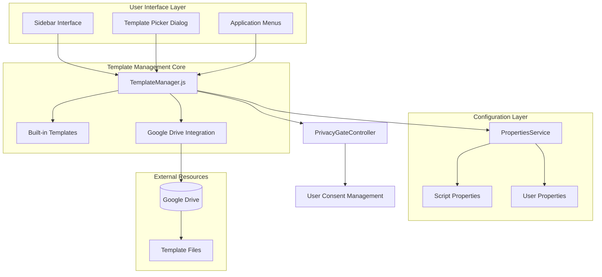
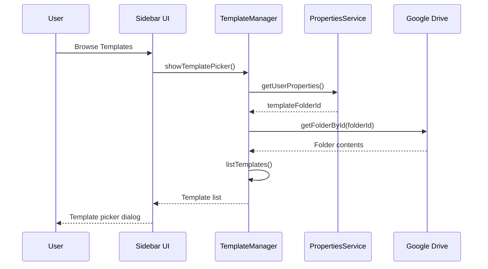
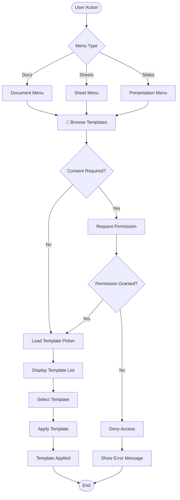

# Template Library Setup

<cite>
**Referenced Files in This Document**
- [ADMIN_GUIDE.md](file://ADMIN_GUIDE.md)
- [src/services/TemplateManager.js](file://src/services/TemplateManager.js)
- [src/Main.js](file://src/Main.js)
- [src/ui/Sidebar.html](file://src/ui/Sidebar.html)
- [src/appsscript.json](file://src/appsscript.json)
- [appsscript.json](file://appsscript.json)
</cite>

## Table of Contents
1. [Introduction](#introduction)
2. [System Architecture Overview](#system-architecture-overview)
3. [Step-by-Step Setup Process](#step-by-step-setup-process)
4. [Configuration Management](#configuration-management)
5. [Template Access and Usage](#template-access-and-usage)
6. [Best Practices](#best-practices)
7. [Common Issues and Troubleshooting](#common-issues-and-troubleshooting)
8. [Team Onboarding Guide](#team-onboarding-guide)
9. [Maintenance and Updates](#maintenance-and-updates)

## Introduction

The Techno Browser extension provides a sophisticated shared template library system that enables organizations to centralize and standardize document templates across Google Workspace applications. This system combines built-in templates with customizable shared libraries hosted in Google Drive, offering users instant access to pre-designed templates for documents, spreadsheets, and presentations.

The template library serves as a foundation for efficient content creation, ensuring consistency in formatting, structure, and branding across organizational communications. By leveraging Google Drive's collaboration features, teams can maintain centralized repositories of approved templates while individual users benefit from seamless template application workflows.

## System Architecture Overview

The template library system consists of several interconnected components that work together to provide a seamless template experience:



**Diagram sources**
- [src/services/TemplateManager.js](file://src/services/TemplateManager.js#L1-L479)
- [src/ui/Sidebar.html](file://src/ui/Sidebar.html#L610-L649)

### Core Components

**TemplateManager.js**: The central orchestrator that manages template discovery, validation, and application. It handles both built-in templates and custom templates from Google Drive.

**Built-in Templates**: Pre-configured templates for common use cases including grading rubrics, professional document styles, legal contracts, and sales reports.

**Google Drive Integration**: Seamless integration with Google Drive for accessing shared template libraries with appropriate sharing permissions.

**PrivacyGateController**: Ensures user consent is obtained before accessing external template resources.

**Section sources**
- [src/services/TemplateManager.js](file://src/services/TemplateManager.js#L1-L479)

## Step-by-Step Setup Process

### Step 1: Create Dedicated Template Folder

1. **Navigate to Google Drive**
   - Open Google Drive in your web browser
   - Sign in with your organizational Google account

2. **Create Template Library Folder**
   - Click "New" → "Folder"
   - Name the folder: "Document Automation Templates"
   - Place it in a logical location within your organization's shared drive

3. **Configure Sharing Permissions**
   - Right-click the folder and select "Share"
   - Set sharing to: "Anyone in organization with link"
   - Grant "Viewer" permission level
   - Copy the folder ID from the sharing link

### Step 2: Upload Standardized Templates

1. **Organize Templates by Category**
   - Create subfolders for different categories (Education, Business, Legal, Sales)
   - Use the recommended naming convention: `[Category] Template Name`

2. **Template Naming Convention**
   - Format: `[Category] [Purpose] [Type]`
   - Examples:
     - `Education Grading Rubric Spreadsheet`
     - `Business Professional Document DOCX`
     - `Legal Contract Template PDF`
     - `Sales Monthly Report Spreadsheet`

3. **File Formats Supported**
   - Google Docs (.gdoc)
   - Google Sheets (.gsheet)
   - Google Slides (.gslides)
   - Microsoft Office formats (.docx, .xlsx, .pptx)
   - PDF files

### Step 3: Configure Template Folder ID

Execute the following JavaScript code in the Apps Script editor to configure the template library:

```javascript
// Set template folder ID in Script Properties
PropertiesService.getScriptProperties()
  .setProperty('templateFolderId', 'YOUR_FOLDER_ID_HERE');
```

**Important**: Replace `YOUR_FOLDER_ID_HERE` with the actual folder ID from your Google Drive sharing link.

### Step 4: Verify Configuration

1. **Test Template Access**
   - Open any Google Workspace application (Docs, Sheets, Slides)
   - Navigate to the add-on menu
   - Select "Browse Templates" option
   - Verify that your custom templates appear alongside built-in templates

2. **Check User Properties**
   - In Apps Script editor, go to "View" → "Properties"
   - Verify that the `templateFolderId` property contains your folder ID

**Section sources**
- [ADMIN_GUIDE.md](file://ADMIN_GUIDE.md#L186-L202)
- [src/services/TemplateManager.js](file://src/services/TemplateManager.js#L125-L149)

## Configuration Management

### TemplateManager.js Configuration

The TemplateManager retrieves and uses the template configuration through a structured approach:



**Diagram sources**
- [src/services/TemplateManager.js](file://src/services/TemplateManager.js#L46-L76)
- [src/services/TemplateManager.js](file://src/services/TemplateManager.js#L125-L149)

### Built-in Template Categories

The system includes five predefined template categories:

| Category | Purpose | Template Types |
|----------|---------|----------------|
| Education | Academic and educational content | Grading rubrics, student forms |
| Business | Corporate documentation | Professional styles, reports |
| Legal | Legal and compliance documents | Contracts, agreements, policies |
| Sales | Sales and marketing materials | Reports, presentations, proposals |

### Template Discovery Process

The TemplateManager follows a hierarchical discovery process:

1. **Built-in Templates**: Always available, no external dependencies
2. **Custom Templates**: Retrieved from configured Google Drive folder
3. **Category Filtering**: Templates can be filtered by category for easier navigation
4. **Type Validation**: Ensures template compatibility with current document type

**Section sources**
- [src/services/TemplateManager.js](file://src/services/TemplateManager.js#L87-L114)
- [src/services/TemplateManager.js](file://src/services/TemplateManager.js#L125-L149)

## Template Access and Usage

### User Interface Integration

Templates are accessible through multiple interface points within the add-on:



**Diagram sources**
- [src/services/TemplateManager.js](file://src/services/TemplateManager.js#L46-L76)
- [src/ui/Sidebar.html](file://src/ui/Sidebar.html#L613-L627)

### Template Application Workflow

When users select a template, the system follows this process:

1. **Permission Validation**: Checks if user has granted template access consent
2. **Template Type Verification**: Ensures template compatibility with current document type
3. **Content Application**: Applies template structure and formatting
4. **Analytics Tracking**: Records template usage for reporting
5. **User Feedback**: Provides success/failure notifications

### Template Picker Interface

The template picker presents a clean, categorized interface:

- **Visual Design**: Clean layout with hover effects and clear categorization
- **Template Information**: Name, description, and category display
- **Interactive Elements**: Click-to-apply functionality
- **Responsive Design**: Optimized for various screen sizes

**Section sources**
- [src/services/TemplateManager.js](file://src/services/TemplateManager.js#L420-L444)
- [src/ui/Sidebar.html](file://src/ui/Sidebar.html#L613-L627)

## Best Practices

### Template Organization

**Folder Structure Recommendations**:
- Create logical subcategories within the main template folder
- Use consistent naming conventions across all templates
- Maintain separate folders for different document types

**Template Quality Standards**:
- Ensure templates are professionally designed and branded
- Include clear instructions for customization
- Test templates across different device types and browsers
- Maintain version control for template updates

### Sharing and Collaboration

**Access Control**:
- Use "Anyone in organization with link" for broad accessibility
- Implement regular reviews of template access permissions
- Establish governance processes for template approval

**Content Management**:
- Establish naming conventions for template versions
- Maintain documentation for template purposes and usage guidelines
- Implement change management processes for template updates

### Performance Optimization

**Loading Times**:
- Keep template files reasonably sized (< 10MB)
- Use efficient formatting and minimal embedded content
- Consider caching strategies for frequently used templates

**User Experience**:
- Provide clear descriptions for each template
- Implement category filtering for large template libraries
- Ensure responsive design for mobile devices

## Common Issues and Troubleshooting

### Incorrect Folder ID Configuration

**Problem**: Templates not appearing in the picker interface

**Symptoms**:
- Empty template list in the picker
- Error messages about missing templates
- "Template access requires Drive permission" warnings

**Solution**:
1. Verify the folder ID in Script Properties
2. Ensure the ID matches the Google Drive sharing link format
3. Check that the folder exists and is accessible
4. Clear browser cache and refresh the add-on

### Insufficient Sharing Permissions

**Problem**: "Access denied" errors when trying to access templates

**Symptoms**:
- Permission-related error messages
- Templates not loading despite correct configuration
- Inconsistent access across different user accounts

**Solution**:
1. Verify sharing settings are set to "Anyone in organization with link"
2. Ensure Viewer permission level is assigned
3. Check that the organization domain matches the sharing settings
4. Test access with different user accounts

### Synchronization Delays

**Problem**: Newly added templates not appearing immediately

**Symptoms**:
- Freshly uploaded templates not visible in picker
- Stale template lists persist after updates
- Delayed availability of template changes

**Solution**:
1. Wait 5-10 minutes for Google Drive synchronization
2. Clear browser cache and reload the add-on
3. Verify template file formats are supported
4. Check for Google Drive quota limitations

### Template Compatibility Issues

**Problem**: Templates fail to apply to certain document types

**Symptoms**:
- "Template is for [type] but current document is [type]" errors
- Partial template application
- Formatting inconsistencies

**Solution**:
1. Verify template MIME type matches target document type
2. Check template structure for compatibility
3. Test with different document types
4. Review template application logic

**Section sources**
- [src/services/TemplateManager.js](file://src/services/TemplateManager.js#L125-L149)
- [src/services/TemplateManager.js](file://src/services/TemplateManager.js#L169-L174)

## Team Onboarding Guide

### Training Materials

**Getting Started Guide**:
- Introduction to template library benefits
- Step-by-step template browsing tutorial
- Template application workflow walkthrough
- Best practices for template creation

**Advanced Usage**:
- Custom template development guidelines
- Template library maintenance procedures
- Troubleshooting common issues
- Performance optimization tips

### Governance Framework

**Template Approval Process**:
1. Template submission for review
2. Governance committee evaluation
3. Approval or feedback provision
4. Implementation timeline coordination

**Quality Assurance**:
- Regular template audits
- User feedback collection
- Performance monitoring
- Continuous improvement cycles

### Support Channels

**Technical Support**:
- IT help desk for configuration issues
- Admin contact for permission problems
- Developer support for custom template development

**Documentation Resources**:
- Internal wiki for template guidelines
- Video tutorials for common tasks
- FAQ documentation for frequent issues

## Maintenance and Updates

### Regular Maintenance Tasks

**Template Library Health Checks**:
- Monthly review of template accessibility
- Quarterly assessment of template relevance
- Annual cleanup of obsolete templates
- Performance monitoring and optimization

**System Updates**:
- Add-on version management
- Template library feature enhancements
- Security updates and patches
- Compatibility testing with new Google Workspace features

### Version Control Strategy

**Template Versioning**:
- Semantic versioning for major template updates
- Change logs maintained for all modifications
- Backward compatibility preservation
- Migration guides for significant changes

**Deployment Process**:
1. Development and testing in sandbox environment
2. Pilot testing with small user group
3. Full deployment rollout
4. Post-deployment monitoring and support

### Monitoring and Analytics

**Usage Analytics**:
- Template application frequency tracking
- User engagement metrics
- Popular template identification
- Adoption rate monitoring

**Performance Metrics**:
- Loading times and response rates
- Error rates and resolution times
- User satisfaction surveys
- System reliability indicators

**Section sources**
- [ADMIN_GUIDE.md](file://ADMIN_GUIDE.md#L303-L373)