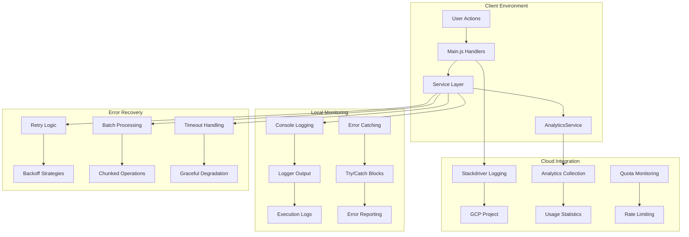
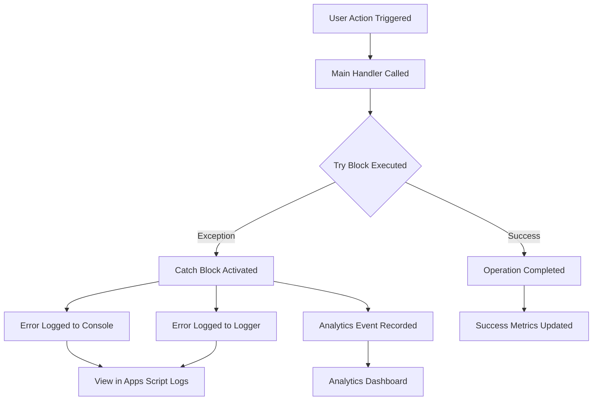
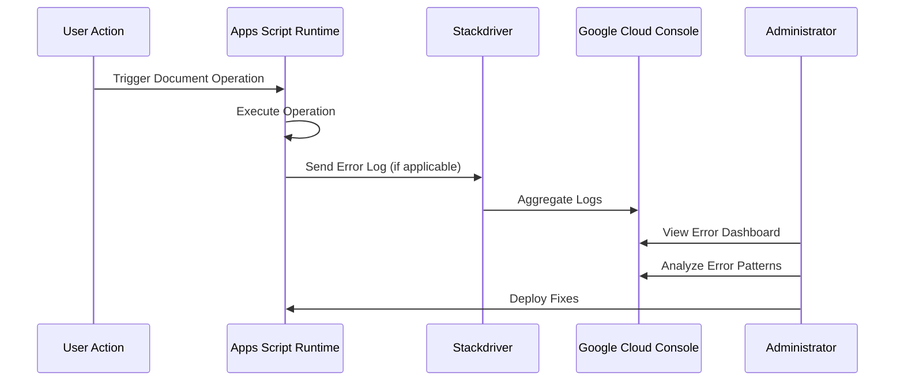
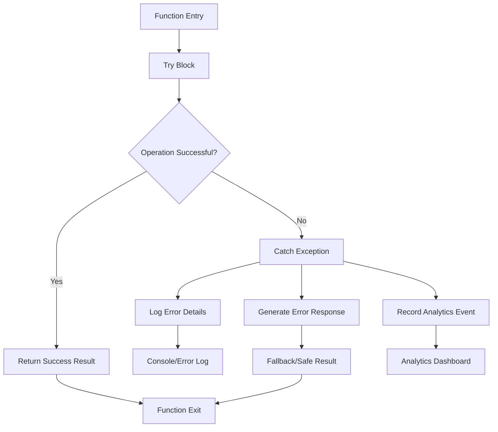
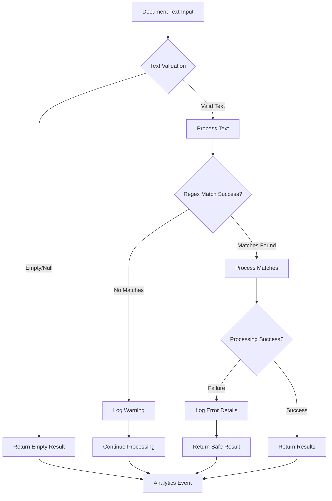
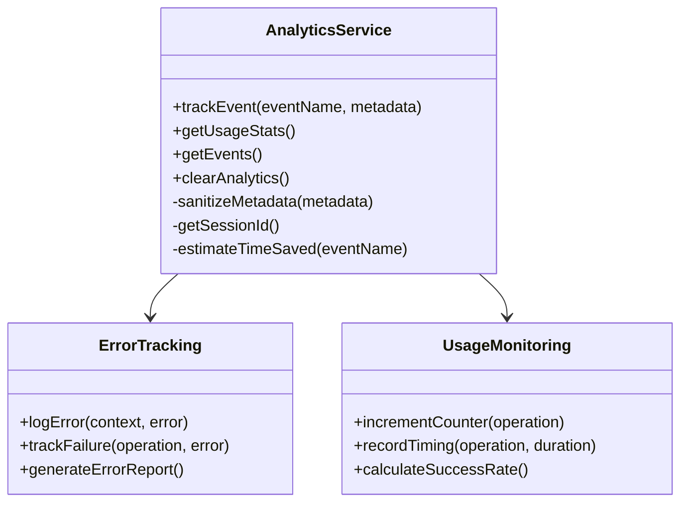
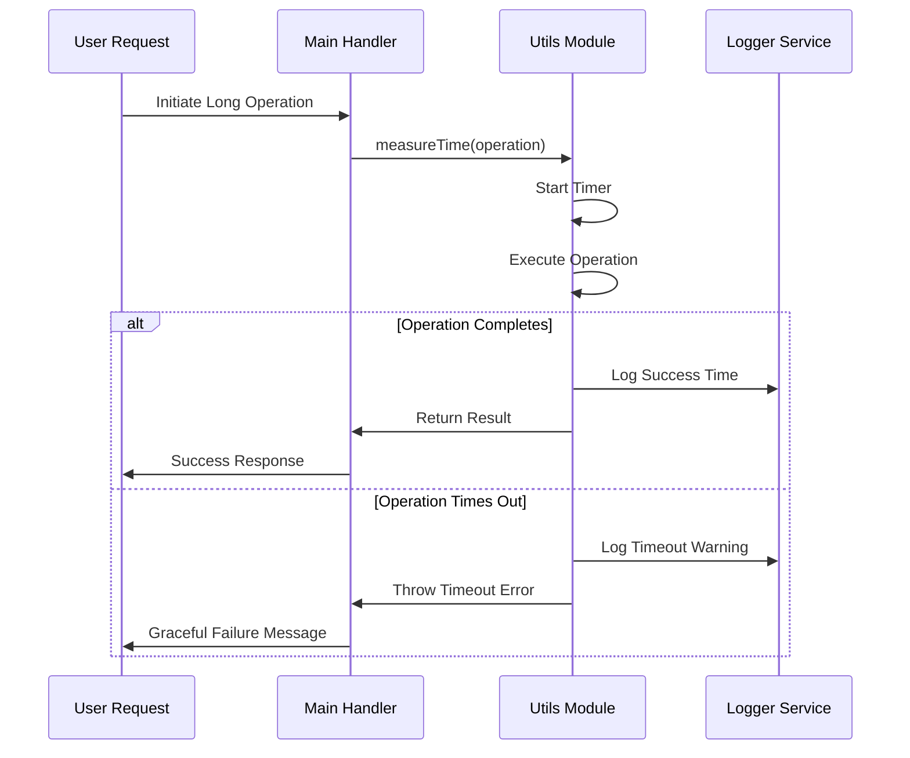
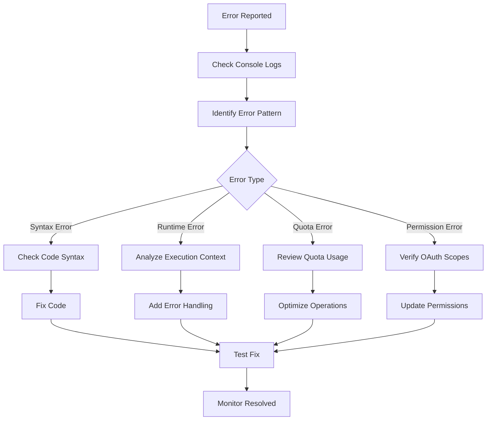
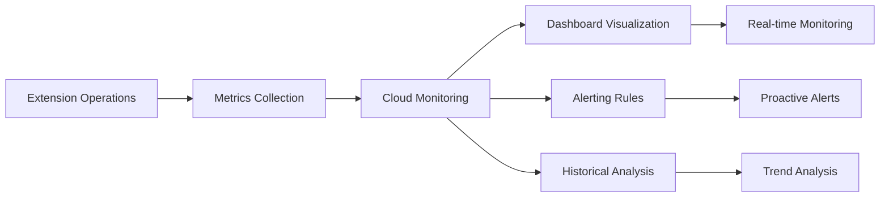

# Error Monitoring

<cite>
**Referenced Files in This Document**
- [src/services/AnalyticsService.js](file://src/services/AnalyticsService.js)
- [src/Main.js](file://src/Main.js)
- [src/appsscript.json](file://src/appsscript.json)
- [appsscript.json](file://appsscript.json)
- [src/services/DocumentAnalysisEngine.js](file://src/services/DocumentAnalysisEngine.js)
- [src/services/RedactionService.js](file://src/services/RedactionService.js)
- [src/utils/Utils.js](file://src/utils/Utils.js)
- [README.md](file://README.md)
</cite>

## Table of Contents
1. [Introduction](#introduction)
2. [Error Monitoring Architecture](#error-monitoring-architecture)
3. [Execution Logs and Apps Script Editor Integration](#execution-logs-and-apps-script-editor-integration)
4. [Stackdriver Logging Integration](#stackdriver-logging-integration)
5. [Built-in Error Handling Patterns](#built-in-error-handling-patterns)
6. [Common Error Patterns in Document Processing](#common-error-patterns-in-document-processing)
7. [Analytics Service Error Monitoring](#analytics-service-error-monitoring)
8. [Quota Management and Execution Monitoring](#quota-management-and-execution-monitoring)
9. [Debugging and Troubleshooting](#debugging-and-troubleshooting)
10. [Advanced Monitoring Configuration](#advanced-monitoring-configuration)
11. [Best Practices](#best-practices)
12. [Troubleshooting Guide](#troubleshooting-guide)

## Introduction

The Techno Browser extension implements a comprehensive error monitoring system designed specifically for Google Apps Script environments. This system provides multiple layers of error detection, logging, and analysis to ensure reliable document processing operations while maintaining privacy-first principles.

The error monitoring framework encompasses automatic execution logging, structured error capture, quota-aware processing, and centralized analytics collection. It's designed to handle the complexities of Google Workspace add-on development while providing administrators and developers with the insights needed to optimize performance and resolve issues quickly.

## Error Monitoring Architecture

The extension employs a multi-layered error monitoring architecture that combines local logging, automated analytics, and cloud-based monitoring capabilities.



**Diagram sources**
- [src/Main.js](file://src/Main.js#L133-L145)
- [src/services/AnalyticsService.js](file://src/services/AnalyticsService.js#L16-L44)
- [src/utils/Utils.js](file://src/utils/Utils.js#L90-L113)

**Section sources**
- [src/appsscript.json](file://src/appsscript.json#L27-L28)
- [appsscript.json](file://appsscript.json#L5-L6)

## Execution Logs and Apps Script Editor Integration

### Accessing Execution Logs

The primary method for accessing execution logs in the Techno Browser extension is through the Apps Script editor's built-in logging functionality. This provides immediate visibility into runtime operations and error conditions.

#### Viewing Logs in Apps Script Editor

1. **Open the Apps Script Editor**:
   - Navigate to [script.google.com](https://script.google.com)
   - Select your project containing the Techno Browser extension

2. **Access the Logs Panel**:
   - Go to **View → Logs** in the editor menu
   - This displays real-time execution logs for your add-on operations

3. **Log Categories**:
   - **Console Logs**: Generated by `console.log()` statements throughout the codebase
   - **Logger Logs**: Generated by `Logger.log()` calls for structured logging
   - **Error Messages**: Automatic error capture and reporting

#### Log Structure and Organization

The extension generates logs with specific patterns for easy identification and correlation:



**Diagram sources**
- [src/Main.js](file://src/Main.js#L133-L145)
- [src/services/DocumentAnalysisEngine.js](file://src/services/DocumentAnalysisEngine.js#L12-L29)

### Log Message Patterns

The extension uses consistent logging patterns across different service layers:

| Log Type | Pattern | Purpose |
|----------|---------|---------|
| **Operation Start** | `"Processing batch X/Y"` | Progress tracking for batch operations |
| **Error Detection** | `"Error analyzing document: X"` | Structured error reporting |
| **Validation Failures** | `"JSON parse error: X"` | Data validation issues |
| **Performance Metrics** | `"Operation took Yms"` | Timing and optimization insights |
| **Warning Conditions** | `"AI may have returned explanation"` | Quality assurance alerts |

**Section sources**
- [src/utils/Utils.js](file://src/utils/Utils.js#L210-L216)
- [src/utils/Utils.js](file://src/utils/Utils.js#L81-L87)

## Stackdriver Logging Integration

### Automatic Stackdriver Configuration

The extension is configured to automatically send error logs to Stackdriver (now part of Google Cloud Console) when linked to a Google Cloud Project. This provides centralized error aggregation and monitoring capabilities.

#### Configuration Details

The Stackdriver integration is enabled through the Apps Script manifest configuration:

```json
{
  "exceptionLogging": "STACKDRIVER",
  "runtimeVersion": "V8"
}
```

This configuration ensures that:
- **Uncaught Exceptions**: Automatically captured and forwarded to Stackdriver
- **Structured Logging**: Error messages are properly formatted for cloud processing
- **Performance Monitoring**: Execution times and resource usage tracked
- **Error Correlation**: Cross-reference with other Google Cloud services

#### Enabling Stackdriver Logging

1. **Link to Google Cloud Project**:
   - Open Apps Script project settings
   - Navigate to **Overview → Google Cloud Platform (GCP) project**
   - Link to your existing GCP project or create a new one

2. **Verify Logging Configuration**:
   - Check the `appsscript.json` file for `"exceptionLogging": "STACKDRIVER"`
   - Confirm the runtime version is set to "V8"

3. **Access Stackdriver Console**:
   - Navigate to [cloud.google.com](https://cloud.google.com)
   - Select your project containing the Apps Script application
   - Access **Logging → Logs Explorer**

### Centralized Error Aggregation

Stackdriver provides several advantages for error monitoring:



**Diagram sources**
- [src/appsscript.json](file://src/appsscript.json#L27-L28)
- [appsscript.json](file://appsscript.json#L5-L6)

**Section sources**
- [src/appsscript.json](file://src/appsscript.json#L27-L28)
- [appsscript.json](file://appsscript.json#L5-L6)

## Built-in Error Handling Patterns

### Try/Catch Block Implementation

The extension implements comprehensive error handling using try/catch blocks throughout the codebase. These patterns serve as the foundation for robust error tracking and recovery.

#### Core Error Handling Structure



**Diagram sources**
- [src/services/AnalyticsService.js](file://src/services/AnalyticsService.js#L51-L64)
- [src/services/DocumentAnalysisEngine.js](file://src/services/DocumentAnalysisEngine.js#L12-L29)

#### AnalyticsService Error Handling Model

The AnalyticsService demonstrates the optimal error handling pattern used throughout the extension:

```javascript
// Example pattern from AnalyticsService.js
function getUsageStats() {
  try {
    // Primary operation
    const userProperties = PropertiesService.getUserProperties();
    const statsJson = userProperties.getProperty(ANALYTICS_PROPERTY_KEY);
    
    if (statsJson) {
      return JSON.parse(statsJson);
    }
    
    return getDefaultStats();
  } catch (e) {
    console.error('Error getting usage stats:', e);
    return getDefaultStats();
  }
}
```

Key characteristics of this pattern:
- **Specific Error Context**: Error messages include function name and context
- **Graceful Degradation**: Returns safe default values on failure
- **Logging Integration**: Both console and structured logging
- **Analytics Tracking**: Error conditions recorded for monitoring

### Error Propagation and Recovery

The extension implements sophisticated error propagation mechanisms that allow for graceful degradation while maintaining user experience.

#### Retry Mechanisms

The Utils module provides exponential backoff retry functionality:

```javascript
// From Utils.js - retryWithBackoff implementation
function retryWithBackoff(func, maxRetries = 3, baseDelay = 1000) {
  let lastError;
  
  for (let attempt = 0; attempt < maxRetries; attempt++) {
    try {
      return func();
    } catch (e) {
      lastError = e;
      if (attempt < maxRetries - 1) {
        const delay = baseDelay * Math.pow(2, attempt);
        Utilities.sleep(delay);
      }
    }
  }
  
  throw lastError;
}
```

**Section sources**
- [src/services/AnalyticsService.js](file://src/services/AnalyticsService.js#L51-L64)
- [src/utils/Utils.js](file://src/utils/Utils.js#L90-L113)

## Common Error Patterns in Document Processing

### Document Analysis Errors

Document processing operations commonly encounter specific error patterns that administrators should monitor and understand.

#### Text Processing Failures



**Diagram sources**
- [src/services/DocumentAnalysisEngine.js](file://src/services/DocumentAnalysisEngine.js#L92-L100)
- [src/services/RedactionService.js](file://src/services/RedactionService.js#L112-L135)

#### Common Error Types

| Error Category | Symptoms | Resolution Strategy |
|----------------|----------|-------------------|
| **Empty Documents** | `Document is empty` | Skip processing, notify user |
| **Invalid Text Encoding** | `Cannot read property of undefined` | Validate text encoding before processing |
| **Memory Limit Exceeded** | `Out of memory` | Implement chunked processing |
| **Timeout Errors** | `Execution timeout` | Reduce batch sizes, add progress indicators |
| **Permission Denied** | `Access denied` | Check OAuth scopes and user permissions |

### PII Detection and Redaction Errors

PII processing involves complex regex patterns and can encounter various edge cases:

#### Pattern Matching Issues

```javascript
// Common PII pattern failures
const PII_PATTERNS = {
  EMAIL: {
    regex: /\b[A-Za-z0-9._%+-]+@[A-Za-z0-9.-]+\.[A-Z|a-z]{2,}\b/g,
    // May fail on unconventional email formats
  },
  PHONE: {
    regex: /(\+\d{1,3}[\s.-]?)?\(?\d{3}\)?[\s.-]?\d{3}[\s.-]?\d{4}\b/g,
    // May miss international formats without country codes
  }
};
```

#### Error Recovery Strategies

1. **Fallback Processing**: Use simpler patterns when complex ones fail
2. **Partial Results**: Return detected items even if some patterns fail
3. **User Notification**: Inform users when processing limitations occur
4. **Logging**: Record which patterns failed for future improvements

**Section sources**
- [src/services/DocumentAnalysisEngine.js](file://src/services/DocumentAnalysisEngine.js#L92-L100)
- [src/services/RedactionService.js](file://src/services/RedactionService.js#L52-L68)

## Analytics Service Error Monitoring

### Usage Statistics Collection

The AnalyticsService provides comprehensive error tracking and usage monitoring capabilities that help administrators understand system health and user behavior patterns.

#### Error Tracking Implementation



**Diagram sources**
- [src/services/AnalyticsService.js](file://src/services/AnalyticsService.js#L16-L44)
- [src/services/AnalyticsService.js](file://src/services/AnalyticsService.js#L51-L64)

#### Event Tracking Patterns

The AnalyticsService tracks various error scenarios:

| Event Type | Metadata | Purpose |
|------------|----------|---------|
| `error_analyzing_document` | `{errorType, documentType}` | Document analysis failures |
| `error_redacting_pii` | `{errorType, itemCount}` | PII processing errors |
| `error_processing_timeout` | `{operation, timeoutMs}` | Timeout-related failures |
| `error_quota_exceeded` | `{service, limitType}` | Resource limit violations |

### Error Rate Calculation

The service calculates error rates and success metrics to provide administrators with actionable insights:

```javascript
// Example error rate calculation pattern
function calculateErrorRate(totalOperations, errorCount) {
  if (totalOperations === 0) return 0;
  return (errorCount / totalOperations) * 100;
}
```

**Section sources**
- [src/services/AnalyticsService.js](file://src/services/AnalyticsService.js#L16-L44)
- [src/services/AnalyticsService.js](file://src/services/AnalyticsService.js#L51-L64)

## Quota Management and Execution Monitoring

### Google Apps Script Quotas

Understanding and monitoring Google Apps Script quotas is crucial for effective error management and system reliability.

#### Quota Categories and Limits

| Quota Type | Consumer Limit | Enterprise Limit | Monitoring Approach |
|------------|---------------|------------------|-------------------|
| **Execution Time** | 6 minutes | 30 minutes | Built-in timeout detection |
| **URL Fetch Calls** | 20,000/day | Unlimited | Request counting |
| **Properties Service** | 500 KB/store | 500 KB/store | Size validation |
| **File Operations** | Rate-limited | Rate-limited | Batch processing |
| **Document API Calls** | Rate-limited | Rate-limited | Throttling detection |

#### Execution Timeout Handling

The extension implements sophisticated timeout detection and recovery:



**Diagram sources**
- [src/utils/Utils.js](file://src/utils/Utils.js#L204-L216)
- [src/Main.js](file://src/Main.js#L412-L456)

### Batch Processing for Quota Management

The extension uses batch processing to avoid quota limits and improve reliability:

```javascript
// From Utils.js - batchProcess implementation
function batchProcess(items, operation, batchSize = 100) {
  const chunks = chunkArray(items, batchSize);
  
  chunks.forEach((chunk, index) => {
    console.log(`Processing batch ${index + 1}/${chunks.length}`);
    chunk.forEach(item => operation(item));
    
    // Small delay between batches to avoid rate limits
    if (index < chunks.length - 1) {
      Utilities.sleep(100);
    }
  });
}
```

**Section sources**
- [src/utils/Utils.js](file://src/utils/Utils.js#L218-L236)
- [README.md](file://README.md#L255-L269)

## Debugging and Troubleshooting

### Log Analysis Techniques

Effective error monitoring requires systematic log analysis and pattern recognition.

#### Log Correlation Strategies



#### Common Debugging Commands

Administrators can use these techniques to diagnose issues:

1. **Check Recent Logs**:
   ```javascript
   // View recent execution logs
   var logs = Logger.getLog();
   ```

2. **Monitor Error Frequency**:
   ```javascript
   // Count errors in recent logs
   var errorCount = logs.match(/ERROR/g).length;
   ```

3. **Track Operation Durations**:
   ```javascript
   // Measure operation timing
   var startTime = new Date().getTime();
   // ... perform operation ...
   var duration = new Date().getTime() - startTime;
   ```

### Error Message Interpretation

Understanding the specific error messages generated by the extension helps in rapid diagnosis:

| Error Pattern | Meaning | Solution |
|---------------|---------|----------|
| `Error analyzing document:` | Document processing failure | Check document format and content |
| `AI returned empty response` | AI service timeout or failure | Retry with smaller input |
| `JSON parse error:` | Data corruption or invalid format | Validate input data structure |
| `Out of memory` | Large document processing | Implement chunked processing |
| `Execution timeout` | Operation exceeded time limit | Optimize algorithm or reduce scope |

**Section sources**
- [src/Main.js](file://src/Main.js#L489-L518)
- [src/utils/Utils.js](file://src/utils/Utils.js#L81-L87)

## Advanced Monitoring Configuration

### Custom Error Handling

Administrators can extend the built-in error monitoring with custom handlers:

```javascript
// Custom error handler example
function setupCustomErrorHandler() {
  // Register global error handler
  ScriptApp.addTrigger('globalErrorHandler', 
    ScriptApp.EventType.ON_ERROR, 
    ScriptApp.ExecutionTime.END_OF_EXECUTION);
}

function globalErrorHandler(e) {
  // Custom error processing logic
  Logger.log('Global Error: ' + e.errorMessage);
  Logger.log('Error Stack: ' + e.errorStack);
  
  // Send notification to administrator
  sendAdminNotification('Critical Error', e.errorMessage);
}
```

### Performance Monitoring Integration

The extension integrates with Google Cloud Monitoring for advanced performance tracking:



### Analytics Dashboard Configuration

Administrators can configure custom analytics dashboards to monitor error patterns:

1. **Error Rate Tracking**: Monitor percentage of failed operations
2. **Operation Duration**: Track processing times for optimization
3. **User Impact**: Measure how errors affect user experience
4. **Resource Utilization**: Monitor quota usage and limits

**Section sources**
- [src/services/AnalyticsService.js](file://src/services/AnalyticsService.js#L16-L44)
- [src/appsscript.json](file://src/appsscript.json#L27-L28)

## Best Practices

### Error Handling Guidelines

1. **Always Wrap Critical Operations in Try/Catch**:
   ```javascript
   try {
     // Critical operation
   } catch (e) {
     console.error('Operation failed:', e);
     return { success: false, error: e.message };
   }
   ```

2. **Provide Meaningful Error Messages**:
   - Include context about what operation failed
   - Log stack traces for debugging
   - Return user-friendly error messages

3. **Implement Graceful Degradation**:
   - Return safe default values on failure
   - Provide fallback processing options
   - Maintain system stability

4. **Monitor Error Rates**:
   - Track error frequency and patterns
   - Set up alerts for unusual error spikes
   - Regular analysis of error trends

### Logging Best Practices

1. **Structured Logging**:
   ```javascript
   Logger.log('Operation: %s, Status: %s, Duration: %sms', 
     operationName, status, duration);
   ```

2. **Contextual Information**:
   - Include user IDs when possible (anonymously)
   - Document operation parameters
   - Capture timestamps accurately

3. **Log Level Management**:
   - Use DEBUG for development
   - Use INFO for operational events
   - Use ERROR for failures

### Performance Monitoring

1. **Measure Operation Times**:
   ```javascript
   function measureOperation(func, label) {
     const start = new Date().getTime();
     const result = func();
     const end = new Date().getTime();
     console.log(`${label} took ${end - start}ms`);
     return result;
   }
   ```

2. **Monitor Resource Usage**:
   - Track memory consumption
   - Monitor API call counts
   - Analyze processing bottlenecks

3. **Implement Circuit Breakers**:
   - Stop operations when failure rates exceed thresholds
   - Provide fallback mechanisms
   - Gradually recover from failures

## Troubleshooting Guide

### Common Issues and Solutions

#### Issue: Add-on Doesn't Appear in Menu

**Symptoms**:
- Add-on not visible in Google Workspace applications
- "Authorization required" errors

**Diagnosis Steps**:
1. Verify add-on installation in Google Workspace Admin Console
2. Check user permissions and domain policies
3. Confirm OAuth scopes are properly configured

**Resolution**:
```javascript
// Check if add-on is properly installed
function checkAddonInstallation() {
  try {
    DocumentApp.getActiveDocument();
    return true;
  } catch (e) {
    console.error('Add-on not properly installed:', e);
    return false;
  }
}
```

#### Issue: Operations Fail or Timeout

**Symptoms**:
- Long-running operations terminate unexpectedly
- "Execution timeout" error messages
- Partial processing results

**Diagnosis**:
1. Check document size and complexity
2. Monitor quota usage
3. Analyze operation timing logs

**Solutions**:
- Implement batch processing for large documents
- Reduce operation scope when possible
- Add progress indicators for long operations

#### Issue: PII Detection Misses Items

**Symptoms**:
- Expected sensitive information not detected
- False negatives in PII detection

**Diagnosis**:
1. Review regex patterns for completeness
2. Test with various data formats
3. Check for edge cases in data structure

**Enhancement**:
```javascript
// Enhanced PII detection with custom patterns
function enhancedPIIDetection(text) {
  const customPatterns = [
    // Add organization-specific patterns here
    '\\b[A-Z]{2}\\d{6}\\b', // Custom ID pattern
    '\\b\\d{4}-\\d{4}-\\d{4}\\b' // Custom format
  ];
  
  // Combine with existing patterns
  const combinedRegex = new RegExp(
    Object.values(PII_PATTERNS).map(p => p.regex.source).join('|') + 
    '|' + customPatterns.join('|'), 'gi'
  );
  
  return text.match(combinedRegex) || [];
}
```

### Performance Optimization

#### Memory Management

Large document processing can cause memory issues:

```javascript
// Memory-efficient processing pattern
function processLargeDocument(document) {
  const text = document.getBody().getText();
  const batchSize = 1000; // Adjust based on available memory
  
  for (let i = 0; i < text.length; i += batchSize) {
    const chunk = text.substring(i, i + batchSize);
    processTextChunk(chunk);
    
    // Allow garbage collection
    Utilities.sleep(100);
  }
}
```

#### Network Timeout Handling

External API calls require robust timeout management:

```javascript
// Robust network request with timeout
function makeNetworkRequest(url, options) {
  const timeoutMs = 30000; // 30 seconds
  
  try {
    const response = UrlFetchApp.fetch(url, {
      ...options,
      muteHttpExceptions: true,
      timeout: timeoutMs
    });
    
    if (response.getResponseCode() >= 400) {
      throw new Error('HTTP Error: ' + response.getContentText());
    }
    
    return response.getContentAsObject();
  } catch (e) {
    if (e.message.includes('Timed out')) {
      console.error('Request timed out after ' + timeoutMs + 'ms');
      throw new Error('Request timeout - try again later');
    }
    throw e;
  }
}
```

**Section sources**
- [README.md](file://README.md#L223-L253)
- [src/Main.js](file://src/Main.js#L412-L456)
- [src/utils/Utils.js](file://src/utils/Utils.js#L90-L113)