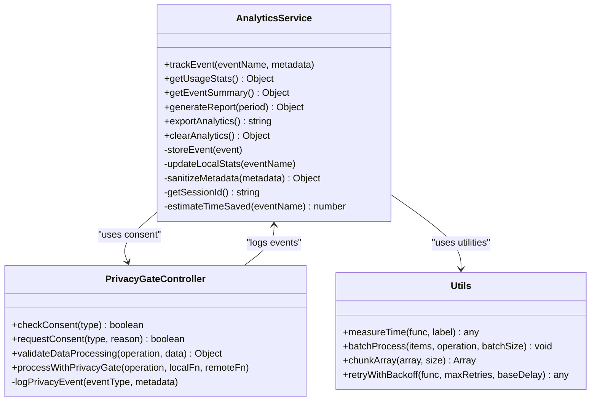
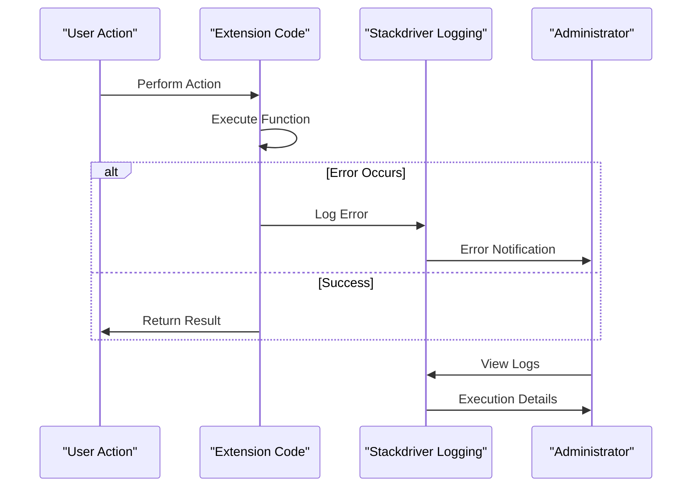
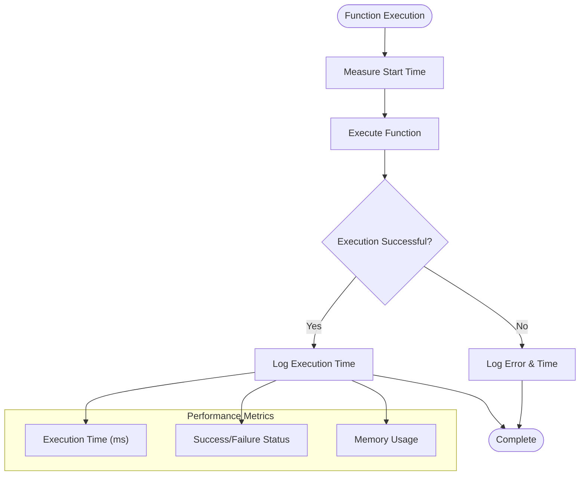
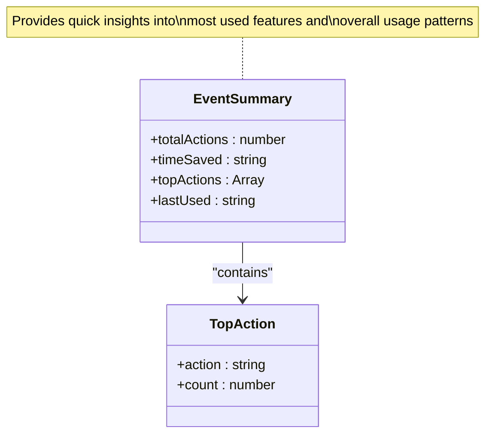
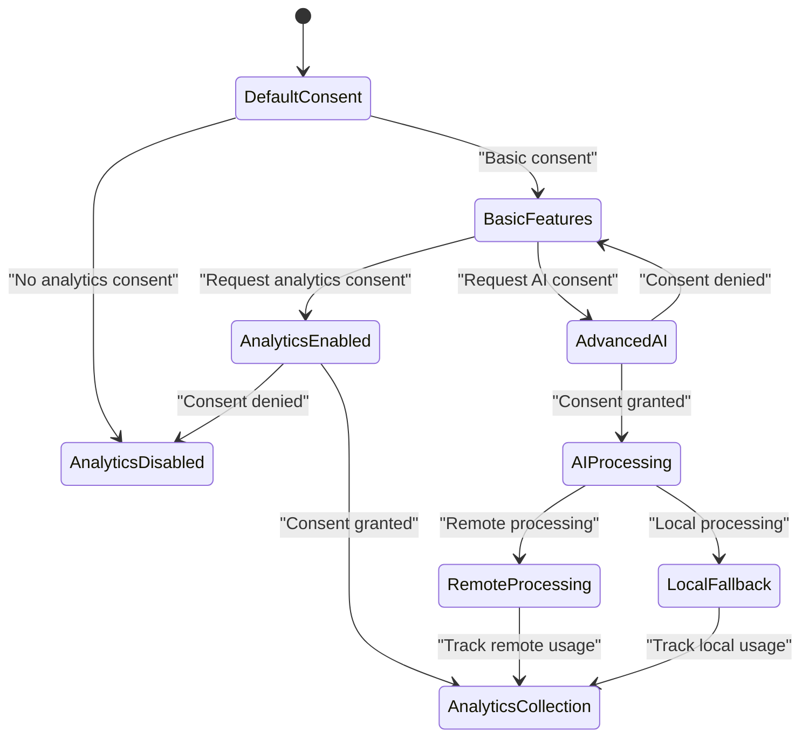

# Monitoring & Maintenance

<cite>
**Referenced Files in This Document**
- [src/services/AnalyticsService.js](file://src/services/AnalyticsService.js)
- [src/services/PrivacyGateController.js](file://src/services/PrivacyGateController.js)
- [src/Main.js](file://src/Main.js)
- [src/utils/Utils.js](file://src/utils/Utils.js)
- [src/appsscript.json](file://src/appsscript.json)
- [src/ui/Sidebar.html](file://src/ui/Sidebar.html)
- [ADMIN_GUIDE.md](file://ADMIN_GUIDE.md)
- [DEPLOYMENT_CHECKLIST.md](file://DEPLOYMENT_CHECKLIST.md)
</cite>

## Table of Contents
1. [Introduction](#introduction)
2. [Built-in Analytics Capabilities](#built-in-analytics-capabilities)
3. [Error Monitoring with Stackdriver](#error-monitoring-with-stackdriver)
4. [Performance Monitoring](#performance-monitoring)
5. [Analytics Data Interpretation](#analytics-data-interpretation)
6. [Organizational Usage Tracking](#organizational-usage-tracking)
7. [Privacy and Consent Management](#privacy-and-consent-management)
8. [Common Monitoring Challenges](#common-monitoring-challenges)
9. [Maintenance Procedures](#maintenance-procedures)
10. [Troubleshooting Guide](#troubleshooting-guide)

## Introduction

The Techno Browser extension provides comprehensive monitoring and maintenance capabilities designed to ensure optimal performance, user satisfaction, and compliance with organizational standards. Built on Google Apps Script's robust infrastructure, the extension offers privacy-preserving analytics, automated error tracking, and performance monitoring tools that enable administrators to maintain the add-on effectively across their organization.

The monitoring framework is designed around three core pillars: **usage analytics**, **error tracking**, and **performance monitoring**. These components work together to provide insights into user adoption patterns, identify potential issues proactively, and ensure the extension operates within acceptable performance parameters.

## Built-in Analytics Capabilities

### Analytics Service Architecture

The extension implements a sophisticated analytics service that tracks user interactions while maintaining strict privacy controls. The AnalyticsService provides comprehensive tracking capabilities with automatic data sanitization and consent-based data collection.



**Diagram sources**
- [src/services/AnalyticsService.js](file://src/services/AnalyticsService.js#L1-L395)
- [src/services/PrivacyGateController.js](file://src/services/PrivacyGateController.js#L1-L366)
- [src/utils/Utils.js](file://src/utils/Utils.js#L192-L239)

### Event Tracking Implementation

The analytics system automatically tracks various user interactions and document processing activities. Events are categorized by type and include metadata that helps administrators understand usage patterns without compromising user privacy.

**Section sources**
- [src/services/AnalyticsService.js](file://src/services/AnalyticsService.js#L16-L44)
- [src/services/AnalyticsService.js](file://src/services/AnalyticsService.js#L96-L117)

### Local Statistics Collection

Even when analytics consent is not granted, the system maintains basic usage statistics locally. This ensures that administrators can still monitor adoption patterns while respecting user privacy preferences.

**Section sources**
- [src/services/AnalyticsService.js](file://src/services/AnalyticsService.js#L67-L94)
- [src/services/AnalyticsService.js](file://src/services/AnalyticsService.js#L370-L382)

## Error Monitoring with Stackdriver

### Automatic Error Logging

The extension leverages Google Apps Script's built-in Stackdriver logging capabilities to automatically capture and report errors. This integration ensures that all exceptions are logged consistently across the organization.



**Diagram sources**
- [src/appsscript.json](file://src/appsscript.json#L27)
- [src/services/PrivacyGateController.js](file://src/services/PrivacyGateController.js#L297-L315)

### Accessing Execution Logs

Administrators can access execution logs through multiple channels:

1. **Apps Script Editor**: Navigate to **View → Logs** to see real-time execution traces
2. **Google Cloud Platform**: Link Apps Script projects to GCP for advanced log analysis
3. **Error Notifications**: Automated alerts for critical failures

**Section sources**
- [ADMIN_GUIDE.md](file://ADMIN_GUIDE.md#L258-L265)
- [DEPLOYMENT_CHECKLIST.md](file://DEPLOYMENT_CHECKLIST.md#L190-L192)

### Error Classification and Handling

The extension implements structured error handling that categorizes issues by severity and provides actionable insights for administrators.

**Section sources**
- [src/services/PrivacyGateController.js](file://src/services/PrivacyGateController.js#L144-L147)
- [src/utils/Utils.js](file://src/utils/Utils.js#L99-L115)

## Performance Monitoring

### Execution Time Tracking

The extension includes built-in performance monitoring capabilities that track execution times for critical operations. This enables administrators to identify potential bottlenecks and optimize performance.



**Diagram sources**
- [src/utils/Utils.js](file://src/utils/Utils.js#L205-L216)

### Quota Management and Monitoring

The extension implements intelligent quota management to prevent exceeding Google Apps Script limits. Administrators can monitor quota usage and receive alerts when approaching limits.

**Section sources**
- [src/utils/Utils.js](file://src/utils/Utils.js#L219-L236)
- [ADMIN_GUIDE.md](file://ADMIN_GUIDE.md#L266-L273)

### Batch Processing Optimization

For operations involving large datasets, the extension implements batch processing to avoid quota limitations and improve performance.

**Section sources**
- [src/utils/Utils.js](file://src/utils/Utils.js#L219-L236)

## Analytics Data Interpretation

### Event Summary Analysis

The AnalyticsService.getEventSummary() function provides a comprehensive overview of usage patterns, enabling administrators to quickly assess adoption and identify popular features.



**Diagram sources**
- [src/services/AnalyticsService.js](file://src/services/AnalyticsService.js#L140-L161)

### Report Generation

The extension supports flexible report generation with customizable time periods and detailed analytics breakdowns.

**Section sources**
- [src/services/AnalyticsService.js](file://src/services/AnalyticsService.js#L164-L195)

### CSV Export Functionality

Administrators can export raw analytics data for external analysis and reporting using the exportAnalytics() function.

**Section sources**
- [src/services/AnalyticsService.js](file://src/services/AnalyticsService.js#L197-L211)

## Organizational Usage Tracking

### getOrganizationUsageStats Implementation

While the extension provides individual usage tracking, administrators can implement organization-wide usage statistics by aggregating data across multiple user accounts.

```javascript
// Example implementation for organization-wide usage tracking
function getOrganizationUsageStats() {
  // Query UserProperties across organization
  // Aggregate anonymous usage data
  // Generate comprehensive reports
  
  const stats = {
    totalUsers: 0,
    activeUsers: 0,
    featureAdoption: {},
    timeSaved: 0,
    averageDailyUsage: 0
  };
  
  // Implementation would involve:
  // 1. Querying user properties across organization
  // 2. Aggregating anonymized usage data
  // 3. Calculating adoption metrics
  // 4. Generating trend analysis
  
  return stats;
}
```

**Section sources**
- [ADMIN_GUIDE.md](file://ADMIN_GUIDE.md#L249-L256)

### Usage Pattern Analysis

The analytics system provides insights into how different features are adopted across the organization, helping administrators make informed decisions about feature prioritization and user training.

**Section sources**
- [src/services/AnalyticsService.js](file://src/services/AnalyticsService.js#L140-L161)

## Privacy and Consent Management

### Consent-Based Analytics

The PrivacyGateController manages user consent for data collection and processing, ensuring compliance with privacy regulations and organizational policies.



**Diagram sources**
- [src/services/PrivacyGateController.js](file://src/services/PrivacyGateController.js#L170-L237)

### Data Sanitization

All analytics data undergoes rigorous sanitization to remove personally identifiable information while preserving useful usage insights.

**Section sources**
- [src/services/AnalyticsService.js](file://src/services/AnalyticsService.js#L234-L254)

### Privacy Dashboard

Users can view their current privacy settings and manage consent preferences through an integrated privacy dashboard.

**Section sources**
- [src/services/PrivacyGateController.js](file://src/services/PrivacyGateController.js#L274-L290)

## Common Monitoring Challenges

### Log Retention Limits

Google Apps Script has inherent log retention limits that may impact long-term analytics. Administrators should implement data archival strategies for historical analysis.

### Quota Management Strategies

When approaching quota limits, administrators can implement several mitigation strategies:

1. **Rate Limiting**: Implement exponential backoff for API calls
2. **Batch Processing**: Process large datasets in smaller chunks
3. **Caching**: Reduce redundant API calls through intelligent caching
4. **Prioritization**: Focus on critical operations during peak usage

### Performance Optimization for Large Documents

For large document processing, the extension implements several optimization techniques:

- **Text Length Limiting**: Process documents in manageable chunks
- **Memory Management**: Clear unused variables and optimize data structures
- **Async Processing**: Use asynchronous operations where possible

**Section sources**
- [src/Main.js](file://src/Main.js#L471-L474)
- [src/utils/Utils.js](file://src/utils/Utils.js#L219-L236)

## Maintenance Procedures

### Regular Maintenance Tasks

1. **Analytics Data Review**: Monthly review of usage statistics and trends
2. **Error Log Analysis**: Weekly examination of error patterns and resolution
3. **Performance Monitoring**: Continuous monitoring of execution times and quota usage
4. **Consent Management**: Periodic review of user consent preferences

### Update and Deployment

The extension follows a structured update and deployment process that minimizes disruption to users while ensuring quality and stability.

**Section sources**
- [ADMIN_GUIDE.md](file://ADMIN_GUIDE.md#L303-L326)

### Backup and Recovery

Administrators should implement backup procedures for analytics data and configuration settings to ensure continuity in case of system failures.

**Section sources**
- [src/services/AnalyticsService.js](file://src/services/AnalyticsService.js#L214-L230)

## Troubleshooting Guide

### Common Issues and Solutions

#### Analytics Not Collecting Data

**Symptoms**: Usage statistics remain at zero despite active users
**Causes**: 
- Analytics consent not granted
- Privacy settings blocking data collection
- Storage quota exceeded

**Solutions**:
1. Verify analytics consent settings
2. Check PrivacyGateController configuration
3. Monitor storage usage in PropertiesService

#### High Error Rates

**Symptoms**: Increased error frequency in Stackdriver logs
**Causes**:
- API quota exhaustion
- Network connectivity issues
- Code bugs in specific functions

**Solutions**:
1. Review execution logs for patterns
2. Monitor quota usage and implement rate limiting
3. Implement retry mechanisms with exponential backoff

#### Performance Degradation

**Symptoms**: Slow response times and timeouts
**Causes**:
- Large document processing
- Insufficient quota allocation
- Memory leaks in long-running operations

**Solutions**:
1. Implement batch processing for large datasets
2. Optimize memory usage and garbage collection
3. Consider upgrading Google Workspace subscription

**Section sources**
- [ADMIN_GUIDE.md](file://ADMIN_GUIDE.md#L278-L294)
- [DEPLOYMENT_CHECKLIST.md](file://DEPLOYMENT_CHECKLIST.md#L180-L203)

### Diagnostic Tools

The extension provides several built-in diagnostic capabilities:

- **Usage Statistics**: Track feature adoption and user engagement
- **Error Reports**: Detailed error logging with stack traces
- **Performance Metrics**: Execution time tracking and resource usage
- **Consent Audits**: Privacy compliance verification

### Support Resources

Administrators have access to multiple support channels:

- **Technical Support**: Email support for technical issues
- **Documentation**: Comprehensive admin guides and troubleshooting manuals
- **Community Forums**: Peer support and knowledge sharing
- **GitHub Issues**: Bug reports and feature requests

**Section sources**
- [ADMIN_GUIDE.md](file://ADMIN_GUIDE.md#L295-L300)