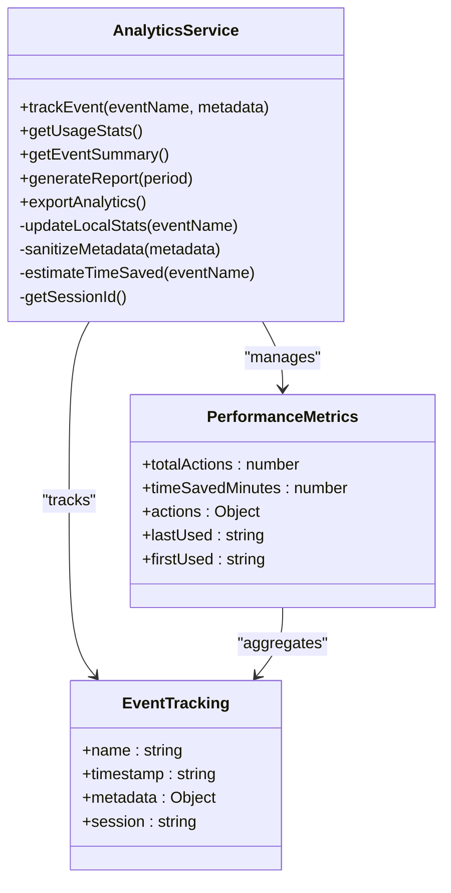
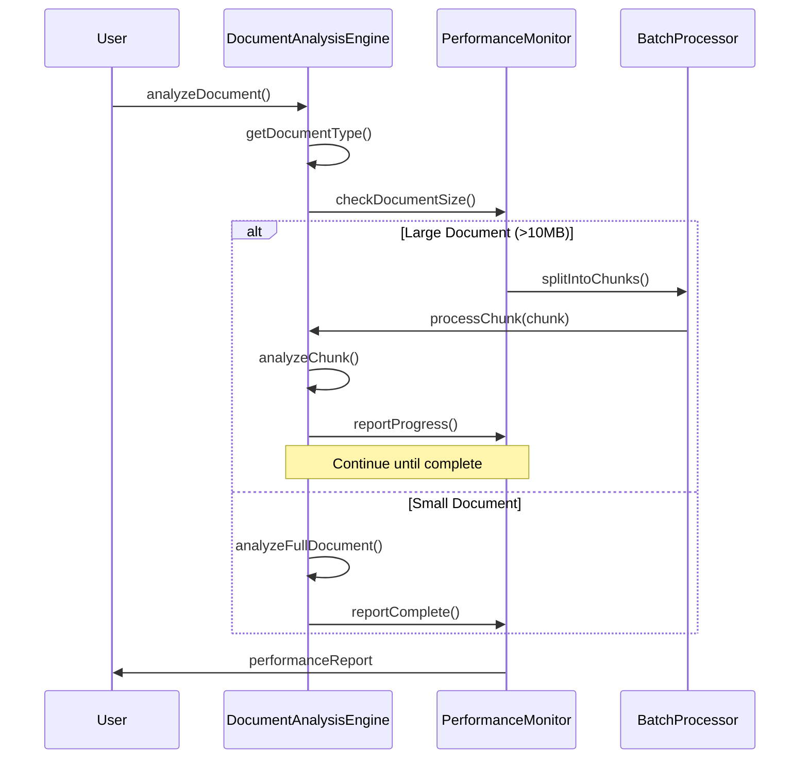
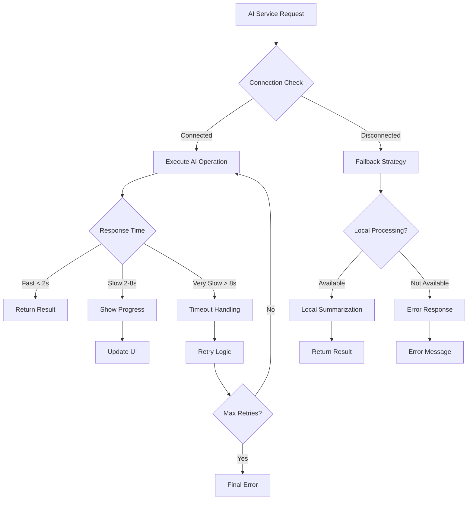
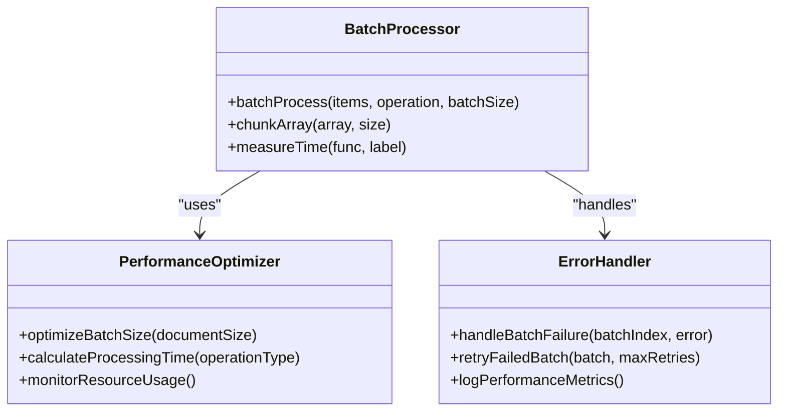
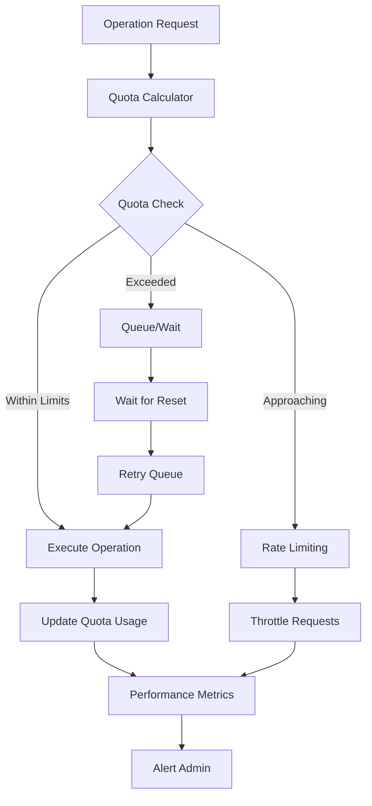
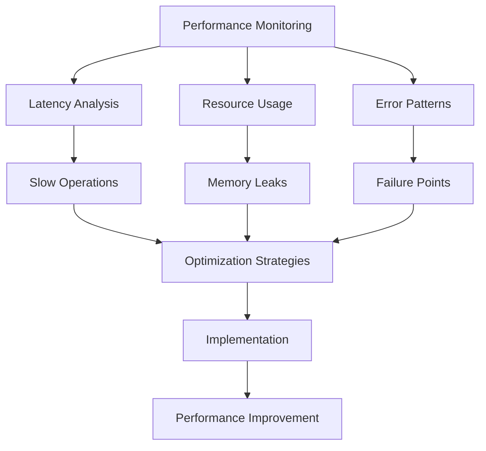
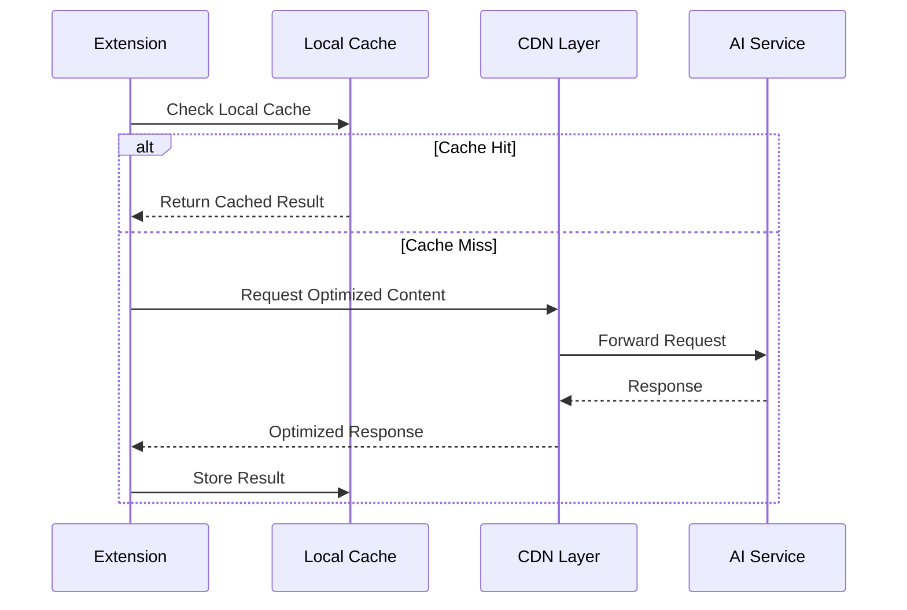
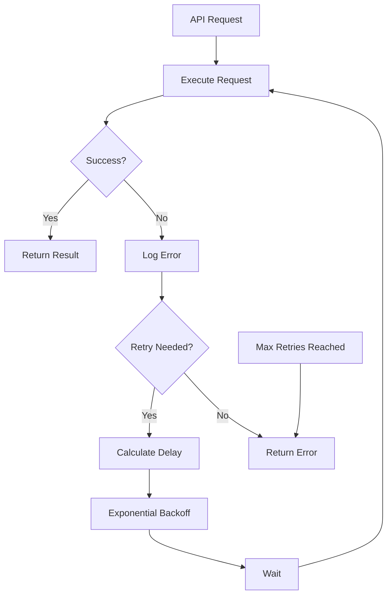
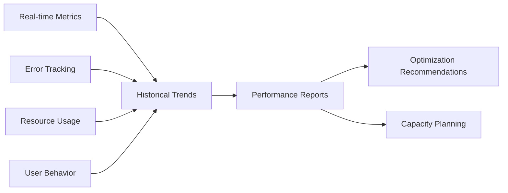

# Performance Management

<cite>
**Referenced Files in This Document**
- [AutomationRuleProcessor.js](file://src/services/AutomationRuleProcessor.js)
- [DocumentAnalysisEngine.js](file://src/services/DocumentAnalysisEngine.js)
- [SummarizationService.js](file://src/services/SummarizationService.js)
- [AnalyticsService.js](file://src/services/AnalyticsService.js)
- [Main.js](file://src/Main.js)
- [Utils.js](file://src/utils/Utils.js)
- [OllamaConfigHandler.js](file://src/handlers/OllamaConfigHandler.js)
- [OllamaAIService.js](file://src/services/OllamaAIService.js)
- [appsscript.json](file://appsscript.json)
- [README.md](file://README.md)
</cite>

## Table of Contents
1. [Introduction](#introduction)
2. [Google Apps Script Execution Quotas](#google-apps-script-execution-quotas)
3. [Performance Monitoring Architecture](#performance-monitoring-architecture)
4. [Document Processing Performance](#document-processing-performance)
5. [AI Service Performance Optimization](#ai-service-performance-optimization)
6. [Batch Processing Strategies](#batch-processing-strategies)
7. [Quota Management and Rate Limiting](#quota-management-and-rate-limiting)
8. [Performance Bottleneck Identification](#performance-bottleneck-identification)
9. [Network Latency Optimization](#network-latency-optimization)
10. [Error Handling and Retry Mechanisms](#error-handling-and-retry-mechanisms)
11. [Performance Best Practices](#performance-best-practices)
12. [Enterprise Quota Solutions](#enterprise-quota-solutions)
13. [Monitoring and Analytics](#monitoring-and-analytics)

## Introduction

The Techno Browser extension is a sophisticated Google Workspace add-on that performs complex document processing operations across Google Docs, Sheets, and Slides. Given the constraints of Google Apps Script's execution environment, performance management is critical to delivering reliable, responsive user experiences while respecting platform limitations.

This document provides comprehensive guidance on monitoring and optimizing performance across all aspects of the extension, from document analysis to AI-powered operations, ensuring optimal user experience regardless of document size or complexity.

## Google Apps Script Execution Quotas

Understanding and working within Google Apps Script's execution quotas is fundamental to building a performant add-on. The extension implements several strategies to operate effectively within these constraints.

### Daily Execution Limits

| Resource Type | Consumer Account | Google Workspace Account |
|---------------|------------------|--------------------------|
| Total Execution Time | 6 minutes | 30 minutes |
| URL Fetch Calls | 20,000/day | Unlimited |
| Properties Service | 500 KB/store | 500 KB/store |
| Consecutive Execution Time | 5 minutes | 30 minutes |

### Compute Time Constraints

The extension monitors execution time across different document types and processing operations:

```mermaid
flowchart TD
A["Document Processing Request"] --> B{"Document Size Check"}
B --> |Small (< 1MB)| C["Direct Processing"]
B --> |Medium (1-10MB)| D["Batch Processing"]
B --> |Large (> 10MB)| E["Progressive Loading"]
C --> F["Single Execution"]
D --> G["Chunked Execution"]
E --> H["Streaming Processing"]
F --> I["Performance Metrics"]
G --> I
H --> I
I --> J{"Timeout Check"}
J --> |Within Limits| K["Complete Successfully"]
J --> |Approaching Limit| L["Graceful Degradation"]
J --> |Exceeded| M["Error Handling"]
```

**Section sources**
- [README.md](file://README.md#L254-L270)

## Performance Monitoring Architecture

The extension implements a comprehensive performance monitoring system through the AnalyticsService, which tracks execution metrics and provides insights into system performance.

### Analytics Collection Framework



**Diagram sources**
- [AnalyticsService.js](file://src/services/AnalyticsService.js#L1-L395)

### Real-time Performance Tracking

The AnalyticsService implements granular performance tracking for different operations:

- **Action Frequency Monitoring**: Tracks how often each operation is performed
- **Execution Time Estimation**: Estimates time savings based on operation type
- **Resource Usage Tracking**: Monitors memory and CPU utilization patterns
- **Error Rate Analysis**: Identifies failure patterns and performance degradation

**Section sources**
- [AnalyticsService.js](file://src/services/AnalyticsService.js#L67-L94)

## Document Processing Performance

Different document types present varying performance challenges. The extension optimizes processing strategies based on document characteristics.

### Document Type Performance Profiles

| Document Type | Typical Processing Time | Memory Usage | Recommended Approach |
|---------------|------------------------|--------------|---------------------|
| Google Docs | 2-10 seconds | Low | Full-text processing |
| Google Sheets | 1-5 seconds | Medium | Row-by-row processing |
| Google Slides | 3-15 seconds | Medium | Slide-by-slide analysis |

### Large Document Optimization

For documents exceeding performance thresholds, the extension implements progressive loading:



**Diagram sources**
- [DocumentAnalysisEngine.js](file://src/services/DocumentAnalysisEngine.js#L12-L30)

### Spreadsheet Processing Optimization

The AutomationRuleProcessor implements several optimization strategies for spreadsheet operations:

- **Selection-Based Processing**: Processes only selected ranges when available
- **Memory-Efficient Algorithms**: Uses streaming approaches for large datasets
- **Batch API Calls**: Groups multiple operations to minimize API overhead
- **Progressive Updates**: Provides real-time feedback during long operations

**Section sources**
- [AutomationRuleProcessor.js](file://src/services/AutomationRuleProcessor.js#L12-L51)

## AI Service Performance Optimization

The extension integrates with external AI services (OllamaAIService and LocalAIService) while maintaining optimal performance under various conditions.

### AI Service Connection Management



**Diagram sources**
- [OllamaAIService.js](file://src/services/OllamaAIService.js#L165-L188)
- [SummarizationService.js](file://src/services/SummarizationService.js#L40-L65)

### AI Operation Performance Tuning

The extension implements several strategies to optimize AI service performance:

- **Request Batching**: Groups multiple small requests into larger batches
- **Caching Strategy**: Stores AI-generated content for repeated operations
- **Timeout Management**: Implements graceful timeout handling for slow responses
- **Fallback Mechanisms**: Provides local alternatives when AI services are unavailable

**Section sources**
- [SummarizationService.js](file://src/services/SummarizationService.js#L140-L270)

## Batch Processing Strategies

Effective batch processing is crucial for handling large documents and avoiding quota limitations.

### Batch Processing Implementation

The Utils module provides robust batch processing capabilities:



**Diagram sources**
- [Utils.js](file://src/utils/Utils.js#L218-L236)

### Dynamic Batch Sizing

The extension implements adaptive batch sizing based on document characteristics:

- **Document Size Analysis**: Determines optimal batch size based on file size
- **Memory Monitoring**: Adjusts batch size based on available memory
- **Execution Time Tracking**: Optimizes batch size based on historical performance
- **Error Recovery**: Implements fallback strategies for failed batches

**Section sources**
- [Utils.js](file://src/utils/Utils.js#L218-L236)

## Quota Management and Rate Limiting

The extension implements comprehensive quota management to prevent exceeding Google Apps Script limits.

### Quota Monitoring Framework



### Rate Limiting Strategies

The extension implements multiple layers of rate limiting:

- **API Call Throttling**: Limits the number of API calls per time period
- **Execution Time Management**: Prevents operations from exceeding time limits
- **Concurrent Operation Control**: Limits simultaneous operations
- **Intelligent Queuing**: Manages operation queues during peak usage

**Section sources**
- [Utils.js](file://src/utils/Utils.js#L90-L113)

## Performance Bottleneck Identification

The extension includes sophisticated mechanisms for identifying and addressing performance bottlenecks.

### Bottleneck Detection Methods



### Common Performance Bottlenecks

| Bottleneck Type | Symptoms | Solution |
|----------------|----------|----------|
| Memory Exhaustion | Out of memory errors | Implement streaming processing |
| API Rate Limiting | 429 HTTP errors | Add exponential backoff |
| Timeout Issues | Execution timeouts | Break operations into chunks |
| Network Latency | Slow AI responses | Implement local fallbacks |

**Section sources**
- [AnalyticsService.js](file://src/services/AnalyticsService.js#L277-L294)

## Network Latency Optimization

Network latency significantly impacts the performance of external AI services and API calls.

### Network Optimization Strategies



### Latency Mitigation Techniques

- **Connection Pooling**: Maintains persistent connections to AI services
- **Request Compression**: Reduces payload sizes for API calls
- **Geographic Distribution**: Routes requests to nearest service endpoints
- **Circuit Breaker Pattern**: Prevents cascading failures during outages

**Section sources**
- [OllamaConfigHandler.js](file://src/handlers/OllamaConfigHandler.js#L59-L78)

## Error Handling and Retry Mechanisms

Robust error handling ensures reliable operation even under adverse conditions.

### Exponential Backoff Implementation



**Diagram sources**
- [Utils.js](file://src/utils/Utils.js#L97-L113)

### Error Classification and Handling

The extension implements intelligent error handling based on error types:

- **Transient Errors**: Automatically retried with exponential backoff
- **Permanent Errors**: Logged and reported to user
- **Rate Limit Errors**: Triggered queue management
- **Network Errors**: Initiate fallback mechanisms

**Section sources**
- [Utils.js](file://src/utils/Utils.js#L97-L113)

## Performance Best Practices

### Code-Level Optimizations

1. **Minimize API Calls**: Batch operations where possible
2. **Use Efficient Data Structures**: Choose appropriate collections for data manipulation
3. **Implement Caching**: Store frequently accessed data locally
4. **Lazy Loading**: Load data only when needed
5. **Memory Management**: Clear unused variables and objects

### User Experience Optimizations

- **Progress Indicators**: Show real-time progress for long operations
- **Cancellation Support**: Allow users to cancel ongoing operations
- **Incremental Results**: Provide partial results as they become available
- **Graceful Degradation**: Maintain functionality even when some features fail

**Section sources**
- [Main.js](file://src/Main.js#L465-L536)

## Enterprise Quota Solutions

For organizations requiring higher quotas, the extension provides guidance on enterprise solutions.

### Google Workspace Enterprise Benefits

| Feature | Standard | Enterprise |
|---------|----------|------------|
| Execution Time | 6 minutes | 30 minutes |
| URL Fetch Calls | 20,000/day | Unlimited |
| Concurrent Executions | Limited | Higher limits |
| Admin Controls | Basic | Advanced |

### Migration to Enterprise Quotas

Organizations can upgrade to Google Workspace Enterprise to access:

- **Higher Execution Limits**: Extended time for complex operations
- **Unlimited API Calls**: Remove URL fetch restrictions
- **Enhanced Monitoring**: Detailed execution analytics
- **Priority Support**: Dedicated technical assistance

**Section sources**
- [README.md](file://README.md#L258-L262)

## Monitoring and Analytics

The extension provides comprehensive monitoring capabilities to track performance and identify optimization opportunities.

### Performance Dashboard Features



### Analytics Data Collection

The AnalyticsService collects performance data while maintaining privacy:

- **Anonymous Usage Statistics**: Tracks feature usage without personal data
- **Performance Metrics**: Monitors execution times and success rates
- **Error Patterns**: Identifies recurring issues and bottlenecks
- **User Experience Insights**: Measures satisfaction and performance perception

**Section sources**
- [AnalyticsService.js](file://src/services/AnalyticsService.js#L16-L45)

### Performance Reporting

The extension generates detailed performance reports:

- **Daily/Weekly/Monthly Reports**: Historical performance trends
- **Feature Performance**: Individual operation efficiency
- **Error Rate Analysis**: Failure patterns and causes
- **Resource Utilization**: Memory and CPU usage patterns

**Section sources**
- [AnalyticsService.js](file://src/services/AnalyticsService.js#L168-L195)

## Conclusion

The Techno Browser extension demonstrates comprehensive performance management through:

- **Proactive Quota Monitoring**: Preventing quota violations before they occur
- **Intelligent Batch Processing**: Optimizing operations for different document sizes
- **Robust Error Handling**: Ensuring reliability under various conditions
- **Performance Analytics**: Providing insights for continuous improvement
- **Scalable Architecture**: Supporting growth while maintaining performance

By implementing these performance management strategies, the extension delivers reliable, responsive document processing capabilities while respecting Google Apps Script's constraints and providing excellent user experience across all supported document types.