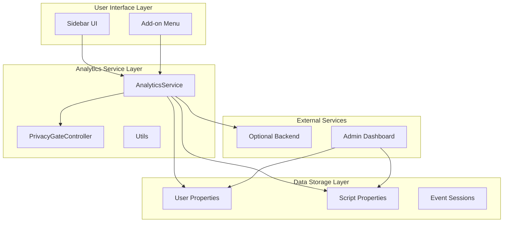
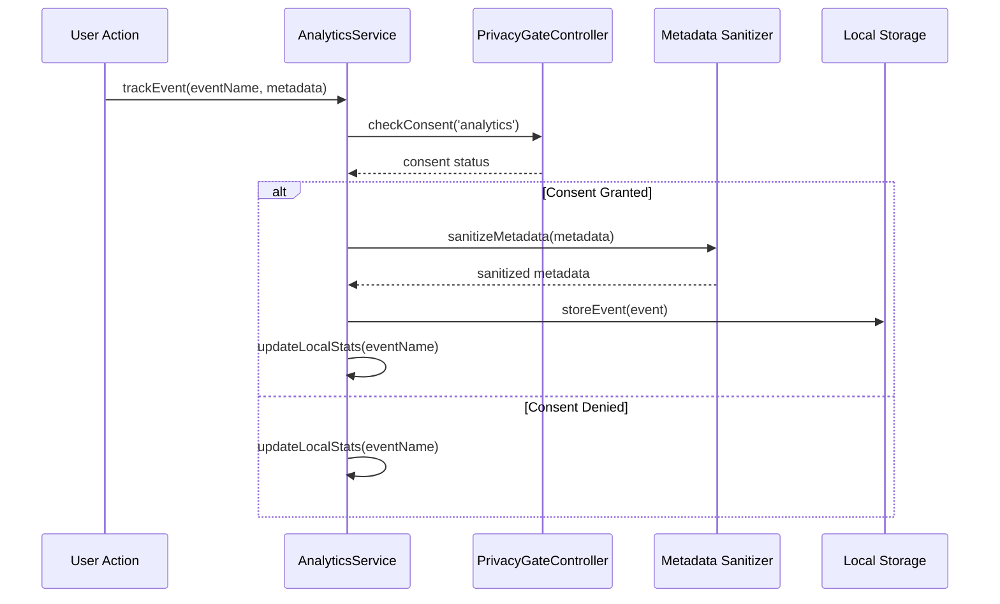
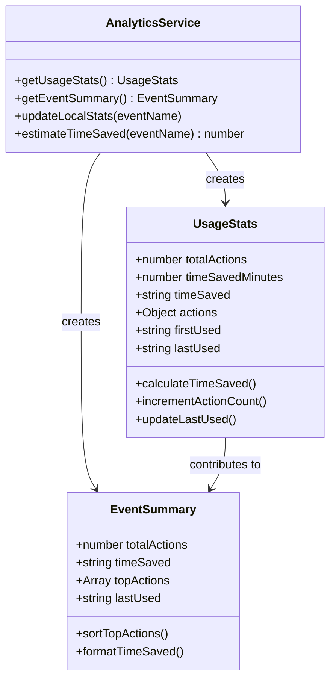
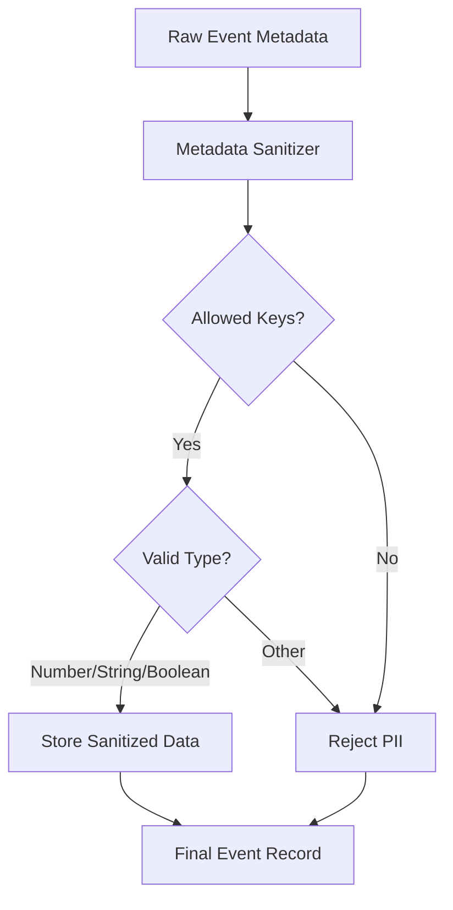
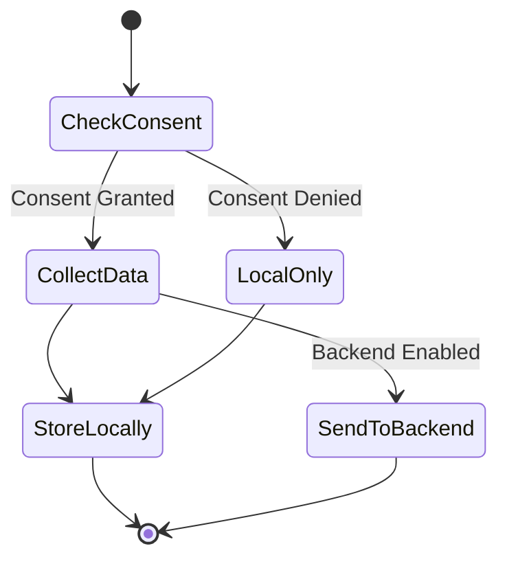
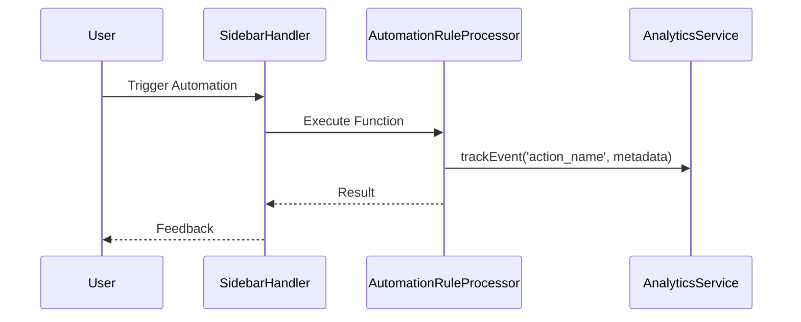
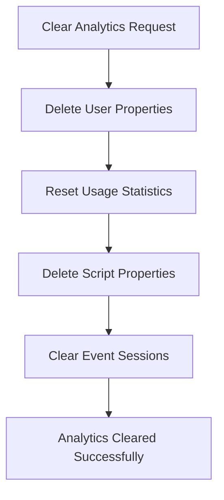

# Usage Analytics

<cite>
**Referenced Files in This Document**
- [AnalyticsService.js](file://src/services/AnalyticsService.js)
- [PrivacyGateController.js](file://src/services/PrivacyGateController.js)
- [ADMIN_GUIDE.md](file://ADMIN_GUIDE.md)
- [Main.js](file://src/Main.js)
- [Utils.js](file://src/utils/Utils.js)
- [AutomationRuleProcessor.js](file://src/services/AutomationRuleProcessor.js)
- [RedactionService.js](file://src/services/RedactionService.js)
- [SidebarHandlers.js](file://src/handlers/SidebarHandlers.js)
</cite>

## Table of Contents
1. [Introduction](#introduction)
2. [Analytics Architecture](#analytics-architecture)
3. [Core Analytics Functions](#core-analytics-functions)
4. [Usage Statistics Collection](#usage-statistics-collection)
5. [Privacy-Preserving Design](#privacy-preserving-design)
6. [Administrative Analytics](#administrative-analytics)
7. [Common Usage Patterns](#common-usage-patterns)
8. [Troubleshooting and Configuration](#troubleshooting-and-configuration)
9. [Best Practices](#best-practices)

## Introduction

The Techno Browser extension implements a comprehensive usage analytics system that tracks user interactions with automated document processing features while maintaining strict privacy controls. The analytics service operates on a privacy-first principle, collecting only anonymized usage data with explicit user consent and providing administrators with insights into adoption patterns and ROI metrics.

The analytics system is built around several core functions that enable tracking of user actions, generating usage summaries, creating period-based reports, and exporting data for administrative analysis. All analytics data is stored locally and never transmitted without user consent, ensuring complete privacy protection.

## Analytics Architecture

The analytics system follows a modular architecture with clear separation of concerns between data collection, processing, and reporting:



**Diagram sources**
- [AnalyticsService.js](file://src/services/AnalyticsService.js#L1-L50)
- [PrivacyGateController.js](file://src/services/PrivacyGateController.js#L1-L50)

**Section sources**
- [AnalyticsService.js](file://src/services/AnalyticsService.js#L1-L395)
- [PrivacyGateController.js](file://src/services/PrivacyGateController.js#L1-L366)

## Core Analytics Functions

### AnalyticsService Public API

The AnalyticsService provides five primary functions for analytics management:

| Function | Purpose | Parameters | Returns |
|----------|---------|------------|---------|
| `trackEvent()` | Records individual user actions | `eventName`, `metadata` | None |
| `getUsageStats()` | Retrieves aggregated statistics | None | Object with usage metrics |
| `getEventSummary()` | Gets summarized usage overview | None | Object with totals and top actions |
| `generateReport()` | Creates period-based reports | `period` (day/week/month/all) | Report object with filtered data |
| `exportAnalytics()` | Exports CSV-formatted data | None | CSV string for spreadsheet analysis |
| `clearAnalytics()` | Resets all analytics data | None | Success/failure object |

### Event Tracking Implementation

The `trackEvent()` function serves as the primary data collection mechanism, automatically handling consent checks and data sanitization:



**Diagram sources**
- [AnalyticsService.js](file://src/services/AnalyticsService.js#L16-L44)
- [PrivacyGateController.js](file://src/services/PrivacyGateController.js#L78-L81)

**Section sources**
- [AnalyticsService.js](file://src/services/AnalyticsService.js#L16-L44)

## Usage Statistics Collection

### Aggregated Usage Statistics

The analytics system maintains comprehensive usage statistics through the `getUsageStats()` function, which returns detailed metrics about user engagement:



**Diagram sources**
- [AnalyticsService.js](file://src/services/AnalyticsService.js#L51-L94)
- [AnalyticsService.js](file://src/services/AnalyticsService.js#L140-L160)

### Time Saved Calculations

The system implements heuristic-based time savings estimation through the `estimateTimeSaved()` function, which assigns rough time values to different automation actions:

| Action Type | Estimated Time Saved | Calculation Basis |
|-------------|---------------------|-------------------|
| `analyze_document` | 2 minutes | Manual document analysis time |
| `remove_duplicates` | 5 minutes | Data cleaning and deduplication effort |
| `standardize_dates` | 3 minutes | Date format standardization |
| `fill_empty_cells` | 4 minutes | Spreadsheet data completion |
| `redact_pii` | 10 minutes | Privacy compliance and data protection |
| `apply_template` | 15 minutes | Template application and formatting |
| `summarize` | 8 minutes | Document summarization process |
| `remove_empty_rows` | 2 minutes | Data cleanup efficiency |
| `standardize_currency` | 3 minutes | Financial data standardization |
| `trim_whitespace` | 1 minute | Text formatting improvement |
| `capitalize_text` | 2 minutes | Text formatting enhancement |

**Section sources**
- [AnalyticsService.js](file://src/services/AnalyticsService.js#L277-L294)

## Privacy-Preserving Design

### Metadata Sanitization

The analytics system implements comprehensive privacy protection through the `sanitizeMetadata()` function, which removes personally identifiable information (PII) while preserving useful analytical data:



**Diagram sources**
- [AnalyticsService.js](file://src/services/AnalyticsService.js#L239-L254)

### Allowed Metadata Fields

The sanitizer permits only specific, non-identifiable metadata fields:

| Field | Purpose | Example Values |
|-------|---------|----------------|
| `count` | Quantity of items processed | `5`, `12`, `1` |
| `type` | Category of operation | `'document'`, `'spreadsheet'`, `'presentation'` |
| `method` | Processing approach | `'ai'`, `'regex'`, `'manual'` |
| `format` | Data format | `'csv'`, `'json'`, `'pdf'` |
| `category` | Operation classification | `'cleanup'`, `'analysis'`, `'formatting'` |
| `docType` | Document type | `'google_docs'`, `'google_sheets'` |
| `length` | Data size | `1024`, `512`, `2048` |

**Section sources**
- [AnalyticsService.js](file://src/services/AnalyticsService.js#L239-L254)

### Consent-Based Data Collection

The system operates under strict consent requirements enforced by the PrivacyGateController:



**Diagram sources**
- [PrivacyGateController.js](file://src/services/PrivacyGateController.js#L78-L81)
- [AnalyticsService.js](file://src/services/AnalyticsService.js#L19-L23)

**Section sources**
- [PrivacyGateController.js](file://src/services/PrivacyGateController.js#L78-L81)
- [AnalyticsService.js](file://src/services/AnalyticsService.js#L19-L23)

## Administrative Analytics

### Organization-Wide Usage Patterns

While the core AnalyticsService focuses on individual user data, administrators can access organization-wide usage patterns through the `getOrganizationUsageStats()` function described in the ADMIN_GUIDE.md:

```javascript
// Example implementation pattern (not in codebase)
function getOrganizationUsageStats() {
  // Query UserProperties across organization
  // Aggregate anonymous usage data
  // Generate reports
}
```

### Data Export and Reporting

The analytics system provides multiple export mechanisms for administrative analysis:

| Export Type | Format | Use Case | Access Method |
|-------------|--------|----------|---------------|
| Real-time Summary | JSON Object | Current usage overview | `getEventSummary()` |
| Period Reports | JSON Object | Historical trend analysis | `generateReport(period)` |
| CSV Export | Comma-separated | Spreadsheet analysis | `exportAnalytics()` |
| Clear Analytics | N/A | Data reset | `clearAnalytics()` |

### Administrative Dashboard Integration

Administrators can integrate analytics data into custom dashboards using the exported CSV format or programmatic access to the analytics functions.

**Section sources**
- [ADMIN_GUIDE.md](file://ADMIN_GUIDE.md#L250-L256)
- [AnalyticsService.js](file://src/services/AnalyticsService.js#L197-L211)

## Common Usage Patterns

### Automated Event Tracking

The analytics system automatically tracks events across various automation functions throughout the application:



**Diagram sources**
- [SidebarHandlers.js](file://src/handlers/SidebarHandlers.js#L58-L75)
- [AutomationRuleProcessor.js](file://src/services/AutomationRuleProcessor.js#L47-L80)

### Feature Adoption Tracking

The system tracks adoption patterns for different automation features, enabling administrators to identify popular tools and areas for user education:

| Feature Category | Typical Actions | Expected Usage Patterns |
|------------------|-----------------|------------------------|
| Document Cleanup | `remove_duplicates`, `trim_whitespace` | High frequency, low time savings |
| Data Standardization | `standardize_dates`, `standardize_currency` | Medium frequency, medium time savings |
| Privacy Protection | `redact_pii` | Variable, depends on document content |
| Template Application | `apply_template` | Low frequency, high impact |
| Advanced Analysis | `summarize` | Moderate frequency, high time savings |

**Section sources**
- [AutomationRuleProcessor.js](file://src/services/AutomationRuleProcessor.js#L47-L80)
- [RedactionService.js](file://src/services/RedactionService.js#L247-L254)

## Troubleshooting and Configuration

### Data Retention Limits

The analytics system implements several data retention mechanisms to prevent unlimited storage growth:

| Limit Type | Configuration | Purpose |
|------------|---------------|---------|
| Event Count | 1,000 events per session | Prevents memory overflow |
| Session Isolation | Separate event storage per session | Maintains data separation |
| Local Storage Only | No external data transmission | Privacy protection |
| Consent-Based Collection | Optional backend sending | User choice control |

### Clearing Analytics Data

Administrators and users can clear analytics data using the `clearAnalytics()` function, which performs a complete reset of all collected statistics:



**Diagram sources**
- [AnalyticsService.js](file://src/services/AnalyticsService.js#L214-L230)

### Analytics Consent Configuration

Analytics consent can be configured at the organizational level through the PrivacyGateController:

| Consent Setting | Default Value | Impact |
|-----------------|---------------|--------|
| `analytics` | `false` | Controls all analytics collection |
| `advancedAI` | `false` | Enables AI-powered features |
| `redaction` | `true` | Allows privacy protection features |
| `templateSharing` | `false` | Enables template library access |

**Section sources**
- [AnalyticsService.js](file://src/services/AnalyticsService.js#L214-L230)
- [PrivacyGateController.js](file://src/services/PrivacyGateController.js#L30-L38)

## Best Practices

### Analytics Implementation Guidelines

1. **Always Check Consent**: Verify analytics consent before tracking any events
2. **Sanitize Metadata**: Ensure all metadata is properly sanitized before storage
3. **Respect User Preferences**: Honor user choices regarding data collection
4. **Limit Data Retention**: Respect the 1,000 event limit per session
5. **Provide Transparency**: Clearly communicate what data is collected

### Performance Considerations

- Analytics operations are lightweight and should not impact user experience
- Event tracking adds minimal overhead to automation functions
- Report generation is optimized for real-time usage
- Data export operations handle large datasets efficiently

### Privacy Compliance

- All analytics data remains local unless explicit consent is given
- No personally identifiable information is ever collected
- Users can completely clear their analytics data at any time
- Administrators cannot access individual user data without consent

The usage analytics system provides a robust foundation for understanding user behavior while maintaining the highest standards of privacy and user control. Through careful design and implementation, it enables valuable insights into automation adoption patterns while respecting user privacy preferences.