# Audit & Logging

<cite>
**Referenced Files in This Document**
- [ADMIN_GUIDE.md](file://ADMIN_GUIDE.md)
- [src/services/PrivacyGateController.js](file://src/services/PrivacyGateController.js)
- [src/services/AnalyticsService.js](file://src/services/AnalyticsService.js)
- [src/Main.js](file://src/Main.js)
- [appsscript.json](file://appsscript.json)
</cite>

## Table of Contents
1. [Introduction](#introduction)
2. [Audit Logging Architecture](#audit-logging-architecture)
3. [PrivacyGateController Implementation](#privacygatecontroller-implementation)
4. [AnalyticsService Integration](#analyticsservice-integration)
5. [Enabling Audit Logging](#enabling-audit-logging)
6. [Event Types and Metadata](#event-types-and-metadata)
7. [Configuration Management](#configuration-management)
8. [Use Cases and Applications](#use-cases-and-applications)
9. [Security and Compliance](#security-and-compliance)
10. [Troubleshooting and Best Practices](#troubleshooting-and-best-practices)
11. [Monitoring and Maintenance](#monitoring-and-maintenance)

## Introduction

The Techno Browser extension implements a comprehensive audit logging system designed to track privacy-sensitive operations and maintain compliance with organizational security requirements. This system provides administrators with visibility into user consent changes, privacy events, and processing decisions while maintaining strict adherence to privacy principles.

The audit logging capabilities are built around two core components: the PrivacyGateController for managing consent and privacy events, and the AnalyticsService for tracking usage patterns and system behavior. Together, these systems create a robust framework for compliance audits, security investigations, and operational monitoring.

## Audit Logging Architecture

The audit logging system follows a modular architecture that separates privacy event logging from analytics tracking, ensuring that sensitive operations are properly captured while maintaining user privacy.

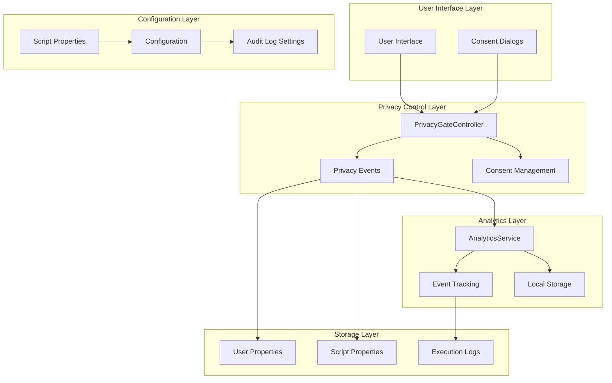

**Diagram sources**
- [src/services/PrivacyGateController.js](file://src/services/PrivacyGateController.js#L292-L315)
- [src/services/AnalyticsService.js](file://src/services/AnalyticsService.js#L16-L44)
- [ADMIN_GUIDE.md](file://ADMIN_GUIDE.md#L233-L239)

**Section sources**
- [src/services/PrivacyGateController.js](file://src/services/PrivacyGateController.js#L1-L366)
- [src/services/AnalyticsService.js](file://src/services/AnalyticsService.js#L1-L395)

## PrivacyGateController Implementation

The PrivacyGateController serves as the central hub for privacy event logging, implementing the `logPrivacyEvent()` function that captures detailed information about privacy-sensitive operations.

### Core Logging Functionality

The `logPrivacyEvent()` function creates structured log entries containing timestamp, event type, metadata, and user identification:

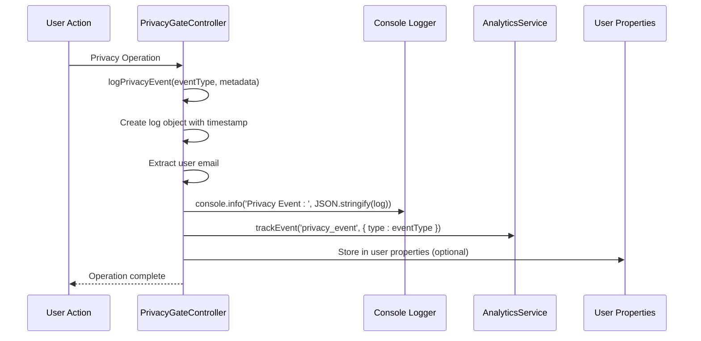

**Diagram sources**
- [src/services/PrivacyGateController.js](file://src/services/PrivacyGateController.js#L297-L315)

### Event Types and Processing

The PrivacyGateController handles various types of privacy events, including:

| Event Type | Description | Metadata Fields | User Impact |
|------------|-------------|----------------|-------------|
| `consent_update` | User grants or revokes consent | `type`: consent type, `granted`: boolean | Privacy settings change |
| `consent_revoke_all` | All consents revoked | `{}` | Complete privacy reset |
| `remote_processing` | Data processed remotely | `operation`: operation name | Advanced feature usage |
| `local_processing_fallback` | Remote processing fallback | `operation`: operation name | Local processing activation |

### Consent Change Logging

When users modify their consent preferences, the system automatically logs these changes with detailed metadata:

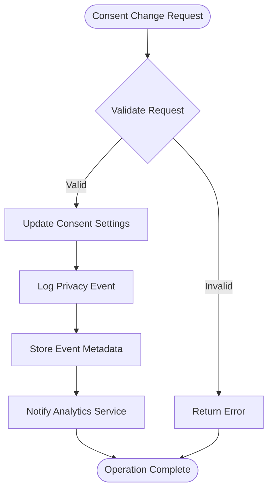

**Diagram sources**
- [src/services/PrivacyGateController.js](file://src/services/PrivacyGateController.js#L51-L70)
- [src/services/PrivacyGateController.js](file://src/services/PrivacyGateController.js#L150-L167)

**Section sources**
- [src/services/PrivacyGateController.js](file://src/services/PrivacyGateController.js#L292-L315)
- [src/services/PrivacyGateController.js](file://src/services/PrivacyGateController.js#L51-L70)

## AnalyticsService Integration

The AnalyticsService complements the PrivacyGateController by providing comprehensive tracking of usage patterns and system behavior when analytics consent is granted.

### Event Tracking Architecture

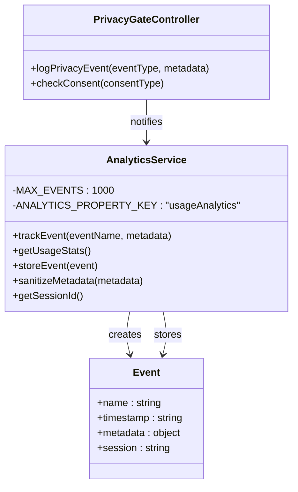

**Diagram sources**
- [src/services/AnalyticsService.js](file://src/services/AnalyticsService.js#L16-L44)
- [src/services/PrivacyGateController.js](file://src/services/PrivacyGateController.js#L297-L315)

### Metadata Sanitization

The AnalyticsService implements strict metadata sanitization to prevent personally identifiable information (PII) from being logged:

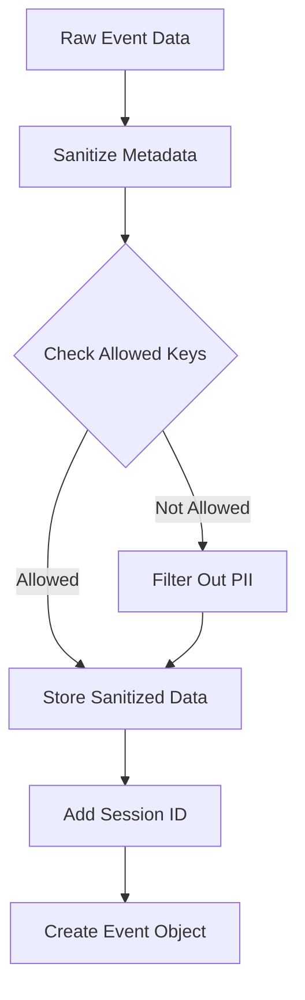

**Diagram sources**
- [src/services/AnalyticsService.js](file://src/services/AnalyticsService.js#L234-L254)

**Section sources**
- [src/services/AnalyticsService.js](file://src/services/AnalyticsService.js#L16-L44)
- [src/services/AnalyticsService.js](file://src/services/AnalyticsService.js#L234-L254)

## Enabling Audit Logging

Administrators can activate audit logging capabilities through the `enableAuditLogging()` function, which configures the system to capture privacy-sensitive operations.

### Configuration Process

The audit logging setup involves two key script properties:

| Property | Purpose | Required Value |
|----------|---------|----------------|
| `auditLogging` | Enables audit logging globally | `'true'` |
| `auditLogSpreadsheet` | Specifies Google Sheets ID for log storage | `SPREADSHEET_ID` |

### Implementation Steps

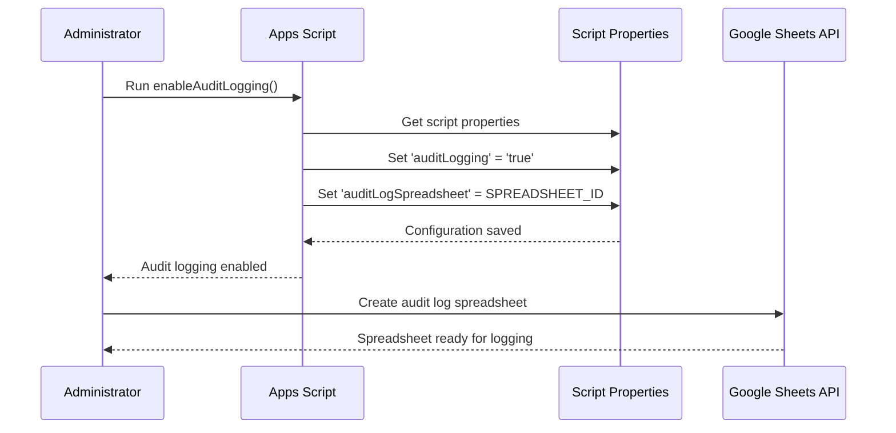

**Diagram sources**
- [ADMIN_GUIDE.md](file://ADMIN_GUIDE.md#L233-L239)

### Spreadsheet Configuration Requirements

When configuring the audit log spreadsheet, administrators should:

1. **Create Dedicated Spreadsheet**: Establish a separate Google Sheets document for audit logs
2. **Set Appropriate Permissions**: Configure sharing permissions to restrict access to authorized personnel
3. **Enable Version History**: Activate version history for audit trail integrity
4. **Set Retention Policies**: Implement automatic cleanup of old log entries

**Section sources**
- [ADMIN_GUIDE.md](file://ADMIN_GUIDE.md#L233-L239)

## Event Types and Metadata

The audit logging system captures comprehensive information about privacy-sensitive operations, organized into structured event types with standardized metadata.

### Privacy Event Categories

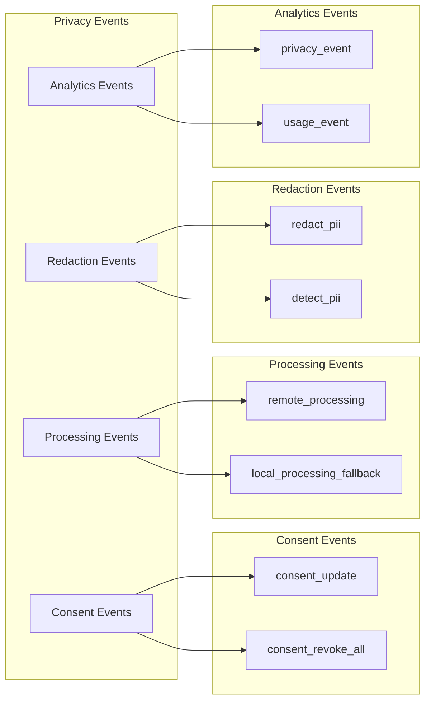

**Diagram sources**
- [src/services/PrivacyGateController.js](file://src/services/PrivacyGateController.js#L297-L315)
- [src/services/AnalyticsService.js](file://src/services/AnalyticsService.js#L16-L44)

### Standardized Metadata Structure

Each logged event includes the following standardized fields:

| Field | Type | Description | Example |
|-------|------|-------------|---------|
| `timestamp` | ISO String | Event occurrence time | `"2024-01-15T10:30:45.123Z"` |
| `event` | String | Event type identifier | `"consent_update"` |
| `metadata` | Object | Event-specific data | `{ type: "advancedAI", granted: true }` |
| `user` | String | User email address | `"user@organization.com"` |

### Event-Specific Metadata Examples

**Consent Update Event:**
```json
{
  "timestamp": "2024-01-15T10:30:45.123Z",
  "event": "consent_update",
  "metadata": {
    "type": "advancedAI",
    "granted": true
  },
  "user": "user@organization.com"
}
```

**Remote Processing Event:**
```json
{
  "timestamp": "2024-01-15T10:31:12.456Z",
  "event": "remote_processing",
  "metadata": {
    "operation": "summarize"
  },
  "user": "user@organization.com"
}
```

**Section sources**
- [src/services/PrivacyGateController.js](file://src/services/PrivacyGateController.js#L297-L315)

## Configuration Management

The audit logging system relies on Google Apps Script's PropertiesService to manage configuration settings and maintain persistent state across user sessions.

### Property Management Architecture

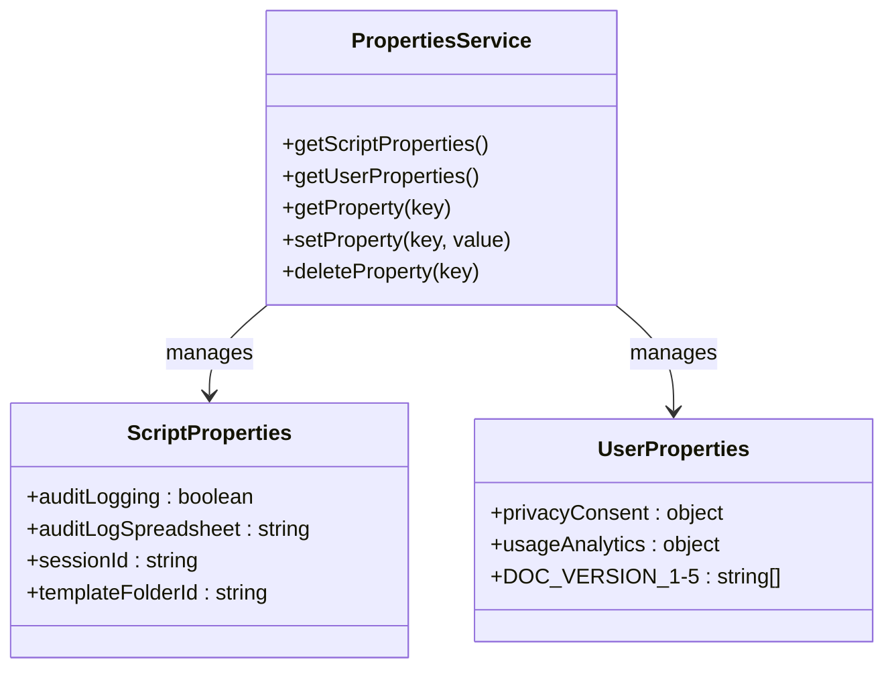

**Diagram sources**
- [src/services/PrivacyGateController.js](file://src/services/PrivacyGateController.js#L23-L25)
- [src/services/AnalyticsService.js](file://src/services/AnalyticsService.js#L52-L58)

### Configuration Key Definitions

| Configuration Key | Purpose | Scope | Default Value |
|-------------------|---------|-------|---------------|
| `auditLogging` | Global audit logging toggle | Script | `false` |
| `auditLogSpreadsheet` | Target spreadsheet ID | Script | `undefined` |
| `privacyConsent` | User consent preferences | User | Default settings |
| `usageAnalytics` | Analytics tracking data | User | Empty object |
| `sessionId` | Current session identifier | Script | Generated UUID |

### Administrative Configuration Functions

The system provides several administrative functions for managing configuration:

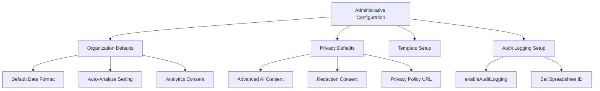

**Diagram sources**
- [ADMIN_GUIDE.md](file://ADMIN_GUIDE.md#L148-L201)

**Section sources**
- [ADMIN_GUIDE.md](file://ADMIN_GUIDE.md#L148-L201)
- [src/services/PrivacyGateController.js](file://src/services/PrivacyGateController.js#L23-L25)

## Use Cases and Applications

The audit logging system serves multiple critical business and compliance requirements, enabling organizations to maintain transparency and accountability in their document automation processes.

### Compliance Audits

Audit logs provide essential evidence for regulatory compliance requirements:

- **GDPR Compliance**: Track consent changes and data processing activities
- **SOX Requirements**: Maintain audit trails for financial document processing
- **HIPAA Documentation**: Record access to sensitive healthcare information
- **Corporate Governance**: Demonstrate adherence to internal policies

### Security Investigations

When security incidents occur, audit logs enable thorough investigation:

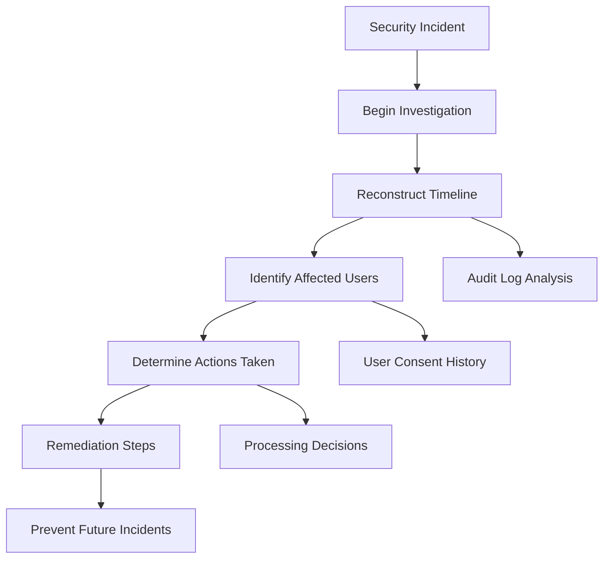

### Operational Monitoring

Organizations can monitor system usage and effectiveness:

- **Feature Adoption Rates**: Track which privacy features are most commonly used
- **Processing Patterns**: Monitor how documents are being automated
- **Performance Metrics**: Analyze processing times and success rates
- **User Behavior**: Understand how users interact with privacy controls

### Risk Management

Audit logs support comprehensive risk assessment:

| Risk Category | Audit Log Insights | Mitigation Actions |
|---------------|-------------------|-------------------|
| **Unauthorized Access** | Login attempts, consent bypasses | Enhanced authentication, monitoring |
| **Data Leakage** | Remote processing requests | Local processing fallbacks |
| **Policy Violations** | Consent violations, unauthorized operations | Automated enforcement, alerts |
| **System Failures** | Processing errors, timeouts | Error tracking, system health monitoring |

**Section sources**
- [src/services/PrivacyGateController.js](file://src/services/PrivacyGateController.js#L297-L315)
- [src/services/AnalyticsService.js](file://src/services/AnalyticsService.js#L16-L44)

## Security and Compliance

The audit logging system implements multiple security measures to protect sensitive information while maintaining compliance with privacy regulations.

### Data Protection Measures

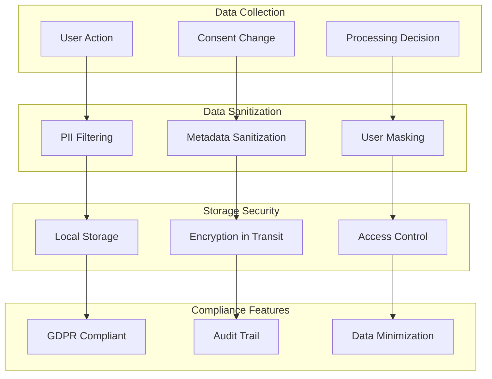

**Diagram sources**
- [src/services/PrivacyGateController.js](file://src/services/PrivacyGateController.js#L297-L315)
- [src/services/AnalyticsService.js](file://src/services/AnalyticsService.js#L234-L254)

### Privacy by Design Principles

The system incorporates privacy-by-design principles:

1. **Data Minimization**: Only collect essential information for audit purposes
2. **Purpose Limitation**: Use collected data solely for audit and compliance
3. **Storage Limitation**: Implement automatic cleanup of old log entries
4. **Integrity**: Ensure log entries cannot be altered or deleted
5. **Availability**: Maintain access to audit logs for authorized personnel

### Access Control Implementation

Audit logs are protected through multiple access control mechanisms:

- **Role-Based Access**: Only administrators can enable audit logging
- **Session Isolation**: Logs are associated with specific user sessions
- **Encryption**: Data transmitted to Google Sheets is encrypted
- **Retention Policies**: Automatic cleanup of old log entries

### Regulatory Compliance

The system supports various regulatory frameworks:

| Regulation | Compliance Features | Implementation Details |
|------------|-------------------|----------------------|
| **GDPR** | Right to erasure, data minimization | User can revoke consent, minimal data collection |
| **CCPA** | Right to opt-out, data portability | Consent management, export functionality |
| **SOX** | Audit trail requirements | Comprehensive event logging, immutable records |
| **HIPAA** | Accountability, integrity | Secure storage, access controls |

**Section sources**
- [src/services/PrivacyGateController.js](file://src/services/PrivacyGateController.js#L297-L315)
- [src/services/AnalyticsService.js](file://src/services/AnalyticsService.js#L234-L254)

## Troubleshooting and Best Practices

This section provides guidance for administrators and developers working with the audit logging system, covering common issues, solutions, and best practices.

### Common Issues and Solutions

#### Audit Logging Not Working

**Problem**: Audit logs are not being captured despite enabling audit logging.

**Diagnostic Steps**:
1. Verify `auditLogging` property is set to `'true'`
2. Check that `auditLogSpreadsheet` contains a valid spreadsheet ID
3. Review execution logs for any errors
4. Confirm user consent for analytics is granted

**Solution**: Re-run the `enableAuditLogging()` function with proper parameters.

#### Spreadsheet Access Issues

**Problem**: Cannot write to the designated audit log spreadsheet.

**Diagnostic Steps**:
1. Verify spreadsheet ID is correct
2. Check spreadsheet sharing permissions
3. Ensure add-on has necessary Google Sheets API access
4. Review Google Cloud Console API quotas

**Solution**: Update spreadsheet permissions to allow the add-on to write, or use a different spreadsheet.

#### Performance Impact

**Problem**: Audit logging causing performance degradation.

**Mitigation Strategies**:
- Reduce logging verbosity during high-volume operations
- Implement asynchronous logging where possible
- Monitor execution time and adjust logging frequency
- Use local storage for temporary logging before batch writing

### Best Practices for Log Management

#### Log Retention Strategy

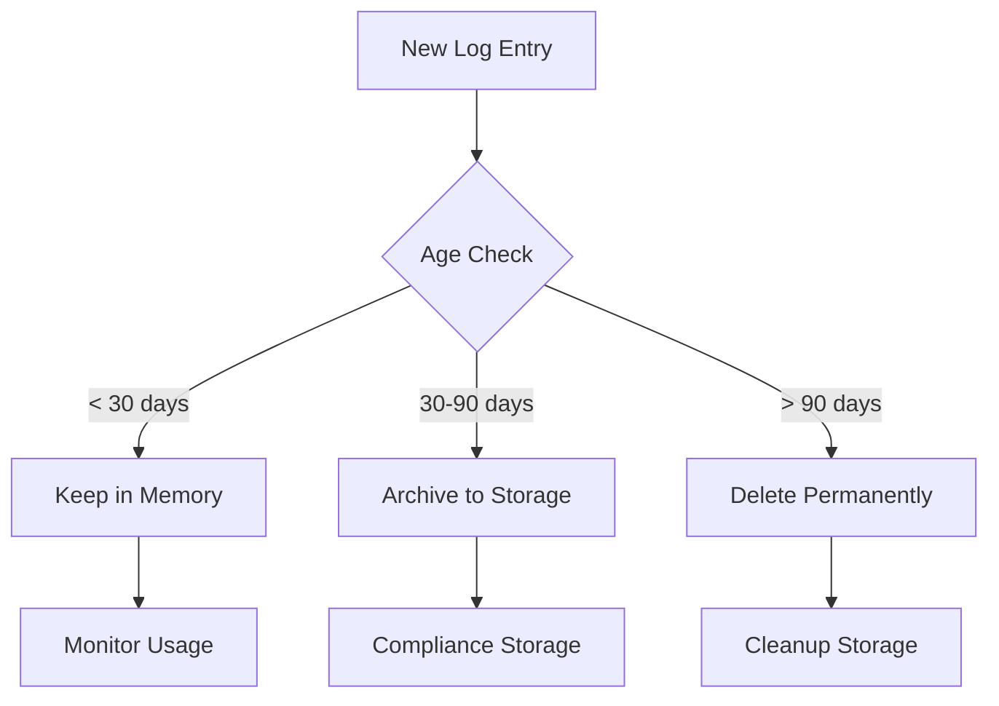

#### Security Best Practices

1. **Secure Spreadsheet Access**:
   - Restrict spreadsheet access to authorized personnel only
   - Use organization-wide sharing settings
   - Implement two-factor authentication for spreadsheet access

2. **Regular Security Reviews**:
   - Audit spreadsheet access logs monthly
   - Review consent settings regularly
   - Monitor for unusual logging activity

3. **Backup and Recovery**:
   - Maintain backups of audit log spreadsheets
   - Implement disaster recovery procedures
   - Test backup restoration processes

#### Performance Optimization

1. **Efficient Logging**:
   - Batch log entries when possible
   - Use asynchronous operations for non-critical logging
   - Implement log rotation to prevent excessive growth

2. **Resource Management**:
   - Monitor Apps Script quotas
   - Optimize log entry size
   - Implement circuit breakers for logging failures

### Monitoring and Alerting

#### Key Performance Indicators

| Metric | Threshold | Action |
|--------|-----------|---------|
| Log Write Success Rate | < 95% | Investigate connectivity issues |
| Average Log Processing Time | > 100ms | Optimize logging implementation |
| Storage Quota Usage | > 80% | Clean up old logs |
| Error Rate | > 5% | Review error patterns |

#### Alert Configuration

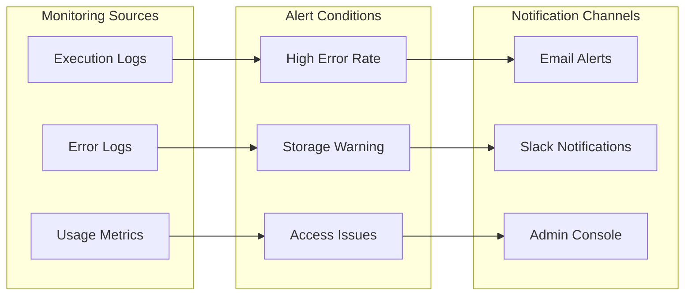

**Section sources**
- [src/services/PrivacyGateController.js](file://src/services/PrivacyGateController.js#L297-L315)
- [src/services/AnalyticsService.js](file://src/services/AnalyticsService.js#L16-L44)

## Monitoring and Maintenance

Effective monitoring and maintenance are crucial for ensuring the long-term reliability and effectiveness of the audit logging system.

### System Health Monitoring

#### Key Monitoring Areas

1. **Logging Infrastructure**:
   - Verify audit logging is enabled and functioning
   - Monitor log entry success rates
   - Track storage utilization

2. **Performance Metrics**:
   - Measure logging latency
   - Monitor memory usage
   - Track API quota consumption

3. **Security Status**:
   - Review access logs
   - Monitor for unauthorized access attempts
   - Verify encryption implementation

### Maintenance Procedures

#### Regular Maintenance Tasks

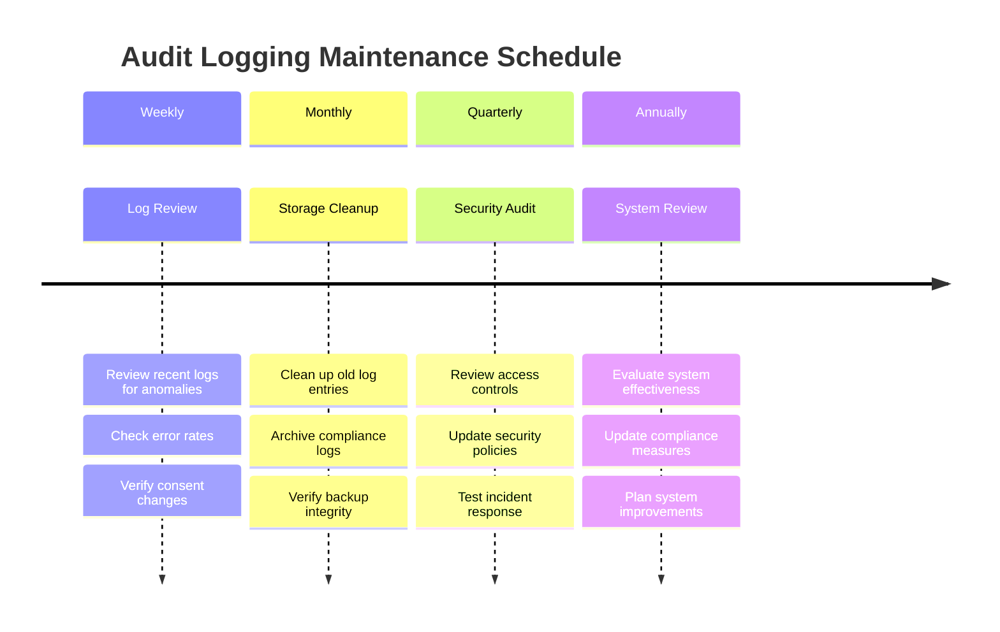

#### Automated Maintenance Scripts

The system supports automated maintenance through Google Apps Script:

- **Log Rotation**: Automatically clean up logs older than retention period
- **Health Checks**: Daily verification of logging functionality
- **Backup Verification**: Monthly confirmation of backup integrity
- **Security Scans**: Weekly review of access patterns

### System Updates and Upgrades

#### Update Management

When updating the audit logging system:

1. **Compatibility Testing**: Verify new versions maintain backward compatibility
2. **Data Migration**: Ensure existing log data remains accessible
3. **Configuration Preservation**: Maintain current settings during upgrades
4. **Rollback Planning**: Prepare rollback procedures for failed updates

#### Version Management

| Version | Features | Compatibility | Upgrade Path |
|---------|----------|---------------|--------------|
| v1.0 | Basic logging | Initial release | Manual upgrade |
| v1.1 | Enhanced filtering | Backward compatible | Automatic |
| v1.2 | Batch processing | Backward compatible | Automatic |

### Disaster Recovery

#### Backup Strategy

1. **Log Backups**: Regular backups of audit log spreadsheets
2. **Configuration Backups**: Save script properties and settings
3. **Documentation Backups**: Maintain current configuration documentation
4. **Test Recovery**: Regular testing of backup restoration procedures

#### Recovery Procedures

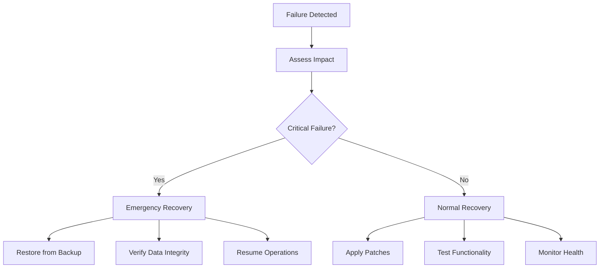

**Section sources**
- [src/services/PrivacyGateController.js](file://src/services/PrivacyGateController.js#L297-L315)
- [src/services/AnalyticsService.js](file://src/services/AnalyticsService.js#L16-L44)