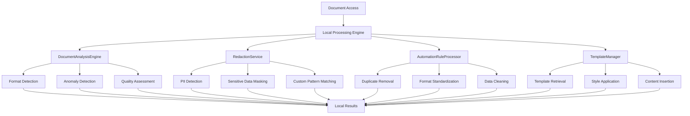
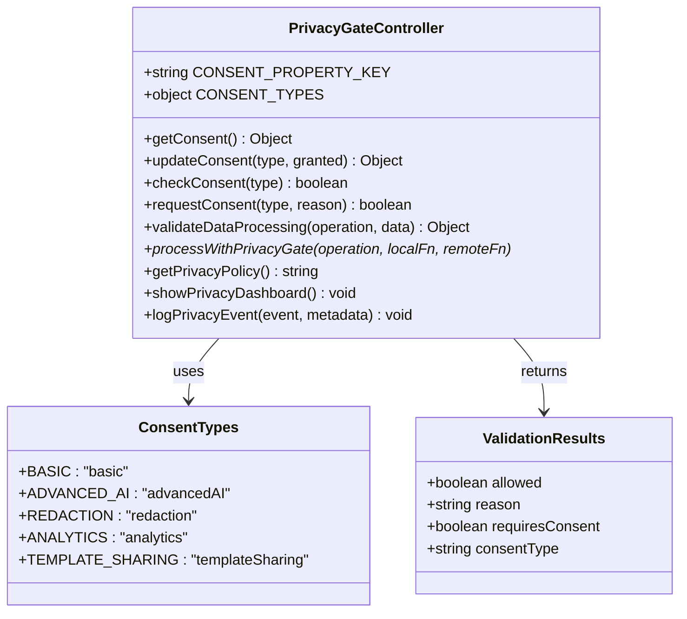
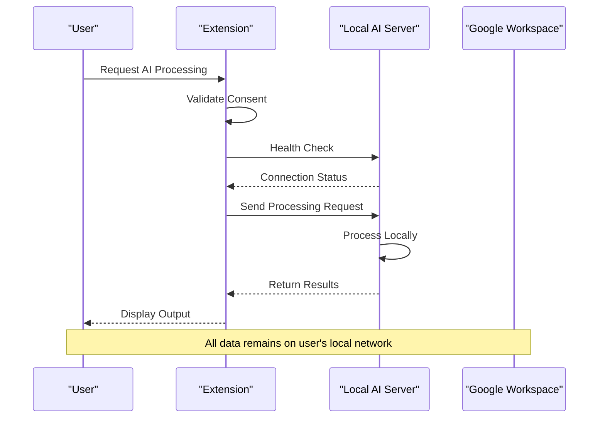
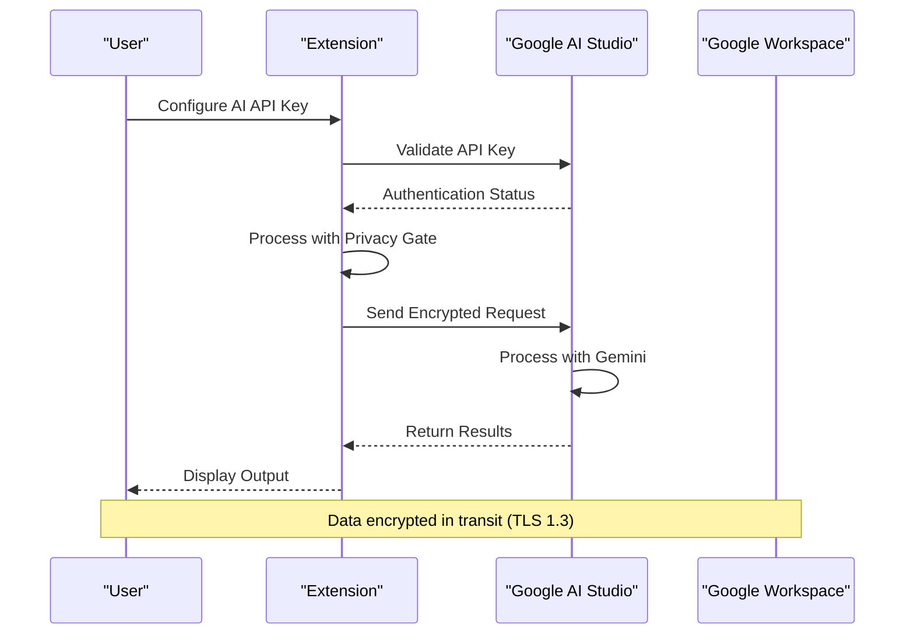
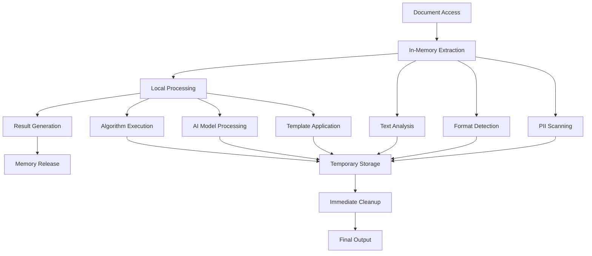
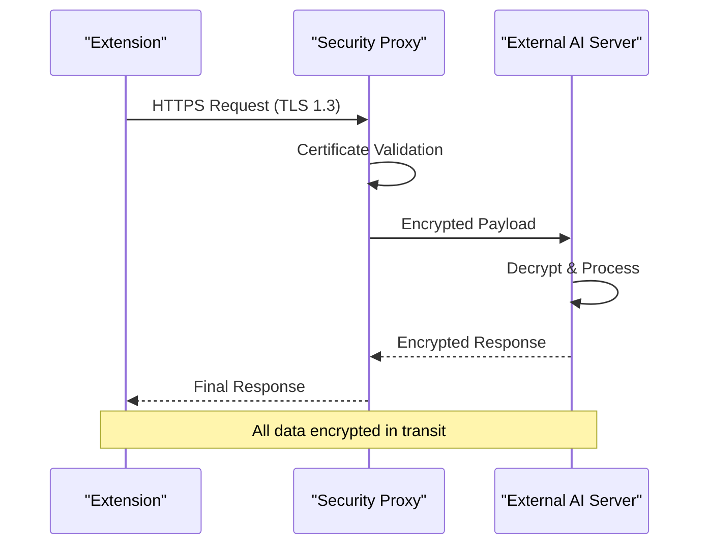
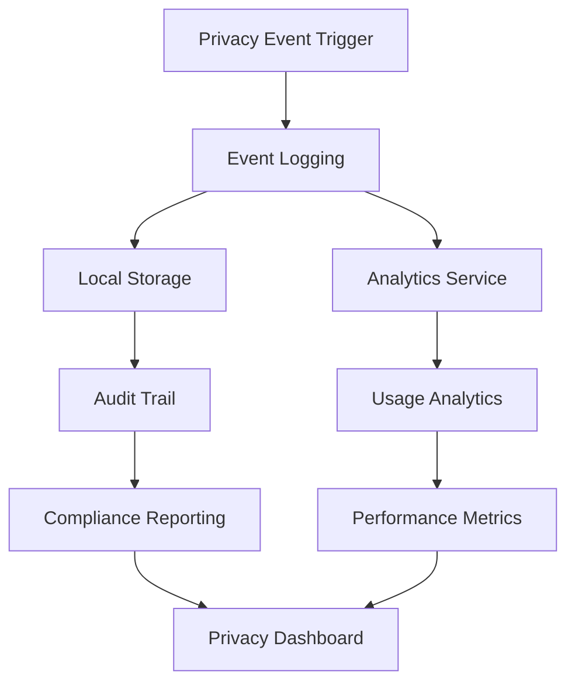

# Data Processing Policies

<cite>
**Referenced Files in This Document**
- [PrivacyGateController.js](file://src/services/PrivacyGateController.js)
- [DocumentAnalysisEngine.js](file://src/services/DocumentAnalysisEngine.js)
- [SummarizationService.js](file://src/services/SummarizationService.js)
- [RedactionService.js](file://src/services/RedactionService.js)
- [LocalAIService.js](file://src/services/LocalAIService.js)
- [OllamaAIService.js](file://src/services/OllamaAIService.js)
- [Main.js](file://src/Main.js)
- [README.md](file://README.md)
- [ADMIN_GUIDE.md](file://ADMIN_GUIDE.md)
</cite>

## Table of Contents
1. [Introduction](#introduction)
2. [Local-First Processing Model](#local-first-processing-model)
3. [PrivacyGateController Architecture](#privacygatecontroller-architecture)
4. [External Processing Pathways](#external-processing-pathways)
5. [Data Lifecycle Management](#data-lifecycle-management)
6. [Encryption and Security](#encryption-and-security)
7. [User Consent Framework](#user-consent-framework)
8. [Administrative Configuration](#administrative-configuration)
9. [Privacy Compliance Features](#privacy-compliance-features)
10. [Troubleshooting and Monitoring](#troubleshooting-and-monitoring)

## Introduction

The Techno Browser extension implements a sophisticated data processing architecture centered around Google Workspace's infrastructure, prioritizing user privacy through a comprehensive local-first processing model. This system ensures that all document operations execute within Google's secure environment by default, maintaining strict data residency within the Google Workspace ecosystem while providing optional advanced AI capabilities through controlled external pathways.

The extension operates under a privacy-by-design philosophy, implementing granular consent mechanisms, transparent data processing policies, and robust security measures that comply with modern privacy regulations. Every aspect of data handling is designed to minimize exposure and maximize user control over their information.

## Local-First Processing Model

### Core Architecture Principles

The extension's foundation rests on the principle of local-first processing, where all document operations occur within Google's infrastructure by default. This approach eliminates the need for external data transfers and maintains complete data sovereignty within the Google Workspace environment.



**Diagram sources**
- [DocumentAnalysisEngine.js](file://src/services/DocumentAnalysisEngine.js#L1-L739)
- [RedactionService.js](file://src/services/RedactionService.js#L1-L402)
- [Main.js](file://src/Main.js#L1-L800)

### Default Processing Locations

| Feature Category | Processing Location | Data Residency | Consent Required |
|------------------|-------------------|----------------|------------------|
| Document Analysis | Local (Apps Script) | Google Workspace Infrastructure | No |
| Redaction Operations | Local (Apps Script) | Google Workspace Infrastructure | Yes (Basic) |
| Cleanup Operations | Local (Apps Script) | Google Workspace Infrastructure | No |
| Template Application | Local (Apps Script) | Google Workspace Infrastructure | No |
| Basic Summarization | Local (Apps Script) | Google Workspace Infrastructure | No |
| Advanced AI Features | Optional External | User-Controlled | Yes (Explicit) |
| Usage Analytics | Local Storage | Google Workspace Infrastructure | Yes (Opt-in) |

**Section sources**
- [PrivacyGateController.js](file://src/services/PrivacyGateController.js#L184-L190)
- [DocumentAnalysisEngine.js](file://src/services/DocumentAnalysisEngine.js#L1-L50)

## PrivacyGateController Architecture

### Consent Management System

The PrivacyGateController serves as the central authority for managing user consent and enforcing privacy policies across all data processing operations. It implements a hierarchical consent model with five distinct consent categories, each governing specific types of data processing activities.



**Diagram sources**
- [PrivacyGateController.js](file://src/services/PrivacyGateController.js#L6-L16)
- [PrivacyGateController.js](file://src/services/PrivacyGateController.js#L175-L213)

### Default Consent Configuration

The system initializes with conservative default settings that prioritize user privacy:

```javascript
// Default consent settings (from PrivacyGateController.js)
{
  basic: true,           // Core functionality enabled
  advancedAI: false,     // AI features disabled by default
  redaction: true,       // Redaction enabled for PII protection
  analytics: false,      // Analytics disabled by default
  templateSharing: false // Template sharing disabled by default
}
```

**Section sources**
- [PrivacyGateController.js](file://src/services/PrivacyGateController.js#L30-L38)
- [PrivacyGateController.js](file://src/services/PrivacyGateController.js#L317-L329)

## External Processing Pathways

### Advanced AI Processing Options

When users opt into advanced AI features, the system provides two distinct external processing pathways, each offering different levels of capability and privacy controls.

#### LocalAIService Integration

The LocalAIService enables processing through locally-hosted AI models, providing maximum privacy while maintaining advanced capabilities:



**Diagram sources**
- [LocalAIService.js](file://src/services/LocalAIService.js#L31-L67)
- [PrivacyGateController.js](file://src/services/PrivacyGateController.js#L222-L236)

#### OllamaAIService Integration

The OllamaAIService connects to Google AI Studio's Gemini models, providing enterprise-grade AI capabilities with enhanced security:



**Diagram sources**
- [OllamaAIService.js](file://src/services/OllamaAIService.js#L30-L46)
- [PrivacyGateController.js](file://src/services/PrivacyGateController.js#L222-L236)

### External Processing Validation

The system implements comprehensive validation before initiating external processing:

```javascript
// Validation logic from PrivacyGateController.js
function validateDataProcessing(operation, data) {
  const validation = {
    allowed: false,
    reason: '',
    requiresConsent: false,
    consentType: null
  };
  
  const operationConsentMap = {
    'summarize': CONSENT_TYPES.ADVANCED_AI,
    'advanced_analysis': CONSENT_TYPES.ADVANCED_AI,
    'redact': CONSENT_TYPES.REDACTION,
    'track_analytics': CONSENT_TYPES.ANALYTICS,
    'share_template': CONSENT_TYPES.TEMPLATE_SHARING
  };
  
  const requiredConsent = operationConsentMap[operation];
  // ... validation logic
}
```

**Section sources**
- [PrivacyGateController.js](file://src/services/PrivacyGateController.js#L175-L213)
- [LocalAIService.js](file://src/services/LocalAIService.js#L1-L267)
- [OllamaAIService.js](file://src/services/OllamaAIService.js#L1-L189)

## Data Lifecycle Management

### Document Processing Workflow

The extension implements a comprehensive data lifecycle that ensures temporary processing without persistent storage:



**Diagram sources**
- [DocumentAnalysisEngine.js](file://src/services/DocumentAnalysisEngine.js#L12-L30)
- [SummarizationService.js](file://src/services/SummarizationService.js#L16-L65)

### Memory Management Strategy

The system employs aggressive memory management to prevent data persistence:

- **In-Memory Processing**: All operations occur in RAM without disk writes
- **Immediate Cleanup**: Temporary variables are cleared after processing completion
- **No Persistent Storage**: Results are not stored beyond the current session
- **Scope Limitation**: Variables are confined to function scope to prevent leaks

### Data Retention Policy

The extension implements a strict data retention policy:

| Data Type | Retention Period | Storage Location | Purpose |
|-----------|------------------|------------------|---------|
| Processing Results | Immediate | Memory | Temporary computation |
| User Preferences | Permanent | User Properties | Personalization |
| Consent Settings | Permanent | User Properties | Privacy Control |
| Analytics Events | 30 days | Local Storage | Usage Insights |
| Version History | 5 versions | User Properties | Undo Capability |

**Section sources**
- [Main.js](file://src/Main.js#L675-L711)
- [PrivacyGateController.js](file://src/services/PrivacyGateController.js#L297-L315)

## Encryption and Security

### Transport Layer Security

All external communications utilize industry-standard encryption protocols:

#### TLS 1.3 Implementation

The system mandates TLS 1.3 for all external connections, ensuring:

- **Forward Secrecy**: Each session uses unique keys
- **Quantum Resistance**: Modern cryptographic algorithms
- **Perfect Forward Secrecy**: Compromise of long-term keys doesn't compromise past sessions
- **Zero-RTT Support**: Fast connection establishment without sacrificing security

#### Secure Communication Channels



**Diagram sources**
- [LocalAIService.js](file://src/services/LocalAIService.js#L41-L67)
- [OllamaAIService.js](file://src/services/OllamaAIService.js#L60-L99)

### At-Rest Security

Within Google's infrastructure, data benefits from multiple layers of security:

- **Infrastructure Encryption**: All data stored on encrypted drives
- **Access Controls**: Role-based permissions at the organizational level
- **Audit Logging**: Comprehensive tracking of all data access
- **Data Isolation**: Multi-tenant architecture prevents cross-contamination

**Section sources**
- [PrivacyGateController.js](file://src/services/PrivacyGateController.js#L244-L269)

## User Consent Framework

### Granular Consent Types

The system implements five distinct consent categories, each serving specific privacy requirements:

#### Consent Type Definitions

| Consent Type | Purpose | Default State | User Control |
|--------------|---------|---------------|--------------|
| `BASIC` | Core functionality | Enabled | Cannot be disabled |
| `ADVANCED_AI` | AI-powered features | Disabled | User opt-in |
| `REDACTION` | PII detection/redaction | Enabled | User opt-out |
| `ANALYTICS` | Usage tracking | Disabled | User opt-in |
| `TEMPLATE_SHARING` | Template library access | Disabled | User opt-in |

### Consent Request Mechanism

The system provides contextual consent requests with clear explanations:

```javascript
// Consent request logic from PrivacyGateController.js
function requestConsent(consentType, reason) {
  const messages = {
    advancedAI: '🤖 Advanced AI Processing\n\n' +
               'This feature requires sending document content to a secure AI service...\n\n' +
               '🔒 Your data will be:\n' +
               '• Encrypted in transit\n' +
               '• Processed on secure servers\n' +
               '• Never stored permanently\n' +
               '• Never shared with third parties\n\n' +
               'Reason: ' + reason + '\n\n' +
               'Grant permission?',
    
    analytics: '📊 Usage Analytics\n\n' +
              'This allows collection of anonymous usage statistics...\n\n' +
              '✓ What we collect:\n' +
              '• Feature usage counts\n' +
              '• Error reports\n' +
              '• Performance metrics\n\n' +
              '✗ What we DON\'T collect:\n' +
              '• Document content\n' +
              '• Personal information\n' +
              '• File names or metadata\n\n' +
              'Grant permission?'
  };
}
```

### Consent Persistence

User consent decisions are persisted securely using Google's Properties Service:

```javascript
// Consent storage mechanism
const userProperties = PropertiesService.getUserProperties();
userProperties.setProperty(CONSENT_PROPERTY_KEY, JSON.stringify(currentConsent));
```

**Section sources**
- [PrivacyGateController.js](file://src/services/PrivacyGateController.js#L89-L147)
- [PrivacyGateController.js](file://src/services/PrivacyGateController.js#L21-L39)

## Administrative Configuration

### Organization-Wide Settings

Administrators can configure default privacy settings across the organization:

#### Default Consent Configuration

```javascript
// Administrative default settings
function setPrivacyDefaults() {
  const scriptProps = PropertiesService.getScriptProperties();
  
  // Disable advanced AI by default
  scriptProps.setProperty('defaultAdvancedAI', 'false');
  
  // Enable redaction by default
  scriptProps.setProperty('defaultRedaction', 'true');
  
  // Privacy policy URL
  scriptProps.setProperty('privacyPolicyUrl', 'https://yourorg.com/privacy');
}
```

#### Template Library Configuration

Administrators can configure shared template libraries:

```javascript
// Template library setup
PropertiesService.getScriptProperties()
  .setProperty('templateFolderId', 'YOUR_FOLDER_ID');
```

### OAuth Scope Management

The system requests minimal OAuth scopes to maintain privacy:

| Scope | Purpose | Risk Level |
|-------|---------|------------|
| `documents.currentonly` | Read/write current document | Low |
| `spreadsheets.currentonly` | Read/write current spreadsheet | Low |
| `presentations.currentonly` | Read/write current presentation | Low |
| `drive.file` | Access add-on created files | Low |
| `script.container.ui` | Display sidebar interface | Minimal |

**Section sources**
- [ADMIN_GUIDE.md](file://ADMIN_GUIDE.md#L167-L202)

## Privacy Compliance Features

### Built-in Compliance Documentation

The system includes comprehensive privacy documentation accessible through the PrivacyGateController:

```javascript
// Privacy policy text from PrivacyGateController.js
function getPrivacyPolicy() {
  return '🔒 PRIVACY POLICY - Intelligent Document Automation\n\n' +
         '1. LOCAL-FIRST PROCESSING\n' +
         'All document analysis and automation runs locally in your Google Workspace environment...\n\n' +
         '2. DATA COLLECTION\n' +
         '• We do NOT collect your document content\n' +
         '• We do NOT collect personal information\n' +
         '• We do NOT share data with third parties\n\n' +
         '3. OPTIONAL FEATURES\n' +
         'Advanced AI features require explicit consent and may send data to secure servers...\n\n' +
         '4. ANALYTICS (OPTIONAL)\n' +
         'If you opt in, we collect anonymous usage statistics...\n\n' +
         '5. YOUR RIGHTS\n' +
         '• You can revoke consent at any time\n' +
         '• You can request data deletion\n' +
         '• You control what data is processed\n\n' +
         '6. SECURITY\n' +
         '• All data transmission uses encryption\n' +
         '• Access is limited to authorized operations\n' +
         '• Regular security audits\n\n' +
         'Last Updated: ' + new Date().toDateString();
}
```

### Audit Logging System

The system maintains comprehensive audit logs for privacy compliance:

```javascript
// Privacy event logging
function logPrivacyEvent(eventType, metadata) {
  const log = {
    timestamp: new Date().toISOString(),
    event: eventType,
    metadata: metadata,
    user: Session.getActiveUser().getEmail()
  };
  
  console.info('Privacy Event:', JSON.stringify(log));
  
  // Optional analytics tracking
  if (checkConsent(CONSENT_TYPES.ANALYTICS)) {
    AnalyticsService.trackEvent('privacy_event', { type: eventType });
  }
}
```

### Data Minimization Principles

The system adheres to strict data minimization principles:

- **No Document Content Collection**: Never stores or transmits document contents
- **Minimal Metadata**: Only collects essential operational metadata
- **Temporary Processing**: All data processed in memory only
- **User Control**: Complete transparency and control over data processing

**Section sources**
- [PrivacyGateController.js](file://src/services/PrivacyGateController.js#L243-L269)
- [PrivacyGateController.js](file://src/services/PrivacyGateController.js#L297-L315)

## Troubleshooting and Monitoring

### Privacy Event Tracking

The system provides comprehensive monitoring of privacy-related events:



**Diagram sources**
- [PrivacyGateController.js](file://src/services/PrivacyGateController.js#L297-L315)

### Common Issues and Solutions

#### External Processing Failures

When external AI services are unavailable, the system gracefully falls back to local processing:

```javascript
// Privacy gate fallback mechanism
function processWithPrivacyGate(operation, localFn, remoteFn) {
  const validation = validateDataProcessing(operation, {});
  
  if (validation.allowed && validation.requiresConsent) {
    // Remote processing with consent
    return remoteFn();
  } else if (!validation.requiresConsent) {
    // Safe local processing
    return localFn();
  } else {
    // Consent required but not granted
    logPrivacyEvent('local_processing_fallback', { operation });
    return localFn();
  }
}
```

#### Consent Management Issues

Users can manage their privacy settings through the integrated dashboard:

- **Privacy Dashboard**: Real-time consent status display
- **Consent Revocation**: Ability to revoke all consents
- **Policy Viewer**: Access to complete privacy policy
- **Export Capabilities**: Data export and deletion options

**Section sources**
- [PrivacyGateController.js](file://src/services/PrivacyGateController.js#L222-L236)
- [PrivacyGateController.js](file://src/services/PrivacyGateController.js#L275-L289)