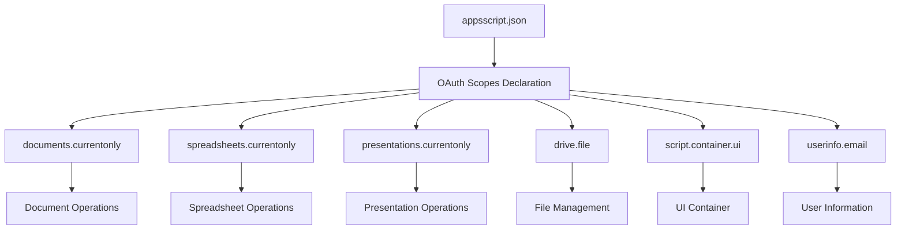
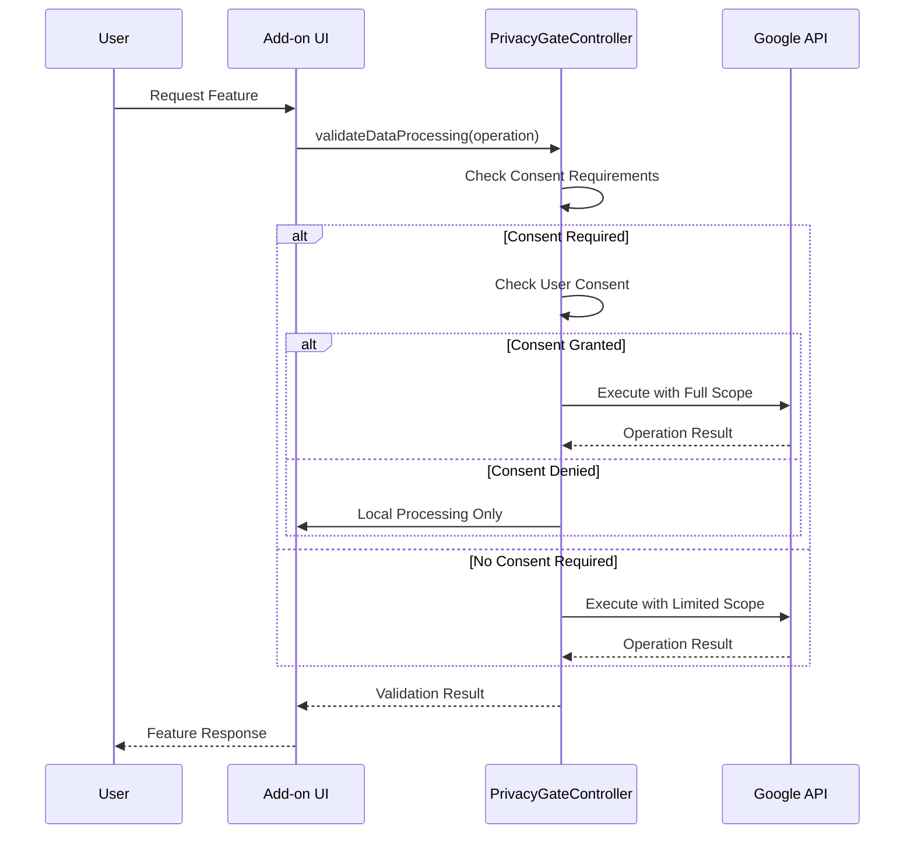
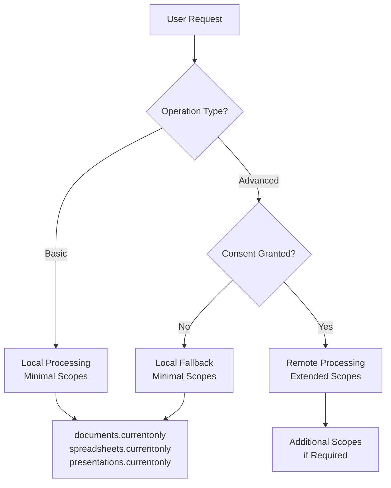
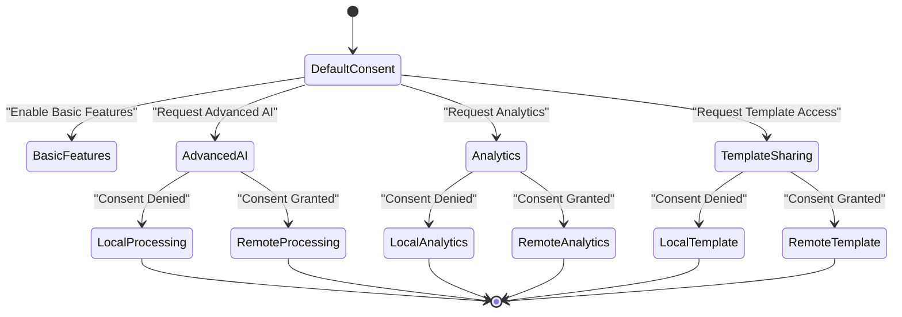
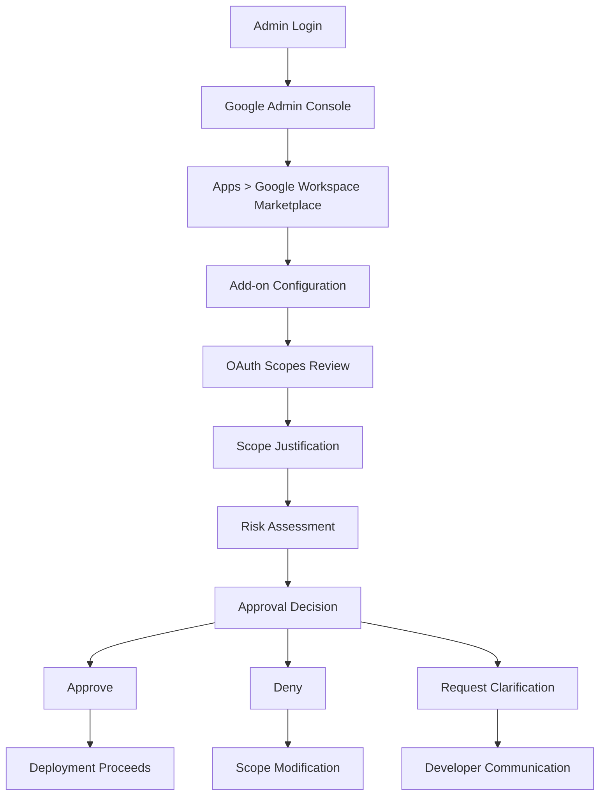
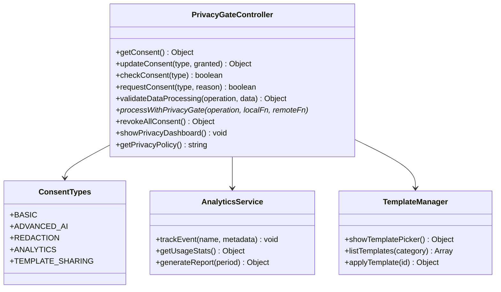

# OAuth Scopes

<cite>
**Referenced Files in This Document**
- [ADMIN_GUIDE.md](file://ADMIN_GUIDE.md)
- [src/services/PrivacyGateController.js](file://src/services/PrivacyGateController.js)
- [src/appsscript.json](file://src/appsscript.json)
- [src/Main.js](file://src/Main.js)
- [src/handlers/SidebarHandlers.js](file://src/handlers/SidebarHandlers.js)
- [src/services/AnalyticsService.js](file://src/services/AnalyticsService.js)
- [src/services/TemplateManager.js](file://src/services/TemplateManager.js)
- [src/services/DocumentAnalysisEngine.js](file://src/services/DocumentAnalysisEngine.js)
</cite>

## Table of Contents
1. [Introduction](#introduction)
2. [Scope Overview](#scope-overview)
3. [Required OAuth Scopes](#required-oauth-scopes)
4. [Scope Implementation Details](#scope-implementation-details)
5. [Minimal Scope Principle](#minimal-scope-principle)
6. [User Consent Flow](#user-consent-flow)
7. [Administrator Review Guidelines](#administrator-review-guidelines)
8. [Troubleshooting](#troubleshooting)
9. [PrivacyGateController Integration](#privacygatecontroller-integration)
10. [Best Practices](#best-practices)

## Introduction

The Techno Browser extension implements a comprehensive OAuth scope management system that ensures minimal privilege access while enabling essential functionality. The add-on operates under strict privacy controls, requiring explicit user consent for advanced features that involve data processing beyond local operations.

This documentation covers the five required OAuth scopes defined in the project's manifest, explaining their specific purposes, risk levels, and operational necessity within the add-on's functionality. The implementation follows Google's OAuth best practices and maintains transparency in data access requirements.

## Scope Overview

The add-on requires five specific OAuth scopes to function effectively:

| Scope | Purpose | Risk Level | Justification |
|-------|---------|------------|---------------|
| `documents.currentonly` | Read/write current Google Doc only | Low | Enables document analysis and automation features |
| `spreadsheets.currentonly` | Read/write current Google Sheet only | Low | Provides spreadsheet cleanup and analysis capabilities |
| `presentations.currentonly` | Read/write current Google Slide only | Low | Supports presentation analysis and template application |
| `drive.file` | Access only add-on created files | Low | Allows template sharing and file management |
| `script.container.ui` | Display sidebar interface | Minimal | Enables user interface functionality |

**Section sources**
- [ADMIN_GUIDE.md](file://ADMIN_GUIDE.md#L208-L216)
- [src/appsscript.json](file://src/appsscript.json#L29-L35)

## Required OAuth Scopes

### documents.currentonly

**Purpose**: Grants read and write access to the currently active Google Document.

**Implementation Details**:
- Access limited to the document currently open in the user's Google Docs interface
- Enables document analysis, formatting automation, and content manipulation
- Supports summarization, PII detection, and redaction features
- Operates exclusively on user-initiated document modifications

**Risk Level**: Low
- Read-only access to current document content
- No cross-document access permitted
- All operations occur within document boundaries
- No data export or sharing capabilities

**Operational Necessity**: Essential for core document automation features including:
- Document analysis and formatting improvements
- AI-powered content enhancement
- Privacy-sensitive data detection and redaction
- Template application and customization

**Section sources**
- [src/services/DocumentAnalysisEngine.js](file://src/services/DocumentAnalysisEngine.js#L89-L159)
- [src/services/PrivacyGateController.js](file://src/services/PrivacyGateController.js#L184-L189)

### spreadsheets.currentonly

**Purpose**: Provides read and write access to the currently active Google Sheet.

**Implementation Details**:
- Access restricted to the spreadsheet currently open in Google Sheets
- Enables data cleaning, formatting standardization, and analysis
- Supports duplicate removal, date format standardization, and empty cell filling
- Operates on selected ranges or entire sheets based on user preference

**Risk Level**: Low
- Limited to current spreadsheet only
- No cross-sheet data access
- Operations confined to user-selected ranges
- No external data transfer capabilities

**Operational Necessity**: Critical for spreadsheet automation including:
- Data quality improvement and cleaning
- Formatting consistency enforcement
- Automated data analysis and anomaly detection
- Template-based spreadsheet creation

**Section sources**
- [src/services/DocumentAnalysisEngine.js](file://src/services/DocumentAnalysisEngine.js#L36-L85)

### presentations.currentonly

**Purpose**: Grants read and write access to the currently active Google Slides presentation.

**Implementation Details**:
- Access limited to the presentation currently open in Google Slides
- Enables presentation analysis, template application, and content enhancement
- Supports slide consistency checking and speaker note generation
- Operates exclusively on user-initiated presentation modifications

**Risk Level**: Low
- Read-only access to current presentation content
- No cross-presentation access permitted
- Template operations are content-aware and safe
- No external presentation sharing capabilities

**Operational Necessity**: Essential for presentation automation including:
- Slide content analysis and improvement
- Template-based design standardization
- Speaker note generation and enhancement
- Presentation consistency verification

**Section sources**
- [src/services/DocumentAnalysisEngine.js](file://src/services/DocumentAnalysisEngine.js#L165-L197)

### drive.file

**Purpose**: Provides access to files created or modified by the add-on in Google Drive.

**Implementation Details**:
- Access limited to files owned by the add-on
- Enables template sharing and file management capabilities
- Supports custom template storage and retrieval
- Operates within the add-on's sandboxed file system

**Risk Level**: Low
- Read-only access to add-on-created files
- No access to user's personal files or folders
- File operations are additive and non-destructive
- No external file sharing or export capabilities

**Operational Necessity**: Required for:
- Custom template library access
- File-based configuration storage
- User preference persistence
- Add-on-generated file management

**Section sources**
- [src/services/TemplateManager.js](file://src/services/TemplateManager.js#L121-L149)

### script.container.ui

**Purpose**: Enables display of the add-on's sidebar interface within Google Workspace applications.

**Implementation Details**:
- Provides UI container functionality for the add-on's interface
- Enables modal dialogs, sidebars, and interactive elements
- Supports user interaction and preference configuration
- Operates within the Google Workspace UI framework

**Risk Level**: Minimal
- No data access capabilities
- Limited to UI presentation and user interaction
- No cross-application communication
- No persistent data storage

**Operational Necessity**: Essential for:
- User interface presentation
- Interactive feature access
- Preference configuration
- Status and progress reporting

**Section sources**
- [src/Main.js](file://src/Main.js#L152-L161)

## Scope Implementation Details

### Manifest Configuration

The OAuth scopes are declared in the `appsscript.json` manifest file, ensuring proper scope registration during deployment:

**Diagram sources**
- [src/appsscript.json](file://src/appsscript.json#L29-L36)

### Scope Validation and Enforcement

The add-on implements comprehensive scope validation through the PrivacyGateController, ensuring that operations respect scope limitations:

**Diagram sources**
- [src/services/PrivacyGateController.js](file://src/services/PrivacyGateController.js#L170-L213)

**Section sources**
- [src/services/PrivacyGateController.js](file://src/services/PrivacyGateController.js#L170-L213)

## Minimal Scope Principle

The add-on strictly adheres to the principle of least privilege, implementing several mechanisms to ensure minimal scope usage:

### Local-First Processing

All operations default to local processing, utilizing only the necessary scopes for immediate functionality:

**Diagram sources**
- [src/services/PrivacyGateController.js](file://src/services/PrivacyGateController.js#L215-L237)

### Dynamic Scope Management

The system dynamically manages scope usage based on user consent and operation requirements:

- **Basic Features**: Utilize only the core document scopes
- **Advanced Features**: Require explicit user consent and may use extended scopes
- **File Operations**: Limited to add-on-created files with drive.file scope
- **UI Operations**: Minimal script.container.ui scope for interface display

**Section sources**
- [src/services/PrivacyGateController.js](file://src/services/PrivacyGateController.js#L215-L237)

## User Consent Flow

### Consent Management Architecture

The PrivacyGateController implements a comprehensive consent management system that handles user permissions transparently:

**Diagram sources**
- [src/services/PrivacyGateController.js](file://src/services/PrivacyGateController.js#L83-L147)

### Consent Request Process

When advanced features require additional permissions, the system presents clear consent dialogs:

1. **Automatic Detection**: System identifies when consent is required
2. **Clear Explanation**: User receives detailed explanation of data usage
3. **Explicit Choice**: User makes informed consent decision
4. **Persistent Storage**: Consent decisions are stored securely
5. **Revocation Option**: Users can revoke consent at any time

**Section sources**
- [src/services/PrivacyGateController.js](file://src/services/PrivacyGateController.js#L83-L147)

### Privacy Dashboard

Users can manage their consent preferences through an integrated privacy dashboard:

- **Real-time Status**: Current consent status for all features
- **Feature Descriptions**: Clear explanations of each feature's requirements
- **Easy Toggle**: Simple on/off controls for each consent type
- **Revocation Capability**: Ability to revoke all consents simultaneously

**Section sources**
- [src/services/PrivacyGateController.js](file://src/services/PrivacyGateController.js#L272-L290)

## Administrator Review Guidelines

### OAuth Consent Screen Configuration

Administrators must carefully review and configure the OAuth consent screen to ensure proper scope management:

#### Internal vs External User Types

- **Internal User Type**: Recommended for domain-only deployments
- **External User Type**: Required for public-facing applications
- **Domain Verification**: Ensure proper domain verification for internal users

#### Scope Review Checklist

1. **Scope Justification**: Verify each scope's necessity for functionality
2. **Risk Assessment**: Evaluate potential data exposure risks
3. **User Impact**: Consider user experience implications
4. **Compliance Requirements**: Ensure alignment with organizational policies

**Section sources**
- [ADMIN_GUIDE.md](file://ADMIN_GUIDE.md#L74-L80)

### Administrative Approval Process

The Google Admin Console provides comprehensive tools for scope review and approval:

**Diagram sources**
- [ADMIN_GUIDE.md](file://ADMIN_GUIDE.md#L127-L134)

### Monitoring and Auditing

Administrators should implement ongoing monitoring of scope usage:

- **Usage Analytics**: Track which scopes are actually utilized
- **User Feedback**: Monitor user concerns about scope requests
- **Compliance Reporting**: Generate reports for regulatory compliance
- **Periodic Review**: Regular assessment of scope necessity

**Section sources**
- [ADMIN_GUIDE.md](file://ADMIN_GUIDE.md#L229-L240)

## Troubleshooting

### Common Scope-Related Issues

#### Permission Errors

**Symptoms**: Operations fail with "Insufficient permissions" errors
**Causes**: 
- Insufficient scope authorization
- User revocation of specific permissions
- Scope limitations in Google Workspace settings

**Resolution Steps**:
1. Verify scope authorization in Google Admin Console
2. Check user consent status in add-on settings
3. Reauthorize scopes through Google Account settings
4. Review organizational scope restrictions

#### Reauthorization Requirements

**Symptoms**: Add-on prompts for reauthorization frequently
**Causes**:
- Scope changes in manifest
- Administrative scope revocation
- User account changes

**Resolution Steps**:
1. Deploy new version with updated scopes
2. Communicate scope changes to users
3. Provide clear reauthorization instructions
4. Monitor reauthorization completion rates

#### Scope Limitations

**Symptoms**: Features work inconsistently or not at all
**Causes**:
- Overly restrictive organizational policies
- User-level scope denials
- Conflicting add-on permissions

**Resolution Steps**:
1. Review organizational scope policies
2. Verify individual user permissions
3. Test with different user accounts
4. Adjust scope requirements if possible

**Section sources**
- [ADMIN_GUIDE.md](file://ADMIN_GUIDE.md#L278-L294)

### Diagnostic Tools

The add-on provides several diagnostic capabilities for troubleshooting scope issues:

- **Consent Status**: Real-time visibility into user consent
- **Scope Validation**: Automatic validation of required scopes
- **Error Logging**: Detailed logging of scope-related errors
- **Usage Analytics**: Tracking of scope utilization patterns

**Section sources**
- [src/services/PrivacyGateController.js](file://src/services/PrivacyGateController.js#L272-L290)

## PrivacyGateController Integration

### Centralized Consent Management

The PrivacyGateController serves as the central hub for all privacy and consent management:

**Diagram sources**
- [src/services/PrivacyGateController.js](file://src/services/PrivacyGateController.js#L351-L363)

### Data Processing Enforcement

The PrivacyGateController enforces privacy policies through comprehensive data processing validation:

1. **Operation Mapping**: Maps each operation to required consent types
2. **Validation Engine**: Validates consent requirements before execution
3. **Fallback Mechanism**: Provides local processing fallback when consent is denied
4. **Audit Trail**: Maintains comprehensive logs of privacy decisions

**Section sources**
- [src/services/PrivacyGateController.js](file://src/services/PrivacyGateController.js#L170-L213)

### Integration with Services

Each major service integrates with the PrivacyGateController for proper consent management:

- **AnalyticsService**: Respects analytics consent for data collection
- **TemplateManager**: Requires template sharing consent for Drive access
- **SummarizationService**: May require advanced AI consent for remote processing
- **RedactionService**: Operates primarily with local processing

**Section sources**
- [src/services/AnalyticsService.js](file://src/services/AnalyticsService.js#L16-L41)
- [src/services/TemplateManager.js](file://src/services/TemplateManager.js#L46-L61)

## Best Practices

### Development Guidelines

1. **Scope Minimization**: Request only the scopes necessary for functionality
2. **Consent Transparency**: Provide clear explanations for each scope requirement
3. **Graceful Degradation**: Implement fallback functionality when scopes are denied
4. **User Control**: Respect user consent decisions and provide easy revocation

### Deployment Recommendations

1. **Staged Rollout**: Gradually deploy new scopes to monitor user acceptance
2. **Communication Plan**: Clearly explain scope changes to users
3. **Testing Protocol**: Thoroughly test scope interactions before deployment
4. **Monitoring Setup**: Implement comprehensive logging and monitoring

### Administrative Best Practices

1. **Regular Reviews**: Periodically review scope necessity and usage
2. **User Education**: Educate users about scope requirements and benefits
3. **Documentation**: Maintain comprehensive documentation of scope rationale
4. **Support Channels**: Establish clear support channels for scope-related issues

**Section sources**
- [ADMIN_GUIDE.md](file://ADMIN_GUIDE.md#L344-L358)