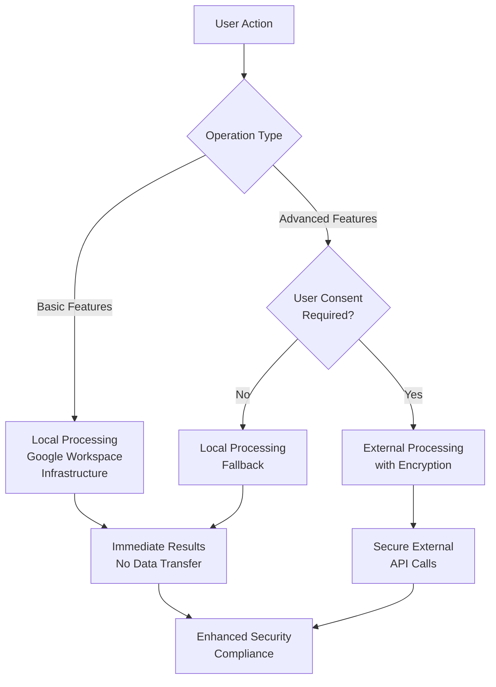
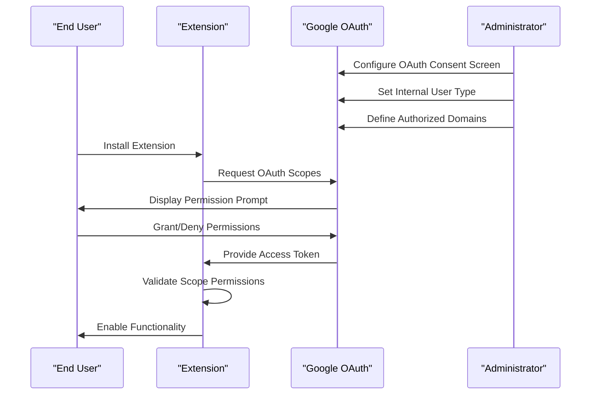
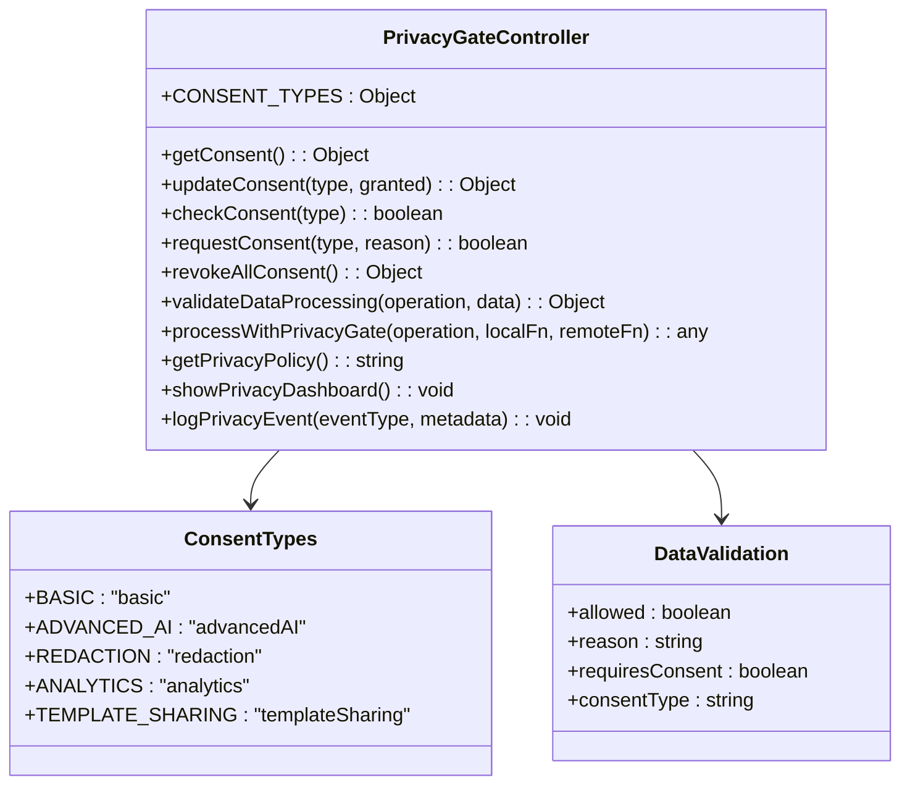
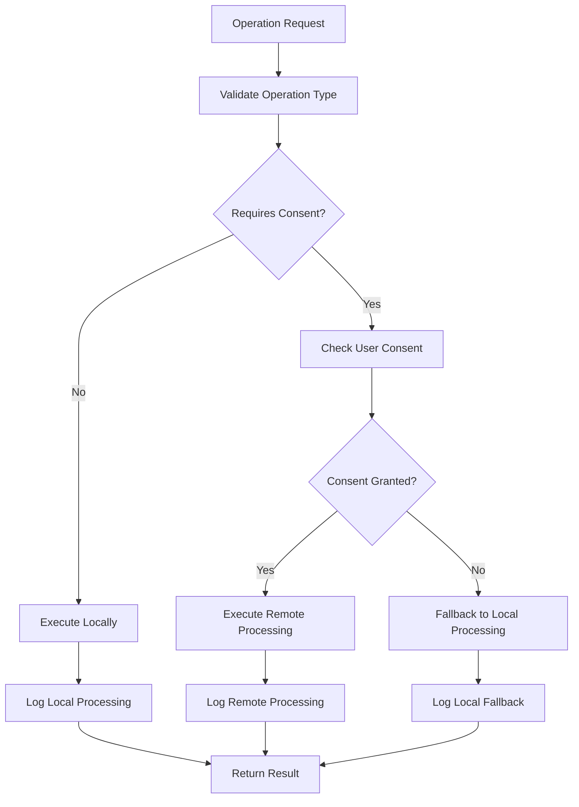
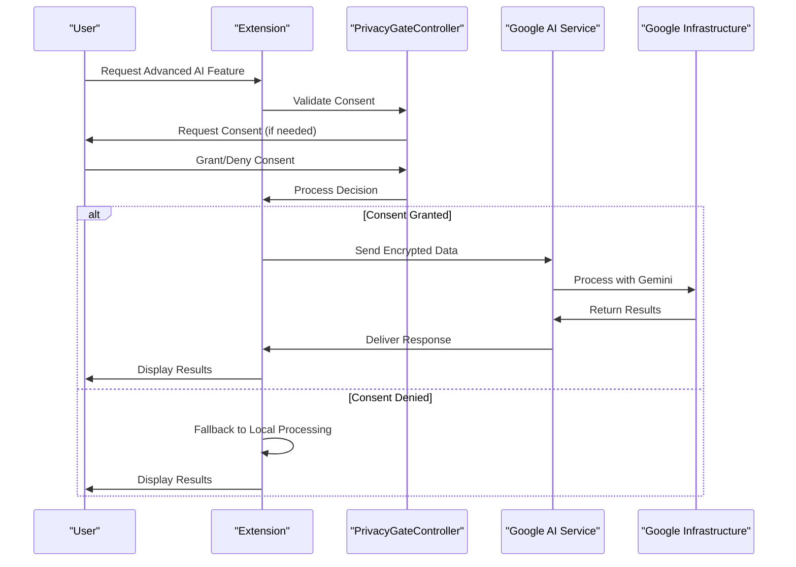
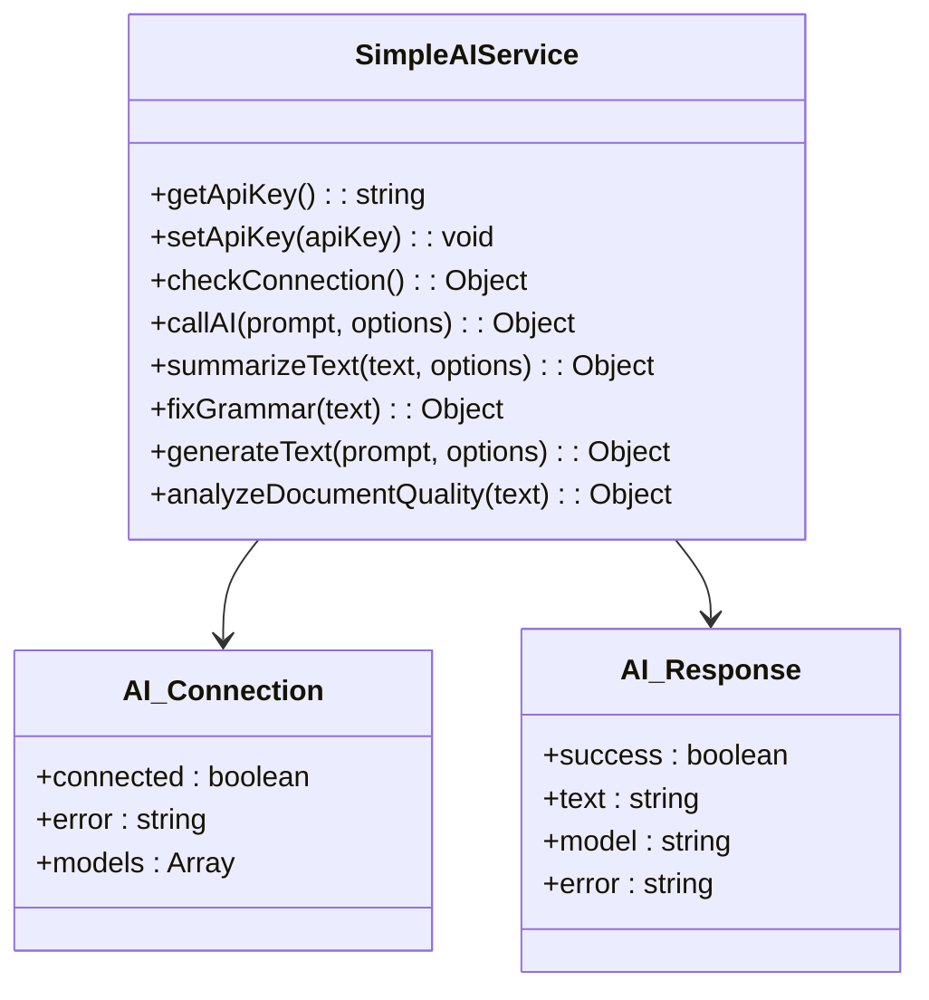
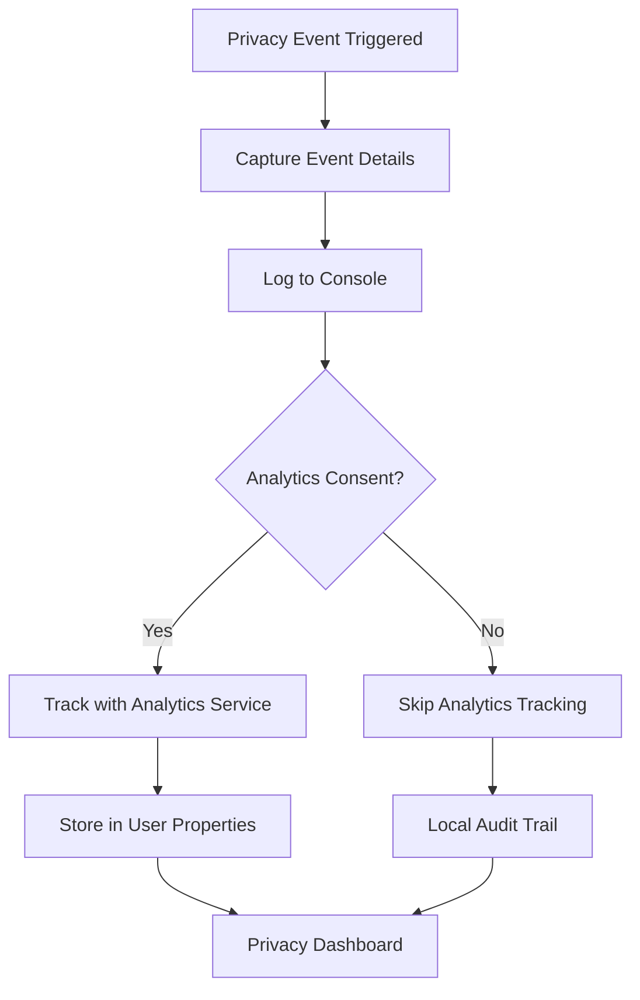
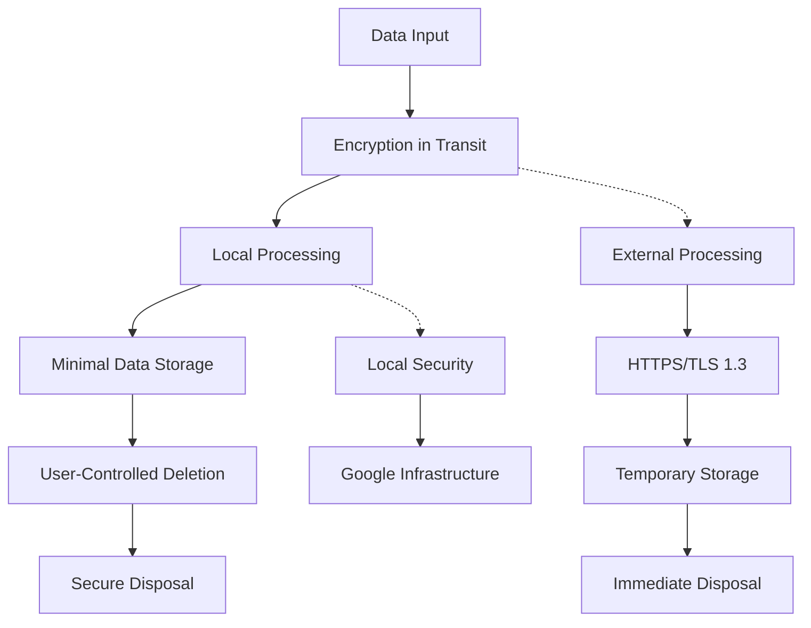
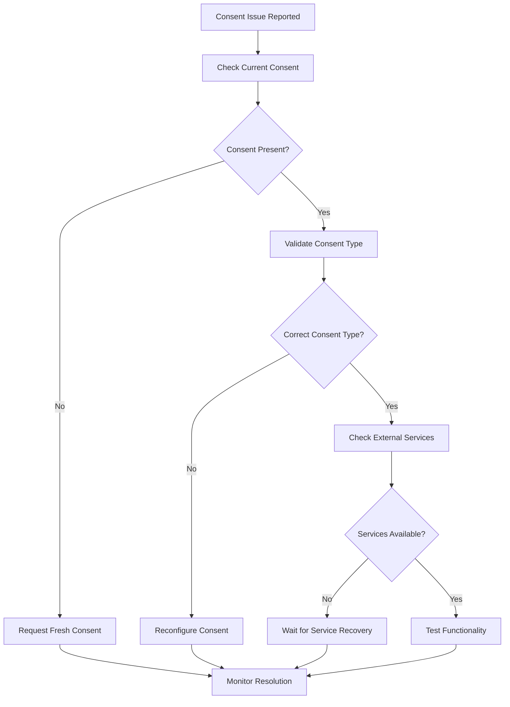
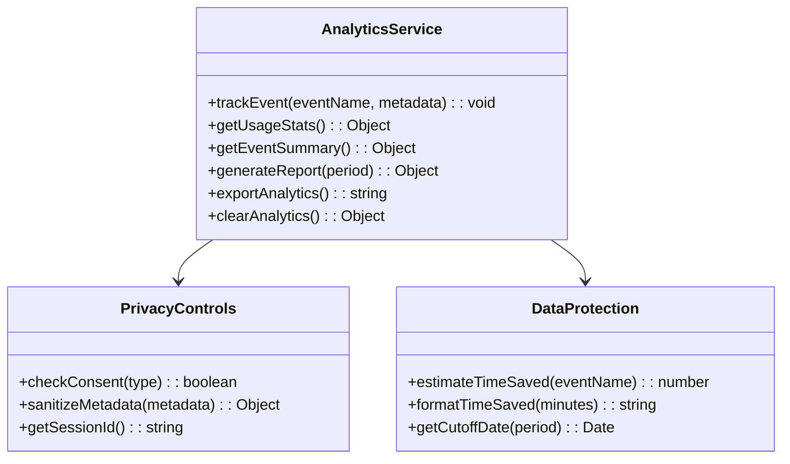

# Security & Compliance

<cite>
**Referenced Files in This Document**
- [src/services/PrivacyGateController.js](file://src/services/PrivacyGateController.js)
- [src/services/AnalyticsService.js](file://src/services/AnalyticsService.js)
- [src/services/SummarizationService.js](file://src/services/SummarizationService.js)
- [src/services/RedactionService.js](file://src/services/RedactionService.js)
- [src/services/OllamaAIService.js](file://src/services/OllamaAIService.js)
- [src/Main.js](file://src/Main.js)
- [ADMIN_GUIDE.md](file://ADMIN_GUIDE.md)
- [DEPLOYMENT_CHECKLIST.md](file://DEPLOYMENT_CHECKLIST.md)
- [src/appsscript.json](file://src/appsscript.json)
- [appsscript.json](file://appsscript.json)
</cite>

## Table of Contents
1. [Introduction](#introduction)
2. [Privacy-First Architecture](#privacy-first-architecture)
3. [OAuth Scope Management](#oauth-scope-management)
4. [Consent Management System](#consent-management-system)
5. [Data Processing Locations](#data-processing-locations)
6. [Advanced AI Processing](#advanced-ai-processing)
7. [Audit Logging Capabilities](#audit-logging-capabilities)
8. [Privacy Policy Implementation](#privacy-policy-implementation)
9. [Security Best Practices](#security-best-practices)
10. [Compliance Framework](#compliance-framework)
11. [Legal and Compliance Guidance](#legal-and-compliance-guidance)
12. [Troubleshooting Security Issues](#troubleshooting-security-issues)
13. [Monitoring and Reporting](#monitoring-and-reporting)

## Introduction

The Techno Browser extension implements a comprehensive security and compliance framework designed around the principle of privacy-first processing. Built on Google Workspace infrastructure, the extension ensures that all document automation operations occur locally by default while providing granular consent mechanisms for optional advanced features that require external processing.

This document covers the complete security architecture, compliance measures, and operational guidelines for deploying and managing the extension within organizational environments. The framework emphasizes transparency, user control, and regulatory compliance while maintaining optimal functionality.

## Privacy-First Architecture

### Core Design Principles

The extension follows a strict privacy-first architecture where all operations default to local processing within Google's infrastructure. This approach eliminates unnecessary data transfers and provides maximum control to end users.



**Diagram sources**
- [src/services/PrivacyGateController.js](file://src/services/PrivacyGateController.js#L215-L237)
- [src/services/SummarizationService.js](file://src/services/SummarizationService.js#L16-L65)

### Local-First Processing Model

All core document analysis, formatting, and automation features operate exclusively within Google Apps Script runtime. This ensures:

- **Zero External Transfers**: Document content never leaves Google's infrastructure
- **Real-time Processing**: Immediate results without network latency
- **Complete Isolation**: No cross-user data sharing or exposure
- **Regulatory Compliance**: Meets strict data residency requirements

**Section sources**
- [src/services/PrivacyGateController.js](file://src/services/PrivacyGateController.js#L215-L237)
- [ADMIN_GUIDE.md](file://ADMIN_GUIDE.md#L217-L228)

## OAuth Scope Management

### Minimal Scope Implementation

The extension requests only essential OAuth scopes necessary for core functionality, following the principle of least privilege access.

| Scope | Justification | Risk Level | Implementation Details |
|-------|---------------|------------|----------------------|
| `documents.currentonly` | Read/write current document only | Low | Restricts access to active document context |
| `spreadsheets.currentonly` | Read/write current spreadsheet only | Low | Limits operations to active spreadsheet |
| `presentations.currentonly` | Read/write current presentation only | Low | Controls access to active presentation |
| `drive.file` | Access only add-on created files | Low | Enables file management for automation |
| `script.container.ui` | Display sidebar interface | Minimal | Provides user interface functionality |

### Scope Validation Process



**Diagram sources**
- [src/appsscript.json](file://src/appsscript.json#L29-L35)
- [ADMIN_GUIDE.md](file://ADMIN_GUIDE.md#L73-L80)

### Administrative Control

Administrators can configure default consent settings and restrict advanced features organization-wide:

```javascript
// Example administrative configuration
function setPrivacyDefaults() {
  const scriptProps = PropertiesService.getScriptProperties();
  
  // Disable advanced AI by default
  scriptProps.setProperty('defaultAdvancedAI', 'false');
  
  // Enable redaction by default
  scriptProps.setProperty('defaultRedaction', 'true');
  
  // Privacy policy URL
  scriptProps.setProperty('privacyPolicyUrl', 'https://yourorg.com/privacy');
}
```

**Section sources**
- [ADMIN_GUIDE.md](file://ADMIN_GUIDE.md#L167-L183)
- [src/appsscript.json](file://src/appsscript.json#L29-L35)

## Consent Management System

### Granular Consent Types

The PrivacyGateController implements five distinct consent categories, each with specific use cases and data processing implications:



**Diagram sources**
- [src/services/PrivacyGateController.js](file://src/services/PrivacyGateController.js#L8-L16)
- [src/services/PrivacyGateController.js](file://src/services/PrivacyGateController.js#L170-L213)

### Consent Validation Workflow

Each operation undergoes rigorous consent validation before processing:



**Diagram sources**
- [src/services/PrivacyGateController.js](file://src/services/PrivacyGateController.js#L170-L213)
- [src/services/PrivacyGateController.js](file://src/services/PrivacyGateController.js#L215-L237)

### User Consent Prompts

The system provides contextual consent prompts with clear explanations:

- **Advanced AI Processing**: Explains encryption, temporary storage, and no permanent retention
- **Usage Analytics**: Details anonymous data collection and user rights
- **Template Sharing**: Clarifies Google Drive integration scope
- **Redaction Services**: Describes PII detection and masking processes

**Section sources**
- [src/services/PrivacyGateController.js](file://src/services/PrivacyGateController.js#L83-L147)
- [src/services/PrivacyGateController.js](file://src/services/PrivacyGateController.js#L240-L269)

## Data Processing Locations

### Default Local Processing

All core functionality operates within Google Workspace infrastructure:

- **Document Analysis**: Real-time text extraction and processing
- **Format Automation**: Grammar correction and formatting enhancements
- **Template Application**: Style and layout modifications
- **Data Cleaning**: Duplicate removal and standardization

### Optional External Processing

Advanced AI features require explicit user consent and utilize secure external processing:



**Diagram sources**
- [src/services/PrivacyGateController.js](file://src/services/PrivacyGateController.js#L215-L237)
- [src/services/SummarizationService.js](file://src/services/SummarizationService.js#L16-L65)

### Data Flow Architecture

| Processing Type | Location | Data Retention | Encryption |
|----------------|----------|----------------|------------|
| Basic Features | Local Google Workspace | None | N/A |
| Advanced AI | Google AI Studio | Temporary | TLS 1.3 |
| Analytics | Local + Optional Backend | Local only | N/A |
| Template Sharing | Google Drive | User-controlled | HTTPS |

**Section sources**
- [ADMIN_GUIDE.md](file://ADMIN_GUIDE.md#L217-L228)
- [src/services/SummarizationService.js](file://src/services/SummarizationService.js#L16-L65)

## Advanced AI Processing

### Gemini AI Integration

The extension integrates with Google's Gemini AI models for advanced document processing:



**Diagram sources**
- [src/services/OllamaAIService.js](file://src/services/OllamaAIService.js#L1-L188)

### AI Processing Pipeline

Advanced AI features require explicit consent and follow a secure processing pipeline:

1. **API Key Configuration**: Users obtain free API keys from Google AI Studio
2. **Consent Validation**: User must explicitly grant AI processing consent
3. **Encrypted Transmission**: All data transmitted via HTTPS with TLS 1.3
4. **Temporary Processing**: Data processed temporarily on Google's infrastructure
5. **Immediate Results**: No permanent data storage or retention

### Local AI Alternative

For organizations requiring complete local processing, the extension supports local AI services:

- **Ollama Integration**: Local model hosting capability
- **No External Dependencies**: Complete offline functionality
- **Custom Model Support**: Organizations can deploy custom AI models
- **Data Sovereignty**: Full control over processing environment

**Section sources**
- [src/services/OllamaAIService.js](file://src/services/OllamaAIService.js#L1-L188)
- [src/services/SummarizationService.js](file://src/services/SummarizationService.js#L16-L65)

## Audit Logging Capabilities

### Privacy Event Tracking

The extension implements comprehensive audit logging for privacy-sensitive operations:



**Diagram sources**
- [src/services/PrivacyGateController.js](file://src/services/PrivacyGateController.js#L293-L315)
- [src/services/AnalyticsService.js](file://src/services/AnalyticsService.js#L16-L45)

### Audit Logging Implementation

The `enableAuditLogging()` function provides centralized audit capabilities:

```javascript
function enableAuditLogging() {
  // Log all privacy-sensitive operations
  const scriptProps = PropertiesService.getScriptProperties();
  scriptProps.setProperty('auditLogging', 'true');
  scriptProps.setProperty('auditLogSpreadsheet', 'SPREADSHEET_ID');
}
```

### Audit Events Tracked

| Event Type | Description | Data Included |
|------------|-------------|---------------|
| `consent_update` | User consent changes | Consent type, granted status |
| `remote_processing` | External AI processing | Operation type, user |
| `local_processing_fallback` | Local fallback usage | Operation type, user |
| `privacy_event` | General privacy events | Event type, metadata |
| `consent_revoke_all` | Complete consent revocation | User |

### Analytics Data Protection

The AnalyticsService implements strict privacy protections:

- **PII Sanitization**: All metadata automatically sanitized
- **Anonymous Collection**: No personally identifiable information collected
- **User Control**: Complete opt-out capability
- **Local Storage**: All analytics data stored locally only

**Section sources**
- [src/services/PrivacyGateController.js](file://src/services/PrivacyGateController.js#L293-L315)
- [src/services/AnalyticsService.js](file://src/services/AnalyticsService.js#L16-L45)

## Privacy Policy Implementation

### Built-in Privacy Policy

The extension includes a comprehensive privacy policy accessible through the PrivacyGateController:

```javascript
function getPrivacyPolicy() {
  return '🔒 PRIVACY POLICY - Intelligent Document Automation\n\n' +
         '1. LOCAL-FIRST PROCESSING\n' +
         'All document analysis and automation runs locally in your Google Workspace environment by default.\n\n' +
         '2. DATA COLLECTION\n' +
         '• We do NOT collect your document content\n' +
         '• We do NOT collect personal information\n' +
         '• We do NOT share data with third parties\n\n' +
         '3. OPTIONAL FEATURES\n' +
         'Advanced AI features require explicit consent and may send data to secure servers...\n\n' +
         '4. ANALYTICS (OPTIONAL)\n' +
         'If you opt in, we collect anonymous usage statistics...\n\n' +
         '5. YOUR RIGHTS\n' +
         '• You can revoke consent at any time\n' +
         '• You can request data deletion\n' +
         '• You control what data is processed\n\n' +
         '6. SECURITY\n' +
         '• All data transmission uses encryption\n' +
         '• Access is limited to authorized operations\n' +
         '• Regular security audits\n\n' +
         'Last Updated: ' + new Date().toDateString();
}
```

### Privacy Dashboard

Users can view their current privacy settings through an interactive dashboard:

- **Current Consent Status**: Real-time visibility of enabled features
- **Feature Descriptions**: Clear explanations of each privacy setting
- **Update Mechanism**: Easy consent modification interface
- **Timestamp Tracking**: Last update timestamps for transparency

### Compliance Features

The privacy policy implementation includes several compliance-enhancing features:

- **Transparency**: Clear, accessible privacy information
- **User Control**: Granular consent management
- **Data Minimization**: Only necessary data collected
- **Purpose Limitation**: Data used only for stated purposes
- **Accountability**: Comprehensive audit trails

**Section sources**
- [src/services/PrivacyGateController.js](file://src/services/PrivacyGateController.js#L240-L269)
- [src/services/PrivacyGateController.js](file://src/services/PrivacyGateController.js#L273-L290)

## Security Best Practices

### Minimal OAuth Implementation

The extension follows OAuth security best practices:

- **Least Privilege**: Only essential scopes requested
- **Context-Specific Access**: Operations limited to active documents
- **User Consent**: Explicit permission for sensitive operations
- **Token Management**: Secure token handling and storage

### Data Protection Measures



### Security Monitoring

The extension implements continuous security monitoring:

- **Error Tracking**: Automatic error detection and logging
- **Access Auditing**: Comprehensive access tracking
- **Performance Monitoring**: Resource usage optimization
- **Security Alerts**: Proactive threat detection

### Regular Security Reviews

Organizations should conduct regular security reviews:

- **Scope Validation**: Verify OAuth scopes remain appropriate
- **Consent Management**: Monitor user consent patterns
- **Processing Logs**: Review audit trails regularly
- **Update Management**: Keep extension updated with security patches

**Section sources**
- [ADMIN_GUIDE.md](file://ADMIN_GUIDE.md#L110-L116)
- [DEPLOYMENT_CHECKLIST.md](file://DEPLOYMENT_CHECKLIST.md#L110-L116)

## Compliance Framework

### Regulatory Compliance

The extension supports compliance with major privacy regulations:

| Regulation | Compliance Features | Implementation Details |
|------------|-------------------|----------------------|
| GDPR | Data minimization, user rights | Local processing, consent management |
| CCPA | Transparency, opt-out capability | Privacy dashboard, data deletion |
| HIPAA | Data protection, audit trails | Encrypted processing, comprehensive logging |
| SOX | Accountability, record keeping | Audit logs, user activity tracking |

### Data Governance

Organizations can implement data governance policies:

- **Retention Policies**: Define data retention periods
- **Access Controls**: Restrict access to sensitive features
- **Audit Requirements**: Mandate regular compliance reviews
- **Incident Response**: Procedures for data breaches

### Third-Party Integrations

For organizations requiring external integrations:

- **API Security**: Secure API communication protocols
- **Data Classification**: Categorize data sensitivity levels
- **Vendor Management**: Evaluate third-party security practices
- **Contractual Obligations**: Include security requirements in agreements

**Section sources**
- [ADMIN_GUIDE.md](file://ADMIN_GUIDE.md#L205-L241)
- [src/services/PrivacyGateController.js](file://src/services/PrivacyGateController.js#L240-L269)

## Legal and Compliance Guidance

### Privacy Impact Assessment

Organizations deploying the extension should conduct a Privacy Impact Assessment (PIA):

1. **Data Inventory**: Identify all data processed by the extension
2. **Risk Assessment**: Evaluate privacy risks and mitigation strategies
3. **Consent Management**: Plan consent collection and management processes
4. **User Rights**: Establish procedures for user privacy requests
5. **Third-Party Processing**: Document external AI service usage

### Legal Review Checklist

Before deployment, legal teams should review:

- **Privacy Policy Alignment**: Ensure alignment with organizational policies
- **Consent Forms**: Review consent mechanisms and documentation
- **Data Processing Agreements**: Update contracts for AI processing
- **Cross-Border Data Transfers**: Address international data flow concerns
- **User Notification Requirements**: Plan user communication strategies

### Compliance Monitoring

Establish ongoing compliance monitoring:

- **Regular Audits**: Schedule periodic compliance reviews
- **User Feedback**: Collect and address privacy concerns
- **Regulatory Updates**: Stay current with privacy regulation changes
- **Technical Updates**: Implement security improvements promptly

### Incident Response

Develop incident response procedures:

- **Data Breach Protocol**: Define steps for privacy violations
- **User Notification**: Establish timelines for breach notifications
- **Remediation Plans**: Outline corrective actions for compliance issues
- **Documentation Requirements**: Maintain incident response records

**Section sources**
- [ADMIN_GUIDE.md](file://ADMIN_GUIDE.md#L167-L183)
- [DEPLOYMENT_CHECKLIST.md](file://DEPLOYMENT_CHECKLIST.md#L344-L373)

## Troubleshooting Security Issues

### Common Permission Errors

| Issue | Cause | Solution |
|-------|-------|----------|
| OAuth Scope Denied | Insufficient permissions | Verify OAuth consent screen configuration |
| Consent Required | Missing user consent | Request explicit consent for advanced features |
| API Key Invalid | Incorrect AI configuration | Verify Google AI Studio API key |
| External Processing Failed | Network or service issues | Check connectivity and service status |
| Local Processing Errors | Insufficient quota | Monitor Apps Script quotas |

### Permission Approval Process

For administrators resolving permission issues:

1. **Verify OAuth Configuration**: Check Google Cloud Console settings
2. **Review Consent Screen**: Ensure proper user type and scopes
3. **Test Connectivity**: Validate API access and service availability
4. **Monitor Quotas**: Track usage against Google Workspace limits
5. **User Education**: Provide guidance on consent management

### Debugging Consent Issues



### Technical Support Resources

Organizations should establish support channels:

- **Technical Support**: IT department for technical issues
- **Security Contact**: Security team for privacy concerns
- **Compliance Officer**: Legal team for regulatory questions
- **Extension Developer**: Primary development contact

**Section sources**
- [ADMIN_GUIDE.md](file://ADMIN_GUIDE.md#L276-L300)
- [DEPLOYMENT_CHECKLIST.md](file://DEPLOYMENT_CHECKLIST.md#L180-L200)

## Monitoring and Reporting

### Usage Analytics

The extension provides comprehensive usage analytics with privacy controls:



**Diagram sources**
- [src/services/AnalyticsService.js](file://src/services/AnalyticsService.js#L1-L395)

### Administrative Dashboards

Administrators can monitor extension usage through:

- **Usage Statistics**: Feature adoption rates and frequency
- **Error Rates**: Technical issue identification and resolution
- **User Engagement**: Active user identification and trends
- **Resource Utilization**: Quota monitoring and optimization

### Compliance Reporting

Generate compliance reports for:

- **Consent Tracking**: User consent patterns and changes
- **Data Processing Logs**: Audit trail analysis
- **Security Incidents**: Incident identification and response
- **User Rights Requests**: Privacy request fulfillment tracking

### Performance Metrics

Monitor key performance indicators:

- **Processing Times**: Operation response times and efficiency
- **Error Rates**: System reliability and stability
- **User Satisfaction**: Feature adoption and usability metrics
- **Resource Consumption**: Quota utilization and optimization opportunities

**Section sources**
- [src/services/AnalyticsService.js](file://src/services/AnalyticsService.js#L47-L162)
- [ADMIN_GUIDE.md](file://ADMIN_GUIDE.md#L244-L273)