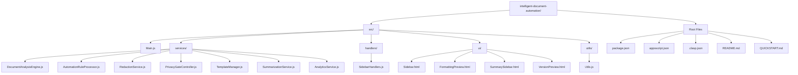
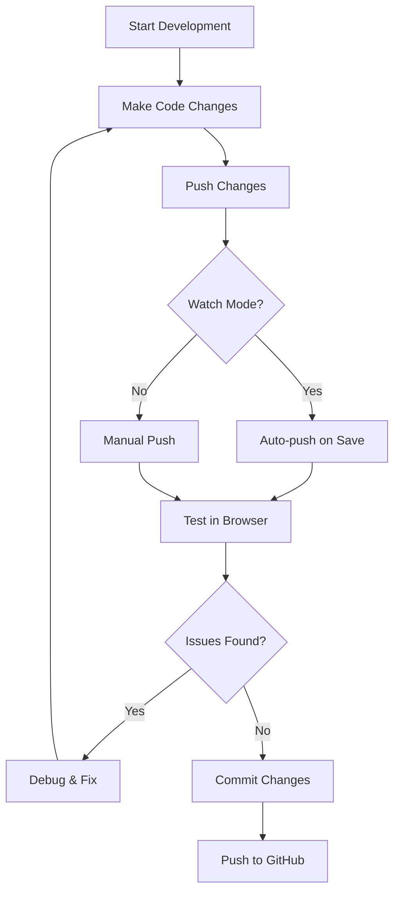

# Development Environment Setup

<cite>
**Referenced Files in This Document**
- [README.md](file://README.md)
- [QUICKSTART.md](file://QUICKSTART.md)
- [package.json](file://package.json)
- [appsscript.json](file://appsscript.json)
- [src/appsscript.json](file://src/appsscript.json)
- [.clasp.json](file://.clasp.json)
- [src/Main.js](file://src/Main.js)
- [src/ui/Sidebar.html](file://src/ui/Sidebar.html)
- [src/utils/Utils.js](file://src/utils/Utils.js)
</cite>

## Table of Contents
1. [Introduction](#introduction)
2. [Prerequisites](#prerequisites)
3. [Environment Setup](#environment-setup)
4. [Repository Setup](#repository-setup)
5. [Project Structure](#project-structure)
6. [Development Workflows](#development-workflows)
7. [Key Configuration Files](#key-configuration-files)
8. [Common Development Commands](#common-development-commands)
9. [Troubleshooting](#troubleshooting)
10. [Best Practices](#best-practices)

## Introduction

The Intelligent Document Automation extension is a Google Workspace add-on built with Google Apps Script that provides AI-powered document automation capabilities. This guide walks you through setting up a complete local development environment for contributing to or modifying the extension.

The extension offers features like document analysis, PII redaction, data cleanup, template application, and AI-powered summarization, all while maintaining strict privacy standards by processing data locally in Google Apps Script.

## Prerequisites

Before setting up the development environment, ensure you have the following prerequisites installed:

### System Requirements
- **Operating System**: Windows, macOS, or Linux
- **Node.js**: Version 16.x or higher (required for @google/clasp CLI)
- **npm**: Comes bundled with Node.js
- **Git**: For version control and repository cloning

### Google Workspace Requirements
- **Google Account**: With access to Google Workspace
- **Apps Script API**: Enabled in your Google Cloud project
- **OAuth Consent Screen**: Configured for your project
- **Google Workspace Admin Access**: For domain-wide deployment (optional)

### Recommended Tools
- **Code Editor**: VS Code, WebStorm, or any JavaScript IDE
- **Browser**: Chrome or Chromium-based browser for testing
- **Postman**: For API testing (optional)

## Environment Setup

### Step 1: Install Node.js and npm

Visit the official Node.js website to download and install the latest LTS version for your operating system.

```bash
# Verify installation
node --version
npm --version
```

### Step 2: Install @google/clasp CLI Tool

The `@google/clasp` CLI tool is essential for managing Google Apps Script projects. It enables seamless synchronization between local code and remote Apps Script projects.

```bash
# Install clasp globally
npm install -g @google/clasp

# Verify installation
clasp --version
```

### Step 3: Configure clasp Authentication

Before working with Apps Script projects, authenticate clasp with your Google account:

```bash
# Login to Google
clasp login

# This command opens a browser window for authentication
# Follow the prompts to authorize clasp access to your Google account
```

**Important**: Ensure you're logged in with the Google account that has access to the Apps Script project you want to develop.

## Repository Setup

### Step 1: Clone the Repository

```bash
# Clone the repository from GitHub
git clone https://github.com/AayushBhat07/intelligent-document-automation.git

# Navigate to the project directory
cd intelligent-document-automation
```

### Step 2: Install Dependencies

The project uses npm for dependency management and includes several development tools:

```bash
# Install project dependencies
npm install

# This installs:
# - @google/clasp: Google Apps Script CLI
# - @types/google-apps-script: TypeScript definitions
```

### Step 3: Create a New Apps Script Project

For development, create a standalone Apps Script project:

```bash
# Create a new standalone Apps Script project
clasp create --type standalone --title "Intelligent Document Automation"

# This creates a new Apps Script project and generates a script ID
```

### Step 4: Link Local Project to Remote Script

Link your local development environment to the newly created Apps Script project:

```bash
# Clone the remote project to your local environment
clasp clone <your-script-id>

# Alternatively, if you've already created the project:
# clasp push
```

## Project Structure

Understanding the project structure is crucial for effective development:



**Diagram sources**
- [src/Main.js](file://src/Main.js#L1-L50)
- [src/ui/Sidebar.html](file://src/ui/Sidebar.html#L1-L50)
- [src/utils/Utils.js](file://src/utils/Utils.js#L1-L50)

### Directory Breakdown

#### `/src` - Core Application Code
- **Main.js**: Entry point containing menu creation, sidebar management, and core functionality
- **services/**: Business logic services for document analysis, redaction, automation, and analytics
- **handlers/**: UI event handlers and callback functions
- **ui/**: HTML templates for the add-on interface
- **utils/**: Utility functions for date formatting, validation, and common operations

#### Root Configuration Files
- **package.json**: NPM configuration with deployment scripts
- **appsscript.json**: Apps Script manifest defining runtime, dependencies, and OAuth scopes
- **.clasp.json**: Clasp configuration specifying project ID and file mapping

**Section sources**
- [src/Main.js](file://src/Main.js#L1-L100)
- [src/ui/Sidebar.html](file://src/ui/Sidebar.html#L1-L100)
- [src/utils/Utils.js](file://src/utils/Utils.js#L1-L100)

## Development Workflows

### Basic Development Cycle



### Pushing Code to Apps Script

```bash
# Push all local files to Apps Script
clasp push

# Watch for changes and auto-push
clasp push --watch

# Force push all files regardless of modification time
clasp push --force
```

### Viewing Execution Logs

Monitor your add-on's execution and debug issues:

```bash
# View real-time execution logs
clasp logs

# View logs with filtering
clasp logs --filter "error"

# View logs with limit
clasp logs --limit 50
```

### Pulling Remote Changes

Sync remote modifications to your local environment:

```bash
# Pull latest changes from Apps Script
clasp pull

# Pull specific files
clasp pull --files src/Main.js,src/services/DocumentAnalysisEngine.js
```

### Opening in Apps Script Editor

```bash
# Open the project in Apps Script web editor
clasp open

# Open in Google Workspace
clasp open --webapp
```

**Section sources**
- [QUICKSTART.md](file://QUICKSTART.md#L64-L80)
- [README.md](file://README.md#L285-L301)

## Key Configuration Files

### package.json - NPM Configuration

The `package.json` file defines project metadata and provides convenient npm scripts for development tasks:

```json
{
  "name": "intelligent-document-automation",
  "version": "1.0.0",
  "scripts": {
    "push": "clasp push",
    "deploy": "clasp deploy",
    "open": "clasp open",
    "login": "clasp login"
  }
}
```

**Purpose and Usage:**
- **Scripts**: Provides shorthand commands for common development tasks
- **Dependencies**: Includes `@google/clasp` for Apps Script management
- **Metadata**: Contains project information and licensing details

### appsscript.json - Runtime Configuration

The root `appsscript.json` defines the Apps Script runtime environment:

```json
{
  "timeZone": "America/New_York",
  "dependencies": {},
  "exceptionLogging": "STACKDRIVER",
  "runtimeVersion": "V8"
}
```

**Key Properties:**
- **timeZone**: Sets the default timezone for date operations
- **dependencies**: Empty in root but populated in src/appsscript.json
- **exceptionLogging**: Enables Stackdriver logging for debugging
- **runtimeVersion**: Uses V8 runtime for improved performance

### src/appsscript.json - Add-on Manifest

The `src/appsscript.json` file contains the complete add-on configuration:

```json
{
  "addOns": {
    "common": {
      "name": "Intelligent Document Automation",
      "logoUrl": "https://www.gstatic.com/images/branding/product/1x/apps_script_48dp.png",
      "layoutProperties": {
        "primaryColor": "#4285f4"
      },
      "useLocaleFromApp": true
    }
  },
  "oauthScopes": [
    "https://www.googleapis.com/auth/documents.currentonly",
    "https://www.googleapis.com/auth/spreadsheets.currentonly",
    "https://www.googleapis.com/auth/presentations.currentonly",
    "https://www.googleapis.com/auth/drive.file",
    "https://www.googleapis.com/auth/script.container.ui",
    "https://www.googleapis.com/auth/userinfo.email"
  ]
}
```

**Critical Components:**
- **Add-on Metadata**: Name, logo, and visual branding
- **OAuth Scopes**: Minimal permissions required for functionality
- **Advanced Services**: Integration with Docs, Sheets, Slides APIs

### .clasp.json - Project Mapping

The `.clasp.json` file configures clasp's behavior:

```json
{
  "scriptId": "111Jf6pTEckRvEjHckTWtFfVEBS4E7kXk_fanN-gnRSx0PWaqYkebcmVy",
  "rootDir": "./src",
  "scriptExtensions": [".js", ".gs"],
  "htmlExtensions": [".html"],
  "jsonExtensions": [".json"],
  "filePushOrder": []
}
```

**Configuration Details:**
- **scriptId**: Maps to your specific Apps Script project
- **rootDir**: Specifies the source directory
- **Extensions**: Defines file types to include during sync
- **Push Order**: Controls file upload sequence

**Section sources**
- [package.json](file://package.json#L1-L25)
- [appsscript.json](file://appsscript.json#L1-L7)
- [src/appsscript.json](file://src/appsscript.json#L1-L47)
- [.clasp.json](file://.clasp.json#L1-L15)

## Common Development Commands

### Quick Start Commands

```bash
# Full development setup
git clone https://github.com/AayushBhat07/intelligent-document-automation.git
cd intelligent-document-automation
npm install
clasp login
clasp create --type standalone --title "Intelligent Document Automation"
clasp push
clasp open
```

### Development Workflow Commands

```bash
# Daily development
clasp push                    # Sync changes
clasp push --watch           # Auto-sync on save
clasp logs                   # Monitor execution
clasp pull                   # Sync remote changes

# Testing and debugging
clasp logs --filter "error"  # Filter error logs
clasp logs --limit 100       # Show recent logs
clasp open --webapp          # Open in web app mode

# Deployment preparation
npm run deploy               # Deploy to production
npm run push                 # Shortcut for clasp push
```

### Project Management Commands

```bash
# Project setup
clasp clone <script-id>      # Link existing project
clasp create --type standalone --title "My Add-on"

# File management
clasp pull --files src/Main.js  # Pull specific files
clasp push --force             # Force push all files

# Status checking
clasp status                 # Show file status
clasp list                   # List all files
```

## Troubleshooting

### Common Setup Issues

#### Authentication Failures

**Problem**: `clasp login` fails or returns authentication errors.

**Solutions**:
```bash
# Clear existing credentials
rm ~/.clasprc.json

# Try login again
clasp login

# Use browser-based authentication
clasp login --creds
```

#### Deployment Conflicts

**Problem**: `clasp push` fails with "File not found" or "Permission denied".

**Solutions**:
```bash
# Force push to overwrite
clasp push --force

# Check file permissions
clasp status

# Verify script ID in .clasp.json
cat .clasp.json
```

#### Manifest Configuration Errors

**Problem**: Add-on doesn't appear or functions incorrectly.

**Solutions**:
```bash
# Validate manifest
clasp push --dry-run

# Check OAuth scopes
clasp open --webapp

# Verify dependencies in src/appsscript.json
```

### Development Environment Issues

#### File Sync Problems

**Problem**: Changes aren't syncing to Apps Script.

**Solutions**:
```bash
# Check clasp status
clasp status

# Force sync
clasp push --force

# Verify file extensions in .clasp.json
```

#### Performance Issues

**Problem**: Slow development cycle or timeout errors.

**Solutions**:
```bash
# Use watch mode for faster iteration
clasp push --watch

# Optimize file structure
clasp pull --files src/Main.js  # Pull only essentials
```

### Debugging Strategies

#### Logging and Monitoring

```bash
# Enable verbose logging
DEBUG=clasp* clasp push

# Monitor execution in real-time
clasp logs --stream

# Check specific log patterns
clasp logs --filter "WARNING"
```

#### Testing in Browser

```bash
# Open in web app mode for testing
clasp open --webapp

# Test specific functions
clasp run functionName
```

**Section sources**
- [README.md](file://README.md#L223-L250)
- [QUICKSTART.md](file://QUICKSTART.md#L163-L186)

## Best Practices

### Development Workflow

1. **Always use watch mode** during active development for immediate feedback
2. **Test frequently** in the actual Google Workspace environment
3. **Monitor logs** regularly to catch issues early
4. **Backup changes** before major modifications
5. **Follow commit conventions** for better collaboration

### Code Organization

1. **Keep functions focused** and modular for easier testing
2. **Use meaningful variable names** that describe their purpose
3. **Document complex logic** with comments and function descriptions
4. **Maintain consistent formatting** across all JavaScript files
5. **Separate concerns** between UI logic and business logic

### Performance Optimization

1. **Batch operations** to avoid hitting API quotas
2. **Use debouncing** for user input handlers
3. **Implement proper error handling** for async operations
4. **Minimize DOM manipulation** in HTML templates
5. **Cache frequently accessed data** using PropertiesService

### Security Considerations

1. **Request minimal OAuth scopes** necessary for functionality
2. **Validate all user inputs** before processing
3. **Use secure patterns** for PII detection and redaction
4. **Implement proper consent management** for advanced features
5. **Follow privacy-first principles** in all data processing

### Testing and Quality Assurance

1. **Test across different document types** (Docs, Sheets, Slides)
2. **Verify functionality** with various data sets and edge cases
3. **Check browser compatibility** for HTML components
4. **Validate error handling** scenarios
5. **Perform usability testing** with real users

This comprehensive development environment setup guide provides everything needed to contribute effectively to the Intelligent Document Automation extension. The modular architecture, comprehensive configuration files, and robust development workflows enable efficient collaboration and maintenance of this powerful Google Workspace add-on.