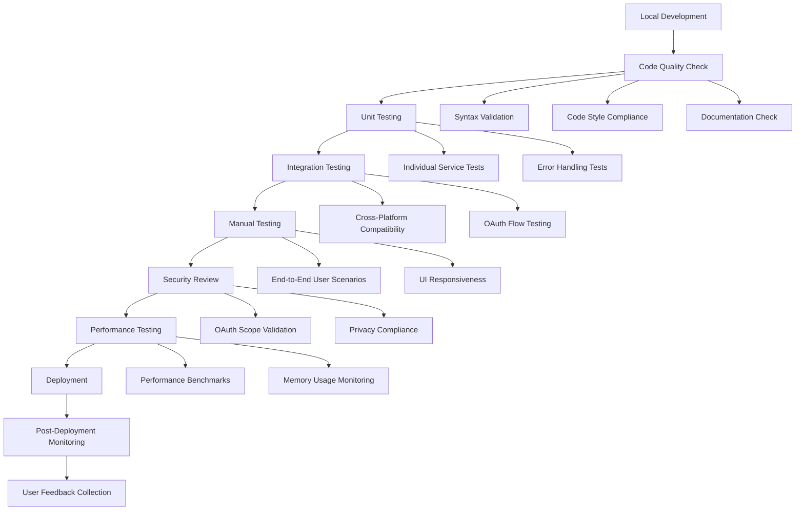

# Installation and Setup

<cite>
**Referenced Files in This Document**
- [README.md](file://README.md)
- [QUICKSTART.md](file://QUICKSTART.md)
- [ADMIN_GUIDE.md](file://ADMIN_GUIDE.md)
- [DEPLOYMENT_CHECKLIST.md](file://DEPLOYMENT_CHECKLIST.md)
- [PROJECT_SUMMARY.md](file://PROJECT_SUMMARY.md)
- [package.json](file://package.json)
- [appsscript.json](file://appsscript.json)
- [src/appsscript.json](file://src/appsscript.json)
- [src/Main.js](file://src/Main.js)
- [src/ui/Sidebar.html](file://src/ui/Sidebar.html)
</cite>

## Table of Contents
1. [Introduction](#introduction)
2. [Prerequisites](#prerequisites)
3. [User Installation](#user-installation)
4. [Administrator Deployment](#administrator-deployment)
5. [Development Environment Setup](#development-environment-setup)
6. [Configuration Files](#configuration-files)
7. [Deployment Workflow](#deployment-workflow)
8. [Common Issues and Troubleshooting](#common-issues-and-troubleshooting)
9. [Best Practices](#best-practices)

## Introduction

The Intelligent Document Automation extension is a powerful Google Workspace add-on that transforms document workflows through AI-powered automation. This comprehensive guide covers installation, setup, and deployment procedures for both end users and administrators, along with development environment configuration for contributors.

The add-on provides intelligent document analysis, privacy-first redaction, automated cleanup operations, and template management across Google Docs, Sheets, and Slides. It operates with minimal permissions and prioritizes user privacy by processing data locally by default.

## Prerequisites

### For End Users
- **Google Account**: Active Google Workspace account with access to Docs, Sheets, or Slides
- **Browser**: Modern web browser (Chrome recommended)
- **JavaScript Knowledge**: Basic understanding of web applications helpful
- **Git Familiarity**: Optional for development setup

### For Administrators
- **Google Workspace Admin Access**: Super Admin or delegated privileges
- **Domain-Wide Delegation**: Enabled for advanced deployments
- **Apps Script API Access**: Enabled in Google Cloud Console
- **OAuth Consent Screen**: Configured for domain-wide installations
- **Google Cloud Project**: Linked to Google Workspace account

### For Developers
- **Node.js**: Version 14 or higher
- **npm**: Package manager for Node.js
- **@google/clasp**: Google Apps Script CLI tool
- **Git**: Version control system
- **Text Editor**: VS Code, Sublime Text, or equivalent

**Section sources**
- [README.md](file://README.md#L46-L115)
- [ADMIN_GUIDE.md](file://ADMIN_GUIDE.md#L9-L18)

## User Installation

### Installation from Google Workspace Marketplace

The simplest way for end users to install the add-on is through the Google Workspace Marketplace:

1. **Visit Marketplace**: Navigate to [Google Workspace Marketplace](https://workspace.google.com/marketplace)
2. **Search**: Type "Intelligent Document Automation" in the search bar
3. **Install**: Click the "Install" button
4. **Grant Permissions**: Review and accept requested permissions
5. **Complete**: The add-on will be available in your Google Workspace applications

### Manual Installation for Development

For developers or users who prefer manual installation:

```bash
# Clone the repository
git clone https://github.com/AayushBhat07/intelligent-document-automation.git
cd intelligent-document-automation

# Install clasp (Google Apps Script CLI)
npm install -g @google/clasp

# Login to Google
clasp login

# Create a new Apps Script project
clasp create --type standalone --title "Intelligent Document Automation"

# Push code to Apps Script
clasp push

# Open in Apps Script editor
clasp open
```

### Permission Grants and Sidebar Initialization

Upon first installation, users will encounter the following permission prompts:

| Permission Scope | Purpose | Justification |
|------------------|---------|---------------|
| `documents.currentonly` | Access current document only | Enables document analysis and automation |
| `spreadsheets.currentonly` | Access current spreadsheet only | Allows data cleanup and formatting operations |
| `presentations.currentonly` | Access current presentation only | Supports slide analysis and template application |
| `drive.file` | Access files created by add-on | Manages template libraries and temporary files |
| `script.container.ui` | Display UI in Google apps | Shows the sidebar interface |

The sidebar initialization occurs automatically when users access the add-on through the "Add-ons" menu. The system detects the current document type and loads the appropriate interface with relevant tabs (Analyze, Redact, Clean, Templates).

**Section sources**
- [README.md](file://README.md#L46-L115)
- [src/Main.js](file://src/Main.js#L15-L35)
- [src/ui/Sidebar.html](file://src/ui/Sidebar.html#L200-L210)

## Administrator Deployment

### Prerequisites for Domain Deployment

Before deploying the add-on organization-wide, ensure the following prerequisites are met:

- **Google Workspace Admin Access**: Required for domain-wide installation
- **Apps Script API Enabled**: Must be enabled in Google Cloud Console
- **Domain-Wide Delegation**: Configured for advanced features
- **OAuth Consent Screen**: Set up with Internal user type for domain-only deployment

### Deployment Steps

#### Step 1: Create Apps Script Project

1. **Navigate to Apps Script**: Go to [script.google.com](https://script.google.com)
2. **Sign In**: Use your admin account credentials
3. **Create Project**: Click "New Project" and name it "Intelligent Document Automation"
4. **Upload Files**: Replace default files with the project structure from `src/`
5. **Add Manifest**: Configure `appsscript.json` with OAuth scopes and add-on metadata

#### Step 2: Configure Google Cloud Project

1. **Link Project**: Connect to your organization's Google Cloud Project
2. **Enable APIs**: Activate Google Docs, Sheets, Slides, and Drive APIs
3. **Configure Consent Screen**: Set up OAuth consent screen with Internal user type
4. **Verify Scopes**: Ensure all required scopes are properly configured

#### Step 3: Deploy as Add-on

Using the Apps Script editor:

1. **Create Deployment**: Click "Deploy" → "New deployment"
2. **Select Type**: Choose "Editor Add-on"
3. **Provide Description**: Enter "v1.0.0 - Production Release"
4. **Note Deployment ID**: Copy the generated deployment ID for domain installation

#### Step 4: Domain-Wide Installation

1. **Access Admin Console**: Navigate to [admin.google.com](https://admin.google.com)
2. **Go to Marketplace**: Apps → Google Workspace Marketplace apps
3. **Add App**: Click "Add app" → "Add custom app"
4. **Enter Deployment ID**: Paste your deployment ID
5. **Configure Installation**: Choose domain-wide or selective installation
6. **Review Permissions**: Verify requested scopes and accept

### Organizational Policies Configuration

Administrators can configure default settings for all users:

```javascript
// Set organization-wide defaults
function setOrganizationDefaults() {
  const scriptProps = PropertiesService.getScriptProperties();
  
  // Default date format
  scriptProps.setProperty('defaultDateFormat', 'yyyy-MM-dd');
  
  // Auto-analyze on document open
  scriptProps.setProperty('autoAnalyze', 'false');
  
  // Template library folder ID
  scriptProps.setProperty('templateFolderId', 'YOUR_FOLDER_ID');
  
  // Analytics enabled by default
  scriptProps.setProperty('defaultAnalyticsConsent', 'false');
}
```

**Section sources**
- [ADMIN_GUIDE.md](file://ADMIN_GUIDE.md#L21-L139)
- [src/appsscript.json](file://src/appsscript.json#L29-L36)

## Development Environment Setup

### Node.js and Dependencies

Ensure your development environment meets the technical requirements:

1. **Install Node.js**: Download and install Node.js version 14 or higher
2. **Install npm**: Comes bundled with Node.js installation
3. **Install clasp CLI**: Globally install the Google Apps Script CLI

```bash
# Install clasp globally
npm install -g @google/clasp

# Verify installation
clasp --version
```

### Project Cloning and Initialization

Clone the repository and set up the development environment:

```bash
# Clone the repository
git clone https://github.com/AayushBhat07/intelligent-document-automation.git
cd intelligent-document-automation

# Install project dependencies
npm install

# Login to Google
clasp login

# Create new Apps Script project
clasp create --type standalone --title "Intelligent Document Automation"

# Push initial code
clasp push
```

### Development Workflow

The development workflow involves several key commands for managing the project:

```bash
# Push changes to Apps Script
clasp push

# Watch for changes and auto-push
clasp push --watch

# View execution logs
clasp logs

# Pull remote changes
clasp pull

# Open project in browser
clasp open

# Deploy new version
clasp deploy --description "v1.0.1 - Hotfix"
```

### Testing and Validation

Before deployment, thoroughly test the add-on across all supported platforms:

- **Document Analysis**: Test in Google Docs for formatting issues and anomalies
- **Data Operations**: Verify in Google Sheets for duplicate removal and date standardization
- **Presentation Tools**: Check in Google Slides for template application and consistency checks
- **Privacy Features**: Validate PII detection and redaction functionality
- **UI Responsiveness**: Ensure sidebar interface works correctly across browsers

**Section sources**
- [QUICKSTART.md](file://QUICKSTART.md#L37-L80)
- [package.json](file://package.json#L6-L11)

## Configuration Files

### appsscript.json (Runtime Settings)

The main configuration file defines the add-on's runtime environment and capabilities:

```json
{
  "timeZone": "America/New_York",
  "dependencies": {
    "enabledAdvancedServices": [
      {
        "userSymbol": "Drive",
        "version": "v3",
        "serviceId": "drive"
      },
      {
        "userSymbol": "Sheets",
        "version": "v4",
        "serviceId": "sheets"
      },
      {
        "userSymbol": "Docs",
        "version": "v1",
        "serviceId": "docs"
      },
      {
        "userSymbol": "Slides",
        "version": "v1",
        "serviceId": "slides"
      }
    ]
  },
  "exceptionLogging": "STACKDRIVER",
  "runtimeVersion": "V8",
  "oauthScopes": [
    "https://www.googleapis.com/auth/documents.currentonly",
    "https://www.googleapis.com/auth/spreadsheets.currentonly",
    "https://www.googleapis.com/auth/presentations.currentonly",
    "https://www.googleapis.com/auth/drive.file",
    "https://www.googleapis.com/auth/script.container.ui",
    "https://www.googleapis.com/auth/userinfo.email"
  ],
  "addOns": {
    "common": {
      "name": "Intelligent Document Automation",
      "logoUrl": "https://www.gstatic.com/images/branding/product/1x/apps_script_48dp.png",
      "layoutProperties": {
        "primaryColor": "#4285f4"
      },
      "useLocaleFromApp": true
    }
  }
}
```

### package.json (Deployment Scripts)

The NPM configuration file manages development dependencies and deployment scripts:

```json
{
  "name": "intelligent-document-automation",
  "version": "1.0.0",
  "description": "🚀 Smart automation for Google Workspace",
  "main": "src/Main.js",
  "scripts": {
    "push": "clasp push",
    "deploy": "clasp deploy",
    "open": "clasp open",
    "login": "clasp login"
  },
  "devDependencies": {
    "@google/clasp": "^2.4.2",
    "@types/google-apps-script": "^1.0.83"
  }
}
```

### .clasp.json (Project ID Mapping)

This hidden file stores the mapping between your local development environment and the remote Apps Script project:

```json
{
  "scriptId": "YOUR_SCRIPT_ID_HERE",
  "rootDir": "./src",
  "projectId": "",
  "fileExtension": ".gs"
}
```

### Configuration File Purposes

| File | Purpose | Key Features |
|------|---------|--------------|
| `appsscript.json` | Runtime configuration | OAuth scopes, API dependencies, add-on metadata |
| `package.json` | Development dependencies | NPM scripts, dev dependencies, project metadata |
| `.clasp.json` | Project mapping | Script ID, root directory, file extensions |

**Section sources**
- [appsscript.json](file://appsscript.json#L1-L7)
- [src/appsscript.json](file://src/appsscript.json#L1-L47)
- [package.json](file://package.json#L1-L25)

## Deployment Workflow

### Local Development to Production

The deployment workflow ensures code quality and proper testing before production release:



**Diagram sources**
- [DEPLOYMENT_CHECKLIST.md](file://DEPLOYMENT_CHECKLIST.md#L50-L109)

### Syncing Local Code with Apps Script Server

Maintain synchronization between local development and remote Apps Script projects:

```bash
# Push local changes to server
clasp push

# Pull remote changes to local
clasp pull

# Watch for changes and auto-sync
clasp push --watch

# View deployment history
clasp deployments

# Create new deployment
clasp deploy --description "v1.0.1 - Feature Release"
```

### Version Management

Implement semantic versioning for organized releases:

- **Major versions** (1.0.0 → 2.0.0): Breaking changes requiring user action
- **Minor versions** (1.0.0 → 1.1.0): New features and enhancements
- **Patch versions** (1.0.0 → 1.0.1): Bug fixes and minor improvements

**Section sources**
- [DEPLOYMENT_CHECKLIST.md](file://DEPLOYMENT_CHECKLIST.md#L50-L109)
- [QUICKSTART.md](file://QUICKSTART.md#L64-L78)

## Common Issues and Troubleshooting

### Permission Errors

**Issue**: "Authorization required" or permission denied errors

**Solutions**:
1. **Re-authorize**: Click "Authorize" in the add-on and grant requested permissions
2. **Check Account**: Ensure you're signed in with the correct Google account
3. **Admin Policies**: Verify domain policies aren't blocking add-on installation
4. **Clear Cache**: Clear browser cache and cookies, then refresh the page

### Deployment Conflicts

**Issue**: "Script ID already exists" or deployment conflicts

**Solutions**:
1. **Delete Existing**: Remove conflicting deployments in Apps Script editor
2. **Create New Project**: Generate a fresh Apps Script project
3. **Check Permissions**: Verify you have write access to the project
4. **Sync Locally**: Run `clasp pull` to sync with existing project

### Manifest Configuration Problems

**Issue**: OAuth scopes not working or add-on not appearing

**Solutions**:
1. **Validate JSON**: Check `appsscript.json` syntax and structure
2. **Scope Alignment**: Ensure scopes match actual API usage
3. **Cloud Project**: Verify Google Cloud project is properly linked
4. **Consent Screen**: Confirm OAuth consent screen is configured correctly

### Performance Issues

**Issue**: Operations timing out or taking too long

**Solutions**:
1. **Reduce Document Size**: Process smaller selections or documents
2. **Check Internet**: Ensure stable internet connection
3. **Optimize Code**: Review batch processing and memory usage
4. **Upgrade Quotas**: Consider Google Workspace Enterprise for higher limits

### Sidebar and UI Issues

**Issue**: Sidebar not loading or interface not responding

**Solutions**:
1. **Refresh Page**: Close and reopen the document
2. **Check Menu**: Verify add-on appears in "Add-ons" menu
3. **Browser Compatibility**: Try a different browser or update current one
4. **Clear Storage**: Clear browser storage and cookies

**Section sources**
- [README.md](file://README.md#L223-L250)
- [ADMIN_GUIDE.md](file://ADMIN_GUIDE.md#L277-L300)

## Best Practices

### Security and Privacy

1. **Minimal Permissions**: Request only necessary OAuth scopes
2. **Local Processing**: Process sensitive data locally when possible
3. **User Consent**: Implement clear consent mechanisms for advanced features
4. **Audit Logging**: Maintain comprehensive audit trails for compliance

### Development Standards

1. **Code Organization**: Follow modular architecture with clear separation of concerns
2. **Error Handling**: Implement comprehensive error handling and user feedback
3. **Documentation**: Maintain up-to-date inline comments and external documentation
4. **Testing**: Thoroughly test across all supported platforms and document types

### Deployment Guidelines

1. **Staged Rollouts**: Deploy to small user groups before full organization-wide rollout
2. **Monitoring**: Set up error monitoring and usage analytics
3. **Backup Plans**: Maintain rollback procedures for emergency situations
4. **User Communication**: Provide clear instructions and support channels

### Performance Optimization

1. **Batch Processing**: Implement efficient batch operations for large datasets
2. **Caching**: Utilize caching mechanisms for frequently accessed data
3. **Timeout Handling**: Implement proper timeout and retry logic
4. **Resource Management**: Monitor memory usage and optimize resource consumption

**Section sources**
- [PROJECT_SUMMARY.md](file://PROJECT_SUMMARY.md#L137-L154)
- [ADMIN_GUIDE.md](file://ADMIN_GUIDE.md#L205-L241)