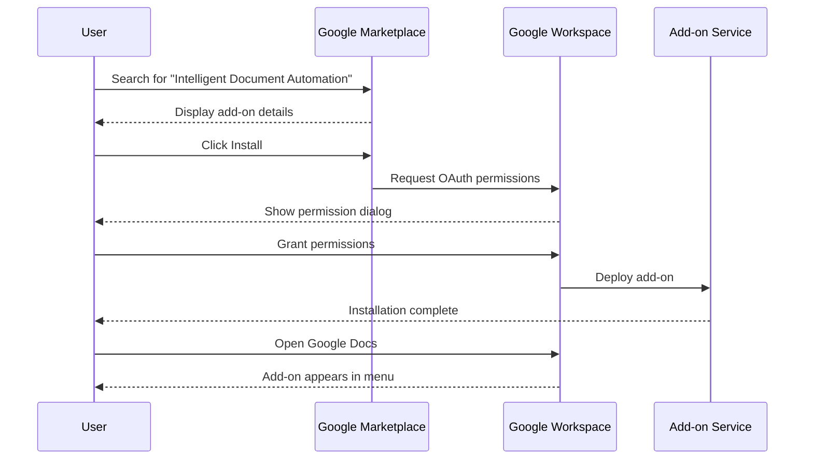

# User Installation

<cite>
**Referenced Files in This Document**
- [README.md](file://README.md)
- [QUICKSTART.md](file://QUICKSTART.md)
- [ADMIN_GUIDE.md](file://ADMIN_GUIDE.md)
- [PROJECT_SUMMARY.md](file://PROJECT_SUMMARY.md)
- [appsscript.json](file://appsscript.json)
- [src/Main.js](file://src/Main.js)
- [src/ui/Sidebar.html](file://src/ui/Sidebar.html)
- [src/handlers/SidebarHandlers.js](file://src/handlers/SidebarHandlers.js)
</cite>

## Table of Contents
1. [Introduction](#introduction)
2. [Prerequisites](#prerequisites)
3. [Installation Methods](#installation-methods)
4. [Step-by-Step Installation Guide](#step-by-step-installation-guide)
5. [Post-Installation Setup](#post-installation-setup)
6. [Understanding OAuth Scopes](#understanding-oauth-scopes)
7. [Common Installation Issues](#common-installation-issues)
8. [Browser Compatibility](#browser-compatibility)
9. [First-Time User Guide](#first-time-user-guide)
10. [Troubleshooting Tips](#troubleshooting-tips)

## Introduction

The Intelligent Document Automation Google Workspace Add-on transforms your document workflow with AI-powered intelligence while maintaining strict privacy standards. This comprehensive guide walks you through the complete installation process for end users, covering everything from initial setup to first-time usage scenarios.

The add-on provides automated solutions for repetitive tasks across Google Docs, Sheets, and Slides, including document analysis, PII redaction, data cleanup, and template application—all while respecting your privacy with local processing by default.

## Prerequisites

Before installing the add-on, ensure you have:

- **Google Workspace Account**: Active Google Workspace subscription
- **Supported Browser**: Chrome, Firefox, Safari, or Edge
- **Internet Connection**: Stable connection for initial setup and updates
- **Permissions**: Ability to install add-ons in your Google Workspace environment
- **Document Access**: Permission to access and modify documents in Google Drive

## Installation Methods

There are two primary installation methods available for end users:

### Method 1: Google Workspace Marketplace (Recommended)

The easiest and most straightforward installation method for most users.

### Method 2: Manual Installation (Development/Testing)

For developers or users who need to install from source code.

```mermaid
flowchart TD
Start([Begin Installation]) --> Choice{Choose Installation Method}
Choice --> |Marketplace| Marketplace[Google Workspace Marketplace]
Choice --> |Manual| Manual[Manual Installation]
Marketplace --> Search[Search for "Intelligent Document Automation"]
Search --> Install[Click Install]
Install --> Authorize[Grant Permissions]
Authorize --> Complete[Installation Complete]
Manual --> Clone[Clone Repository]
Clone --> Setup[Setup Development Environment]
Setup --> Deploy[Deploy to Apps Script]
Deploy --> Complete
Complete --> PostInstall[Post-Installation Steps]
```

**Section sources**
- [README.md](file://README.md#L46-L73)
- [QUICKSTART.md](file://QUICKSTART.md#L11-L18)

## Step-by-Step Installation Guide

### Step 1: Access Google Workspace Marketplace

1. **Open Google Workspace Marketplace**
   - Visit [Google Workspace Marketplace](https://workspace.google.com/marketplace)
   - Sign in with your Google Workspace account

2. **Search for the Add-on**
   - Use the search bar to find "Intelligent Document Automation"
   - Verify the official publisher and description match

### Step 2: Install the Add-on

1. **Click the Install Button**
   - Locate the add-on in search results
   - Click the "Install" button
   - Review the installation details

2. **Grant Required Permissions**
   - The add-on will request specific OAuth scopes
   - Review the permissions carefully
   - Click "Allow" to grant access

### Step 3: Verify Installation

1. **Check Your Google Workspace Apps**
   - Open Google Docs, Sheets, or Slides
   - Navigate to the "Add-ons" menu
   - Look for "Intelligent Document Automation"

2. **Initial Authorization**
   - First-time users may see an authorization prompt
   - Follow the on-screen instructions to complete setup



**Diagram sources**
- [README.md](file://README.md#L48-L51)
- [src/Main.js](file://src/Main.js#L10-L12)

**Section sources**
- [README.md](file://README.md#L48-L51)
- [QUICKSTART.md](file://QUICKSTART.md#L11-L18)

## Post-Installation Setup

### Refresh Your Document

After installation, refresh your Google Workspace document to ensure the add-on appears in the menu:

1. **Refresh the Page**
   - Press F5 or Command+R (Mac) / Ctrl+R (Windows)
   - Alternatively, close and reopen the document

2. **Verify Menu Appearance**
   - Open any Google Doc, Sheet, or Slide
   - Check the "Add-ons" menu for the new option

### Open the Sidebar

Access the main interface by following these steps:

1. **Navigate to Add-ons Menu**
   - Click "Add-ons" in the top menu
   - Select "Intelligent Document Automation"
   - Choose "Open Smart Automation"

2. **Sidebar Interface**
   - The sidebar will appear on the right side of your document
   - You'll see four main tabs: Analyze, Redact, Clean, Templates

### Initial Configuration

Upon first opening, the add-on performs automatic analysis:

- **Document Analysis**: The add-on automatically scans your document for issues
- **Suggestions Display**: Detected problems appear in the Analyze tab
- **Privacy Settings**: Review consent preferences in the sidebar

**Section sources**
- [README.md](file://README.md#L118-L122)
- [QUICKSTART.md](file://QUICKSTART.md#L21-L32)

## Understanding OAuth Scopes

The Intelligent Document Automation add-on requests minimal OAuth scopes to function effectively while maintaining user privacy. Here's a detailed breakdown of each permission:

| Scope | Purpose | Risk Level | Justification |
|-------|---------|------------|---------------|
| `documents.currentonly` | Access current document only | Low | Required for document analysis and modifications |
| `spreadsheets.currentonly` | Access current spreadsheet only | Low | Needed for data cleaning and formatting operations |
| `presentations.currentonly` | Access current presentation only | Low | Enables slide analysis and template application |
| `drive.file` | Access files created or opened by the add-on | Low | Allows template sharing and file management |
| `script.container.ui` | Display UI inside Google apps | Minimal | Essential for the sidebar interface |

### Scope Details Explained

**documents.currentonly**: This scope grants read and write access specifically to the currently active Google Doc. It ensures the add-on can analyze and modify your document without accessing other files in your Google Drive.

**spreadsheets.currentonly**: Provides access to the current spreadsheet for data cleaning operations like removing duplicates, standardizing formats, and filling empty cells.

**presentations.currentonly**: Enables the add-on to work with Google Slides for presentation analysis and template application.

**drive.file**: Allows the add-on to access files it creates or modifies, primarily for template sharing functionality.

**script.container.ui**: This minimal scope enables the add-on to display its user interface within Google Workspace applications.

### Privacy Assurance

The add-on implements a privacy-first approach:
- **Local Processing**: All document analysis occurs within Google's secure environment
- **No External Transmission**: Document content never leaves Google's servers
- **Explicit Consent**: Advanced features require user approval
- **Revocable Permissions**: Users can revoke access at any time

**Section sources**
- [README.md](file://README.md#L89-L96)
- [ADMIN_GUIDE.md](file://ADMIN_GUIDE.md#L207-L216)
- [PROJECT_SUMMARY.md](file://PROJECT_SUMMARY.md#L146-L152)

## Common Installation Issues

### Issue 1: Add-on Not Appearing in Menu

**Symptoms**: The add-on doesn't show up in the "Add-ons" menu after installation

**Solutions**:
1. **Refresh the Page**: Press F5 or Command+R / Ctrl+R
2. **Check Document Type**: Ensure you're in Google Docs, Sheets, or Slides (not Drive)
3. **Sign Out and Back In**: Log out of Google and sign back in
4. **Clear Browser Cache**: Clear your browser's cache and cookies
5. **Try Different Browser**: Test with another supported browser

### Issue 2: "Authorization Required" Prompt

**Symptoms**: Seeing authorization prompts or permission errors

**Solutions**:
1. **Grant Permissions**: Click "Authorize" and follow the prompts
2. **Check Account**: Ensure you're using the correct Google account
3. **Admin Restrictions**: Contact your administrator if domain policies block add-ons
4. **Browser Settings**: Verify pop-ups are allowed for Google Workspace

### Issue 3: Installation Fails or Times Out

**Symptoms**: Installation process hangs or fails

**Solutions**:
1. **Check Internet Connection**: Ensure stable connectivity
2. **Wait for Propagation**: Installation may take up to 10 minutes
3. **Retry Installation**: Attempt installation again after waiting
4. **Contact Support**: Reach out if issues persist

### Issue 4: Add-on Appears but Doesn't Work

**Symptoms**: Add-on shows in menu but operations fail

**Solutions**:
1. **Refresh Document**: Close and reopen the document
2. **Check Permissions**: Verify all required scopes are granted
3. **Update Add-on**: Check for available updates
4. **Test with Sample Document**: Try with a new, empty document

**Section sources**
- [README.md](file://README.md#L226-L246)
- [QUICKSTART.md](file://QUICKSTART.md#L164-L185)

## Browser Compatibility

The Intelligent Document Automation add-on works optimally with modern browsers:

### Recommended Browsers
- **Chrome**: Latest version (recommended)
- **Firefox**: Latest version
- **Safari**: Latest version (macOS/iOS)
- **Edge**: Latest version

### Minimum Requirements
- **JavaScript Enabled**: Ensure JavaScript is enabled in your browser
- **Cookies Allowed**: Cookie support is required for authentication
- **Pop-up Blocked**: Allow pop-ups for Google Workspace applications
- **HTTPS Connection**: Secure connection required for OAuth authentication

### Browser-Specific Considerations

**Chrome**: Best performance and full feature support
**Firefox**: Excellent compatibility with minor UI differences
**Safari**: Good compatibility, occasional layout adjustments
**Edge**: Modern Chromium-based Edge provides optimal experience

### Troubleshooting Browser Issues

1. **Update Browser**: Ensure you're using the latest browser version
2. **Disable Extensions**: Temporarily disable browser extensions that might interfere
3. **Incognito Mode**: Try incognito/private browsing mode
4. **Clear Cache**: Perform a complete browser cache clearing

**Section sources**
- [PROJECT_SUMMARY.md](file://PROJECT_SUMMARY.md#L192)

## First-Time User Guide

### Quick Start Tutorial

Follow this step-by-step guide for your first experience with the add-on:

#### Step 1: Open Your Document
1. Open any Google Doc, Sheet, or Slide
2. Wait for the add-on to automatically analyze the document

#### Step 2: Explore the Sidebar
1. Click "Add-ons" → "Intelligent Document Automation" → "Open Smart Automation"
2. The sidebar opens with real-time analysis results
3. Review detected issues and suggestions

#### Step 3: Run Your First Analysis
1. Click the "📊 Analyze" tab
2. Click "🔍 Analyze Document"
3. Review the suggested improvements
4. Click individual suggestions to apply fixes

#### Step 4: Try a Quick Action
1. Go to the "✨ Clean" tab
2. Click "🗑️ Remove Duplicates" (in Sheets)
3. See instant results!

### Practical Examples

**Example 1: Document Analysis**
- Open a research paper in Google Docs
- Click "Analyze Document"
- Review formatting inconsistencies
- Apply suggested fixes for improved readability

**Example 2: Data Cleaning**
- Open a spreadsheet with customer data
- Use "Remove Duplicates" to clean up entries
- Standardize date formats with "Standardize Dates"
- Fill empty cells with relevant data

**Example 3: Privacy Protection**
- Open a document containing sensitive information
- Click "🔒 Redact" tab
- Click "🔍 Detect PII" to find sensitive data
- Review and redact personal information

### Getting Started Checklist

- [ ] Install the add-on from Google Workspace Marketplace
- [ ] Refresh your document to see the add-on in the menu
- [ ] Open the sidebar and run your first analysis
- [ ] Try at least one cleanup operation
- [ ] Review privacy settings and consent preferences

**Section sources**
- [QUICKSTART.md](file://QUICKSTART.md#L19-L32)
- [README.md](file://README.md#L124-L150)

## Troubleshooting Tips

### General Troubleshooting Approach

1. **Systematic Problem Solving**
   - Identify the specific issue
   - Check prerequisites and requirements
   - Try basic solutions first

2. **Information Gathering**
   - Note error messages and codes
   - Check browser console for JavaScript errors
   - Verify document type and permissions

3. **Resolution Steps**
   - Apply basic fixes (refresh, restart)
   - Check settings and configurations
   - Seek specialized help if needed

### Advanced Troubleshooting

#### Performance Issues
- **Large Documents**: Process in smaller sections
- **Slow Operations**: Check internet connection
- **Timeout Errors**: Reduce document size or selection

#### Permission Problems
- **Access Denied**: Verify Google Workspace account permissions
- **Scope Issues**: Reinstall add-on to reset permissions
- **Domain Policies**: Contact administrator for restrictions

#### Technical Issues
- **JavaScript Errors**: Update browser or try incognito mode
- **Network Problems**: Check firewall and proxy settings
- **Storage Issues**: Clear browser cache and cookies

### When to Contact Support

Contact support when you encounter:
- Persistent installation failures
- Critical functionality issues
- Security or privacy concerns
- Administrative restrictions
- Performance problems affecting productivity

### Support Resources

- **Documentation**: [GitHub Wiki](https://github.com/AayushBhat07/intelligent-document-automation/wiki)
- **Bug Reports**: [GitHub Issues](https://github.com/AayushBhat07/intelligent-document-automation/issues)
- **Community**: [GitHub Discussions](https://github.com/AayushBhat07/intelligent-document-automation/discussions)
- **Email**: support@example.com

**Section sources**
- [README.md](file://README.md#L247-L253)
- [QUICKSTART.md](file://QUICKSTART.md#L186-L194)