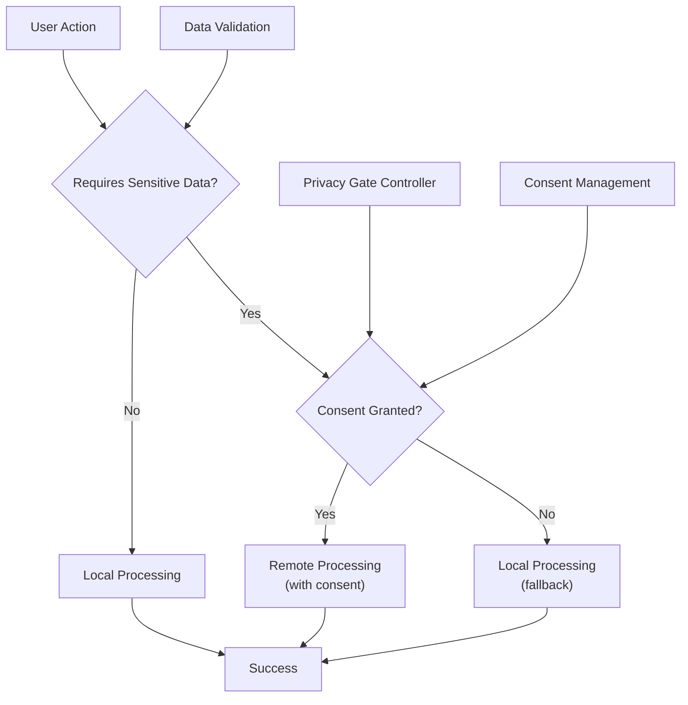
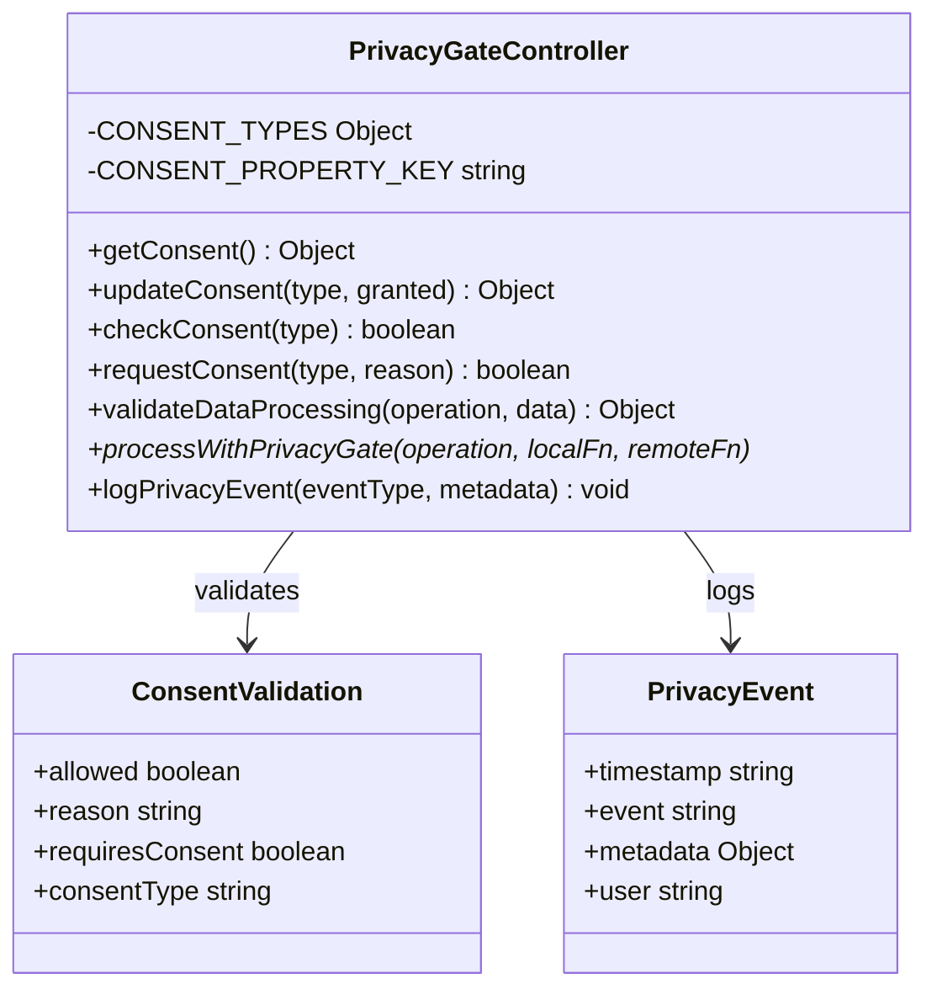
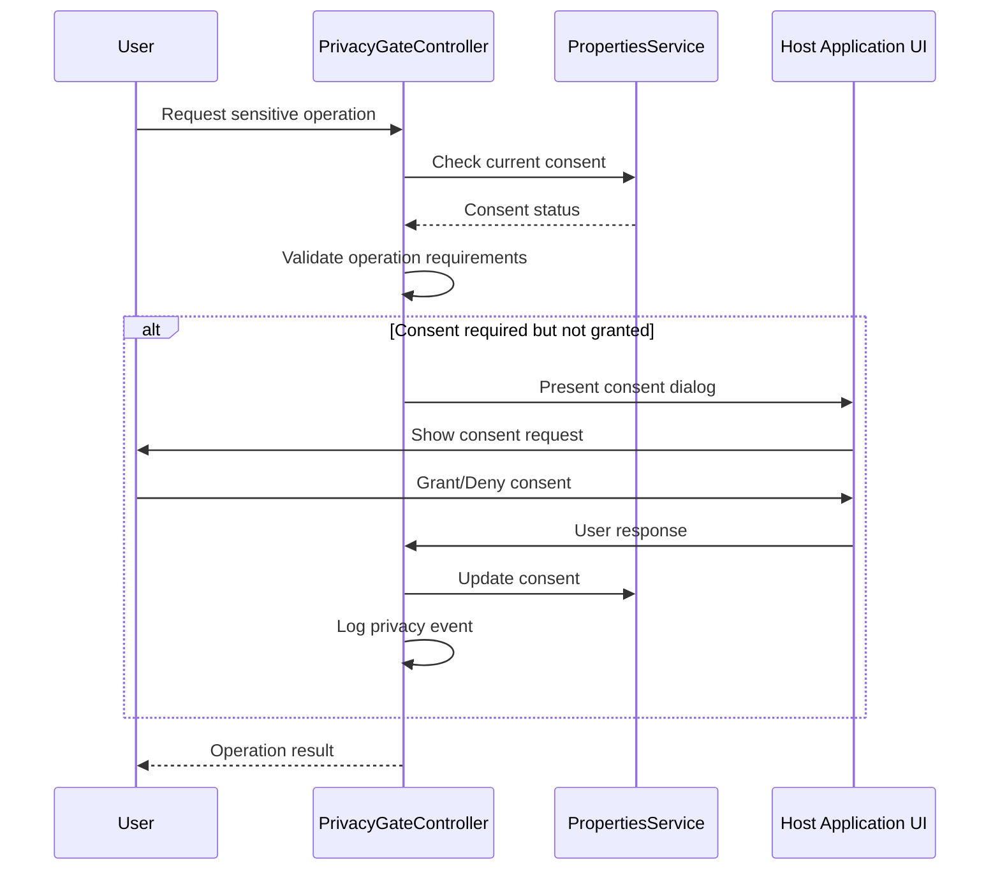
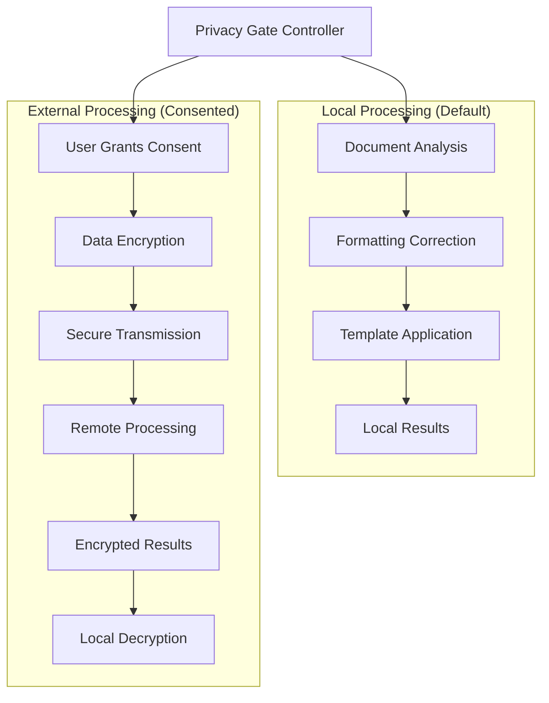
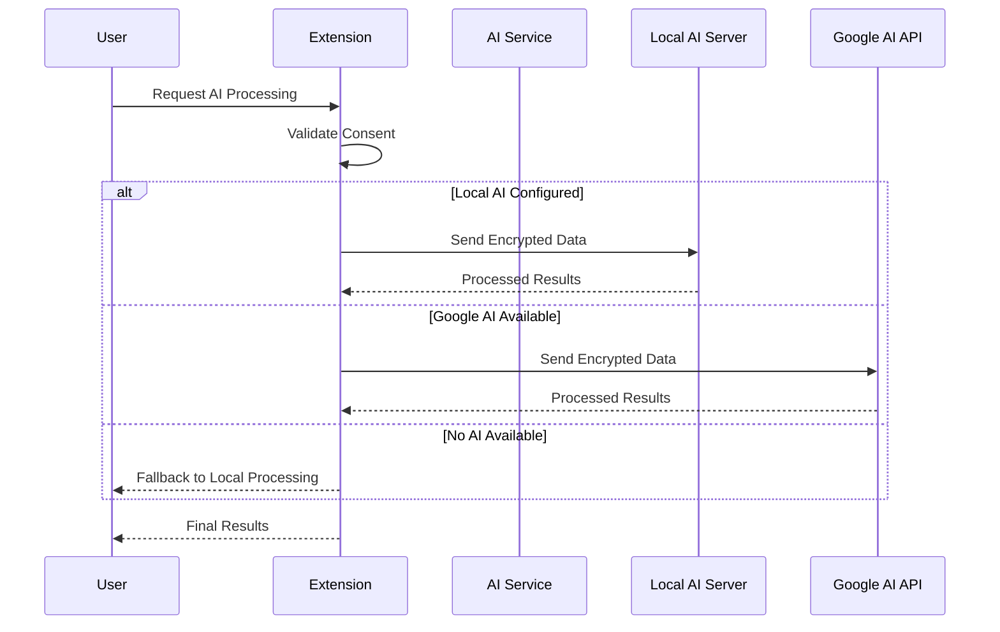

# Privacy and Security

<cite>
**Referenced Files in This Document**
- [PrivacyGateController.js](file://src/services/PrivacyGateController.js)
- [AnalyticsService.js](file://src/services/AnalyticsService.js)
- [RedactionService.js](file://src/services/RedactionService.js)
- [LocalAIService.js](file://src/services/LocalAIService.js)
- [OllamaAIService.js](file://src/services/OllamaAIService.js)
- [DocumentAnalysisEngine.js](file://src/services/DocumentAnalysisEngine.js)
- [Main.js](file://src/Main.js)
- [ADMIN_GUIDE.md](file://ADMIN_GUIDE.md)
- [Utils.js](file://src/utils/Utils.js)
</cite>

## Table of Contents
1. [Introduction](#introduction)
2. [Privacy-First Design Philosophy](#privacy-first-design-philosophy)
3. [PrivacyGateController Architecture](#privacygatecontroller-architecture)
4. [Consent Management System](#consent-management-system)
5. [Local-First Processing Model](#local-first-processing-model)
6. [Minimal OAuth Scopes](#minimal-oauth-scopes)
7. [Data Processing and Encryption](#data-processing-and-encryption)
8. [External AI Processing](#external-ai-processing)
9. [Audit Logging and Compliance](#audit-logging-and-compliance)
10. [Enterprise Deployment Security](#enterprise-deployment-security)
11. [Administrator Configuration](#administrator-configuration)
12. [Data Retention Policies](#data-retention-policies)
13. [Troubleshooting and Support](#troubleshooting-and-support)

## Introduction

The Techno Browser extension implements a comprehensive privacy-first architecture designed to protect user data while delivering powerful document automation capabilities. Built on Google Workspace's security foundation, the extension prioritizes local processing, user consent, and minimal data collection through a sophisticated privacy enforcement system.

This document covers the extension's privacy and security architecture, including consent management, data processing models, encryption practices, and enterprise deployment considerations. The system ensures compliance with modern privacy regulations while maintaining functionality and user experience.

## Privacy-First Design Philosophy

The extension follows a strict privacy-first approach where user data remains within Google's ecosystem by default. All sensitive operations require explicit user consent, and the system provides granular control over data processing preferences.

### Core Principles

- **Local-First Processing**: All operations occur within Google Workspace's secure environment
- **Explicit Consent**: Users must actively grant permission for sensitive features
- **Minimal Data Collection**: Only anonymous usage statistics are collected with explicit consent
- **Transparent Operations**: Users can audit and understand what data is processed
- **User Control**: Complete revocation capability for any consent granted



**Diagram sources**
- [PrivacyGateController.js](file://src/services/PrivacyGateController.js#L222-L236)
- [AnalyticsService.js](file://src/services/AnalyticsService.js#L16-L41)

## PrivacyGateController Architecture

The PrivacyGateController serves as the central authority for privacy enforcement, managing user consent, validating data processing requests, and ensuring compliance with privacy policies.

### Consent Types and Management

The system defines five distinct consent categories:

| Consent Type | Purpose | Default State | User Control |
|--------------|---------|---------------|--------------|
| BASIC | Core functionality | Enabled | Cannot disable |
| ADVANCED_AI | External AI processing | Disabled | Revocable |
| REDACTION | PII detection/redaction | Enabled | Revocable |
| ANALYTICS | Usage statistics | Disabled | Revocable |
| TEMPLATE_SHARING | Shared template access | Disabled | Revocable |

### Privacy Gate Enforcement

The PrivacyGateController implements a two-tier validation system:

1. **Operation Validation**: Maps operations to required consent types
2. **Data Processing Validation**: Ensures compliance with user preferences



**Diagram sources**
- [PrivacyGateController.js](file://src/services/PrivacyGateController.js#L8-L15)
- [PrivacyGateController.js](file://src/services/PrivacyGateController.js#L175-L212)

**Section sources**
- [PrivacyGateController.js](file://src/services/PrivacyGateController.js#L1-L366)

## Consent Management System

The consent management system provides users with granular control over data processing preferences through an intuitive interface and persistent storage mechanism.

### Consent Storage and Retrieval

Consent settings are stored securely using Google Apps Script's PropertiesService, ensuring persistence across sessions while maintaining isolation between users.

### Consent Request Workflow

When sensitive operations require user consent, the system presents a standardized dialog explaining:
- The specific feature requiring consent
- The data processing involved
- Security measures in place
- User rights and revocation options

### Consent Validation Process



**Diagram sources**
- [PrivacyGateController.js](file://src/services/PrivacyGateController.js#L89-L147)

**Section sources**
- [PrivacyGateController.js](file://src/services/PrivacyGateController.js#L18-L147)

## Local-First Processing Model

The extension prioritizes local processing to minimize data exposure and ensure compliance with privacy requirements. All core functionality operates within Google Workspace's secure environment.

### Supported Document Types

The system handles three primary document types with specialized processing:

- **Google Docs**: Text-based document analysis with formatting detection
- **Google Sheets**: Spreadsheet analysis with data quality validation
- **Google Slides**: Presentation analysis with consistency checking

### Local Processing Capabilities

Core operations include:
- Document formatting analysis and correction
- Data quality assessment
- Template application and management
- Automation rule processing

### Privacy Guarantees

Local processing ensures:
- Document content never leaves Google's infrastructure
- No external API calls for basic functionality
- Immediate data processing without network transmission
- Real-time user feedback on operations

**Section sources**
- [DocumentAnalysisEngine.js](file://src/services/DocumentAnalysisEngine.js#L1-L739)
- [RedactionService.js](file://src/services/RedactionService.js#L1-L402)

## Minimal OAuth Scopes

The extension requests only essential OAuth scopes necessary for core functionality, ensuring minimal privilege and maximum security.

### Requested Scopes and Justifications

| Scope | Purpose | Risk Level | Justification |
|-------|---------|------------|---------------|
| `documents.currentonly` | Read/write current document | Low | Single document access only |
| `spreadsheets.currentonly` | Read/write current spreadsheet | Low | Single sheet access only |
| `presentations.currentonly` | Read/write current presentation | Low | Single presentation access only |
| `drive.file` | Access add-on created files | Low | Limited to add-on context |
| `script.container.ui` | Display sidebar interface | Minimal | UI functionality only |

### Scope Implementation

The OAuth scopes are implemented with strict boundaries:
- **Document Isolation**: Access limited to currently active documents
- **Temporary Access**: Scopes revoked when documents are closed
- **Context Awareness**: Operations restricted to add-on context
- **Audit Trail**: All scope usage logged for transparency

**Section sources**
- [ADMIN_GUIDE.md](file://ADMIN_GUIDE.md#L109-L217)

## Data Processing and Encryption

The extension implements robust data protection measures for scenarios requiring external processing or storage.

### Data Transmission Security

When external processing is required (with user consent), the system employs industry-standard security measures:

- **TLS 1.3 Encryption**: All external communications use strongest encryption
- **End-to-End Protection**: Data encrypted in transit and decrypted upon arrival
- **Secure Channels**: Communication only through verified endpoints
- **Certificate Validation**: SSL/TLS certificate verification

### Data Processing Locations



**Diagram sources**
- [PrivacyGateController.js](file://src/services/PrivacyGateController.js#L222-L236)
- [LocalAIService.js](file://src/services/LocalAIService.js#L1-L267)

### Data Sanitization

For analytics and debugging purposes, the system implements comprehensive data sanitization:

- **PII Removal**: Personal identifiers stripped from metadata
- **Content Filtering**: Document content never included in analytics
- **Anonymization**: User identification replaced with session tokens
- **Whitelist Validation**: Only approved metadata fields retained

**Section sources**
- [AnalyticsService.js](file://src/services/AnalyticsService.js#L25-L41)
- [AnalyticsService.js](file://src/services/AnalyticsService.js#L233-L254)

## External AI Processing

The extension supports optional external AI processing through configurable AI services, with strict privacy controls and user consent requirements.

### Local AI Service Integration

The LocalAIService enables private AI processing through locally hosted models:

- **ngrok Integration**: Secure tunneling for local development
- **Model Flexibility**: Support for various transformer models
- **On-Premises Processing**: Complete data isolation
- **Performance Optimization**: Local hardware utilization

### Google AI Studio Integration

The OllamaAIService provides access to Google's generative AI models:

- **Gemini API Access**: Through Google AI Studio
- **API Key Management**: Secure credential storage
- **Rate Limiting**: Built-in throttling for reliability
- **Error Handling**: Graceful degradation on failures

### AI Processing Workflow



**Diagram sources**
- [LocalAIService.js](file://src/services/LocalAIService.js#L70-L165)
- [OllamaAIService.js](file://src/services/OllamaAIService.js#L54-L150)

### AI Data Protection

Both AI processing methods implement strict data protection:
- **No Data Storage**: Results processed and discarded immediately
- **Encrypted Transmission**: All data encrypted in transit
- **User Control**: Explicit consent required for each AI operation
- **Transparency**: Users informed of processing methods

**Section sources**
- [LocalAIService.js](file://src/services/LocalAIService.js#L1-L267)
- [OllamaAIService.js](file://src/services/OllamaAIService.js#L1-L189)

## Audit Logging and Compliance

The extension maintains comprehensive audit trails for privacy and compliance purposes, enabling administrators to monitor usage and ensure regulatory compliance.

### Privacy Event Logging

The system logs all privacy-relevant events with detailed metadata:

- **Event Timestamps**: ISO 8601 formatted timestamps
- **User Identification**: Session-based user tracking
- **Operation Details**: Specific actions and parameters
- **Consent Changes**: All consent modifications tracked

### Analytics Data Protection

Usage analytics operate under strict privacy controls:

- **Anonymous Collection**: No personally identifiable information
- **Local Storage**: Data stored locally with user consent
- **Minimal Metadata**: Only functional usage data collected
- **User Control**: Complete opt-out capability

### Compliance Features

The system supports enterprise compliance requirements:

- **Data Deletion**: User-requested data removal capability
- **Export Functionality**: Structured data export for compliance
- **Audit Trails**: Complete operational history maintenance
- **Privacy Policy**: Comprehensive privacy statement provision

**Section sources**
- [PrivacyGateController.js](file://src/services/PrivacyGateController.js#L297-L315)
- [AnalyticsService.js](file://src/services/AnalyticsService.js#L1-L395)

## Enterprise Deployment Security

The extension provides comprehensive security features for enterprise environments, ensuring safe deployment and operation across organizational networks.

### Domain-Wide Installation

Administrators can deploy the extension across entire organizations or specific groups:

- **Domain Installation**: All users receive the add-on automatically
- **Organizational Unit Targeting**: Department-specific deployment
- **Group-Based Installation**: Team or project-specific access
- **Gradual Rollout**: Phased deployment capabilities

### Security Configuration

Enterprise security requirements are addressed through:

- **OAuth Consent Management**: Centralized approval processes
- **Network Restrictions**: Compatibility with corporate firewalls
- **Data Governance**: Integration with existing data policies
- **Access Controls**: Role-based functionality restrictions

### Administrative Controls

Administrators can configure privacy defaults and monitoring:

```javascript
// Example administrative configuration
function setEnterpriseDefaults() {
  // Disable advanced features by default
  PropertiesService.getScriptProperties()
    .setProperty('defaultAdvancedAI', 'false');
  
  // Enable redaction for compliance
  PropertiesService.getScriptProperties()
    .setProperty('defaultRedaction', 'true');
  
  // Configure audit logging
  PropertiesService.getScriptProperties()
    .setProperty('auditLogging', 'true');
}
```

**Section sources**
- [ADMIN_GUIDE.md](file://ADMIN_GUIDE.md#L143-L217)

## Administrator Configuration

System administrators can configure privacy settings organization-wide through Google Apps Script properties, ensuring consistent privacy policies across the organization.

### Organization-Wide Defaults

Administrators can set default privacy preferences:

```javascript
function setOrganizationDefaults() {
  const scriptProps = PropertiesService.getScriptProperties();
  
  // Default date format
  scriptProps.setProperty('defaultDateFormat', 'yyyy-MM-dd');
  
  // Auto-analyze on document open
  scriptProps.setProperty('autoAnalyze', 'false');
  
  // Analytics enabled by default
  scriptProps.setProperty('defaultAnalyticsConsent', 'false');
}
```

### Privacy Policy Configuration

Administrators can customize privacy policies:

```javascript
function setPrivacyDefaults() {
  const scriptProps = PropertiesService.getScriptProperties();
  
  // Disable advanced AI by default
  scriptProps.setProperty('defaultAdvancedAI', 'false');
  
  // Enable redaction by default
  scriptProps.setProperty('defaultRedaction', 'true');
  
  // Privacy policy URL
  scriptProps.setProperty('privacyPolicyUrl', 'https://yourorg.com/privacy');
}
```

### Template Library Management

Administrators can configure shared template libraries:

1. **Create Shared Folder**: Establish organization-wide template repository
2. **Configure Access**: Set appropriate sharing permissions
3. **Integration Setup**: Link templates to the extension
4. **Monitoring**: Track template usage and effectiveness

**Section sources**
- [ADMIN_GUIDE.md](file://ADMIN_GUIDE.md#L143-L217)

## Data Retention Policies

The extension implements clear data retention policies aligned with privacy best practices and regulatory requirements.

### Local Data Retention

Data stored locally on user devices follows these retention principles:

- **Temporary Storage**: Data maintained only as long as needed
- **Automatic Cleanup**: Old entries removed based on age criteria
- **User Control**: Users can manually delete stored data
- **Minimal Footprint**: Storage requirements kept to absolute minimum

### Analytics Data Management

Usage analytics data retention follows privacy-by-design principles:

- **Limited Duration**: Events stored for configurable periods
- **Automatic Purging**: Old data automatically removed
- **User Export**: Ability to export data before purging
- **Compliance Ready**: Supports data minimization requirements

### Data Deletion Procedures

Users can request complete data deletion through multiple channels:

1. **Consent Revocation**: Revoke all consents to delete associated data
2. **Manual Deletion**: Direct data removal through settings
3. **Administrative Deletion**: Organization-wide data cleanup
4. **Export and Destroy**: Data export followed by secure deletion

**Section sources**
- [AnalyticsService.js](file://src/services/AnalyticsService.js#L1-L395)

## Troubleshooting and Support

The extension provides comprehensive troubleshooting resources and support channels for privacy and security concerns.

### Common Privacy Issues

**Add-on Not Appearing for Users**:
- Verify installation scope (domain, OU, groups)
- Check user refresh of Google applications
- Confirm propagation completion (24-hour window)

**Permission Errors**:
- Validate OAuth consent screen configuration
- Verify Cloud Project linkage
- Ensure required APIs enabled in GCP Console

**Quota Exceeded Errors**:
- Monitor Apps Script execution quotas
- Consider Google Workspace Enterprise upgrades
- Implement rate limiting in custom configurations

### Support Resources

Administrators and users can access support through multiple channels:

- **Technical Support**: Email: tech-support@example.com
- **Security Questions**: Email: security@example.com
- **Compliance Assistance**: Email: compliance@example.com
- **Documentation**: GitHub Wiki and internal knowledge bases
- **Priority Support**: Available for enterprise customers

### Privacy Incident Response

In case of privacy concerns or incidents:

1. **Immediate Investigation**: Review audit logs and user activities
2. **Impact Assessment**: Determine affected users and data
3. **Remediation Actions**: Implement corrective measures
4. **Communication**: Notify affected users and stakeholders
5. **Prevention**: Update policies and procedures to prevent recurrence

**Section sources**
- [ADMIN_GUIDE.md](file://ADMIN_GUIDE.md#L277-L373)