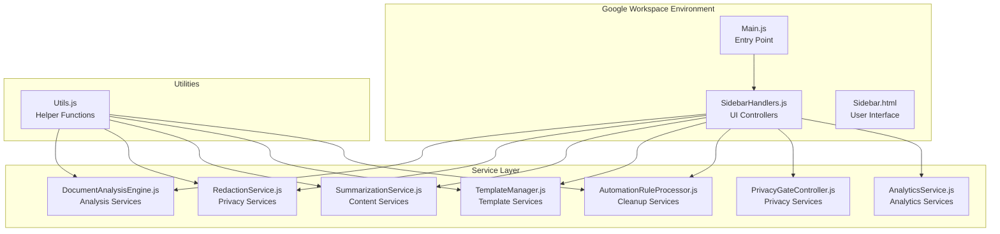
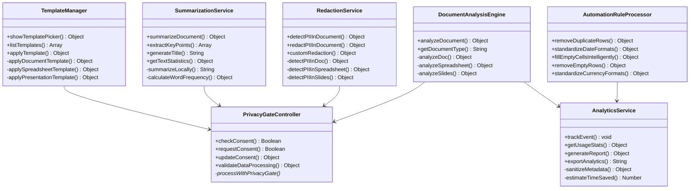
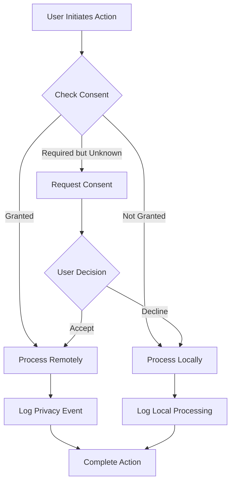
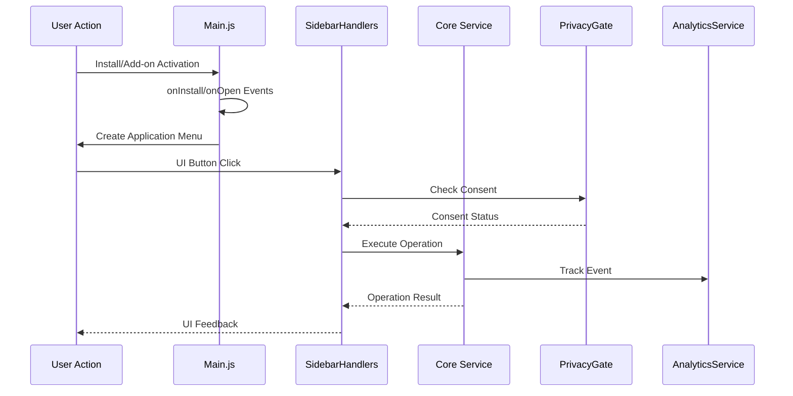

# Project Overview

<cite>
**Referenced Files in This Document**
- [Main.js](file://src/Main.js)
- [appsscript.json](file://src/appsscript.json)
- [SidebarHandlers.js](file://src/handlers/SidebarHandlers.js)
- [Sidebar.html](file://src/ui/Sidebar.html)
- [DocumentAnalysisEngine.js](file://src/services/DocumentAnalysisEngine.js)
- [RedactionService.js](file://src/services/RedactionService.js)
- [SummarizationService.js](file://src/services/SummarizationService.js)
- [TemplateManager.js](file://src/services/TemplateManager.js)
- [PrivacyGateController.js](file://src/services/PrivacyGateController.js)
- [AnalyticsService.js](file://src/services/AnalyticsService.js)
- [AutomationRuleProcessor.js](file://src/services/AutomationRuleProcessor.js)
- [Utils.js](file://src/utils/Utils.js)
- [README.md](file://README.md)
</cite>

## Table of Contents
1. [Introduction](#introduction)
2. [Project Architecture](#project-architecture)
3. [Core Components](#core-components)
4. [Service Layer Architecture](#service-layer-architecture)
5. [Privacy-First Design Principles](#privacy-first-design-principles)
6. [User Interface Components](#user-interface-components)
7. [Event-Driven Programming Model](#event-driven-programming-model)
8. [Common User Workflows](#common-user-workflows)
9. [Technical Implementation Details](#technical-implementation-details)
10. [Deployment and Configuration](#deployment-and-configuration)

## Introduction

The Intelligent Document Automation Google Workspace Add-on is a sophisticated service-oriented application designed to automate repetitive document tasks across Google Docs, Sheets, and Slides. Built on Google Apps Script, this add-on provides intelligent analysis, PII redaction, cleanup automation, template application, and summarization capabilities while maintaining strict privacy-first processing principles.

The add-on operates as a local-first solution by default, processing all data within Google's secure environment without transmitting sensitive information to external servers. Advanced features requiring external processing are gated behind explicit user consent, ensuring complete transparency and control over data processing.

## Project Architecture

The add-on follows a modular service-oriented architecture with clear separation of concerns between UI handlers, core services, and utility functions.

**Diagram sources**
- [Main.js](file://src/Main.js#L1-L50)
- [SidebarHandlers.js](file://src/handlers/SidebarHandlers.js#L1-L30)
- [DocumentAnalysisEngine.js](file://src/services/DocumentAnalysisEngine.js#L1-L50)

**Section sources**
- [Main.js](file://src/Main.js#L1-L100)
- [appsscript.json](file://src/appsscript.json#L1-L47)

## Core Components

### Main Entry Point

The [`Main.js`](file://src/Main.js) file serves as the primary entry point for the add-on, handling installation triggers, menu creation, and UI initialization. It implements a sophisticated menu system that adapts to the current Google Workspace application (Docs, Sheets, or Slides).

Key responsibilities include:
- **Installation Management**: Handles initial setup and permissions
- **Dynamic Menu Creation**: Creates application-specific menus based on document type
- **UI Coordination**: Manages sidebar display and modal dialogs
- **Event Routing**: Routes user actions to appropriate service handlers

### Sidebar Handlers

The [`SidebarHandlers.js`](file://src/handlers/SidebarHandlers.js) module acts as the intermediary between the user interface and core services, providing a clean API layer for UI interactions.

Features:
- **Service Orchestration**: Coordinates calls between UI and service layers
- **Error Handling**: Centralized error management and user feedback
- **Analytics Integration**: Tracks user interactions and feature usage
- **Privacy Enforcement**: Validates consent before processing sensitive operations

**Section sources**
- [Main.js](file://src/Main.js#L1-L200)
- [SidebarHandlers.js](file://src/handlers/SidebarHandlers.js#L1-L172)

## Service Layer Architecture

The service layer implements a comprehensive suite of specialized services, each focusing on specific automation domains.

**Diagram sources**
- [DocumentAnalysisEngine.js](file://src/services/DocumentAnalysisEngine.js#L6-L100)
- [RedactionService.js](file://src/services/RedactionService.js#L6-L100)
- [SummarizationService.js](file://src/services/SummarizationService.js#L6-L100)
- [TemplateManager.js](file://src/services/TemplateManager.js#L6-L100)
- [AutomationRuleProcessor.js](file://src/services/AutomationRuleProcessor.js#L6-L100)
- [PrivacyGateController.js](file://src/services/PrivacyGateController.js#L6-L100)
- [AnalyticsService.js](file://src/services/AnalyticsService.js#L6-L100)

### Document Analysis Engine

The [`DocumentAnalysisEngine.js`](file://src/services/DocumentAnalysisEngine.js) provides comprehensive analysis capabilities across all Google Workspace applications:

**Document Analysis Features:**
- **Formatting Detection**: Identifies multiple spaces, punctuation issues, capitalization errors
- **Content Quality Assessment**: Detects spelling mistakes, sentence structure problems
- **Structural Analysis**: Reviews heading consistency, list formatting, paragraph length
- **Application-Specific Analysis**: Tailored checks for Docs, Sheets, and Slides

**Technical Implementation:**
- Uses regular expressions for pattern matching
- Implements scoring algorithms for quality assessment
- Provides actionable suggestions with specific remediation steps
- Supports both full document and selection-based analysis

### Redaction Service

The [`RedactionService.js`](file://src/services/RedactionService.js) implements comprehensive PII detection and redaction capabilities:

**PII Detection Patterns:**
- Email addresses and phone numbers
- Social Security Numbers and credit card numbers
- IP addresses and ZIP codes
- Custom pattern support for organization-specific identifiers

**Privacy Features:**
- Real-time detection with preview masking
- Configurable redaction patterns
- Consent-based processing for sensitive operations
- Audit trail for redaction activities

### Summarization Service

The [`SummarizationService.js`](file://src/services/SummarizationService.js) provides intelligent document summarization with multiple processing modes:

**Processing Modes:**
- **Local Processing**: Fast summarization using extractive algorithms
- **AI Enhancement**: Optional advanced summarization with external AI services
- **Truncated Processing**: Automatic truncation for large documents

**Content Analysis Capabilities:**
- Keyword frequency analysis
- Sentence scoring and ranking
- Statistical metrics (word count, reading time)
- Key point extraction

**Section sources**
- [DocumentAnalysisEngine.js](file://src/services/DocumentAnalysisEngine.js#L1-L739)
- [RedactionService.js](file://src/services/RedactionService.js#L1-L402)
- [SummarizationService.js](file://src/services/SummarizationService.js#L1-L356)

## Privacy-First Design Principles

The add-on implements a comprehensive privacy framework through the [`PrivacyGateController.js`](file://src/services/PrivacyGateController.js):

### Consent Management Framework

**Diagram sources**
- [PrivacyGateController.js](file://src/services/PrivacyGateController.js#L222-L236)

### Privacy Features

**Data Processing Controls:**
- **Local-First Processing**: All operations default to local execution
- **Explicit Consent**: Advanced features require user approval
- **Minimal Data Collection**: No document content stored or transmitted
- **Audit Logging**: Comprehensive tracking of privacy decisions

**Consent Types:**
- **Basic Features**: Always enabled (document analysis, formatting)
- **Advanced AI**: Requires explicit consent for external processing
- **Redaction**: Consent required for sensitive data processing
- **Analytics**: Optional usage tracking with user control
- **Template Sharing**: Permission for accessing shared template libraries

**Section sources**
- [PrivacyGateController.js](file://src/services/PrivacyGateController.js#L1-L366)

## User Interface Components

### Sidebar Interface

The [`Sidebar.html`](file://src/ui/Sidebar.html) provides an intuitive interface organized into functional tabs:

**Interface Design Principles:**
- **Responsive Layout**: Adapts to different screen sizes
- **Progress Indicators**: Loading states and operation feedback
- **Action Cards**: Clear visual representation of available operations
- **Real-time Feedback**: Immediate results display with actionable insights

**Tab Organization:**
- **Analyze**: Document quality assessment and formatting analysis
- **Redact**: PII detection and sensitive data protection
- **Clean**: Data cleanup and formatting automation
- **Templates**: Template library browsing and application

### UI Interaction Model

The interface implements a seamless Google Workspace integration:

**Event Handling:**
- **Google Script Integration**: Bidirectional communication between UI and backend
- **Error Recovery**: Graceful handling of failures with user-friendly messages
- **Progress Tracking**: Real-time updates during long-running operations
- **Undo Support**: Version history and rollback capabilities

**Section sources**
- [Sidebar.html](file://src/ui/Sidebar.html#L1-L493)

## Event-Driven Programming Model

The add-on implements a sophisticated event-driven architecture leveraging Google Apps Script's trigger system:

### Trigger Types and Handlers

**Diagram sources**
- [Main.js](file://src/Main.js#L10-L35)
- [SidebarHandlers.js](file://src/handlers/SidebarHandlers.js#L10-L20)

### PropertiesService Usage

The add-on extensively uses Google Apps Script's PropertiesService for persistent storage:

**Storage Categories:**
- **User Properties**: Individual user settings and consent preferences
- **Script Properties**: Shared configuration and session management
- **Document Properties**: Temporary data for current document operations

**Implementation Patterns:**
- **Consent Persistence**: User privacy preferences across sessions
- **Version Control**: Document version history for undo functionality
- **Analytics Storage**: Usage statistics and event tracking
- **Configuration Management**: Add-on settings and feature flags

**Section sources**
- [Main.js](file://src/Main.js#L590-L624)
- [PrivacyGateController.js](file://src/services/PrivacyGateController.js#L22-L42)

## Common User Workflows

### Document Analysis Workflow

**Step-by-Step Process:**
1. **Open Document**: Launch add-on from Google Workspace menu
2. **Analyze Content**: Click "Analyze Document" in the Analyze tab
3. **Review Results**: Examine detected issues and suggestions
4. **Apply Fixes**: Click individual suggestions to apply automated corrections
5. **Export Summary**: Generate comprehensive document analysis report

**Technical Implementation:**
- **Multi-stage Analysis**: Progressive scanning with increasing complexity
- **Incremental Results**: Real-time issue detection and reporting
- **Selective Application**: Granular control over which fixes to apply
- **Quality Assurance**: Post-fix validation and verification

### PII Redaction Workflow

**Privacy Protection Process:**
1. **Detection Phase**: Automated scanning for sensitive information
2. **Preview Review**: Interactive review of detected PII with masked previews
3. **Redaction Execution**: One-click removal of sensitive data
4. **Verification**: Confirmation of successful redaction
5. **Documentation**: Audit trail of redaction activities

**Security Features:**
- **Real-time Preview**: Non-destructive PII detection with masking
- **Configurable Patterns**: Customizable detection rules for organizational needs
- **Consent Management**: Explicit approval required for sensitive operations
- **Recovery Options**: Ability to undo redaction operations

### Template Application Workflow

**Template Management Process:**
1. **Library Access**: Browse built-in and custom template collections
2. **Category Filtering**: Organized template discovery by document type and purpose
3. **Preview Functionality**: Live preview before application
4. **Application Execution**: One-click template deployment
5. **Post-Application Editing**: Manual adjustments to template content

**Template Types Supported:**
- **Educational**: Grading rubrics, academic templates
- **Business**: Professional documents, sales reports
- **Legal**: Contract templates, agreement formats
- **Presentations**: Clean slide designs, presentation frameworks

**Section sources**
- [SidebarHandlers.js](file://src/handlers/SidebarHandlers.js#L10-L40)
- [TemplateManager.js](file://src/services/TemplateManager.js#L46-L80)

## Technical Implementation Details

### Utility Functions

The [`Utils.js`](file://src/utils/Utils.js) module provides essential helper functions for cross-cutting concerns:

**Core Utilities:**
- **Data Processing**: Safe JSON parsing, text truncation, HTML escaping
- **Performance Optimization**: Debouncing, batching, and retry mechanisms
- **Format Conversions**: Date formatting, column letter/index conversion
- **Validation**: Email validation, empty value checking, deep cloning

**Advanced Features:**
- **Batch Processing**: Efficient handling of large datasets
- **Error Recovery**: Exponential backoff for transient failures
- **Measurement**: Execution time tracking for performance monitoring
- **Security**: Input sanitization and XSS prevention

### Analytics Integration

The [`AnalyticsService.js`](file://src/services/AnalyticsService.js) implements privacy-preserving usage tracking:

**Analytics Features:**
- **Event Tracking**: Comprehensive action logging with metadata
- **Usage Statistics**: Time savings estimation and feature adoption metrics
- **Reporting**: Periodic analytics generation and export capabilities
- **Privacy Compliance**: PII-free data collection with user consent

**Technical Implementation:**
- **Local Storage**: All analytics data stored locally in user properties
- **Metadata Sanitization**: Automatic filtering of potentially identifying information
- **Session Management**: Unique session identification for coherent tracking
- **Rate Limiting**: Controlled event submission to avoid quota violations

**Section sources**
- [Utils.js](file://src/utils/Utils.js#L1-L258)
- [AnalyticsService.js](file://src/services/AnalyticsService.js#L1-L395)

## Deployment and Configuration

### OAuth Scopes and Permissions

The add-on requests minimal OAuth scopes to ensure user trust and security:

**Required Scopes:**
- `documents.currentonly`: Access to current Google Doc
- `spreadsheets.currentonly`: Access to current Google Sheet
- `presentations.currentonly`: Access to current Google Slide
- `drive.file`: Access to files created by the add-on
- `script.container.ui`: Display UI elements within Google Workspace

**Permission Model:**
- **Just-in-Time**: Permissions requested only when specific features are used
- **Granular Control**: Users can revoke individual permissions
- **Transparent Communication**: Clear explanations of why each permission is needed

### Configuration Options

**User-Level Settings:**
- **Auto-Analyze**: Automatic document analysis on opening
- **Default Formats**: Preferred date and currency formats
- **Template Library**: Custom template folder location
- **Privacy Preferences**: Consent management and data handling preferences

**Administrative Configuration:**
- **Domain Policies**: Organization-wide consent requirements
- **Template Management**: Centralized template distribution
- **Analytics Control**: Usage tracking preferences
- **Feature Restrictions**: Capability-based access control

**Section sources**
- [appsscript.json](file://src/appsscript.json#L29-L36)
- [README.md](file://README.md#L45-L110)