# Technical Architecture

<cite>
**Referenced Files in This Document**
- [Main.js](file://src/Main.js)
- [SidebarHandlers.js](file://src/handlers/SidebarHandlers.js)
- [PrivacyGateController.js](file://src/services/PrivacyGateController.js)
- [Sidebar.html](file://src/ui/Sidebar.html)
- [appsscript.json](file://src/appsscript.json)
- [DocumentAnalysisEngine.js](file://src/services/DocumentAnalysisEngine.js)
- [SummarizationService.js](file://src/services/SummarizationService.js)
- [RedactionService.js](file://src/services/RedactionService.js)
- [AutomationRuleProcessor.js](file://src/services/AutomationRuleProcessor.js)
- [TemplateManager.js](file://src/services/TemplateManager.js)
- [AnalyticsService.js](file://src/services/AnalyticsService.js)
- [Utils.js](file://src/utils/Utils.js)
- [LocalAIService.js](file://src/services/LocalAIService.js)
- [OllamaAIService.js](file://src/services/OllamaAIService.js)
- [package.json](file://package.json)
</cite>

## Table of Contents
1. [Introduction](#introduction)
2. [System Overview](#system-overview)
3. [Architecture Patterns](#architecture-patterns)
4. [Component Analysis](#component-analysis)
5. [Event-Driven Programming Model](#event-driven-programming-model)
6. [Data Flow Architecture](#data-flow-architecture)
7. [Privacy and Security Architecture](#privacy-and-security-architecture)
8. [Technology Stack](#technology-stack)
9. [Infrastructure Requirements](#infrastructure-requirements)
10. [Deployment Topology](#deployment-topology)
11. [Scalability Considerations](#scalability-considerations)
12. [Performance Architecture](#performance-architecture)
13. [Conclusion](#conclusion)

## Introduction

The Techno Browser extension is a sophisticated Google Apps Script add-on designed to automate document processing tasks within Google Workspace applications. Built as a service-oriented architecture with clear separation of concerns, it provides intelligent automation capabilities for Google Docs, Sheets, and Slides through a modular, privacy-first design.

The system operates as a Google Workspace add-on that integrates seamlessly with existing Google Workspace applications, offering users powerful document analysis, formatting, redaction, and template management capabilities while maintaining strict privacy controls and compliance with Google's security requirements.

## System Overview

The Techno Browser extension follows a layered architecture pattern with distinct separation between UI, business logic, and data processing components. The system is designed around Google's CardService and HtmlService frameworks, leveraging Google Apps Script's event-driven programming model.

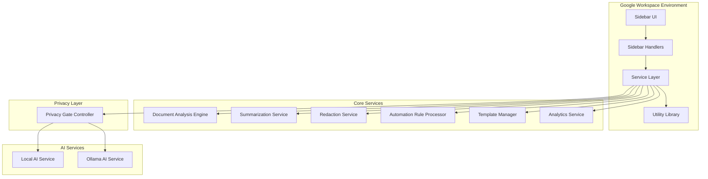

**Diagram sources**
- [Main.js](file://src/Main.js#L1-L50)
- [SidebarHandlers.js](file://src/handlers/SidebarHandlers.js#L1-L30)
- [PrivacyGateController.js](file://src/services/PrivacyGateController.js#L1-L50)

**Section sources**
- [Main.js](file://src/Main.js#L1-L100)
- [appsscript.json](file://src/appsscript.json#L1-L47)

## Architecture Patterns

### Service-Oriented Architecture (SOA)

The system implements a service-oriented architecture where each major functional area is encapsulated within dedicated service classes. This pattern promotes modularity, reusability, and maintainability.

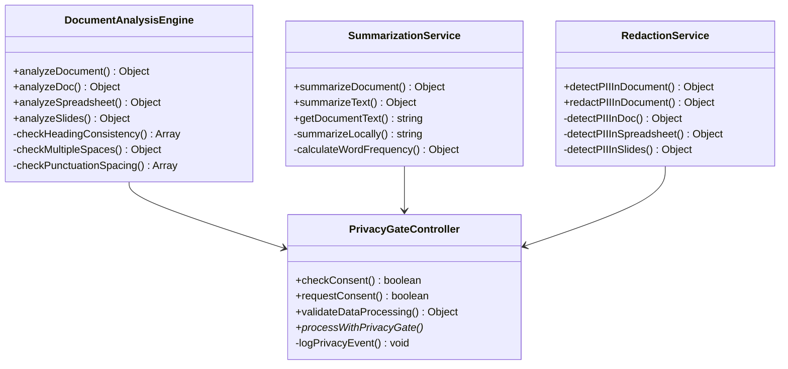

**Diagram sources**
- [DocumentAnalysisEngine.js](file://src/services/DocumentAnalysisEngine.js#L6-L50)
- [SummarizationService.js](file://src/services/SummarizationService.js#L6-L50)
- [RedactionService.js](file://src/services/RedactionService.js#L6-L50)
- [PrivacyGateController.js](file://src/services/PrivacyGateController.js#L6-L100)

### Singleton Pattern Implementation

Services utilize the Immediately Invoked Function Expression (IIFE) pattern to implement singleton behavior, ensuring single instances of each service throughout the application lifecycle.

### Factory Pattern for Service Creation

The system employs factory patterns for creating service instances, particularly evident in the AI service abstraction layer that can switch between local and cloud-based AI providers.

**Section sources**
- [PrivacyGateController.js](file://src/services/PrivacyGateController.js#L6-L366)
- [DocumentAnalysisEngine.js](file://src/services/DocumentAnalysisEngine.js#L6-L200)
- [SummarizationService.js](file://src/services/SummarizationService.js#L6-L200)

## Component Analysis

### Main.js - Application Entry Point

The Main.js file serves as the primary entry point and orchestrates the add-on's initialization and menu creation across different Google Workspace applications.

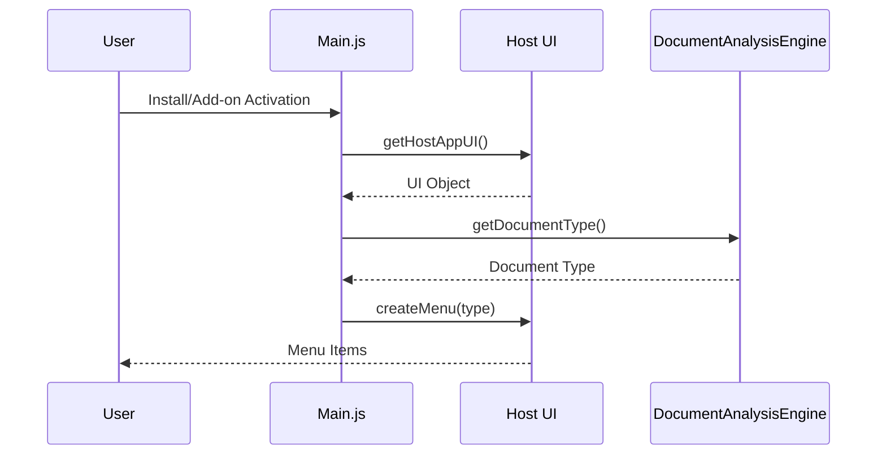

**Diagram sources**
- [Main.js](file://src/Main.js#L10-L60)

Key responsibilities include:
- **Add-on Lifecycle Management**: Handles installation and opening events
- **Application Detection**: Identifies whether the add-on is running in Docs, Sheets, or Slides
- **Menu Generation**: Creates application-specific menus with appropriate functionality
- **Sidebar Management**: Initializes and displays the main sidebar interface

### SidebarHandlers.js - UI Event Bridge

The SidebarHandlers module acts as a bridge between the HTML sidebar UI and the underlying service layer, implementing the presenter pattern to handle user interactions.

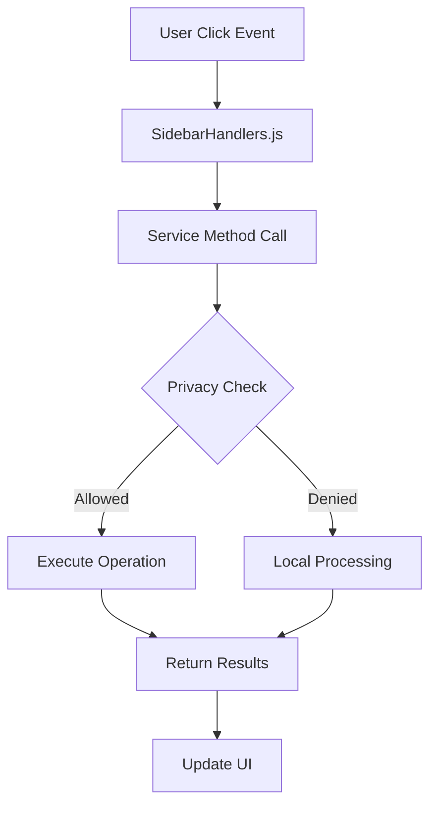

**Diagram sources**
- [SidebarHandlers.js](file://src/handlers/SidebarHandlers.js#L1-L172)

### PrivacyGateController - Mediator for Sensitive Operations

The PrivacyGateController implements a comprehensive privacy and consent management system that mediates all sensitive operations requiring user approval.

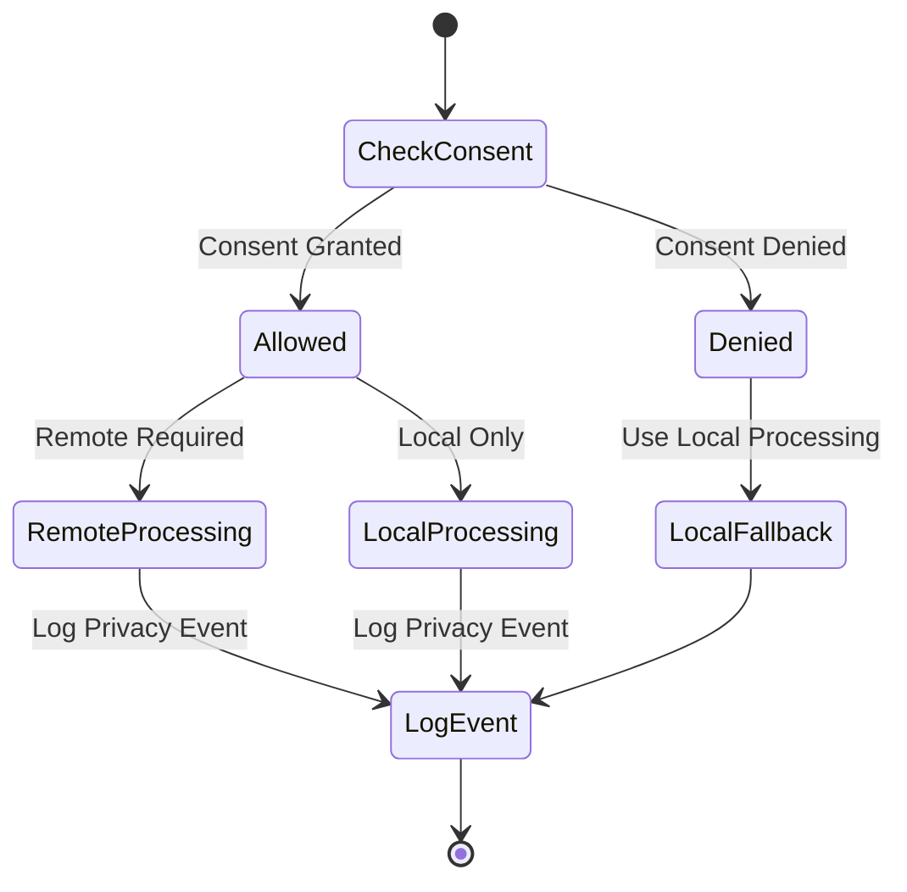

**Diagram sources**
- [PrivacyGateController.js](file://src/services/PrivacyGateController.js#L222-L237)

**Section sources**
- [Main.js](file://src/Main.js#L1-L800)
- [SidebarHandlers.js](file://src/handlers/SidebarHandlers.js#L1-L172)
- [PrivacyGateController.js](file://src/services/PrivacyGateController.js#L1-L366)

## Event-Driven Programming Model

The system operates on Google's event-driven programming model, utilizing Google Apps Script's triggers and CardService framework for responsive user interactions.

### Google Apps Script Triggers

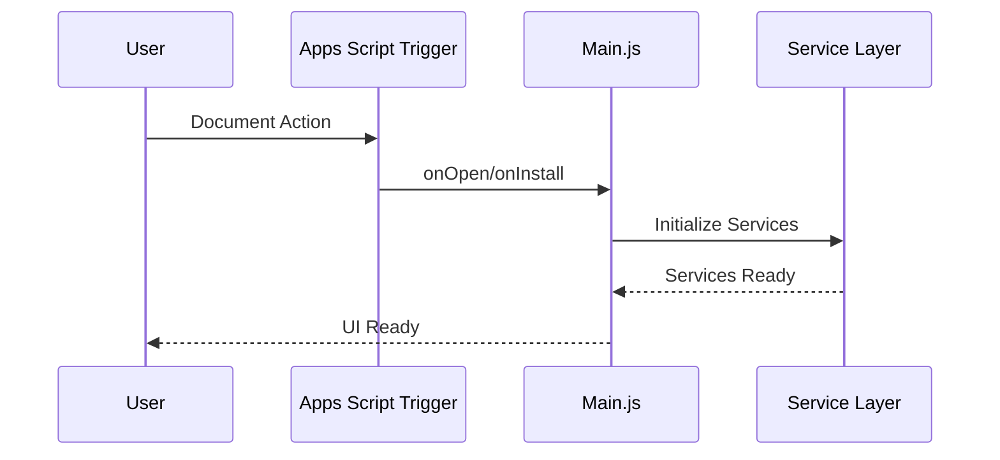

### CardService Integration

The system leverages Google's CardService for building interactive UI cards that integrate seamlessly with Google Workspace applications.

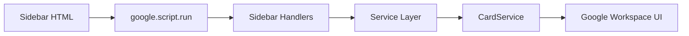

**Diagram sources**
- [Sidebar.html](file://src/ui/Sidebar.html#L307-L493)

**Section sources**
- [Sidebar.html](file://src/ui/Sidebar.html#L1-L493)

## Data Flow Architecture

### Document Processing Pipeline

The system implements a sophisticated data flow architecture that handles document processing from user interaction to final output.

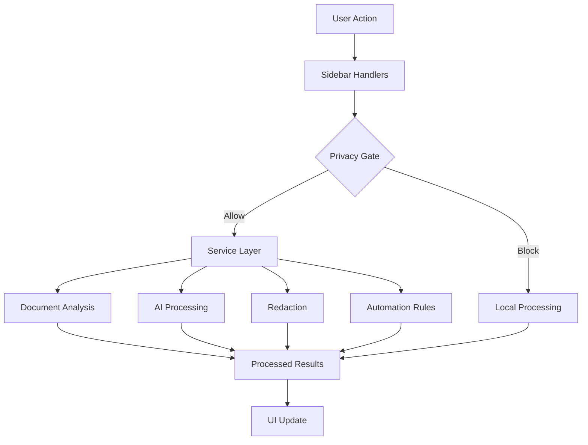

### Data Transformation Stages

1. **Input Collection**: Extract text/content from Google Workspace documents
2. **Validation**: Apply privacy checks and consent validation
3. **Processing**: Transform data using appropriate algorithms or AI services
4. **Output Generation**: Format results for UI presentation
5. **Persistence**: Store results and analytics data

**Section sources**
- [DocumentAnalysisEngine.js](file://src/services/DocumentAnalysisEngine.js#L1-L200)
- [SummarizationService.js](file://src/services/SummarizationService.js#L1-L200)

## Privacy and Security Architecture

### Privacy Gate Controller Implementation

The PrivacyGateController implements a comprehensive privacy framework that ensures user data protection and compliance with privacy regulations.

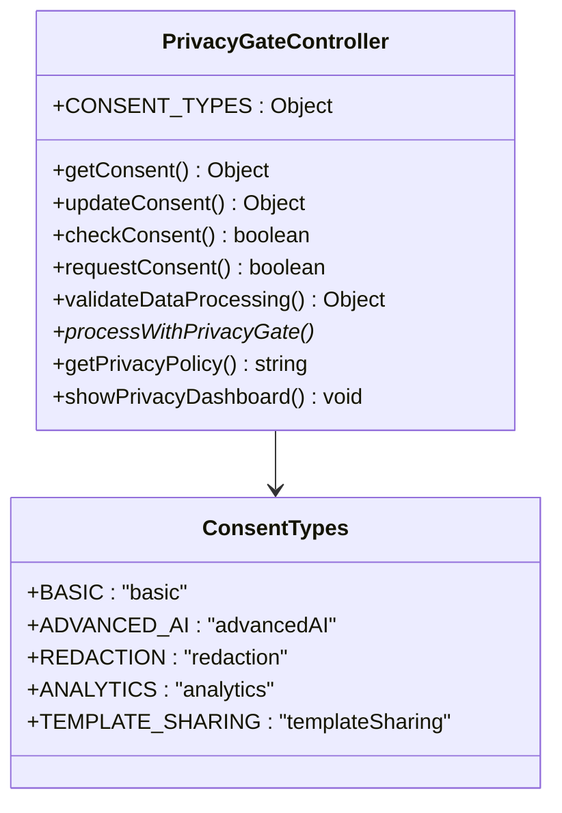

**Diagram sources**
- [PrivacyGateController.js](file://src/services/PrivacyGateController.js#L8-L15)

### Privacy Policy Framework

The system implements a tiered privacy approach:

1. **Basic Features**: Always enabled, process data locally
2. **Advanced AI**: Requires explicit consent, may process data remotely
3. **Analytics**: Optional, user-controlled data collection
4. **Template Sharing**: Requires Drive access permissions

### Data Processing Validation

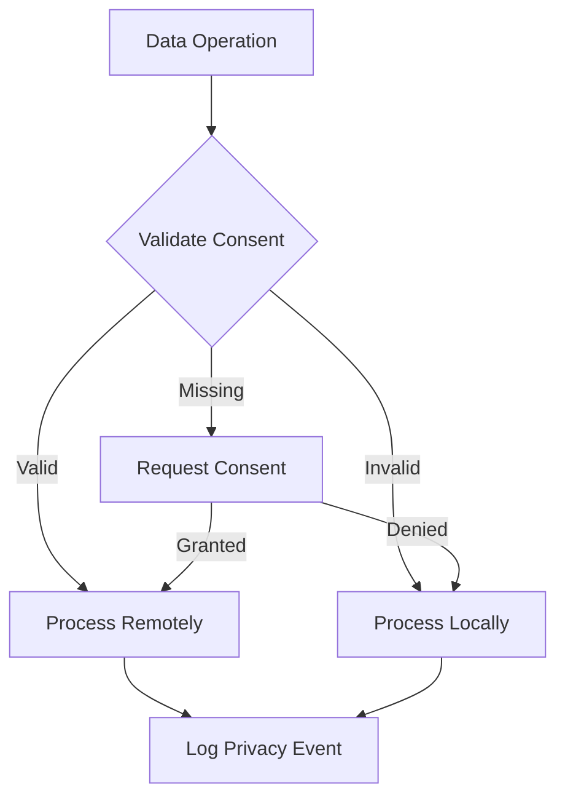

**Diagram sources**
- [PrivacyGateController.js](file://src/services/PrivacyGateController.js#L170-L237)

**Section sources**
- [PrivacyGateController.js](file://src/services/PrivacyGateController.js#L1-L366)

## Technology Stack

### Core Technologies

| Component | Technology | Purpose |
|-----------|------------|---------|
| Runtime Environment | Google Apps Script V8 | JavaScript runtime with Google Workspace integration |
| UI Framework | HtmlService + CardService | Interactive user interface development |
| Build Tooling | clasp (Google Apps Script CLI) | Development, deployment, and version control |
| Package Management | npm | Development dependencies and scripts |
| AI Integration | Google AI Studio / Local AI Server | Natural language processing and document analysis |

### Google Workspace APIs

The system leverages multiple Google Workspace APIs for comprehensive functionality:

- **Docs API**: Document manipulation and analysis
- **Sheets API**: Spreadsheet processing and automation
- **Slides API**: Presentation analysis and formatting
- **Drive API**: Template storage and sharing
- **OAuth Scopes**: Controlled access to user data

### JavaScript Runtime Constraints

The system operates within Google Apps Script's JavaScript runtime constraints:

- **Execution Limits**: Maximum 6-minute execution time per session
- **Memory Limits**: 128MB memory allocation
- **Network Limits**: 30-second HTTP request timeouts
- **File Size Limits**: 10MB for individual files

**Section sources**
- [appsscript.json](file://src/appsscript.json#L1-L47)
- [package.json](file://package.json#L1-L25)

## Infrastructure Requirements

### Development Environment

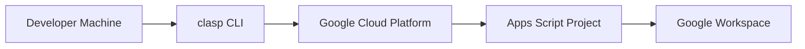

### Production Deployment

The system requires specific infrastructure components for optimal operation:

1. **Google Cloud Platform**: For hosting AI services (optional)
2. **ngrok**: For local AI server tunneling (development)
3. **Google AI Studio**: For cloud-based AI processing
4. **Google Workspace**: For document access and integration

### Network Requirements

- **Outbound HTTPS**: Required for AI service communication
- **Firewall Configuration**: Allow outbound connections to AI endpoints
- **Proxy Support**: Configurable proxy settings for enterprise environments

**Section sources**
- [LocalAIService.js](file://src/services/LocalAIService.js#L1-L200)
- [OllamaAIService.js](file://src/services/OllamaAIService.js#L1-L189)

## Deployment Topology

### Single-Tenant Deployment

The Techno Browser extension follows a single-tenant deployment model within Google Workspace:

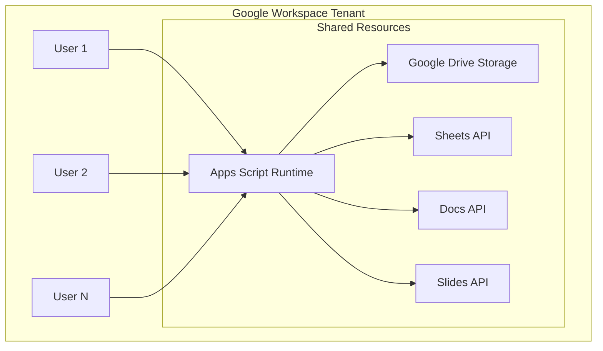

### Multi-Environment Support

The system supports multiple deployment environments:

1. **Development**: Local development with ngrok tunneling
2. **Testing**: Staging environment for feature validation
3. **Production**: Live deployment in Google Workspace marketplace

**Section sources**
- [appsscript.json](file://src/appsscript.json#L1-L47)

## Scalability Considerations

### Horizontal Scaling Limitations

Google Apps Script imposes inherent limitations on horizontal scaling:

- **Single Instance**: Each user runs their own isolated instance
- **No Load Balancing**: Automatic distribution across Google's infrastructure
- **Resource Contention**: Shared resources within user quotas

### Vertical Scaling Opportunities

The system optimizes vertical scaling through:

- **Efficient Algorithms**: Optimized document processing routines
- **Caching Strategies**: Local caching of frequently accessed data
- **Lazy Loading**: On-demand service initialization
- **Batch Processing**: Efficient handling of large documents

### Performance Optimization Strategies

1. **Document Size Management**: Processing limits and truncation strategies
2. **AI Service Selection**: Dynamic choice between local and cloud AI
3. **Concurrent Processing**: Non-blocking UI updates during processing
4. **Memory Management**: Efficient data structures and garbage collection

**Section sources**
- [SummarizationService.js](file://src/services/SummarizationService.js#L40-L70)
- [DocumentAnalysisEngine.js](file://src/services/DocumentAnalysisEngine.js#L1-L100)

## Performance Architecture

### Asynchronous Processing Model

The system implements asynchronous processing patterns to maintain responsive UI interactions:

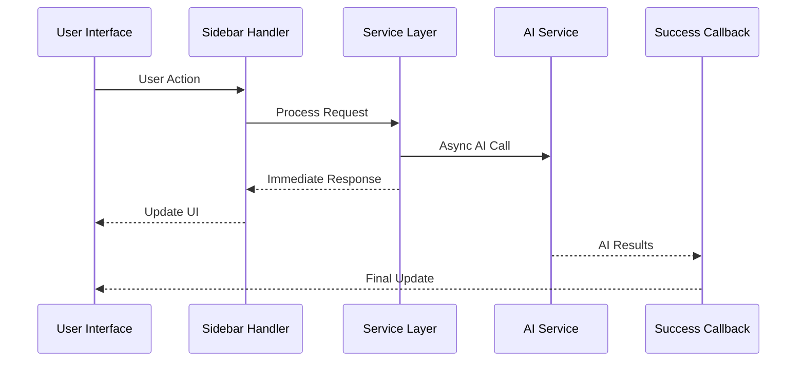

### Caching and Memoization

Services implement caching strategies to optimize performance:

- **Consent Caching**: Cached privacy consent decisions
- **AI Connection Testing**: Cached connection status
- **Template Metadata**: Cached template information
- **Analytics Aggregation**: Batched analytics updates

### Resource Management

The system implements careful resource management:

- **Memory Monitoring**: Tracking memory usage for large documents
- **Execution Timeouts**: Graceful handling of long-running operations
- **Retry Mechanisms**: Robust error handling with exponential backoff
- **Graceful Degradation**: Fallback to local processing when AI unavailable

**Section sources**
- [Utils.js](file://src/utils/Utils.js#L1-L200)
- [AnalyticsService.js](file://src/services/AnalyticsService.js#L1-L200)

## Conclusion

The Techno Browser extension demonstrates a sophisticated approach to building Google Workspace add-ons with modern architectural patterns. Its service-oriented design, comprehensive privacy framework, and event-driven programming model create a robust foundation for intelligent document automation.

Key architectural strengths include:

- **Clear Separation of Concerns**: Well-defined boundaries between UI, business logic, and data processing
- **Privacy-First Design**: Comprehensive consent management and data protection measures
- **Modular Service Architecture**: Extensible and maintainable service layer
- **Event-Driven Interactions**: Responsive user experience with asynchronous processing
- **Multi-Provider AI Support**: Flexible AI service integration options

The system successfully balances functionality, performance, and privacy requirements while operating within the constraints of Google Apps Script's runtime environment. Its modular architecture provides a solid foundation for future enhancements and feature additions.