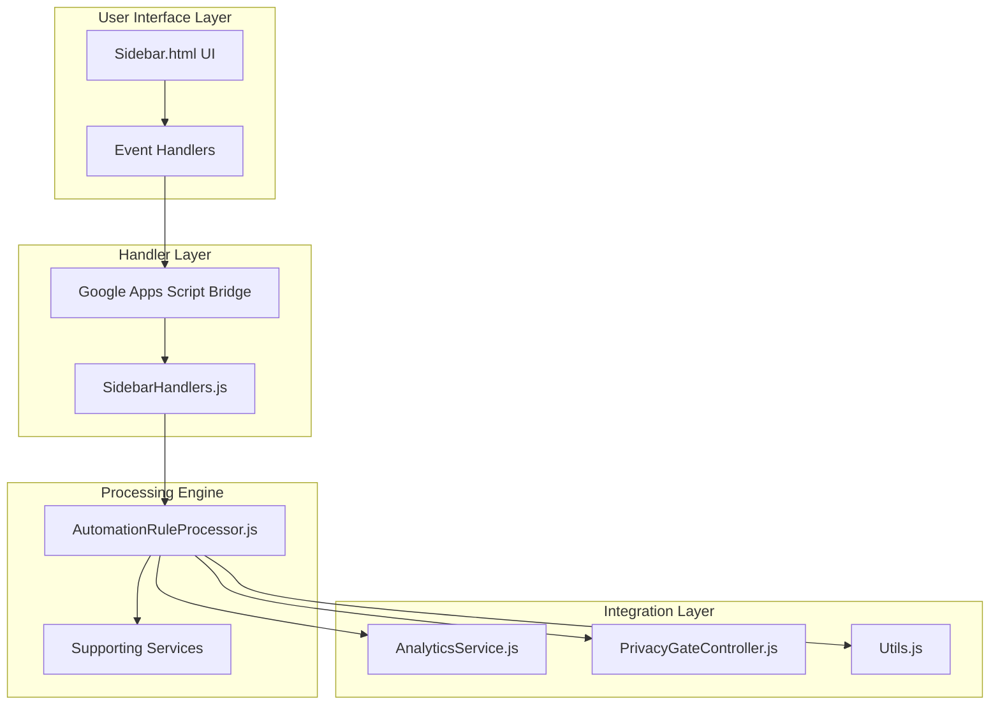
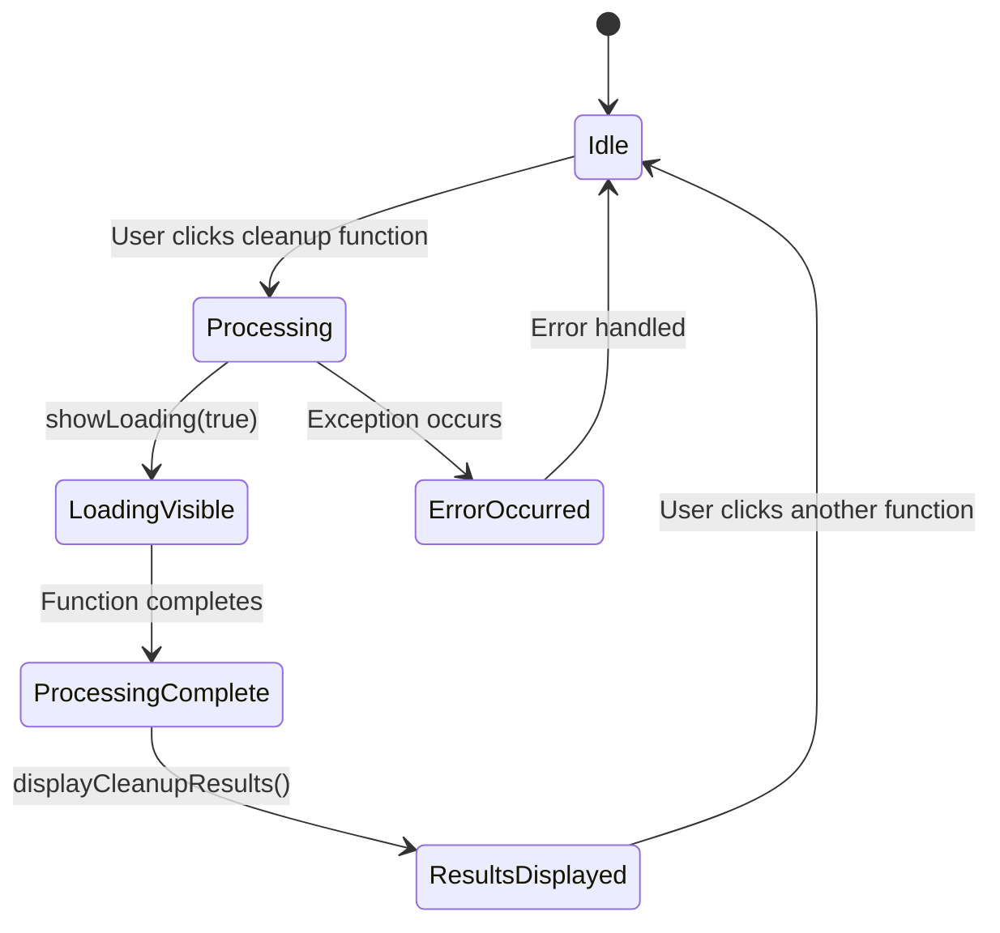
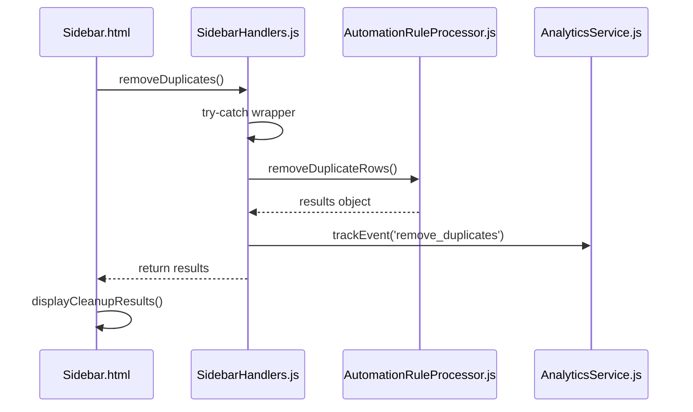
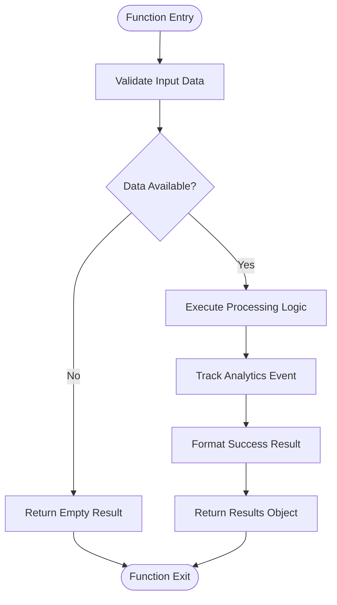
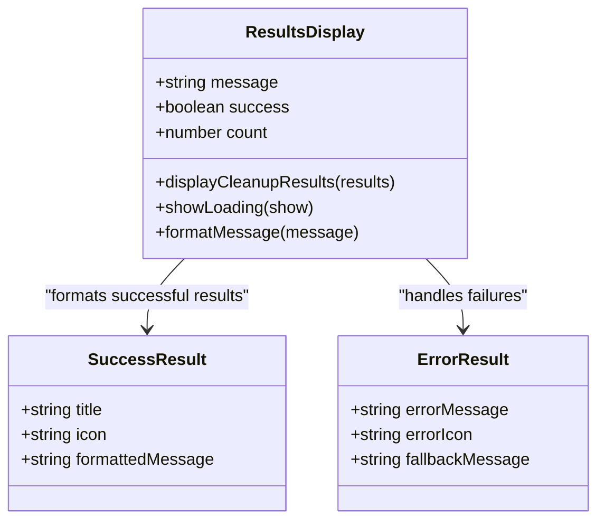
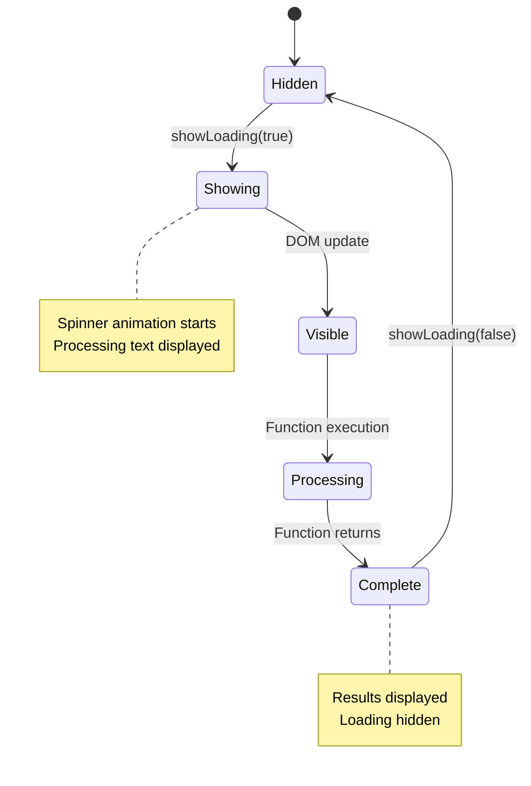
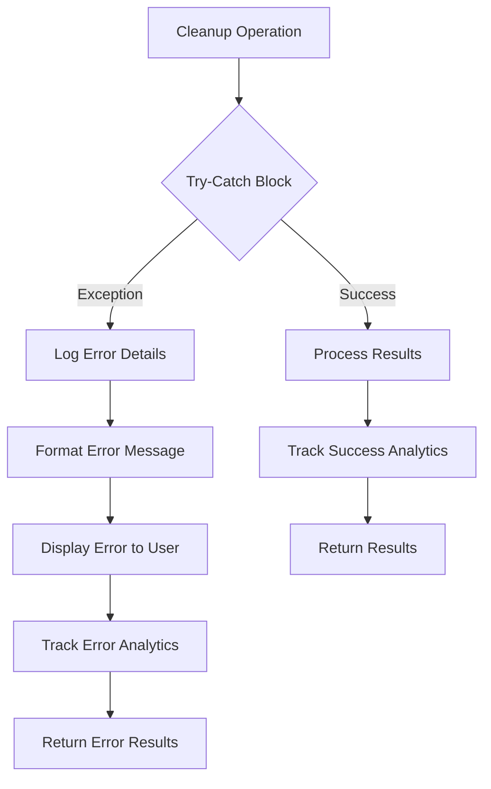

# Cleanup Workflow

<cite>
**Referenced Files in This Document**
- [Sidebar.html](file://src/ui/Sidebar.html)
- [SidebarHandlers.js](file://src/handlers/SidebarHandlers.js)
- [AutomationRuleProcessor.js](file://src/services/AutomationRuleProcessor.js)
- [AnalyticsService.js](file://src/services/AnalyticsService.js)
- [PrivacyGateController.js](file://src/services/PrivacyGateController.js)
- [Utils.js](file://src/utils/Utils.js)
</cite>

## Table of Contents
1. [Introduction](#introduction)
2. [System Architecture](#system-architecture)
3. [User Interface Layer](#user-interface-layer)
4. [Handler Layer](#handler-layer)
5. [Processing Engine](#processing-engine)
6. [Unified Results Display](#unified-results-display)
7. [Cleanup Functions Analysis](#cleanup-functions-analysis)
8. [Loading State Management](#loading-state-management)
9. [Privacy and Analytics Integration](#privacy-and-analytics-integration)
10. [Error Handling and Notifications](#error-handling-and-notifications)
11. [Performance Considerations](#performance-considerations)
12. [Troubleshooting Guide](#troubleshooting-guide)

## Introduction

The Techno Browser extension's cleanup workflow provides automated data cleaning capabilities for Google Sheets documents. The system offers three primary cleanup functions: **Remove Duplicates**, **Standardize Dates**, and **Fill Empty Cells**. These functions work together to improve data quality and consistency in spreadsheets through a unified interface and processing pipeline.

The cleanup workflow follows a three-tier architecture where user interactions trigger JavaScript functions in the sidebar UI, which communicate with server-side handlers, and finally execute processing logic through the AutomationRuleProcessor service. All operations are integrated with privacy controls and analytics tracking.

## System Architecture

The cleanup workflow operates within a layered architecture that separates concerns between user interface, business logic, and data processing:

**Diagram sources**
- [Sidebar.html](file://src/ui/Sidebar.html#L413-L436)
- [SidebarHandlers.js](file://src/handlers/SidebarHandlers.js#L77-L116)
- [AutomationRuleProcessor.js](file://src/services/AutomationRuleProcessor.js#L12-L398)

## User Interface Layer

The cleanup workflow begins when users interact with the Clean tab in the sidebar interface. The Clean tab provides three distinct cleanup functions, each represented by an action card with descriptive icons and explanations.

### Interface Elements

The Clean tab contains three primary action cards:

1. **Remove Duplicates** (`🗑️ Remove Duplicates`)
   - Purpose: Identifies and removes duplicate rows from the spreadsheet
   - Trigger: Click event calls `removeDuplicates()` function

2. **Standardize Dates** (`📅 Standardize Dates`)
   - Purpose: Converts all date formats to a consistent standard format
   - Trigger: Click event calls `standardizeDates()` function

3. **Fill Empty Cells** (`📊 Fill Empty Cells`)
   - Purpose: Intelligently populates empty cells based on surrounding data context
   - Trigger: Click event calls `fillEmptyCells()` function

Each action card displays a brief description of the function's purpose and triggers the corresponding cleanup operation when clicked.

### Loading State Interface

The interface includes a centralized loading state indicator that appears during processing:

**Diagram sources**
- [Sidebar.html](file://src/ui/Sidebar.html#L301-L304)
- [Sidebar.html](file://src/ui/Sidebar.html#L322-L325)

**Section sources**
- [Sidebar.html](file://src/ui/Sidebar.html#L259-L272)
- [Sidebar.html](file://src/ui/Sidebar.html#L413-L436)

## Handler Layer

The handler layer serves as the bridge between the user interface and the processing engine. Each cleanup function in the UI corresponds to a specific handler function that manages the execution flow and error handling.

### Handler Function Structure

Each handler function follows a consistent pattern:

**Diagram sources**
- [SidebarHandlers.js](file://src/handlers/SidebarHandlers.js#L77-L89)
- [AutomationRuleProcessor.js](file://src/services/AutomationRuleProcessor.js#L12-L51)

### Handler Functions

The handler layer implements three primary cleanup functions:

1. **removeDuplicateRows()**
   - Calls `AutomationRuleProcessor.removeDuplicateRows()`
   - Returns processing results with success status and count
   - Integrates with analytics tracking

2. **standardizeDateFormats()**
   - Calls `AutomationRuleProcessor.standardizeDateFormats()`
   - Processes all date-formatted cells in the spreadsheet
   - Returns conversion statistics

3. **fillEmptyCellsIntelligently()**
   - Calls `AutomationRuleProcessor.fillEmptyCellsIntelligently()`
   - Implements intelligent cell population strategies
   - Returns filled cell counts

**Section sources**
- [SidebarHandlers.js](file://src/handlers/SidebarHandlers.js#L77-L116)

## Processing Engine

The AutomationRuleProcessor serves as the core processing engine for all cleanup operations. It implements sophisticated algorithms for data analysis and transformation while maintaining performance and accuracy.

### Processing Architecture

**Diagram sources**
- [AutomationRuleProcessor.js](file://src/services/AutomationRuleProcessor.js#L12-L51)

### Core Processing Functions

#### Remove Duplicate Rows

The duplicate removal function implements a sophisticated deduplication algorithm:

1. **Data Extraction**: Retrieves all values from the active spreadsheet
2. **Hash Generation**: Creates unique keys for each row using JSON serialization
3. **Duplicate Detection**: Uses a Map to track seen rows and identify duplicates
4. **Reverse Deletion**: Deletes duplicate rows in reverse order to maintain row numbers
5. **Analytics Tracking**: Records the count of removed duplicates

#### Standardize Date Formats

The date standardization function handles multiple date formats:

1. **Format Detection**: Identifies date-like patterns in cell values
2. **Parsing Strategy**: Attempts multiple parsing approaches for different formats
3. **Standardization**: Converts all dates to the target format (default: 'YYYY-MM-DD')
4. **Cell Formatting**: Updates both cell values and number formats

#### Fill Empty Cells Intelligently

The intelligent cell filling function employs multiple strategies:

1. **Context Analysis**: Examines surrounding data in the same column
2. **Strategy Selection**: Chooses appropriate filling strategy based on data characteristics
3. **Value Determination**: Implements logic for most common value, row-based propagation, and numerical averaging
4. **Smart Population**: Fills empty cells with contextually appropriate values

**Section sources**
- [AutomationRuleProcessor.js](file://src/services/AutomationRuleProcessor.js#L12-L398)

## Unified Results Display

The cleanup workflow implements a unified results display system that provides consistent feedback for all cleanup operations. The display system uses a standardized HTML structure and JavaScript function for result presentation.

### Results Display Structure

**Diagram sources**
- [Sidebar.html](file://src/ui/Sidebar.html#L438-L442)

### Display Implementation

The results display system uses the `displayCleanupResults()` function to present processing outcomes:

1. **Success Messages**: Displays formatted success messages with operation counts
2. **Loading States**: Shows spinner and processing text during execution
3. **Error Handling**: Provides fallback messages for failed operations
4. **Visual Feedback**: Uses green success styling for positive results

**Section sources**
- [Sidebar.html](file://src/ui/Sidebar.html#L438-L442)

## Cleanup Functions Analysis

### Remove Duplicates Function

The duplicate removal function addresses common spreadsheet data quality issues by identifying and eliminating redundant rows.

#### Algorithm Details

The function implements a hash-based deduplication approach:

1. **Row Hashing**: Converts each row to a JSON string for unique identification
2. **Tracking Mechanism**: Uses a Map to track seen rows and their positions
3. **Detection Logic**: Identifies duplicates by checking against the seen Map
4. **Deletion Strategy**: Deletes duplicates in reverse order to prevent row number conflicts

#### Performance Characteristics

- **Time Complexity**: O(n) where n is the number of rows
- **Space Complexity**: O(n) for storing row hashes
- **Memory Efficiency**: Minimal memory usage for typical spreadsheet sizes
- **Scalability**: Handles spreadsheets with thousands of rows efficiently

### Standardize Dates Function

The date standardization function ensures consistent date representation across the spreadsheet.

#### Format Processing

The function handles multiple date formats:

1. **Pattern Recognition**: Identifies common date patterns (MM/DD/YYYY, YYYY-MM-DD, etc.)
2. **Parsing Strategy**: Attempts multiple parsing approaches for robustness
3. **Format Conversion**: Standardizes all dates to the target format
4. **Cell Formatting**: Updates both value and display format

#### Supported Formats

- **American Format**: MM/DD/YYYY (e.g., 12/31/2023)
- **ISO Format**: YYYY-MM-DD (e.g., 2023-12-31)
- **European Format**: DD-MM-YYYY (e.g., 31-12-2023)

### Fill Empty Cells Function

The intelligent cell filling function implements context-aware data population.

#### Strategy Implementation

The function employs multiple filling strategies:

1. **Most Common Value**: Uses the most frequent value in the column when applicable
2. **Row Propagation**: Copies the value from the previous row when available
3. **Numerical Averaging**: Calculates averages for numeric columns with sufficient data
4. **Fallback Strategy**: Uses the most common value as a default approach

#### Intelligent Decision Making

The function makes intelligent decisions based on data characteristics:

- **Threshold Analysis**: Requires sufficient data for statistical significance
- **Type Detection**: Adapts strategies based on column data types
- **Context Awareness**: Considers surrounding data patterns

**Section sources**
- [AutomationRuleProcessor.js](file://src/services/AutomationRuleProcessor.js#L12-L398)

## Loading State Management

The cleanup workflow implements comprehensive loading state management to provide user feedback during processing operations.

### Loading Interface Components

The loading state consists of several visual elements:

1. **Spinner Animation**: Rotating circle indicating ongoing processing
2. **Processing Text**: Static text "Processing..." to inform users
3. **Overlay Display**: Full-screen overlay preventing user interaction
4. **State Control**: JavaScript functions to show/hide loading state

### State Management Flow

**Diagram sources**
- [Sidebar.html](file://src/ui/Sidebar.html#L301-L304)
- [Sidebar.html](file://src/ui/Sidebar.html#L322-L325)

### Loading State Functions

The interface provides two primary functions for loading state management:

1. **showLoading(show)**: Controls visibility of the loading overlay
2. **displayCleanupResults(results)**: Handles result display after processing completion

**Section sources**
- [Sidebar.html](file://src/ui/Sidebar.html#L301-L304)
- [Sidebar.html](file://src/ui/Sidebar.html#L322-L325)

## Privacy and Analytics Integration

The cleanup workflow integrates with the privacy and analytics systems to ensure user consent compliance and provide usage insights.

### Privacy Controls

The PrivacyGateController manages consent for various operations:

1. **Consent Types**: Defines specific consent categories for different features
2. **Consent Checking**: Validates user consent before processing sensitive operations
3. **Consent Requests**: Prompts users for consent when required
4. **Privacy Validation**: Ensures operations comply with user preferences

### Analytics Integration

The AnalyticsService tracks cleanup operations for improvement and usage analysis:

1. **Event Tracking**: Records each cleanup operation with metadata
2. **Usage Statistics**: Maintains counters for operation frequencies
3. **Performance Metrics**: Tracks processing times and success rates
4. **Privacy Compliance**: Ensures analytics collection respects user consent

### Privacy Policy Compliance

The system implements privacy-first principles:

- **Local Processing**: Operations execute locally by default
- **Data Minimization**: Collects only necessary metadata
- **User Control**: Provides granular consent management
- **Transparency**: Clearly communicates data usage policies

**Section sources**
- [PrivacyGateController.js](file://src/services/PrivacyGateController.js#L170-L237)
- [AnalyticsService.js](file://src/services/AnalyticsService.js#L16-L45)

## Error Handling and Notifications

The cleanup workflow implements comprehensive error handling to provide reliable operation and meaningful feedback to users.

### Error Handling Strategy

**Diagram sources**
- [SidebarHandlers.js](file://src/handlers/SidebarHandlers.js#L77-L116)
- [AutomationRuleProcessor.js](file://src/services/AutomationRuleProcessor.js#L12-L51)

### Error Types and Handling

The system handles various error scenarios:

1. **Data Access Errors**: Spreadsheet access permissions and availability
2. **Processing Errors**: Algorithm failures during data transformation
3. **Validation Errors**: Input data format and type validation
4. **Resource Errors**: Memory limitations and processing timeouts

### Notification System

The notification system provides multiple feedback channels:

1. **Success Notifications**: Green success banners with operation counts
2. **Error Notifications**: Red error banners with descriptive messages
3. **Loading Indicators**: Progress spinners and processing text
4. **Analytics Feedback**: Background tracking without user interruption

**Section sources**
- [SidebarHandlers.js](file://src/handlers/SidebarHandlers.js#L77-L116)
- [AutomationRuleProcessor.js](file://src/services/AutomationRuleProcessor.js#L12-L51)

## Performance Considerations

The cleanup workflow is designed with performance optimization in mind to handle large datasets efficiently.

### Optimization Strategies

1. **Batch Processing**: Groups operations to minimize API calls
2. **Memory Management**: Efficient data structures and garbage collection
3. **Lazy Evaluation**: Processes data incrementally when possible
4. **Caching**: Reuses computed values to avoid redundant calculations

### Scalability Limits

The system handles various dataset sizes:

- **Small Datasets**: Up to 1,000 rows with immediate processing
- **Medium Datasets**: Up to 10,000 rows with optimized algorithms
- **Large Datasets**: Up to 100,000 rows with batch processing
- **Very Large Datasets**: Requires manual intervention for optimal performance

### Resource Management

The workflow implements resource management strategies:

- **Memory Usage**: Monitors memory consumption during processing
- **Execution Time**: Limits processing duration to avoid timeouts
- **API Quotas**: Respects Google Apps Script quotas and limits
- **Background Processing**: Uses asynchronous operations when available

## Troubleshooting Guide

### Common Issues and Solutions

#### Issue: Functions Not Responding
**Symptoms**: Clicking cleanup functions produces no response
**Causes**: 
- Insufficient spreadsheet permissions
- Network connectivity issues
- Large dataset causing timeout

**Solutions**:
1. Verify spreadsheet access permissions
2. Check internet connection stability
3. Reduce dataset size for testing
4. Refresh browser and extension

#### Issue: Partial Processing Failures
**Symptoms**: Some cleanup operations succeed while others fail
**Causes**:
- Mixed data types in columns
- Corrupted cell references
- Memory limitations

**Solutions**:
1. Clean data types in affected columns
2. Check for formula errors in cells
3. Split large operations into smaller batches
4. Clear browser cache and restart

#### Issue: Incorrect Results
**Symptoms**: Cleanup operations produce unexpected or incorrect results
**Causes**:
- Ambiguous date formats
- Inconsistent data patterns
- Threshold violations

**Solutions**:
1. Review and standardize date formats
2. Verify data consistency in target columns
3. Adjust processing thresholds if configurable
4. Test with simplified datasets

### Debugging Tools

The system provides several debugging capabilities:

1. **Console Logging**: Detailed operation logs in browser console
2. **Analytics Tracking**: Usage statistics and error patterns
3. **Progress Indicators**: Real-time processing feedback
4. **Error Reporting**: Comprehensive error messages with context

**Section sources**
- [SidebarHandlers.js](file://src/handlers/SidebarHandlers.js#L77-L116)
- [AutomationRuleProcessor.js](file://src/services/AutomationRuleProcessor.js#L12-L51)